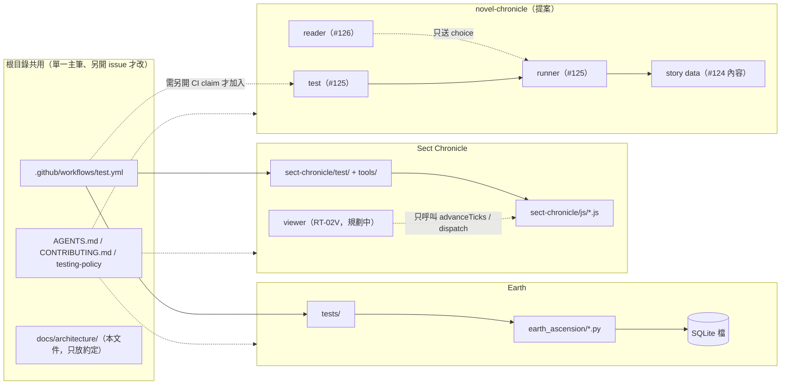

# 產品組合邊界：Earth、Sect Chronicle 與獨立小說

- 狀態：**Stage A 設計提案**（[#128](https://github.com/lalagrass/earth-ascension/issues/128) A1），待 Earth PO 審查跨產品邊界。本文件不改任何規則、schema、RNG、CI 或根目錄契約，也不授權任何 runtime 工作。
- 實際主筆：Claude（Anthropic Claude Code），使用共用 `lalagrass` 帳號；不是任何 PO 的獨立審核。
- 核對基底：dev `0875d116e774cf2b53c6c36d160465b460302b1d`（PR #108 RT-02 squash）。
- 配套文件：[SG 架構現況與最小抽取 ADR](../../sect-chronicle/docs/ARCHITECTURE.md)、[小說技術設計](../../novel-chronicle/docs/TECHNICAL_DESIGN.md)。

標記：**【現況】**＝dev 已有、可在上述 SHA 核對；**【提案】**＝本文件建議，尚未批准；**【已定】**＝引用既有批准，不在此重開。

## 1. 三個產品一覽

| | Earth（月制模擬） | Sect Chronicle（SG，tick 制遊戲） | 獨立互動小說 |
|---|---|---|---|
| 狀態 | 【現況】M1／M2 已交付，M2 P0 未全驗收；M3 僅文件 | 【現況】RT-01、RT-02 已合 dev；RT-02V（#110）排程中 | 【提案】只有 issue #123–127，沒有程式 |
| 程式位置 | `earth_ascension/`（Python stdlib） | `sect-chronicle/js/`（UMD JavaScript，無建置） | 候選 `novel-chronicle/`（目錄尚不存在） |
| 入口 | `python3 -m earth_ascension.server`（`server.py` → `store.py` → `engine.py`／`m2.py`）；靜態頁 `earth_ascension/static/` | Node：`require('sect-chronicle/js/realtime.js')`；瀏覽器：依序 `<script>` 掛 `globalThis.SectChronicle.*`（尚無 HTML 入口）；工具 `sect-chronicle/tools/*.js` | 候選：純 runner 模組＋靜態 reader 頁（#125／#126） |
| 世界／故事狀態 | SQLite 檔（`--db`），每月快照＋事件 | 單一 JSON 世界物件（`createWorld`→`advanceTicks`／`dispatch`） | 故事狀態：目前節點、少量旗標、選擇歷史 |
| 版本身份 | M1 `RULES_VERSION` `0.1.0`；M2 `M2_VERSION` `0.2.2`、`SCHEMA_VERSION` 2、`policy_mode` `m2_rules`（`earth_ascension/m2.py`） | slot：schema4／rule3（歷史）；RT：`schemaVersion` 5、`ruleVersion` 4、`rngVersion` 1、`scenarioId` `life-rt` | 【提案】`format`＋`schemaVersion`＋`storyId`＋`contentVersion`（見小說文件 §5） |
| 存檔命名空間 | 使用者指定的 SQLite 檔路徑 | 【現況】`serializeState`／`parseState` 純函式，無瀏覽器存檔；【已定】SG-07／RT-03 設計用 localStorage key `sect-chronicle-save-v1`（[TECHNICAL_DESIGN](../../sect-chronicle/docs/TECHNICAL_DESIGN.md)） | 【提案】獨立 key，例如 `novel-chronicle-save-v1`，不讀寫其他 key |
| 本機埠 | 【現況】README 用 18765；HTTP demo 18766；程式預設 8765 | 【現況】無服務。【提案】RT-02V 作者在啟動文件記錄實際埠，建議 18770 起 | 【提案】18780 起，由 #126 作者記錄 |
| 測試 | `python3 -m unittest discover -s tests -v`；`tests/test_golden.py` | `node --test sect-chronicle/test/*.test.js`；RT 20seed×2700、slot 20seed×42 回放 | 【提案】`node --test novel-chronicle/test/*.test.js`（尚無 CI job） |
| 產品負責 | Earth PO（Codex） | 遊戲 PO（另一個 Astra 聊天） | Earth PO 暫代協調（#123）；正式小說 PO／主筆未指派 |

三個產品之間**沒有任何 import**：【現況】`earth_ascension/` 不讀 `sect-chronicle/`，`sect-chronicle/js/` 只 `require('./*.js')` 同目錄模組。小說必須維持同樣狀態。未追蹤的 `guwu-game/`、`sect_ascension/` 等原型不在 dev，也不是任何產品的依賴；本文件不複製或引用它們的程式。

## 2. 依賴方向

規則：

1. 箭頭只在產品內部；產品之間沒有程式依賴、沒有共用可變狀態、沒有共用 RNG。
2. 根目錄契約與 CI 對三個產品都有效，但由各自的單一主筆 issue 修改（CONTRIBUTING「共用 CI、根目錄契約與依賴設定另開 issue」）。
3. `docs/architecture/` 只記約定與邊界，不放可執行程式。

## 3. 檔案所有權

| 路徑 | 擁有者（產品） | 誰可以改 |
|---|---|---|
| `earth_ascension/`、`tests/`、`docs/m2/`、`docs/m3/`、`artifacts/`（Earth 報告） | Earth | 認領該 Earth issue 的主筆 |
| `sect-chronicle/`（js、test、tools、docs、未來 viewer） | SG | 遊戲 PO 指派的主筆；同一時間一個核心實作包（[PARALLEL_HANDOFF](../../sect-chronicle/docs/PARALLEL_HANDOFF.md)） |
| `novel-chronicle/`（提案） | 小說 | #124（`docs/STORY_BIBLE.md`、`docs/CHAPTER_MAP.md`、`story/`）、#125（`js/` runner、save、test）、#126（reader UI）各自認領；本 Stage A 只建立 `docs/TECHNICAL_DESIGN.md` |
| `AGENTS.md`、`CONTRIBUTING.md`、`CLAUDE.md`、`docs/testing-policy.md`、`.github/` | 共用 | 另開協調 issue，指定單一主筆 |
| `docs/architecture/` | 共用（約定） | 架構主筆（目前 #128 Claude）；內容變更由 Earth PO 審查 |

## 4. 狀態、版本、存檔與埠的分離

- **世界／故事狀態**：每個產品只認自己的狀態形狀。Earth 世界、SG 世界與小說故事狀態不互相轉換；任何載入器遇到別的產品格式都必須明確拒絕（SG 已有 `wrong_mode`／`mode_mismatch`；小說見其文件 §5）。
- **版本身份**：各產品自有版本欄位，**不設跨產品共同版本號**。改版規則照各產品契約：Earth 依 CONTRIBUTING「改 M2 規則、存檔或 RNG」；SG 依 RT00 §5.1；小說 schema 與內容版本分開。
- **存檔命名空間**：Earth 用檔案路徑；SG 與小說若都在瀏覽器存檔，各用固定前綴的 key（`sect-chronicle-*`、`novel-chronicle-*`），且**不同埠**，避免同一 origin 的 localStorage 混用或誤刪。任一產品的清除／重置只能動自己的 key。
- **埠**：同時開多個本機服務時各用不同埠；實際值記在各產品的啟動文件，不寫死在共用文件。

## 5. 可共用的東西（已核准 vs 提案）

| 層次 | 內容 | 狀態 |
|---|---|---|
| 協作約定 | issue 先行、單一 PR 單一 issue、實際主筆／base SHA、共用帳號不冒充獨立審核、#67 佇列 | 【已定】CONTRIBUTING |
| 設計約定 | 版本欄位分開且未知版本不靜默升級；canonical JSON（key 排序）＋hash 作重播證據；命令 id 去重；UI 只送命令、只讀結果；壞檔不覆蓋原檔 | 【現況】Earth 與 SG 各自已實作；【提案】小說沿用同一套約定，**各自實作**，不共用程式 |
| 純工具程式 | 例如 canonical stringify、版本封套檢查 | 【提案，未啟動】只有在兩個以上產品同時有具體使用者、且各自的測試能鎖住行為時，才另開 issue 討論；不預先抽出 |
| 模擬引擎 | Python／JS 共同引擎、跨產品 tick 核心、共同角色心智 | **不做**。#116 PO 分流已定「共用 Python/JS 引擎需另案與決策」；本文件不提出 |

不建立共用 `common/` 目錄。重複幾十行的 canonical stringify 比引入跨產品依賴、共用版本與共用 CI 失敗面便宜。

## 6. 來源（provenance）規則

1. **模擬衍生的文字**（Earth 編年史、SG 日報、未來 #120 投影）只能引用權威事件：Earth 事件 id／月份，SG `eventLog` 的 `seq`／`tick`。不得補寫世界沒發生的事實（CONTRIBUTING 實作邊界、SG AGENTS）。
2. **獨立原創小說**（#123 已定）引用的是作者撰寫的節點 id 與選項 id，與 Earth／SG 是**不同的 continuity**。小說文字不是任何模擬世界的證據，模擬報告也不能引用小說情節。
3. **任何小說選擇都不改 Earth 或 SG 狀態**，反之亦然。
4. 把模擬歷史匯入成小說素材，是**未來可選提案**，不在本切片：需要它自己的來源契約（引用哪個世界、哪個版本、哪些事件），由擁有人另行決定。

## 7. CI 責任

| 檢查 | 目前（【現況】`.github/workflows/test.yml`） | 擁有者 |
|---|---|---|
| Earth 單測與 golden、`node --check earth_ascension/static/m2.js`、`git diff --check` | `test` job，Python 3.12／3.13／3.14 | Earth；workflow 本身屬共用 |
| SG Node 測試 | `game-test` job，Node 22／24；有 `js/` 或 `test/` 卻沒測試檔即失敗 | SG；workflow 本身屬共用 |
| 小說 Node 測試 | **沒有** | 【提案】在第一個小說 runtime PR（#125）被接受**之前**，另開一個 CI claim，加入 `novel-test` job：與 `game-test` 同樣「目錄存在但無 `*.test.js` 即失敗」。該 CI PR 單一主筆，不夾在內容或 runtime PR 裡 |

- 現有必要檢查全部照舊。[#113](https://github.com/lalagrass/earth-ascension/issues/113) 的路徑篩選是另一個候選實作，若先合入，`novel-chronicle/**` 必須加進分類與彙總 gate。
- 共用 workflow 的改動屬共用檔，需要它自己的 issue 與主筆；產品 PR 不順手改 workflow。
- 沒有明確小說測試 gate 的小說 runtime PR 不接受（#123 PO 計畫）。

## 8. 後續工作（依優先序）

| 優先 | 工作 | 擁有者 | 前置 | 證據 |
|---|---|---|---|---|
| 1 | SG：抽出 `arbitrate` 到獨立模組（ADR §5 選項 B） | 遊戲 PO 排程的 SG 核心主筆（Stage B，單一 claim） | ADR 經遊戲 PO 接受；#110 不在同檔進行 | 見 [ADR §5.4](../../sect-chronicle/docs/ARCHITECTURE.md#54-驗收證據與回滾) |
| 2 | CI：新增 `novel-test` job | 共用 CI 單一主筆（另開 issue） | 早於 #125 runtime PR 接受；與 #113 協調 | workflow 在無目錄時 notice、有目錄無測試時失敗的實際 run |
| 3 | 小說 #124 內容依 [技術設計 §2](../../novel-chronicle/docs/TECHNICAL_DESIGN.md#2-資料契約提案) 的節點／選項形狀撰寫 branch map | #124 主筆 | #123 擁有人 gate 前即可設計 | 三條路徑走查（#124 DoD） |
| 4 | SG RT-03 存檔格式選擇（#121） | 遊戲 PO | ADR §7 的比較；#118／#120 的決定 | 實測大小／載入時間 |
| 5 | 讀取 viewer 啟動埠與 key 記錄 | RT-02V 主筆 | #110 | README 啟動命令 |

## 9. 尚待決定（不在本 PR 定案）

- [#111](https://github.com/lalagrass/earth-ascension/issues/111)：Earth 與 SG 的資源優先序（擁有人）。本文件不假設任何一方凍結；兩者邊界在任一選項下都成立。
- [#112](https://github.com/lalagrass/earth-ascension/issues/112)：分支規則與 agent 帳號（擁有人設定）。
- [#113](https://github.com/lalagrass/earth-ascension/issues/113)：CI 路徑篩選（Earth PO 評估）。
- [#118](https://github.com/lalagrass/earth-ascension/issues/118)：SG RNG 是否升版（擁有人）；rng1 在決定前維持有效。
- [#123](https://github.com/lalagrass/earth-ascension/issues/123)：小說語氣／視角／選擇節奏／存讀語意與 runtime 授權（擁有人）。
