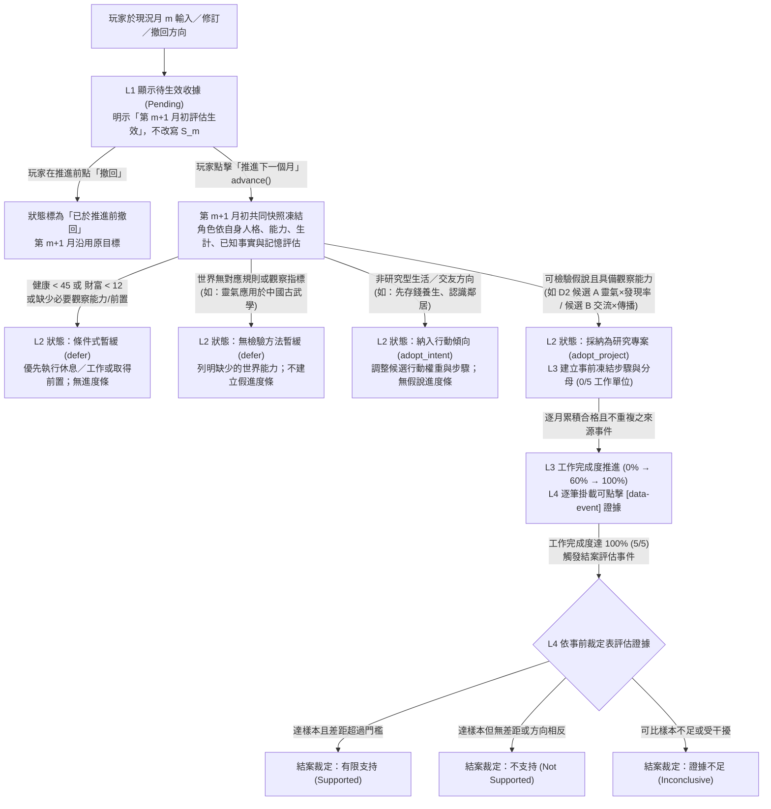

# M3 D3：開放方向輸入、角色提案與研究進度介面草圖

狀態：對應 [#21](https://github.com/lalagrass/earth-ascension/issues/21)（父追蹤 [#18](https://github.com/lalagrass/earth-ascension/issues/18)）。本文件為 **M3 Discovery／Sprint 0 介面與互動流程草圖**，只定義畫面結構、狀態轉移與欄位契約，**不修改前端程式（`index.html`、`m2.js`）、不改後端規則，也不授權 M3 實作**。

- 實際主筆：Antigravity (Gemini)（以 `lalagrass` 帳號操作）
- 對齊文件：[M3 提案 `creator-briefs.md`](creator-briefs.md)、[M3 協作計畫 `contribution-plan.md`](contribution-plan.md)、[M3 D2 行動與證據盤點 `action-evidence-inventory.md`](action-evidence-inventory.md)、[M3 D1 驗收與盲評規則 `direction-acceptance-rubric.md`](direction-acceptance-rubric.md)、[M2 玩家輸入與快照契約 `../m2/player-input-snapshot-rfc.md`](../m2/player-input-snapshot-rfc.md)
- 標記慣例：`〔現有〕` 為目前 `dev`（規則 `0.2.2`）已存在的 UI 或引擎行為；`〔推論〕` 為由現有契約直接推導的限制；`〔提案〕` 為待維護者審核的 M3 Dashboard 設計。

---

## 1. 設計原則與四層資訊分離〔提案〕

在玩家試玩與 [`creator-briefs.md`](creator-briefs.md) 的風險分析中，開放方向 UI 最容易出現三種誤導：
1. 把「玩家剛送出的文字」當成「已改寫當月世界事實」；
2. 把「角色做完 100% 觀察步驟」當成「100% 證明假說成立或自動解鎖新功能」；
3. 對世界根本無法檢驗的方向（如「靈氣應用於中國古武學」）畫出 0–100% 假進度條。

因此，M3 在「人物觀察（Observer）」頁（及「創造者視角（Creator）」頁的唯讀摘要）將方向與研究顯示嚴格拆為**四個視覺與資料皆分離的子區塊**：

| 區塊層級 | 區塊標題 | 只回答什麼問題 | 嚴格禁止事項（Anti-Fabrication） |
|---|---|---|---|
| **L1 玩家輸入與待生效收據** | `玩家開放方向（推進前輸入）` | 玩家對這名角色說了什麼？何時生效？是否修訂或撤回？ | 禁止在推進前宣稱角色已採納或已改變當月快照 `S_m`；玩家輸入字串一律經 `esc()` 跳脫 HTML |
| **L2 角色自主解讀與採納／暫緩** | `角色自主解讀與回應` | 角色在月初根據自己的目標、人格、生計與已知事實，決定**採納為研究專案**、**納入生活傾向**，還是**暫緩**？為什麼？ | 禁止引用角色未知事實或同月他人的新發現；不可檢驗或生計緊急時必須顯示具體暫緩原因 |
| **L3 工作完成進度（僅限可檢驗專案）** | `研究專案 · 工作步驟完成度` | 角色為檢驗假說所排定的觀察／行動步驟，目前完成了幾分之幾（例如 `3/5 工作單位 · 60%`）？ | **無可檢驗方法（C4）或純生活傾向（C3）時不渲染此進度條**；重複無效行動不加分子；標題明寫「工作完成度 ≠ 假說成立率」 |
| **L4 來源證據帳本與結案／解鎖狀態** | `來源證據與結案裁定 · 功能前置` | 收集到哪些可點擊的真實事件？100% 工作完成後證據裁定為何（**有限支持／不支持／證據不足**）？既有功能（如 `修習`）前置是否滿足？ | 禁止由工作百分比自動推導「支持」或自動解鎖功能；`practice_basis` → `修習` 的前置條件在 100% 前後保持一致 |

---

## 2. 端到端畫面狀態流程圖〔提案〕



---

## 3. 九種核心畫面狀態草圖（Wireframes）〔提案〕

以下草圖呈現嵌入於 `人物觀察（Observer）` 分頁中（位於「人物基本狀態／目標卡」下方、「最近行動 · 為什麼他這樣做？」上方）的 **「開放方向與自主探索」** 卡片在各種情境下的實際畫面配置。

### 3.1 狀態一：無方向空狀態（Empty State — 玩家尚未輸入方向）

適用於玩家人物剛投放或從未提交方向時（`viewMonth === null` 且 `p.player && p.alive`）。不顯示任何假專案或空白進度條：

```text
+-----------------------------------------------------------------------------------+
| 開放方向與自主探索                                          [狀態：未設定玩家方向] |
|-----------------------------------------------------------------------------------|
| 目前無玩家輸入的開放方向。角色正依自身長期目標「探索靈氣」（進度 1/3 · 下一步：   |
| 蒐集靈氣資料）與個人處境自主決策。                                                |
|                                                                                   |
| 給「測試旅人」一個推進前方向（角色會在下個月初依自身能力、已知資訊與生計自主評估）：|
| [ 例如：觀察看看靈氣濃度高的時候，研究是不是更容易有發現？                      ] |
| [ 送出方向（第 13 月初評估生效） ]                                                |
| 小提示：輸入不受固定題目表限制；若世界尚無檢驗方法或角色生計吃緊，角色會說明原因  |
| 並暫緩，不會產生假進度。                                                          |
+-----------------------------------------------------------------------------------+
```

> **非玩家人物（NPC，`p.player === false`）**：不顯示輸入框，僅顯示「NPC 由自身目標與經歷驅動，不接受玩家方向輸入」。

---

### 3.2 狀態二：推進前輸入、同月修訂與撤回（Pending Receipt at Month `m`）

對齊 [`../m2/player-input-snapshot-rfc.md`](../m2/player-input-snapshot-rfc.md) 方案 A：玩家在第 12 月送出或修改方向後，第 12 月已封存快照 `S_12` 與 `state_hash:12` **保持不變**，畫面明確標示「待第 13 月初評估生效」，並允許在按下「推進下一個月」前修訂或撤回：

```text
+-----------------------------------------------------------------------------------+
| 開放方向與自主探索                              [收據：待第 13 月初生效 · 修訂 #2] |
|-----------------------------------------------------------------------------------|
| ▶ L1 玩家開放方向（推進前待生效）                                                 |
|   待生效原文：「觀察看看靈氣濃度比較高的時候，研究是不是更容易做出發現？」        |
|   收據編號：dir:101:12:r2 · 提交於第 12 月 · 預計生效：第 13 月初共同決策快照     |
|   （註：第 12 月當月決策與歷史快照已封存，此方向將於推進至第 13 月時由角色評估）  |
|   [ 修訂待生效文字 ]  [ 撤回此待生效方向 ]                                        |
|-----------------------------------------------------------------------------------|
| ▶ L2 角色目前生效中狀態（第 12 月快照）                                           |
|   第 12 月尚無已生效之玩家方向；角色本月依原目標「探索靈氣」行事。                |
+-----------------------------------------------------------------------------------+
```

- 若玩家在已生效專案進行中（例如第 15 月）送出新方向或點擊「撤回目前方向」，同樣先在 L1 顯示「待第 16 月初生效之修訂／撤回命令」；推進至第 16 月後，舊專案轉入歷史紀錄（保留已發生的工作與事件來源，不抹除歷史），新狀態於第 16 月生效。

---

### 3.3 狀態三：可檢驗方向 — 角色採納為研究專案與進行中進度（Adopted Project in Progress）

以 [D2 候選 A](action-evidence-inventory.md)（「靈氣濃度越高，研究越容易有發現嗎？」）為例，角色具備 `感知 6`（可觀察靈氣）、健康與財富正常，於第 13 月初採納並執行至第 16 月（完成 `3/5` 工作單位）：

```text
+-----------------------------------------------------------------------------------+
| 開放方向與自主探索                                  [狀態：研究專案進行中 · 第 16 月] |
|-----------------------------------------------------------------------------------|
| ▶ L1 玩家開放方向（自第 13 月生效 · dir:101:12:r2）                               |
|   原文：「觀察看看靈氣濃度比較高的時候，研究是不是更容易做出發現？」              |
|   [ 修訂方向（第 17 月生效） ]  [ 停止／撤回方向（第 17 月生效） ]                |
|-----------------------------------------------------------------------------------|
| ▶ L2 角色自主解讀與採納理由（提案 prp:101:13:1 · 生效月：第 13 月）               |
|   決策模式：【採納為可檢驗研究專案 (adopt_project)】                              |
|   角色提出的候選問題：「本區可感知的靈氣高低，是否影響研究出現『發現』的比例？」  |
|   採納依據：                                                                      |
|   · 能力與觀察條件：本人感知 6（可察覺當月靈氣高低）                              |
|   · 已知事實與記憶：已知可修習基礎（2 個來源）· 曾於 [第 12 月 發現 m2:12:1451 ↗] |
|   · 生計檢查：健康 82/100、財富 38（無緊急生計壓力）                              |
|-----------------------------------------------------------------------------------|
| ▶ L3 研究專案 · 工作步驟完成度（注意：此百分比僅代表觀察工作進度，不代表假說成立）|
|   專案編號：prj:101:13:1（計畫版 v1 · 事前凍結分母：5 個工作單位）                |
|   [████████████░░░░░░░░] 60%（已完成 3 / 5 工作單位 · 待完成 2 單位）             |
|                                                                                   |
|   事前凍結步驟與完成來源：                                                        |
|   [✓] 步驟 1（權重 2/5）：於高靈氣月份（感知靈氣 ≥ 65）完成 2 次研究觀察          |
|       └ 已完成 2/2：[第 13 月 行動 m2:13:1580 ↗（感知靈氣 68 · 發現 m2:13:1581 ↗）]|
|                     [第 15 月 行動 m2:15:1820 ↗（感知靈氣 66 · 未發現）]          |
|   [進行中] 步驟 2（權重 2/5）：於低／平靈氣月份（感知靈氣 < 60）完成 2 次研究觀察 |
|       └ 已完成 1/2：[第 16 月 行動 m2:16:1942 ↗（感知靈氣 52 · 未發現）]          |
|       └ 註：第 14 月研究時感知靈氣為 67（屬高靈氣，不重複計入步驟 1 已滿額度）    |
|   [ ] 步驟 3（權重 1/5）：彙整高低靈氣共 4 次可比觀察樣本並進行結案比對（0/1）    |
|-----------------------------------------------------------------------------------|
| ▶ L4 來源證據帳本、結案裁定與功能前置狀態                                         |
|   · 假說證據可信度：【蒐集中 — 尚未結案（需完成 5/5 工作單位後裁定）】            |
|     目前累計可比樣本：高靈氣發現 1/2 次（50%）；低靈氣發現 0/1 次（樣本未滿）     |
|   · 功能與行動前置對照（獨立於研究專案 100% 進度）：                              |
|     [修習] 已解鎖 — 依既有規則由已知事實「已知可修習基礎」解鎖                    |
|            （最早來源：[第 5 月 發現 m2:5:609 ↗]；不受本專案百分比影響）          |
+-----------------------------------------------------------------------------------+
```

---

### 3.4 狀態四：100% 工作完成後的三種結案裁定（100% Work Completion ≠ Guaranteed Success）

當 L3 工作步驟完成度達到 `5/5（100%）` 時，系統在同一月結算產生一筆具穩定 `event_id` 的結案評估事件，L4 必須清楚區分**三種可能結果**，且不自動編造未定義的新功能解鎖：

````carousel
```text
+-----------------------------------------------------------------------------------+
| ▶ L3 研究專案 · 工作步驟完成度                                                    |
|   [████████████████████] 100%（已完成 5 / 5 工作單位 · 第 18 月結案）             |
|-----------------------------------------------------------------------------------|
| ▶ L4 來源證據帳本與 100% 結案裁定                                                 |
|   · 結案裁定：【✓ 有限支持 (Supported)】 · 結案事件 [第 18 月 專案結案 m2:18:2190 ↗]|
|   · 裁定理由：已完成事前設定之高低靈氣各 2 次研究觀察（共 4 筆來源事件）。        |
|     高靈氣期間發現率（2/2）高於低靈氣期間（0/2），差距達事前門檻，支持「高靈氣    |
|     下研究較易有所發現」之假說。                                                  |
|   · 引用證據來源：[m2:13:1580 ↗]、[m2:13:1581 ↗]、[m2:15:1820 ↗]、                |
|                   [m2:16:1942 ↗]、[m2:17:2065 ↗]、[m2:18:2189 ↗]                  |
|   · 後續影響：寫入角色有來源記憶，作為後續選擇研究時機之依據；不改變世界底層公式。|
+-----------------------------------------------------------------------------------+
```
<!-- slide -->
```text
+-----------------------------------------------------------------------------------+
| ▶ L3 研究專案 · 工作步驟完成度                                                    |
|   [████████████████████] 100%（已完成 5 / 5 工作單位 · 第 19 月結案）             |
|-----------------------------------------------------------------------------------|
| ▶ L4 來源證據帳本與 100% 結案裁定                                                 |
|   · 結案裁定：【✗ 不支持 (Not Supported)】 · 結案事件 [第 19 月 專案結案 m2:19:2310 ↗]|
|   · 裁定理由：角色已完成全部 5/5 觀察工作，但在本次收集的 4 筆研究樣本中，高靈氣  |
|     發現 0/2 次、低靈氣發現 1/2 次，觀察結果未支持原假說（工作 100% 完成，但世界  |
|     證據與假說相反或無顯著正向差距）。                                            |
|   · 引用證據來源：[m2:13:1590 ↗]、[m2:15:1833 ↗]、[m2:17:2071 ↗]、[m2:19:2309 ↗]  |
|   · 後續影響：角色記錄「現有觀察未支持此假說」，下月重評方向，不再盲目重複原計畫。|
+-----------------------------------------------------------------------------------+
```
<!-- slide -->
```text
+-----------------------------------------------------------------------------------+
| ▶ L3 研究專案 · 工作步驟完成度                                                    |
|   [████████████████████] 100%（已完成 5 / 5 工作單位 · 第 20 月結案）             |
|-----------------------------------------------------------------------------------|
| ▶ L4 來源證據帳本與 100% 結案裁定                                                 |
|   · 結案裁定：【？ 證據不足 (Inconclusive)】 · 結案事件 [第 20 月 專案結案 m2:20:2430 ↗]|
|   · 裁定理由：角色已完成預定嘗試次數，但期間同區多人競爭研究名額或靈氣持續處於同  |
|     一區間，缺乏足夠對照組樣本，現有紀錄不足以判定假說真偽。                      |
|   · 引用證據來源：[m2:14:1702 ↗]、[m2:16:1950 ↗]、[m2:18:2195 ↗]、[m2:20:2429 ↗]  |
|   · 後續影響：不宣稱支持亦不偽造成功；角色可選擇暫緩或待環境變化後另立新案。      |
+-----------------------------------------------------------------------------------+
```
````

---

### 3.5 狀態五：無可檢驗方法之方向 — 正確暫緩且無假進度條（Unverifiable Direction `C4`）

當玩家輸入 `DEV-C4-01`（「研究靈氣能不能應用在中國古武學」）時，依 [#21](https://github.com/lalagrass/earth-ascension/issues/21) 與 [D2 §4](action-evidence-inventory.md) 規定，**絕不渲染 L3 進度條**，並清楚說明角色為何暫緩及目前缺少哪些世界能力：

```text
+-----------------------------------------------------------------------------------+
| 開放方向與自主探索                              [狀態：因欠缺檢驗方法而暫緩 (defer)] |
|-----------------------------------------------------------------------------------|
| ▶ L1 玩家開放方向（自第 13 月生效 · dir:101:12:r1）                               |
|   原文：「研究靈氣能不能應用在中國古武學，結合拳法與內功開創武道流派。」          |
|   [ 改換其他方向（第 14 月生效） ]  [ 撤回方向 ]                                  |
|-----------------------------------------------------------------------------------|
| ▶ L2 角色自主解讀與暫緩理由（提案 prp:101:13:1 · 生效月：第 13 月）               |
|   決策模式：【暫緩執行 — 尚無可檢驗方法 (defer: unverifiable_in_current_rules)】  |
|   角色提出的候選問題：「靈氣或修習能否轉化為古武學招式與實戰內功效果？」          |
|   暫緩原因（具體缺少的能力與前置）：                                              |
|   1. 缺少觀察與行動模型：目前世界僅有基礎「研究」與「修習」，尚無武術招式、對練   |
|      或身體武學效果的行動與檢驗指標。                                             |
|   2. 證據邊界限制：本人雖已知「已知可修習基礎」（[第 5 月 發現 m2:5:609 ↗]），但該 |
|      事實僅代表基礎靈氣修習門檻，不能冒充「古武學應用」的證據。                   |
|   角色當前處置：暫不建立研究專案，維持原長期目標「探索靈氣」（下一步：蒐集靈氣資  |
|   料），不消耗行動於無效假步驟。                                                  |
|-----------------------------------------------------------------------------------|
| ▶ L3 研究專案進度                                                                 |
|   （此方向在現行世界規則下無可檢驗方法，不建立 0–100% 研究進度條，亦無自動解鎖。）|
+-----------------------------------------------------------------------------------+
```

---

### 3.6 狀態六：健康／生計危機或角色前置不足之暫緩（Survival Priority / Prerequisite Deferral `C5`）

當角色處於 `健康 < 45` 或 `財富 < 12`（如 `需求：恢復健康` 或 `需求：維持生計`），或角色本身 `感知 < 6` 無法觀測靈氣、`knowledge_v2` 尚無 `practice_basis` 時：

```text
+-----------------------------------------------------------------------------------+
| 開放方向與自主探索                              [狀態：生計／健康優先，暫緩方向執行] |
|-----------------------------------------------------------------------------------|
| ⚠️ 角色生存與前置優先提示：                                                       |
|   「測試旅人」目前健康 36/100（低於安全線 45，當前需求：恢復健康）、財富 9（低於  |
|   安全線 12）。角色本月必須優先執行「休息／工作」維持生命與溫飽，暫緩投入高消耗   |
|   的開放方向研究。                                                                |
|-----------------------------------------------------------------------------------|
| ▶ L1 玩家開放方向（自第 13 月生效 · dir:101:12:r1）                               |
|   原文：「趁最近集中投入高強度靈氣研究，觀察發現機率。」                          |
|-----------------------------------------------------------------------------------|
| ▶ L2 角色自主解讀與暫緩理由（提案 prp:101:13:2 · 第 15 月重評）                   |
|   決策模式：【條件式暫緩 — 生計／健康優先 (defer: survival_priority)】            |
|   暫緩依據：健康 36/100、財富 9（最近消耗來源：[第 14 月 行動 m2:14:1705 ↗]）。   |
|   重評條件：待健康恢復至 ≥ 45 且財富 ≥ 12 後，將於後續月初自動重評是否啟動步驟。  |
|-----------------------------------------------------------------------------------|
| ▶ L3 研究專案 · 工作步驟完成度（已凍結暫停）                                      |
|   [████░░░░░░░░░░░░░░░░] 20%（已完成 1 / 5 工作單位 · 因生計危機暫停推進）        |
+-----------------------------------------------------------------------------------+
```

- **角色感知不足（`感知 < 6`）或未知 `practice_basis` 時**：L2 顯示 `【條件式暫緩 — 角色目前缺少觀察能力／前置知識】`（例如：「本人感知為 4（需 ≥ 6 才能在研究時察覺靈氣濃度高低），無法自行記錄靈氣高低對照樣本，暫緩立項」或「本人尚未知曉『已知可修習基礎』，無法執行『修習』相關檢驗，需先透過研究發現或他人社交分享獲知後再重評」）。

---

### 3.7 狀態七：非研究型生活／人際方向（Lifestyle / Social Intent `C3`，不畫假專案進度條）

當玩家輸入 `DEV-C3-03`（「在本地多認識幾位合得來的朋友，建立穩定的互信關係」）這類生活與人際導向時，角色採納為**行動傾向（`adopt_intent`）**，清楚顯示對當月候選行動與計畫步驟的影響，但**不偽裝成科學假說研究專案**：

```text
+-----------------------------------------------------------------------------------+
| 開放方向與自主探索                              [狀態：已納入生活與行動傾向 (Active)]|
|-----------------------------------------------------------------------------------|
| ▶ L1 玩家開放方向（自第 13 月生效 · dir:101:12:r1）                               |
|   原文：「在本地多認識幾位合得來的朋友，建立穩定的互信關係。」                    |
|-----------------------------------------------------------------------------------|
| ▶ L2 角色自主解讀與行動傾向（提案 prp:101:13:1）                                  |
|   決策模式：【納入生活與行動傾向 (adopt_intent — 非假說研究專案)】                |
|   角色回應：「將優先在同區（學園）尋找親和度相近的對象進行『社交』，累積信任。」  |
|   機械落地與近期來源事件：                                                        |
|   · 候選行動加權：社交 +0.40（受方向與合群人格 50% 共同影響）                     |
|   · 近期相關結果：[第 14 月 關係 m2:14:1710 ↗（與 林知夏 信任升至 32）]           |
|-----------------------------------------------------------------------------------|
| ▶ L3 研究專案進度                                                                 |
|   （此方向屬於生活與人際追求，直接反映於每月行動選擇與定向關係，無假說研究進度條）|
+-----------------------------------------------------------------------------------+
```

---

### 3.8 狀態八：歷史月份回看狀態（Historical Snapshot View `viewMonth !== null`）

當玩家點擊任何 `[data-event]` 來源按鈕或從「時間軸與歷史」回看第 $N$ 月快照時（配合 #52 的跨分頁 `#historyBanner`「返回現況」橫幅）：
1. **隱藏／鎖定所有方向輸入、修訂、撤回按鈕**；
2. 只渲染第 $N$ 月快照 `S_N` 當時已生效的方向、提案、進度與當時已知的證據事件；
3. 第 $N$ 月提交但待第 $N+1$ 月才生效的 pending 輸入，絕不混入第 $N$ 月的歷史提案或事件中。

```text
+-----------------------------------------------------------------------------------+
| [歷史快照橫幅] 目前檢視第 14 月歷史快照（僅供回看當時狀態）          [ 返回現況 ] |
+-----------------------------------------------------------------------------------+
| 開放方向與自主探索                              [第 14 月歷史狀態 · 唯讀不可修改] |
|-----------------------------------------------------------------------------------|
| · 歷史月份唯讀模式：回看過去月份時不可輸入、修訂或撤回方向。                      |
| · 第 14 月當時生效方向：「觀察看看靈氣濃度比較高的時候，研究是不是更容易做出發現」|
| · 第 14 月當時工作完成度：1 / 5 工作單位（20%）                                   |
| · 第 14 月當時已收集證據：[第 13 月 行動 m2:13:1580 ↗]、[第 13 月 發現 m2:13:1581 ↗]|
|   （註：第 15 月之後發生的事件與結案結果不在第 14 月歷史快照中顯示）              |
+-----------------------------------------------------------------------------------+
```

---

### 3.9 狀態九：人物已故狀態（Deceased Character View `p.alive === false`）

當選中的玩家人物已離世時（對齊 #27 已故觀察頁契約）：
1. 永久關閉該人物的方向輸入、修訂與撤回控制項；
2. 保留離世當月凍結的最後方向、提案、已完成工作單位與來源事件連結供歷史追查，並明示「已於第 $K$ 月離世，方向與研究專案不再推進或重評」。

```text
+-----------------------------------------------------------------------------------+
| 開放方向與自主探索                              [狀態：人物已離世 · 紀錄永久封存] |
|-----------------------------------------------------------------------------------|
| 測試旅人 已於第 48 月離世（離世事件來源：[第 48 月 死亡 m2:48:5812 ↗]）。          |
| 開放方向與研究專案已於離世當月停止推進與重評；以下為離世時封存之最終紀錄：        |
|                                                                                   |
| · 離世時方向：「觀察看看靈氣濃度比較高的時候，研究是不是更容易做出發現？」        |
| · 離世時工作完成度：3 / 5 工作單位（60% · 未結案即離世）                          |
| · 生前已記錄證據：[m2:13:1580 ↗]、[m2:13:1581 ↗]、[m2:15:1820 ↗]、[m2:16:1942 ↗]  |
+-----------------------------------------------------------------------------------+
```

---

## 4. 畫面欄位與資料來源對照表（防止 UI 編造世界狀態）〔提案〕

為確保 Dashboard 上的每一個字、百分比與按鈕都有確定性資料支撐，不讓前端自行猜測或拼湊故事，各 UI 元素必須嚴格對應後端快照或命令日誌欄位：

| UI 顯示項目 | 對應資料來源欄位 | 缺值或邊界處理 |
|---|---|---|
| 待生效方向原文、修訂號、預計生效月 | `pending_commands[]`（`command_type="set_direction"`，`effective_month = world.month + 1`） | 僅在 `viewMonth === null`（現況）顯示；歷史快照 API 不回傳 pending 命令；原文一律 `esc()` |
| 已生效方向原文与方向 ID | `p.active_direction`（`direction_id`、`raw_text`、`revision`、`effective_month`） | 若為 `null`，顯示 3.1 節「未設定玩家方向」空狀態 |
| 角色解讀模式（採納專案／行動傾向／暫緩） | `p.direction_proposal.mode`（`adopt_project`｜`adopt_intent`｜`defer`） | 必須由月初決策驗證器寫入，UI 不得自行依關鍵字判斷 |
| 角色候選問題、採納／暫緩原因 | `p.direction_proposal.question`、`p.direction_proposal.rationale`、`p.direction_proposal.missing_prerequisites[]` | 若 `mode === 'defer'`，必須列出 `missing_prerequisites`（如 `unverifiable_domain`、`perception_below_6`、`survival_health`、`missing_fact:practice_basis`） |
| 角色提案引用的已知事實與事件來源 | `p.direction_proposal.cited_fact_ids[]`（經 `fact_id` 去重並附來源數）、`p.direction_proposal.cited_event_ids[]` | 每個 `event_id` 渲染為 `<button class="person" data-event="...">`；若不在快照則顯示不可點徽章 |
| 工作完成百分比（`0%–100%`）與步驟分子／分母 | `p.research_project.completed_weight` / `p.research_project.total_weight`、`steps[].completed_event_ids[]` | **僅當 `p.research_project !== null` 時渲染進度條**；重複或條件不符之行動不進入 `completed_event_ids` |
| 假說證據可信度與 100% 結案裁定 | `p.research_project.verdict`（`pending`｜`supported`｜`not_supported`｜`inconclusive`）與 `verdict_event_id` | 未達 `completed_weight === total_weight` 時固定顯示「蒐集中 — 尚未結案」；達 100% 時由結案事件 `verdict_event_id` 決定三種結果之一 |
| 功能前置與解鎖狀態（如 `修習`） | `p.knowledge_v2`（是否含 `fact_id === "practice_basis"` 及其 `source_event_id`）与 `p.last_decision.feasible` | 直接讀取既有規則欄位，證明研究專案 100% 前後都不改變 `practice_basis` → `修習` 的解鎖條件 |

---

## 5. 與既有頁面的整合及 M1 回歸邊界〔提案〕

1. **在六個分頁中的位置**：
   - 主操作與完整四層卡片（L1–L4）位於 **「人物觀察（Observer）」** 分頁中（當檢視玩家人物時顯示輸入與完整卡片；檢視 NPC 時僅顯示無玩家方向說明）。
   - **「創造者視角（Creator）」** 分頁可顯示目前所有玩家人物（最多 3 名）的開放方向、採納／暫緩狀態與工作進度摘要列，點擊人物即可跳至「人物觀察」檢視完整證據鏈。
   - **「總覽（Overview）」** 與 **「生命歷程（Chronicle）」**：當研究專案於 100% 產生 `專案結案` 重要事件，或月初產生 `方向採納／暫緩` 事件時，直接作為標準世界事件顯示於事件流與玩家重大事件區塊，不另造孤立系統。
2. **窄螢幕（390px）相容性**：
   - L1–L4 採用單欄垂直堆疊卡片，輸入框與按鈕使用 `width: 100%` 或 `flex-wrap: wrap`，進度條與步驟清單不產生橫向滾動條（`scrollWidth <= innerWidth`）。
3. **M1 與無方向 M2 存檔回歸**：
   - 當載入 M1 存檔（無 `m2_version`／`rules_version`）時，`m2.js` 的 M3 方向區塊完全不掛載，保留 M1 六頁原有行為。
   - 當載入無方向的 M2 `0.2.0`／`0.2.1`／`0.2.2` 存檔時，顯示 3.1 節空狀態，所有既有決策卡、目標評估與關鍵記憶顯示維持不變。

---

## 6. 留給維護者決策的項目

1. **輸入入口位置**：方向輸入框是否只放在「人物觀察」頁的玩家人物卡片中，或同時在「創造者視角」頁提供快速輸入入口？
2. **已生效方向的同月撤回語義**：當研究專案已在進行中（例如 `3/5`），玩家點「撤回方向」並推進到下一月後，未完成的專案應標記為 `abandoned_by_player` 封存於專案歷史，還是允許日後恢復原進度繼續？本草圖預設為「封存已完成的 3/5 與事件來源於歷史，不抹除過去紀錄」。
3. **「創造者視角」分頁的定位**：M3 實作時是否將現有「創造者視角（Creator）」升級為多玩家人物的方向與研究總控台（Dashboard），或維持在「人物觀察（Observer）」為主？
