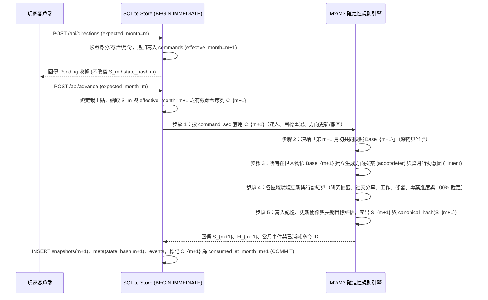

# M3 D4 RFC：玩家開放方向輸入、版本維度與固定 Seed 回放契約

狀態：對應 [#22](https://github.com/lalagrass/earth-ascension/issues/22)（父追蹤 [#18](https://github.com/lalagrass/earth-ascension/issues/18)）。本文件為 **M3 Discovery／Sprint 0 技術契約 RFC**，明確依賴 M2 [#10](https://github.com/lalagrass/earth-ascension/issues/10)（版本與 RNG 分離）與 [#11](https://github.com/lalagrass/earth-ascension/issues/11)（玩家輸入與快照不變性）。**在前置程式 PR 未完整合併前，本文件僅交付架構選項、交易邊界、遷移方案與待決點，不宣稱契約已鎖定，亦不修改 `store.py`、`m2.py`、schema 或 RNG。**

- 實際主筆：Antigravity (Gemini)（以 `lalagrass` 帳號操作）
- 對齊文件：[M3 提案 `creator-briefs.md`](creator-briefs.md)、[M3 協作計畫 `contribution-plan.md`](contribution-plan.md)、[M2 玩家輸入與快照契約 `../m2/player-input-snapshot-rfc.md`](../m2/player-input-snapshot-rfc.md)、[M3 D1 盲評規則 `direction-acceptance-rubric.md`](direction-acceptance-rubric.md)、[M3 D2 行動與證據盤點 `action-evidence-inventory.md`](action-evidence-inventory.md)、[M3 D3 介面草圖 `direction-dashboard-wireframes.md`](direction-dashboard-wireframes.md)
- 標記慣例：`〔現有〕` 為目前 `dev`（`e3c4594`，規則 `0.2.2`）已存在的實作；`〔前置未完〕` 為 #10／#11 尚未合入程式的部分；`〔提案〕` 為本 RFC 提出供維護者決策的設計選項。

---

## 1. 現況盤點與前置依賴邊界（#10、#11）

### 1.1 目前 `dev` 的實際行為〔現有〕

1. **`store.py` 的原地覆寫問題（#11 〔前置未完〕）**：
   - 在目前 `earth_ascension/store.py` 中，`create_character()`（L78–L118）與 `set_legacy_goal()`（L143–L177）都在 `BEGIN IMMEDIATE` 交易內直接修改當月 `world`，並執行 `UPDATE snapshots SET state=? WHERE month=?` 與 `INSERT OR REPLACE INTO meta VALUES ('state_hash:m', digest)`。
   - 這表示在第 $m$ 月已經結算封存後，任何玩家輸入都會原地改寫 `S_m` 與 `H_m`。若 M3 的「開放方向輸入／修訂／撤回」沿用此模式，將無法區分「第 $m$ 月結算時的原始狀態」與「事後修改的方向」，也無法保證固定 seed 與命令序列的可驗證回放。
   - M2 的設計方向已於 [`docs/m2/player-input-snapshot-rfc.md`](../m2/player-input-snapshot-rfc.md)（PR #24）提出，但 `store.py` 的程式改造尚未實作合入。
2. **`m2.py` 的版本常數分離第一步（#10 〔現有〕與〔前置未完〕）**：
   - PR #23 與 PR #32 已在 `earth_ascension/m2.py`（L9–L21）將 `RNG_NAMESPACE = "0.2.0"` 從 `M2_VERSION = "0.2.2"` 拆開，並以 `COMPATIBLE = {(v, v, SCHEMA_VERSION, "m2_rules") for v in ("0.2.0", "0.2.1", "0.2.2")}` 讓 `0.2.0`、`0.2.1`、`0.2.2` 存檔在同一 `SCHEMA_VERSION = 2` 下各自依原分支規則（`RULES_0_2_0_EVICTION`、`GOAL_REVIEW_RULES`）續玩。
   - **為何不能把 #10 的第一步當成完整遷移〔推論〕**：
     - 目前 `COMPATIBLE` 僅處理「快照 JSON 欄位結構相容、SQLite 資料表不變、僅決策分支公式微調」的情境；
     - 它**沒有**解決 SQLite 新增資料表（如追加式命令日誌表 `commands`）、**沒有**分離「方向解讀器版本（interpreter version）」與「行動／觀察目錄版本（action/observable catalog version）」、也**沒有**提供當事件格式擴充（如 [D2 候選 A](action-evidence-inventory.md) 需在研究事件記錄可觀察靈氣）時的複製式升版（copy-on-migrate）流程。

---

## 2. 開放方向輸入與快照不變性方案比較〔提案〕

延續 [`docs/m2/player-input-snapshot-rfc.md`](../m2/player-input-snapshot-rfc.md) 的三種架構，下表針對 M3「玩家可於推進前輸入、同月多次修訂、撤回開放方向，且進行中專案可跨月調整」的需求，完整比較其資料量、舊檔、審計、重播與 UI 即時可見成本：

| 比較維度 | 方案 A：追加式待生效命令日誌 + 第 `m+1` 月初共同快照（**推薦候選**） | 方案 B：同月追加式快照修訂鏈（`S_{m,0} → R_{m,1..k}`） | 方案 C：原地覆寫 `S_m` 與 `H_m`（現有 `store.py` 做法） |
|---|---|---|---|
| **核心機制** | 已提交的 `snapshots(month=m)` 與 `state_hash:m` **永不改寫**。第 $m$ 月收到的建人、目標重選、方向輸入／修訂／撤回只追加寫入 `commands` 表（`effective_month = m + 1`）；在 `advance(expected_month=m)` 同一交易內按序套用有效命令，形成第 $m+1$ 月初共同決策快照。 | 保留 `S_{m,0}`，但在第 $m$ 月每次玩家輸入時立即套用至世界並另存一份新修訂快照 `R_{m,k}` 與 `state_hash:m:k`；`advance(m)` 從最後一版 `R_{m,k}` 推進。 | 直接 `UPDATE snapshots SET state=? WHERE month=m` 並覆蓋 `state_hash:m`。 |
| **1. 資料量與儲存成長** | **極低（$O(K)$，僅存命令列）**：每筆方向修訂只存數百 bytes 的命令 JSON（方向原文、人物 ID、修訂號、狀態），不複製整個 100 人世界快照（避免了 [#3](https://github.com/lalagrass/earth-ascension/issues/3) 快照膨脹惡化）。 | **高（$O(K \times |S_m|)$）**：同月若玩家修訂 5 次方向文字，就產生 5 份完整世界快照（每份含 100 人與完整 `world.events`），放大 [#3](https://github.com/lalagrass/earth-ascension/issues/3) 的平方成長問題。 | 無額外列，但抹除歷史狀態。 |
| **2. 舊檔相容與遷移成本** | **清晰**：舊 M2 `0.2.0`–`0.2.2` 存檔無 `commands` 表時視為「歷史月份無額外待生效命令」；升級時只需建立空 `commands` 表並以最後現存快照為不可變起點。 | **複雜**：所有讀取 API（`GET /api/world?month=m`）、歷史回看與驗證器都必須改寫為雙層索引 `(month, revision)`，與現有單一 `month` 主鍵不相容。 | 無法驗證舊檔是否曾被中途竄改。 |
| **3. 審計與因果可追溯性** | **完整**：每次提交、修訂、撤回都有單調遞增 `command_seq` 與原命令引用（`supersedes_command_id`）；為何某方向未生效（如被同月後續撤回）一查即知。 | **中等但易混淆**：若玩家同月先輸入方向 X（產生角色提案 X）又改為方向 Y，第 $m$ 月會殘留多套彼此衝突的「當月提案」修訂版。 | **無**：被覆蓋的原輸入與原 `state_hash:m` 永久消失。 |
| **4. 固定 Seed 重播與確定性** | **最高**：重播函數純粹為 $S_{m+1} = F(\text{seed}, S_m, \text{CommittedCommands}_{m \to m+1})$；角色提案與 NPC 決策全部在第 $m+1$ 月初共同快照中一次性確定性生成。 | **脆弱**：若在修訂 $R_{m,1}$ 時就提前呼叫解讀器或 RNG 產生角色提案，多次修訂會消耗不同次數的 RNG 或留下副作用。 | **不合格**：無法證明某個 `state_hash` 對應哪個時間點的輸入。 |
| **5. UI 即時可見成本** | 提交後 UI 立即顯示**待生效收據（Pending Receipt）**與預覽（「已收到方向修訂 #2，將於推進至第 $m+1$ 月初由角色評估」），但要推進一個月後才看到角色的正式提案與步驟。 | 提交當下即可在畫面上看到寫入 `R_{m,k}` 的人物或方向，但前端必須理解「修訂版號」與「尚未推進月」的差異。 | 表面立即看到，但破壞歷史回看與 A9 契約。 |

> **選項小結〔提案〕**：
> - **方案 C** 違反 A9 與不可變歷史契約，直接排除。
> - **方案 A** 與產品語義「玩家在**推進前**給方向，角色在推進時自主思考與行動」完全吻合，且不會因同月反覆修改方向文字而複製多份百萬字節的世界快照。
> - 若維護者希望玩家在按下 `advance()` **之前**就能先看到「角色對此方向的初步解讀預覽」，可在方案 A 上附加一個**純唯讀、不寫庫、不消耗 RNG 的乾跑預覽（Dry-Run Preview）**，而正式提案仍嚴格在 `advance(m)` 交易內產生並寫入 `S_{m+1}`。

---

## 3. 七種操作案例之交易邊界、冪等性與生效月份〔提案〕

以下以**方案 A（追加式命令日誌 + 第 `m+1` 月初共同決策快照）**為基準，逐一標出 [#22](https://github.com/lalagrass/earth-ascension/issues/22) 要求的七種操作案例之 SQLite 交易行為、有效性檢查與生效月份（設目前世界已提交之最新月份為 `world.month = m`，對應不可變快照 `S_m` 與雜湊 `H_m`）：

| 案例 | 玩家操作情境 | 寫入交易與檢查（`BEGIN IMMEDIATE`） | 對 `S_m` / `H_m` 的影響 | 生效月份與 `advance(m)` 結算行為 |
|---|---|---|---|---|
| **1. 建立人物（含同月給定方向）** | 在第 $m$ 月創建新人物（及可選初始方向） | 驗證欄位、點數、16 題、玩家人物上限（已生效 + 待生效未撤回 $\le 3$）與 `expected_month == m`；寫入 `commands` 表（`cmd_create`，`effective_month = m+1`）。若附帶初始方向，以 `target_command_id = cmd_create.id` 關聯寫入 `cmd_dir`。 | **0 修改**：`S_m` 與 `H_m` 逐位元不變；不提前遞增 `world.next_id`。 | **第 $m+1$ 月初生效**：`advance(m)` 先依 `command_seq` 配發正式 `person_id`、產生第 $m+1$ 月 `投放` 事件，再載入初始方向進入第 $m+1$ 月初共同快照，與全城 NPC 一起做第 $m+1$ 月決策。 |
| **2. 同月多次修訂方向** | 在第 $m$ 月對人物 `101` 先送方向 `D_1`，推進前又改為 `D_2`、`D_3` | 每次修改不 `UPDATE` 舊列，而是插入新列 `cmd_r2`（`supersedes = cmd_r1`）、`cmd_r3`（`supersedes = cmd_r2`），舊列狀態標記為 `superseded_before_cutoff`（或由查詢折疊）。 | **0 修改**：`S_m` 與 `H_m` 不變；`commands` 表保留 `r1, r2, r3` 完整審計軌跡。 | **第 $m+1$ 月初僅 `D_3` 生效**：`advance(m)` 截止折疊（Cutoff Resolution）對同一 `(person_id, kind='direction')` 只取最新未撤回之 `cmd_r3` 進入第 $m+1$ 月初角色評估與 canonical hash；`D_1, D_2` 不產生角色提案或事件。 |
| **3. 網路超時或重複點擊重送** | 同一請求帶相同 `(actor_scope, client_request_id)` 重送 2–N 次 | `commands` 表對 `(client_request_id)` 設唯一約束；第二次到達時在交易中查得既有列，若 payload 相同則直接回傳原 `command_id` 收據（冪等成功）；若同 key 但 payload 不同則回傳 `409 Conflict`。 | **0 修改**：不產生重複命令列，不推進 `command_seq`。 | **第 $m+1$ 月初僅執行一次**：重送完全不改變 `CommittedCommands` 序列與 `H_{m+1}`。 |
| **4A. 推進前撤回待生效方向** | 在第 $m$ 月送出待生效方向 `D_1` 後，尚未按推進即點擊「撤回」 | 插入 `cmd_withdraw`（`supersedes = cmd_r1`，`effective_month = m+1`）。 | **0 修改**：`S_m` 與 `H_m` 不變。 | **第 $m+1$ 月初不生效**：截止折疊後該人物於第 $m+1$ 月無新方向輸入，維持既有狀態。 |
| **4B. 撤回「已在進行中」的方向／專案** | 方向 `D_0` 已於第 $13$ 月生效並建立專案，玩家在第 $m=15$ 月點「停止／撤回方向」 | 插入 `cmd_stop_dir`（`target_direction_id = D_0`，`effective_month = 16`）。**絕不回頭修改第 13–15 月快照**。 | **0 修改**：`S_{13}..S_{15}` 與已完成之 3/5 工作紀錄完全保留。 | **第 $m+1=16$ 月初生效**：`advance(15)` 於第 16 月初將原專案狀態轉為 `withdrawn_by_player` 封存於歷史，產生第 16 月方向撤回事件，角色自第 16 月起回到原生目標決策。 |
| **5. 離線後補送／過期月份請求** | 分頁停留在第 $m=12$ 月，但另一分頁已推進至第 $14$ 月；舊分頁送出 `expected_month = 12` 的方向 | `BEGIN IMMEDIATE` 讀取 `current_month = 14 != expected_month (12)`，**立即拒絕交易**並回傳明確錯誤（「世界已推進至第 14 月，請重新載入確認角色最新狀態後再輸入」）。 | **0 修改**：不寫入 `commands` 表。 | **永不靜默順延套用**：因為第 14 月角色可能已重傷、破產、完成目標或離世，靜默把第 12 月的輸入套到第 15 月會造成非預期的因果錯置。 |
| **6. 歷史月份檢視（`viewMonth = k < m`）** | 玩家回看第 $k$ 月歷史快照，查詢 API 或嘗試在歷史畫面送出方向 | `GET /api/world?month=k` 為純唯讀查詢，只回傳 `snapshots(month=k)` 與第 $k$ 月當時已生效資料，**過濾掉所有 `effective_month > k` 的待生效命令**；任何帶 `expected_month = k < m` 的 POST 一律拒絕。 | **0 修改**：歷史快照唯讀。 | **不適用（拒絕寫入）**：保證歷史回看永遠只呈現第 $k$ 月當時的世界真相。 |
| **7. 月度推進中的並發輸入競爭** | 請求 T1 呼叫 `advance(expected_month=m)` 進行結算的同時，請求 T2 送出 `expected_month=m` 的方向輸入 | SQLite `BEGIN IMMEDIATE` 強制單一寫入者排隊：<br>· **情況 α（T2 先取得鎖）**：T2 寫入 `effective_month=m+1` 並 commit；隨後 T1 取得鎖，將 T2 納入第 $m+1$ 月初截止集合一起結算。<br>· **情況 β（T1 先取得鎖）**：T1 完成推進並 commit `current_month = m+1`；隨後 T2 取得鎖，檢查發現 `current_month (m+1) != expected_month (m)`，依案例 5 明確拒絕 T2。 | **0 修改**：不會出現「半套寫入」或「只影響後半段 NPC」的競爭污染。 | **情況 α 於第 $m+1$ 月生效；情況 β 明確拒絕並要求客戶端重載第 $m+1$ 月狀態**。 |

---

## 4. 共同月初決策快照（Joint Start-of-Month Snapshot）執行順序〔提案〕

為同時滿足 M2 既有不變量（`test_no_same_month_knowledge_leak`、`test_people_insertion_order_does_not_change_result`）與 M3「所有角色基於同一月初狀態提案，先結算者的新發現不得成為他人同月情報」（[`creator-briefs.md`](creator-briefs.md)），`advance(expected_month=m)` 交易內的確定性步驟順序設計如下：



- **同月情報隔離保證**：步驟 3（方向提案與 `_intent` 決策）嚴格只讀取步驟 2 凍結的 `Base_{m+1}`；步驟 4 中任何人物在第 $m+1$ 月新獲得的 `發現`（`practice_basis`）或新分享事件，要到第 $m+2$ 月初的 `Base_{m+2}` 才會被其他人物或方向提案看見。

---

## 5. 規則、資料、解讀器與 RNG 版本契約〔提案〕

### 5.1 為什麼需要五維度版本元組（Version Tuple）

在 M2 中，世界版本只需描述 `(version, rules_version, schema_version, policy_mode)`。但進入 M3 後，「開放方向文字如何轉為候選問題（解讀器）」與「世界支援哪些可檢驗行動／觀察指標（原語目錄）」會獨立演進。因此提案將版本中繼資料明確拆為五個正交維度：

| 版本欄位 | 職責定義 | 何時必須遞增 | 對回放與舊檔的影響 |
|---|---|---|---|
| `schema_version` | SQLite 表結構與快照頂層 JSON 必要欄位格式（M2 現為 `2`；M3 含命令日誌與方向專案欄位建議升為 `3`） | 新增／修改 SQLite 資料表、快照必要欄位名稱或型別變更時 | 不同 `schema_version` 不可直接原檔混寫；須走唯讀讀取或複製式遷移（見第 6 節） |
| `rules_version` | 月度結算、行動效果、記憶淘汰、目標評估、專案 100% 證據裁定公式（如 `0.2.0`、`0.2.1`、`0.2.2`、未來 `0.3.0`） | 任何會改變同一快照下決策分數、結算結果或事件欄位的規則變更 | 每個 `rules_version` 鎖定各自的 golden canonical hash 測試 |
| `rng_namespace` | `draw(seed, month, actor, purpose, target)` 的雜湊命名空間（現為 `"0.2.0"`） | **僅在刻意重洗所有隨機抽樣時才變更**；常規規則與 UI 修正保持不變 | 保持不變可讓未受影響的抽樣流在跨小版本對照實驗中維持配對可比性 |
| `interpreter_version` | 無 LLM 方向概念擷取器与候選問題生成規則版本（如 `"m3_rule_v1"`；若未來離線做方案 B 影子實驗則另標記影子模型與 prompt 版本） | 修改開放文字分類詞庫、概念映射或暫緩判準時 | 已保存於歷史快照的 `direction_proposal` 按快照當時紀錄回放；重跑相同輸入日誌須使用相同 `interpreter_version` |
| `action_catalog_version` | 可執行行動原語與可檢驗方向模板目錄版本（如對應 D2 候選 A／B 的步驟與觀察欄位定義） | 新增可支援的研究假說類別或修改步驟權重／樣本門檻定義時 | 進行中的研究專案保存建立時的 `plan_catalog_version` 與凍結分母，不因後續目錄擴充而中途竄改分母 |

### 5.2 專用 RNG 子流與無方向基線零干擾保證（RNG Isolation）

依 `m2.py` L33–L35 現有設計：
```python
def draw(seed, month, actor, purpose, target=""):
    key = f"{seed}:{RNG_NAMESPACE}:{month}:{actor}:{purpose}:{target}"
    return random.Random(int.from_bytes(hashlib.sha256(key.encode()).digest()[:8], "big"))
```
這項 keyed PRNG 設計天然具備**依 `(month, actor, purpose, target)` 完全獨立**的特性。在 M3 中必須遵守兩條 RNG 鐵律：
1. **方向解讀與提案優先採純確定性規則（無 RNG 抽樣）**：給定月初快照與方向原文，角色採納哪個候選問題或為何暫緩，應由角色人格、能力、生計與已知事實確定性推導（0 次隨機抽樣）。
2. **若方向相關決策需微小打破平手抽樣，必須使用專屬 `purpose`（如 `"m3_direction_tiebreak"`）**：
   - 絕對不可與 `"action"`、`"discover"`、`"social"`、`"goal_review"` 共用同一個 `Random` 實例。
   - **可驗證不變量**：當玩家人物 `101` 未輸入任何方向時，世界在 `0.3.0` 無方向模式下的 RNG 呼叫鍵集合與 M2 基線完全一致；當玩家人物 `101` 輸入方向時，同月其他 99 名 NPC 的 `"action"` 與 `"goal_review"` 隨機數抽樣值 **100% 不受玩家方向輸入影響**（僅在玩家人物改變自身行動如改選 `研究` 參與同區 `"discover"` 抽籤時，才會依既有物理規則影響同區發現競爭）。

### 5.3 Canonical Hash 涵蓋範圍

第 $m$ 月的 `state_hash:m` 由 `canonical_hash(world)` 計算，其中 `world` 快照內包含：
- 當月已消耗生效之命令摘要（`consumed_commands`：含 `command_id`、`person_id`、`kind`、`raw_text`、`revision`、`effective_month=m`，**不含**伺服器系統時鐘 timestamp 或客戶端隨機 UUID 字串，以確保跨機重跑雜湊一致）；
- 角色當月生成的 `direction_proposal` 與 `research_project` 狀態；
- 當月所有人物狀態與事件。

因此，**只要 `seed`、初始世界版本與有序輸入命令序列 $\langle C_1, C_2, \dots, C_T \rangle$ 相同，在任何機器、任何時間重跑 60 個月，逐月 `state_hash:0 .. state_hash:60` 必然 100% 逐位元一致**。

---

## 6. M1、M2 舊存檔、未知版本與未來 M3 讀取／遷移契約〔提案〕

依 [#22](https://github.com/lalagrass/earth-ascension/issues/22) 完成判準：「保留 M1 路徑；說明 M2 0.2.0、未知版本及未來 M3 讀取／遷移選項，不把 Claude 在 #10 的第一步當完整遷移」，下表完整定義五類存檔在開啟、推進與遷移時的行為契約：

| 存檔類型 | 識別特徵 | 直接開啟與歷史回看（Read / Load） | 直接推進（In-Place Advance） | 升版遷移路徑（Migration Path） |
|---|---|---|---|---|
| **1. M1 舊存檔** | 無 `schema_version`、`rules_version`、`policy_mode`（`is_m2_world(world) == False`） | **原樣保留 M1 路徑**：走 `engine.py` 與 M1 六頁 UI，不載入 M2/M3 面板 | 走 `engine.advance(world)`，維持 `test_m1_legacy_replay` golden hash 不變 | 僅能透過 `WorldStore.migrate_copy(src, dst)` **複製到新檔案**升版，原 M1 存檔位元不變（`test_real_m1_checkpoints_migrate_or_reject_safely`） |
| **2. M2 `0.2.0` / `0.2.1` / `0.2.2` 存檔** | `schema_version == 2`、`policy_mode == "m2_rules"`、`rules_version in {"0.2.0", "0.2.1", "0.2.2"}` | **相容唯讀與回看**：可完整讀取各月快照與歷史事件；UI 在無 M3 欄位時顯示無方向狀態 | **依原 M2 規則版本續玩**（由 `COMPATIBLE` 與版本分支保留 `0.2.0`/`0.2.1`/`0.2.2` 各自行為與 golden hash）；**不允許直接在 `schema_version == 2` 原檔寫入 M3 方向命令** | **複製式升版 `migrate_m2_to_m3_copy(src, dst)`〔提案〕**：<br>1. 以唯讀模式備份 `src` 至新路徑 `dst`，記錄 `migrated_from_sha256` 與 `migrated_at_month = m`；<br>2. 驗證 `src` 的 `0..m` 快照與現存 `state_hash`；對 #11 修復前曾被原地覆寫過的舊檔，保留其現存快照並標記 `pre_migration_input_log = "unrecorded_m2_in_place"`，**絕不偽造過去未記錄的命令日誌**；<br>3. 在 `dst` 建立 `commands` 表，將最新快照 `S_m` 升級為 M3 `schema_version = 3`（補齊玩家人物空方向欄位 `active_direction = None`），自第 $m+1$ 月起啟用 M3 規則與方向輸入。 |
| **3. M3 存檔（無玩家方向輸入）** | `schema_version == 3`、`rules_version == "0.3.0"`、`commands` 表無方向命令 | 完整支援現況與歷史回看 | 正常推進；若該版本未修改無方向基礎規則，其無方向路徑可與 M2 最新基線做同機配對比較 | 不需遷移 |
| **4. M3 存檔（含玩家方向與研究專案）** | `schema_version == 3`、`rules_version == "0.3.0"`、含已消耗或待生效方向命令 | 現況顯示生效方向、專案與待生效收據；歷史月 `?month=k` 只顯示第 $k$ 月快照當時狀態 | 依第 4 節共同月初快照流程推進，逐月驗證 `state_hash` | 日後 `0.3.x` 規則微調若不改 schema，可結合 `COMPATIBLE` 分支或複製遷移 |
| **5. 未知版本或未來版本存檔** | `is_m2_world(world) == True`，但 `(version, rules_version, schema_version, policy_mode, ...)` 不在 `COMPATIBLE` 中（例如拿舊版 M2 程式開 M3 `schema_version = 3` 存檔，或未知 `rules_version = "9.9.9"`） | `validate()` / `_check_compatible()` **明確拋出 `ValueError("規則或資料版本不相容")`** | **明確拒絕推進且不改動資料庫任何位元**（`test_unknown_rules_version_rejected_without_mutation`） | 拒絕靜默降級或忽略未知欄位，防止舊版引擎破壞新版存檔結構 |

---

## 7. 可執行驗收矩陣（供後續實作階段檢驗）〔提案〕

當 #10、#11 與 M3 獲准進入實作時，必須通過以下五組自動化測試與故障注入驗收：

1. **快照與 Hash 不可變測試（Immutability Check）**：
   - 在第 0、12 月保存 `snapshots.state` 與 `state_hash:0`、`state_hash:12`；執行建人、方向輸入、同月修訂 3 次、撤回後，第 0、12 月的 `snapshots.state` 與 `state_hash` 逐位元 100% 不變。
2. **七案例邊界與冪等測試（7-Case Transaction Suite）**：
   - 逐一自動化驗證第 3 節案例 1–7：同 `client_request_id` 重送 2 次只產生 1 筆命令；過期 `expected_month` 100% 拒絕；`GET /api/world?month=k` 絕不洩漏 `effective_month > k` 的待生效方向。
3. **30 Seed × 60 月確定性回放測試（Deterministic Replay）**：
   - 固定 30 個開發 seed，給定包含「建人、輸入方向、同月修訂、推進前撤回、進行中撤回、跨月重設方向」的命令序列，在兩個獨立 SQLite 實例重播 60 個月，30/30 seed 的逐月 `state_hash:0..60` 完全相同。
4. **NPC 抽樣零干擾配對測試（RNG Isolation Check）**：
   - 同一 seed 下，比較「玩家未輸入方向」與「玩家輸入方向（但被暫緩或尚未改變同區研究抽籤名額）」當月所有無關 NPC 的 `draw()` 輸出與決策，驗證方向提案不會偷吃共用 RNG 流。
5. **M1 與 M2 `0.2.0`–`0.2.2` 存檔回歸與複製遷移測試**：
   - M1 golden replay 與 `0.2.0`/`0.2.1`/`0.2.2` golden replay 100% 維持原雜湊；`migrate_m2_to_m3_copy` 驗證來源檔 SHA-256 遷移前後完全不變，且未知版本明確拒絕。

---

## 8. 留給維護者定案的決策點

1. **#11 的落地時機與範圍**：是否先在 M2 完成 `store.py` 的「追加式待生效命令（方案 A）」改造（涵蓋 `create_character` 與 `set_legacy_goal`），再讓 M3 的開放方向直接複用同一張 `commands` 表？本 RFC 強烈建議共用同一命令日誌機制，避免 M2 與 M3 各自維護兩套玩家輸入管線。
2. **推進前「角色初步解讀預覽」的需求**：採用方案 A 時，玩家在第 $m$ 月送出方向後，UI 只需顯示「待第 $m+1$ 月初評估生效」收據（如 [D3 草圖 §3.2](direction-dashboard-wireframes.md)），還是需要額外提供一個不寫庫、不改 `S_m` 的「月初解讀乾跑預覽（Dry-Run Preview）」？
3. **M2 → M3 的續玩政策**：當 M3 正式引入新 SQLite 表（`commands`）或新事件欄位（如 D2 候選 A 的研究可觀察靈氣）時，舊 M2 `0.2.0`–`0.2.2` 存檔應採用「原檔維持 M2 規則續玩 ＋ 提供 `migrate_m2_to_m3_copy` 複製升版為 M3」（第 6 節推薦方案），還是僅供唯讀查閱？
