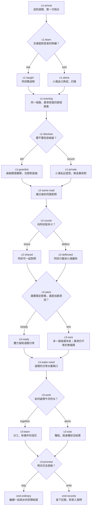

# 《挑水的暑假》三章選擇與因果圖（#124 設計稿）

配套：[故事聖經](STORY_BIBLE.md)、[第一章樣稿](../story/chapter-1.md)。本圖是**內容審查用**，不是已選的 JSON schema、可執行 runner 或遊戲規則。節點／選項 ID 供作者與未來 #125 對照，正式發布前才凍結。#123 尚需決定選擇節奏、重讀與存檔；本稿示範每章兩次選擇。所有數字與旗標都是質性回呼標記，不是能力倍率。

## 事前已知與揭露邊界

- 小滿知道自己來自現代、如今在另一具孩子身體裡；旁人只見他的言行變了。讀者跟著小滿知道這件事，不能讀到其他人物未說出的內心。
- 三人都知道他初次挑水易喘、阿祁較熟練；他們可觀察數日後姿勢與速度改進。
- 小滿可感到恢復較快，但第一章無人有足夠證據將其定為靈氣效果。不得讓他無代價使用現代知識或未知功法。

## 節點與分支

圖中的結局是兩類**短篇收束**，各有前面選擇的文字變體；不是所有不同選擇自動同一結果。`c3-work=alone` 且前章加趟測試，會有人要求休息／分擔，不能靠作者安排突然完成超額工作。`c3-work=together` 且之前瞞著阿祁，合作須先承認至少一件他能理解的事，不能直接恢復充分信任。

## 選擇、可見代價與後文回呼

| 選項 ID | 當時看得懂的取捨 | 即時變化 | 必須出現的後文回呼 |
|---|---|---|---|
| `c1-ask`／`c1-solo` | 放下面子學姿勢，或自己再試以保住面子 | 前者提早掌握技巧；後者仍能練但多花力氣 | 第二章阿祁是先主動提點，或等小滿先開口；兩路都可正常進步。 |
| `c1-tell`／`c1-record` | 告訴爺爺身體感受，或先私記避免被限制 | 爺爺能觀察並設休息界線，或暫時不知情 | 第二章有人幫忙核對與否；第三章若逞強，知情的爺爺會用具體觀察提醒。 |
| `c2-share`／`c2-deflect` | 讓阿祁參與對照，或暫留自己的祕密 | 阿祁有資訊與發言權，或只看見小滿變快 | 第三章合作時他如何回應小滿；不能把被隱瞞者寫成已知異常。 |
| `c2-steady`／`c2-test` | 按約定趟數練，或多走一趟確認變化 | 加趟者獲得更多觀察，同時承受疲憊與可能失約 | 第三章水量缺口時是否需要休息；不把「測試」變免費進度。 |
| `c3-together`／`c3-alone` | 分擔與接受別人的能力，或獨自完成自己能做的部分 | 兩人當日工作與互信不同；獨挑者仍可被勸休息 | 收束段明說今天每人實際做了什麼，不能一人替全道館解決。 |
| `c3-stay`／`c3-write` | 約定明日繼續，或先留下記錄／給家人交代 | 一個是日常承諾，一個是向外界負責 | 結尾讀者看得到承諾對象、已知事實與未解問題；兩者均非失敗。 |

`c1-learn` 的兩路在 `c1-evening` 匯流時必須有不同一句：請教者記得阿祁教的腳步，獨試者記得自己摸索和對方欲言又止；不能只複製同段正文。`c2-cousin` 匯流前需回應爺爺是否知情，`c3-water-need` 前需回應阿祁是否知情及小滿有否逞強。這些是寫作者的 promise ledger，不靠自動計分證明完成。

## 三條紙上走查

1. **合作與安靜結尾**：`c1-ask → c1-tell → c2-share → c2-steady → c3-together → c3-stay`。小滿學會挑水，爺爺與阿祁都知道異常只是待查觀察。最後兩人分工挑完今天需要的水，約好明天繼續；沒有能力確認或英雄事件。
2. **藏起祕密，獨挑受限**：`c1-solo → c1-record → c2-deflect → c2-test → c3-alone → c3-write`。小滿確實比第一天進步，也因多測一趟更累；阿祁無法理解突然的距離，爺爺只看見他逞強，要求停下。小滿留下對自身變化的記錄，向父母交代道館生活；未解異常不作成功宣告。
3. **晚些坦白，重新合作**：`c1-solo → c1-record → c2-share → c2-test → c3-together → c3-stay`。小滿一開始保面子，數日後主動讓阿祁幫忙對照；加趟後須承認自己也會累。第三章兩人分擔，信任從晚些坦白開始，不能寫成從頭便毫無芥蒂。

每條均從開頭走到結尾、沒有未定節點；兩個結局都可達。後續若把這份圖轉為可執行資料，必須另驗證所有組合的節點可達、前置與回呼，再依 #123 決定工具和版本語義。紙上走查只證明這三條，不能宣稱六個選擇的所有組合已驗證。

## 與遊戲互相供材的最小方式

小說給遊戲參考的是「空桶下山／裝水／負重上山／倒水」的視覺節奏、爺孫對話和阿祁如何看待主角進步。遊戲 [#155](https://github.com/lalagrass/earth-ascension/issues/155) 的畫面稿可供小說作者校對山路、桶與步態。兩者只共享可審的地點／角色候選與動作來源；小說的選項、結尾、穿越真相不會透過改寫遊戲事件資料自動成立。
