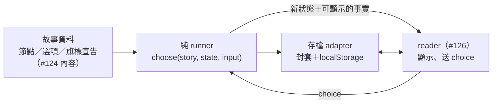

# 獨立互動小說：技術設計（提案）

- 狀態：**提案**（[#128](https://github.com/lalagrass/earth-ascension/issues/128) A3），待 Earth PO／暫代小說協調審查。**`novel-chronicle/` 目前只有本文件，沒有任何 runtime**；本文件不授權 #125–#127，也不決定 #123 的產品取捨。
- 實際主筆：Claude（Anthropic Claude Code），共用 `lalagrass` 帳號。
- 核對基底：dev `0875d116e774cf2b53c6c36d160465b460302b1d`。
- 已定（不重問）：**原創獨立故事、獨立 continuity**（#123 擁有人決定）。故事聖經、正文與分支圖屬 [#124](https://github.com/lalagrass/earth-ascension/issues/124)；語氣、視角、選擇節奏、存讀語意與 runtime 授權屬 [#123](https://github.com/lalagrass/earth-ascension/issues/123)。
- 上層：[產品組合邊界](../../docs/architecture/PORTFOLIO_BOUNDARIES.md)。

本文所有欄位名、檔名、範例內容都是**提案**；範例故事內容（藥泉、鄰人）取自 #123 PO 留言的候選素描，只用來說明形狀，不是 #124 的正文或定稿。

## 1. 範圍與不做的事

切片需要的只有四塊：



不需要、預設也不加：模擬時鐘、自主角色排程、RNG、Earth／SG import、事件溯源平台、付費生成服務、20 seed 矩陣。故事圖是確定的作者資料。

## 2. 資料契約（提案）

### 2.1 故事包

```js
// 提案形狀；以 UMD 純資料模組或 JSON 提供，由 #124／#125 決定實際檔案
{
  storyId: 'spring-village',          // 臨時代號
  contentVersion: 1,                   // 內容有任何影響狀態的改動就 +1
  start: 'c1-open',
  flags: {                             // 所有旗標都要先宣告
    trustNeighbor: { kind: 'relationship', type: 'int', min: -2, max: 2, initial: 0, readerKnown: true },
    springChanged:  { kind: 'knowledge',    type: 'bool', initial: false, readerKnown: true },
    promisedRecords:{ kind: 'obligation',   type: 'bool', initial: false, readerKnown: true },
  },
  nodes: {
    'c1-open': {
      chapter: 1,
      text: 'story/chapter-1.md#c1-open',   // 正文來源（#124）；runner 不讀正文
      choices: [
        { id: 'c1-tell', label: '把泉水的變化告訴信得過的鄰人',
          requires: null,
          effects: [{ op: 'add', flag: 'trustNeighbor', by: 1 }, { op: 'set', flag: 'springChanged', to: true }],
          next: 'c1-shared' },
        { id: 'c1-observe', label: '先自己小心觀察幾天',
          requires: null,
          effects: [{ op: 'set', flag: 'springChanged', to: true }],
          next: 'c1-alone' },
      ],
    },
    'c2-meet': {
      chapter: 2,
      text: 'story/chapter-2.md#c2-meet',
      acknowledges: ['c1-tell', 'c1-observe'],   // 匯流節點必須宣告它回應哪些先前選擇（§4）
      next: 'c2-choice',                          // 無選項節點直接接續
    },
    'end-steward': { chapter: 3, text: 'story/chapter-3.md#end-steward', ending: 'steward' },
  },
}
```

規則：

- 節點只有三種：**選擇節點**（`choices` 非空）、**接續節點**（只有 `next`）、**結局節點**（`ending`）。三者互斥。
- `id` 全故事唯一；選項 `id` 也全故事唯一（存檔歷史只記 id，所以 id 一旦發布不改義）。
- `requires` 是封閉的小語言，不執行任意程式：`null`、`{ flag, eq|gte|lte: 值 }`、`{ chose: 選項id }`、`{ all: [...] }`、`{ any: [...] }`、`{ not: ... }`。
- `effects` 也是封閉清單：`set`（bool／int）、`add`（int，結果夾在 `min..max`）。沒有跳轉、沒有隨機、沒有呼叫外部。
- 不滿足 `requires` 的選項**不顯示或顯示為不可選並寫明理由**，這是 #123 的產品選擇（見 §8）；runner 兩種都支援，因為它只回報「可選／不可選＋原因」。

### 2.2 故事狀態

```js
{
  nodeId: 'c2-meet',
  flags: { trustNeighbor: 1, springChanged: true, promisedRecords: false },
  history: [ { seq: 1, nodeId: 'c1-open', choiceId: 'c1-tell' } ],
  ended: null,                 // 到達結局時為 ending 名稱
}
```

狀態只放：目前節點、宣告過的旗標、選擇歷史、是否結束。沒有時間、沒有亂數、沒有世界資料。

## 3. 純轉移

```js
// 提案介面（#125）
validateStory(story)                 // → { ok } 或 { ok:false, code, where }；載入時跑一次
newState(story)                      // → { state, passed }：start 節點、旗標 initial、空歷史，再經 settle
available(story, state)              // → [{ choiceId, label, enabled, reason? }]，給 UI 用
choose(story, state, input)          // input = { nodeId, choiceId, seq }；套效果、移到 next，再經 settle
  // → { ok:true, state, passed:[nodeId...], applied:[...effects], duplicate:false }
  // → { ok:true, state, passed:[], duplicate:true }   同一 seq＋同一 choice 重送：回目前狀態，不再套效果
  // → { ok:false, code, reason }                  不改輸入
```

**正規化（settle）**：`newState` 與 `choose` 結尾都跑同一個內部步驟——只要目前節點是接續節點，就沿 `next` 往下走，直到選擇節點或結局節點；到結局節點時設 `ended`。走過的接續節點依序放在 `passed`，給 UI 顯示正文。因此：

- **對外可見的 `state.nodeId` 永遠是選擇節點或結局節點**；不存在停在接續節點上的合法狀態，也沒有獨立的 `advance` 操作。
- 讀者在 `passed` 正文之間翻頁，是 UI 的閱讀位置，不進故事狀態、不進存檔；重新整理後從目前的選擇節點開始顯示（可重顯最後一段 `passed`，由 #126 決定）。
- settle 最多走「節點總數」步；超過即回 `continuation_cycle` 錯誤、不改輸入。正常情況下不會發生，因為 `validateStory` 已拒絕只由接續節點構成的循環（§7 圖檢查）。含選擇節點的循環（例如可重訪的場景）不受此限，因為每一圈都要讀者選一次。

拒絕碼（提案）：`ended`、`continuation_cycle`、`stale_node`（`input.nodeId ≠ state.nodeId`）、`unknown_choice`、`prerequisite_unmet`、`seq_conflict`（同 seq 不同 choice）、`seq_gap`（seq 不是 `history.length + 1`）。

責任分配：

| 誰 | 做什麼 | 不做什麼 |
|---|---|---|
| runner | 驗證故事包、驗證前置條件、拒絕重複／過期／不合法選擇、**每個選擇只套一次效果**（以 `seq` 保證）、產生新狀態 | 不讀 DOM、不讀時鐘、不抽亂數、不讀正文 |
| 存檔 adapter | 封套、版本檢查、寫入與失敗回復（§5） | 不改故事狀態內容 |
| reader UI | 顯示 `passed` 與目前節點的正文、`available()` 的結果、回顧；管理接續正文之間的翻頁位置；把使用者點擊轉成 `{ nodeId, choiceId, seq }` | 不算後果、不改旗標、不決定可選性、不自行沿 `next` 推進故事狀態 |

連點兩次同一選項 → 第二次帶同一 `seq`，回 `duplicate: true`，效果不重複。**`stale_node`／`seq_*` 只對「傳入的那一份 state」成立**：同一分頁中，基於已被取代的畫面送出的請求會被拒絕；但 runner 是純函式，不知道別的分頁有沒有存過更新的狀態。跨分頁的保護屬於存檔 adapter，見 §5.4。

### 3.1 範例轉移（臨時內容）

```text
// 假設 c1-tell.next = 'c1-shared'（接續）→ 'c2-meet'（接續）→ 'c2-choice'（選擇節點）
state0 = { nodeId:'c1-open', flags:{trustNeighbor:0, springChanged:false, promisedRecords:false}, history:[], ended:null }
choose(story, state0, { nodeId:'c1-open', choiceId:'c1-tell', seq:1 })
→ ok, applied = [add trustNeighbor +1, set springChanged true], passed = ['c1-shared', 'c2-meet']
state1 = { nodeId:'c2-choice', flags:{trustNeighbor:1, springChanged:true, promisedRecords:false},
           history:[{seq:1,nodeId:'c1-open',choiceId:'c1-tell'}], ended:null }
choose(story, state1, { nodeId:'c1-open', choiceId:'c1-tell', seq:1 })   // 同分頁重送
→ ok, duplicate:true, passed = [], state 不變
// 重播：newState → choose(c1-tell, seq 1) 得到的 state 與 state1 相同，因為兩者都經同一個 settle
```

## 4. 後果、回呼與讀者可知的事實

- **每個後果都有作者來源**：效果寫在選項上；後面的場景若因此不同，用 `requires` 分支或在節點上宣告 `acknowledges`，並指向正文中的對應段落。
- **匯流（reconvergence）規則**：若兩條以上路徑在某節點匯合，且路徑上有不同選擇，該節點的 `acknowledges` 必須涵蓋這些選擇（或涵蓋它們設定的旗標）。圖檢查會找出沒宣告就匯流的節點（§7）。這把 #124 DoD 的「匯流仍承認先前選擇」變成可檢查的資料規則；正文**是否真的寫到**仍由 #124 走查與 #127 讀者驗證判斷。
- **讀者可知**：旗標宣告 `readerKnown`。回顧畫面只顯示歷史中的選項 `label` 與 `readerKnown: true` 的旗標；`false` 的旗標只供 runner 判斷，UI 不顯示，避免洩漏未知事實。選項文字本身也不能預告未來事實（#126 DoD），這是內容審查，不是 runner 規則。

## 5. 身份、存檔與失敗處理

### 5.1 封套（提案）

```js
// localStorage key：'novel-chronicle-save-v1'（獨立 key，不讀寫 sect-chronicle-* 或其他 key）
{
  format: 'novel-chronicle-save',
  schemaVersion: 1,          // 封套與狀態形狀的版本
  storyId: 'spring-village',
  contentVersion: 1,
  savedAt: '…',              // 只給人看，不參與驗證或比較
  state: { nodeId, flags, history, ended },
  checksum: 'sha256:…'       // canonical JSON（key 排序）的雜湊，偵測損壞，不證明真偽
}
```

### 5.2 載入規則

| 情況 | 行為 |
|---|---|
| JSON 壞掉、`format` 不符、`checksum` 不符 | 拒絕；**原始字串保留在原 key**，UI 提供匯出原始資料與「開始新故事」 |
| `schemaVersion` 未知（大於支援） | 同上；不猜、不升級 |
| `storyId` 不符 | 同上（這不是本故事的存檔） |
| `contentVersion` 不同 | **待 #123 決定**（§8）；runner 預設拒絕並保留原檔 |
| 結構合法 | **重播驗證**：從 `newState` 依 `history` 逐一 `choose`（兩者都含 §3 的 settle），結果必須與存檔 `state` 完全相同，才採用；否則視為損壞 |

重播驗證是免費的完整性檢查：故事狀態完全由歷史加上同一個確定性的 settle 決定，所以「存檔中途讀回」與「從頭照同一歷史走」必然相同，不同就代表存檔或內容不一致。正常遊玩與重播走的是同一組函式，不會出現「正常存的檔被重播判為損壞」。

### 5.3 寫入與重開

- 每次成功 `choose` 後存檔：先組封套並自我驗證（重播），再寫入；寫入失敗（quota、權限）時**不改記憶體中的狀態**、保留舊存檔，UI 顯示「未保存」，不能把失敗當成已保存。
- 寫新存檔前把舊值複製到 `novel-chronicle-save-v1:backup`，成功後才覆蓋主 key。
- **開始新故事**需要明確確認；確認後舊存檔先移到 backup，新故事第一次保存成功後才清。

### 5.4 多分頁：單一權威寫入者（切片範圍）

**同時在兩個分頁遊玩同一個存檔不在本切片支援範圍。** 純 runner 無法偵測另一分頁的保存，所以 adapter 只提供以下有限保護，不加通用鎖或服務：

- 寫入前**重讀主 key**：若主 key 的 `history` 不是本分頁新 `history` 的前綴（另一分頁已走了不同的選擇，或走得更遠），拒絕寫入、保留主 key 原值，UI 顯示「另一個分頁已更新這份故事，請重新載入」。這擋住最常見的「舊分頁覆寫新存檔」。
- 監聽 `storage` 事件：主 key 被其他分頁改動後，本分頁標記為過期、停用選項，直到使用者重新載入。
- localStorage 沒有比較後寫入的原子操作，兩個分頁在同一瞬間寫入仍可能互相覆蓋；這是已知限制，不宣稱已防護。若 #127 發現讀者實際會多分頁閱讀，再另提方案。
- **繼續**：重新整理頁面時讀主 key，停在存檔的節點。

## 6. 決定性

- 同一故事包（同 `storyId`＋`contentVersion`）＋同一選擇序列 → 同一狀態，位元組相同（canonical JSON）。
- 中途存讀後繼續 ≡ 不中斷繼續。
- runner 沒有 RNG、沒有時鐘；若未來想要隨機事件，必須另開提案並改 `schemaVersion`，不在本切片。

## 7. 對應 #125／#126／#127 與檢查

| 工作 | 本設計提供的介面 | 必要檢查 |
|---|---|---|
| #124 內容 | §2 節點／選項／旗標形狀；`acknowledges` | 三條以上不同路徑走查（含平凡路徑）；圖檢查報告 |
| #125 runner＋存檔 | §3 `validateStory`／`newState`／`available`／`choose`（含 settle）；§5 adapter | 轉移單測（效果只套一次、同分頁重送、過期、前置不滿足、結局後拒絕、settle 走過多個接續節點後停在選擇／結局節點、`passed` 順序）；**圖檢查**（所有 `next` 存在、所有旗標已宣告、所有節點從 start 可達、非結局節點都有出路、**沒有只由接續節點構成的循環**、每個結局至少一條路徑可達、每個選項在某條路徑上可選、匯流節點 `acknowledges` 覆蓋分歧選擇）；**存檔測試**（往返、壞 JSON、未知 schema、`storyId`／`contentVersion` 不符、checksum 不符、重播不等、接續節點後保存再讀回仍合法、寫入失敗保留舊檔、主 key 已被另一分頁推進時拒絕寫入） |
| #126 reader | 只呼叫 `newState`／`available`／`choose`／adapter | 真實瀏覽器：完整讀完三章、重新整理續讀、第二分頁改動後本分頁停用選項、新故事需確認且不誤刪、鍵盤操作與焦點、手機寬度 |
| #127 讀者驗證 | 歷史與 `readerKnown` 旗標可作回顧 | 記錄實際 build／路徑／人數；作者走查不等於獨立讀者回饋 |
| CI | `node --test novel-chronicle/test/*.test.js` | 需要另開共用 CI claim 加 `novel-test` job，且在 #125 被接受前完成（[邊界文件 §7](../../docs/architecture/PORTFOLIO_BOUNDARIES.md#7-ci-責任)） |

故事品質與讀者是否認出後果，是 #124／#127 的驗收，不是上述自動測試能證明的。

### 7.1 檔案佈局（提案）

```text
novel-chronicle/
  docs/TECHNICAL_DESIGN.md   # 本文件（#128）
  docs/STORY_BIBLE.md        # #124
  docs/CHAPTER_MAP.md        # #124
  story/                     # #124 正文；故事包資料檔由 #124／#125 協議
  js/story.js  js/save.js    # #125
  test/*.test.js             # #125
  index.html  style.css  js/ui.js   # #126
```

與 SG 一樣用 UMD、無建置，Node 測試直接 `require`。

## 8. 交 #123 產品 gate 的待決項（不在此定案）

| 問題 | 選項 | 技術上的影響 |
|---|---|---|
| 不可選的選項要不要顯示 | 隱藏／顯示並寫理由 | runner 兩者都支援；只影響 UI |
| 選擇節奏 | 只在章節交界／場景中也有 | 不影響資料形狀（節點的 `chapter` 欄位已足夠） |
| 內容改版後舊存檔 | A 拒絕並提供重開（預設）／B 若歷史中每個選擇在新內容仍合法就重播接上／C 保留舊內容包讓舊檔照舊讀完 | A 最簡單；B 需要選項 id 永不改義；C 需要同時載入多個內容版本 |
| 多分頁同時遊玩 | 不支援（預設，§5.4）／支援 | 支援需要跨分頁協調設計，非本切片 |
| 重開／多存檔位 | 單一存檔＋backup（預設）／多個存檔位 | 多存檔位要改 key 規則與 UI |
| 讀完後 | 回到開頭重玩不同路徑／保留結局紀錄 | 結局紀錄是另一個 key，不進故事狀態 |
