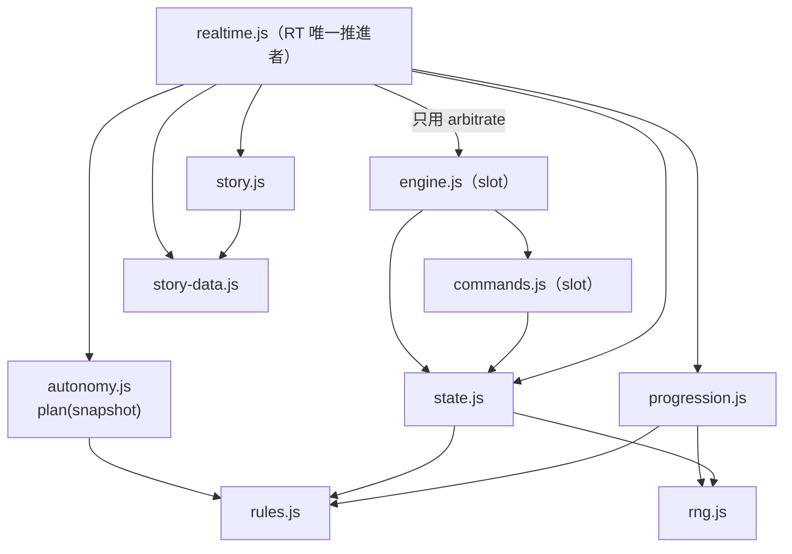

# Sect Chronicle 架構現況與最小抽取 ADR

## 生活入口架構盤點入口（2026-10-24）

下文是dev0875d116的舊`js/realtime.js`提案，並非目前生活入口的重構授權。當前`experiments/water-carry/demo/model.mjs`／`app.mjs`／`routes.mjs`的有限盤點與最小存讀邊界，見[下一milestone提案](LIFE_MILESTONE_NEXT.md#架構健康有具體債尚不需要全面重構)及[#215](https://github.com/lalagrass/earth-ascension/issues/215)。

保留單一權威tick與原模型／幾何／呈現分工；不因行數或本提案先做kernel／通用JobQueue／引擎遷移。Grok既有D35接線不受新架構前置阻擋；新增功能／存讀／整理待正式範圍批准。

- 狀態：**提案**（[#128](https://github.com/lalagrass/earth-ascension/issues/128) A2，ADR for [#117](https://github.com/lalagrass/earth-ascension/issues/117)），待遊戲 PO 技術接受。本文件不改 runtime、fixture、規則、schema、RNG、驗證頻率或排程文件。
- 實際主筆：Claude（Anthropic Claude Code），共用 `lalagrass` 帳號；不是遊戲 PO 的獨立審核。
- 核對基底：dev `0875d116e774cf2b53c6c36d160465b460302b1d`（#108 RT-02 squash）。所有行號以此 SHA 為準。
- 上層：[產品組合邊界](../../docs/architecture/PORTFOLIO_BOUNDARIES.md)。取代 #116 原「六階段 kernel＋系統註冊」提案作為 #117 的第一步；原提案保留為輸入，不再是預設方向。
- 不變的契約：D9／[RT00_CONTRACT](RT00_CONTRACT.md) P1–P4、§1.3 的四個步驟順序、RT-02 已通過的 R1–R4、手動優先類、突破待決 payload、rng1、slot 舊 API 與 golden、P4=B。

## 1. 決策摘要

1. **建議的最小有用抽取：把純函式 `arbitrate` 從 `engine.js` 移到新的 `js/arbitrate.js`，`engine.js` 以同一個函式物件重新匯出。** RT 從此不再載入 slot 引擎與 `commands.js`。行為與 hash 依構造不變（同一份程式碼搬家）。理由與證據見 §5。
2. **不做**：tick 階段註冊表、通用 plugin registry、kernel 改寫、六階段重排、`autonomy.js` 二次抽取（RT-02 已經抽好）。目前沒有一個具體的下一個改動需要它們，而且 #108 R1 修正說明了只用 hash 驗不出階段抽象的順序錯誤。
3. 第二候選（等 RT-03 開工時再評估，不與第一項同 PR）：把 `realtime.js` 的載入驗證抽成 `realtime-validate.js`（§5.5）。
4. #117–122 分別歸類，各自獨立 PR／gate（§6）。#121 存檔建議先比較「最小已驗證現況存檔」與「快照＋重播」（§7），推薦前者作 RT-03 起點，數字是候選。

## 2. 現況：模組與 import（【現況】）

全部模組都是 UMD：Node 走 `require('./x.js')`，瀏覽器走一般 `<script>`，掛在 `globalThis.SectChronicle.<Name>`。dev 上**還沒有任何 HTML 入口**；瀏覽器載入順序只寫在各檔頭註解與 `realtime.js` 的錯誤訊息。

| 模組 | 行數 | Node import（檔頭 `require`） | 匯出（摘要） | 所屬模式 |
|---|---|---|---|---|
| `rng.js` | 111 | — | `RNG_VERSION`、`create`、`validateState`… | 共用 |
| `rules.js` | 480 | — | 數值表與純公式、`RT_RULE_VERSION`、`TICKS_PER_SLOT`、`STEP_TICKS`… | 共用 |
| `state.js` | 1036 | rng、rules | slot 世界、`canonicalize`、`hashWorld`、`sha256Hex`、角色選項 | slot 為主；RT 借用 canonical／常數 |
| `story-data.js` | 696 | — | 事件表 `getEvent` | 共用 |
| `story.js` | 176 | rules、state、story-data | `inviteEventId`、`CANDIDATE_PROFILES`、`profileAttributes`… | 共用 |
| `progression.js` | 125 | rng、rules | `eligibility`、`cultivationBlock`、`judge`、`resolve` | 共用 |
| `commands.js` | 488 | rules、state、story-data、story、progression | slot `dispatch` | slot |
| `engine.js` | 613 | rules、state、story-data、story、progression、commands | `advance`、**`arbitrate`**、`settleIntents`、`planIntents`、`factsFor` | slot（`arbitrate` 為純函式） |
| `autonomy.js` | 301 | rules | `WAIT_REASONS`、`plan(snapshot)`、`pathBetween` | RT |
| `realtime.js` | 2455 | rng、rules、state、progression、**engine**、story、autonomy、story-data | `createWorld`、`validateWorld`、`hashWorld`、`serializeState`、`parseState`、`dispatch`、`advanceTicks`、`pathBetween`、`arbitrateDepartures`、版本常數與政策常數 | RT |

`realtime.js` 對其他模組的實際使用（`grep` 計數，dev `0875d11`）：

| 依賴 | 用到的成員 |
|---|---|
| `Engine` | **只有 `arbitrate`**（3 處：L1263 休養備案、L1759 `arbitrateDepartures`、L2382 `resolveBatch`） |
| `State` | `canonicalize`、`hashWorld`、`sha256Hex`、`CANDIDATE_IDS`、`MASTER_ID`、`PROTAGONIST_ID`、`MAX_ROSTER`、`DEFAULT_CHARACTER_OPTIONS`、`validateCharacterOptions` |
| `Story` | `inviteEventId`、`CANDIDATE_PROFILES`、`profileAttributes` |
| `StoryData` | `getEvent` |
| `Progression` | `eligibility`、`cultivationBlock`、`judge`、`resolve`（唯一的 RNG 消耗點） |
| `Autonomy` | `plan`、`WAIT_REASONS` |
| `Rng` | `RNG_VERSION`、`create`、`validateState` |

### 2.1 狀態所有權

- **RT 世界**是一個 JSON 物件，只有 `realtime.js` 的 `advanceTicks`／`dispatch` 回傳新狀態；兩者都先 `validateWorld`，再在 clone 上工作，不改輸入。
- `autonomy.js` 只讀 `decisionSnapshot(world, decideIds)`（L2245）產生的快照，輸出正式請求或帶原因的等待；預約、扣料與移動仍在 `realtime.js`。
- slot 世界只由 `Engine.advance`／`Commands.dispatch` 推進；兩邊對另一模式回 `wrong_mode`（RT00 §1.6）。

### 2.2 命令與事件

- 公開命令（`applyCommand`，L830）：`orderActivity`、`cancelManualOrder`、`setGoals`、`setPolicy`、`chooseEvent`、`acceptCandidate`。寫入 `commandLog`，`origin: 'manual'`。
- 引擎內部紀錄（`logInternal`，L1952）：自主指派 `autoAssign` 等，也寫入 `commandLog`，`origin: 'auto'`，同樣 `revision + 1`。不變式 `revision === clock.tick + commandLog.length`（`validateWorld` L330）。**因此 `commandLog` 是稽核紀錄，不是純玩家輸入清單**（影響 #121，見 §7）。
- 事件寫入 `eventLog`，帶 `seq` 與 `tick`；`dayReport` 在 `tick mod 180 = 179` 產生。

### 2.3 RNG

單一 sfc32 狀態 `world.rngState`（rng1）。RT 中**唯一消耗點**是突破單位完成時的 `Progression.resolve`（`applyUnitEffect`，L1742）。自主決策與仲裁不抽樣（RT00 §1.3 最後一段）。

### 2.4 驗證

每個 tick 末端全量 `validateWorld`（`runTick` L1035），載入（`parseState`）與命令前也全量驗證。實測見 §7.2。

## 3. tick 順序：現況程式對 RT00 §1.3 的對照

`runTick`（L1003–1038）。下表**只是命名對照**，不重排。任何抽取都必須保持左欄每一列的相對順序。

| RT00 §1.3 步驟 | `runTick` 中的程式（依序） | 不能移動的原因 |
|---|---|---|
| 1 到期事件 | 階段通知（t = 540／1080／1800）；`settleStory`：`expirePending` → `raisePlea` → `raiseInvites` → `raiseBreakthroughAsks` | 逾期處理要在新詢問產生之前；詢問不凍結世界 |
| 2 預約仲裁（前置） | 角色 `resumeReason` → `autonomyResumed` 事件、`decisionSeq + 1`；`dropArmed`（取消已標記 `halt: 'drop'` 的活動） | 釋放的人與座位必須出現在**本 tick** 的快照，否則晚一 tick 才能被決策 |
| 2 預約仲裁 | `collectRequests`（手動，優先類 0）→ `collectAutonomy`（`Autonomy.plan(decisionSnapshot)`，優先類 1，只對閒置且無手動鎖者）→ `resolveBatch`：**單次** `arbitrate`（含 `busy-*` 佔位請求）、被拒者轉 `startRestFallback`、`startGranted`、`autoAssign` 記錄 | 手動與自主同批仲裁；快照取自 tick `t` 開始時；被拒者同 tick 不重試 |
| 3 推進 | `progressMovers`（依活動 id 排序）：移動一步／工作 +1／完成單位 → `applyUnitEffect`（含突破 RNG）；日報 | 本 tick 完成的產出**下一 tick** 才可見；排序鍵是活動 id |
| 4 提交與驗證 | `clock.tick = t + 1`、`revision + 1`、`validateWorld` | 驗證失敗回 `error`，已提交 tick 保留（RT00 §1.5） |

若日後真的要命名更細的階段（例如 `prepare`／`decide`／`arbitrate`／`progress`／`commit`），它們必須是上表列的**直接改名**，且每個名稱的單元測試要和相鄰真實系統一起驗順序與衝突，不能只測空註冊。

## 4. 要保持的介面（相容性清單）

- `Realtime` 匯出的全部名稱與回傳形狀（§2 表）；`advanceTicks` 的 `{ ok, state, events, advancedTicks, stopReason, error? }` 與 `breakthroughResolved` 停點語意。
- `Engine` 匯出的全部名稱，含 `Engine.arbitrate`（`test/autonomy.test.js`、`test/engine.test.js` 直接呼叫）。
- 檔案路徑 `sect-chronicle/js/*.js`：測試與工具以相對路徑 `require('../js/…')`（`engine.js`／`commands.js` 各 8 處、`state.js` 16 處、`rules.js` 17 處）。
- 瀏覽器命名空間 `SectChronicle.<Name>`。
- fixture：`test/fixtures/*.json` 不重產；RT 20seed×2700 tick（`tools/rt-auto-replay.js`，`rt-auto-life-v1`）與 slot 20seed×42 的回放 hash 不變。

## 5. 最小抽取：比較與建議

### 5.1 選項

| 選項 | 內容 | 對下一個具體改動的幫助 | 代價／風險 |
|---|---|---|---|
| A 維持現狀 | 不動 | 無 | RT 繼續載入整個 slot 引擎；#110 viewer 要多帶 `commands.js`、`engine.js` 兩個 slot 檔；#122 無法評估「slot 只剩測試用途」 |
| **B 抽 `arbitrate`（建議）** | 新增 `js/arbitrate.js`（`arbitrate` 與它用到的 `checkCounts`、`isRecord`、`isNonNeg`、`isInt`、`has`、`byIdAsc`，約 70 行）；`engine.js` 改成 `const { arbitrate } = Arbitrate` 並照舊匯出；`realtime.js` 改 import `arbitrate.js`，不再 import `engine.js` | (1) RT／viewer 的瀏覽器載入清單去掉兩個 slot 檔、加一個無依賴的小檔（10 → 9 個 script）；(2) RT 與 slot 的唯一程式耦合消失，#122 才能誠實地說 slot 引擎對 RT 無依賴；(3) 仲裁成為 RT 與 slot 共用的明確契約（RT00 §1.3「以 SG-04 的 `arbitrate()` 語意」） | 小；載入順序要多一個檔（§5.3） |
| C 抽 RT 驗證 | `validateWorld` 及其子函式（L251–711、L1795–1930，約 600 行）搬到 `realtime-validate.js` | RT-03 載入路徑審查較集中；#122 增量驗證日後有地方落地 | 中：驗證函式與內部 helper 共用多，要先畫出 helper 依賴；現在沒有 RT-03 claim 需要它 |
| D #116 原提案 | kernel＋六階段註冊＋systems 目錄 | 現在沒有 | 大：重排風險（§3）、一次大 PR、與 #110 衝突 |

### 5.2 為什麼是 B

B 是唯一一個「現在就有消費者」的抽取：RT-02V viewer 必須在瀏覽器依序載入 RT 用到的模組，而 dev 上 RT 對 slot 引擎的依賴只剩一個純函式。C 的消費者是 RT-03，等那個工作包認領時再做，才能確定它真正需要的邊界。D 沒有消費者。

### 5.3 B 的檔案、相容 shim 與順序風險

- 新增 `sect-chronicle/js/arbitrate.js`，UMD，無依賴，瀏覽器掛 `SectChronicle.Arbitrate`。
- `engine.js`：Node 加 `require('./arbitrate.js')`，瀏覽器讀 `SectChronicle.Arbitrate`；刪除本地的 `arbitrate` 定義；`checkCounts`、`isRecord`、`isNonNeg`、`isInt`、`has`、`byIdAsc` 在 `engine.js` 其他函式也有用到，保留本地副本，`arbitrate.js` 自帶一份；匯出清單不變。`settleIntents`、`planIntents` 內部照常呼叫同名函式。
- `realtime.js`：`Engine` 參數改為 `Arbitrate`，三處 `Engine.arbitrate` → `Arbitrate.arbitrate`；更新瀏覽器缺模組錯誤訊息。L4 檔頭註解提到 `Engine.advance` 的 `wrong_mode` 說明保留（那是 slot 側的行為）。
- 載入順序：`arbitrate.js` 必須在 `engine.js` 與 `realtime.js` 之前。若 RT-02V 的 HTML 已先合入，B 的 PR 要在該 HTML 的 `<script>` 清單加一行並刪去不再需要的 `commands.js`／`engine.js`——這是另一位作者的檔案，**先在 #110／#67 與遊戲 PO 協調時間**，不要在 viewer 驗收進行中換掉它下面的引擎。若 B 先合入，viewer 直接用新清單。
- tick 邏輯完全不動：同一份函式程式碼，呼叫點與參數不變，因此不存在 §3 的順序風險。

### 5.4 驗收證據與回滾

必要（依 #116 PO 分流的「純搬移」門檻）：

1. `node --test sect-chronicle/test/*.test.js` 全綠（CI Node 22／24），與根目錄三項檢查。
2. 新測試：`Engine.arbitrate === Arbitrate.arbitrate`（同一函式物件）；Node 下 `require('./realtime.js')` 後 `require.cache` 不含 `engine.js`、`commands.js`。
3. `node sect-chronicle/tools/rt-auto-replay.js --matrix`（20seed×2700，step／3／60／180 切塊）與 slot 20seed×42 回放的 hash 與基底相同；附基底與 head 的 SHA 與命令輸出摘要。
4. 瀏覽器載入冒煙：依新順序載入後 `SectChronicle.Realtime.createWorld` 與 `advanceTicks(world, 1)` 成功（若 viewer 已存在，用 viewer 正式入口）。

回滾：單一 squash commit 的 revert；沒有資料或存檔遷移。

### 5.5 第二候選 C 的前置

在 RT-03 認領時，由 RT-03 主筆或遊戲 PO 指派的作者先列出 `validateWorld` 用到的 helper 與常數，確認可以只靠參數或 `Rules` 取得；若需要把 helper 再拆一份，先證明不會讓兩邊驗證漂移（同一組壞狀態 fixture 在兩邊都被拒）。驗證**頻率**不在 C 範圍（那是 #122 的行為變更）。

## 6. #117–122 分類

| Issue | 本 ADR 的分類 | 需要的 gate | 建議時機 |
|---|---|---|---|
| #117 kernel／systems | **行為保持的搬移**，一次一個抽取；第一個是 §5 選項 B | 遊戲 PO 接受本 ADR；§5.4 證據 | ADR 接受後；與 #110 協調檔案與時間 |
| #119 brain 介面＋trace | `plan(snapshot)` 已是 brain v1 介面，**不再抽一次**。trace 分兩種：(a) **衍生診斷**——由 `plan` 的輸出（已含等待原因 `WAIT_REASONS`）在呼叫端組成、不入世界、不入 hash；(b) **持久化 trace**——寫入世界即是 **canonical／schema 變更** | (a) 遊戲 PO；(b) schema 升版與相容決策 | (a) 可配合 #110 viewer 的「為何等待」；(b) 不在本批 |
| #120 事件因果＋敘事投影 | 只讀 selector（日報、編年史）＝**衍生投影**，可沿用現有 `eventLog`；新增 `causes[]` 欄位＝**canonical／schema 變更** | 投影：遊戲 PO；`causes`：schema 決策、驗證與因果來源定義 | 投影可隨時；`causes` 要在 RT-03 存檔格式對外前決定 |
| #118 keyed RNG | **RNG 變更**（rngVersion 2） | 擁有人；在那之前 **rng1 維持**，D9 有效 | 見下方 #116 PO 更正 |
| #121 RT-03 存檔 | **持久化選擇** | 遊戲 PO 選最小存檔契約；超出已批准 RT 範圍交擁有人 | §7 |
| #122 slot → legacy、增量驗證 | 兩件事：(1) 目錄搬移＝**行為保持的搬移**，但**前置是 §5 選項 B**，且必須保留 `js/engine.js`、`js/commands.js` 路徑的 shim 或測試路徑；(2) 增量驗證＝**驗證效能變更**，改變拒絕時機與覆蓋，不能沿用「行為不變」 | (1) 遊戲 PO＋API／import 檢查；(2) 先有瀏覽器 profiling 證明瓶頸 | (1) B 合入後評估；(2) §7.2 的數字目前不支持需要它 |

### 6.1 #116 PO 更正的落實

- **四步驟對照，不是新順序**：§3。
- **trace 與 hash**：#119 不能同時新增持久化 trace 又宣稱 hash 不變；本 ADR 只建議 (a) 衍生診斷。不新增人格／記憶佔位欄位；brain v2 留在 #105／#106。
- **#122 不是純路徑搬移**：`realtime.js` 現在 import `engine.js`；§5 選項 B 是讓它成立的前置。`state.js`、`story.js`、`progression.js`、`story-data.js` 仍是 RT 與 slot 共用，**不搬進 legacy**。
- **#118 RNG 身份**：同 seed／tick／角色／用途／目標的重複抽樣、重試與邏輯事件 id 都要能區分；用途名、演算法、版本會變成契約。**P4=B 只指 RT 入口拒絕舊 slot 檔**，不授權把現有 RT rng1 存檔變成只能重播的檔案。三個選項各有代價：保留 rng1；rng1 與 rng2 並存；明示拒絕 rng1 並保留原檔。擁有人選擇前不替換任何 golden。
- **#121 存檔**：§7。

## 7. #121：RT-03 存檔格式比較

### 7.1 兩個選項

| | 選項 1：最小已驗證現況存檔（建議作 RT-03 起點） | 選項 2：初始參數＋命令＋快照重播 |
|---|---|---|
| 內容 | 封套＋`serializeState(world)`（即現有 canonical 世界，含 `seed`、`characterOptions`、`commandLog`、`eventLog`、`rngState`） | 初始建立參數＋玩家命令序列＋定期快照（候選：每日）＋hash |
| 原始建立參數 vs 後續命令 | 世界本身已分開：`seed`、`characterOptions` 在建立時寫入；`policy`／`goals` 之後只能經 `setPolicy`／`setGoals` 改，留在 `commandLog` | 必須另存建立參數；不得把後來的政策當成初始設定 |
| 命令順序／revision／id | 由現有 `dispatch` 規則保證：同 id 去重、`expectedRevision`、`revision = tick + commandLog.length` | 重播只能餵 `origin: 'manual'` 的項目，並以 `(tick, seq)` 排序；`origin: 'auto'` 的 `autoAssign` 要由重播重新產生並逐一比對，而不是當成輸入 |
| 突破批次續推 | 存的是 tick 邊界狀態，`breakthroughResolved` 停點後照常 `advanceTicks` 續推（RT00 §1.5、§5.5 已要求任意邊界可存讀） | 重播必須重現同一停點，並在停點後接續剩餘 tick |
| 驗證 | 現有 `parseState` → `validateWorld` 全量驗證 | 結構驗證＋重播等價（重播後 hash 等於快照 hash）；hash chain 只能偵測不一致，不證明真實性 |
| 歷史瀏覽 | 不提供（只有目前狀態與 `eventLog`） | 可從快照往後重播；但只保留 day 0＋最近 N 日時，被刪區間的 seek **不保證**最多重播一日，需實測並寫明上限 |
| 大小 | 見 §7.2 | 每日快照若各自包含 `eventLog`，會巢狀複製整份歷史；必須不在快照內嵌事件 |
| 主要風險 | 存檔隨 `eventLog`／`activities` 線性成長 | 重播邏輯本身成為新的正確性來源；兩條路徑（直接續玩 vs 重播）的等價要持續測 |

兩個選項都需要：壞檔／未知版本**保留原始資料**不覆蓋；寫入失敗或 quota 不足時**原子回復**（先序列化並驗證，再寫新 key，成功後才換指標；保留上一份可讀備份，沿 [TECHNICAL_DESIGN](TECHNICAL_DESIGN.md) 的 SG-07 設計）。

### 7.2 已有的實測（候選依據，不是正式量測）

量測方式：在 dev `0875d11`，Node v22.22.0（雲端容器，非瀏覽器），用 `tools/rt-auto-replay.js` 的 `play(index, 180)` 跑到 tick 2700，對最終世界量 `serializeState` 位元組數與 `validateWorld`／`parseState` 平均時間。三個 seed 各代表一種政策組；不是 20seed 矩陣，不能當分布結論。

| seed | 政策 | 位元組 | 去掉 `eventLog` | 事件 | commandLog | activities | `validateWorld` | `parseState` |
|---|---|---|---|---|---|---|---|---|
| rt-dev-000 | 安穩發展 | 134,203 | 86,401 | 290 | 79 | 86 | 3.27 ms | 4.00 ms |
| rt-dev-010 | 全部詢問 | 61,817 | 37,125 | 159 | 35 | 34 | 1.17 ms | 1.59 ms |
| rt-dev-015 | 自訂 | 56,030 | 35,832 | 123 | 34 | 33 | 1.16 ms | 1.52 ms |

解讀（推論，待 RT-03 在瀏覽器實測）：

- 15 日觀察窗內，選項 1 的單一存檔約 0.06–0.13 MB，遠低於候選上限 1 MB。
- 選項 2 若保留 15 份完整每日快照，總量約等於各日大小相加；以線性成長粗估會接近或超過 1 MB，除非快照不含 `eventLog`／已完成活動。
- 每 tick 全量驗證約 1–3 ms；1× 每秒 4 tick、4× 每秒 16 tick 時約佔每秒 50 ms 以下。**目前沒有證據需要 #122 的增量驗證**。

### 7.3 建議

RT-03 先用選項 1，封套欄位沿 SG-07 設計（`format: sect-chronicle`＋三個版本＋checksum＋完整狀態，key `sect-chronicle-save-v1`）。若擁有人要歷史瀏覽，另提選項 2 的子集（只對 `origin: 'manual'` 重播並與現況 hash 比對）作為**驗證工具**，不是存檔格式。1 MB、每日快照仍是候選數字。

## 8. 後續（依優先序）

| 優先 | 工作 | 擁有者 | 前置 | 證據 |
|---|---|---|---|---|
| 1 | §5 選項 B：抽 `arbitrate.js` | 遊戲 PO 排程的 SG 核心主筆（Stage B 單一 claim；可為 Claude） | 本 ADR 接受；與 #110 viewer 協調 | §5.4 |
| 2 | #119 (a)：把 `plan` 的等待原因組成唯讀「為何等待」selector | #110 viewer 主筆或遊戲 PO 指派 | 無（不入世界） | viewer 瀏覽器證據 |
| 3 | #121：RT-03 存檔契約選擇 | 遊戲 PO | §7；#120 `causes` 是否要先定 | 瀏覽器實測大小／載入時間 |
| 4 | #118：RNG 選項整理（重複抽樣身份、三種 rng1 處置成本） | 架構主筆起草、擁有人決定 | 無 | 文件；不換 golden |
| 5 | §5.5 選項 C | RT-03 主筆 | RT-03 認領 | 同一組壞狀態 fixture 被拒 |
| 6 | #122 (1) legacy 目錄評估 | 遊戲 PO 指派 | 選項 B 合入 | import graph 與 shim 清單 |

## 9. 不屬於本 ADR

戰鬥、輕功、第二境、28 天內容、Earth 人格／記憶移植（brain v2）、跨產品共用引擎。#110 不依賴本 ADR 的任何一項。
