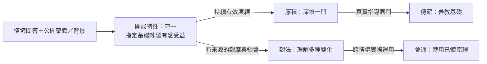

# 開局隱藏特性、歷練分支與經典武學路線

狀態：2026-10-26，依擁有人追加構想整理的**紙上設計提案**，主[#340](https://github.com/lalagrass/earth-ascension/issues/340)，PR #341。可研究開局較強特性，不限於弱提示；具體效果、門檻、問答改版與runtime尚未批准。角色／武學名稱是研究對照，不新增遊戲內容，不改現有分支或D53。

先讀[心性與共用面板](CHARACTER_PERSONA_TRAITS_DESIGN.md)、[角色／原生數值對照](CHARACTER_TEMPLATE_CONTRAST_REVIEW.md)。

## 1. 喜歡九劍或降龍，本身就能形成不同養成族群

擁有人指出：有人喜歡獨孤九劍，有人喜歡降龍十八掌，不必把所有路線做成同樣的一組數值。採為本輪研究方向：**讓喜好、打法與成長過程有差異，不要求每條路線適合所有人或數字完全相等**。

但需分清：

| 層次 | 問的問題 | 可用的條件 |
|---|---|---|
| 得到機會 | 如何接觸教法？ | 師承、秘籍、探索、關係、事件；不是先天值 |
| 能入門 | 目前能否學基礎？ | 已學基礎、必要身體／內息能力、可教老師；少數特殊學法可有真前置 |
| 怎樣練 | 理解、熟練、經驗如何累積？ | 反覆演練、觀摩、交手、調息；稟賦／特性影響方式與效率 |
| 能精通 | 為何突破不了？ | 真正接觸不同情境、足夠練習、缺教法或特定領悟；不全用悟性一條線 |
| 用得強 | 地圖上能做什麼？ | 技巧、身體、所學內功、距離／時機／精力、敵人形態及真招式規則 |

**郭靖、喬峰、洪七公均為降龍對照**，不能從郭靖的數值推出「降龍必須低悟性」。風清揚與令狐沖也不必有相同性情，才能使用同種武學。這是分類反例，不宣稱原著提供本作精確門檻。

九劍可以偏讀招與臨機破勢，降龍偏掌勁、站位與正面壓制；前者在可辨起手的單體交手更有表現，後者在護路／驅獸的正面衝擊更有表現。這些是本作**待評玩法假設**，不是所有版本的既定規則；不將九劍固定成必勝反擊，亦不將降龍固定成永遠群攻最強。

## 2. 問答給有感的基礎特性，再由歷練分叉

建議「稟賦／基礎能力」「天賦支系」「武學譜」分開：

- 根骨、原悟性、力量等仍按各版權威規則與起始快照記錄。
- 問答可形成心性／價值、志向，並參與產生一項開局隱藏特性。特性可以在指定領域顯著有效，不必故意弱化成文案；原角色基值不被偷偷改寫。
- 天賦支系記這項特性如何因歷練分支、獲得新能力或改變效果。
- 武學譜記某門學了多少、哪些招式能真施展。隱藏特性不等於已學會獨孤九劍／降龍十八掌。

紙上最小規模建議：**一項開局種子→兩條可辨方向→各一個後續節點**，先用三條公共支系作對照。不是每個角色各做一棵獨立大樹；公共規則可重用，角色的起始所學與故事階段另記。這個數量也是提案，不是新工程指派。

圖中是條件關係，不是「點一下就學會」。厚積／觀法是否互斥、能否晚些兼修尚待選；不能因畫成兩叉就擅加永久封路。不同人物可以共享守一，後來走向不同；相同節點也不保證相同功力。

### 強力開局怎樣保留樂趣

允許玩家喜歡某種答案與build，熟悉之後選路線也不必視為作弊。重點是有多種值得玩的強項，而不是所有答案都送同一種全技能倍率。

- 初始特性主要改一個能看見的領域，例如同一基礎套路更容易穩定進步，或觀察陌生出手更有收穫；不是同時提高傷害、速度、恢復與社交。
- 有些人物可以先天較強，無需人人等點／同強度；清楚標示是故事模板、一般自創或特殊開局，平衡方式待真人與擁有人選。
- 稀有條件可保留少數真正獨特的學法，但不能把所有絕學都集中給「高悟性＋某一種人格」。
- 分支差異可由練習時間、精力、站位、可遇師承與想做的生活來形成；不為平衡先創新貨幣、強制技能欄或完整天賦點系統。
- 問答可提供初始方向，後續行動仍有轉向／替代途徑；人格不直接禁止玩家下命令。
- 先不定加成百分比、稀有率、閾值；要與原悟性／特質倍率查重後再談。不把紙上強力設定冒充已實測。

## 3. 隱藏與成長狀態必須分開

| 機制 | 意義 | 反例 |
|---|---|---|
| 開局即有效、暫未揭露 | 特性在創角時已生成並有真效果；後續發現只改認識 | 不能揭露時再加同一份效果 |
| 開局種子／潛能，尚未有該分支效果 | 初始只確定學習方向，後續事件才獲分支 | 不能用「隱藏」誤導玩家以為早已獲得全部buff |
| 達成條件取得新節點 | 後天獲得，記前置、事件／時間、效果來源 | 同一演練／照護事件不能重複刷授予 |
| 取代／升級 | 新節點替換原效果，或明定保留哪些部分 | 不默認父節點與子節點全部乘算 |
| 條件啟動 | 特性已取得，但此情境才有效 | 精力／目標改變可結束；不是反覆永久解鎖 |

問答生成、條件檢查、機率與授予都由權威核心處理，讀卡／重畫畫面不重擲。完全未知不藉空格／樹輪廓暴露；已獲線索可顯示方向，已發現／已取得才依核心允許顯示效果與條件。開局是否明示特性名、隱藏效果是否可由玩家觀察推理，仍待選。

## 4. 經典角色的候選隱藏特性與分支

以下是**研究建議，不是原著官方天賦或已存在程式**。階段不足的資料留未知；成熟者可從已獲特性節點開始，不能全部倒推成出生贈品。表中「→A／B」是候選分支，未決互斥／兼修；角色不必一人專屬一棵樹。

| 對照角色 | 候選種子／已獲特性 | 歷練後可能的方向 | 分類邊界 |
|---|---|---|---|
| 郭靖 | 守一／穩健學法 | 厚積深修／傳薪教基礎 | 不要求低悟性，也不因憨厚直接送降龍 |
| 令狐沖 | 識隙 | 臨機破勢／通式會意 | 九劍仍需真師承與所學，不由灑脫直接獲得 |
| 岳不群 | 持序研習 | 精研正脈／權衡捷徑 | 名望、人格矛盾與武學選擇分開；不是天生必走邪路 |
| 韋小寶 | 察言 | 經營結交／趨避周旋 | 社交機變不等於武學悟性滿值 |
| 張無忌 | 內息適應候選 | 綿息／會通調勁 | 九陽、乾坤等為所得武學，不由一項根骨直接全開 |
| 阿星 | 未顯潛質／開局壓抑狀態 | 潛質漸顯／因緣覺醒 | 隱藏真值與封閉效果分開；現分支既有劇情不被本研究改寫 |
| 包租婆 | 精控吐納候選 | 聚氣發聲／護院應變 | 獅吼是已學招式，不把成熟本領全列先天 |
| 包租公 | 柔勁感受候選 | 借勢／圓轉 | 太極所學另列，懶散不等於低天資 |
| 東方不敗 | 凝神精察候選 | 疾應／精控 | 葵花造成的能力屬後天；性別／情感不作天賦前置 |
| 黃蓉 | 觸類／強記候選 | 百藝巧用／設策助人 | 廚藝、陣法等知識有學習來源，不全是出生值 |
| 周伯通 | 好奇玩學 | 遊習／兩式互參 | 左右互搏需特殊教法與實踐，不由低悟性自動獲得 |
| 喬峰／蕭峰 | 臨戰敏銳候選 | 迎勢／護眾 | 義／群體責任不是硬傷害倍率 |
| 小龍女 | 澄心候選 | 凝練／無擾 | 內向不等於冷漠；雙劍需要已學與執行能力 |
| 王語嫣 | 強記候選 | 辨譜識招／授理 | 識招不等於能親自出招；知識量另記 |
| 虛竹 | 收攝／適應候選 | 守成／調和 | 傳功前後功力可差很大，不倒寫天賦 |
| 石破天 | 直觀領會候選 | 觀形悟理／自然運使 | 不以文盲為獎勵或必要條件，文字技能與領悟分開 |
| 張三豐 | 成熟融會（後天） | 立意創法／傳薪 | 青年種子未知；成熟創見不是出生滿分證據 |
| 黃藥師 | 觀物／嘗新候選 | 匠心／音理 | 多藝先要實際知識與練習 |
| 歐陽鋒 | 攻堅傾向候選 | 窮研／險試 | 選路與受創狀態不等於先天善惡 |
| 任我行 | 察勢候選 | 統籌／制衡 | 組織目標與吸星等所學分開 |
| 林平之 | 初始未知；經歷形成的決意 | 重建／追索 | 復仇不是出生屬性，人生不被問答鎖死 |
| 程靈素 | 細察候選 | 辨藥／照護 | 醫藥技術與關懷動機分開，不是只換戰鬥加成 |
| 段譽 | 理路興趣候選 | 步理會意／專注運使 | 不願練與學不會不同，奇遇所得另列 |
| 洪七公 | 成熟掌勁／傳授經驗 | 精研／傳薪 | 不臆測青年根骨，已會降龍不是低悟性證據 |
| 楊過 | 融會候選／已得經歷 | 重意／應變 | 重劍與黯然等條件須獨立，不把經歷變成通用先天 |

其餘已盤點同伴可先用公共種子與既有資料評估，不為表完整就亂造專屬天賦；下一輪各agent只挑最能揭露語義問題的三組，不重做全人物評分。

## 5. 先列經典武學，再看是否都是同一組條件

下表是**本作待評功能與學法假設**；原著、各款老遊戲與三分支設定分開，沒有原著官方的根骨／悟性點數。不是此表出現就批准新增武學、硬門檻或特殊戰鬥系統。

| 武學／家族 | 想呈現的不同學法／長處 | 值得核的能力／特性 | 不應一概要求 |
|---|---|---|---|
| 獨孤九劍 | 觀變、理解對手與應變；可讀起手的交手 | 劍術基礎、理解、觀察經驗；識隙可幫助 | 特定外向性格；或一拿到隱藏特性就自動全破 |
| 降龍十八掌 | 掌勁、勁力控制、站位與進退 | 掌法、出力／體能、內息與反覆演練；厚積可幫助 | 低悟性、憨厚或唯一人格；高悟性同樣能練 |
| 打狗棒法 | 器械、變化、距離與纏繞牽制 | 棍術、協調、理解與師承 | 與降龍完全相同的力量門檻或同一特性 |
| 太極拳／劍 | 辨勢、借勢、調勁 | 技巧、控制、經驗、內息；柔勁感受可幫助 | 年老、慢速數值、或天生低力量 |
| 九陽類內功 | 持續調息、身體適應與運用 | 內功基礎、根骨原義、修行經歷 | 只要根骨高就直接獲得全本九陽 |
| 九陰類綜合典籍 | 分篇研習與不同技術組合 | 典籍理解、各篇前置、已有技術 | 一個總悟性同時代表所有章節熟練 |
| 易筋類修持 | 長期修持與身體／內息適應 | 持續修行、身體與教法 | 只憑宗教身份或一題善惡回答 |
| 北冥／吸星類 | 特殊功力取得與調和方式 | 傳承、已有內功狀態、處理不同來源的能力 | 相同性格或把所得功力當根骨；衝突代價按版本另核 |
| 葵花／辟邪類 | 高速、精密施展與特殊傳承 | 教法、所學、動作控制及真代價 | 用性別／情感身份推出天資或人格 |
| 凌波微步 | 步理、節奏、移動路線 | 步法理解、身體協調、練習 | 一個裸移速值即可代表學會；需不需要卦理是版本設定 |
| 左右互搏 | 特殊分心協調的學法 | 教法、分心訓練、可驗證的實作 | 低悟性必會／高悟性永久禁學（本案尚未定） |
| 六脈神劍 | 內力運使、穩定與控制 | 內息、控制、教法與真消耗 | 與劍器套路完全同一種身法門檻 |
| 黯然銷魂掌 | 經歷與意境如何影響已學技術 | 武學積累、可追溯狀態／經歷 | 強迫玩家受情傷才有玩法；情緒變化不當出生天賦 |
| 玉女劍／合璧類 | 精密招式與合作時機 | 已學劍法、配合、站位／事件 | 高好感等於已會招式，或特定關係身份必然加成 |
| 十二路譚腿 | 腿招、下盤、距離與連段 | 腿法技術、通用力量／下肢能力、協調 | 跑速或腳力高就等於腿法高 |
| 獅子吼 | 發聲／吐納、範圍與控制 | 真內息、控制、相應教法 | 脾氣大、外向或嗓門大直接等於會武功 |
| 如來神掌（功夫路線） | 特殊傳承／覺醒與掌法表現 | 既有故事、潛質與實際所學 | 所有人都靠瀕死刷開；研究不改現有阿星劇情 |
| 太玄類學法 | 不同理解媒介／圖形領會 | 觀形、體悟、教法；文識獨立 | 簡化成「不識字才天才」 |
| 彈指／細勁類 | 精密發力與距離判斷 | 精控、技巧、指力等是否真有必要另評 | 再加一項通用「天生指力」只為湊表 |

**同一能力可支援多種武學，同一武學也可由不同稟賦的人練成。** 隱藏特性主要提供特色路徑／效率／變式；少數武學可有特殊前置，但不先把每門絕學綁一個出生祕密ID。天才可能雙修，差異仍可由投入時間、所學深度、可遇教法與場景造成，不必一律永久鎖門。

## 6. 三分支已定義的前置，並非全都相同

固定來源仍為GPT79c1665、Gemini bae4341、Grok6db09fd。以下只是已提交資料／函式核讀，非完整runtime驗收：

| 分支 | 核實觀察 | 解讀限制 |
|---|---|---|
| GPT | data.mjs列基礎拳、齊眉棍、基礎劍、九劍入門、提縱步。martial-config.mjs的九劍路數有觀察／窗口，快拳與佯攻可破局；U/F/I分理解／熟練／體悟 | 不把「九劍入門」冒充完整九劍，未核到降龍不補造。不同招式已有時機與距離差異，不只是換傷害數 |
| Gemini | martial-trees-v07.json定義降龍需空明拳3、strength7、innerQi6；九劍需五嶽反擊劍3、agility7、comprehension8；紫霞需抱元氣5、innerQi6、constitution4 | 是本分支資料前置，不是原著／公版批准值；governingStat是效果主導欄，不等於唯一學習條件。與v04／legends同名異ID和重複項的權威需作者核對 |
| Grok | arts.mjs分req、wuxingMin、secret取得；悟性影響學習倍率及部分上限，honest／free／diligent亦影響特定路數。data.mjs的降龍／九劍req空但secret為真；wuxia／華山劇情有傳授與觀破條件 | req空不等於人人直接獲得。降龍偏好憨直是本版作者規則，不擴為所有版本的必然前提；高悟性通用高階倍率也不代表所有絕學前置相同 |

因此不用先新增十種隱藏數值，才開始形成九劍／降龍的不同族群。先保留既有不同教法／前置／玩法，再找哪些特色確實需要公共天賦支系。

本輪核讀位置：
- GPT：solo-sect-gpt/src/data.mjs、martial-config.mjs及content/core-v1.json，本機固定已提交SHA，不假設遠端存在。
- [Gemini武學樹](https://github.com/lalagrass/earth-ascension/blob/bae43412dced2a2f0d9d82008d5cdf8b3acfb8f9/sect-chronicle/life/data/martial-trees-v07.json)與martial-arts-v04.json。
- [Grok武學規則](https://github.com/lalagrass/earth-ascension/blob/6db09fd97cac3d9a66cde49103978d7793317418/solo-sect/src/arts.mjs)、data.mjs及wuxia.mjs／jianghu.mjs。沿用已交#340報告，不重跑戰鬥。

## 7. 開源如何表達分支

- [CDDA特性文件](https://docs.cataclysmdda.org/JSON/MUTATIONS.html)：有創角可選特性、前置／互斥／後續變化等資料。可借起始節點和後續節點的關係；不搬變異規則，也不把不顯示等同安全遮罩。
- [Wesnoth UnitTypeWML](https://wiki.wesnoth.org/Unittypewml)：advances_to可提供多個進階方向，advancement有前置、互斥與次數限制。可借有界分支與明確效果來源；本作不是替換兵種，也不搬回合制經驗門檻。
- 情境問答、人格／價值分層及問答變成最佳解的取捨，見[心性設計來源](CHARACTER_PERSONA_TRAITS_DESIGN.md#8-社群開源參考與限制)。

不是有現成樹UI就能直接用：本作還要決定誰判條件、哪個事件算歷練、效果是否取代、玩家知道多少。先定內容再選樹形呈現，不新增依賴／通用規則引擎。

## 8. 共用面板與最小下一步

同一人物卡內：
- 生活總覽的「心性與志向」看人格、價值、當前目標與來源。
- 武學成長的「特性支系」只看已知節點／線索／真獲得事件。
- 武學成長的「所學與可學路線」把教法、入門、練習／精通、當前施展效果分欄；隱藏條件由核心遮罩。
- 稟賦、天賦支系與武學譜共用引用，不共用一個會被UI寫回的分數，也不按畫面連線自動授予招式。

建議下一輪先紙上比較**九劍／降龍**兩路，再加一條**內功／生活**路線作非直接輸出對照。每路只挑一個開局特性、一個分叉與一個不靠該特性也可入門的例子；確認後再選工程。第一包不一口氣實裝表內19類武學、25名角色或全部天賦樹。

待定：開局特性給玩家看多少、哪些路線允許硬前置、分叉互斥或晚些兼修、首批實戰差異與有限效果。這些不是已批准門檻。存檔升版／手機繼續最後，不為研究新增保存或測試矩陣；已批准開發包照常。
