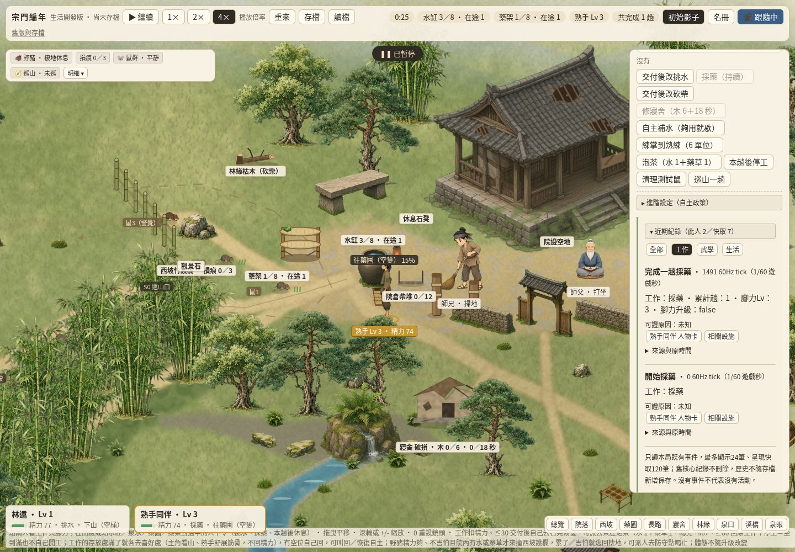
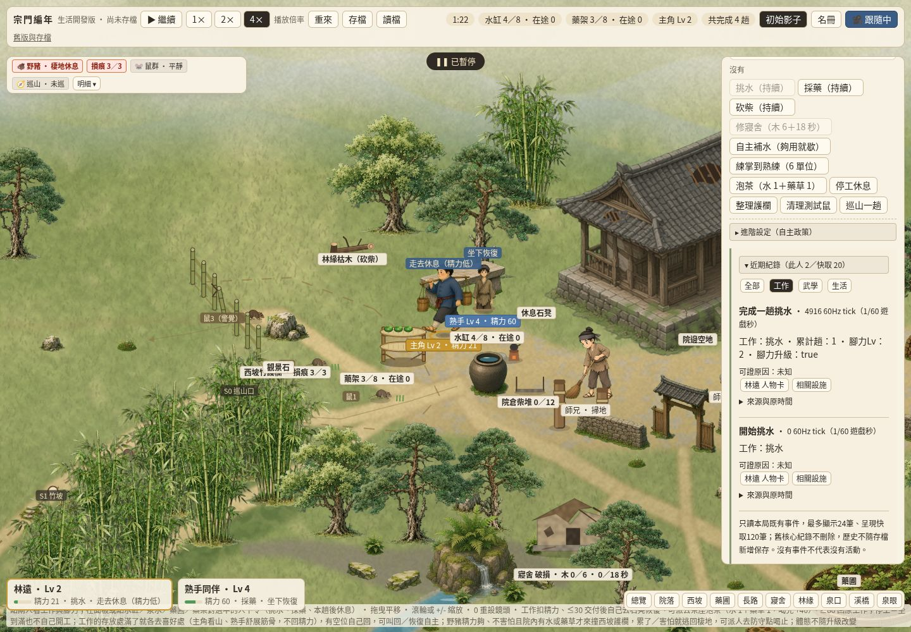

# SG-PUBLIC-05／#351 唯讀近期紀錄與有限序列收尾

玩家問題：工作完成、掌法練熟後，從同一張人物卡看見原核心真紀錄、原時間及可證原因，能回到人物／設施，而不用翻原始 log。

實際主筆：獨立 Codex Cloud `/root/events351_author`，非 grass reviewer／merge owner。自有 checkout `/workspace/events351-author`，短分支 `codex/events351`；base dev `67b49e3a078ea491432a9ff22de48400019fc57e`。[唯一 claim](https://github.com/lalagrass/earth-ascension/issues/351#issuecomment-6414178870) created_at `2026-10-26T10:49:20Z`，四小時可附進度續期（至 `14:49:20Z`），非總開發時限；登記前 comments 空，登記後再次核無較早有效作者。共享 GitHub login 不是平台獨立 approval。#350／PR354 前置已合此 dev，push postCI40309733677 success，證據復用。

## 範圍、原事件與呈現記憶

`event-view/contract.mjs` 的 EventView version1 是**呈現物件**，沒有寫入 canonical world／save。每筆包含來源、stream、穩定原 ID 或可重現 adapterID、原 tick／單位、角色、已證設施／行動、真結果、可見性與事件自身原因。值復用公版 field；hidden 在投影時刪除原值、角色、設施、行動及類別，cursor消費後不放入玩家快取，清單／篩選／計數均不顯示其存在或原時間；直接render也過濾hidden，不能從 tooltip／連結／篩選洩漏。HTML 文字全部 escape。

正式／Gemini adapter 讀 `model.state.log`、原 `tea.state.events`／`home02.state.events`／`train01.state.log`／`life02.state.log`。核心主 log 是一個 offset，原生小 ring 只記該 ring 視窗的參照（最多40筆），沒有另複製無界歷史；正式核心既有未保存練功／茶／木床事件依原界線只本局。所有新增資訊在 UI，核心物件與原日誌不改。原有不同 stream 的同一件事可以有不同視角記錄，不宣稱跨 stream 為同一 canonical 事件。原記錄的 `kind='note'` 和 `why` 才作原因，不借目前人物 why、鄰近事件或時間排序倒推原因；缺因果鏈不顯示「因此」。

沒有原 ID 的正式／Grok 紀錄採 `source:epoch:stream:原時間:同時間原記錄ordinal`，同一觀察起點與原始事件順序下可重現，逐筆／批次讀取相同；相同 tick 的相同內容仍是不同事件。這不是存檔／跨 session 永久 ID，也不補回原核心在觀察前已捨去的 ring 歷史。GPT ID 明留 native `event.N` 於 namespace 尾端。

`createRecentEvents` 只保留最近120筆、最多24筆呈現；一個命名空間最多8個 stream high-water cursor，逐 stream 遞增序號讓已淘汰舊 batch 重新送入也不重播，去重 set 與 rows 同界。近期篩選跟隨選中人物，可選全部／工作／武學／生活；同一清單在生活與武學分頁共用。人物連結回原人物卡；只對原正式 adapter 已支援水缸／藥架給設施連結，練功樁／茶座／新木倉沒有公版設施詳情就不造一個假連結。模型替換、原 tick 倒退或顯式 reset 切 epoch；正式重來／成功讀檔明確清 cache 與 reader，失敗讀檔不清、不改原流程。切來源／epoch 整份清呈現資料，不能混前一局或另一核心。

## 三版能力與固定來源

以下是**已提交固定快照＋dev接線**的驗證，不是三位原作者最新分支已採用。原公式／schema／RNG／保存、人物數與各自玩法不變。

| 能力 | 正式 dev／Gemini 家族 | GPT 固定快照 | Grok 固定快照 |
|---|---|---|---|
| 固定來源 | 正式67b49e3；Gemini `bae43412dced2a2f0d9d82008d5cdf8b3acfb8f9` | `6cbd3e6fccb8bc376e95e2f406ce6cead2a30fdc`（原作者 Claude Opus5.5） | `6760f21c342cbf72fc9fb4baf0aec8655abd0dd2` |
| 真場景／人物與命令 | 同一正式入口，既有60Hz／路線／原dispatch；固定Gemini另測 | 原20Hz world與座標，開發 harness；合法原command | 原0.25秒 tick、原pos／setOrder，開發 harness |
| 人物／武學 | 原第一式、原精力／腳力／熟練、四類前提按來源缺項 | 原skill U/F/I各量尺，execution未知 | 原arts XP／已解鎖moves；隱藏悟性不傳判定；execution未知 |
| 設施 | 水／藥等原支援詳情／指派；站位容量／排隊unsupported | 真原設施／庫存／command薄適配，缺項明示 | 共用場景有原設施錨點；公版完整互動unsupported |
| 事件結果與時間 | 原log與既有小系統事件，60Hz tick（1/60遊戲秒） | 原journal ID，20Hz tick（1/20遊戲秒）；只投影明列結果欄位 | 原public log.msg／原生who，保留floor(t)原整秒 |
| 原因／可見性 | 只用事件自身why／note；其他unknown | 原journal沒有歷史可見性；wild/cave/departed/缺失／inactive演員一律保守hidden，unknown類型結果unknown | 原public log已是原生玩家可見文字；只有原who、不由名字重判；結構化設施／行動與原因unknown |
| 正式UI採用狀態 | 本PR候選同入口清單；非已合dev | adapter真核心定向驗證，非其原作者分支已更新 | adapter真核心定向驗證，非其原作者分支已更新 |

来源原檔、作者、每檔 SHA256／依賴邊、授權與保留通知沿 [scene-shared/SOURCES.md](../scene-shared/SOURCES.md) 及三個 `sources/*/manifest.json`。本包不下載新素材／套件、不重釋同repo權利為第三方開源。正式 Event adapter 僅讀模型，不載入其他核心來演戲；來源 pins 是常數，不會在正式入口啟動額外 world／clock。

## 來源／版本更新指南與UI小整理

1. 由新 issue 明確選定欲更新的核心與不可變 commit；從該作者已提交來源取得最小依賴閉包，不讀他人未公開 checkout／工作區，不把「分支最新」寫死為已同步。
2. 保留原作者與授權／NOTICE，更新該核心 source manifest 的實際檔案 hashes、依賴邊及來源說明。先核真時間單位、可見性、ID／原生ring方向與容量，再更新該核心 adapter pin；scene／character／assets／facility／martial／events 的相關 pin 各核實，不盲目全改同一SHA。
3. 只修薄 adapter 的來源欄位與 unsupported 映射；先定向核新舊原世界／RNG完全一致、同tick重複事件、ring輪替、重置／換核心與遮罩，再跑當前必要CI。新能力或保存語義另決策，不能由新 adapter 欄位倒灌核心公式。
4. 非作者 review 核完整diff／head/base、真來源及必要CI後沿 #67 整合；原作者分支真正採用時須另有其 commit／回報，固定快照測試不能代替。

UI復用既有 `field`／`escape`／`valueText`、原 `.btn`／`.mini`／`toggle-adv`，近期元件獨立 `recentHtml`。局部 `event-view/style.css` 提供暖紙surface／edge／line／space／small字級tokens，人物action、武學article及近期紀錄共用小面板邊界；不引入框架、依賴或重排整頁。

## 驗證與既有證據復用

定向命令：`node --test --test-isolation=none sect-chronicle/event-view/checks/events.test.mjs`，8個真子測試通過；正式／固定Gemini逐步與批次adapter ID／事件相同、真交付／練掌6單位及原palm:skill、GPT/Grok配對完整權威（包含RNG）相同、凍結核心可讀、事件原因不倒推、遮罩／HTML escape、同tick重複、120／24上限與舊batch不重播、reset／換核心隔離。普通sandbox子程序隔離可能只報wrapper，沿前包用 `--test-isolation=none` 顯示真子測試。

桌面命令：`node sect-chronicle/event-view/checks/desktop-check.mjs`，自有8819單一本地服務與一頁1440×1000 Chromium，正式根入口重導原demo。只點原UI／原clock，沒有fixture／跳tick／造世界／授技；選人看狀態原因→原第一式卡→水缸／藥架改派→真長路及速度差→藥先交付、水仍在途→兩人各真完成→卡片與近期紀錄真變化→篩選、連回人物／設施→暫停反覆讀不重播→重來清快取。既有練掌完整桌面證據沿 #350，這次累積流程以原工作真完成滿足「完成或既有練功」。

第一次檢查試圖重新指派已在做的挑水，被原核心disabled按鈕正確拒絕；檢查改成先原UI停工再設施指派，未修改核心規則。每次finally都暫停、還原自有viewport後關頁／browser／server；無Mac部署、8800、其他作者服務、永久輪詢或排程。最終原始收據與真圖見 `event-view/evidence/`；最終head／PR／當前必要CI以 #351 作者交付留言固定。前包 #342／#345／#348／#349／#350未變場景、遮擋、素材來源／缺圖、命令與武學證據復用；沒有再跑全checks／rootSG／全seed／手機／保存／角色武學矩陣，必要devCI仍按當前head核對。

## 母單已交／未交與停止線

- #346 已接受前四包及 #342；#351在本PR交候選，grass非作者review／dev／必要postCI前不稱done。見 [SHARED_PUBLIC_ROADMAP](SHARED_PUBLIC_ROADMAP.md)。
- #340 公版人物卡／武學語義的有限投影已由 #345／#350落正式入口；本包補事件銜接。新增天賦效果／經典角色與各分支全面採用未交，仍是研究／另授。
- #339 共用素材的有限pin／manifest與主角既有圖裁切由 #348已交；完整圖庫、女孩正式圖、第三方權利、CDN／LFS與三作者最新分支自動同步未交。
- #181／#315／#318等共用呈現與架構母願景只交本序列已證薄接線，不能當全面遷移或完整場景／全角色動畫已完成。
- #120只交既有事件唯讀投影；完整causes[] canonical schema／validator、存檔升版、編年史／人格／LLM生成敘事均未交且未授權，不關閉整個母願景。

有限序列在 #351 結束。作者／grass完成本包必要review、同PR補修、#67整合／postCI後全員休息，不開任何後包或其他backlog。根／.github／共用依賴／跨產品缺口交Earth，不繞範圍。

### 最終Cloud桌面收據

runtime checkpoint `be0cec1ec295486fa4d03eb7e1c0252cfcc2e8ce`（原Cloud桌面checkpoint；後續hidden補修按下節9/9定向核對，未變圖／流程復用）；Chromium154.0.8037.57、1440×1000，16項檢查通過、零page／console錯誤。真水路1700.9、採藥515.2場景單位，主角空手60／負重40、熟手74.4／52；tick1555時熟手已交藥1、主角仍下山且交水0，tick4974時主角交水1、水缸4、藥草3。事件原始完成tick1491／4916與觀察tick區分，近期不改寫時間。讀卡、篩選、連結與暫停重render保持完整權威state；重來清空UI快取。

[原始16項結果與cleanup](../event-view/evidence/desktop-results.json)／[定向結果摘要](../event-view/evidence/targeted-results.json)。finally確認pageClosed／browserClosed／serverStopped全true，自有viewport還原後關閉。

### PR355 集中review同PR補修

grass [集中review6414448272](https://github.com/lalagrass/earth-ascension/pull/355#issuecomment-6414448272)指出hidden GPT事件雖已遮payload，原time與事件存在仍可能在未限人物的近期列表顯示。本PR最小補修在cache消費cursor後跳過hidden，玩家rows／filters／size／dedup計數都不保留；renderer直接輸入也過濾hidden。新增真GPT journal反例核隱藏事件原tick987654321／ID／內容不出現在DOM，計數保持原公開數，重送不重播。定向測試更新為9/9；未變正式累積流程、兩真圖與cleanup沿原16項證據復用，沒有重跑桌面／矩陣。原核心／save／公式／RNG未改。
