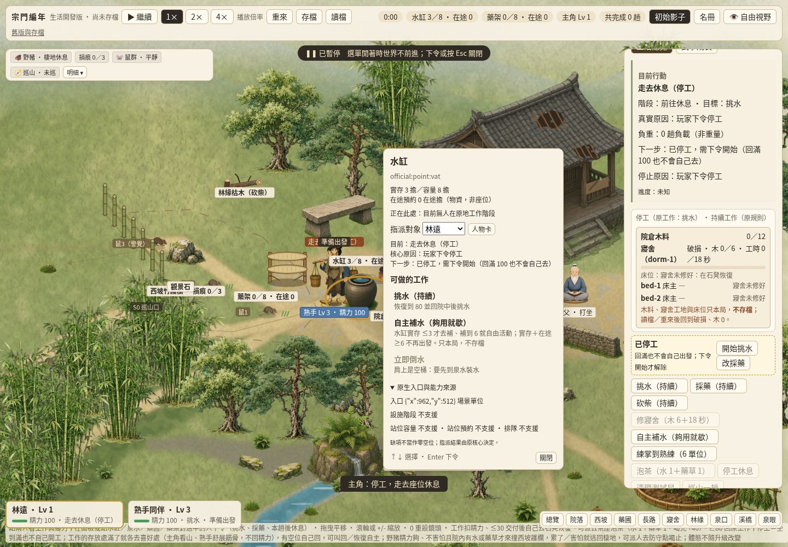
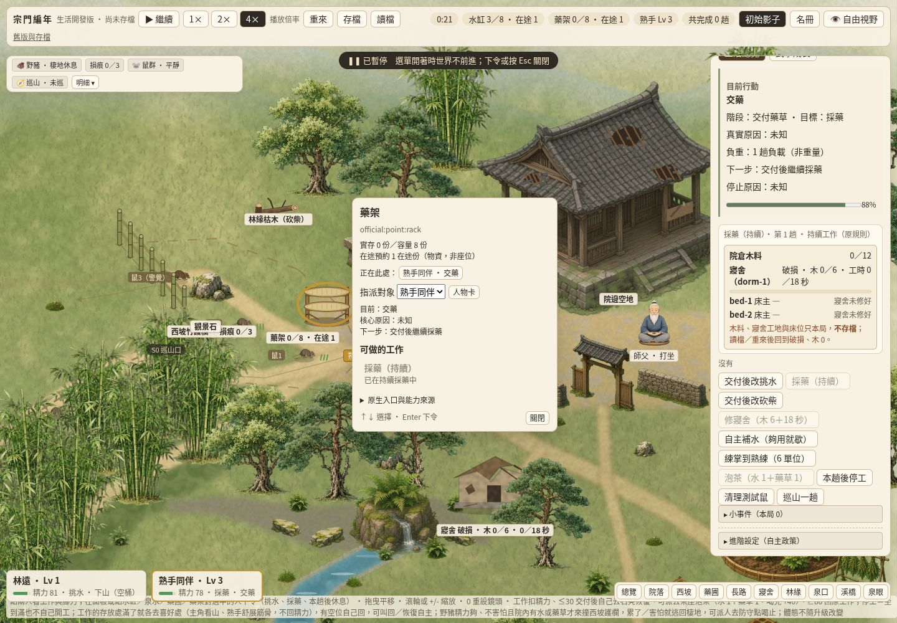
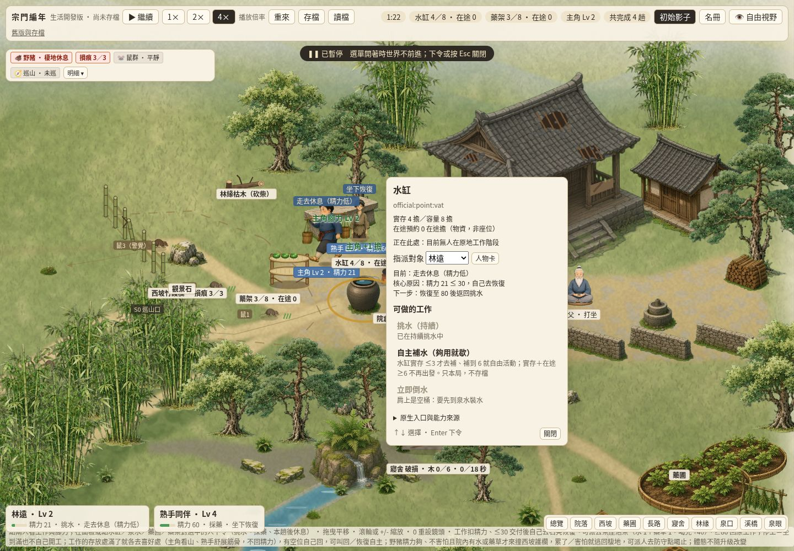

# SG-PUBLIC-03／#349 設施與互動點工作包

本包玩家問題：點設施時，原選單混列各種工作，無法核對原入口、真容量／在途及現地使用者。本包在同一正式入口 `experiments/water-carry/demo/` 將既有選單接為公版設施詳情與 tooltip，仍由原核心決定能否指派。

實際主筆：Codex Cloud 工程作者 `/root/facility349_author`，不是 grass reviewer／merge owner。共享 GitHub login 只作傳輸身份，沒有平台獨立 approval。自有 checkout `/workspace/facility349-author`、branch `codex/facility349`。Base dev `23b511db75f2fb2862241194a8a999aa357534aa`；[認領](https://github.com/lalagrass/earth-ascension/issues/349#issuecomment-6413439961)前重讀 comments 為空、登記後再核無其他有效作者。四小時可附進度續 claim，不是總開發時限。前置 #348／PR352／push postCI40304567407 五成功沿用；最終 head／PR／當前 CI 見 issue 作者交付收據。

## 契約與交付

- `facility-view/contract.mjs` 定義 FacilityView／InteractionPoint：`<core>:facility:<nativeId>`／`<core>:point:<nativeId>` 穩定 ID，與來源 SHA 分離；值攜帶 authority source、known／unknown／hidden／unsupported，非 known 值在交給 renderer 前移除。
- `official.mjs` 只讀原 `model.view()`／`model.actions(actorId)`；水缸／泉眼、藥架／藥圃、石凳、護欄、兩偏好點沿既有選取熱區與原入口。`stock` 只在水缸／藥架顯示真實存、真容量、真在途，單位擔／份；不是座位數。`users` 明確只代表原地工作階段，不把前往／返程者算成現地占位。
- 水缸實存／容量／預約＝`view.vat/vatCapacity/inFlight`；藥架＝`view.herbs/herbCapacity/herbInFlight`。原入口直接取 `WATER_POINTS`／`HERB.points` 等，不拿景物掛點當人物站位。特別是藥架掛點 `(896,474)`，真交付仍在 `(962,512)`；藥圃掛點 `(1440,788)`，真採藥仍在 `(1398,772)`。
- 可做活動只列該點現有的原 actions；enabled／原 detail 或 reason 直接來自核心。dispatch 時再次讀取最新 actions，拒絕過期、別點或不支援命令，再送原 `dispatch`。人物卡所有原命令保留。
- 正式 app 沿原 renderer 的人物優先 pick，再做設施 pick；前景深度／樹石淡出不改。設施 tooltip、詳情、選定對象、現地人物／人物卡按鈕與原名冊共用同一 `hero/cousin` 身份。打開詳情沿原暫停／關閉恢復語義，不引入時鐘；手動暫停下命令維持暫停。
- `gpt.mjs` 是第二真核心的薄證明，唯讀固定 GPT 原生 `world.facilities[id].stage` 與 `map.rects[id].door/rect`，使用相同 contract／HTML renderer。未接的 GPT 活動、站位／預約／queue mapping 明示 unsupported；不匯入其建造／床位玩法，也不是第二玩家版本。

## 權威來源及保留限制

正式 base SHA 如上；原核心在 `experiments/water-carry/demo/model.mjs`，幾何在 `routes.mjs`／`water-layout.mjs`。第二核心為 #342 已固定的 GPT `6cbd3e6fccb8bc376e95e2f406ce6cead2a30fdc`，原作者及每個來源檔 hash／來源邊見 `scene-shared/sources/gpt/manifest.json` 與 `scene-shared/SOURCES.md`。本包只讀已接受來源，沒有新下載、第三方圖或權利聲明；#348 原圖／pin／權利資料不改。

目前這些 official 點沒有可公開的建造階段／站位容量／站位預約／雙人 queue，標為不支援；不因水藥的在途欄位創造共用預約引擎。既有 HOME02 床／寢舍與 D45 茶、D53 身份與社交保持原核心／原人物卡，本包不接新床位認領、新建造或耗材。三固定原核心檔、速度、長通勤、命令優先級、規則／schema／RNG／存檔格式均不改。

## 定向驗收與重跑

`node --test --test-isolation=none sect-chronicle/facility-view/checks/facility.test.mjs`：4/4。涵蓋 detached 欄位／穩定 ID／缺項遮罩、真水藥兩路走到原入口與更新、相同命令完整權威 parity、重複／別點命令拒絕、真正跑到水缸滿位的原原因及最新停工優先。第二真 GPT seeds11/23/37 以有／無反覆 facility reads 比較完整世界（包含 RNG、事件），相同。同一測試由 `test/facility-view.test.js` 納入現行 devCI。

普通 sandbox 的 Node 子程序隔離輸出曾只回單一檔案計數；本地用 `--test-isolation=none` 取得四個真子測試結果，沒有把包裝檔 1/1 充作完整驗證。現行必要 CI 由最終 PR head 核對；不重跑未變 #342/#345/#348 瀏覽器／長路／遮擋／素材矩陣及 rootSG 全檢查。無全 seed／存讀／手機／角色武學矩陣。

Cloud 桌面重跑：`node sect-chronicle/facility-view/checks/desktop-check.mjs`，需要既有 Cloud Playwright 與 `/usr/bin/chromium`。一頁、一臨時服務 8817（可用 FACILITY_TEST_PORT 改自有空埠）、一自有瀏覽器；只透過真 UI 指派與原 clock 等候。結果及圖在 `facility-view/evidence/`。finally 暫停、復原自有 viewport、關頁／browser／server，沒有 Mac／部署／8800／永久輪詢。實際結果與清理列於本包 PR 及下方收據。

本包待非作者 grass 集中 review／#67唯一票整合 dev／必要 postCI。#350/#351 只由序列控制派出，本作者不認領後包。

### 本次 Cloud 收據

Chromium154.0.8037.57，1440×1000，runtime checkpoint `35c341f4899c6fa9ba41491a855ff5dd32b264a5`。真 UI 14項通過、零 page／console errors；[原始結果](../facility-view/evidence/desktop-results.json)。於tick0暫停中派 hero挑水、cousin採藥，真採藥入口到達／藥架交付使用者／人物卡連結／長泉路到達／兩份真資源更新均實走。打開、切對象及觀察面板不推 tick，最終完整 state 暫停不變。

finally回報pageClosed／browserClosed／serverStopped全true、自有viewport已恢復後關閉；事後核對沒有本包8817服務或desktop-check程序殘留。後續文件／證據提交不改runtime，復用此checkpoint行為證據。
