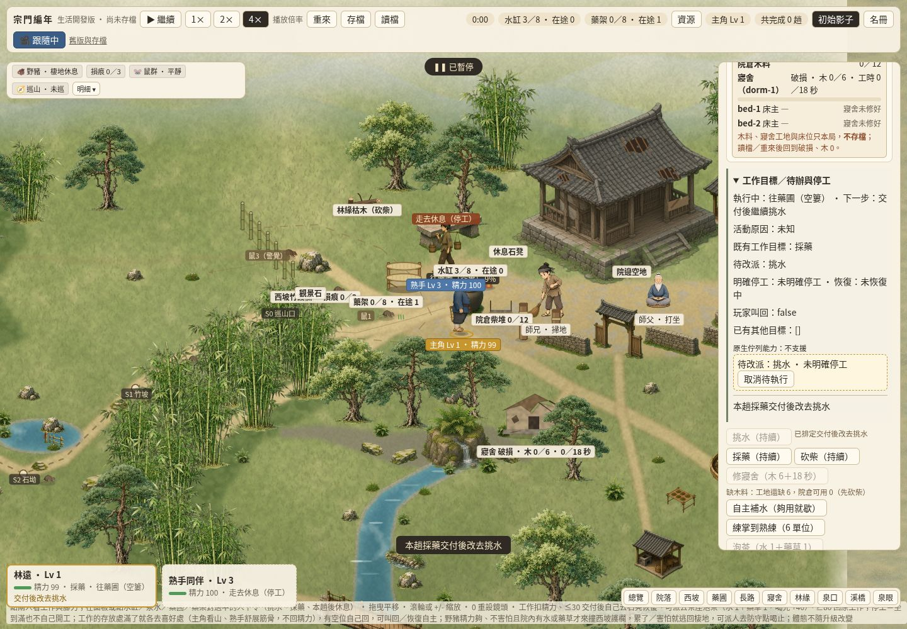
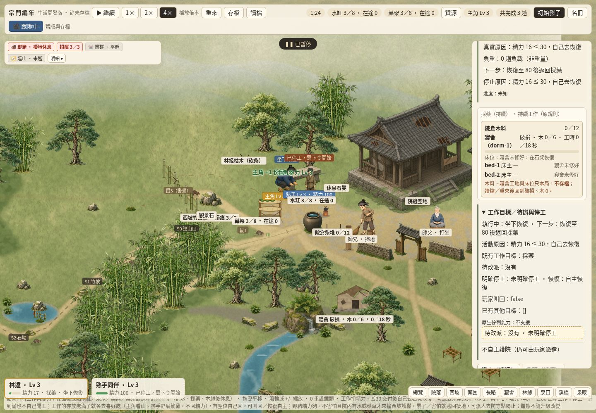
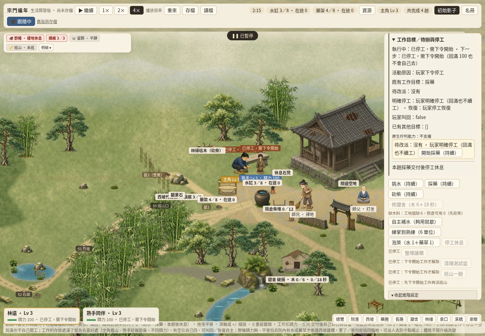
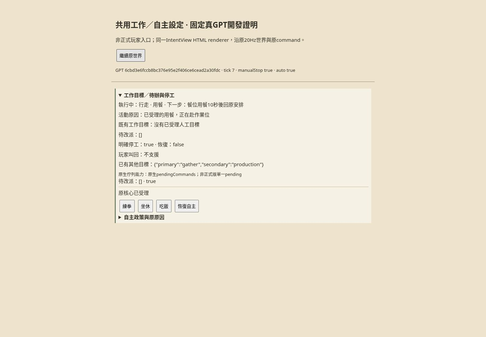

# #359 INTENT-VIEW-01：原工作與自主設定共用呈現

玩家問題：人物卡能看目前行動，卻不易分清原工作目標、這趟後唯一改派、必要恢復與玩家明確停工，也不能一致核對自主許可／原因。本包在同一正式入口抽出共用意圖／政策與原命令呈現，沿原核心執行，沒有新JobQueue或自主AI。

實際獨立Cloud作者：Codex task `/root/martial350_author`，非grass reviewer／merge owner；runtime精確backend ID不可讀，不虛稱已驗模型，共用GitHub login不是平台獨立approval。新checkout `/workspace/intent359-author`、新branch `codex/intent359`，真base `5e7f36682272ef44190bc0d908030213e4ab8ca0`。已讀根規範／D51、遊戲AGENTS與PUBLIC_M2／RESOURCE正式包；未重用#357分支或讀他人未公開成果。

[唯一claim6416127786](https://github.com/lalagrass/earth-ascension/issues/359#issuecomment-6416127786)前核comments空，登記後／推送前重讀無競合。claimed_at `2026-10-26T12:35:12Z`、expires_at `2026-10-26T16:35:12Z`；4h可附具體進度續claim，非總工時，完整交付後等待review不算失聯。前置#358／PR361已合本base、push postCI40323071547五success。

## 契約與入口

- `intent-view/contract.mjs` 的IntentView保存source＋actorId、同人物卡的current action、逐欄source／availability的工作／pending／停工／恢復／叫回／既有目標、PolicyView及原命令。復用既有field遮罩，非known不傳raw值，不把0／false當未知。
- `official.mjs` 只讀原`model.view().people[id]`／`model.actions(id)`與原公版人物卡。current直接沿geminiCard.action，茶原因／目標延用#357已接受修法，不重做actionHtml。工作目標讀jobLabel；pending只讀那一個pending，沒有FIFO；其他已有補水／練掌／泡茶／修寢舍目標只是本局原旗標，不推定新的排程。
- 明確停工讀resting；自主恢復讀原rest=auto，和manual分開；叫回讀recall，不由動畫位置猜意圖。不能用「恢復自主」解除manual的核心原限制保持，滿精力仍停工直到原開始／工作指令。
- 原護院／整理政策讀auto／up的allow／reactLabel／state／text，不複製觸發公式或共用門檻；候補只是意願、未占名額。共用按鈕沿原setAuto／setUpkeep，原取消意願指令保留。自主清鼠／原茶／建造／床／訓練／巡山等其餘既有功能控制不刪；只抽護院／整理重複呈現與已替代的舊handler。
- `render.mjs` 共用intentHtml／commandHtml／policiesHtml；正式入口保留原#p-cmds、待辦快捷與既有進階區。disabled原因直接列出原reason；最近指令回覆用本頁每人物Map，與原toast同時顯示，不寫world／save。新CSS只處理本面板，未換框架。
- 每個命令都有穩定本版ID／原生ID、label／enabled／reason／detail及native payload。HTML同時綁actor與payload；送出當下重讀同人最新原actions／policy，拒絕切人後舊命令或過期toggle payload，不把舊按鈕的意圖套新人物。原核心再次驗證；不直接寫world，不從DOM傳來的method任意呼叫核心。
- 正式dispatch經原sceneAdapter.command，確保既有事件捕捉；政策經原setter。一次click在新handler受理後return，不再落入舊data-cmd handler。未知／非法／disabled保真原因，介面過期拒絕明示是介面更新。

## view state與三版能力

沿#357 createViewWriter；工作詳情使用穩定`intent` key、命令用data-intent-command恢復焦點。正式進階區展開改為每人物本頁狀態，切人不串；原詳情／焦點也沿每人物scope保存。所有state與結果Map只屬本頁，不寫保存／localStorage或新世界資料。

| 核心／固定來源 | 此包可證投影與指令 | 缺項／限制 |
|---|---|---|
| 正式Gemini衍生dev5e7f366…，`demo/model.mjs:view/actions/setAuto/setUpkeep` | 真活動、工作、唯一pending、manual／auto、叫回及原政策；全部原可見actions仍可用，必要hidden開始／取消只在原合法狀態顯示 | 沒有原生FIFO，queue標unsupported；不新增策略／數值 |
| GPT6cbd3e6fccb8bc376e95e2f406ce6cead2a30fdc，`src/person-view.mjs:situation`／`world.mjs:command` | 同renderer讀原current、intent.kind、manualStop、recovering、auto、primary／secondary；原pendingCommands只列本人已排定命令的ID／type／kind／executeTick。真stop／resume等原可見commands透過原command送出 | 與正式版單一pending不同；沒有共用護院／整理reaction或獨立recall映射，標unsupported，原因缺失unknown，不強制互換休息語義 |
| Grok6760f21c342cbf72fc9fb4baf0aec8655abd0dd2，沿既有`character-card/grok.mjs`與`status.mjs:statusOf` | 既有card已有原order／task／now／why／next、原setOrder入口；本包保其原來源／mask與玩法，不更新副本 | 本包未新增IntentView runtime，不冒充與正式或GPT政策／pending／永久停工等價；控制薄接線另案才可宣稱 |

GPT adapter先沿原visibleEntity，再排inactive／departed；未發現人物無intent／commands，沒有隱藏人格或出生值payload。原固定核心檔與hash不改，來源沿scene-shared/SOURCES.md及各manifest。只在明標開發頁展示第二真核心，不開第二玩家版本。

## 精簡驗證與收據

`node --test --test-isolation=none sect-chronicle/intent-view/checks/intent.test.mjs sect-chronicle/character-card/checks/card.test.mjs`：12個真子測試通過。包含原工作→單一改派→重複拒絕→取消→manual停工滿精力不續工→原開始工作→真低精力auto恢復及續工；有／無頻繁意圖讀取、同命令原模型的完整state／log完全相同。政策與原setter逐項比對，過期payload／錯人／非法命令不改state；第二真GPT同renderer原stop／resume與原世界／RNG對照，未發現角色及隱藏人格不外洩。

Cloud桌面 `node sect-chronicle/intent-view/checks/desktop-check.mjs`，既有Playwright／Chromium，1440×1000。一頁順次正式生活入口→明標GPT開發頁，一context／browser／8821臨時服務。只送原UI合法命令、走原路／clock，正式流程實走工作／改派取消／自主恢復續工／明確停工／開始與一組護院許可，核每人物展開／焦點與綁定。GPT用同intentHtml送真stop／resume。首次GPT的佇列能力說明仍收起，檢查innerText未展開而停止，finally全清；已調整為先按穩定intent key的真summary，與第二個政策summary區分，沒有改runtime讓測試追綠。最終結果／真圖見下方和intent-view/evidence。

必要CI核最終PR head；語法／whitespace／交付連結檢查保留。復用#357／358／346未變長路、素材、世界／資源與遮罩證據；無本地rootSG全跑／全seed／手機／保存／歷史矩陣。原三核心玩法、幾何／速度／D45／D53、RNG/schema/save及core bytes不改；root/.github/共用依賴／權限均未碰。

本PR只候選待grass非作者review→#67正常鎖expected_head_sha squash→dev／必要postCI；真head/base/CI見#359作者收據。本#356第三包完成及同PR必要補修後休息，不啟RelationView／建造／人格／小地圖等backlog，不新增排程／常駐輪詢。Mac只真人、無部署／8800／他人服務操作。finally觀察後暫停，復原viewport，關自有page/context/browser/server並確認。

### Cloud實際短流程收據

Chromium154.0.8037.57、1440×1000、runtime checkpoint `54045715125be2491b2bcba4c6a7b4ffa8cb38d5`：20項通過、零page／console errors。原UI採藥3趟後tick5075進入auto恢復（精力17.45），恢復後真續工；第四趟交付後明確停工，tick8154精力100仍保manual與4趟不再出發。第二真GPT由同HTML發原stop／resume，原stop允許必要自理的差異保持。詳見[原始結果](../intent-view/evidence/desktop-results.json)。

最後只補一次dispatch橋接計數反例（fixes4/4通過）與新局／成功讀檔清本頁命令回覆，避免上局回覆誤留；原核心／保存流程不改。主流程證據復用，必要當前CI核最終head。

原護院setter回覆的真圖另存`official-policy-source.jpg`；控制操作／只改所選人物與原因在原結果中逐項核對。finally pageClosed／contextClosed／browserClosed／serverStopped全true，viewport復原後關閉；事後無8821 server或本包desktop程序殘留。
