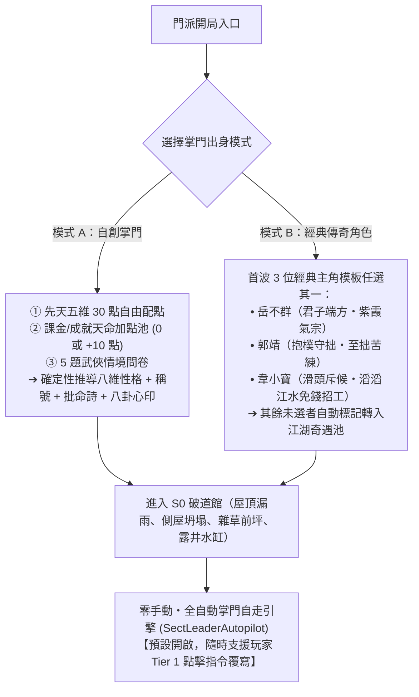
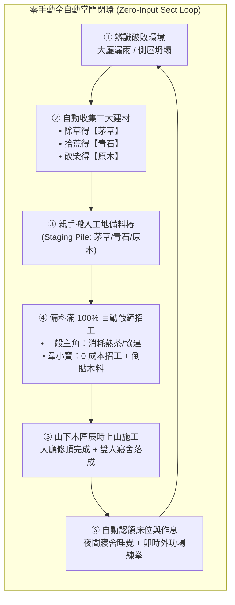

# LIFE-V01-V02 正式工程規格書：新核心同感移植、破道館雙軌開局、零手動掌門自走與備料招工擴建

> **狀態**：正式工程規格書（Handoff Specification for `v0.1` + `v0.2`）
> **分支**：`plan/sect-life-architecture-redesign`
> **基準總藍圖**：[`SECT_LIFE_REDESIGN_MASTERPLAN.md`](file:///Users/chenyuying/workspace/earth-ascension/sect-chronicle/docs/vision/SECT_LIFE_REDESIGN_MASTERPLAN.md)（第 1～4 章、第 5.2～5.3 章、第 6 章 `v0.1` 與 `v0.2`）
> **對齊規格基準**：[`HOME02_HANDOFF.md`](file:///Users/chenyuying/workspace/earth-ascension/sect-chronicle/docs/HOME02_HANDOFF.md)、[`model.mjs`](file:///Users/chenyuying/workspace/earth-ascension/sect-chronicle/experiments/water-carry/demo/model.mjs)、[`routes.mjs`](file:///Users/chenyuying/workspace/earth-ascension/sect-chronicle/experiments/water-carry/demo/routes.mjs)、[`app.mjs`](file:///Users/chenyuying/workspace/earth-ascension/sect-chronicle/experiments/water-carry/demo/app.mjs)
> **核心職責**：換引擎骨架不換手感，提供零手動自走開局與踏實的備料招工擴建工程契約。

---

## 一、 目標與玩家可見閉環（Player-Visible Loop）

本階段將遊戲時間線退回「門派尚未正式立匾成立前」的荒涼破道館，交付兩大核心體驗：**「S0 破道館開局與雙軌創角」** 以及 **「零手動・全自動掌門自走引擎（`SectLeaderAutopilot`）」**。

### 1.1 S0 破道館開局與雙軌創角

開局畫面不再直接綁死既有固定的兩人（`hero` 與 `cousin`），而是提供清晰的雙軌開局選擇面板：



#### (1) 模式 A（自創掌門主角）：配點 ＋ 天命加點 ＋ 情境問卷
1. **先天五維配點池（Point-Buy Pool）**：
   - 基礎總點數固定為 `30 點`。
   - 五大屬性（範圍皆為整數 `1～10`，預設每項均為 `6`）：
     - `comprehension`（悟性）：影響高階武學領悟速度與研讀門檻（$\le 3$ 時解鎖「心無雜念」專屬的《基礎羅漢拳 Lv10 返璞歸真》前置條件）。
     - `constitution`（根骨）：影響精力上限、負重體態與內功修練門檻。
     - `strength`（臂力）：影響搬運負重上限、砍柴效率與招式擊退判定。
     - `agility`（身法）：影響空手移速（$60 \to 84/\text{s}$）與出招前搖縮減率。
     - `composure`（定力／福緣）：影響閉關突破率、宿命心魔抵抗（影響辟邪劍法分歧抉擇）與奇遇機率。
2. **天命加點池（Destiny Bonus Pool）**：
   - 預設可選擇注入 `destinyBonusPoints = 0`（標準體驗）或 `destinyBonusPoints = +10`（支持者／天命神仙開局）。
   - 選配 1 項先天傳奇命格詞條（`innatePerks`）：
     - `perk.gentleman_sword`（【君子端方】：大廳早課聲望累積翻倍）；
     - `perk.peerless_talent`（【萬中無一】：武學熟練度提升速率 $+50\%$）；
     - `perk.smooth_talker`（【滔滔江水】：山下招工費用為 $0$，且額外獲贈建材）；
     - `perk.food_master`（【食神轉世】：膳房料理品質提升一階）。
3. **5 題武俠情境問卷（Situational Questionnaire）**：
   - 每題提供 4 個具備江湖抉擇感的選項，以確定性矩陣權重累計至 Big-Five 八維性格（`open, conscientious, extravert, agreeable, stable, explore, safe, care`，數值範圍 $[0.0, 1.0]$）。
   - 依據主導性格維度確定性推導：
     - **道家心性稱號**（如：【玄同澄照】、【抱樸守拙】、【太上仁心】、【狂狷任誕】、【君子端方】）。
     - **古風批命詩**（如：`"紫氣東來映華山，有所不為立人間"` 或 `"抱樸守拙知常在，苦練千回意自純"`）。
     - **預設三問心印（心印八卦象）**：如 `0b111`（☰ 乾為天【積極進取】）、`0b000`（☷ 坤為地【抱樸守拙】）。**預設直接自動預選，不跳出阻擋視窗干擾開局節奏**。

#### (2) 模式 B（直接選經典角色當掌門）：首波實裝三大主角模板
首波實裝 3 位代表性經典角色模板供玩家開局一鍵選擇，並自動綁定 [`destiny-trees.json`](file:///Users/chenyuying/workspace/earth-ascension/sect-chronicle/life/data/destiny-trees.json) 的四階本命成長定義：

| 經典主角模板 | 先天五維與詞條 | 性格傾向與核心心印 | 四階本命武學階梯（成長閉環） | 掌門自走風格與特殊機制 |
|---|---|---|---|---|
| **【岳不群】**<br>*(君子端方・紫霞氣宗)* | 悟性 7、根骨 6、臂力 5、身法 7、定力 8<br>詞條：`perk.gentleman_sword` | 高盡責 (`conscientious: 0.88`)、高安全 (`safe: 0.82`)、高定力<br>心印：`☰ 乾為天【重振門楣】` | **階梯一**：《華山基礎劍法》＋《華山抱元勁》<br>**階梯二**：《養吾劍法》＋《希夷劍法》<br>**階梯三**：《紫霞神功》＋《奪命三仙劍》<br>**階梯四**：正道《紫霞十重》vs 邪道《辟邪劍法》 | 極度重視山門規矩與門面；自動優先修補大廳屋頂與早課；招工擴建大廳意願最高。 |
| **【郭靖】**<br>*(抱樸守拙・至拙苦練)* | 悟性 2、根骨 9、臂力 8、身法 4、定力 9<br>詞條：`perk.peerless_talent` (低悟反璞特化) | 極高盡責 (`conscientious: 0.95`)、極高仁善 (`agreeable: 0.90`)、低悟性 (`open: 0.15`)<br>心印：`☷ 坤為地【抱樸守拙】` | **階梯一**：《基礎羅漢拳》<br>**階梯二**：《基礎羅漢拳 Lv10 返璞歸真》（0.15s 零前搖瞬發）<br>**階梯三**：《降龍十八掌》＋《空明拳》<br>**階梯四**：《左右互搏雙掌齊出》＋《九陰真經》 | 雷打不動苦練基礎套路；自動主動挑水砍柴除草備料；修繕時專注協建，體魄成長極快。 |
| **【韋小寶】**<br>*(滑頭斥候・滔滔江水)* | 悟性 8、根骨 3、臂力 3、身法 9、定力 7<br>詞條：`perk.smooth_talker` (0 成本招工) | 極高外向 (`extravert: 0.92`)、極高探索 (`explore: 0.88`)、低盡責 (`conscientious: 0.25`)<br>心印：`☱ 兌為澤【八面玲瓏】` | **階梯一**：《撒石灰》＋《抓奶龍爪手》<br>**階梯二**：《神行百變抹油逃命步》<br>**階梯三**：《五件金絲軟甲》＋《含沙射影》<br>**階梯四**：《洋人火銃連發》＋《神仙替我打架》 | 雜務偷懶但善於社交；**觸發【滔滔江水連綿不絕】嘴砲，招工鐘 0 成本且木匠倒貼原木 +1！** |

> **江湖奇遇池標記**：開局未被玩家選擇的經典角色模板，其實體自動標記為 `availableForRecruit: true` 並置入後續山下奇遇池，保留其完整的性格、五維與宿命成長樹，絕不丟失。

---

### 1.2 零手動・全自動掌門自走引擎（`SectLeaderAutopilot`）

為了實現「放鬆看武俠生態缸」的終極模擬體驗，系統內建**預設開啟**的掌門自走引擎。就算玩家創完角後**雙手完全離開鍵盤滑鼠（0 點擊）**，遊戲也能平滑運轉：



1. **自走全流程可見表現**：
   - **採集與備料階段**：主角自動環顧四周，發現大廳（`fac.hall`）處於 `ruin` 破損狀態、前坪雜草叢生、側院散落瓦礫。主角自動走向前坪**除草**獲得【茅草】、走向廢墟**拾荒**獲得【青石】、走向林緣枯木**砍柴**獲得【原木】，並將物資親手抱入大廳屋頂與寢舍的**工地備料樁（`stagingPile`）**。
   - **招工擴建階段**：當大廳屋頂備料滿額（原木 4、青石 4、茅草 4）後，主角走到山門敲響**【招工鐘】**：
     - 若為普通掌門或自創掌門，消耗 1 壺茶水請出山下木匠；
     - 若為【韋小寶】，觸發專屬氣泡 `「掌門我憑三寸不爛之舌，哄得山下木匠連夜來效力，還倒送一捆上好原木！」`，直接 0 成本啟動施工，木匠進場叮叮噹噹搭起鷹架修繕屋頂。
   - **生活與成長階段**：大廳屋頂修繕完成後，第二工程寢舍（`fac.dorm.a`）接續備料完工；主角夜間自動認領 `bed-1` 入室安睡恢復精力（$+5/\text{s}$），次日卯時自動前往外功演練場站上木人樁修練第一階武學。
2. **隨時插手（Tier 1 玩家覆寫最高優先級）**：
   - 任何時候玩家手動點擊任何設施（如點擊水缸要求挑水、或手動點擊木樁練拳），系統立即中斷當前 Autopilot 決策，切換至最高等級的 `Tier 1 玩家指令`；
   - 玩家若在面板重新勾選「順性自走」，主角在當前手動任務結束後無縫回歸 Autopilot 個性自走。

---

## 二、 架構與檔案白名單（File Scope & Modular Layout）

為了保證與既有系統乾淨解耦，新核心模組全部收斂在 `sect-chronicle/life/` 目錄下，不侵入改寫舊有的長通勤與物理常數。

```
sect-chronicle/
├── life/
│   ├── core/
│   │   ├── toils.mjs             # 五步原子工序引擎與 onCleanup 清理鉤子
│   │   ├── smart-objects.mjs     # 設施與活動宣告表 (Smart Objects Advertisement)
│   │   ├── reservation.mjs       # 通用預約守恆器 (ReservationBroker，防雙花)
│   │   ├── persona-creation.mjs  # 雙軌創角純函式庫 (配點檢核/問卷矩陣/性格稱號批命推導)
│   │   ├── autopilot.mjs         # 零手動掌門自走引擎 (SectLeaderAutopilot)
│   │   └── destiny-engine.mjs    # 純 JSON 宿命樹檢核器 (<150 行宣告式狀態機)
│   └── data/
│       └── destiny-trees.json    # 岳不群、郭靖、韋小寶首波四階本命成長定義
├── experiments/water-carry/demo/
│   ├── model.mjs                 # 匯入 life/core 接線，保留 60Hz tick 與單一權威狀態
│   ├── routes.mjs                # 增補除草、拾荒、招工鐘短折線，既有水藥木路 100% 保留
│   ├── app.mjs                   # 創角介面、S0 破道館渲染、工地 HUD 與 Autopilot 控制面板
│   ├── index.html                # 增掛創角視窗與擴建模態 DOM 結構
│   └── style.css                 # 創角卡片、備料進度條與古風批命字體樣式
└── test/
    ├── acceptance/               # 既有驗收測試保持唯讀
    ├── life-v01-v02.test.js      # 新增：本包專屬單元與確定性反例測試
    └── *.test.js                 # 既有 383 個單元測試 100% 通過
```

### 檔案修改權限白名單

| 檔案路徑 | 權限 | 限定用途 |
|---|---|---|
| [`sect-chronicle/life/core/*.mjs`](file:///Users/chenyuying/workspace/earth-ascension/sect-chronicle/life/core/) | **新增／可寫** | 實裝 `Toil` 五步工序、SmartObject 宣告、預約守恆器、創角純函式、Autopilot 引擎與宿命檢核器。 |
| [`sect-chronicle/life/data/destiny-trees.json`](file:///Users/chenyuying/workspace/earth-ascension/sect-chronicle/life/data/destiny-trees.json) | **新增／可寫** | 純 JSON 儲存岳不群、郭靖、韋小寶之四階武學與宿命條件定義。 |
| [`sect-chronicle/experiments/water-carry/demo/model.mjs`](file:///Users/chenyuying/workspace/earth-ascension/sect-chronicle/experiments/water-carry/demo/model.mjs) | **可修改** | 接線新核心模組，掛載 `Toil` 執行器與 Autopilot tick，保持對外 API 與舊測試簽名 100% 相容。 |
| [`sect-chronicle/experiments/water-carry/demo/routes.mjs`](file:///Users/chenyuying/workspace/earth-ascension/sect-chronicle/experiments/water-carry/demo/routes.mjs) | **可修改** | 增補雜草站位、瓦礫站位、招工鐘站位與短路徑幾何，**嚴禁修改既有挑水路與採藥路折線**。 |
| [`sect-chronicle/experiments/water-carry/demo/app.mjs`](file:///Users/chenyuying/workspace/earth-ascension/sect-chronicle/experiments/water-carry/demo/app.mjs) | **可修改** | 實裝創角 UI 流程、S0 破道館母版圖層替換、工地備料 UI 顯示與 Autopilot 面板。 |
| [`sect-chronicle/experiments/water-carry/demo/index.html`](file:///Users/chenyuying/workspace/earth-ascension/sect-chronicle/experiments/water-carry/demo/index.html) | **可修改** | 增設創角 Modal、SectLeaderAutopilot 狀態切換開關與工地進度容器。 |
| [`sect-chronicle/experiments/water-carry/demo/style.css`](file:///Users/chenyuying/workspace/earth-ascension/sect-chronicle/experiments/water-carry/demo/style.css) | **可修改** | 增補創角卡片排版、古風批命文字水墨效果與工地備料條樣式。 |
| [`sect-chronicle/test/life-v01-v02.test.js`](file:///Users/chenyuying/workspace/earth-ascension/sect-chronicle/test/life-v01-v02.test.js) | **新增／可寫** | 針對本包新增之 DoD A～D 撰寫直接反例測試。 |
| **其餘舊測試檔與歷史 design / atlas** | **唯讀** | `test/*.test.js`、`water-layout.mjs`、`palm.mjs`、`patrol.mjs`、`life-save.mjs` 嚴禁任何非相容改動。 |

---

## 三、 核心資料結構與 JSON Schema（Data Contracts）

所有實體與工序狀態必須遵循可被 `JSON.stringify()` 序列化、無閉包洩漏、無迴圈引用的資料契約。

### 3.1 角色／掌門統一實體（`Disciple`）

```typescript
interface Disciple {
  id: string;                          // 'disc.hero' | 'disc.cousin' | 'disc.preset_yue'
  name: string;                        // 自創姓名（如 '林玄真'）或經典角色姓名（如 '岳不群'）
  originMode: 'custom_point_buy' | 'preset_iconic';
  destinyTreeId: string;               // 綁定 destiny-trees.json（如 'destiny.yue_buqun'）
  role: 'master' | 'senior' | 'inner_disciple' | 'outer_disciple';
  availableForRecruit?: boolean;       // 若開局未選之經典角色，此欄設為 true 進入招募池

  innateStats: {
    comprehension: number;             // 悟性 (1~10)
    constitution: number;              // 根骨 (1~10)
    strength: number;                  // 臂力 (1~10)
    agility: number;                   // 身法 (1~10)
    composure: number;                 // 定力/福緣 (1~10)
    destinyBonusPoints: number;        // 額外注入點數 (0 或 10)
    innatePerks: string[];             // 先天詞條 ID 清單
  };

  persona: {
    base: {                            // Big-Five + 武俠三維 (0.00 ~ 1.00)
      open: number;                    // 開放/悟性偏向
      conscientious: number;           // 盡責/勤勉
      extravert: number;               // 外向/社交
      agreeable: number;               // 隨和/仁善
      stable: number;                  // 情緒穩定/沉著
      explore: number;                 // 探索欲
      safe: number;                    // 謹慎求安
      care: number;                    // 護短/關懷
    };
    current: Record<string, number>;   // 隨重大事件微調之動態性格
    daoTitle: string;                  // 道家心性稱號（如 '君子端方'）
    natalPoem: string[];               // 古風批命詩（兩句，如 ['紫氣東來映華山', '有所不為立人間']）
    heartSeal: {
      code: number;                    // 八卦心印代碼 (0b000 ~ 0b111)
      overriddenByPlayer: boolean;     // 玩家手動覆寫標記 (預設 false)
    };
    autopilot: {
      enabled: boolean;                // 掌門全自動自走開關 (預設 true)
      policy: 'balanced' | 'focus_build' | 'focus_train' | 'smooth_talker';
    };
  };

  needs: {
    energy: { current: number; max: number; restAt: number; backAt: number }; // 預設 100, 30, 80
    thirst: { current: number; max: number; wantAt: number };                 // 預設 80, 20
  };

  skills: {
    legStrength: { level: number; exp: number; nextExp: number };
    physique: { level: number; exp: number; nextExp: number };
    construction: { level: number; exp: number; nextExp: number };
  };

  carrying: {
    item: 'water' | 'herb' | 'timber' | 'stone' | 'thatch' | null;
    amount: number;
  };

  housing: {
    roomId: string | null;             // 'fac.dorm.a'
    bedId: string | null;              // 'bed-1' | 'bed-2'
  };

  decision: {
    tier: 1 | 2 | 3 | 4;               // 1=玩家手動, 2=生理自理, 3=門派作息/Autopilot, 4=自由休閒
    currentToil: ActiveToilState | null;
    explain: {
      doing: string;                   // '正在：搬運【原木】往大廳工地'
      reason: string;                  // '原因：Autopilot 備料擴建（差 2 原木）'
      nextPlan: string;                // '下一步：備料滿 100% 後敲響招工鐘'
    };
  };
}
```

---

### 3.2 擴建工地實體（`ConstructionSite`）

```typescript
interface ConstructionSite {
  facilityId: 'fac.hall' | 'fac.dorm.a';
  name: string;
  targetStage: 'S1';
  phase: 'staging_materials' | 'ready_to_build' | 'building' | 'completed';

  // 備料樁 (Staging Pile) 守恆結構
  stagingPile: {
    timber: { current: number; required: number; reservedInFlight: number };
    stone:  { current: number; required: number; reservedInFlight: number };
    thatch: { current: number; required: number; reservedInFlight: number };
  };

  workforce: {
    mode: 'hire_artisans' | 'sect_disciples';
    hiredArtisan: {
      id: string;                      // 'npc.carpenter_lin'
      name: string;                    // '山下林木匠'
      status: 'idle' | 'walking_in' | 'working' | 'walking_out';
    } | null;
    hiringCost: {
      tea: number;                     // 一般需消耗 1 壺茶水
      freeByPerk: boolean;             // 韋小寶特質 perk.smooth_talker 為 true
    };
    progressTicks: number;             // 當前施工累積 tick
    totalTicks: number;                // 所需工時 (大廳 1440 ticks, 寢舍 1080 ticks)
    activeWorkerId: string | null;     // 當前站上鷹架之施工者 ID
  };
}
```

---

### 3.3 通用五步原子工序（`Toil Pipeline`）與異常清理鉤子（`onCleanup`）

所有工作（挑水、採藥、砍柴、除草、拾荒、搬料、修繕、泡茶、練掌、休養）一律拆解為以下 5 個標準原子工序：

```typescript
interface ToilStepDefinition {
  step: 'reserve' | 'goto' | 'interact' | 'transfer' | 'complete';
  execute: (world: WorldState, actor: Disciple, context: ToilContext) => ToilStepResult;
}

interface ToilContext {
  toilId: string;                      // 如 'toil.gather_thatch'
  facilityId: string;
  stationId: string;
  sourceItem?: 'timber' | 'stone' | 'thatch' | 'water' | 'herb';
  amount?: number;
  targetFacilityId?: string;           // 搬運目的地
  targetStagingPileKey?: 'timber' | 'stone' | 'thatch';
  progressTicks?: number;
  needTicks?: number;
}
```

#### 五大標準生命週期合約
1. **`reserve`**：原子鎖定站位、所需原料與目的地庫存容量。若站位忙碌或容量已滿，立刻失敗並寫入可解釋原因，絕不在背後盲目重試。
2. **`goto`**：向目標站位移動。移速依角色的 `carrying` 狀態嚴格分流：
   - 空手：使用 $v_{\text{empty}} = \min(84, 60 \times (1 + 0.12 \times (\text{level} - 1)))$；
   - 負重（攜帶木、石、草、水）：使用 $v_{\text{load}} = \min(64, 40 \times (1 + 0.15 \times (\text{level} - 1)))$。
3. **`interact`**：到達站位面向目標，播放對應動作（砍柴、除草、拾荒、施工），每遊戲秒扣除對應精力並累積進度。
4. **`transfer`**：實施實體物資所有權轉移（從採集點扣除、轉入角色手中 `carrying`；或從手中放入工地備料樁 `stagingPile`），全程物資守恆。
5. **`complete`**：結算技能經驗（腳力/體魄/營造 $+1$）、釋放所有暫態預約鎖，更新 Autopilot 宏觀進度。

#### 異常清理鉤子（`onCleanup`）
任何正在執行的工序若遭遇以下事件，必須強制觸發 `onCleanup(world, actor, toilContext, reason)`：
- 玩家下達 Tier 1 新指令（手動改派）；
- 角色精力下降至 $\le 30$ 觸發 Tier 2 生理自理中斷；
- 招工鐘施工提前完成或目標站位失效。

**`onCleanup` 必須強制履行的守恆不變量**：
- **站位鎖釋放**：將該角色在 `ReservationBroker` 註冊的站位鎖、工位鎖完全清除；
- **在途貨物安全處置**：
  - 若角色手中已抱有物資（`carrying.amount > 0`）：
    - 若此時距離目的地備料樁較近且該樁未滿，繼續走完交付；
    - 否則角色將物資原路帶回院倉堆疊，嚴禁物資就地蒸發或憑空多出一份！
- **施工工時保留**：工地已累積的 `progressTicks` 完整保留在工地物件中，不因施工中斷而重置歸零。

---

### 3.4 宿命樹資料結構（`destiny-trees.json`）

純 JSON 定義，引擎端 [`destiny-engine.mjs`](file:///Users/chenyuying/workspace/earth-ascension/sect-chronicle/life/core/destiny-engine.mjs) 僅提供不超過 150 行的通用評估函式 `evaluateDestinyMilestones(world, disciple)`：

```json
{
  "$schema": "http://json-schema.org/draft-07/schema#",
  "trees": {
    "destiny.yue_buqun": {
      "archetypeId": "yue_buqun",
      "name": "岳不群",
      "stages": [
        {
          "stage": 1,
          "name": "落魄華山",
          "unlockArt": "art.huashan_basic_sword",
          "unlockInternal": "art.huashan_baoyuan_jin",
          "require": { "dayMin": 1 }
        },
        {
          "stage": 2,
          "name": "君子名劍",
          "unlockArt": "art.yangwu_sword",
          "require": {
            "facilityCompleted": "fac.hall",
            "artLevel": { "art.huashan_basic_sword": 2 }
          }
        },
        {
          "stage": 3,
          "name": "紫氣東來",
          "unlockArt": "art.zixia_qi",
          "require": {
            "statMin": { "composure": 8 },
            "artLevel": { "art.yangwu_sword": 3 }
          }
        },
        {
          "stage": 4,
          "name": "宿命心魔",
          "dilemmaId": "dilemma.huashan_crisis",
          "branches": {
            "orthodox": {
              "name": "堅守君子本心",
              "require": { "composureMin": 9, "currentSafeMin": 0.80 },
              "unlockArt": "art.zixia_tier10",
              "title": "華山聖手"
            },
            "bixie": {
              "name": "辟邪速成入魔",
              "require": { "composureMax": 6 },
              "unlockArt": "art.bixie_sword",
              "applyPerk": "perk.bixie_ghost_speed",
              "title": "紫衣梟雄"
            }
          }
        }
      ]
    },
    "destiny.guo_jing": {
      "archetypeId": "guo_jing",
      "name": "郭靖",
      "stages": [
        {
          "stage": 1,
          "name": "荒漠少年",
          "unlockArt": "art.luohan_fist",
          "require": { "dayMin": 1 }
        },
        {
          "stage": 2,
          "name": "返璞歸真",
          "unlockArt": "art.luohan_fist_tier10",
          "require": {
            "statMax": { "comprehension": 3 },
            "artLevel": { "art.luohan_fist": 5 }
          }
        },
        {
          "stage": 3,
          "name": "名菜神丐",
          "unlockArt": "art.dragon_palm",
          "require": {
            "facilityCompleted": "fac.dorm.a",
            "statMin": { "constitution": 8 }
          }
        },
        {
          "stage": 4,
          "name": "左右雙絕",
          "unlockArt": "art.dual_wield_dragon_fist",
          "require": {
            "artLevel": { "art.dragon_palm": 3, "art.luohan_fist_tier10": 1 }
          }
        }
      ]
    },
    "destiny.wei_xiaobao": {
      "archetypeId": "wei_xiaobao",
      "name": "韋小寶",
      "stages": [
        {
          "stage": 1,
          "name": "街頭小滑頭",
          "unlockArt": "art.lime_spray_claw",
          "require": { "dayMin": 1 }
        },
        {
          "stage": 2,
          "name": "泥鰍抹油步",
          "unlockArt": "art.shenxing_baibian",
          "require": {
            "facilityCompleted": "fac.hall",
            "statMin": { "agility": 8 }
          }
        },
        {
          "stage": 3,
          "name": "五甲保命",
          "unlockArt": "art.five_armor_turtle",
          "require": {
            "statMin": { "composure": 7 }
          }
        },
        {
          "stage": 4,
          "name": "火銃連天神仙下凡",
          "unlockArt": "art.foreign_musket_volley",
          "require": {
            "facilityCompleted": "fac.dorm.a"
          }
        }
      ]
    }
  }
}
```

---

## 四、 權威數值與確定性不變量表（Authoritative Constants & Invariants）

### 4.1 100% 保留之舊世界基準常數

| 常數項 | 權威數值 | 規格來源 | 備註說明 |
|---|---|---|---|
| 世界地圖幾何規格 | `1600 × 1350` 像素單位 | Masterplan 1.2 / `HOME02` | 全局統一連續地圖，禁止瞬移與跨圖裁切。 |
| 院中核心集結端點 | `(962, 512)` | [`routes.mjs`](file:///Users/chenyuying/workspace/earth-ascension/sect-chronicle/experiments/water-carry/demo/routes.mjs#L2) | 原挑水、採藥出發與回程端點，保持連續導航。 |
| 挑水路單程長度 | `1700.9` 單位 | [`water-layout.mjs`](file:///Users/chenyuying/workspace/earth-ascension/sect-chronicle/experiments/water-carry/demo/water-layout.mjs) / D26 | 竹林坡、溪橋、潭南石階折線，手感不可變更。 |
| 採藥路單程長度 | `515.2` 單位 | [`routes.mjs`](file:///Users/chenyuying/workspace/earth-ascension/sect-chronicle/experiments/water-carry/demo/routes.mjs#L8) / `HERB` | 往東坡藥草小路長度。 |
| 空手移動速度 | $v_{\text{empty}} = \min(84, 60 \times (1 + 0.12 \times (L - 1)))$ | [`model.mjs`](file:///Users/chenyuying/workspace/earth-ascension/sect-chronicle/experiments/water-carry/demo/model.mjs#L46) / D26 | Lv1 $60/\text{s}$ 至 Lv5 $84/\text{s}$。 |
| 負重移動速度 | $v_{\text{load}} = \min(64, 40 \times (1 + 0.15 \times (L - 1)))$ | [`model.mjs`](file:///Users/chenyuying/workspace/earth-ascension/sect-chronicle/experiments/water-carry/demo/model.mjs#L47) / D26 | Lv1 $40/\text{s}$ 至 Lv5 $64/\text{s}$（「成長即速度」）。 |
| 精力上限與恢復 | 上限 100，工作耗 $1/\text{s}$，坐凳／躺床 $+5/\text{s}$ | [`model.mjs`](file:///Users/chenyuying/workspace/earth-ascension/sect-chronicle/experiments/water-carry/demo/model.mjs#L57) / `RULES.energy` | 基礎生理消耗不變。 |
| 生理遲滯門檻 | 觸發自理歇息 $\le 30$，續接原工作 $\ge 80$ | [`model.mjs`](file:///Users/chenyuying/workspace/earth-ascension/sect-chronicle/experiments/water-carry/demo/model.mjs#L57) / LP-04 | 嚴格維持 FreeSO 遲滯防頻繁切換。 |
| 泡茶工期與消耗 | 需水 1 ＋ 藥 1；煮茶 6s (360t)，飲茶 4s (240t) | [`tea.mjs`](file:///Users/chenyuying/workspace/earth-ascension/sect-chronicle/experiments/water-carry/demo/tea.mjs#L5) / `TEA` | 精力 $+40$，座位單一排他。 |
| 砍柴工期與庫存 | 作業 8s (480t)，耗 8 精力，柴堆容量 12 捆 | [`home02.mjs`](file:///Users/chenyuying/workspace/earth-ascension/sect-chronicle/experiments/water-carry/demo/home02.mjs#L6) / `WOOD` | 林緣枯木點 `(836, 350)`。 |

---

### 4.2 本包新增之權威常數

```javascript
export const LIFE_V02_CONSTANTS = Object.freeze({
  // 1. 三大基礎建材收集工序
  chores: {
    clearWeeds: {
      durationMs: 6000,              // 除草 6 遊戲秒 (360 ticks)
      energyPerSec: 1,               // 耗精力 1/s (共 6 點)
      yieldItem: 'thatch',           // 產出茅草
      yieldAmount: 1,
      stationPos: [940, 560]         // 院坪雜草站位
    },
    salvageRubble: {
      durationMs: 8000,              // 拾荒清瓦礫 8 遊戲秒 (480 ticks)
      energyPerSec: 1,               // 耗精力 1/s (共 8 點)
      yieldItem: 'stone',            // 產出青石
      yieldAmount: 1,
      stationPos: [880, 260]         // 正堂廢墟瓦礫站位
    },
    chopWood: {
      durationMs: 8000,              // 沿用 HOME02 枯木砍柴 8 遊戲秒
      energyPerSec: 1,
      yieldItem: 'timber',           // 產出原木
      yieldAmount: 1,
      stationPos: [836, 350]
    }
  },

  // 2. 擴建藍圖與備料樁需求 (Staging Pile Requirements)
  blueprints: {
    hallRoofRepair: {
      facilityId: 'fac.hall',
      name: '大廳屋頂修繕',
      required: { timber: 4, stone: 4, thatch: 4 },
      workMs: 24000,                 // 山下木匠施工 24 遊戲秒 (1440 ticks)
      scaffoldingBox: [765, 135, 975, 275]
    },
    dormExpansion: {
      facilityId: 'fac.dorm.a',
      name: '第一間雙人寢舍落成',
      required: { timber: 6, stone: 2, thatch: 2 },
      workMs: 18000,                 // 施工 18 遊戲秒 (1080 ticks，對齊 HOME02)
      scaffoldingBox: [1060, 680, 1150, 750],
      bedsProvided: ['bed-1', 'bed-2']
    }
  },

  // 3. 山下招工鐘 (Artisan Bell)
  bell: {
    pos: [910, 480],                 // 山門木樁鐘位置
    ringMs: 1500,                    // 敲鐘動作 1.5 秒
    normalCost: { teaVat: 1, herb: 1 }, // 一般耗茶水 1 壺
    weiXiaobaoFreePerk: true,        // 韋小寶特質 0 成本
    artisanBonusTimber: 1            // 韋小寶特質獲贈木料 +1
  },

  // 4. FreeSO 式自主飽和衰減與時辰作息鐘
  simulation: {
    shichenDurationMs: 60000,        // 一時辰 = 60 遊戲秒 (3600 ticks)
    fullDayTicks: 43200,             // 一日 12 時辰 = 720 秒 (43200 ticks)
    funCooldownMs: 60000,            // 休閒完成後冷卻 60 秒
    saturationAttenuation: 0.30,     // 60 秒內重做同一休閒吸引力衰減 70% (僅剩 30% 權重)
    scheduleBonusMultiplier: 2.50    // 處於作息時辰之活動獲得 2.5 倍偏好加成
  }
});
```

---

## 五、 四組完成判準（DoD Group A ～ D）與直接反例測試清單

驗收測試必須嚴格對齊專案的 [`VALIDATION_POLICY.md`](file:///Users/chenyuying/workspace/earth-ascension/sect-chronicle/docs/VALIDATION_POLICY.md)：以新增直接反例為主，不跑冗長無窮組合矩陣。

### 5.1 DoD 驗收項目清單

| 組別 | 驗收項目 | 必要完成判準 |
|---|---|---|
| **A 組：雙軌創角與破道館可見性** | A1 先天五維配點 | 30 點自由分配於悟性、根骨、臂力、身法、定力；任一單項不可超 $1\sim10$；總和超出或小於 30 均被防呆拒絕；天命點可選 0 或 10 點。 |
| | A2 問卷與性格推導 | 5 題情境性向測驗輸入後，確定性產出八維性格向量、道家心性稱號、批命詩，且八卦心印預設自動勾選無彈窗阻擋。 |
| | A3 經典主角開局 | 選擇岳不群、郭靖、韋小寶任一人開局，未選角色標記 `availableForRecruit: true`；綁定對應 `destinyTreeId` 與首階武學。 |
| | A4 破道館開局視圖 | 進入遊戲畫面上大廳為漏雨破頂、前坪為雜草、側屋為殘垣；工地備料樁清楚呈現茅草/青石/原木 0 進度條。 |
| **B 組：Toil 預約守恆與 onCleanup 退料** | B1 站位與容量原子預約 | 兩名弟子同 tick 爭奪最後 1 份建材或唯一定位，只有 1 人預約成功，另 1 人優雅轉向；無雙花、無死鎖。 |
| | B2 中途中斷安全退料 | 攜帶茅草/青石/原木在途中被玩家 Tier 1 手動指令打斷，觸發 `onCleanup`：攜帶物安全退回源頭或送至備料樁，物資總量守恆不遺失。 |
| | B3 施工中斷工時保留 | 鷹架施工至 50% 時被改派指令，工位鎖立即釋放，已交材料不退，已累積之工期完整保留，接續施工不重置。 |
| **C 組：零手動 Autopilot 跨時辰閉環** | C1 零手動備料自走 | 玩家創角後雙手離開滑鼠（0 點擊），主角依五維與性格自動執行「除草＋拾荒＋砍柴」搬入工地，將備料補滿 100%。 |
| | C2 自動敲鐘招工完工 | 備料達標後，Autopilot 自動走到山門敲鐘，山下木匠入場施工，大廳屋頂與雙人寢舍依序完工並解鎖第一階武學。 |
| | C3 韋小寶 0 成本特例 | 韋小寶開局自走敲鐘時，茶水不被扣除（0 成本），且施工完畢後備料樁額外獲得原木 $+1$。 |
| | C4 晚間自理與床位認領 | 寢舍修好後，主角夜間自動認領 `bed-1` 入室安睡恢復精力至 80，次日晨起前往外功場自發練掌。 |
| **D 組：回歸防線與確定性單測** | D1 既有單測 100% 通過 | 執行 `node --test sect-chronicle/test/*.test.js`，全部 383 個測試維持 100% PASS。 |
| | D2 新增確定性測試明細 | 新增 `test/life-v01-v02.test.js`，覆蓋配點防呆、問卷性格矩陣、Toil 原子預約、退料守恆與 Autopilot 閉環。 |

---

### 5.2 直接反例測試清單（Anti-Patterns & Direct Counter-Examples）

為防止邊界漏洞，工程師實作時必須在 `test/life-v01-v02.test.js` 寫入以下 6 個直接反例斷言：

1. **反例 1（配點防呆反例：`counter_stats_overflow`）**：
   - 嘗試輸入 `comprehension: 11` 或總和為 31 點的自創角設定，`createPersona()` 必須拋出清晰之錯誤物件 `{ ok: false, reason: 'POINT_BUY_EXCEEDED' }`，世界狀態不可被改寫。
2. **反例 2（最後一份建材競爭反例：`counter_material_double_spend`）**：
   - 當庫存或野外僅剩 1 份茅草時，弟子 A 與弟子 B 在同一 tick 同時宣告 `reserve`，斷言只有 1 位持有者成功獲得，另 1 位收到 `LACK_OF_MATERIAL` 並轉入候補，不可出現兩人手中各拿 1 份的幽靈雙花物資。
3. **反例 3（在途改派退料守恆反例：`counter_in_flight_cancellation_preservation`）**：
   - 弟子抱著 1 塊青石走向工地，於進度 $u = 0.5$ 處下達玩家 Tier 1 停工令。斷言青石不會直接消失，`onCleanup` 觸發安全返程將青石放回庫存，最終 `inventory.stone + site.stagingPile.stone` 總量嚴格等於初始總量。
4. **反例 4（未備齊建材敲鐘反例：`counter_premature_artisan_hire`）**：
   - 在工地備料僅達 $80\%$（如原木缺 1 根）時嘗試觸發敲鐘，系統必須拒絕並回傳清晰原因：`「建材尚未備齊：尚缺原木 1 捆，無法招工」`，工匠不進場、茶水不扣除。
5. **反例 5（韋小寶 0 成本與額外贈料反例：`counter_wei_xiaobao_free_perk`）**：
   - 模擬韋小寶敲鐘招工，斷言茶水存量在敲鐘前後完全不變，且完工結算時 `inventory.timber` 確實增加 1 捆。
6. **反例 6（床位不搶反例：`counter_bed_owner_respect`）**：
   - 當 `bed-1` 已被掌門認領為主，另一弟子精力不足自理回房時，必須認領尚未有主的 `bed-2`；若兩床皆有主，不可將正在躺臥者擠下床。

---

## 六、 實作邊界（Out of Scope for v0.1 + v0.2）

為了確保本工作包能夠聚焦並在單一迭代中高品質交付，以下系統明確列為**本包範圍外（Out of Scope）**，留待後續版本依序實裝：

1. **菜園四季耕種與名菜烹飪（留待 `v0.3`）**：
   - 東南菜畦開墾、四季蔬菜生長週期、膳房大陶灶四階名菜食譜、菜香吸引洪七公等，本包暫不實裝。
2. **同圖進階武學連招與輕功捷徑（留待 `v0.4`）**：
   - 《青松掌法》第二式疊浪連招、同門切磋拆招、翻越矮牆與踏石渡溪輕功捷徑，本包暫不包含（本包僅保留第一階基礎出拳與練木樁）。
3. **下山免費義學與招收外門弟子（留待 `v0.5`）**：
   - 派人下山義診、村民圍觀學拳、外門弟子每日雜務定額、包租婆水缸催水等，本包暫不實裝（本包僅實裝山下木匠短工）。
4. **後山 S0～S5 六段里程巡山與塔防演武波次（留待 `v0.6`）**：
   - 後山迷霧林緣、斷崖黑熊、塔防木傀儡波次與退敵對比戰報，留待 `v0.6`，本包維持舊有單隻野豬與林鼠防衛機制。
5. **自由擺放建築與沙盒造屋（刻意不做）**：
   - 本專案堅持水彩山門母版美感，所有建築皆沿母版預留點增量擴建，不做自由格點擺建。
6. **每 Tick 呼叫 LLM 動態生成對話（刻意不做）**：
   - 所有批命詩、性格稱號與頭頂氣泡皆由純 JSON 矩陣與事件帳本確定性驅動，禁止引入任何不可控之外部 API 調用。

---

## 七、 驗收流程與工程師執行指南

1. **環境檢核**：
   - 本工作在分支 `plan/sect-life-architecture-redesign` 進行。
   - 根目錄未追蹤目錄（`docs/sect_ascension/`、`guwu-game/`、`sect_ascension/`）嚴禁修改或加入 git。
2. **執行命令矩陣**：
   ```bash
   # 1. 執行既有單元測試（必須 100% 通過，383 tests）
   node --test sect-chronicle/test/*.test.js

   # 2. 執行本包專屬測試
   node --test sect-chronicle/test/life-v01-v02.test.js

   # 3. 檢查程式碼格式與 git diff 空白問題
   git diff origin/dev --check
   ```
3. **交付成果**：
   - 本規格書審定後，交由開發者依照白名單完成 Model、Data JSON、UI 接線與專屬單元測試，集中於單一主 PR 提交。
