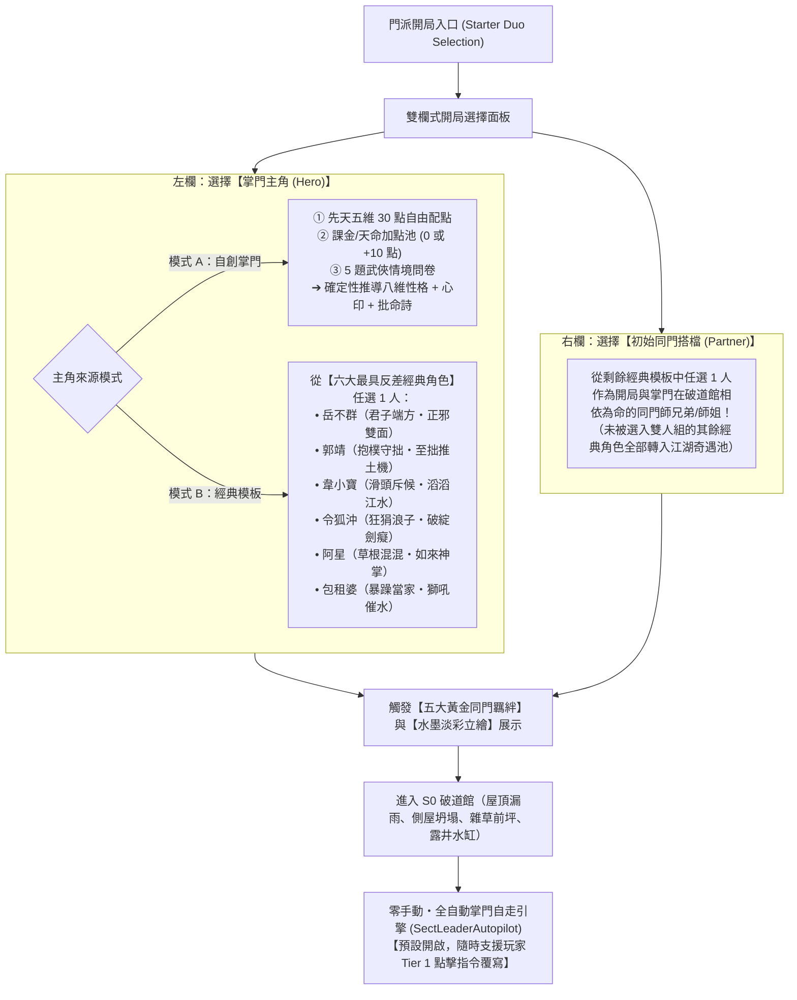
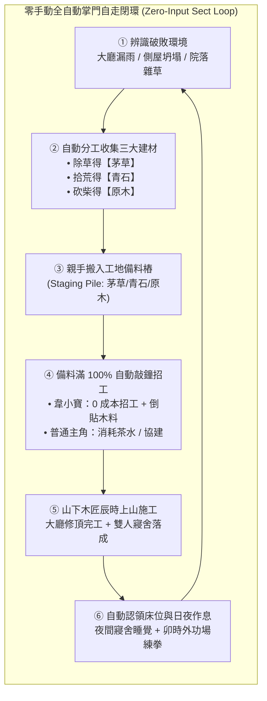

# LIFE-V01-V02 正式工程規格書：新核心同感移植、破道館雙軌開局、六大初始模板與同門搭檔、水墨淡彩立繪、零手動掌門自走與備料招工擴建

> **狀態**：正式工程規格書（Handoff Specification for `v0.1` + `v0.2` 升級版）
> **分支**：`plan/sect-life-architecture-redesign`
> **基準總藍圖**：[`SECT_LIFE_REDESIGN_MASTERPLAN.md`](file:///Users/chenyuying/workspace/earth-ascension/sect-chronicle/docs/vision/SECT_LIFE_REDESIGN_MASTERPLAN.md)（第 1～4 章、第 2.3(4) 六大模板與同門搭檔、第 2.4 外門雜務、第 5.2～5.3 章、第 6 章 `v0.1` 與 `v0.2`）
> **對齊規格基準**：[`HOME02_HANDOFF.md`](file:///Users/chenyuying/workspace/earth-ascension/sect-chronicle/docs/HOME02_HANDOFF.md)、[`model.mjs`](file:///Users/chenyuying/workspace/earth-ascension/sect-chronicle/experiments/water-carry/demo/model.mjs)、[`routes.mjs`](file:///Users/chenyuying/workspace/earth-ascension/sect-chronicle/experiments/water-carry/demo/routes.mjs)、[`app.mjs`](file:///Users/chenyuying/workspace/earth-ascension/sect-chronicle/experiments/water-carry/demo/app.mjs)
> **核心職責**：換引擎骨架不換手感，提供「自創掌門／六大經典模板 ＋ 初始同門搭檔」雙人開局、水墨立繪、零手動自走開局與踏實的備料招工擴建工程契約。

---

## 一、 目標與玩家可見閉環（Player-Visible Loop）

本階段將遊戲時間線退回「門派尚未正式立匾成立前」的荒涼破道館，交付兩大核心體驗：**「S0 破道館雙人開局創角（掌門主角 ＋ 初始同門搭檔 ＋ 水墨立繪）」** 以及 **「零手動・全自動掌門自走引擎（`SectLeaderAutopilot`）」**。

### 1.1 S0 破道館開局與開局雙人搭檔選擇器（Starter Duo Selection）

開局畫面不再直接綁死既有固定的兩人（`hero` 與 `cousin`），而是提供極具江湖帶入感的「掌門主角（Hero） ＋ 初始同門搭檔（Partner）」雙人搭檔選擇面板：



---

### 1.2 六大最具反差特色的初始可選角色模板

我們從傳奇人物中挑選出 **玩法機制差異最大、性格最鮮明、絕不撞型** 的 6 位代表角色作為開局可直接選用的初始模板（既可選為【掌門主角】，也可選為【初始同門搭檔】）：

| 初始可選模板 | 核心流派定位 | 先天五維與特化詞條 | 破道館日常與經營特技 | 四階本命武學階梯（成長閉環） | 水墨淡彩立繪視覺特徵 |
|---|---|---|---|---|---|
| **①【岳不群】**<br>*(君子端方・正邪雙面)* | **【正統氣宗掌門流】** | 悟性 7、根骨 6、臂力 5、身法 7、定力 8<br>詞條：`perk.gentleman_sword` | 重視山門規矩與門面；自動優先修補大廳屋頂與早課；大廳授課聲望累積翻倍 | **一階**：《華山基礎劍法》＋《抱元勁》<br>**二階**：《養吾劍法》＋《希夷劍法》<br>**三階**：《紫霞神功》＋《奪命三仙劍》<br>**四階**：正道《紫霞十重》vs 邪道《辟邪劍法》 | 青衫文士冠、手持君子長劍、頷下三縷長鬚，周身淡雅紫氣 |
| **②【郭靖】**<br>*(抱樸守拙・至拙推土機)* | **【低悟性破限 ＆ 100%全清流】** | **悟性 2**、根骨 9、臂力 8、身法 4、定力 9<br>詞條：`perk.simple_mastery` | 任勞任怨第一名，砍柴挑水除草備料效率極高；修繕時專注協建，體魄成長翻倍 | **一階**：《基礎羅漢拳》<br>**二階**：《羅漢拳 Lv10 返璞歸真》（0.15s 瞬發）<br>**三階**：《降龍十八掌》＋《空明拳》<br>**四階**：《左右互搏雙掌齊出》＋《九陰真經》 | 粗布褐衫、濃眉大眼、雙拳沉穩起勢，背景磐石金蓮氣韻 |
| **③【韋小寶】**<br>*(星爺版・滑頭摸金斥候)* | **【0武功嘴砲招工 ＆ 溜邊摸金流】** | 悟性 8、根骨 3、臂力 3、**身法 9**、定力 7<br>詞條：`perk.smooth_talker` | 雜務偷懶但善於社交；**敲鐘招工觸發【滔滔江水】0 成本免茶水且木匠倒貼原木 +1！** | **一階**：《撒石灰》＋《抓奶龍爪手》<br>**二階**：《神行百變抹油逃命步》<br>**三階**：《五件金絲軟甲》＋《含沙射影》<br>**四階**：《洋人火銃連發》＋《滿門神仙替我打架》 | 華麗清裝小帽、古靈精怪壞笑、一手拋灌鉛骰子一手藏白石灰袋 |
| **④【令狐沖】**<br>*(狂狷浪子・無招破綻劍癡)* | **【見招拆招・獨孤九劍流】** | **悟性 10**、根骨 5、臂力 6、身法 9、定力 4<br>詞條：`perk.flaw_seeker` | 打木人樁會打哈欠，最愛喝茶飲酒與找同門切磋拆招；同門切磋經驗獲取翻倍 | **一階**：《華山基礎劍法》<br>**二階**：《太岳三青峰》<br>**三階**：《獨孤九劍・總決式》（0s 後發先至截擊）<br>**四階**：《九劍五破圖譜》＋《易筋經》 | 瀟灑敞懷藍衫、腰掛紅酒葫蘆、嘴角叼草單手提青鋒長劍 |
| **⑤【阿星】**<br>*(《功夫》版・破繭如來神掌)* | **【草根混混 ➔ 破繭逆襲神功流】** | 悟性 6、根骨 8、臂力 6、身法 9、定力 8<br>詞條：`perk.meridian_cocoon` | 開局手拿十塊錢《如來神掌》小人書，開鎖奇快，被追時逃命步移速 $+35\%$ | **一階**：《無影踩腳趾》（踩扁雙腳定身 3s）<br>**二階**：《挨打練成銅皮鐵骨》<br>**三階**：重傷木乃伊破繭打通任督二脈<br>**四階**：《如來神掌・萬佛朝宗》（全屏天降巨掌） | 破舊白褂黑褲、半褪繃帶金光破繭態、手捧泛黃如來神掌秘笈 |
| **⑥【包租婆】**<br>*(《功夫》版・獅吼催水當家)* | **【最強督導加速 ＆ 全屏音浪流】** | 悟性 7、根骨 8、臂力 7、**身法 10**、定力 8<br>詞條：`perk.lion_roar_supervise` | **只要水缸存量 $<50\%$ 就叉腰獅吼：「包租婆～怎麼沒水了呢？！」全場挑水砍柴移速瞬間 $+50\%$！** | **一階**：《風火輪狂奔》（全地圖極限第一移速）<br>**二階**：《震退獅吼功》<br>**三階**：《青銅古鐘大喇叭擴音獅吼》<br>**四階**：《夫妻太極獅吼合擊》 | 絲質印花睡袍、滿頭彩色捲髮筒、嘴角叼菸叉腰咆哮、身後古鐘音浪 |

---

### 1.3 開局「掌門 ＋ 同門搭檔」五大黃金雙人組合（Starter Duo Synergies）

當玩家在開局同時選出【掌門】與【初始同門搭檔】時，兩人從第一天就在破道館並肩生活，並立即觸發專屬的**同門黃金化學反應（Starter Duo Synergy Perk）**：

1. **🔥 黃金組合一：【郭靖 ＋ 韋小寶】——《至拙與至巧・最佳損友開局》**
   - **代碼**：`duo_synergy.simple_and_slick`
   - **破道館日常加成**：老實人郭靖除草、拾荒、砍柴將工地備料樁堆滿效率 $+25\%$；滑頭韋小寶敲鐘招工觸發「滔滔江水」**0 成本免茶水還讓木匠倒貼原木 +1**！
   - **巡山接力開拓**：後山開放時，郭靖清場 $100\%$ 打通前路，韋小寶 $0$ 交手狂飆摘回靈芝。
2. **⚔️ 黃金組合二：【岳不群 ＋ 令狐沖】——《華山師徒・正奇相生開局》**
   - **代碼**：`duo_synergy.mentor_and_rebel`
   - **破道館日常加成**：師父岳不群端方嚴謹、修大廳與早課授課聲望翻倍；大徒弟令狐沖每日找岳不群對練切磋，師徒切磋時令狐沖的招式經驗與破劍式領悟速率**翻倍（$\times 2.0$）**！
3. **📢 黃金組合三：【包租婆 ＋ 阿星（或韋小寶）】——《豬籠城寨・雞飛狗跳開局》**
   - **代碼**：`duo_synergy.lion_roar_slacker`
   - **破道館日常加成**：水缸低於 $50\%$ 時包租婆叉腰獅吼「怎麼沒水了呢？！」，偷懶的阿星／韋小寶頭頂冒汗觸發【逃命步】，挑水與搬木移速疊加飆升至 **$+65\%$**！守山門時獅吼音浪震暈全場，阿星補上一記從天而降的如來神掌！
4. **🐉 黃金組合四：【郭靖 ＋ 令狐沖】——《一拳一劍・雙絕鎮山開局》**
   - **代碼**：`duo_synergy.fist_and_sword`
   - **破道館日常加成**：郭靖走「低悟性《羅漢拳 Lv10》0.15s 零前搖至拙流」，令狐沖走「高悟性《獨孤九劍》0s 截擊至巧流」。兩人在外功場切磋觸發「至拙無破綻 vs 無招勝有招」共鳴，雙方每週各獲得一次武學頓悟點數！
5. **✨ 黃金組合五：【自創掌門 ＋ 任選一位經典同門】——《天命掌門與護法開局》**
   - **代碼**：`duo_synergy.custom_destiny_warden`
   - **破道館日常加成**：自創主角獲得護法加持，全屬性修練心得提升 $+15\%$，且完整繼承所選同門搭檔的專屬經營特技（如選韋小寶獲 0 成本招工、選包租婆獲水缸催水、選郭靖獲協建體魄翻倍）。

> **奇遇池流轉規則**：開局未被選入雙人組的其餘經典角色模板，系統自動標記其實體為 `availableForRecruit: true` 並置入山下江湖奇遇池，其先天五維、專屬詞條與四階宿命樹完整保留，後續在 `v0.5` 下山義學與拜山事件中可自然偶遇招募！

---

### 1.4 東方手繪水墨淡彩人物立繪（Hand-Inked Watercolor Portraits）

對齊專案視覺母版 `art184-watercolor`，在 `sect-chronicle/experiments/water-carry/demo/assets/portraits/` 下統一定義並實裝 7 張高解析手繪半身立繪：

| 立繪檔案名稱 | 對應角色模板 | 水墨淡彩視覺特徵與氣韻 | 掛載與呈現位置 |
|---|---|---|---|
| `custom_hero.png` | 自創掌門主角 | 斗笠布衣、背負長劍、目光堅定、周身青竹水墨留白 | 創角卡片左欄、頂部掌門狀態列、對話氣泡頭像 |
| `yue_buqun.png` | 岳不群 | 青衫文士冠、三縷長鬚、手握君子劍、周身淡雅紫霞氣韻 | 創角卡片、人物資訊卡、大廳授課特寫、對話氣泡 |
| `guo_jing.png` | 郭靖 | 粗布褐衫、濃眉大眼、沉穩抱拳起勢、背景厚重磐石金蓮 | 創角卡片、人物資訊卡、木樁練拳特寫、對話氣泡 |
| `wei_xiaobao.png` | 韋小寶 | 清裝小帽、古靈精怪壞笑、拋擲灌鉛骰子、腰懸白石灰袋 | 創角卡片、人物資訊卡、山門敲鐘特寫、對話氣泡 |
| `linghu_chong.png` | 令狐沖 | 瀟灑敞懷藍衫、嘴角叼草、腰掛紅酒葫蘆、單手提青鋒劍 | 創角卡片、人物資訊卡、屋頂飲酒特寫、對話氣泡 |
| `ah_sing.png` | 阿星 | 破舊白褂黑褲、手捧泛黃如來神掌秘笈、半褪繃帶金光 | 創角卡片、人物資訊卡、破繭蛻變特寫、對話氣泡 |
| `landlady.png` | 包租婆 | 絲質印花睡袍、滿頭彩色捲髮筒、嘴角叼菸叉腰咆哮音浪 | 創角卡片、人物資訊卡、水缸催水特寫、對話氣泡 |

- **UI 整合規格**：
  - **創角面板**：選擇對應卡片時以水墨淡入（Fade-In 200ms）展示 `160×240` 半身像；
  - **遊戲右側人物檢查卡（Inspector Card）**：常駐顯示 `80×120` 圓角水墨畫框肖像；
  - **對話氣泡（Dialogue Bubbles）**：發言時在氣泡左側掛載 `40×40` 圓形水彩墨線頭像。

---

### 1.5 零手動・全自動掌門自走引擎（`SectLeaderAutopilot`）

為實現「放鬆看武俠生態缸」的終極模擬體驗，系統內建**預設開啟**的掌門自走引擎。就算玩家創完角後**雙手完全離開鍵盤滑鼠（0 點擊）**，主角與搭檔也能依照各自性格自走運轉：



1. **自走全流程可見表現**：
   - **採集與備料階段**：主角與搭檔自動環顧四周，發現大廳（`fac.hall`）處於 `ruin` 破損狀態、前坪雜草叢生、側院散落瓦礫。老實型角色（如郭靖）主動走向前坪**除草**獲得【茅草】、走向廢墟**拾荒**獲得【青石】、走向林緣枯木**砍柴**獲得【原木】，並將物資親手抱入大廳屋頂與寢舍的**工地備料樁（`stagingPile`）**。
   - **招工擴建階段**：當大廳屋頂備料滿額（原木 4、青石 4、茅草 4）後，主角或搭檔走到山門敲響**【招工鐘】**：
     - 若為普通掌門或自創掌門，消耗 1 壺茶水請出山下木匠；
     - 若同門中有【韋小寶】，觸發專屬氣泡 `「掌門我憑三寸不爛之舌，哄得山下木匠連夜來效力，還倒送一捆上好原木！」`，直接 0 成本啟動施工，木匠進場叮叮噹噹搭起鷹架修繕屋頂。
   - **生活與作息階段**：大廳屋頂修繕完成後，第二工程寢舍（`fac.dorm.a`）接續備料完工；掌門與同門夜間自動認領 `bed-1` 與 `bed-2` 入室安睡恢復精力（$+5/\text{s}$），次日卯時自動前往外功演練場站上木人樁修練第一階武學。
2. **隨時插手（Tier 1 玩家覆寫最高優先級）**：
   - 任何時候玩家手動點擊任何設施（如點擊水缸要求挑水、或手動點擊木樁練拳），系統立即中斷當前 Autopilot 決策，切換至最高等級的 `Tier 1 玩家指令`；
   - 玩家若在面板重新勾選「順性自走」，小人在當前手動任務結束後無縫回歸 Autopilot 個性自走。

---

## 二、 架構與檔案白名單（File Scope & Modular Layout）

為保證與既有系統乾淨解耦，新核心模組全部收斂在 `sect-chronicle/life/` 目錄下，不侵入改寫舊有的長通勤與物理常數。

```
sect-chronicle/
├── life/
│   ├── core/
│   │   ├── toils.mjs             # 五步原子工序引擎與 onCleanup 清理鉤子
│   │   ├── smart-objects.mjs     # 設施與活動宣告表 (Smart Objects Advertisement)
│   │   ├── reservation.mjs       # 通用預約守恆器 (ReservationBroker，防雙花)
│   │   ├── persona-creation.mjs  # 雙軌創角純函式庫 (配點檢核/問卷矩陣/性格稱號批命推導)
│   │   ├── starter-duo.mjs       # 開局雙人搭檔選擇器與五大黃金同門羈絆結算器
│   │   ├── autopilot.mjs         # 零手動掌門自走引擎 (SectLeaderAutopilot)
│   │   └── destiny-engine.mjs    # 純 JSON 宿命樹檢核器 (<150 行宣告式狀態機)
│   └── data/
│       └── destiny-trees.json    # 六大初始角色與傳奇四階本命武學成長定義
├── experiments/water-carry/demo/
│   ├── assets/
│   │   └── portraits/            # 水墨淡彩立繪目錄 (7 張 hand-inked watercolor portraits)
│   ├── model.mjs                 # 匯入 life/core 接線，保留 60Hz tick 與單一權威狀態
│   ├── routes.mjs                # 增補除草、拾荒、招工鐘短折線，既有水藥木路 100% 保留
│   ├── app.mjs                   # 雙人創角介面、立繪渲染、S0 破道館、工地 HUD 與 Autopilot 面板
│   ├── index.html                # 增掛雙人創角 Modal、立繪視窗與擴建模態 DOM 結構
│   └── style.css                 # 創角卡片、水墨畫框、備料進度條與古風批命字體樣式
└── test/
    ├── acceptance/               # 既有驗收測試保持唯讀
    ├── life-v01-v02.test.js      # 新增：本包專屬單元與確定性反例測試
    └── *.test.js                 # 既有 383 個單元測試 100% 通過
```

### 檔案修改權限白名單

| 檔案路徑 | 權限 | 限定用途 |
|---|---|---|
| [`sect-chronicle/life/core/*.mjs`](file:///Users/chenyuying/workspace/earth-ascension/sect-chronicle/life/core/) | **新增／可寫** | 實裝 `Toil` 五步工序、SmartObject 宣告、預約守恆器、創角純函式、雙人搭檔羈絆、Autopilot 引擎與宿命檢核器。 |
| [`sect-chronicle/life/data/destiny-trees.json`](file:///Users/chenyuying/workspace/earth-ascension/sect-chronicle/life/data/destiny-trees.json) | **新增／可寫** | 純 JSON 儲存六大初始模板之四階武學與宿命條件定義。 |
| `sect-chronicle/experiments/water-carry/demo/assets/portraits/*.png` | **新增／資產** | 存放 7 張 hand-inked 水墨淡彩立繪檔案。 |
| [`sect-chronicle/experiments/water-carry/demo/model.mjs`](file:///Users/chenyuying/workspace/earth-ascension/sect-chronicle/experiments/water-carry/demo/model.mjs) | **可修改** | 接線新核心模組，掛載 `Toil` 執行器、雙人搭檔狀態與 Autopilot tick，保持 API 與舊測試簽名 100% 相容。 |
| [`sect-chronicle/experiments/water-carry/demo/routes.mjs`](file:///Users/chenyuying/workspace/earth-ascension/sect-chronicle/experiments/water-carry/demo/routes.mjs) | **可修改** | 增補雜草站位、瓦礫站位、招工鐘短折線，**嚴禁修改既有挑水路與採藥路折線**。 |
| [`sect-chronicle/experiments/water-carry/demo/app.mjs`](file:///Users/chenyuying/workspace/earth-ascension/sect-chronicle/experiments/water-carry/demo/app.mjs) | **可修改** | 實裝雙人創角 UI 流程、立繪渲染、S0 破道館底圖替換、工地備料 UI 與 Autopilot 面板。 |
| [`sect-chronicle/experiments/water-carry/demo/index.html`](file:///Users/chenyuying/workspace/earth-ascension/sect-chronicle/experiments/water-carry/demo/index.html) | **可修改** | 增設雙人創角 Modal、立繪畫框容器、Autopilot 開關與工地進度容器。 |
| [`sect-chronicle/experiments/water-carry/demo/style.css`](file:///Users/chenyuying/workspace/earth-ascension/sect-chronicle/experiments/water-carry/demo/style.css) | **可修改** | 增補雙欄創角排版、水墨畫框特效、古風批命字體與工地備料條樣式。 |
| [`sect-chronicle/test/life-v01-v02.test.js`](file:///Users/chenyuying/workspace/earth-ascension/sect-chronicle/test/life-v01-v02.test.js) | **新增／可寫** | 針對本包新增之 DoD A～D 撰寫直接反例測試。 |
| **其餘舊測試檔與歷史 design / atlas** | **唯讀** | `test/*.test.js`、`water-layout.mjs`、`palm.mjs`、`patrol.mjs`、`life-save.mjs` 嚴禁任何非相容改動。 |

---

## 三、 核心資料結構與 JSON Schema（Data Contracts）

所有實體與工序狀態必須遵循可被 `JSON.stringify()` 序列化、無閉包洩漏、無迴圈引用的資料契約。

### 3.1 角色／掌門統一實體（`Disciple`）

```typescript
interface Disciple {
  id: string;                          // 'disc.hero' | 'disc.partner'
  name: string;                        // 自創姓名（如 '林玄真'）或經典角色姓名（如 '岳不群'）
  originMode: 'custom_point_buy' | 'preset_iconic';
  destinyTreeId: string;               // 綁定 destiny-trees.json（如 'destiny.yue_buqun'）
  role: 'master' | 'senior' | 'inner_disciple' | 'outer_disciple';
  availableForRecruit?: boolean;       // 若開局未選之經典角色，此欄設為 true 進入招募池
  portraitUrl: string;                 // 'assets/portraits/yue_buqun.png'

  innateStats: {
    comprehension: number;             // 悟性 (1~10)
    constitution: number;              // 根骨 (1~10)
    strength: number;                  // 臂力 (1~10)
    agility: number;                   // 身法 (1~10)
    composure: number;                 // 定力/福緣 (1~10)
    destinyBonusPoints: number;        // 額外注入天命點數 (0 或 10)
    innatePerks: string[];             // 先天詞條 ID 清單 (如 ['perk.gentleman_sword'])
  };

  starterDuo?: {
    isHero: boolean;                   // true 代表掌門，false 代表搭檔
    partnerId: string;                 // 對向角色 ID
    synergyPerkId: string | null;      // 'duo_synergy.simple_and_slick' 等
  };

  persona: {
    base: {                            // Big-Five + 武俠三維 (0.00 ~ 1.00)
      open: number;                    // 開放/悟性偏向
      conscientious: number;           // 盡責/勤勉
      extravert: number;               // 外向/社交
      agreeable: number;               // 隨和/仁善
      stable: number;                  // 情緒穩定/沉著
      explore: number;                 // 探索欲
      safe: number;                    // 謹慎求安
      care: number;                    // 護短/關懷
    };
    current: Record<string, number>;   // 隨重大事件微調之動態性格
    daoTitle: string;                  // 道家心性稱號（如 '君子端方'）
    natalPoem: string[];               // 古風批命詩（如 ['紫氣東來映華山', '有所不為立人間']）
    heartSeal: {
      code: number;                    // 八卦心印代碼 (0b000 ~ 0b111)
      overriddenByPlayer: boolean;     // 玩家手動覆寫標記 (預設 false)
    };
    autopilot: {
      enabled: boolean;                // 掌門全自動自走開關 (預設 true)
      policy: 'balanced' | 'focus_build' | 'focus_train' | 'smooth_talker';
    };
  };

  needs: {
    energy: { current: number; max: number; restAt: number; backAt: number }; // 預設 100, 30, 80
    thirst: { current: number; max: number; wantAt: number };                 // 預設 80, 20
  };

  skills: {
    legStrength: { level: number; exp: number; nextExp: number };
    physique: { level: number; exp: number; nextExp: number };
    construction: { level: number; exp: number; nextExp: number };
  };

  carrying: {
    item: 'water' | 'herb' | 'timber' | 'stone' | 'thatch' | null;
    amount: number;
  };

  housing: {
    roomId: string | null;             // 'fac.dorm.a'
    bedId: string | null;              // 'bed-1' | 'bed-2'
  };

  decision: {
    tier: 1 | 2 | 3 | 4;               // 1=玩家手動, 2=生理自理, 3=門派作息/Autopilot, 4=自由休閒
    currentToil: ActiveToilState | null;
    explain: {
      doing: string;                   // '正在：搬運【原木】往大廳工地'
      reason: string;                  // '原因：Autopilot 備料擴建（差 2 原木）'
      nextPlan: string;                // '下一步：備料滿 100% 後敲響招工鐘'
    };
  };
}
```

---

### 3.2 雙人搭檔選擇 JSON Schema（`StarterDuoSelection`）

```json
{
  "$schema": "http://json-schema.org/draft-07/schema#",
  "title": "StarterDuoSelectionConfig",
  "type": "object",
  "required": ["hero", "partner"],
  "properties": {
    "hero": {
      "type": "object",
      "required": ["mode"],
      "properties": {
        "mode": { "type": "string", "enum": ["custom_point_buy", "preset_iconic"] },
        "presetArchetypeId": { "type": "string", "enum": ["yue_buqun", "guo_jing", "wei_xiaobao", "linghu_chong", "ah_sing", "landlady"] },
        "customSettings": {
          "type": "object",
          "properties": {
            "name": { "type": "string", "minLength": 1, "maxLength": 8 },
            "stats": {
              "type": "object",
              "required": ["comprehension", "constitution", "strength", "agility", "composure"],
              "properties": {
                "comprehension": { "type": "integer", "minimum": 1, "maximum": 10 },
                "constitution": { "type": "integer", "minimum": 1, "maximum": 10 },
                "strength": { "type": "integer", "minimum": 1, "maximum": 10 },
                "agility": { "type": "integer", "minimum": 1, "maximum": 10 },
                "composure": { "type": "integer", "minimum": 1, "maximum": 10 }
              }
            },
            "destinyBonusPoints": { "type": "integer", "enum": [0, 10] },
            "selectedPerk": { "type": "string" },
            "questionAnswers": { "type": "array", "items": { "type": "integer", "minimum": 0, "maximum": 3 }, "minItems": 5, "maxItems": 5 }
          }
        }
      }
    },
    "partner": {
      "type": "object",
      "required": ["presetArchetypeId"],
      "properties": {
        "presetArchetypeId": { "type": "string", "enum": ["yue_buqun", "guo_jing", "wei_xiaobao", "linghu_chong", "ah_sing", "landlady"] }
      }
    }
  }
}
```

---

### 3.3 擴建工地實體（`ConstructionSite`）

```typescript
interface ConstructionSite {
  facilityId: 'fac.hall' | 'fac.dorm.a';
  name: string;
  targetStage: 'S1';
  phase: 'staging_materials' | 'ready_to_build' | 'building' | 'completed';

  stagingPile: {
    timber: { current: number; required: number; reservedInFlight: number };
    stone:  { current: number; required: number; reservedInFlight: number };
    thatch: { current: number; required: number; reservedInFlight: number };
  };

  workforce: {
    mode: 'hire_artisans' | 'sect_disciples';
    hiredArtisan: {
      id: string;                      // 'npc.carpenter_lin'
      name: string;                    // '山下林木匠'
      status: 'idle' | 'walking_in' | 'working' | 'walking_out';
    } | null;
    hiringCost: {
      tea: number;                     // 一般需消耗 1 壺茶水
      freeByPerk: boolean;             // 韋小寶特質 perk.smooth_talker 為 true
    };
    progressTicks: number;             // 當前施工累積 tick
    totalTicks: number;                // 所需工時 (大廳 1440 ticks, 寢舍 1080 ticks)
    activeWorkerId: string | null;     // 當前站上鷹架之施工者 ID
  };
}
```

---

### 3.4 通用五步原子工序（`Toil Pipeline`）與異常清理鉤子（`onCleanup`）

所有工作（挑水、採藥、砍柴、除草、拾荒、搬料、修繕、泡茶、練掌、休養）一律拆解為以下 5 個標準原子工序：

```typescript
interface ToilStepDefinition {
  step: 'reserve' | 'goto' | 'interact' | 'transfer' | 'complete';
  execute: (world: WorldState, actor: Disciple, context: ToilContext) => ToilStepResult;
}

interface ToilContext {
  toilId: string;                      // 如 'toil.gather_thatch'
  facilityId: string;
  stationId: string;
  sourceItem?: 'timber' | 'stone' | 'thatch' | 'water' | 'herb';
  amount?: number;
  targetFacilityId?: string;           // 搬運目的地
  targetStagingPileKey?: 'timber' | 'stone' | 'thatch';
  progressTicks?: number;
  needTicks?: number;
}
```

#### 異常清理鉤子（`onCleanup`）
任何正在執行的工序若遭遇以下事件，必須強制觸發 `onCleanup(world, actor, toilContext, reason)`：
- 玩家下達 Tier 1 新指令（手動改派）；
- 角色精力下降至 $\le 30$ 觸發 Tier 2 生理自理中斷；
- 招工鐘施工提前完成或目標站位失效。

**`onCleanup` 必須強制履行的守恆不變量**：
- **站位鎖釋放**：將該角色在 `ReservationBroker` 註冊的站位鎖、工位鎖完全清除；
- **在途貨物安全處置**：若角色手中已抱有物資（`carrying.amount > 0`），若目的地未滿則繼續交付，否則安全退回庫存，嚴禁憑空消失或雙花；
- **施工工時保留**：工地已累積的 `progressTicks` 完整保留，不因中斷而重置歸零。

---

### 3.5 宿命樹資料結構（`destiny-trees.json`，涵蓋六大模板）

```json
{
  "$schema": "http://json-schema.org/draft-07/schema#",
  "trees": {
    "destiny.yue_buqun": {
      "archetypeId": "yue_buqun",
      "name": "岳不群",
      "stages": [
        { "stage": 1, "unlockArt": "art.huashan_basic_sword", "unlockInternal": "art.huashan_baoyuan_jin", "require": { "dayMin": 1 } },
        { "stage": 2, "unlockArt": "art.yangwu_sword", "require": { "facilityCompleted": "fac.hall", "artLevel": { "art.huashan_basic_sword": 2 } } },
        { "stage": 3, "unlockArt": "art.zixia_qi", "require": { "statMin": { "composure": 8 }, "artLevel": { "art.yangwu_sword": 3 } } },
        { "stage": 4, "dilemmaId": "dilemma.huashan_crisis", "branches": {
            "orthodox": { "require": { "composureMin": 9, "currentSafeMin": 0.80 }, "unlockArt": "art.zixia_tier10", "title": "華山聖手" },
            "bixie": { "require": { "composureMax": 6 }, "unlockArt": "art.bixie_sword", "applyPerk": "perk.bixie_ghost_speed", "title": "紫衣梟雄" }
          }
        }
      ]
    },
    "destiny.guo_jing": {
      "archetypeId": "guo_jing",
      "name": "郭靖",
      "stages": [
        { "stage": 1, "unlockArt": "art.luohan_fist", "require": { "dayMin": 1 } },
        { "stage": 2, "unlockArt": "art.luohan_fist_tier10", "require": { "statMax": { "comprehension": 3 }, "artLevel": { "art.luohan_fist": 5 } } },
        { "stage": 3, "unlockArt": "art.dragon_palm", "require": { "facilityCompleted": "fac.dorm.a", "statMin": { "constitution": 8 } } },
        { "stage": 4, "unlockArt": "art.dual_wield_dragon_fist", "require": { "artLevel": { "art.dragon_palm": 3, "art.luohan_fist_tier10": 1 } } }
      ]
    },
    "destiny.wei_xiaobao": {
      "archetypeId": "wei_xiaobao",
      "name": "韋小寶",
      "stages": [
        { "stage": 1, "unlockArt": "art.lime_spray_claw", "require": { "dayMin": 1 } },
        { "stage": 2, "unlockArt": "art.shenxing_baibian", "require": { "facilityCompleted": "fac.hall", "statMin": { "agility": 8 } } },
        { "stage": 3, "unlockArt": "art.five_armor_turtle", "require": { "statMin": { "composure": 7 } } },
        { "stage": 4, "unlockArt": "art.foreign_musket_volley", "require": { "facilityCompleted": "fac.dorm.a" } }
      ]
    },
    "destiny.linghu_chong": {
      "archetypeId": "linghu_chong",
      "name": "令狐沖",
      "stages": [
        { "stage": 1, "unlockArt": "art.huashan_basic_sword", "require": { "dayMin": 1 } },
        { "stage": 2, "unlockArt": "art.taiyue_three_peaks", "require": { "sparringCountMin": 5, "artLevel": { "art.huashan_basic_sword": 3 } } },
        { "stage": 3, "unlockArt": "art.dugu_nine_swords_stance", "require": { "statMin": { "comprehension": 9 }, "artLevel": { "art.taiyue_three_peaks": 3 } } },
        { "stage": 4, "unlockArt": "art.five_flaw_mastery_yijinjing", "require": { "artLevel": { "art.dugu_nine_swords_stance": 5 } } }
      ]
    },
    "destiny.ah_sing": {
      "archetypeId": "ah_sing",
      "name": "阿星",
      "stages": [
        { "stage": 1, "unlockArt": "art.shadowless_toe_stomp", "require": { "dayMin": 1 } },
        { "stage": 2, "unlockArt": "art.bronze_skin_iron_bone", "require": { "damageTakenMin": 200 } },
        { "stage": 3, "unlockArt": "art.meridian_cocoon_breakthrough", "require": { "isCocoonHealed": true } },
        { "stage": 4, "unlockArt": "art.buddha_palm_ultimate", "require": { "artLevel": { "art.meridian_cocoon_breakthrough": 1 } } }
      ]
    },
    "destiny.landlady": {
      "archetypeId": "landlady",
      "name": "包租婆",
      "stages": [
        { "stage": 1, "unlockArt": "art.hot_wheels_sprint", "require": { "dayMin": 1 } },
        { "stage": 2, "unlockArt": "art.lion_roar_knockback", "require": { "facilityCompleted": "fac.hall" } },
        { "stage": 3, "unlockArt": "art.bronze_bell_megaphonic_roar", "require": { "statMin": { "composure": 8 }, "artLevel": { "art.lion_roar_knockback": 3 } } },
        { "stage": 4, "unlockArt": "art.couple_taichi_roar_combo", "require": { "hasPartnerBond": true } }
      ]
    }
  }
}
```

---

## 四、 權威數值與確定性不變量表（Authoritative Constants & Invariants）

### 4.1 100% 保留之舊世界基準常數

| 常數項 | 權威數值 | 規格來源 | 備註說明 |
|---|---|---|---|
| 世界地圖幾何規格 | `1600 × 1350` 像素單位 | Masterplan 1.2 / `HOME02` | 全局統一連續地圖，禁止瞬移與跨圖裁切。 |
| 院中核心集結端點 | `(962, 512)` | [`routes.mjs`](file:///Users/chenyuying/workspace/earth-ascension/sect-chronicle/experiments/water-carry/demo/routes.mjs#L2) | 原挑水、採藥出發與回程端點，保持連續導航。 |
| 挑水路單程長度 | `1700.9` 單位 | [`water-layout.mjs`](file:///Users/chenyuying/workspace/earth-ascension/sect-chronicle/experiments/water-carry/demo/water-layout.mjs) / D26 | 竹林坡、溪橋、潭南石階折線，手感不可變更。 |
| 採藥路單程長度 | `515.2` 單位 | [`routes.mjs`](file:///Users/chenyuying/workspace/earth-ascension/sect-chronicle/experiments/water-carry/demo/routes.mjs#L8) / `HERB` | 往東坡藥草小路長度。 |
| 空手移動速度 | $v_{\text{empty}} = \min(84, 60 \times (1 + 0.12 \times (L - 1)))$ | [`model.mjs`](file:///Users/chenyuying/workspace/earth-ascension/sect-chronicle/experiments/water-carry/demo/model.mjs#L46) / D26 | Lv1 $60/\text{s}$ 至 Lv5 $84/\text{s}$。 |
| 負重移動速度 | $v_{\text{load}} = \min(64, 40 \times (1 + 0.15 \times (L - 1)))$ | [`model.mjs`](file:///Users/chenyuying/workspace/earth-ascension/sect-chronicle/experiments/water-carry/demo/model.mjs#L47) / D26 | Lv1 $40/\text{s}$ 至 Lv5 $64/\text{s}$（「成長即速度」）。 |
| 精力上限與恢復 | 上限 100，工作耗 $1/\text{s}$，坐凳／躺床 $+5/\text{s}$ | [`model.mjs`](file:///Users/chenyuying/workspace/earth-ascension/sect-chronicle/experiments/water-carry/demo/model.mjs#L57) / `RULES.energy` | 基礎生理消耗不變。 |
| 生理遲滯門檻 | 觸發自理歇息 $\le 30$，續接原工作 $\ge 80$ | [`model.mjs`](file:///Users/chenyuying/workspace/earth-ascension/sect-chronicle/experiments/water-carry/demo/model.mjs#L57) / LP-04 | 嚴格維持 FreeSO 遲滯防頻繁切換。 |
| 泡茶工期與消耗 | 需水 1 ＋ 藥 1；煮茶 6s (360t)，飲茶 4s (240t) | [`tea.mjs`](file:///Users/chenyuying/workspace/earth-ascension/sect-chronicle/experiments/water-carry/demo/tea.mjs#L5) / `TEA` | 精力 $+40$，座位單一排他。 |
| 砍柴工期與庫存 | 作業 8s (480t)，耗 8 精力，柴堆容量 12 捆 | [`home02.mjs`](file:///Users/chenyuying/workspace/earth-ascension/sect-chronicle/experiments/water-carry/demo/home02.mjs#L6) / `WOOD` | 林緣枯木點 `(836, 350)`。 |

---

### 4.2 本包新增之權威常數

```javascript
export const LIFE_V02_CONSTANTS = Object.freeze({
  // 1. 三大基礎建材收集工序
  chores: {
    clearWeeds: {
      durationMs: 6000,              // 除草 6 遊戲秒 (360 ticks)
      energyPerSec: 1,               // 耗精力 1/s (共 6 點)
      yieldItem: 'thatch',           // 產出茅草
      yieldAmount: 1,
      stationPos: [940, 560]         // 院坪雜草站位
    },
    salvageRubble: {
      durationMs: 8000,              // 拾荒清瓦礫 8 遊戲秒 (480 ticks)
      energyPerSec: 1,               // 耗精力 1/s (共 8 點)
      yieldItem: 'stone',            // 產出青石
      yieldAmount: 1,
      stationPos: [880, 260]         // 正堂廢墟瓦礫站位
    },
    chopWood: {
      durationMs: 8000,              // 沿用 HOME02 枯木砍柴 8 遊戲秒
      energyPerSec: 1,
      yieldItem: 'timber',           // 產出原木
      yieldAmount: 1,
      stationPos: [836, 350]
    }
  },

  // 2. 擴建藍圖與備料樁需求 (Staging Pile Requirements)
  blueprints: {
    hallRoofRepair: {
      facilityId: 'fac.hall',
      name: '大廳屋頂修繕',
      required: { timber: 4, stone: 4, thatch: 4 },
      workMs: 24000,                 // 山下木匠施工 24 遊戲秒 (1440 ticks)
      scaffoldingBox: [765, 135, 975, 275]
    },
    dormExpansion: {
      facilityId: 'fac.dorm.a',
      name: '第一間雙人寢舍落成',
      required: { timber: 6, stone: 2, thatch: 2 },
      workMs: 18000,                 // 施工 18 遊戲秒 (1080 ticks，對齊 HOME02)
      scaffoldingBox: [1060, 680, 1150, 750],
      bedsProvided: ['bed-1', 'bed-2']
    }
  },

  // 3. 山下招工鐘 (Artisan Bell)
  bell: {
    pos: [910, 480],                 // 山門木樁鐘位置
    ringMs: 1500,                    // 敲鐘動作 1.5 秒
    normalCost: { teaVat: 1, herb: 1 }, // 一般耗茶水 1 壺
    weiXiaobaoFreePerk: true,        // 韋小寶特質 0 成本
    artisanBonusTimber: 1            // 韋小寶特質獲贈木料 +1
  },

  // 4. 包租婆督導催水與羈絆加速常數
  supervision: {
    waterThreshold: 0.50,            // 水缸 < 50% 觸發
    baseSpeedBonus: 0.50,            // 全場外門挑水砍柴移速 +50%
    slackerDuoSpeedBonus: 0.65       // 包租婆 + 阿星/韋小寶同門羈絆移速 +65%
  },

  // 5. FreeSO 式自主飽和衰減與時辰作息鐘
  simulation: {
    shichenDurationMs: 60000,        // 一時辰 = 60 遊戲秒 (3600 ticks)
    fullDayTicks: 43200,             // 一日 12 時辰 = 720 秒 (43200 ticks)
    funCooldownMs: 60000,            // 休閒完成後冷卻 60 秒
    saturationAttenuation: 0.30,     // 60 秒內重做同一休閒吸引力衰減 70%
    scheduleBonusMultiplier: 2.50    // 處於作息時辰之活動獲得 2.5 倍偏好加成
  }
});
```

---

## 五、 四組完成判準（DoD Group A ～ D）與直接反例測試清單

驗收測試必須嚴格對齊專案的 [`VALIDATION_POLICY.md`](file:///Users/chenyuying/workspace/earth-ascension/sect-chronicle/docs/VALIDATION_POLICY.md)：以新增直接反例為主，不跑冗長無窮組合矩陣。

### 5.1 DoD 驗收項目清單

| 組別 | 驗收項目 | 必要完成判準 |
|---|---|---|
| **A 組：雙人創角、六大模板與立繪可見性** | A1 先天五維配點與防呆 | 30 點自由分配於悟性、根骨、臂力、身法、定力；任一單項不可超 $1\sim10$；總和超出或小於 30 均被防呆拒絕；天命點可選 0 或 10 點。 |
| | A2 六大模板與雙人搭檔選擇 | 掌門可選自創或六大經典模板之一；初始同門搭檔可從剩餘模板任選 1 人；未被選中模板自動標記 `availableForRecruit: true` 轉入奇遇池。 |
| | A3 水墨淡彩立繪展示 | 7 張手繪半身立繪於創角面板、人物資訊卡與對話氣泡正確載入並以水墨墨線呈現。 |
| | A4 破道館開局視圖 | 進入遊戲畫面上大廳為漏雨破頂、前坪為雜草、側屋為殘垣；工地備料樁清楚呈現茅草/青石/原木 0 進度條。 |
| **B 組：Toil 預約守恆與 onCleanup 退料** | B1 站位與容量原子預約 | 兩名弟子同 tick 爭奪最後 1 份建材或唯一定位，只有 1 人預約成功，另 1 人優雅轉向；無雙花、無死鎖。 |
| | B2 中途中斷安全退料 | 攜帶茅草/青石/原木在途中被玩家 Tier 1 手動指令打斷，觸發 `onCleanup`：攜帶物安全退回源頭或送至備料樁，物資總量守恆不遺失。 |
| | B3 施工中斷工時保留 | 鷹架施工至 50% 時被改派指令，工位鎖立即釋放，已交材料不退，已累積之工期完整保留，接續施工不重置。 |
| **C 組：零手動 Autopilot 跨時辰閉環與同門羈絆** | C1 零手動備料自走 | 玩家創角後雙手離開滑鼠（0 點擊），掌門與搭檔依性格自動執行「除草＋拾荒＋砍柴」搬入工地，將備料補滿 100%。 |
| | C2 自動敲鐘招工完工 | 備料達標後，Autopilot 自動走到山門敲鐘，山下木匠入場施工，大廳屋頂與雙人寢舍依序完工並解鎖第一階武學。 |
| | C3 韋小寶 0 成本特例 | 韋小寶開局自走敲鐘時，茶水不被扣除（0 成本），且施工完畢後備料樁額外獲得原木 $+1$。 |
| | C4 包租婆催水與羈絆加速 | 水缸存量 $<50\%$ 時包租婆自動發動催水獅吼，全場移速 $+50\%$；搭配阿星／韋小寶搭檔時疊加至 $+65\%$。 |
| **D 組：回歸防線與確定性單測** | D1 既有單測 100% 通過 | 執行 `node --test sect-chronicle/test/*.test.js`，全部 383 個測試維持 100% PASS。 |
| | D2 新增確定性測試明細 | 新增 `test/life-v01-v02.test.js`，覆蓋配點防呆、雙人搭檔羈絆、水墨立繪載入、Toil 原子預約、退料守恆與 Autopilot 閉環。 |

---

### 5.2 直接反例測試清單（Anti-Patterns & Direct Counter-Examples）

為防止邊界漏洞，工程師實作時必須在 `test/life-v01-v02.test.js` 寫入以下 6 個直接反例斷言：

1. **反例 1（配點防呆與搭檔重複反例：`counter_stats_and_duplicate_partner`）**：
   - 嘗試輸入 `comprehension: 11` 或總和為 31 點的自創角設定，或掌門選了【郭靖】右欄搭檔又選【郭靖】，系統必須拋出清晰之錯誤物件 `{ ok: false, reason: 'DUPLICATE_PARTNER_OR_STATS_OVERFLOW' }`，創角不可通過。
2. **反例 2（最後一份建材競爭反例：`counter_material_double_spend`）**：
   - 當庫存或野外僅剩 1 份茅草時，掌門與搭檔在同一 tick 同時宣告 `reserve`，斷言只有 1 位持有者成功獲得，另 1 位收到 `LACK_OF_MATERIAL` 並轉入候補，不可出現兩人手中各拿 1 份的幽靈雙花物資。
3. **反例 3（在途改派退料守恆反例：`counter_in_flight_cancellation_preservation`）**：
   - 弟子抱著 1 塊青石走向工地，於進度 $u = 0.5$ 處下達玩家 Tier 1 停工令。斷言青石不會直接消失，`onCleanup` 觸發安全返程將青石放回庫存，最終 `inventory.stone + site.stagingPile.stone` 總量嚴格等於初始總量。
4. **反例 4（未備齊建材敲鐘反例：`counter_premature_artisan_hire`）**：
   - 在工地備料僅達 $80\%$（如原木缺 1 根）時嘗試觸發敲鐘，系統必須拒絕並回傳清晰原因：`「建材尚未備齊：尚缺原木 1 捆，無法招工」`，工匠不進場、茶水不扣除。
5. **反例 5（韋小寶 0 成本與額外贈料反例：`counter_wei_xiaobao_free_perk`）**：
   - 模擬韋小寶敲鐘招工，斷言茶水存量在敲鐘前後完全不變，且完工結算時 `inventory.timber` 確實增加 1 捆。
6. **反例 6（包租婆水缸催水門檻與羈絆加速反例：`counter_landlady_supervision_water_threshold`）**：
   - 當水缸存量為 $51\%$ 時，包租婆不可發動催水獅吼；當水缸降至 $49\%$ 時精準觸發獅吼，斷言全場外門移速乘以 $1.50$；若搭檔為阿星或韋小寶，斷言該搭檔移速精準乘以 $1.65$。

---

## 六、 實作邊界（Out of Scope for v0.1 + v0.2）

1. **菜園四季耕種與名菜烹飪（留待 `v0.3`）**：
   - 東南菜畦開墾、四季蔬菜生長週期、膳房大陶灶四階名菜食譜、菜香吸引洪七公等，本包暫不實裝。
2. **同圖進階武學連招與輕功捷徑（留待 `v0.4`）**：
   - 《青松掌法》第二式疊浪連招、同門切磋拆招、翻越矮牆與踏石渡溪輕功捷徑，本包暫不包含（本包僅保留第一階基礎出拳與練木樁）。
3. **下山免費義學與外門雜務定額（留待 `v0.5`）**：
   - 派人下山義學講武識人、外門弟子每日雜務定額、因果記憶帳本與道侶雙人房結契同住，留待 `v0.5`。
4. **後山 S0～S5 六段里程巡山與塔防演武波次（留待 `v0.6`）**：
   - 後山迷霧林緣、斷崖黑熊、塔防木傀儡波次與退敵對比戰報，留待 `v0.6`，本包維持舊有單隻野豬與林鼠防衛機制。
5. **自由擺放建築與沙盒造屋（刻意不做）**：
   - 本專案堅持水彩山門母版美感，所有建築皆沿母版預留點增量擴建，不做自由格點擺建。
6. **每 Tick 呼叫 LLM 動態生成對話（刻意不做）**：
   - 所有批命詩、性格稱號與頭頂氣泡皆由純 JSON 矩陣與事件帳本確定性驅動，禁止引入任何不可控之外部 API 調用。

---

## 七、 驗收流程與工程師執行指南

1. **環境檢核**：
   - 本工作在分支 `plan/sect-life-architecture-redesign` 進行。
   - 根目錄未追蹤目錄（`docs/sect_ascension/`、`guwu-game/`、`sect_ascension/`）嚴禁修改或加入 git。
2. **執行命令矩陣**：
   ```bash
   # 1. 執行既有單元測試（必須 100% 通過，383 tests）
   node --test sect-chronicle/test/*.test.js

   # 2. 執行本包專屬測試
   node --test sect-chronicle/test/life-v01-v02.test.js

   # 3. 檢查程式碼格式與 git diff 空白問題
   git diff origin/dev --check
   ```
3. **交付成果**：
   - 本規格書審定後，交由開發者依照白名單完成 Model、Data JSON、UI 接線與專屬單元測試，集中於單一主 PR 提交。
