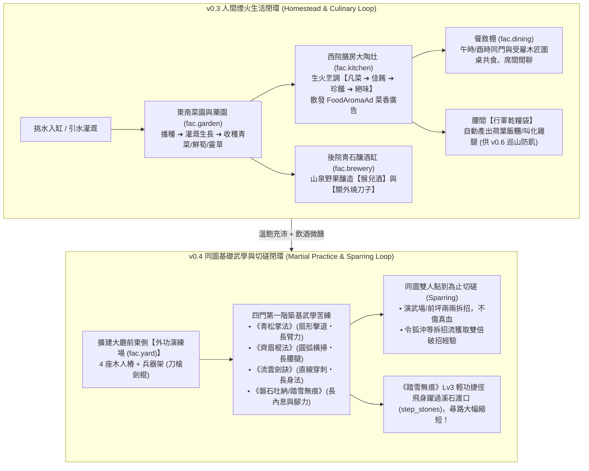

# LIFE-V03-V04 正式工程規格書：人間煙火（菜園、藥園、膳房四階名菜與釀酒）與同圖基礎武學（外功演練場、同門切磋與輕功捷徑）

> **狀態**：正式工程規格書（Handoff Specification for `v0.3` + `v0.4`）
> **分支**：`plan/sect-life-architecture-redesign`
> **基準總藍圖**：[`SECT_LIFE_REDESIGN_MASTERPLAN.md`](file:///Users/chenyuying/workspace/earth-ascension/sect-chronicle/docs/vision/SECT_LIFE_REDESIGN_MASTERPLAN.md)（第 2.2(1) 區域演進、第 2.4(2) 百藝技能、第 2.5(1)-(2) 同圖武學與三段狀態機、第 5.3 體檢七行軍口糧、第 6 章 `v0.3` 與 `v0.4`）
> **對齊規格基準**：[`LIFE_V01_V02_HANDOFF.md`](file:///Users/chenyuying/workspace/earth-ascension/sect-chronicle/docs/LIFE_V01_V02_HANDOFF.md)、[`palm.mjs`](file:///Users/chenyuying/workspace/earth-ascension/sect-chronicle/experiments/water-carry/demo/palm.mjs)、[`train01.mjs`](file:///Users/chenyuying/workspace/earth-ascension/sect-chronicle/experiments/water-carry/demo/train01.mjs)、[`MARTIAL_ARTS_RESEARCH.md`](file:///Users/chenyuying/workspace/earth-ascension/sect-chronicle/docs/MARTIAL_ARTS_RESEARCH.md)
> **核心職責**：補齊門派「挑水 ➔ 種菜 ➔ 名菜 ➔ 共食 ➔ 產出巡山乾糧」與「釀酒 ➔ 微醺」煙火氣，實裝第一階四門同圖武學、木人樁四維淬鍊、同門切磋拆招與輕功溪石捷徑。

---

## 一、 目標與玩家可見閉環（Player-Visible Loop）

本階段交付門派經營兩大最迷人的核心體驗：**`v0.3 人間煙火生活循環`** 與 **`v0.4 同圖即時武學與同門切磋`**。



---

### 1.1 `v0.3` 人間煙火閉環：菜園、藥園、膳房名菜與後院釀酒

1. **東南菜園與藥園（`fac.garden`）開墾與種植**：
   - 收集原木與茅草開荒東南碎石坡，劃出 4 格四季菜畦與 2 格藥圃。
   - **種菜灌溉閉環**：挑水弟子將山泉水挑入地頭小水槽（或手提木桶澆灌），地塊保持濕潤（`moisture >= 20%`）。作物經歷 `播種 ➔ 發芽 ➔ 茁壯 ➔ 成熟` 週期，收穫【小白菜】、【脆嫩鮮筍】、【青江菜】與藥草【紫花地丁】、【田七】。
   - **技能成長**：照料農事成長「農藝（Farming）」，採藥成長「藥理（Herbalism）」。技能提升後照料速度加快，收穫時有高機率額外獲得伴生珍稀【雨後靈筍】與【金線草】。
2. **西院膳房大陶灶（`fac.kitchen`）與四階名菜譜系**：
   - 修復膳房雙眼大陶灶與切菜案板。弟子（如自創主角、黃蓉或外門廚工）消耗柴火與食材烹調料理。
   - **四階名菜譜系**：
     - **凡菜**（基礎口糧）：【粗糧菜飯】、【冬筍豆腐湯】（滿足飽足，無特殊增益）；
     - **佳餚**（巧手小炒）：【香煎雪筍】、【清炒野菜】（飽足 $+50$，精力回復速率 $+10\%$ 持續半日）；
     - **珍饈**（廚仙名菜）：【叫化燒雞】、【荷葉筍尖湯】（飽足 $+75$，精力回復 $+25\%$，出鍋散發 `FoodAromaAd` 菜香廣告，半徑 300 單位吸引飢餓弟子與山下訪客）；
     - **絕味**（傳奇絕品）：【玉笛誰家聽落梅】（飽足 $+100$，精力全滿，且為後續引來【洪七公】關鍵前置）。
3. **隨身【行軍乾糧袋（`RationPouch`）】產出（對齊體檢七）**：
   - 膳房烹飪時，若常備食料充足，自動將多餘熟食打包為攜帶型【荷葉飯糰】或【叫化雞腿】存入膳房乾糧架；
   - 弟子前往長途巡山或遠途勞作前，自動領取 1～2 份掛於腰間，長途跋涉不因飢餓半途折返！
4. **後院青石釀酒缸（`fac.brewery`）**：
   - 投入山泉水、野山果或高粱，靜置發酵釀造：
     - **【猴兒百果酒】**：飲後進入「微醺」狀態，身法輕盈、出招破綻捕捉率 $+15\%$（令狐沖最愛）；
     - **【關外燒刀子】**：飲後進入「豪飲」狀態，臂力激盪、威脅喝止度 $+20$（喬峰最愛）。
5. **餐敘棚（`fac.dining`）圍桌共食與席間閒聊**：
   - 午時（12:00）與酉時（18:00）膳鐘敲響，空閒同門與受雇山下的木匠短工走向餐敘棚八仙桌同桌用餐，頭頂跳出日常寒暄氣泡，吃飽後消除飢餓、累積社交好感。

---

### 1.2 `v0.4` 同圖基礎武學、外功演練場、同門切磋與輕功捷徑

1. **外功演練場（`fac.yard`）擴建與第一階四門築基武學**：
   - 收集建材於大廳前東側立起 4 座木人樁（`post1～post4`）與兵器架（掛載木劍、齊眉棍與皮護腕）。
   - 掌門可於修葺正堂授課傳授**第一階（凡品・築基）四門基礎武學**：
     - **《青松掌法》**：第一式【推山掌】、第二式【疊浪掌】。判定形狀為**扇形（Cone）**，擊退正面敵手，修練大幅淬鍊【臂力】與【掌勁】；
     - **《齊眉棍法》**：第一式【橫掃千軍】、第二式【立劈華山】。判定形狀為**圓弧大範圍（Arc）**，橫掃減速群敵，修練大幅淬鍊【腰腿】與【下盤穩定】；
     - **《流雲劍訣》**：第一式【穿雲刺】、第二式【分水刺】。判定形狀為**直線長距穿透（Line）**，修練大幅淬鍊【身法】與【出招敏銳】；
     - **《磐石吐納》＆《踏雪無痕》**：基礎道門調息內功與步法，修練大幅提升【內息上限】與【通勤腳力移速】。
2. **Veloren 式三段招式狀態機與熟練度連續內插**：
   - 每一招嚴格遵循 **`Buildup (起手前搖) ➔ Action (幾何命中判定) ➔ Recover (收勢硬直)`** 三段狀態機。
   - **肉眼可見的熟練度差距（Lv0 初學 ➔ Lv3 熟練 ➔ Lv5 大成）**：
     - 《青松掌法・推山掌》起手前搖從初學 `48 ticks (0.8s)` 縮短至大成 `20 ticks (0.33s)`；
     - 掌風扇形半徑從 `28px` 擴展至 `38px`，夾角從 $50^\circ$ 擴展至 $75^\circ$；
     - 出招時在地圖上渲染 Pixi 半透明水墨氣勁特效（青松翠浪、棍影圓環、白虹劍芒）。
3. **同圖雙人點到為止切磋（Sparring Session）**：
   - 申時（15:00～17:00）武課或自由時段，兩名同門可在外功演練場或大廳前坪發起「雙人切磋」；
   - 雙方同圖交手對攻 12 秒（720 ticks），血量扣減至 $50\%$ 時自動點到為止收勢抱拳行禮（`「承讓！」`），不傷真元；
   - **特殊角色機制**：狂狷浪子【令狐沖】等無招拆招流角色在切磋中獲得雙倍熟練度，並從對手招式中累積【破掌式】／【破棍式】破招經驗。
4. **《踏雪無痕》Lv3 飛躍溪石輕功捷徑（Qinggong Shortcut）**：
   - 在潭南溪流處設定溪石躍點（`step_stones`，座標 `(810, 620)` ➔ `(890, 640)`）；
   - 普通弟子尋路必須繞行東南溪橋（路長 240 單位）；
   - 當弟子《踏雪無痕》修練至 $\ge \text{Lv3}$ 時，導航圖動態將該跳石邊啟用，弟子飛身踏石凌波渡溪（僅需 40 單位），展現瀟灑身手！

---

## 二、 架構與檔案白名單（File Scope & Modular Layout）

```
sect-chronicle/
├── life/
│   ├── core/
│   │   ├── garden.mjs            # 菜園與藥園地塊生長、灌溉與收穫邏輯
│   │   ├── kitchen.mjs           # 膳房大陶灶烹飪、四階名菜與行軍乾糧袋封裝
│   │   ├── brewery.mjs           # 後院釀酒缸發酵、微醺與豪飲 Buff 結算
│   │   ├── martial-arts.mjs      # 四門基礎武學定義、四維根基淬鍊與熟練度內插
│   │   ├── combat-moves.mjs      # Veloren 式三段招式狀態機與幾何碰撞檢定 (Cone/Arc/Line)
│   │   ├── sparring.mjs          # 同圖雙人點到為止切磋會話管理
│   │   └── nav-shortcuts.mjs     # 輕功地形邊動態連通器 (溪石踏石渡口)
│   └── data/
│       ├── recipes.json          # 純 JSON：四階名菜食譜、釀酒配方與行軍乾糧規格
│       └── martial-arts.json     # 純 JSON：第一階四門武學招式、幾何判定與幀數表
├── experiments/water-carry/demo/
│   ├── model.mjs                 # 接線農事、烹飪、武學狀態機與切磋 tick
│   ├── routes.mjs                # 增補菜園地塊、膳房爐灶、演武場木人樁與溪石躍點座標
│   ├── app.mjs                   # 菜園成長動畫、膳房香氣特效、招式氣勁層與切磋血條 UI
│   ├── index.html                # 增設膳房菜譜視窗、外功場木樁面板與同門切磋按鈕
│   └── style.css                 # 菜香飄散 CSS 特效、武學熟練度條與水墨氣浪樣式
└── test/
    ├── acceptance/               # 既有驗收測試保持唯讀
    ├── life-v03-v04.test.js      # 新增：本包專屬單元與確定性反例測試
    └── *.test.js                 # 既有單元測試 100% 通過
```

### 檔案修改權限白名單

| 檔案路徑 | 權限 | 限定用途 |
|---|---|---|
| [`sect-chronicle/life/core/*.mjs`](file:///Users/chenyuying/workspace/earth-ascension/sect-chronicle/life/core/) | **新增／可寫** | 實裝農事生長、烹飪乾糧、釀酒微醺、招式三段狀態機、幾何判定、同門切磋與輕功尋路連通。 |
| [`sect-chronicle/life/data/recipes.json`](file:///Users/chenyuying/workspace/earth-ascension/sect-chronicle/life/data/recipes.json) | **新增／可寫** | 純 JSON 儲存四階名菜食譜、釀酒配方與乾糧袋規格。 |
| [`sect-chronicle/life/data/martial-arts.json`](file:///Users/chenyuying/workspace/earth-ascension/sect-chronicle/life/data/martial-arts.json) | **新增／可寫** | 純 JSON 儲存青松掌、齊眉棍、流雲劍、踏雪無痕招式參數。 |
| [`sect-chronicle/experiments/water-carry/demo/model.mjs`](file:///Users/chenyuying/workspace/earth-ascension/sect-chronicle/experiments/water-carry/demo/model.mjs) | **可修改** | 掛載農事耕作、廚事烹飪、木人樁練拳與切磋結算 tick。 |
| [`sect-chronicle/experiments/water-carry/demo/routes.mjs`](file:///Users/chenyuying/workspace/earth-ascension/sect-chronicle/experiments/water-carry/demo/routes.mjs) | **可修改** | 增設菜園 4 格地塊、陶灶站位、演武場 4 樁與踏石捷徑邊幾何。 |
| [`sect-chronicle/experiments/water-carry/demo/app.mjs`](file:///Users/chenyuying/workspace/earth-ascension/sect-chronicle/experiments/water-carry/demo/app.mjs) | **可修改** | 實裝作物生長外觀切換、膳房菜香粒子、招式扇形/圓弧/直線視覺、切磋血條。 |
| [`sect-chronicle/experiments/water-carry/demo/index.html`](file:///Users/chenyuying/workspace/earth-ascension/sect-chronicle/experiments/water-carry/demo/index.html) | **可修改** | 增設菜園藥圃狀態卡、膳房名菜菜譜模態框與演武場切磋控制欄。 |
| [`sect-chronicle/experiments/water-carry/demo/style.css`](file:///Users/chenyuying/workspace/earth-ascension/sect-chronicle/experiments/water-carry/demo/style.css) | **可修改** | 增補菜香氣泡樣式、熟練度內插進度環與水墨招式動畫。 |
| [`sect-chronicle/test/life-v03-v04.test.js`](file:///Users/chenyuying/workspace/earth-ascension/sect-chronicle/test/life-v03-v04.test.js) | **新增／可寫** | 撰寫本包專屬 DoD A～D 驗收與 6 個直接反例測試。 |
| **其餘歷史檔案與舊測試** | **唯讀** | 嚴禁任何破壞性修改。 |

---

## 三、 核心資料結構與 JSON Schema（Data Contracts）

### 3.1 菜園與藥園地塊實體（`GardenPlot`）

```typescript
interface GardenPlot {
  plotId: string;                      // 'plot.cabbage_1' | 'plot.herb_1'
  type: 'vegetable' | 'herb';
  pos: [number, number];               // 地塊渲染座標
  stage: 'empty' | 'seeded' | 'sprouting' | 'growing' | 'mature';
  cropId: string | null;               // 'crop.cabbage' | 'crop.bamboo_shoot' | 'crop.herbal_diting'
  moisture: number;                    // 濕度 (0 ~ 100)，每秒衰減 0.2，<20 停止生長
  growthTicks: number;                 // 當前生長進度 tick
  matureTicks: number;                 // 熟成所需 tick (菜 3600t, 藥 5400t)
  reservedBy: string | null;           // 預約灌溉或採摘的弟子 ID
  yieldItem: string;                   // 'item.cabbage'
  yieldCount: number;                  // 基礎產出數量 (2)
  bonusRareYield?: { itemId: string; chance: number }; // 農藝 Lv3+ 機率伴生靈筍
}
```

---

### 3.2 菜譜與名菜實體（`Recipe` & `Dish`）

```typescript
interface Recipe {
  recipeId: string;                    // 'recipe.beggar_chicken'
  name: string;                        // '叫化燒雞'
  tier: 'common' | 'fine' | 'rare' | 'legendary'; // 凡菜 | 佳餚 | 珍饈 | 絕味
  requiredCookingLevel: number;        // 所需庖廚等級 (1 ~ 5)
  ingredients: Array<{ itemId: string; count: number }>;
  woodCost: number;                    // 消耗原木/柴火 (1 ~ 3)
  cookDurationTicks: number;           // 烹調時長 (凡菜 360t, 絕味 1440t)
  satietyRestore: number;              // 飽足度恢復 (30 ~ 100)
  energyRestorePerSec: number;         // 額外精力回補速度
  buffDurationTicks: number;           // 增益持續 tick
  aromaRadius: number;                 // 菜香廣告半徑 (珍饈 300, 絕味 600)
  canPackRation: boolean;              // 能否製成行軍乾糧袋 (true)
}

interface RationPouch {
  ownerId: string;
  items: Array<{
    rationId: 'ration.rice_ball' | 'ration.chicken_leg';
    name: string;
    satietyAmount: number;             // 25 或 40
    energyAmount: number;              // 15 或 25
  }>;
  capacity: number;                    // 上限固定為 2 份
}
```

---

### 3.3 武學、招式狀態機與幾何判定（`MartialArt` & `CombatMove`）

```typescript
interface MartialArt {
  artId: string;                       // 'art.pine_palm' | 'art.eyebrow_staff' | 'art.cloud_sword' | 'art.snow_step'
  name: string;                        // '青松掌法'
  tier: 1;                             // 第一階築基
  category: 'palm' | 'staff' | 'sword' | 'internal_footwork';
  governingStat: 'strength' | 'constitution' | 'agility' | 'composure'; // 淬鍊的主屬性
  level: number;                       // 當前熟練等級 (0=初學, 3=熟練, 5=大成)
  exp: number;                         // 當前經驗
  nextExp: number;                     // 升級所需經驗
  moves: Record<string, CombatMove>;
}

interface CombatMove {
  moveId: string;                      // 'move.pine_push'
  name: string;                        // '推山掌'
  timeline: {
    buildupTicks: number;              // 起手前搖 (初學 48t ➔ 大成 20t)
    actionTicks: number;               // 判定生效時間 (12t)
    recoverTicks: number;              // 收勢硬直 (初學 36t ➔ 大成 18t)
  };
  hitShape: {
    type: 'cone' | 'arc' | 'line';
    radius: number;                    // 扇形/圓弧半徑 (28px ➔ 38px)
    angleDeg?: number;                 // 扇形夾角 (50° ➔ 75°)
    length?: number;                   // 直線長度 (55px ➔ 85px)
    width?: number;                    // 直線寬度 (16px)
  };
  knockbackForce: number;              // 擊退力道 (40 ➔ 70)
  damage: number;                      // 威力值 (15 ➔ 35)
  interruptPower: number;              // 破招打斷力
}
```

---

### 3.4 同門切磋會話實體（`SparringSession`）

```typescript
interface SparringSession {
  sessionId: string;
  challengerId: string;
  opponentId: string;
  location: [number, number];          // 切磋中心點
  stage: 'approaching' | 'active' | 'saluting' | 'completed';
  elapsedTicks: number;
  maxTicks: number;                    // 720 ticks (12 遊戲秒)
  scores: {
    challengerHits: number;
    opponentHits: number;
  };
  healthFloorPercent: 0.50;            // 點到為止血量底線 (50%)
  expGained: {
    base: number;                      // 基礎 +3
    flawSeekerBonus: number;           // 令狐沖特質額外 +3 (合計 +6)
  };
}
```

---

## 四、 權威數值與確定性不變量表（Authoritative Constants & Invariants）

### 4.1 農藝、烹飪、乾糧與釀酒權威數值表

```javascript
export const LIFE_V03_CONSTANTS = Object.freeze({
  // 1. 菜園與藥園地塊配置
  farming: {
    waterConsumptionPerWatering: 1,  // 澆灌一次消耗 1 桶水
    waterMoistureAdd: 40,            // 增加 40% 濕度 (上限 100%)
    moistureDecayPerSec: 0.20,       // 濕度每秒衰減 0.20%
    dryThreshold: 20,                // 濕度 < 20% 停止生長
    growthDurationTicks: {
      cabbage: 3600,                 // 小白菜生長 60 秒 (3600 ticks)
      bambooShoot: 4800,             // 冬筍 80 秒
      herbDiting: 5400               // 紫花地丁 90 秒
    },
    yields: {
      cabbage: { normal: 2, rareChance: 0.15, rareItem: 'item.bamboo_shoot' },
      herbDiting: { normal: 2, rareChance: 0.15, rareItem: 'item.golden_herb' }
    }
  },

  // 2. 膳房四階名菜與增益
  culinary: {
    recipes: {
      vegeRice: { tier: 'common', cookSec: 6, satiety: 30, energyBuff: 0, aromaRadius: 0 },
      bambooSoup: { tier: 'fine', cookSec: 10, satiety: 50, energyBuff: 0.10, aromaRadius: 100 },
      beggarChicken: { tier: 'rare', cookSec: 16, satiety: 75, energyBuff: 0.25, aromaRadius: 300 },
      plumBlossom: { tier: 'legendary', cookSec: 24, satiety: 100, energyBuff: 0.40, aromaRadius: 600 }
    },
    rationPouch: {
      maxCapacity: 2,                // 隨身乾糧上限 2 份
      riceBall: { satiety: 25, energy: 15, eatDurationSec: 2 },
      chickenLeg: { satiety: 40, energy: 25, eatDurationSec: 2 }
    }
  },

  // 3. 青石釀酒缸與戰意 Buff
  brewery: {
    monkeyWine: { brewSec: 30, buffDurationSec: 120, flawCaptureBonus: 0.15 }, // 微醺劍意：破綻捕捉 +15%
    strongLiquor: { brewSec: 30, buffDurationSec: 120, roarThreatBonus: 20 }    // 豪飲戰意：威脅喝止 +20
  }
});
```

---

### 4.2 第一階四門築基武學幾何判定與幀數表

```javascript
export const LIFE_V04_CONSTANTS = Object.freeze({
  // 1. 四門武學招式幀數與幾何內插 (Lv0 初學 ➔ Lv5 大成)
  moves: {
    pinePushMountain: {
      artId: 'art.pine_palm',
      buildupTicks: [48, 42, 36, 30, 24, 20],   // 起手前搖 (0.8s ➔ 0.33s)
      actionTicks: 12,                          // 判定生效 (0.2s)
      recoverTicks: [36, 32, 28, 24, 20, 18],   // 收勢硬直 (0.6s ➔ 0.3s)
      hitShape: 'cone',
      radius: [28, 30, 32, 34, 36, 38],        // 半徑 (28px ➔ 38px)
      angleDeg: [50, 55, 60, 65, 70, 75],      // 扇形夾角 (50° ➔ 75°)
      knockback: [40, 46, 52, 58, 64, 70],      // 擊退距離
      damage: [15, 18, 22, 26, 30, 35]
    },
    staffSweepAll: {
      artId: 'art.eyebrow_staff',
      buildupTicks: [54, 48, 42, 36, 30, 26],   // 揮棍沉重前搖
      actionTicks: 16,
      recoverTicks: [42, 38, 32, 28, 24, 20],
      hitShape: 'arc',
      radius: [36, 38, 41, 44, 46, 48],        // 圓弧橫掃
      angleDeg: [140, 148, 156, 164, 172, 180],
      slowRate: 0.40,                           // 橫掃附加 40% 減速 2 秒
      damage: [12, 15, 19, 23, 27, 32]
    },
    swordCloudPierce: {
      artId: 'art.cloud_sword',
      buildupTicks: [36, 32, 28, 24, 20, 16],   // 輕盈出劍
      actionTicks: 8,
      recoverTicks: [28, 25, 22, 19, 16, 14],
      hitShape: 'line',
      length: [55, 60, 66, 72, 78, 85],        // 直線刺擊長度
      width: 16,
      damage: [18, 22, 27, 32, 38, 45]
    },
    snowStepQinggong: {
      artId: 'art.snow_step',
      speedMultiplier: [1.10, 1.15, 1.20, 1.25, 1.30, 1.35], // 移速增幅
      shortcutUnlockLevel: 3,                   // Lv3 解鎖踏石渡溪捷徑
      stepStonesCoords: [[810, 620], [890, 640]] // 溪石跳躍起訖點
    }
  },

  // 2. 切磋規則常數
  sparring: {
    durationTicks: 720,                         // 切磋時長 12 秒
    healthFloor: 0.50,                          // 點到為止血量下限 50%
    baseExp: 3,                                 // 雙方各得經驗 +3
    flawSeekerBonusExp: 3,                      // 令狐沖特質額外 +3 (合計 +6)
    cooldownTicks: 1800                         // 切磋冷卻 30 秒
  }
});
```

---

## 五、 四組完成判準（DoD Group A ～ D）與直接反例測試清單

### 5.1 DoD 驗收項目清單

| 組別 | 驗收項目 | 必要完成判準 |
|---|---|---|
| **A 組：菜園灌溉、名菜烹飪與乾糧封裝** | A1 菜園濕度與生長閉環 | 挑水灌溉增加菜畦濕度；濕度 $\ge 20\%$ 作物正常生長收成；濕度歸零作物暫停生長；收成進入膳房食材庫。 |
| | A2 四階名菜與菜香廣告 | 凡菜、佳餚、珍饈、絕味依照烹調時長與食材消耗正確出鍋；珍饈與絕味在半徑 300 單位正確廣播 `FoodAromaAd`。 |
| | A3 隨身乾糧袋打包 | 膳房自動封裝荷葉飯糰或叫化雞腿；弟子腰間乾糧袋上限 2 份，食用時於 2 秒內正確補充飽足與精力。 |
| | A4 後院釀酒微醺加成 | 釀造猴兒百果酒與關外燒刀子，飲用後於 120 秒內正確觸發微醺破綻捕捉或豪飲威脅加成。 |
| **B 組：四門同圖武學與三段招式狀態機** | B1 三段招式狀態機 | 每一招嚴格經過 `Buildup ➔ Action ➔ Recover`；Action 階段依幾何形狀（扇形/圓弧/直線）結算命中與擊退。 |
| | B2 熟練度連續內插 | 從 Lv0 練至 Lv5，起手幀數、幾何半徑、傷害與擊退距離依常數表嚴格線性內插，肉眼可見出招變快變大。 |
| | B3 四維根基淬鍊入帳 | 練掌長臂力、練棍長腰腿、練劍長身法、練吐納長內息，經驗值於每次打樁結算時原子寫入。 |
| **C 組：同門切磋與輕功溪石捷徑** | C1 雙人點到為止切磋 | 兩名弟子在外功場切磋 12 秒，造成假性傷害；任一方降至 50% 立即收招行禮；基礎經驗 $+3$。 |
| | C2 令狐沖拆招雙倍加成 | 擁有 `perk.flaw_seeker` 之令狐沖參與切磋，獲得基礎 $+3$ ＋ 拆招特質 $+3$（共 $+6$ 經驗）。 |
| | C3 踏雪無痕溪石捷徑 | 未達 Lv3 弟子尋路自動繞道溪橋（路長 240 步）；$\ge \text{Lv3}$ 弟子尋路直接啟用溪石跳點（40 步飛躍）。 |
| **D 組：回歸防線與確定性單測** | D1 既有單測 100% 通過 | 執行 `node --test sect-chronicle/test/*.test.js`，全部既有測試維持 100% PASS。 |
| | D2 本包專屬測試覆蓋 | 新增 `test/life-v03-v04.test.js`，完整覆蓋灌溉生長、名菜烹調、招式狀態機、幾何判定、切磋與輕功捷徑。 |

---

### 5.2 直接反例測試清單（Anti-Patterns & Direct Counter-Examples）

工程師實作時必須在 `test/life-v03-v04.test.js` 寫入以下 6 個直接反例斷言：

1. **反例 1（缺水停止生長防呆反例：`counter_crop_wither_without_water`）**：
   - 菜畦濕度降至 $19\%$（$<20\%$）時推進 1,000 ticks，斷言 `plot.growthTicks` 完全凍結不增長；手動澆灌水桶補水至 $59\%$ 後，生長進度立即恢復累計。
2. **反例 2（行軍乾糧袋防溢出反例：`counter_ration_pouch_overflow`）**：
   - 弟子腰間乾糧袋已有 2 份荷葉飯糰，膳房再次嘗試向其派發叫化雞腿，系統必須拒絕並回傳 `{ ok: false, reason: 'RATION_POUCH_FULL' }`，乾糧袋數量嚴格保持為 2。
3. **反例 3（招式 Buildup 階段被打斷反例：`counter_buildup_interruption`）**：
   - 角色處於《青松掌・推山掌》Buildup 起手前搖的第 10 tick 時受到強烈擊退破招，斷言該次出招立即被強制中斷，`Action` 判定不被觸發，角色直接轉入受擊硬直，絕不穿透出掌。
4. **反例 4（初學與大成起手判定幾何不變量反例：`counter_martial_proficiency_scaling`）**：
   - 同一名角色分別在 Lv0 與 Lv5 施展《齊眉棍・橫掃千軍》，斷言 Lv0 的 Buildup 嚴格等於 54 ticks 且圓弧為 $140^\circ$；Lv5 的 Buildup 嚴格等於 26 ticks 且圓弧為 $180^\circ$。
5. **反例 5（切磋血量底線不傷真元反例：`counter_sparring_no_injury`）**：
   - 在同門切磋過程中，將挑戰者血量強制壓低至 $49\%$，斷言切磋狀態立即轉入 `saluting`，雙方停止出招並抱拳致意，角色真實生命值不可低於 $50\%$。
6. **反例 6（未達輕功等級溪石捷徑阻擋反例：`counter_qinggong_shortcut_level_lock`）**：
   - 角色《踏雪無痕》等級為 Lv2 時從院子導航至潭南石階，斷言路徑節點嚴格包含溪橋迂迴點；將其等級提升至 Lv3 後再次尋路，路徑節點立即直連 `step_stones` 溪石渡口。

---

## 六、 實作邊界（Out of Scope for v0.3 + v0.4）

1. **下山免費義學與招募外門弟子（留待 `v0.5`）**：
   - 派人下山教學識人、收養孤兒、外門弟子每日雜務定額、包租婆水缸催水等，留待 `v0.5`。
2. **後山 S0～S5 六段里程巡山與四大性格流派（留待 `v0.6`）**：
   - 後山迷霧林緣、斷崖黑熊、韋小寶溜邊摸金 vs 郭靖除惡務盡全清等，留待 `v0.6`。
3. **第二階進階武學領悟與著書立說（留待 `v0.7`）**：
   - 《疊浪排雲掌》、《飛燕穿林劍》、基礎羅漢拳 Lv10 返璞歸真與藏經閣著書傳承，留待 `v0.7`（本包專注第一階四門基礎武學修練至 Lv5）。
4. **複雜飲食腐敗與廚餘垃圾機制（刻意不做）**：
   - 食物不設過期腐爛機制，乾糧袋長久保質，避免增加過度繁瑣的微觀負擔。

---

## 七、 驗收流程與工程師執行指南

1. **環境檢核**：
   - 本工作在分支 `plan/sect-life-architecture-redesign` 進行。
   - 根目錄未追蹤目錄（`docs/sect_ascension/`、`guwu-game/`、`sect_ascension/`）嚴禁修改。
2. **執行命令矩陣**：
   ```bash
   # 1. 執行既有單元測試（必須 100% 通過）
   node --test sect-chronicle/test/*.test.js

   # 2. 執行本包專屬測試
   node --test sect-chronicle/test/life-v03-v04.test.js

   # 3. 檢查程式碼格式與 git diff 空白問題
   git diff origin/dev --check
   ```
3. **交付成果**：
   - 完成 Model、Data JSON、UI 接線與專屬單元測試，集中於單一主 PR 提交。
