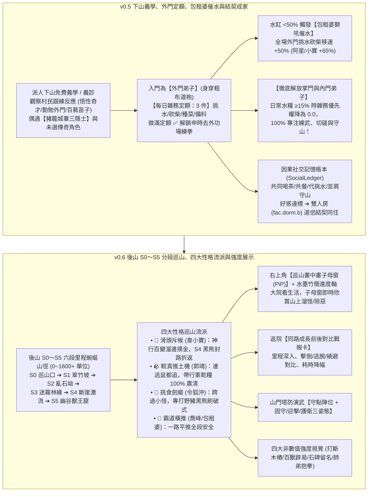

# LIFE-V05-V06 正式工程規格書：下山免費義學、外門雜務定額、包租婆催水、結契成家與後山 S0～S5 分段巡山、四大性格流派、塔防演武與非數值強度視覺

> **狀態**：正式工程規格書（Handoff Specification for `v0.5` + `v0.6`）
> **分支**：`plan/sect-life-architecture-redesign`
> **基準總藍圖**：[`SECT_LIFE_REDESIGN_MASTERPLAN.md`](file:///Users/chenyuying/workspace/earth-ascension/sect-chronicle/docs/vision/SECT_LIFE_REDESIGN_MASTERPLAN.md)（第 2.4 節下山義學與外門定額、第 2.5(5) 分段里程巡山與四大流派、第 2.6(1) 九大升級、第 5.3 體檢六～九、第 6 章 `v0.5` 與 `v0.6`）
> **對齊規格基準**：[`LIFE_V01_V02_HANDOFF.md`](file:///Users/chenyuying/workspace/earth-ascension/sect-chronicle/docs/LIFE_V01_V02_HANDOFF.md)、[`LIFE_V03_V04_HANDOFF.md`](file:///Users/chenyuying/workspace/earth-ascension/sect-chronicle/docs/LIFE_V03_V04_HANDOFF.md)、[`patrol.mjs`](file:///Users/chenyuying/workspace/earth-ascension/sect-chronicle/experiments/water-carry/demo/patrol.mjs)、[`PATROL01_HANDOFF.md`](file:///Users/chenyuying/workspace/earth-ascension/sect-chronicle/docs/PATROL01_HANDOFF.md)、[`PATROL_DEFENSE_RESEARCH.md`](file:///Users/chenyuying/workspace/earth-ascension/sect-chronicle/docs/PATROL_DEFENSE_RESEARCH.md)
> **核心職責**：將門派規模自 3 人擴展至 6～10 人，實裝下山義學識人、豬籠城寨三隱士、外門雜務定額解放內門、包租婆獅吼催水、道侶結契雙人房；實裝後山 S0～S5 六段里程巡山、四大性格巡山流派、巡山畫中畫 PiP 子母窗、塔防演武守點三姿態與四大非數值強度視覺展示。

---

## 一、 目標與玩家可見閉環（Player-Visible Loop）

本階段交付門派養成與綜合實力驗證的兩大里程碑：**`v0.5 外門興起與模擬市民生活`** 以及 **`v0.6 後山分段巡山清怪、四大性格流派與非數值強度回饋`**。



---

### 1.1 `v0.5` 下山免費義學、外門雜務定額、包租婆催水與結契成家

1. **下山免費義學識人與「豬籠城寨大隱於市」奇遇**：
   - 掌門或武學 $\ge \text{Lv3}$ 的資深師兄沿村路（`rt.village`）下山於村口涼亭舉辦半日**免費義學講武**。
   - 3～4 名村民少年與雜役跟練，玩家從現場表現直接識人：
     - `💡 觸類旁通`：步伐沉穩、頭頂浮現微光（悟性奇才）；
     - `💪 吃苦耐勞`：大汗淋漓仍咬牙蹲馬步、主動幫忙挑水桶（外門棟樑）；
     - `🌱 天生藥感` / `🔨 巧匠苗子`：聞草藥、研究涼亭榫卯（百藝專才）。
   - **偶遇傳奇苗子與【豬籠城寨三隱士】**：
     - **【苦力強】**：挑水之神，一次挑 4 桶水，健步如飛；
     - **【裁縫師傅】**：工坊裁縫，縫製精美道袍與鐵環護腕；
     - **【油炸鬼】**：卯時在膳房大擀麵棍揉麵炸香脆油條；
     - **【阿星（前期）】**：拿著十塊錢小人書，只會【無影踩腳趾】與極限逃命步；
     - **【韋小寶】**：靠「滔滔江水」0 成本招工，滿門師姐好感度飆升！
2. **外門弟子「每日雜務定額（`dailyChoreQuota = 3`）」與主角解放**：
   - 新弟子入門身穿粗布道袍，住外門通鋪，為**【記名／外門弟子】**；
   - 每日必須做滿 `3 件雜務`（挑水、砍柴、種菜、搬運建材）。未滿定額時，`ReservationBroker` 派工權重賦予 **$\times 3.0$ 絕對優先級**；做滿後頭頂冒出 `✅ 今日雜務已畢`，解鎖申時去外功場練拳；
   - **掌門與內門弟子 100% 解放**：只要水缸與柴堆存量 $\ge 15\%$，內門與掌門對挑水砍柴雜務優先級降為 `0.0`，完全不被瑣碎雜務打斷閉關練功！
3. **水缸存量 $<50\%$ 觸發【包租婆獅吼催水】督導**：
   - 當門派水缸水量跌破 $50\%$ 時，滿頭捲髮筒、嘴叼香菸的【包租婆】叉腰發動獅吼：`「包租婆～怎麼沒水了呢？！快去挑水！」`；
   - 全場外門弟子挑水與砍柴移速瞬間提升 **$+50\%$**；若與阿星或韋小寶搭檔，逃命步疊加至 **$+65\%$**！
4. **因果記憶帳本（`SocialLedger`）與道侶雙人房結契成家**：
   - 兩名同門因「同桌共食」、「共飲一壺茶」、「代挑一擔水」、「演武場切磋」、「並肩守山門」累積具備時間戳與事件 ID 的共同記憶；
   - **嚴格雙軌分流**：
     - **成年同門軌道**：`同門相識 (1) ➔ 莫逆知己 (3) ➔ 結契道侶 (5)`；達到道侶後可分配入住擴建的**雙人雅室（`fac.dorm.b`）**，夜間同住、日常散步概率提高，戰鬥中優先觸發「護衛伴侶」；
     - **未成年收養親情軌道**：永遠保持純粹的親情長幼守護，嚴禁觸發道侶成家。

---

### 1.2 `v0.6` 後山 S0～S5 六段里程巡山、四大性格流派、塔防演武與非數值強度回饋

1. **後山「S0～S5 六段里程巡山清怪系統」**：
   - 山徑自山門柵欄向後山深處蜿蜒延伸 1,600 世界單位，分為 6 大階層式考驗段：
     - `S0 柵欄巡山口 (0)`：出發門檻精力 $\ge 40$；
     - `S1 翠竹坡 (0～300)`：普通林鼠 ＋ 警覺快鼠（考驗起手幀數與追擊移速）；
     - `S2 亂石坳 (300～600)`：成群石鼠 ＋ 覓食厚皮野豬（考驗掌力威力與膽識喝止）；
     - `S3 迷霧林緣 (600～900)`：群聚野狼 ＋ 吹箭斥候（考驗 AOE 群攻與破箭閃避）；
     - `S4 斷崖激流 (900～1200)`：窄橋地形封鎖度 $95\%$ ＋ 鐵甲黑熊（考驗輕功飛渡與破甲內勁）；
     - `S5 幽谷獸王窟 (1200～1600+)`：後山百獸王（考驗三四階鎮派神功與極限續航）。
   - **嚴格返程精力安全線**：
     $$\text{RetreatBudget} = E_{\text{next}} + E_{\text{return}}(pos) + 8$$
     角色每走過 40 單位即時檢算，一旦觸底立即原路返院，絕不送死。
2. **四大性格巡山流派（韋小寶溜邊摸金 vs 郭靖 100% 肅清）**：
   - 🎲 **【滑頭斥候・摸金溜邊流（韋小寶／段譽）】**：
     - 遇怪預設 `avoid_and_slip`，憑《神行百變》（繞避率 $+85\%$）從野怪草叢旁抹油溜過（繞避 Bypassed +1），0 交手狂飆 S4 崖邊偷採百年靈芝；
     - 遇到 S4 窄橋封路黑熊（`Blockage 95%`）無法穿透，撒白石灰狼狽折返；
     - **實裝體檢六【靈物散香・返程驚獸檢定】**：懷揣靈藥返程若途經未清怪路段，靈藥香氣驚動沿途 9 隻野怪，每段強制消耗一把白石灰或 6 點精力！若先派郭靖清場打通安全山道，則 0 損耗完美帶回奇珍！
   - 🪨 **【較真推土機・除惡務盡流（郭靖／阿牛）】**：
     - 見怪必追，追擊半徑上限翻倍（150 單位 / 6s）、長途耐力減耗 $-35\%$；
     - **實裝體檢七【行軍乾糧袋】**：在 S2 石碑席地而坐吃掉黃蓉包的雞腿飯糰（補 25 飽足 + 15 精力），巡山耗時 110 秒不因飢餓中斷，所過之路**肅清完成度紮實達到 100%（逃脫 0、繞避 0）**！
   - 🍶 **【挑食劍癡・專尋強敵流（令狐沖／楊過）】**：
     - 跨過 S1 小野鼠，直奔 S2 野豬王與 S4 黑熊拆招，快速刷滿《獨孤九劍》破式經驗。
   - 🐉 **【霸道橫推・秋風掃落葉流（喬峰／包租婆）】**：
     - 邊走邊轟出金龍／獅吼音浪，一路推平萬獸。
3. **右上角巡山畫中畫子母窗（Patrol PiP Viewport，體檢八）＋ 水墨竹簡進度軸**：
   - 弟子出門巡山時，右上角浮現 `240×180` 即時同步追蹤圓窗與水墨竹簡里程軸：`[山門]━━S1(✔)━━S2(✔)━━S3(韋小寶・溜邊)━━S4(黑熊封路)━━S5`；
   - 點擊子母窗即可隨時與主畫面無縫切換。
4. **返院「同路成長前後對比戰報卡（Before / After Progression Telemetry）」**：
   - 詳細記錄推進距離、已清路段、個體去重結果（擊倒／驅離／逃脫／繞避）與返院原因，並自動與該角色上次同路紀錄對比（例如：`推進 +690、逃脫率 60% ➔ 0%、單隻交手耗時 -64%`）。
5. **演武場／山門「塔防式試陣演練」與守點三姿態**：
   - 擺放守點陣位（Defense Slots），指定三種姿態：`【固守陣眼】`、`【迎擊攔截】`、`【游走護衛】`；驗收弟子武學能否把敵人擋在山門之外。
6. **四大非數值強度視覺反饋（Show, Don't Tell）**：
   - 🪵 **木人樁四階破壞**：初學手痛 ➔ 木樁搖晃 ➔ 一掌打斷木樁＋青石板裂紋 ➔ 返璞歸真五指大掌坑；
   - 😱 **宗師氣場百獸辟易**：綜合實力達標者走上後山，低階林鼠 180 單位外嚇得瑟瑟發抖逃遁；
   - 🪨 **山門鎮山功勳石碑**：銘刻本門最遠巡山里程、一擊最高震退數與大巧不工極限紀錄，新弟子駐足仰望獲得練功激勵；
   - 🎖️ **同門抱拳行禮稱呼升級**：外門師弟在走廊遇見打穿 S3 的大師兄時主動停步躬身行禮。

---

## 二、 架構與檔案白名單（File Scope & Modular Layout）

```
sect-chronicle/
├── life/
│   ├── core/
│   │   ├── outreach.mjs          # 下山免費義學、義診與跟練識人邏輯
│   │   ├── chore-quota.mjs       # 外門雜務定額與 ReservationBroker 優先序矩陣
│   │   ├── landlady-supervision.mjs # 包租婆水缸 <50% 獅吼催水系統
│   │   ├── social-ledger.mjs     # 因果社交記憶帳本與道侶雙人房結契成家
│   │   ├── segmented-patrol.mjs  # 後山 S0～S5 六段里程巡山與四大性格流派引擎
│   │   ├── patrol-pip.mjs        # 右上角巡山畫中畫子母視窗與竹簡里程軸
│   │   ├── defense-drill.mjs     # 演武場/山門塔防守點陣位與三姿態波次器
│   │   └── strength-showcase.mjs # 四大非數值強度視覺 (斷樁/辟易/石碑/行禮)
│   └── data/
│       ├── patrol-stages.json    # 後山 S0～S5 里程距離、地形封鎖度與怪物生態
│       └── recruit-pool.json     # 下山義學與慕名拜師潛力 NPC 庫 (含城寨三隱士)
├── experiments/water-carry/demo/
│   ├── model.mjs                 # 接線雜務定額、包租婆催水、分段巡山與塔防陣位
│   ├── patrol.mjs                # 升級分段里程、撤退預算、四大性格流派與對比戰報
│   ├── routes.mjs                # 增補後山 S0～S5 山徑點集、隘口窄橋與雙人房座標
│   ├── app.mjs                   # 渲染 PiP 子母窗、竹簡里程軸、對比戰報卡與石碑 UI
│   ├── index.html                # 增設 PiP 容器、戰報彈窗、陣位配置面板與石碑 DOM
│   └── style.css                 # 水墨竹簡軸、PiP 圓窗畫框與戰報字體排版
└── test/
    ├── acceptance/               # 既有驗收測試保持唯讀
    ├── life-v05-v06.test.js      # 新增：本包專屬單元與確定性反例測試
    └── *.test.js                 # 既有單元測試 100% 通過
```

### 檔案修改權限白名單

| 檔案路徑 | 權限 | 限定用途 |
|---|---|---|
| [`sect-chronicle/life/core/*.mjs`](file:///Users/chenyuying/workspace/earth-ascension/sect-chronicle/life/core/) | **新增／可寫** | 實裝義學識人、雜務定額、包租婆催水、記憶帳本、分段巡山、PiP、塔防姿態與強度反饋。 |
| [`sect-chronicle/life/data/*.json`](file:///Users/chenyuying/workspace/earth-ascension/sect-chronicle/life/data/) | **新增／可寫** | 純 JSON 儲存 S0～S5 路段參數與拜師招募候選池。 |
| [`sect-chronicle/experiments/water-carry/demo/model.mjs`](file:///Users/chenyuying/workspace/earth-ascension/sect-chronicle/experiments/water-carry/demo/model.mjs) | **可修改** | 接線雜務定額優先序、包租婆催水移速結算與同門記憶登記。 |
| [`sect-chronicle/experiments/water-carry/demo/patrol.mjs`](file:///Users/chenyuying/workspace/earth-ascension/sect-chronicle/experiments/water-carry/demo/patrol.mjs) | **可修改** | 升級 S0～S5 距離計算、安全撤退預算、四大性格流派判定與前後對比戰報輸出。 |
| [`sect-chronicle/experiments/water-carry/demo/routes.mjs`](file:///Users/chenyuying/workspace/earth-ascension/sect-chronicle/experiments/water-carry/demo/routes.mjs) | **可修改** | 增設後山 S0～S5 折線標記點、隘口窄橋、雙人房門位與石碑站位。 |
| [`sect-chronicle/experiments/water-carry/demo/app.mjs`](file:///Users/chenyuying/workspace/earth-ascension/sect-chronicle/experiments/water-carry/demo/app.mjs) | **可修改** | 實裝 PiP 渲染、水墨竹簡里程、戰報卡顯示與石碑銘文互動。 |
| [`sect-chronicle/experiments/water-carry/demo/index.html`](file:///Users/chenyuying/workspace/earth-ascension/sect-chronicle/experiments/water-carry/demo/index.html) | **可修改** | 增設 PiP 容器、塔防陣位面板、戰報模態框與功勳石碑 UI。 |
| [`sect-chronicle/experiments/water-carry/demo/style.css`](file:///Users/chenyuying/workspace/earth-ascension/sect-chronicle/experiments/water-carry/demo/style.css) | **可修改** | 增補 PiP 水墨圓窗樣式、竹簡軸動畫與戰報排版。 |
| [`sect-chronicle/test/life-v05-v06.test.js`](file:///Users/chenyuying/workspace/earth-ascension/sect-chronicle/test/life-v05-v06.test.js) | **新增／可寫** | 撰寫本包專屬 DoD A～D 驗收與 6 個直接反例測試。 |
| **其餘歷史檔案與舊測試** | **唯讀** | 嚴禁任何破壞性修改。 |

---

## 三、 核心資料結構與 JSON Schema（Data Contracts）

### 3.1 外門雜務定額狀態（`ChoreQuotaState`）

```typescript
interface ChoreQuotaState {
  discipleId: string;
  rankTier: 'outer' | 'inner' | 'senior' | 'master';
  dailyQuota: number;                  // 外門預設 3，內門與掌門為 0
  choresCompletedToday: number;        // 今日已完成雜務數
  isQuotaFulfilled: boolean;           // 今日定額是否已達標
  unlockedMartialPractice: boolean;    // 是否解鎖申時練拳
  contributionPoints: number;          // 累積宗門貢獻點 (滿 100 可行奉茶禮晉升內門)
}
```

---

### 3.2 因果社交記憶帳本實體（`SocialLedger`）

```typescript
interface SocialMemory {
  memoryId: string;
  timestampTick: number;
  partnerId: string;
  eventType: 'share_tea' | 'dining_together' | 'carry_water_help' | 'sparring' | 'defend_gate';
  sentimentDelta: number;              // 好感變化 (+1 ~ +3)
  description: string;                 // '午膳於餐敘棚共食荷葉筍尖湯，言談甚歡'
}

interface SocialBond {
  discipleA: string;
  discipleB: string;
  intimacyLevel: number;               // 0=陌路, 1=同門, 3=知己, 5=道侶
  track: 'romantic_dao_companion' | 'kinship_adoption'; // 成年道侶 vs 未成年收養
  isCoHabiting: boolean;               // 是否入住雙人房 fac.dorm.b
  sharedRoomId: string | null;
  memories: SocialMemory[];
}
```

---

### 3.3 後山分段巡山狀態與對比戰報（`SegmentedPatrolState` & `PatrolReport`）

```typescript
interface SegmentedPatrolState {
  actorId: string;
  patrolStyle: 'stealth_bypass' | 'methodical_clear' | 'elite_hunter' | 'juggernaut';
  currentStageId: 'S0' | 'S1' | 'S2' | 'S3' | 'S4' | 'S5';
  currentDistance: number;             // 世界距離 (0 ~ 1600)
  energyRemaining: number;
  returnBudget: number;                // 即時回程精力安全線
  carriedLoot: Array<{ itemId: string; count: number; hasScent: boolean }>;
  rationCount: number;                 // 攜帶行軍乾糧數 (0 ~ 2)
  metrics: {
    downed: string[];                  // 擊倒個體 ID 清單
    drivenOff: string[];               // 喝止驅離個體 ID 清單
    escaped: string[];                 // 逃脫個體 ID 清單
    bypassed: string[];                // 韋小寶神行百變繞避個體 ID 清單
  };
  returnReason: 'safe_return_budget' | 'chokepoint_blocked' | 'fully_cleared' | 'emergency_recall';
}

interface PatrolReport {
  actorId: string;
  patrolStyle: string;
  furthestDistance: number;
  clearedStages: string[];
  clearanceRate: number;               // 走過路段肅清率 (郭靖 1.00 vs 韋小寶 0.00)
  summaryCounts: {
    downed: number;
    drivenOff: number;
    escaped: number;
    bypassed: number;
  };
  timeAllocationSec: { travel: number; combat: number; return: number; eating: number };
  lootBroughtHome: Array<{ itemId: string; count: number }>;
  comparisonVsPrevious: {
    distanceDelta: number;             // '+690 單位'
    escapedRateDelta: number;          // '-60%'
    avgKillTimeReductionSec: number;   // '-1.8s'
  };
}
```

---

### 3.4 塔防演武陣位實體（`DefenseSlot`）

```typescript
interface DefenseSlot {
  slotId: string;                      // 'slot.bridge_front' | 'slot.gate_arch' | 'slot.inner_steps'
  position: [number, number];
  assignedDiscipleId: string | null;
  doctrine: 'hold' | 'intercept' | 'protect'; // 固守陣眼 | 迎擊攔截 | 游走護衛
  engagementRadius: number;            // 索敵半徑 (固守 40, 迎擊 120, 護衛 80)
  protectTargetId?: string;            // 護衛姿態守護之對象 ID (如道侶或掌門)
}
```

---

## 四、 權威數值與確定性不變量表（Authoritative Constants & Invariants）

### 4.1 雜務定額、包租婆催水與外門優先序矩陣

```javascript
export const LIFE_V05_CONSTANTS = Object.freeze({
  // 1. 外門雜務定額與優先序權重
  choreQuota: {
    dailyRequired: 3,                  // 外門每日必修 3 件
    outerUnfulfilledMultiplier: 3.0,   // 未滿定額時雜務優先權重 x3.0
    innerRoutineWeight: 0.0,           // 內門非危急 (存量 ≥15%) 時雜務權重 0.0
    emergencyWaterThreshold: 0.15,     // 水糧存量 <15% 觸發全門派緊急補位
    emergencyInnerWeight: 1.5,
    promotionContributionThreshold: 100 // 累積貢獻達 100 且根骨/拳法 Lv2 可行奉茶禮晉升
  },

  // 2. 包租婆催水督導系統
  landladySupervision: {
    waterVatThreshold: 0.50,           // 水缸 <50% 觸發
    baseSpeedMultiplier: 1.50,         // 全場外門挑水砍柴移速 +50%
    slackerDuoMultiplier: 1.65,        // 包租婆 + 阿星/韋小寶搭檔移速 +65%
    roarCooldownTicks: 3600            // 獅吼冷卻 60 秒
  },

  // 3. 雙人房與同住門檻
  housing: {
    intimacyCohabitThreshold: 5,       // 道侶親密度 5 解鎖同住雙人房
    sharedSleepEnergyBonusPerSec: 1.0  // 道侶同室睡眠精力恢復額外 +1.0/s
  }
});
```

---

### 4.2 後山 S0～S5 六段里程、四大流派與返程安全線

```javascript
export const LIFE_V06_CONSTANTS = Object.freeze({
  // 1. 六大距離路段參數
  stages: {
    S0: { name: '柵欄巡山口', startDist: 0, endDist: 0, chokepointBlockage: 0.0, startEnergyMin: 40 },
    S1: { name: '翠竹坡', startDist: 0, endDist: 300, chokepointBlockage: 0.15, enemies: ['mouse_normal', 'mouse_alert'] },
    S2: { name: '亂石坳', startDist: 300, endDist: 600, chokepointBlockage: 0.30, enemies: ['mouse_stone', 'boar_thick_hide'] },
    S3: { name: '迷霧林緣', startDist: 600, endDist: 900, chokepointBlockage: 0.50, enemies: ['wolf_pack', 'scout_blowgun'] },
    S4: { name: '斷崖激流', startDist: 900, endDist: 1200, chokepointBlockage: 0.95, enemies: ['bear_armored'] },
    S5: { name: '幽谷獸王窟', startDist: 1200, endDist: 1600, chokepointBlockage: 1.00, enemies: ['boss_beast_king'] }
  },

  // 2. 嚴格返程精力安全線
  safety: {
    energyPerDistanceUnit: 0.02,       // 空手每單位距離耗精力 0.02
    combatReserveMargin: 8,            // 遭遇緩衝安全餘裕 8 點
    maxOffRoadPursuitDistance: 80,     // 常規離路追擊上限 80 單位
    maxOffRoadPursuitSec: 3            // 常規追擊逾時 3 秒
  },

  // 3. 四大性格巡山流派常數
  patrolStyles: {
    stealthBypass: {                   // 🎲 韋小寶 / 段譽
      bypassSuccessBonus: 0.85,        // 神行百變繞避率 +85%
      pursuitDistance: 0,              // 絕不離路追怪
      lootScentAlertEnergyCost: 6,     // 懷揣靈藥穿過未清路段消耗 6 精力或 1 包石灰
      limePouchCapacity: 3
    },
    methodicalClear: {                 // 🪨 郭靖 / 阿牛
      pursuitDistanceMax: 150,         // 追擊上限翻倍至 150 單位
      pursuitDurationMaxSec: 6,        // 追擊逾時放寬至 6 秒
      staminaCostReduction: 0.35,      // 追擊與交手精力減耗 -35%
      eatRationEnergyAdd: 15,          // S2 席地吃乾糧補 15 精力
      eatRationSatietyAdd: 25
    },
    eliteHunter: {                     // 🍶 令狐沖 / 楊過
      skipMinors: true,                // 跨過普通小鼠
      duguFlawExpMultiplier: 2.0       // 強敵交手破式經驗 x2.0
    },
    juggernaut: {                      // 🐉 喬峰 / 包租婆
      knockbackMultiplier: 2.5,        // 掌風/獅吼範圍震退
      autoClearRadius: 100
    }
  },

  // 4. 四大非數值強度視覺階段 (1=初學 ➔ 4=宗師)
  showcaseTiers: {
    1: '手痛初學：木樁紋絲不動，野鼠近身 50 單位慢吞吞逃跑',
    2: '熟練生巧：木樁劇烈搖晃落葉飛舞，出招帶白色水墨氣旋',
    3: '登峰造極：一掌打斷木樁青石震裂，野鼠 180 單位外辟易遠遁，石碑刻名',
    4: '返璞歸真：五指大掌坑/瀑布斷流，山下惡霸抱頭求饒，同門躬身抱拳'
  }
});
```

---

## 五、 四組完成判準（DoD Group A ～ D）與直接反例測試清單

### 5.1 DoD 驗收項目清單

| 組別 | 驗收項目 | 必要完成判準 |
|---|---|---|
| **A 組：下山義學、雜務定額與解放內門** | A1 下山義學與識人邀請 | 派員下山講武，現場跟練直觀呈現悟性/勤勉/百藝標籤；可邀請良才拜入外門。 |
| | A2 外門雜務定額 | 外門弟子每日做滿 3 件雜務才解鎖申時武課；在庫存充足時包攬挑水砍柴種菜。 |
| | A3 內門免除日常雜務 | 門派水糧存量 $\ge 15\%$ 時，掌門與內門弟子雜務派工權重為 0.0，全天專注練武切磋。 |
| | A4 包租婆水缸催水 | 水缸 $<50\%$ 時包租婆叉腰獅吼，全場外門移速 $+50\%$（阿星/韋小寶 $+65\%$）。 |
| **B 組：因果社交記憶與雙人房同住** | B1 記憶事件原子入帳 | 同桌用餐、共飲茶、代挑水、切磋等事件寫入 `SocialLedger`，具備精確時間戳與成因。 |
| | B2 成年道侶結契同住 | 成年弟子親密達標結為道侶，可分配入住雙人雅室 `fac.dorm.b`；未成年收養禁止道侶結契。 |
| **C 組：後山分段巡山、四大流派與 PiP 子母窗** | C1 S0～S5 六段里程推進 | 弟子出發巡山沿 S0～S5 山徑真實推進，依起手速度、身法與威力通過各段生態檢驗。 |
| | C2 返程精力安全線 | 嚴格依 $E_{\text{next}} + E_{\text{return}} + 8$ 計算，觸及安全線立即收招返院，無送死。 |
| | C3 四大性格流派對比 | 韋小寶 $0$ 交手狂飆 S4 摸寶遇黑熊折返；郭靖攜乾糧追擊每隻逃鼠達成 $100\%$ 肅清。 |
| | C4 靈物散香返程驚獸 | 韋小寶懷揣靈藥穿過未清路段消耗白石灰/精力；郭靖清場後韋小寶接力則 0 損耗。 |
| | C5 畫中畫 PiP 與對比戰報 | 右上角水墨圓窗即時跟拍巡山；返院戰報卡精確對比里程、逃脫率與擊倒數。 |
| **D 組：塔防三姿態、強度視覺與回歸單測** | D1 塔防陣位與三姿態 | 演武場/山門陣位正確切換固守、迎擊、護衛姿態；攔截闖陣木傀儡與獸潮。 |
| | D2 四大非數值強度視覺 | 木人樁四階破壞、宗師氣場辟易、石碑刻名與同門行禮皆依實力階梯呈現。 |
| | D3 測試防線 100% 通過 | 執行 `node --test sect-chronicle/test/*.test.js` 與 `test/life-v05-v06.test.js` 均 PASS。 |

---

### 5.2 直接反例測試清單（Anti-Patterns & Direct Counter-Examples）

工程師實作時必須在 `test/life-v05-v06.test.js` 寫入以下 6 個直接反例斷言：

1. **反例 1（內門非危急跳過雜務定額反例：`counter_inner_disciple_chore_exemption`）**：
   - 當水缸存量為 $60\%$（$\ge 15\%$）時，外門弟子正在挑水，掌門或內門大師兄處於空閒狀態。檢查派工隊列，斷言大師兄絕不接取挑水／砍柴任務，其決策直接轉入外功場打木人樁。
2. **反例 2（包租婆水缸催水門檻反例：`counter_landlady_roar_trigger_threshold`）**：
   - 當水缸水量為 $51\%$ 時，包租婆不可發動催水獅吼；當水缸水量降至 $49\%$ 時精準發動獅吼，斷言全場外門移速精準乘以 $1.50$；若同場有阿星或韋小寶，其移速精準乘以 $1.65$。
3. **反例 3（未成年收養禁止道侶結契反例：`counter_youth_adoption_no_marriage`）**：
   - 道館收養的小女孩與主角親密度達到 5，嘗試調用 `proposeDaoCompanion()`，系統必須拋出清晰錯誤 `{ ok: false, reason: 'KINSHIP_ADOPTION_FORBIDS_ROMANCE' }`，關係軌道嚴格鎖定於親情。
4. **反例 4（韋小寶 S4 窄橋封鎖必退與靈物散香驚怪反例：`counter_stealth_bypass_chokepoint_and_scent`）**：
   - 韋小寶憑神行百變繞過 S1～S3 野怪，推進至 S4 窄橋（封鎖度 $95\%$），斷言其不可穿過鐵甲黑熊，必須撒石灰撤退；返程經過未清的 S3、S2、S1，靈藥散香觸發驚怪，斷言其石灰袋數量每段減少 1 包（或精力額外扣除 6 點）。
5. **反例 5（郭靖攜帶乾糧巡山跨午膳不中斷反例：`counter_guo_jing_ration_expedition`）**：
   - 郭靖攜帶 1 份荷葉飯糰出發巡山。於 S2 亂石坳第 70 秒時飽足度降至 24（$<25$ 飢餓線），斷言郭靖不可中斷巡山回院吃飯，而是當場席地 2 秒食用飯糰，飽足回補至 49，繼續向 S3 推進。
6. **反例 6（巡山返程精力預算嚴格守恆反例：`counter_retreat_budget_exact_preservation`）**：
   - 角色在 S3 處剩餘精力為 28，此處回程路耗需 20 點精力。加上安全餘裕 8 點，總需求恰為 28。系統檢算 $28 \le 20 + 8$，斷言角色立即停止前進並轉身返院，抵達山門時剩餘精力嚴格大於等於 8 點，無精力透支昏迷。

---

## 六、 實作邊界（Out of Scope for v0.5 + v0.6）

1. **第二階與第三階武學領悟樹與著書入閣（留待 `v0.7`）**：
   - 《疊浪排雲掌》、《飛燕穿林劍》、《太清御劍術》、基礎羅漢拳 Lv10 返璞歸真與藏經閣著書傳承，留待 `v0.7`。
2. **煉藥洗髓、古墓寒玉床與神兵鍛造（留待 `v0.8`）**：
   - 熬製十全大補湯引海大富、小龍女睡寒玉床、楊過瀑布揮玄鐵重劍、鍛造青鋒長劍等，留待 `v0.8`。
3. **金庸 × 周星馳宇宙二十大角色全面踢館大戰（留待 `v0.9`）**：
   - 火雲邪神白背心拖鞋夾子彈、阿星木乃伊破繭如來神掌、包租婆古鐘獅吼對轟天殘地缺等終極大戰，留待 `v0.9`。
4. **開宗立派與正式存檔 v1（留待 `v1.0`）**：
   - 開山立匾大典、自創鎮派神功、宗門編年史長卷與 Save Schema v1，留待 `v1.0`。

---

## 七、 驗收流程與工程師執行指南

1. **環境檢核**：
   - 本工作在分支 `plan/sect-life-architecture-redesign` 進行。
   - 根目錄未追蹤目錄（`docs/sect_ascension/`、`guwu-game/`、`sect_ascension/`）嚴禁修改。
2. **執行命令矩陣**：
   ```bash
   # 1. 執行既有單元測試（必須 100% 通過）
   node --test sect-chronicle/test/*.test.js

   # 2. 執行本包專屬測試
   node --test sect-chronicle/test/life-v05-v06.test.js

   # 3. 檢查程式碼格式與 git diff 空白問題
   git diff origin/dev --check
   ```
3. **交付成果**：
   - 完成 Model、Data JSON、UI 接線與專屬單元測試，集中於單一主 PR 提交。
