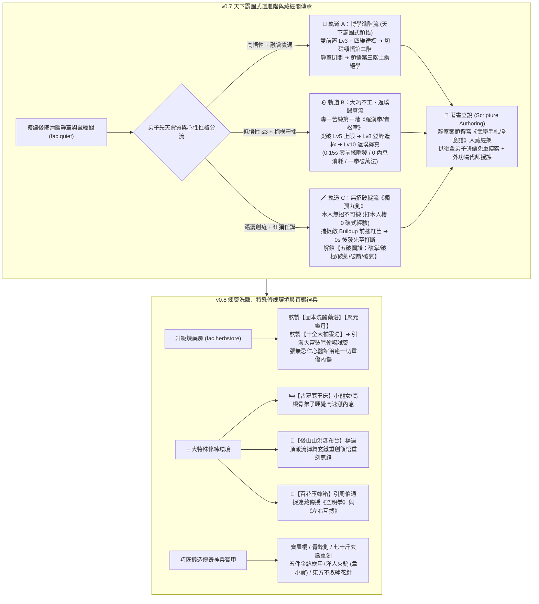

# LIFE-V07-V08 正式工程規格書：天下霸圖式武學進階樹、基礎羅漢拳返璞歸真、獨孤九劍破綻流與著書傳承、煉藥洗髓、特殊修練環境與百鍛神兵

> **狀態**：正式工程規格書（Handoff Specification for `v0.7` + `v0.8`）
> **分支**：`plan/sect-life-architecture-redesign`
> **基準總藍圖**：[`SECT_LIFE_REDESIGN_MASTERPLAN.md`](file:///Users/chenyuying/workspace/earth-ascension/sect-chronicle/docs/vision/SECT_LIFE_REDESIGN_MASTERPLAN.md)（第 2.5 章、第 2.6 章、第 5.1～5.3 章、第 6 章 `v0.7` 與 `v0.8`）
> **對齊規格基準**：[`LIFE_V01_V02_HANDOFF.md`](file:///Users/chenyuying/workspace/earth-ascension/sect-chronicle/docs/LIFE_V01_V02_HANDOFF.md)、[`MARTIAL_ARTS_RESEARCH.md`](file:///Users/chenyuying/workspace/earth-ascension/sect-chronicle/docs/MARTIAL_ARTS_RESEARCH.md)、[`PATROL_DEFENSE_RESEARCH.md`](file:///Users/chenyuying/workspace/earth-ascension/sect-chronicle/docs/PATROL_DEFENSE_RESEARCH.md)
> **核心職責**：實裝天下霸圖式四階武學進階樹、低悟性弟子基礎羅漢拳 Lv10 返璞歸真、瀟灑獨孤九劍看破前搖與五破圖譜、藏經閣著書立說、煉藥洗髓十全大補湯引海大富、三大特殊修練環境（寒玉床/瀑布/玉蜂箱引周伯通）與百鍛神兵。

---

## 一、 目標與玩家可見閉環（Player-Visible Loop）

本階段將門派建設與武道深度推進至中後期，交付兩大核心體驗章節：**「`v0.7` 天下霸圖式三大武道進階與藏經閣傳承」** 以及 **「`v0.8` 煉藥洗髓、特殊修練環境與百鍛神兵」**。



---

### 1.1 `v0.7` 天下霸圖式三大武道進階與藏經閣傳承

#### (1) 擴建後院「清幽靜室與藏經閣（`fac.quiet`）」
- 玩家指派外門弟子收集原木 12、青石 8、茅草 6 敲鐘擴建，於大廳後院落成清幽靜室與藏經書架。
- **武學圖譜 UI（Martial Codex View）**：
  - 徹底解決原版《天下霸圖》條件不明痛點：所有未領悟的進階武學皆以**「水墨剪影＋明確領悟線索」**清晰呈現（如：`【？？？・中階掌法】線索：需《青松掌法》Lv3 ＋《磐石吐納》Lv2 ＋ 臂力 Lv3，於外功場切磋或靜室閉關頓悟`）。

#### (2) 軌道 A（高悟性・博學進階流）：雙前置武學 ＋ 四維根基 ➔ 閉關頓悟高階絕學
- **第一階（凡品・築基）**：以挑水、砍柴、打木人樁淬鍊四維武道根基：
  - **【臂力】**（掌棍威力與擊退負重）；
  - **【腰腿】**（下盤穩固與抗擊退判定）；
  - **【身法】**（出招起手前搖縮減與閃避移速）；
  - **【內息】**（高階招式氣力池與氣勁射程）。
- **第二階（良品・精妙武學，切磋／打樁頓悟）**：
  - 《青松掌 Lv3》＋《磐石吐納 Lv2》＋ 臂力 $\ge 4$ ➔ 頓悟**《疊浪排雲掌》**（雙重氣浪連發，大範圍擊退整排野獸）；
  - 《齊眉棍 Lv3》＋《踏雪無痕 Lv2》＋ 腰腿 $\ge 4$ ➔ 頓悟**《風車輪轉棍》**（持續旋身橫掃減速聚怪圈）；
  - 《流雲劍 Lv3》＋《踏雪無痕 Lv3》＋ 身法 $\ge 4$ ➔ 頓悟**《飛燕穿林劍》**（踏步突進貫穿三敵、殘影折返）。
- **第三階（珍品・上乘絕學，雙進階 ＋ 靜室閉關領悟）**：
  - 滿足雙第二階武學大成與四維根基門檻後，弟子向掌門請旨進入清幽靜室閉關（`Secluded Cultivation`，外門弟子定時送茶飯）。出關時金光灌頂，正式領悟：
    - **《天罡伏虎拳》**（隔空轟出金色拳印，範圍震暈破甲）；
    - **《百鳥朝鳳棍》**（大範圍槍影風暴，封死山門隘口）；
    - **《太清御劍術》**（三道飛劍環繞護體，超遠距自動點殺）。

#### (3) 軌道 B（低悟性 $\le 3$・大巧不工返璞歸真流）：打破常規上限直達 Lv10
- **設計哲學**：打破「低資質角色後期必成廢卡」的手遊套路，致敬郭靖、阿牛與《金庸群俠傳》野球拳／《天龍八部》太祖長拳：
- **觸發條件**：
  - 先天悟性 `comprehension <= 3`；
  - 具有性格【抱樸守拙】（`☷ 坤為地`）或【篤實守靜】（`☶ 艮為山`）；
  - 弟子看高深秘笈頭頂冒出 `💫 字太深奧看攏無...`，專一對同一木人樁日揮萬拳。
- **階梯質變（打破凡品武學 Lv5 上限）**：
  - **Lv6～Lv8【登峰造極】**：解鎖**【強韌霸體】**（出招不被任何常規攻擊打斷）與**【沉渾拳罡】**（出拳震起地面金色塵浪，大距離擊飛）；
  - **Lv9～Lv10【返璞歸真・一拳破萬法】**：
    - 出招前搖壓縮至極限 **`0.15s`（零前搖瞬發）**；
    - 內息消耗為 **`0`**（越戰越勇，永不枯竭）；
    - **【一拳破萬法】**：伴隨低沉雷鳴，無視敵方護體劍陣、格擋與反彈，直接將衝鋒巨獸或踢館宗師一拳轟碎護盾震暈！

#### (4) 軌道 C（瀟灑劍癡・《獨孤九劍》無招破綻流）：見招拆招與五破圖譜
- **「木人無招，唯有活人有破綻」**：
  - 獨孤九劍傳人（令狐沖、風清揚原型弟子）打木人樁獲得的破式經驗嚴格為 `0`！
  - 唯有透過**與同門活人切磋拆招**、或在**山道與踢館中與活生生的敵人交戰**才能累積經驗。
- **同圖核心機制：看破前搖・後發先至（`onTargetBuildupFlaw`）**：
  - 當敵人進入 `Buildup` 起手前搖瞬間，敵人頭頂亮起【🎯 破綻紅芒（Flaw Window）】；
  - 九劍傳人觸發反擊判定，**免除自身全部前搖（`0s` 瞬發殘影斜刺）**，在敵人 Action 生效前搶先刺中死穴！
  - 強制**打斷（Interrupt）**敵人大招蓄力，附加擊退與硬直。
- **五破圖譜（Five-Break Manual）**：
  1. **【破掌式】**：與掌法弟子切磋／迎擊撲擊猛獸解鎖，截斷近身撲擊；
  2. **【破棍式】**：與長兵弟子切磋解鎖，看穿橫掃軸心直刺要害；
  3. **【破劍式】**：迎戰名門劍客解鎖，挑飛敵方兵刃，廢除兵器加成；
  4. **【破箭式】**：迎戰遠程投石／吹箭山賊解鎖，凌空磕飛所有投射物；
  5. **【破氣式】**：迎戰宗師護體罡氣解鎖，刺穿護體真氣與領域結界。
- **雙宗師共鳴終極彩蛋（Master Resonance Easter Egg）**：
  - 當《獨孤九劍》傳人與練成 Lv10《返璞歸真・羅漢拳》的大師兄在外功場切磋時，因阿牛的直拳已返璞歸真（`0.15s` 零前搖瞬發、渾然無招），九劍弟子尋不到任何破綻，頭頂冒出：`「咦？！大師兄這記最普通的直拳渾然天成，竟尋不到半點破綻！」` 兩人相視大笑，雙雙獲益。

#### (5) 著書立說・藏經閣薪火相傳（Scripture Authoring）
- 任何弟子在領悟第二/三階絕學、或將基礎武學修至 Lv10 返璞歸真後，可在靜室案頭耗費精力與墨條**撰寫《武學手札／拳意譜》放入藏經架**。
- 後輩弟子只要根基達標，研讀手札即可直接學會該武學，研讀速度提升 `+100%`，並可由撰寫者在外功場「代師授課」。

---

### 1.2 `v0.8` 煉藥洗髓、特殊修練環境與百鍛神兵

#### (1) 煉藥房升級、仁心醫館與「十全大補湯引海大富」
- 升級煉藥房（`fac.herbstore`）：建造大紫銅藥鼎，可將藥園培育的百年靈草熬製為藥湯與丹丸：
  - **【固本洗髓藥浴】**：浸泡後永久提升弟子根骨 $+1$、內息成長速率 $+25\%$；
  - **【聚元靈丹】**：服用後瞬間補滿內息與定力；
  - **【十全大補靈湯】**：熬煮完成時向全圖散發 `TonicAromaAd`，有機率引來**周星馳版【海大富（海公公）】**！海大富彎腰裝瞎、十步一咳（`「咳咳……小桂子，把藥端來……」`）摸進藥房偷喝試藥！偷喝後給予門派銀兩補償，並解鎖海大富客卿傳功事件。
- **張無忌仁心醫館**：若張無忌入駐藥房，解鎖「神針祛毒」，任何在後山巡山受重創經脈受損的弟子送入藥房可被瞬間治癒。

#### (2) 三大特殊修練環境
1. **🛏️【古墓寒玉床】**：
   - 設於後院雅室。小龍女或高根骨弟子睡在寒玉床上，在睡眠中每秒自動恢復內息，作夢也能精進內力修為。
2. **🌊【後山山洪瀑布台】**：
   - 設於東南山澗激流。楊過頂著萬鈞激流揮舞七十斤玄鐵重劍，在對抗水流衝擊中領悟「重劍無鋒、大巧不工」，大幅提升招式破甲與擊飛判定。
3. **🐝【百花玉蜂箱】**：
   - 設於藥園百花叢。吸引**【老頑童・周伯通】**跑來捉迷藏、與外門弟子玩泥巴，好感達標後傳授**《空明拳》**與獨門神技**《左右互搏術》**（讓郭靖與小龍女解鎖雙手同時出兩招！）。

#### (3) 巧匠鍛造傳奇神兵寶甲
- 在工坊擴建百鍛爐，收集後山硬木、寒鐵礦、玄鐵與金絲，由具備機巧天賦的弟子打造傳奇兵甲：
  - **【熟銅齊眉棍】**：提升棍法橫掃半徑 $+15px$ 與擊倒時間；
  - **【青鋒長劍】**：縮短劍訣起手前搖 $-20\%$；
  - **【七十斤玄鐵重劍】**（楊過專屬）：攻擊附加 200% 破甲與扇形巨浪；
  - **【五件金絲軟甲 ＋ 洋人火銃】**（韋小寶專屬）：金絲軟甲減免 60% 物理傷害，洋人火銃可遠程放冷箭；
  - **【東方不敗繡花針】**：極限縮減出招前搖至 `0.05s`。

---

## 二、 架構與檔案白名單（File Scope & Modular Layout）

```
sect-chronicle/
├── life/
│   ├── core/
│   │   ├── martial-tree.mjs      # 天下霸圖武學進階樹、四維檢核、頓悟與返璞歸真狀態機
│   │   ├── scripture.mjs         # 藏經閣著書立說、秘笈研讀與代師授課
│   │   ├── alchemy.mjs           # 煉藥房熬藥、洗髓藥浴與海大富偷湯事件
│   │   ├── cultivation-beds.mjs  # 三大特殊修練環境 (寒玉床、瀑布台、玉蜂箱) 判定
│   │   └── equipment.mjs         # 巧匠鍛造、神兵寶甲裝備與專屬特質掛載
│   └── data/
│       ├── martial-arts.json     # 全四階武學招式幾何、起手前搖、進階樹純 JSON
│       ├── scriptures.json       # 藏經閣手札庫與研讀加速加成
│       ├── alchemy-recipes.json  # 洗髓藥浴、聚元靈丹、十全大補湯配方表
│       └── equipment.json        # 玄鐵重劍、金絲軟甲、齊眉棍等神兵屬性表
├── experiments/water-carry/demo/
│   ├── model.mjs                 # 掛載武學進階、特殊修練環境與煉藥 tick
│   ├── routes.mjs                # 靜室、後山瀑布台、玉蜂箱導航短折線
│   ├── app.mjs                   # 武學圖譜水墨 UI、藏經閣面板、煉藥界面
│   └── index.html                # 增設武學圖譜 Modal、靜室閉關與神兵插槽 DOM
└── test/
    └── life-v07-v08.test.js      # 本包專屬單元測試與 6 個直接反例測試
```

### 檔案修改權限白名單

| 檔案路徑 | 權限 | 限定用途 |
|---|---|---|
| [`sect-chronicle/life/core/martial-tree.mjs`](file:///Users/chenyuying/workspace/earth-ascension/sect-chronicle/life/core/martial-tree.mjs) | **新增／可寫** | 武學前置檢核、切磋頓悟、靜室閉關、返璞歸真破限與九劍破綻截擊。 |
| [`sect-chronicle/life/core/scripture.mjs`](file:///Users/chenyuying/workspace/earth-ascension/sect-chronicle/life/core/scripture.mjs) | **新增／可寫** | 著書立說撰寫手札、藏經架研讀加速、代師授課經驗結算。 |
| [`sect-chronicle/life/core/alchemy.mjs`](file:///Users/chenyuying/workspace/earth-ascension/sect-chronicle/life/core/alchemy.mjs) | **新增／可寫** | 藥房熬藥、藥浴洗髓、海大富偷藥事件觸發與張無忌仁醫回血。 |
| [`sect-chronicle/life/core/cultivation-beds.mjs`](file:///Users/chenyuying/workspace/earth-ascension/sect-chronicle/life/core/cultivation-beds.mjs) | **新增／可寫** | 寒玉床睡眠增氣、瀑布台抗流練劍、玉蜂箱捉迷藏傳授左右互搏。 |
| [`sect-chronicle/life/core/equipment.mjs`](file:///Users/chenyuying/workspace/earth-ascension/sect-chronicle/life/core/equipment.mjs) | **新增／可寫** | 巧匠鍛造工序、裝備配戴與專屬武器效果（玄鐵重劍/火銃/繡花針）。 |
| [`sect-chronicle/life/data/*.json`](file:///Users/chenyuying/workspace/earth-ascension/sect-chronicle/life/data/) | **新增／可寫** | 純 JSON 定義武學招式、配方、手札與神兵規格。 |
| [`sect-chronicle/experiments/water-carry/demo/model.mjs`](file:///Users/chenyuying/workspace/earth-ascension/sect-chronicle/experiments/water-carry/demo/model.mjs) | **可修改** | 接線進階武學、特殊修練環境與煉藥邏輯，維持舊接口相容。 |
| [`sect-chronicle/test/life-v07-v08.test.js`](file:///Users/chenyuying/workspace/earth-ascension/sect-chronicle/test/life-v07-v08.test.js) | **新增／可寫** | 撰寫本包專屬 DoD A～D 與 6 個直接反例斷言。 |
| **其餘既有測試與核心** | **唯讀** | `test/*.test.js`、`life/core/toils.mjs` 等嚴禁破壞性修改。 |

---

## 三、 核心資料結構與 JSON Schema（Data Contracts）

### 3.1 四階武學與熟練度進階資料結構（`MartialArt`）

```typescript
interface MartialArtDefinition {
  id: string;                          // 'art.luohan_fist' | 'art.dugu_nine_swords'
  name: string;                        // '基礎羅漢拳' | '獨孤九劍'
  tier: 1 | 2 | 3 | 4;                 // 1=築基, 2=精妙, 3=上乘, 4=鎮派
  category: 'fist' | 'polearm' | 'sword' | 'internal' | 'special';

  prerequisites?: {
    requiredArts?: Record<string, number>; // { 'art.qing_song_palm': 3, 'art.pan_shi_breathing': 2 }
    minStats?: {
      strength?: number;               // 臂力門檻
      waistLeg?: number;               // 腰腿門檻
      agility?: number;                // 身法門檻
      innerQi?: number;                // 內息門檻
    };
    maxComprehension?: number;         // 低悟性破限限定 (<= 3)
    requiredPerks?: string[];          // ['perk.simple_minded']
  };

  maxLevel: number;                    // 一般武學為 5，返璞歸真基礎拳為 10

  moves: Array<{
    moveId: string;                    // 'move.luohan_straight_punch'
    name: string;                      // '推山直拳'
    windupSec: number;                 // 起手時間 (Lv1: 0.8s -> Lv10: 0.15s)
    activeSec: number;                 // 判定時間
    recoverySec: number;               // 收勢時間
    qiCost: number;                    // 內息消耗 (基礎拳與返璞歸真為 0)
    hitShape: {
      type: 'cone' | 'circle' | 'line' | 'point';
      params: Record<string, number>;  // { radius: 38, angleDeg: 60 }
    };
    effects: {
      damage: number;
      knockbackUnits: number;
      applyStun?: boolean;
      pierceShield?: boolean;          // Lv10 返璞歸真具備一拳破盾
      uninterruptible?: boolean;       // Lv8+ 登峰造極具備強韌霸體
    };
  }>;
}
```

### 3.2 獨孤九劍看破前搖與五破圖譜資料結構（`DuguNineSwordsState`）

```typescript
interface DuguNineSwordsState {
  unlockedBreaks: {
    breakPalm: { level: number; exp: number; unlocked: boolean };    // 破掌式
    breakPolearm: { level: number; exp: number; unlocked: boolean }; // 破棍式
    breakSword: { level: number; exp: number; unlocked: boolean };   // 破劍式
    breakArrow: { level: number; exp: number; unlocked: boolean };   // 破箭式
    breakQi: { level: number; exp: number; unlocked: boolean };      // 破氣式
  };
  dummyTrainingExpGained: 0;           // 嚴格保證打木人樁經驗為 0
  activeFlawDetected: {
    targetId: string;
    flawType: 'palm' | 'polearm' | 'sword' | 'arrow' | 'qi';
    flawWindowEndTick: number;
    interceptSuccessful: boolean;
  } | null;
}
```

### 3.3 藏經閣手札與著書立說資料結構（`ScriptureRecord`）

```typescript
interface ScriptureRecord {
  id: string;                          // 'scripture.dielang_palm_manual'
  title: string;                       // '《疊浪排雲掌手札》'
  sourceArtId: string;                 // 'art.dielang_palm'
  authorDiscipleId: string;            // 'disc.hero'
  authorName: string;                  // '林玄真'
  createdAtDay: number;
  quality: 'proficient' | 'master' | 'perfection';
  studyEfficiencyMultiplier: number;   // 研讀加速 (2.0 = +100%)
  assignedInstructorId: string | null; // 當前代師授課之師兄 ID
}
```

### 3.4 煉藥房熬藥與海大富偷藥資料結構（`AlchemyCauldron`）

```typescript
interface AlchemyCauldronState {
  facilityId: 'fac.herbstore';
  currentRecipeId: 'recipe.xishui_bath' | 'recipe.juyuan_pill' | 'recipe.shiquan_tonic' | null;
  progressTicks: number;
  totalRequiredTicks: number;
  temperatureLevel: 'simmer' | 'active_boil' | 'cool';
  yieldStock: {
    tonicBatches: number;              // 熬成的大補湯份數
    pills: number;
    bathsReady: number;
  };
  haidafuEncounter: {
    triggered: boolean;
    stolenBatches: number;
    compensatedGold: number;
    dialogueBubble: string | null;     // '咳咳……小桂子，把藥端來……'
  };
}
```

### 3.5 特殊修練環境資料結構（`SpecialCultivationBed`）

```typescript
interface SpecialCultivationBed {
  bedType: 'cold_jade_bed' | 'waterfall_platform' | 'jade_bee_hive';
  facilityId: string;                  // 'fac.quiet.cold_jade' | 'fac.waterfall' | 'fac.garden.hive'
  position: [number, number];
  currentOccupantId: string | null;
  effects: {
    innerQiPerSec?: number;            // 寒玉床：睡覺每秒內息增量 (+2.5/s)
    waterResistanceThreshold?: number; // 瀑布台：抗衡水流力量門檻 (臂力 >= 7)
    swordProficiencyRate?: number;     // 瀑布台：重劍熟練度倍率 (+150%)
    dualWieldUnlockEligible?: boolean; // 玉蜂箱：是否解鎖左右互搏判定
  };
}
```

### 3.6 巧匠鍛造與裝備資料結構（`EquipmentItem`）

```typescript
interface EquipmentItem {
  id: string;                          // 'equip.heavy_iron_sword'
  name: string;                        // '七十斤玄鐵重劍'
  slot: 'weapon_main' | 'armor_body' | 'accessory';
  exclusiveToArchetypeId?: string;     // 'yang_guo' | 'wei_xiaobao' | 'dongfang_bubai'
  statModifiers: {
    strength?: number;
    reachPx?: number;                  // 兵器攻擊距離加成
    windupReductionSec?: number;       // 前搖縮減
    damageBonus?: number;
    damageReductionRatio?: number;     // 金絲軟甲物理減傷 (0.60)
  };
  specialProperties: {
    pierceRate?: number;               // 破甲率
    unarmedMultiAttack?: boolean;      // 左右互搏標記
    projectileVolley?: boolean;        // 洋人火銃標記
  };
}
```

---

## 四、 權威數值與確定性不變量表（Authoritative Constants & Invariants）

### 4.1 四維武道根基與進階門檻

| 武道根基項 | 基礎修練方式 | 影響面向 | 進階第二階門檻 | 突破第三階門檻 |
|---|---|---|---|---|
| **【臂力】** | 砍柴、練掌、搬運青石 | 掌拳傷害、擊退距離、重兵器裝備要求 | 臂力 $\ge 4$ | 臂力 $\ge 7$（玄鐵重劍要求） |
| **【腰腿】** | 挑水走長坡、練棍、負重奔跑 | 下盤穩固、抗擊退硬直、旋身範圍 | 腰腿 $\ge 4$ | 腰腿 $\ge 6$ |
| **【身法】** | 採藥走小徑、練劍法、輕功捷徑 | 出招起手 Windup 縮短、閃避機率、移速 | 身法 $\ge 4$ | 身法 $\ge 7$ |
| **【內息】** | 坐凳歇息、打坐吐納、寒玉床睡眠 | 氣力池上限、高階劍氣射程、大招連發次數 | 內息 $\ge 3$ | 內息 $\ge 6$ |

---

### 4.2 三大武道軌道招式數值對照表

```javascript
export const MARTIAL_V07_CONSTANTS = Object.freeze({
  // 軌道 A：高悟性博學進階流
  trackA: {
    dielangPalm: {
      tier: 2,
      windupSec: 0.35,
      activeSec: 0.20,
      recoverySec: 0.25,
      qiCost: 15,
      shape: { type: 'cone', radius: 45, angleDeg: 75 },
      knockback: 65,
      waves: 2
    },
    taiqingSword: {
      tier: 3,
      windupSec: 0.25,
      activeSec: 0.40,
      recoverySec: 0.20,
      qiCost: 35,
      shape: { type: 'line', length: 120, width: 22 },
      flyingSwordsCount: 3,
      autoTargetRange: 150
    }
  },

  // 軌道 B：低悟性大巧不工返璞歸真流
  trackB: {
    luohanFistTier5: {
      windupSec: 0.40,
      qiCost: 0,
      knockback: 25,
      uninterruptible: false
    },
    luohanFistTier8Dengfeng: {
      windupSec: 0.25,
      qiCost: 0,
      knockback: 55,
      uninterruptible: true,           // 霸體
      goldenAuraWave: true
    },
    luohanFistTier10Fanpu: {
      windupSec: 0.15,                 // 零前搖瞬發
      qiCost: 0,
      knockback: 90,
      uninterruptible: true,
      pierceShield: true,              // 破護體劍陣
      flawless: true                   // 渾然天成無破綻，獨孤九劍無法看破
    }
  },

  // 軌道 C：獨孤九劍看破前搖流
  trackC: {
    duguNineSwords: {
      dummyExpMultiplier: 0.0,         // 打木人樁 0 經驗
      flawReactionWindowSec: 0.20,     // 敵前搖前 0.2 秒亮起紅芒
      instantWindupSec: 0.0,           // 免除己方前搖 0s 瞬發疾刺
      interruptKnockback: 40,
      breakTypes: ['palm', 'polearm', 'sword', 'arrow', 'qi']
    }
  }
});
```

---

### 4.3 煉藥洗髓、特殊修練環境與神兵常數

```javascript
export const ALCHEMY_V08_CONSTANTS = Object.freeze({
  // 煉藥房熬藥工時與效果
  recipes: {
    xishuiBath: {
      workTicks: 1200,                 // 20 秒
      herbCost: { rawHerb: 3, spiritGinseng: 1 },
      constitutionBonus: 1,
      innerQiRateMultiplier: 1.25
    },
    shiquanTonic: {
      workTicks: 1800,                 // 30 秒
      herbCost: { rawHerb: 5, spiritGinseng: 2, lingzhi: 1 },
      haidafuTriggerChance: 0.75,      // 75% 引來海大富
      haidafuGoldCompensation: 100
    }
  },

  // 特殊修練環境
  environments: {
    coldJadeBed: {
      innerQiRegenPerSec: 2.5,         // 睡眠每秒漲 2.5 內息
      requiredConstitution: 6
    },
    waterfallPlatform: {
      impactForce: 75,
      requiredStrength: 7,
      swordProficiencyBonus: 1.50
    },
    jadeBeeHive: {
      zhouBotongFriendshipThreshold: 60,
      dualWieldSimultaneousMoveWindowMs: 50 // 雙手出招容差窗口
    }
  },

  // 巧匠鍛造傳奇兵甲
  forge: {
    heavyIronSword: {
      weightUnits: 70,
      damageMultiplier: 2.2,
      knockbackBonus: 80,
      slashWaveWidthPx: 60
    },
    softGoldArmor: {
      damageReductionRatio: 0.60
    },
    orientalNeedle: {
      windupSec: 0.05,
      multiHitTargetCount: 5
    }
  }
});
```

---

## 五、 四組完成判準（DoD Group A ～ D）與直接反例測試清單

### 5.1 DoD 驗收項目清單

| 組別 | 驗收項目 | 必要完成判準 |
|---|---|---|
| **A 組：武學進階樹與返璞歸真** | A1 雙前置領悟第二階 | 滿足前置武學 Lv3 與臂力/腰腿/身法門檻時，切磋或打樁 100% 觸發頓悟領悟第二階武學。 |
| | A2 靜室閉關突破第三階 | 雙第二階武學滿足且四維達標，入靜室閉關完成後出關領悟第三階上乘絕學。 |
| | A3 基礎拳 Lv10 返璞歸真 | 悟性 $\le 3$ 且性格【抱樸守拙】弟子，專一修練基礎拳突破 Lv5 上限，Lv8 獲霸體，Lv10 獲 `0.15s` 零前搖瞬發與破盾。 |
| | A4 武學圖譜剪影 UI | 武學圖譜介面清楚展示未解鎖武學水墨剪影與精確領悟線索，無黑箱隱藏數值。 |
| **B 組：獨孤九劍破綻截擊與著書** | B1 木人樁 0 經驗限制 | 獨孤九劍打木人樁熟練度嚴格為 0，唯有同門切磋或實戰交手增加破式經驗。 |
| | B2 起手破綻 0s 截擊打斷 | 敵人進入 `Buildup` 前搖瞬間亮起紅芒，九劍傳人 0s 瞬發出招搶先命中並打斷敵招式。 |
| | B3 雙宗師切磋共鳴 | 九劍傳人與 Lv10 返璞歸真弟子切磋時，判定直拳無破綻，跳出特殊共鳴氣泡。 |
| | B4 藏經閣著書與代師授課 | 領悟高階或 Lv10 弟子可在靜室案頭撰寫手札入藏經閣，後輩研讀加速 100%，支援代師授課。 |
| **C 組：煉藥洗髓與三大修練環境** | C1 藥浴洗髓與大補湯 | 藥鼎熬製藥浴成功提升根骨，熬製十全大補湯 75% 確定性引來海大富裝瞎摸入偷喝並留金。 |
| | C2 古墓寒玉床高速回氣 | 小龍女或高根骨弟子睡在寒玉床上，每秒精準獲得 $+2.5$ 內息增長。 |
| | C3 山洪瀑布台重劍無鋒 | 臂力 $\ge 7$ 弟子頂激流練劍，熟練度增長 $+150\%$，解鎖重劍巨浪判定。 |
| | C4 玉蜂箱引周伯通左右互搏 | 玉蜂箱吸引周伯通捉迷藏，好感達標傳授左右互搏，郭靖/小龍女解鎖雙手雙招齊出。 |
| **D 組：百鍛神兵與確定性單測** | D1 巧匠神兵鍛造生效 | 鍛造玄鐵重劍、金絲軟甲、洋人火銃、繡花針，裝備後各自專屬數值與特殊機制精確生效。 |
| | D2 新增 6 個直接反例單測 | 新增 `test/life-v07-v08.test.js`，全部 6 個反例斷言 100% 通過，且既有測試零回歸。 |

---

### 5.2 直接反例測試清單（Anti-Patterns & Direct Counter-Examples）

工程師實作時必須在 `test/life-v07-v08.test.js` 寫入以下 6 個直接反例斷言：

1. **反例 1（木人無招不可練反例：`counter_wooden_dummy_no_dugu_xp`）**：
   - 讓修習《獨孤九劍》的弟子對著木人樁連續揮劍 100 次（6000 ticks），斷言其五破圖譜經驗與總九劍熟練度增量**嚴格等於 0**；隨後與活人同門切磋 1 次，斷言對應破式經驗精準增加。
2. **反例 2（破綻截擊後發先至打斷反例：`counter_flaw_interrupt_precedence`）**：
   - 模擬野豬王或踢館強敵進入 `Buildup` 前搖（需 `0.6s` 完成）；九劍傳人觸發 `onTargetBuildupFlaw`，斷言自身起手時間為 `0s`，在第 `0.2s` 時搶先造成傷害，**敵方的 Action 判定被強制取消，未產生對九劍傳人的任何傷害**。
3. **反例 3（返璞歸真渾然無破綻反例：`counter_luohan_tier10_no_flaw`）**：
   - 讓九劍傳人與已達到 Lv10《返璞歸真・羅漢拳》的弟子切磋。當 Lv10 直拳出招時，斷言其物件帶有 `flawless: true` 且出招僅 `0.15s`，九劍傳人的 `flawWindow` 不觸發，無法執行 `0s` 截擊打斷。
4. **反例 4（高悟性無法突破羅漢拳 Lv10 反例：`counter_high_comprehension_cannot_breakthrough_luohan_tier10`）**：
   - 創建一名悟性 `comprehension = 8` 的聰穎弟子修練《基礎羅漢拳》至 Lv5 滿額，持續對木樁揮拳 10,000 次，斷言其等級**被嚴格卡在 Lv5**，無法開啟 Lv6～Lv10 登峰造極狀態（提示心有雜念，無法抱樸守拙）。
5. **反例 5（海大富偷藥守恆反例：`counter_haidafu_tonic_theft_preservation`）**：
   - 當藥房紫銅鼎產出 1 份【十全大補靈湯】觸發海大富偷喝事件時，斷言鼎內補湯存量精準扣除 1，山門庫存金兩精準增加 100；若鼎內無成藥，海大富偷藥事件絕不憑空觸發，物資完全守恆。
6. **反例 6（左右互搏雙手空閒檢定反例：`counter_dual_wield_requires_both_hands_free`）**：
   - 弟子習得《左右互搏術》後，若主手裝備了需要雙手揮舞的【七十斤玄鐵重劍】，斷言系統拒絕發動「左手羅漢拳、右手降龍掌」雙招同出，回傳 `{ ok: false, reason: 'TWO_HANDED_WEAPON_EQUIPPED' }`；只有雙手為空手或單手輕兵刃時才允許雙招同發。

---

## 六、 實作邊界與嚴格禁止事項（Boundaries & Anti-Patterns）

1. **嚴禁將《獨孤九劍》做成無腦全屏劍氣（Anti-Pattern: AOE Screen Clear）**：
   - 獨孤九劍是「見招拆招的精準截擊」，不是道家御劍術，嚴禁做出覆蓋全圖的飛劍彈幕。
2. **嚴禁破壞 60Hz 確定性物理時序（Anti-Pattern: Floating Asynchronous Delay）**：
   - 所有招式起手、判定、收勢與打斷皆以整數 tick 結算，嚴禁在戰鬥中調用 `setTimeout` 或 `Promise`。
3. **終極踢館與自創鎮派留待 `v0.9` 與 `v1.0`（Out of Scope for v0.7 + v0.8）**：
   - 火雲邪神踢館、阿星木乃伊破繭如來神掌、開山立匾大典與跨周目正式存檔留待下一個規格書，本包專注完成武學進階樹、特殊修練環境與百鍛神兵。

---

## 七、 驗收流程與工程師執行指南

1. **環境檢核**：
   - 在分支 `plan/sect-life-architecture-redesign` 進行。
   - 根目錄未追蹤目錄保持原樣，不碰不加。
2. **命令執行**：
   ```bash
   # 1. 既有單元測試驗證
   node --test sect-chronicle/test/*.test.js

   # 2. 本規格專屬單元與反例測試
   node --test sect-chronicle/test/life-v07-v08.test.js

   # 3. 檢查 git diff 空白問題
   git diff origin/dev --check
   ```
3. **交付宣告**：
   - 依白名單完成 Model、Data JSON、UI 接線與專屬單元測試，集中提交由主控台審定。
