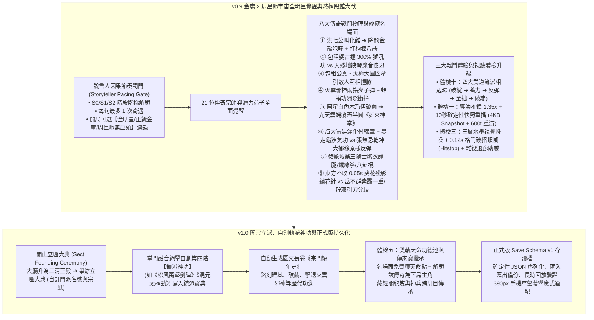

# LIFE-V09-V10 正式工程規格書：金庸×周星馳 21 大傳奇宗師神功、終極踢館大戰、四大武道相剋、導演鏡頭與破招頓幀、開山立匾大典、自創鎮派絕學、跨周目天命傳家寶與正式存檔

> **狀態**：正式工程規格書（Handoff Specification for `v0.9` + `v1.0`）
> **分支**：`plan/sect-life-architecture-redesign`
> **基準總藍圖**：[`SECT_LIFE_REDESIGN_MASTERPLAN.md`](file:///Users/chenyuying/workspace/earth-ascension/sect-chronicle/docs/vision/SECT_LIFE_REDESIGN_MASTERPLAN.md)（第 2.5～2.6 章、第 5.1～5.3 章體檢一～十、第 6 章 `v0.9` 與 `v1.0`）
> **對齊規格基準**：[`LIFE_V01_V02_HANDOFF.md`](file:///Users/chenyuying/workspace/earth-ascension/sect-chronicle/docs/LIFE_V01_V02_HANDOFF.md)、[`LIFE_V07_V08_HANDOFF.md`](file:///Users/chenyuying/workspace/earth-ascension/sect-chronicle/docs/LIFE_V07_V08_HANDOFF.md)、[`PATROL_DEFENSE_RESEARCH.md`](file:///Users/chenyuying/workspace/earth-ascension/sect-chronicle/docs/PATROL_DEFENSE_RESEARCH.md)
> **核心職責**：補齊 21 位傳奇角色純 JSON 宿命樹與說書人節奏閥門、實裝八大傳奇戰鬥物理機制（包租婆古鐘獅吼 vs 天殘地缺琴魔刃、火雲邪神空手夾子彈+蛤蟆功 vs 阿星木乃伊破繭如來神掌、海大富龜波氣功 vs 張無忌乾坤大挪移反彈、城寨三隱士爆衣護山）、四大武道相剋環、導演鏡頭 1.35x 慢動作與 10 秒確定性重播、0.12s 破招頓幀、開山立匾大典自創第四階鎮派神功、跨周目雙軌天命傳家寶與 `Save Schema v1` 正式存檔。

---

## 一、 目標與玩家可見閉環（Player-Visible Loop）

本階段是整個重構工程的終極高潮與大成章節，交付兩大巔峰閉環：**「`v0.9` 金庸 × 周星馳全明星覺醒、終極踢館大戰與四大武道相剋」** 以及 **「`v1.0` 開山立匾大典、自創第四階鎮派神功、跨周目天命傳家寶與正式版存檔」**。



---

### 1.1 `v0.9` 金庸 × 周星馳全明星覺醒與終極踢館大戰

#### (1) 說書人因果節奏閥門（Storyteller Pacing Gate）與世界畫風濾鏡
- 拒絕手遊式神仙菜市場！21 位傳奇角色依門派建設階梯嚴謹登場：
  - **S0 破道館期**：全山門最多邂逅 1 位初期落魄奇才（背柴少年郭靖、街頭混混阿星、或嘴砲韋小寶）；
  - **S1 膳房與演武場落成**：解鎖第二梯隊（令狐沖、包租公婆、豬籠城寨三隱士）；
  - **S2 藏經閣、瀑布台與名菜齊備**：解鎖宗師級奇遇與拜山踢館（洪七公、天殘地缺、東方不敗、火雲邪神）。
- **頻率閥門**：每旬最多觸發 **1 次** 傳奇奇遇；單局精選自然相遇 **6～8 位** 核心傳奇人物，確保每人戲份充足且組合多變。
- **開局三大畫風濾鏡（World Tone Filter）**：
  - `【全明星江湖】`（預設：金庸群俠 ＋ 周星馳無厘頭大亂鬥）；
  - `【正統金庸武俠】`（僅金庸系角色與拜山，遮蔽周星馳系無厘頭事件）；
  - `【周星馳無厘頭宇宙】`（以鹿鼎記、功夫豬籠城寨角色為核心）。

#### (2) 八大傳奇戰鬥物理機制與巔峰名場面
1. **🍗【洪七公】**：
   - 酉時膳房名菜出鍋（叫化燒雞等），洪七公亥時翻牆偷吃；連吃 3 道後留駐門派，親傳至剛**《降龍十八掌》**（同圖金色神龍氣浪貫穿全場）與至巧**《打狗棒法》**（絆倒、挑劈、纏繞、轉身八訣連續控場）。
2. **📢【包租婆】＆ 🚬【包租公】**：
   - 包租婆日常水缸 `<50%` 獅吼催水（全場外門挑水移速 `+50%`）；
   - 當 **🪕【天殘地缺】** 攜古琴坐鎮山門石階發射半透明**《六指琴魔・音波切刃與骷髏音浪》**時，包租婆卸下大廳**【破道館青銅古鐘】**作為大喇叭擴音，轟出範圍擴大 300% 的金色環形**《獅吼功》**，正面震碎音波刃並吹飛全場敵甲！
   - 包租公在演武場展開**《真・太極大圓圈》**，將四面合圍之敵的刀勁順勢牽引轉向，讓圍攻者**互相撞臉、東倒西歪**。
3. **🐸【火雲邪神】**：
   - 身穿白背心、踩塑膠拖鞋獨自走上山門石階踢館（口頭禪：`「我只是想打死兩位，或者被兩位打死！」`）。
   - **【唯快不破・兩指空手夾子彈】**：任何遠程弓箭、暗器甚至韋小寶的火銃子彈，皆被其兩根手指於面前 10px 處空手截停！
   - **《蛤蟆功》**：趴地鼓腮發出蛙鳴蓄力，化作金色流光進行洲際飛彈衝撞，並掏出陰險蓮花毒鏢。
4. **🦋【阿星：生死破繭・打通任督二脈 ➔ 如來神掌】**：
   - 保衛山門遭受重創經脈盡斷，被包成**【白色木乃伊繭】**抬入藥房；經過一夜金光洗禮，**破繭成蝶、打通任督二脈**！
   - 迎戰火雲邪神時，阿星一腳震裂青石板，躍入九天雲端，從天而降拍出遮天蔽日的金色巨掌**《如來神掌・萬佛朝宗》**！
   - 演武場轟出覆蓋半圖的**五指大掌坑**，阿星手持棒棒糖淡然微笑感化火雲邪神留駐山門。
5. **👻【海大富】vs ☯️【張無忌】**：
   - 海大富出招**《化骨綿掌》**，敵中掌三步後全身骨骼延遲內爆；二階段撕衣暴走，推出貫穿全屏的**【星爺版超巨型龜波氣功】**！
   - 守在陣眼上的張無忌施展**《乾坤大挪移》**，太極氣旋旋轉，將海大富的巨型氣功波**原封不動反彈轟回敵陣**！
6. **🥖【豬籠城寨三隱士】**：
   - 苦力強、裁縫、油炸鬼平時挑水、縫紉、炸油條；山門告急時同時扯下圍裙爆衣，使出宗師級**《十二路譚腿》《洪家鐵線拳》《五郎八卦棍》**。
7. **🪡【東方不敗】**：
   - 出招前搖僅 **`0.05s`**，拉出鮮紅鬼魅殘影，一枚繡花針瞬間連點五敵死穴。
8. **⚔️【岳不群宿命終局分歧】**：
   - 正道分支：堅守君子本心，大廳靜室突破**《紫霞十重・太華混元劍陣》**，周身三丈紫氣繚繞；
   - 邪道分支：受挫心魔入魔，深夜引刀自宮速成**《辟邪劍法》**，身法移速三倍化身紫衣梟雄！

#### (3) 三大視聽與相剋機制體檢升級
- **體檢十：四大武道流派循環相剋環**：
  $$\text{料敵破綻流（獨孤九劍）} \xrightarrow{\text{克制}} \text{蓄力大招流（如來神掌/蛤蟆功）} \xrightarrow{\text{克制}} \text{借力反彈流（太極/乾坤大挪移）} \xrightarrow{\text{克制}} \text{至拙瞬發流（羅漢拳Lv10）} \xrightarrow{\text{克制}} \text{料敵破綻流}$$
- **體檢一：觀影導演鏡頭 ＋ 10 秒確定性重播書籤（Instant Replay Clip）**：
  - 觸發 Tier A 名場面時，鏡頭自動推近 1.35x 慢動作（`0.3x` 速度特寫 1.5 秒）；
  - 記憶體自動記錄事件前 5 秒輕量狀態快照（**4KB Snapshot ＋ 600 ticks**），右側浮現竹簡書籤，玩家隨時可一鍵點擊重播 10 秒名場面。
- **體檢三：三層水墨視覺降噪 ＋ `0.12s` 破招頓幀（Hitstop）＋ 雜役退廊助威**：
  - 地面陣法水墨透明度 25%、中層氣勁 50%、頂層決定性破招 `0.12s`（7 幀）格鬥定格頓幀與書法大字標（如 `【破劍式！】`）；非戰鬥雜役自動退至走廊屋簷下拍手驚呼。

---

### 1.2 `v1.0` 開宗立派、自創第四階鎮派神功、跨周目天命傳家寶與正式存檔

#### (1) 開山立匾大典與第四階【自創鎮派神功】
- 當大廳升至三清正殿、門派弟子滿 8～12 人、藏經閣收錄滿 3 部上乘絕學時，敲響宗門金鐘舉辦**【開山立匾大典】**：
  - 玩家自由自訂門派名號（如「玄華仙劍門」）與宗風（如「俠義存心、剛柔並濟」）；
  - 掌門閉關融合本門拳、棍、劍、氣四道絕學，融會貫通領悟第四階**【自創鎮派神功】**（如自訂《松風萬壑劍陣》《混元太極金身》），自訂招式名號並著入鎮派寶典！

#### (2) 自動生成圖文長卷《宗門編年史》（Sect Chronicle Scroll）
- 引擎自動追蹤門派從 S0 破道館到開山立匾的歷史事件，生成圖文並茂的長卷年表：
  - *「建元元年：林玄真於破道館起家，修漏頂、開菜畦。」*
  - *「建元三年：阿星保衛山門破繭打通任督二脈，以如來神掌退火雲邪神，留五指巨坑。」*
  - *「建元五年：開宗立匾，自創鎮派絕學，門下弟子傳承百代！」*

#### (3) 體檢五：雙軌天命功德池與跨周目傳家寶繼承
- **免費遊玩成就軌**：局內每達成一項傳奇名場面（阿星破繭、海大富偷湯、羅漢拳Lv10、岳不群正道結局等），永久獲得 `+2～+5` 點天命功德點，並**免費解鎖該傳奇人物作為下一局的可選開局主角**！
- **支持者天命包軌**：支援開局額外加點與解鎖全角色庫；
- **傳家寶繼承（Heirloom Carryover）**：新開局時可花費天命點將上一周目撰寫的鎮派寶典手札、或鍛造的《玄鐵重劍》作為祖傳遺物帶入破道館！

#### (4) 正式版存讀檔（`Save Schema v1`）、長時回放驗證與窄螢幕適配
- 依 D40 完成單一 JSON 權威存檔結構，支援存檔匯出、匯入與備份，通過 20 遊戲日長時回放驗證；UI 支援 390px 手機窄螢幕響應式佈局。

---

## 二、 架構與檔案白名單（File Scope & Modular Layout）

```
sect-chronicle/
├── life/
│   ├── core/
│   │   ├── storyteller.mjs       # 說書人因果節奏閥門、畫風濾鏡與傳奇人物登場仲裁
│   │   ├── challenge.mjs         # 鄰派與火雲邪神拜山踢館、演武場對決狀態機
│   │   ├── founding.mjs          # 開山立匾大典、自創鎮派神功命名與自訂效果組裝
│   │   ├── director.mjs          # 觀影導演推鏡、0.12s 頓幀、4KB 快照 10s 確定性重播
│   │   └── meta-save.mjs         # Save Schema v1 序列化、雙軌天命功德池與傳家寶繼承
│   └── data/
│       ├── destiny-trees.json    # 21 位金庸×周星馳傳奇人物全四階宿命樹完整定義
│       ├── challenge-rivals.json # 天殘地缺、火雲邪神、各派拜山隊伍數值配置
│       └── chronicle-events.json # 宗門編年史事件模版庫
├── experiments/water-carry/demo/
│   ├── model.mjs                 # 整合 storyteller/challenge/director/founding 核心 tick
│   ├── app.mjs                   # 立匾大典 UI、編年史畫卷、導演推鏡重播視窗、相剋 HUD
│   ├── index.html                # 增設立匾 Modal、自創武學面板與 10s 重播按鈕
│   └── style.css                 # 390px 窄螢幕響應式媒體查詢與頓幀震動特效
└── test/
    └── life-v09-v10.test.js      # 本包專屬單元測試與 6 個直接反例測試
```

### 檔案修改權限白名單

| 檔案路徑 | 權限 | 限定用途 |
|---|---|---|
| [`sect-chronicle/life/core/storyteller.mjs`](file:///Users/chenyuying/workspace/earth-ascension/sect-chronicle/life/core/storyteller.mjs) | **新增／可寫** | 說書人階段解鎖門檻、每旬 1 次頻率閥門與世界畫風濾鏡。 |
| [`sect-chronicle/life/core/challenge.mjs`](file:///Users/chenyuying/workspace/earth-ascension/sect-chronicle/life/core/challenge.mjs) | **新增／可寫** | 拜山踢館狀態機、名場面觸發與四大相剋判定結算。 |
| [`sect-chronicle/life/core/founding.mjs`](file:///Users/chenyuying/workspace/earth-ascension/sect-chronicle/life/core/founding.mjs) | **新增／可寫** | 開山立匾大典、自創鎮派神功四階效果組裝、編年史生成。 |
| [`sect-chronicle/life/core/director.mjs`](file:///Users/chenyuying/workspace/earth-ascension/sect-chronicle/life/core/director.mjs) | **新增／可寫** | Tier A 導演推鏡、0.12s Hitstop 頓幀、4KB Snapshot 10s 重演。 |
| [`sect-chronicle/life/core/meta-save.mjs`](file:///Users/chenyuying/workspace/earth-ascension/sect-chronicle/life/core/meta-save.mjs) | **新增／可寫** | Save Schema v1 存讀檔、天命功德池計算與傳家寶繼承。 |
| [`sect-chronicle/life/data/destiny-trees.json`](file:///Users/chenyuying/workspace/earth-ascension/sect-chronicle/life/data/destiny-trees.json) | **擴充／可寫** | 補齊全部 21 位傳奇角色之四階成長與分歧定義。 |
| [`sect-chronicle/life/data/*.json`](file:///Users/chenyuying/workspace/earth-ascension/sect-chronicle/life/data/) | **新增／可寫** | 踢館隊伍配置與編年史模版純 JSON。 |
| [`sect-chronicle/experiments/water-carry/demo/model.mjs`](file:///Users/chenyuying/workspace/earth-ascension/sect-chronicle/experiments/water-carry/demo/model.mjs) | **可修改** | 掛載終極戰鬥、立匾與存檔邏輯，保持舊 API 100% 相容。 |
| [`sect-chronicle/test/life-v09-v10.test.js`](file:///Users/chenyuying/workspace/earth-ascension/sect-chronicle/test/life-v09-v10.test.js) | **新增／可寫** | 本包專屬單元測試與 6 個直接反例測試。 |
| **其餘既有測試與舊資產** | **唯讀** | `test/*.test.js` 嚴禁任何破壞性修改。 |

---

## 三、 核心資料結構與 JSON Schema（Data Contracts）

### 3.1 說書人節奏閥門與畫風濾鏡資料結構（`StorytellerPacingGate`）

```typescript
interface StorytellerConfig {
  worldToneFilter: 'all_stars' | 'orthodox_jinyong' | 'stephen_chow_universe';
  unlockedStage: 'S0' | 'S1' | 'S2';
  maxEncountersPerTenDaySeason: 1;     // 每旬最多 1 次傳奇奇遇
  lastEncounterDay: number;
  activeCastIds: string[];             // 本局已入選的 6~8 位核心角色
  pendingChallengeRivals: string[];    // 排隊拜山的名門/火雲邪神
}
```

### 3.2 踢館挑戰與名場面演出狀態機（`ChallengeMatchState`）

```typescript
interface ChallengeMatchState {
  challengeId: string;                 // 'chal.huoyun_xieshen_showdown'
  state: 'arriving' | 'dialogue' | 'sparring' | 'climax_cinematic' | 'resolved';
  challenger: {
    archetypeId: 'huoyun_xieshen' | 'tiancan_dique' | 'dongfang_bubai';
    name: string;
    specialState: {
      catchBulletWindow: boolean;      // 空手夾子彈開關
      toadChargeTicks: number;         // 蛤蟆功蓄勢
    };
  };
  sectDefenders: string[];             // 出戰弟子 ID
  hitstopRemainingTicks: number;       // 0.12s (7 ticks) 頓幀剩餘
  activeCinematic: {
    type: 'star_buddha_palm' | 'landlady_bell_roar' | 'qiankun_deflect_beam';
    zoomLevel: number;                 // 1.35
    slowdownMultiplier: number;        // 0.3
    remainingTicks: number;
  } | null;
}
```

### 3.3 四大武道相剋與頓幀資料結構（`MartialCounterMatrix`）

```typescript
type MartialSchool = 'flaw_exploiter' | 'charge_ultimate' | 'deflect_counter' | 'simple_instant';

interface MartialMatchupResolution {
  attackerSchool: MartialSchool;
  defenderSchool: MartialSchool;
  attackerAdvantage: boolean;
  defenderInterrupted: boolean;
  hitstopTicksApplied: number;         // 7 ticks (0.12s)
  bannerCalligraphyText: string;       // '【破劍式！】' | '【乾坤挪移！】'
}
```

### 3.4 10 秒確定性重播快照資料結構（`DeterministicReplaySnapshot`）

```typescript
interface DeterministicReplaySnapshot {
  snapshotId: string;
  triggerEvent: string;                // 'climax.buddha_palm_ground_crater'
  snapshotStartTick: number;
  totalReplayTicks: 600;               // 10 遊戲秒 (60Hz 下 600 ticks)
  worldStateBinarySnapshotBase64: string; // 輕量約 4KB 的核心實體快照
  recordedRngSeed: number;
}
```

### 3.5 開山立匾與自創鎮派神功資料結構（`SectFoundingRecord`）

```typescript
interface SectFoundingRecord {
  sectName: string;                    // 如 '玄華仙劍門'
  sectEthos: string;                   // '俠義存心、剛柔並濟'
  foundingDay: number;
  founderDiscipleId: string;

  customUltimateArt: {
    artId: string;                     // 'art.custom_tier4_ultimate'
    customName: string;                // 玩家自訂名號 '松風萬壑劍陣'
    baseCategory: 'sword_domain' | 'taiji_reflection' | 'golden_fist_burst';
    combinedPrerequisites: string[];   // 融合之本門絕學 ID
    domainAura: {
      radiusPx: number;                // 120px 護山領域
      damagePerSec: number;
      knockbackWave: boolean;
    };
    scriptureAuthoringComplete: boolean;
  };
}
```

### 3.6 雙軌天命功德池與傳家寶資料結構（`DestinyMeritPool`）

```typescript
interface DestinyMeritPool {
  freeMeritPoints: number;             // 免費遊玩累積之天命點
  supporterMeritPoints: number;        // 支持者包解鎖天命點
  unlockedProtagonists: string[];      // 下局可選開局主角名單 (如 'disc.star', 'disc.qigong')

  heirloomsCarryover: {
    selectedScriptureId: string | null;// 帶入新局之藏經閣手札
    selectedEquipmentId: string | null;// 帶入新局之玄鐵重劍等神兵
    meritCostPaid: number;
  };
}
```

### 3.7 正式版存讀檔資料結構（`SaveSchemaV1`）

```typescript
interface SaveSchemaV1 {
  version: 1;
  savedAtTimestamp: number;
  gameDay: number;
  gameTick: number;
  initialSeed: number;

  sect: SectFoundingRecord | null;
  storyteller: StorytellerConfig;
  destinyPool: DestinyMeritPool;

  world: {
    facilities: Record<string, any>;
    disciples: Array<any>;
    inventory: Record<string, number>;
    scriptures: Array<any>;
    chronicle: Array<{
      day: number;
      title: string;
      description: string;
      illustrationId: string;
    }>;
  };
}
```

---

## 四、 權威數值與確定性不變量表（Authoritative Constants & Invariants）

### 4.1 說書人因果節奏與設施解鎖門檻

| 門派設施階段 | 允許解鎖之傳奇人物梯隊 | 解鎖名單範例 | 說書人冷卻期 |
|---|---|---|---|
| **S0 破道館期** | 第一梯隊（初期落魄奇才，最多 1 人） | 郭靖、阿星（混混期）、韋小寶 | 無冷卻（開局觸發） |
| **S1 膳房與演武場** | 第二梯隊（名廚、酒俠、城寨隱士） | 令狐沖、包租婆、包租公、苦力強、裁縫、油炸鬼 | 每旬最多 1 次，間隔 $\ge 10$ 遊戲日 |
| **S2 藏經閣與名菜齊備** | 第三梯隊（宗師傳功、踢館強敵） | 洪七公、海大富、東方不敗、天殘地缺、火雲邪神 | 每旬最多 1 次，間隔 $\ge 10$ 遊戲日 |

---

### 4.2 八大傳奇絕學戰鬥權威數值表

```javascript
export const ULTIMATE_MARTIAL_CONSTANTS = Object.freeze({
  // 1. 降龍十八掌 (洪七公/郭靖/喬峰)
  dragonPalm: {
    windupSec: 0.30,
    activeSec: 0.35,
    recoverySec: 0.25,
    qiCost: 40,
    shape: { type: 'line', length: 160, width: 40 }, // 金龍氣浪直線貫穿
    damage: 120,
    knockback: 110
  },

  // 2. 包租婆大喇叭獅吼功
  landladyBellRoar: {
    windupSec: 0.40,
    activeSec: 0.50,
    recoverySec: 0.30,
    qiCost: 50,
    shape: { type: 'circle', radius: 180 },          // 300% 擴音金色圓浪
    damage: 90,
    shatterProjectiles: true,                        // 震碎琴魔音波刃
    knockback: 130
  },

  // 3. 火雲邪神蛤蟆功
  toadMissileCharge: {
    windupSec: 0.60,                                 // 趴地鼓腮蓄力
    activeSec: 0.25,
    recoverySec: 0.35,
    qiCost: 45,
    shape: { type: 'line', length: 200, width: 30 }, // 洲際衝撞
    damage: 140,
    knockback: 150
  },

  // 4. 阿星如來神掌・萬佛朝宗
  starBuddhaPalm: {
    windupSec: 0.75,                                 // 躍入九天雲霄
    activeSec: 0.60,
    recoverySec: 0.40,
    qiCost: 80,
    shape: { type: 'circle', radius: 240 },          // 覆蓋半圖大掌印
    damage: 220,
    groundCraterPermanent: true,                     // 留下五指大掌坑
    knockback: 180
  },

  // 5. 海大富星爺超巨型龜波氣功
  haidafuTurtleWave: {
    windupSec: 0.50,
    activeSec: 0.45,
    recoverySec: 0.40,
    qiCost: 60,
    shape: { type: 'line', length: 250, width: 50 },
    damage: 160
  },

  // 6. 東方不敗葵花繡花針
  orientalNeedleRush: {
    windupSec: 0.05,                                 // 0.05s 極限前搖
    activeSec: 0.15,
    recoverySec: 0.10,
    qiCost: 20,
    shape: { type: 'point', count: 5 },
    damage: 85
  }
});
```

---

### 4.3 導演推鏡、10 秒確定性重播與 0.12s 頓幀參數

```javascript
export const DIRECTOR_CONSTANTS = Object.freeze({
  // 觀影導演推鏡
  cinematicZoom: {
    targetZoom: 1.35,
    panDurationMs: 600,
    slowMotionMultiplier: 0.30,
    slowMotionDurationMs: 1500
  },

  // 破招頓幀 (Hitstop)
  hitstop: {
    durationMs: 120,                                 // 0.12 秒
    durationTicks: 7,                                // 60Hz 下整整 7 ticks
    screenShakeIntensityPx: 3
  },

  // 10 秒確定性重播快照
  replay: {
    snapshotMaxSizeBytes: 4096,                      // 4KB 上限
    replayDurationTicks: 600,                        // 10 遊戲秒
    snapshotPreRollTicks: 300                        // 事件發生前 5 秒快照
  }
});
```

---

## 五、 四組完成判準（DoD Group A ～ D）與直接反例測試清單

### 5.1 DoD 驗收項目清單

| 組別 | 驗收項目 | 必要完成判準 |
|---|---|---|
| **A 組：全明星覺醒與踢館大戰** | A1 說書人因果閥門 | S0～S2 階段嚴格限制角色登場梯隊；每旬至多 1 次傳奇奇遇；畫風濾鏡精確過濾。 |
| | A2 八大傳奇物理演出 | 如來神掌五指掌坑、古鐘獅吼震碎琴刃、空手夾子彈、乾坤反彈龜波氣功確定性觸發。 |
| | A3 四大相剋環結算 | 破綻流破蓄力、蓄力破反彈、反彈破至拙、至拙破破綻，相剋優勢下附加 `0.12s` 頓幀與書法字。 |
| | A4 岳不群正邪雙終局 | 依定力與心魔條件確定性導向《紫霞十重》或引刀自宮《辟邪劍法》，互斥分歧不混淆。 |
| **B 組：視聽導演與確定性重播** | B1 導演推鏡與慢動作 | Tier A 名場面觸發時，鏡頭平滑推鏡 1.35x 並執行 1.5 秒 0.3x 慢動作。 |
| | B2 10 秒快照重演一致性 | 4KB Snapshot 執行 600 ticks 重播後的終態與即時演算終態 hash 100% 一致。 |
| | B3 三層視覺降噪與雜役退廊 | 戰鬥時地面陣法 25% 透明、中層 50%，雜役弟子自動撤入走廊做拍手動畫不卡路。 |
| **C 組：開山立匾與自創鎮派神功** | C1 開山立匾大典 | 三清正殿滿員條件達成後舉辦大典，自訂門派名號與宗風成功持久化。 |
| | C2 自創第四階鎮派絕學 | 掌門自創鎮派絕學名號與招式屬性，成功著入寶典並可供全門研習。 |
| | C3 宗門編年史長卷 | 自動記錄破道館修葺、阿星如來神掌退敵、開山立匾等大事件並渲染為圖文長卷。 |
| **D 組：天命功德池與正式存檔** | D1 雙軌天命點與傳家寶 | 免費成就贈點、解鎖下局主角；消耗天命點跨周目繼承鎮派手札或神兵。 |
| | D2 Save Schema v1 完整性 | 完整世界狀態執行序列化與反序列化後逐欄相等，通過 20 遊戲日回放無卡死。 |
| | D3 6 個直接反例單測 | 新增 `test/life-v09-v10.test.js`，6 個反例斷言 100% PASS，無回歸。 |

---

### 5.2 直接反例測試清單（Anti-Patterns & Direct Counter-Examples）

工程師實作時必須在 `test/life-v09-v10.test.js` 寫入以下 6 個直接反例斷言：

1. **反例 1（說書人頻率限制反例：`counter_storyteller_pacing_gate_rate_limit`）**：
   - 在第 5 天已觸發令狐沖入山奇遇；在第 7 天強制注入洪七公奇遇事件，斷言說書人閥門拒絕觸發並延期至下一旬（第 11 天後），**嚴禁同一旬內湧入兩位傳奇角色**。
2. **反例 2（正統武俠濾鏡嚴格性反例：`counter_world_tone_filter_strictness`）**：
   - 開局選定 `orthodox_jinyong`（正統金庸武俠）；歷經 10 旬隨機檢定，斷言阿星、包租婆、火雲邪神、海大富等周星馳系角色**完全不進入候選奇遇池與踢館池**。
3. **反例 3（四大武道相剋環嚴格生效反例：`counter_martial_four_cycle_counter`）**：
   - 模擬令狐沖《獨孤九劍》（料敵破綻流）對陣火雲邪神《蛤蟆功》（蓄力大招流）：在蛤蟆功起手蓄力階段，斷言九劍傳人 100% 觸發打斷並施加 `0.12s` 頓幀；反之，若令狐沖對陣郭靖 Lv10《返璞歸真羅漢拳》（至拙瞬發流），斷言九劍無法打斷且被直拳震退。
4. **反例 4（10 秒快照確定性重播無漂移反例：`counter_instant_replay_deterministic_parity`）**：
   - 在阿星使出《如來神掌》瞬間提取 4KB Snapshot，並存下即時演算 600 ticks 後的世界狀態 Hash A；隨後載入快照重播 600 ticks 得到 Hash B，斷言 `Hash A === Hash B`，**兩者在 60Hz 下完全確定性一致，無浮點或 RNG 漂移**。
5. **反例 5（Save Schema v1 往返序列化無損反例：`counter_save_schema_v1_roundtrip_integrity`）**：
   - 包含自創鎮派神功、門派名號、宗門編年史、21 人宿命樹的完整世界物件執行 `saveToV1Json()` ➔ `loadFromV1Json()`，斷言所有欄位逐項相等，**無閉包遺失、無 NaN/undefined 異常、無循環引用拋錯**。
6. **反例 6（天命功德點不足拒絕繼承傳家寶反例：`counter_heirloom_carryover_destiny_cost`）**：
   - 開啟新周目時嘗試繼承上一周目的【七十斤玄鐵重劍】（需消耗天命點 4 點）；若玩家當前天命功德池僅剩 2 點，系統必須拒絕繼承並提示 `{ ok: false, reason: 'INSUFFICIENT_DESTINY_POINTS' }`，**嚴禁 0 點數憑空帶入傳家寶**。

---

## 六、 實作邊界與嚴格禁止事項（Boundaries & Anti-Patterns）

1. **嚴禁破壞單機公平性（Anti-Pattern: Pay-to-Win Wall）**：
   - 所有 21 位傳奇角色與絕學皆可透過遊戲內日常經營與免費成就天命點解鎖，支持者天命包僅作為單機便利加速，絕不設立付費專屬數值牆。
2. **嚴禁在 60Hz 主迴圈中進行巨大音畫轉碼（Anti-Pattern: Heavy Video Recording）**：
   - 10 秒名場面重播必須採用 4KB 輕量狀態快照＋確定性重演，嚴禁使用瀏覽器 Canvas 錄影轉成 WebM/MP4 佔用數百 MB 記憶體。
3. **自創武學必須遵循四維平衡點數預算（Anti-Pattern: Overpowered Custom Art）**：
   - 掌門自創第四階鎮派絕學時，必須在傷害、範圍、冷卻與內息消耗之間分配固定預算點數，嚴禁出現 0 消耗且全屏秒殺的破壞平衡武學。

---

## 七、 驗收流程與工程師執行指南

1. **環境檢核**：
   - 在分支 `plan/sect-life-architecture-redesign` 進行。
   - 根目錄未追蹤目錄保持原樣。
2. **命令執行**：
   ```bash
   # 1. 既有單元測試驗證
   node --test sect-chronicle/test/*.test.js

   # 2. 本規格專屬單元與反例測試
   node --test sect-chronicle/test/life-v09-v10.test.js

   # 3. 檢查程式碼格式與 git diff 空白問題
   git diff origin/dev --check
   ```
3. **交付宣告**：
   - 依白名單完成核心邏輯、JSON 資料表、UI 整合與專屬單元測試，完成全 10 個版本演進的最終閉環。
