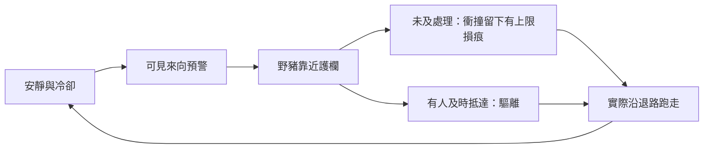

# LP-06候選：日常小獸騷擾與輕防衛

## 來源、現況與授權

追蹤 [#213](https://github.com/lalagrass/earth-ascension/issues/213)，連母單[#75](https://github.com/lalagrass/earth-ascension/issues/75)、安全區／巡山研究[#104](https://github.com/lalagrass/earth-ascension/issues/104)、延後獸患[#98](https://github.com/lalagrass/earth-ascension/issues/98)，沿BL-D01～D04新增BL-D05近程提案。實際整理Codex（遊戲PO），2026-10-22，擁有人本聊天要求review後規劃下一片，並提出：

> 帶點塔防的味道如何？平時可能有小老鼠或野豬來撞幾下，破壞房子或弄傷人，然後就跑走。不理會也沒關係，但不久會再出現。理會的話可以把它們消滅，但可能會跑走

**本輪已委託評估／規劃，尚未批准新獸擾、傷害、驅離／追擊或數值實作。** 下列是供擁有人選擇的有限候選，不是coding agent可直接認領的需求。文件合dev只代表規劃交付；確認產品範圍、凍結必要示意值及實作工作包後，才另登記程式作者。沒有代啟新agent或下一輪循環。

本輪核對dev `a586593f1b42c9ff89d0a02beef0080cc3696e45`。LP05 #208／PR #212仍在補修／review；優先完成它原本的自主／停工交接，不把本提案塞進其DoD。規劃可先交，未來實作以前置LP05實際合dev／postCI及本包批准為準，不搶改Claude有效作者檔案。這不重啟#98舊42格結局／第14天強制獸患，也不改舊RT或Earth。

## 產品判斷與最重要的取捨

可行，而且能讓「工作、成長、閒暇」多一層守護生活的理由。借塔防的來向預警、防守位置與人力安排，保留可暫停自主生活；先不以固定夜晚／不停加強的波次取代日常。

**可以一直不理，與損傷無限累積，不能同時保證。** 若野豬每隔一段時間扣建物耐久／人員健康，長期必定需要修補／照護，甚至失去工作能力。不能嘴上說可忽略、實際把玩家逼成固定頻率點警報。先選風險承諾，再決定頻率與後果。

| 方案 | 放任結果 | 成本與推薦 |
|---|---|---|
| **首片：可忽略的輕騷擾** | 一段非關鍵護欄出現有上限損痕；不影響通行／產能、不倒房、不傷人，日常可繼續 | 推薦先驗來訪、速度與介入是否有趣。只有視覺損耗與安靜時間的回報，不能宣稱已完成完整塔防或建築傷害 |
| 生活壓力模式 | 需要維修／照護，可能短暫停產或降效 | 有真實經營取捨；必須同步有恢復途徑、預警與自主維護，不能只加傷害。待首片回饋後另選 |
| 生存防衛模式 | 放任可倒房、重傷或失敗 | 目標與平衡成本更大，不符合此刻可忽略、先生活的承諾；保留較後獨立模式評估 |

先野豬，因其靠近、衝撞與受驚退走容易從畫面讀懂。老鼠較適合之後糧倉耗損／污染；目前沒有飲食倉儲，不為了第二個怪種硬套同一個撞房AI。動物行為是遊戲設計，不宣稱真實動物學模擬。

## 玩法參考與可取部分

2026-10-22查閱，僅作設計依據，不是本遊戲實測、社群需求比例、開源程式／素材授權或安裝採購建議。

| 來源 | 可參考處 | 保留界線 |
|---|---|---|
| [Farthest Frontier官方戰鬥指南](https://www.farthestfrontier.com/guide/gameplay/combat/) | 野豬可受驚也可衝鋒，獵人與玩家主動指派分開；圍欄／防守位置可影響保護 | 不移植致死、疾病或完整獵人裝備系統，不假稱其內部AI可直接復用 |
| [Thronefall官方商店頁](https://store.steampowered.com/app/2239150/Thronefall/) | 精簡建造與防守，讓少量防衛選擇可看懂 | 借來向、位置與清楚回饋，不照搬夜晚強制波次／通關壓力 |
| [Crate社群：Predator Patrol](https://forums.crateentertainment.com/t/predator-patrol/120264) | 個別玩家曾反映反覆獸襲、不可預測傷亡與手動處理負擔 | 這是2022年個人經驗，非現版本缺陷結論；提醒本作設損失上限與未來可自主守院，不以增加警報數量當內容 |

## 下一個最小可見工作包（候選LD-01）

玩家問題：野豬靠近道館時，我能看懂來向、它做了什麼、誰趕得及處理，以及它最後是跑掉還是被消滅嗎？**首片只交驅離／逃走，不宣告已有擊殺。**

同一 `sect-chronicle/index.html` → `experiments/water-carry/demo/`、兩名既有人物與單一60Hz模型，新增一隻野豬、一條院外靠近／撤退的固定路線、一段新的非關鍵護欄。不加整張戰場、砲塔、城牆編輯器或第三名弟子。

- 不處理：野豬沿路靠近，完成本輪少量衝撞後主動跑走；不一直追著人咬。下次來訪須經冷卻，同時最多一隻；損痕到上限即止，不使設施失效或封路。首片沒有隱藏會逐輪增長的傷害／威脅，也不偷偷恢復損痕。
- 處理：玩家指派一人做一次驅離。角色實際返院／前往防守點，趕得及就讓牠提早逃走；太晚到則明示「已離開」，結束過期目標，回原生活，不虛構命中或消滅。野豬逃跑路徑與較快步態可見，人物既有腳力影響抵達時機，不用播放倍率或額外戰力buff冒充成長。
- 首片反擊是一個可辨動作與受驚／退走反應，沒有獸血條、傷害公式、掉落或戰鬥XP。不是「扣血後刪除＝擊殺」。將來若開追擊再加入生命／攻擊間隔／逃脫邊界，另批。
- 驅離可讓這個體較晚再來，具體冷卻差異仍待選。殺一個體不等於根除棲地；未來若消滅該個體，它不能原ID立刻復活。巡山／剷除來源才接#104／BL-D04的長期安定，不規定一定某天刷大獸。
- 第一片不做常駐守院AI。若試玩發現一次驅離只添手點，後續優先評估低負擔的自動守院／不追出界政策，不靠縮短刷怪間隔讓玩家忙起來。

## 指派與生活交接草案

以下全部是待確認的行為邊界，沒有先行新增API／schema。只保留一份最新指令與原生活工作，不另養戰鬥世界／通用佇列。

| 情境 | 首片建議 |
|---|---|
| 當趟工作未交付 | 一次「本趟後驅離」意圖；先完整交付、釋約／入帳／成長一次，再檢查目標是否仍在與必要精力恢復。不是從山路瞬移守門，也不把未交付材料丟掉 |
| 閒暇／院中待命 | 完成當前路腿後接往防守點；不因下令重置到院中。若已有叫回或更新工作，依最新明確意圖處理，結束後不恢復已被覆蓋的舊意圖 |
| 低精力或已開始恢復 | 沿LP04必要恢復至80再出發；野豬可能先走。不能以守院命令清掉恢復來源或在renderer偷偷回精力 |
| 玩家明確停工 | 不自動徵召，也不以威脅／恢復自主解除停工；首片需先明確解除停工，再接受驅離，或玩家改派另一人 |
| 動物已逃離／目標已過期 | 命令綁本輪來訪目標，取消過期驅離並顯示原因；不等下一隻出現才突然執行舊命令，不憑空領獎 |
| 反擊／碰撞結算 | 只在模型判定抵達與事件條件時生效，每個事件一次；動畫重播、暫停開關、重送指令不重複作用。這是固定路線／事件，不先做剛體物理或動態障礙 |
| 驅離結束／玩家改令 | 走回共同端點，重查最新工作與庫存／公平預約，沿LP04／LP05決策恢復日常；最新停工／改工作能覆蓋待執行驅離，不能被舊守院意圖反覆搶回 |

前往／返回沿既有空手速度，沒有防守瞬移。首片驅離不新增資源收益或成長；其精力消耗是否比照既有非工作往返不扣不回，須在凍結時確認，不讓作者臨時加隱藏成本。沒有勝率／獸群抽樣；來訪節奏先考慮確定性的遊戲時間，圖像、粒子與音效不能推進世界或消耗RNG。

## 分段milestone與task（未批准整串）

| 候選階段 | 最小任務與完成出口 | 開工條件／去向 |
|---|---|---|
| LD-00 風險與時序凍結 | 確認下方四項取捨；由PO整理首訪／預警／冷卻、衝撞次數／損痕上限、逃跑速度與驅離觸發的候選示意值／原因，回填issue及實作handoff | 本文件只到規劃；數字未定，不由coding agent自行補正式值或寫期望測試 |
| **LD-01 一次獸擾／驅離** | 一隻野豬、預警／來訪／有上限損痕／實際逃離／冷卻；一次指派與原工作恢復，兩條可見結果「未及處理／及時驅離」 | LP05已合dev／postCI＋本片產品與示意契約批准後才可認領。可作下一個有限開發窗口，是否2h內完成不保證；未完交draft／缺口，不降gate |
| LD-02 損耗與維護 **或** 輕傷照護 | 二選一：護欄耐久→一種可取得維修投入→修復；或短暫輕傷→明確恢復途徑→回工作 | 先有首片體驗價值再選；需決定放任會不會失效、工作影響與自主維護，不同時加木材／疾病／死亡 |
| LD-03 有界追擊與消滅／逃脫 | 一隻可受傷野獸、攻擊／受傷轉逃、可選追擊、安全線與回程；區分擊退、逃脫、擊殺 | 另批生命／速度／命中與追擊中斷。追不上是合理結果，不強制補命中；逃出可見區不等於死亡。輕功與野獸記仇仍較後 |
| LD-04 長期防衛 | 自動守院、圍欄加固、巡山／安全區與威脅來源 | 接#104／BL-D01～D04研究後再選，不把全部研究／大地圖當LD01硬前置，也不一次預占後包 |

老鼠、建築停用、人員傷勢、獸血條與追擊沒有被首片刪除；明確放後段是為避免一次把生活入口改成另一款生存RTS。

## 必要驗收與成本草案

2～3分鐘展示目標：看預警／來向→不處理，野豬撞護欄後真的跑走，兩人日常可繼續→下一次改派一人，看到路程／抵達、及時或已離開的結果→恢復原工作。初學／熟手可在相同路線條件比較抵達時間；不是保證較快者一定擊殺。完整長冷卻可用局部模型驗，不為展示偷偷縮短正式間隔或真人空等多輪。

六組候選驗收：

1. 同時最多一隻、預警／來訪／碰撞／退走／冷卻有明確邊界；事件不重複，冷卻與損痕達上限不失效。不處理多輪仍可工作／恢復／閒暇，沒有隱藏人傷或倒房。
2. 忙碌角色完整交付／單次入帳／成長／釋約後才接驅離；最新指令與原工作保留正確，停工／必要恢復不被清除，兩人互不串狀態。不把警報當免費戰鬥XP來源。
3. 野豬離場前後的命令／重送／過期目標處置一致，不對下一輪舊令補擊、不重複損傷／驅離／獎勵；晚到是可讀結果，不死鎖等獸。
4. 人／獸逐tick移動連續，依出發鎖定速度／實際距離決定抵達，逃離可見；返回院中重查工作與容量，沒有遠端碰撞或畫面刪除冒充擊殺。
5. 同固定世界時間的暫停／1、2、4×／分幀等值，背景不推進／不補時，重來清獸擾／目標／指令／損痕與預約；無新RNG不造seed矩陣。
6. 一條桌面＋390px真操作並開圖，能看懂目標、原因、損害上限、指派者、未及／驅離／逃走與下一步；不重做全裝置／全命令排列，相關動畫與原畫面證據可復用。

保留必要局部測試、受影響素材／主線快驗、根基本檢查與CI；未變舊RT世界長矩陣／背景handler等復用，不為規劃跑模擬或安裝引擎。完整log落檔只讀摘要／失敗／少量實圖，真exit／GPU限制／未驗項保留，不改門檻追綠。紙上走查與CI不是遊戲平衡／玩家喜好實測。

## 待擁有人選擇與下一步

1. **首片怪種**：推薦只野豬；老鼠待食物／倉儲題再做。
2. **可忽略的界線**：推薦首片只非關鍵護欄可見損痕／有上限，不傷人／倒房；若要真傷害，先定可恢復代價與放任後果。
3. **先驅離或同片追殺**：推薦一次派遣驅離、真逃走；追擊擊殺另包。忙碌完整交付、必要恢復與手動停工優先，目標過期可取消；明確警報不等於自動取消所有玩家意圖。
4. **節奏**：推薦可預告、低頻、最多一隻、冷卻；驅離延後該個體回訪，保留日後巡山可長期安定。請先選方向，再由PO整理必要示意值供批准，不加每幀抽獎／無限增強／強制夜戰。

確認後只細化LD01實作handoff及一次有限接手prompt，不一次授權整串milestone。未確認時只有本規劃可審／合dev，LP05原審照常，不啟程式、不預留未來schema/API、不代占作者或永久排程。若後續維持兩小時循環，T0應從新工作包本人有效認領起算、最後20分鐘不開新包、提前完成即停，作者自測不冒充非作者review，仍由Earth PO唯一queue合dev／postCI。
