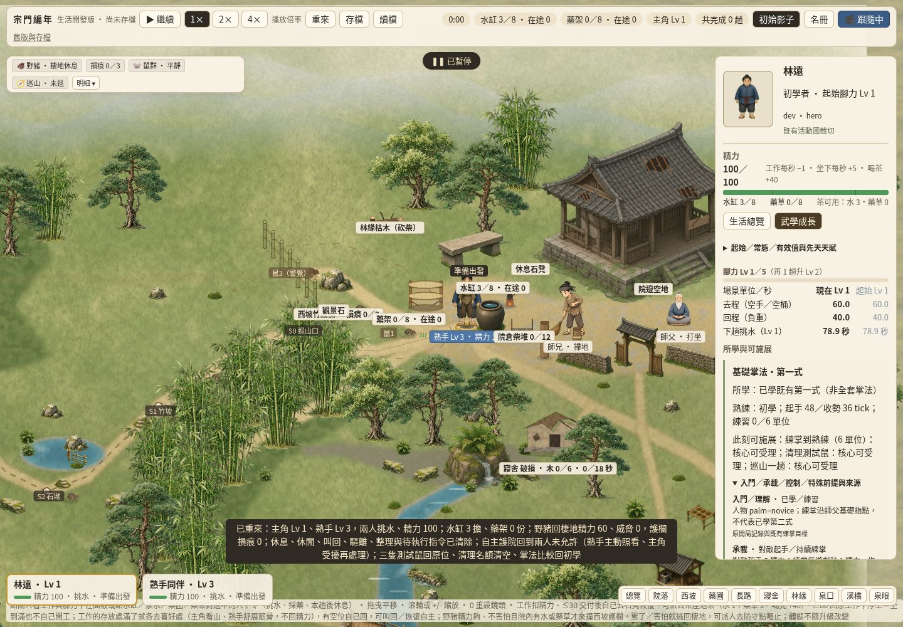
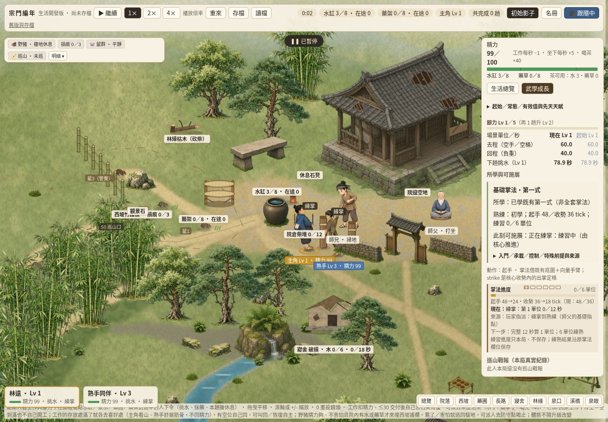
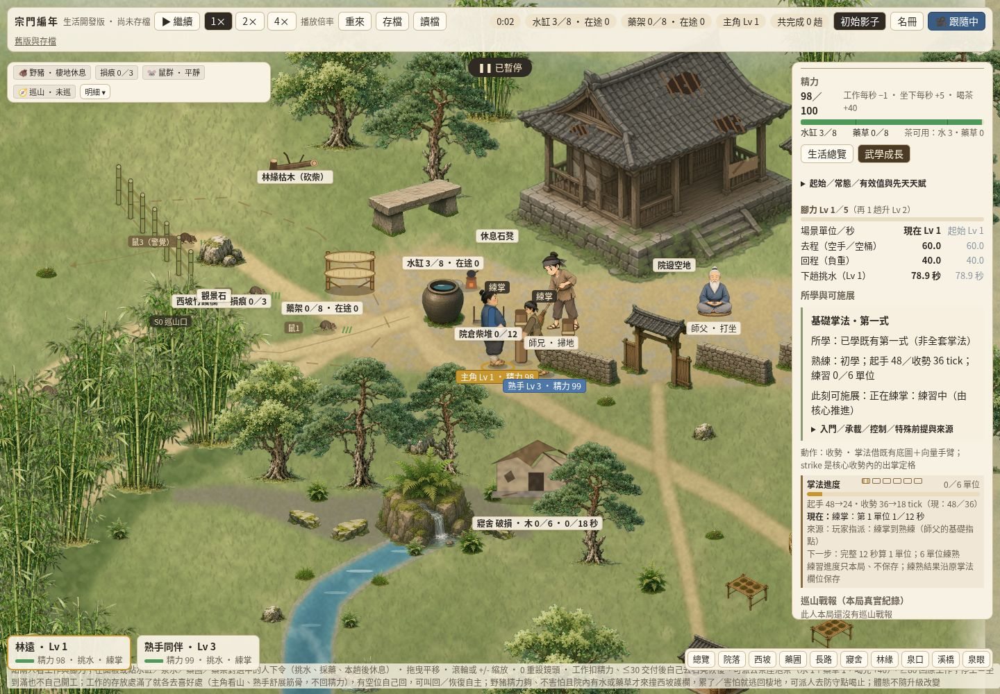
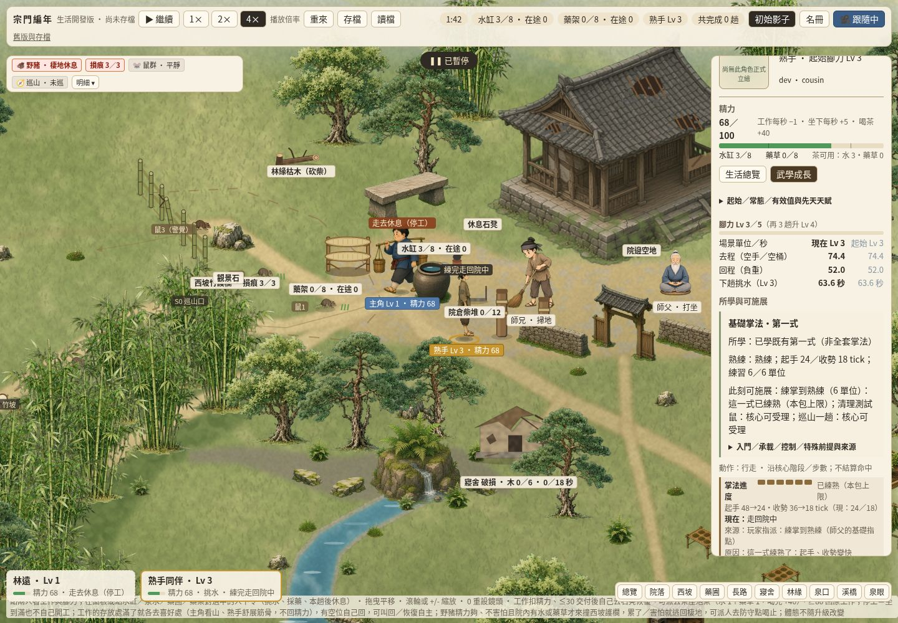

# SG-PUBLIC-04／#350 武學卡與共用動作呈現

玩家問題：同一人物卡原本只有「初學／熟練」文字，容易把掌法階段當成武學身份，或把已學當成此刻一定能安全施展。正式生活入口現在分開展示所學、原生熟練、核心目前受理／實際施展及四類前提，並讓兩個既有人物用同一動作語義、各自素材與肩點呈現真出掌。

實際主筆：獨立 Codex Cloud `/root/martial350_author`，非 grass reviewer／merge owner。自有 checkout `/workspace/martial350-author`、短分支 `codex/martial350`，base dev `95402dcaf6adff4b39a799c930af58c536273b6a`。共享 GitHub login 不代表平台獨立 approval。[唯一 claim](https://github.com/lalagrass/earth-ascension/issues/350#issuecomment-6413797139) 經重讀無重疊：claimed_at `2026-10-26T10:28:35Z`、expires_at `2026-10-26T14:28:35Z`；4h 是可附進度續的獨占 claim，非總工時。前置 #349／PR353 已合此 base，postCI40307050558 五 success；沿用其接受證據。

## 範圍與權威

- 所有修改限 `sect-chronicle/`。`martial-view/contract.mjs` 復用 #340 的定義／人物所學／核心／呈現分工；每個值沿用 known／unknown／hidden／unsupported，非 known 不把 raw value 傳給 renderer。條件分入門／理解、承載、控制、特殊前提，帶作用階段、性質與來源；不是可執行公式語言。
- 正式武學 ID 為 `basic-palm:first`，`palm=novice/adept` 是此人熟練階段，升階不再改武學 ID。只讀原 `model.view.people[id].palm/train01` 和 `model.actions`；既有第一式確已學才列出，不授第二式。可施展欄只稱原指令可受理或正在施展，沒有安全保證。
- 原正式掌法來源 `experiments/water-carry/demo/palm.mjs:SKILLS/PALM`、`model.mjs:actions/contact`、`train01.mjs:view/cycle`。原起手 novice48／adept24 tick、收勢36／18 tick、對敵起手2精力、接觸距離≤28場景單位不改；練掌仍12遊戲秒1單位／6單位練熟／每遊戲秒1精力。承載欄說清這些現有檢查並未提供內息／傷勢承載模型；特殊前提 unsupported、風險 unknown。
- GPT 固定 `6cbd3e6fccb8bc376e95e2f406ce6cead2a30fdc` 的真 `people.skill` 紀錄保持原 ID、U/F/I 各量尺與已存在 sources；原映射沒有提供當下全套施展判定，execution unknown。Grok 固定 `6760f21c342cbf72fc9fb4baf0aec8655abd0dd2` 的真 `arts` 紀錄保持原 XP／ID、req 結構與真已學招式；空 req 不當成沒有師承／機緣。隱藏悟性不傳原值或門檻判定。三版沒有被合成一套數值或保存。
- 不把研究候選變真技能，不把 Grok 左右互搏×1.3／悟性54.9封頂變公版通則。原固定來源檔一字未改；來源、作者與檔案 hashes 沿 `scene-shared/SOURCES.md`／各 sources manifest，無新下載、素材授權或外部套件。

## 有限動作接線

`martial-view/motion.mjs` 從原人物 view 產生 actionId→phase→clip／fx／朝向／腳錨／掛點：

| 語義 | 原階段 | 既有素材／回退 |
|---|---|---|
| life.water | down／up | #181 空桶／負重／成長步態；缺 grown 沿原模板回退 loaded |
| life.walk／life.load | 空手往返／採藥或木料負重 | herbOut／herbBack，依真距離換幀 |
| martial.basic-palm | windup／strike／recover／breath | 既有 herbHand／herbGather 底圖＋原向量掌臂；調息保持站直 |

`strike` 是既有收勢前12個核心步數的**畫面定格**，不增加核心階段或時長；沒宣稱 Grok 有這套 phase。正式核心傷害、接觸重驗、耗能、到達與事件都未改。所有掌勢原姿勢表原值搬到此模組，沒有新時鐘／碰撞／root motion。原核心事件 journal／cursor 繼續逐步捕捉與一次消費；呈現不產生世界事件。

同一 resolver 在正式 app 的 `poseOf` 路徑服務 hero／cousin。每個 skin 可用 `meta.clips[actionId][phase]={clip,fx}` 覆寫；既有兩張 art184-production sheet、原版 #181 animator、腳底 anchor、朝向翻面不變，`meta.palmShoulder` 與選定 frame 的扁擔／桶掛點各自保留。掛點是相對腳底、未翻面場景單位；肩點供原向量手臂直接讀。素材無專用掌法圖，卡片明示借用底圖；未知 action／缺技能回 idle 並明示 unsupported，缺 clip 沿原 fallback，不為展示增學技能。無全角色新圖格／骨架／換裝工程。

## 定向驗證與證據

重跑：`node --test --test-isolation=none sect-chronicle/martial-view/checks/martial.test.mjs sect-chronicle/character-card/checks/card.test.mjs`。

本次12個真子測試通過；之後只加一項調息站姿斷言，受影響 martial4/4 再通過。包含三真核心來源／遮罩／原單位、兩張真 sheet 共用語義／外觀掛點與覆寫、缺圖／缺技能／未知 action 回退、兩人各一次真清鼠完整出招（起手／施展／收勢），逐步原模型和大量讀卡／切人物／重 render 的完整權威 state 相同。1tick 和4tick批次的結果與所有事件完全相同；重 render／暫停重讀不再送事件；命中仍由原核心。

普通 sandbox 的 Node 子程序隔離只回包裝檔計數，依前包用 `--test-isolation=none` 得到真12／4子測試。現行必要 devCI 由 PR head 核對；不額外在本地跑 rootSG／全 checks、全 seed、保存、手機或全角色武學矩陣。未變 #342／#345／#348／#349 的長路、遮擋、素材／水藥證據復用；本包只補這次武學卡／出招直接風險。無 rule／schema／RNG／存檔升版，D45／D53、原速度與長通勤保持。

Cloud 桌面：`node sect-chronicle/martial-view/checks/desktop-check.mjs`，現成 Playwright＋Chromium，單一頁、單一本地服務8818（可用 MARTIAL_TEST_PORT 指定自有空埠）。只用原 UI 練掌，無 `setPalm`／測試世界推進。第一次檢查錯估兩人路程同時到位而停止，finally清理全 true；檢查已改為等兩人真到位，原路程未改。最終實測與真圖見本目錄下方收據及 `martial-view/evidence/`。finally 暫停、還原自有viewport、關頁／browser／server；無Mac／部署／8800／永久輪詢。

最終 head／PR／必要CI由 #350 作者交付收據固定。交 grass 非作者集中review，同PR必要補修；#67唯一票／dev／postCI後才由序列控制派 #351，本作者不開後包。

### Cloud 桌面收據

runtime checkpoint `ed5a68b8b44a9e4e906697306d4d1e3928634040`、Chromium154.0.8037.57、1440×1000：14項通過、零page／console errors。[原始結果](../martial-view/evidence/desktop-results.json)記錄兩人真起手、施展／收勢與原始掛點；原UI派兩人練掌，最終各6單位練熟，原核心各只產生一筆 `palm:skill`／src=train。暫停切人、切分頁與倍率保持完整權威 state；未用fixture授技或跳過路程。

finally確認page／browser／server已關，自有viewport還原後關閉。最後僅新增文件／證據，不改本checkpoint的runtime；必要CI由最終head另核。
