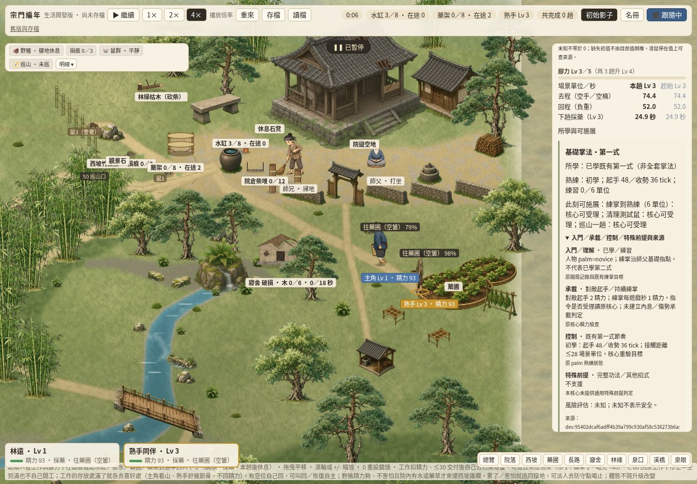
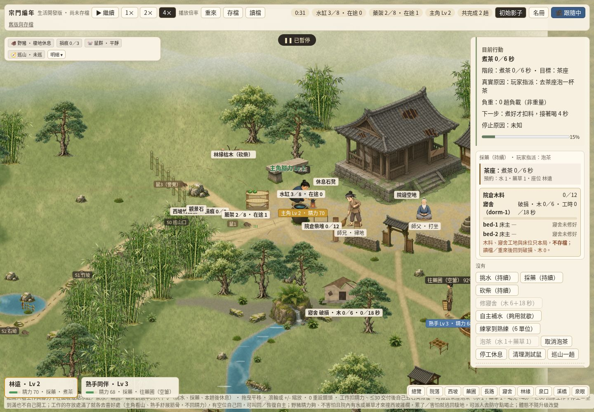
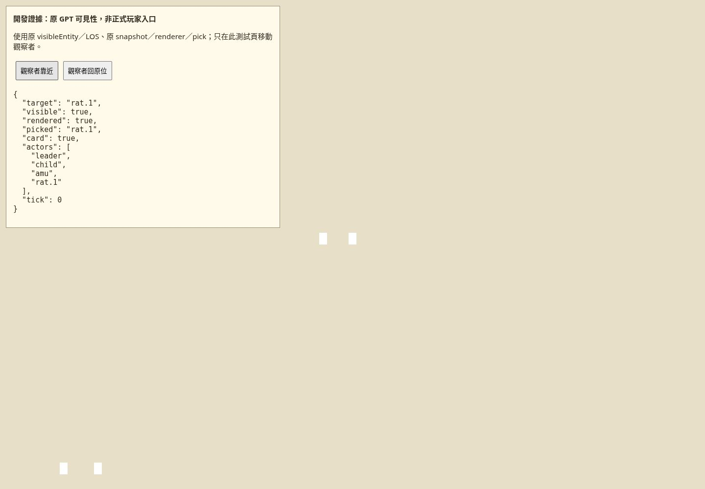

# #356 有限 Cloud 公版序列／#357 補修交付

擁有人2026-10-26要求公版補修後接續開發；已批准[#356](https://github.com/lalagrass/earth-ascension/issues/356)的固定序列為 **#357→#358→#359**，一包dev＋必要postCI成功才派下一包，最後休息。沿RmlUi資料綁定／OpenRA介面分層／Pixi事件的概念，維持現有Pixi＋DOM薄投影；參考與採用判斷已記#356，本包沒有複製第三方實作、安裝框架或新依賴。

#346前序全部已交：最後#351／PR355已合dev `ef823ac277f48d9426cc3806f74468126a9cf91d`，push postCI40312921799五success，[#67完成收據](https://github.com/lalagrass/earth-ascension/issues/67#issuecomment-6414607805)。本輪不重新認領或重做#345–#351。

| 工作包 | 有限範圍／目前狀態 | 下一條件 |
|---|---|---|
| #357 PUBLIC-FIX-01 | 本PR候選：GPT可見性／事件遮罩、茶行動來源、播放中每人物details／焦點；見下方 | grass非作者review、#67、dev＋postCI後才done |
| #358 RESOURCE-VIEW-01 | 已批准但未在本PR實作：原水／藥及有可靠view的木；實存／在途／耗用預約／可用／容量及用途原單位分清；第二真核心薄證明 | #357 dev＋postCI後獨立認領，不預占 |
| #359 INTENT-VIEW-01 | 已批准但未在本PR實作：原工作／待改派／停工／自主許可、合法指令與真拒絕原因；第二真核心原差異 | #358 dev＋postCI後獨立認領，完成收據後休息 |

三核心玩法保持獨立；新關係／社交共用視圖、設施建造／床位、人格／天賦效果、完整圖庫／女孩正式圖、小地圖／編輯器仍候選。#337原作者範圍不變，D53親情陪伴／鼓勵無buff保留。手機與新增保存升版仍最後，不把上述候選授成runtime。

## #357 作者、基線與claim

實際主筆：獨立Codex Cloud task `/root/martial350_author`，非grass reviewer／merge owner。指派紀錄的spawn請求為gpt-6.1-sol／high，runtime精確backend ID未暴露，不能當已驗模型。新隔離Cloud checkout `/workspace/display357-author`、新短分支 `codex/display357`；顯式fetch後base `ef823ac277f48d9426cc3806f74468126a9cf91d`。未重用#350分支或讀其他作者未公開成果。

[唯一claim6415190543](https://github.com/lalagrass/earth-ascension/issues/357#issuecomment-6415190543)登記前核comments空，登記後重讀無競合。claimed_at `2026-10-26T11:44:43Z`、expires_at `2026-10-26T15:44:43Z`，4h為可附進度續期的獨占claim，不是總工時；完整可審交付後等待review不當失聯。只授#357一主PR，真head／PR／當前CI以作者收據為準。

## 最小核實與修法

**F1 GPT scene可見性。** Base的scene adapter只排departed／inactive，與人物卡使用原`visibleEntity()`不一致；原新局確有不可見wild／cave角色，卻會進snapshot並被renderer顯示／pick。改為沿固定GPT `6cbd3e6fccb8bc376e95e2f406ce6cead2a30fdc`原`src/view.mjs:visibleEntity`，再交同一renderer。原LOS、視距／發現函式、位置、核心副本不改。不可見則無sprite與pick表面；原可見才出現，再隱藏會移除舊sprite。

附帶發現scene raw journal確實會繞過#351的hidden遮罩。抽取同一`gptJournalVisible`純投影政策供scene與event adapter共用：明示hidden、wild／cave／departed／inactive／missing actors事件不進scene公開journal；cursor仍消費，沒有事件存在／時間／內容外洩，也不在觀察者靠近後重播歷史。這份原journal沒有歷史可見性紀錄，所以**即使野外角色現在可見，仍不公開其原始歷史事件**。原事件本身未刪或改；已公開的原transfer payload保持既有相容。

**F2 茶活動來源。** 原`tea.view().reason`確為**命令禁用原因**，例如「已在泡茶：改派其他工作或停工即取消」；不是目前活動動機。公版卡不直接換key取它。只在真tea.active時讀原`tea.now/mode/next/brewK/sipK`；目標隨原前往／煮／喝階段指向茶座，返程指院中。動機只引用同一人物既有teaEvents的order／cancel／fail／drank原文與來源；缺事件就unknown，不從工作jobLabel或命令disable原因猜。取消返程原next固定「回院待命」不能代表新改派，未有可證新next便unknown；返院後回原工作卡。訓練／生活既有路徑保留，無茶流程／消耗／收益修改。

**F3 details與焦點。** Base `put()`用innerHTML更新即時energy等欄位，會重新建立details並丟summary焦點；只恢復data-cmd／data-person不足。最小`createViewWriter()`保存每個顯示區塊、每人物、穩定detail key的open值；同人物替換後恢復同summary／現有控制焦點，使用preventScroll。切人物不轉移上一人的展開／焦點，回原人物才恢復自己的狀態。屬性與武學條件給穩定key；其他UI沿同一put入口。狀態只在本頁閉包，不進世界、RNG、存檔或localStorage，不建框架。

## 驗證與重跑

`node --test --test-isolation=none sect-chronicle/public-fix/checks/fixes.test.mjs sect-chronicle/character-card/checks/card.test.mjs sect-chronicle/event-view/checks/events.test.mjs`：21個真子測試通過；調整可見性正例觀察點後受影響fixes4/4再次通過。F1用原新局／原LOS／同renderer／真pick／card驗不可見、可見、再隱藏，raw journal明示hidden／野外／missing反例與正常harvest正例，完整world唯讀不變且不重播。F2真採藥供料→去茶座→煮→喝→返院、取消／停工／改派、原因缺失unknown；與同命令未讀卡原模型的完整權威state相同。#351既有事件遮罩測試沿用；必要devCI由最終head核對。

Cloud桌面腳本 `node sect-chronicle/public-fix/checks/desktop-check.mjs`（既有Playwright／Chromium）。一頁順次正式生活入口→明標開發GPT可見性證明，一自有context／browser、一本地8819服務，無Mac操作。正式流程全用原UI和原clock，不用fixture送資源或跳過路程；GPT開發證明只在測試頁移動觀察者到原LOS可見一側，不改核心函式。F3在真工作／精力更新與恢復時核兩個details與焦點、切人隔離；F2實走茶階段及改派；F1實際sprite／pick／card一致。finally暫停、還原自有viewport、清page／context／browser／server並確認。

首次桌面已驗F2／F3，GPT正例測試點被原LOS擋住而停止，finally全清；改到原可見側，沒有改LOS讓檢查通過。最終結果／圖與cleanup見`public-fix/evidence/desktop-results.json`及本PR收據。未變#346長路／兩skin／原核心／水藥／事件矩陣證據復用；沒有rootSG全跑、全seed、全人物武學、手機或保存驗收。所有diff限sect-chronicle；根／共用CI／依賴／權限缺口交Earth，不繞權限。

### Cloud短流程實際收據

Chromium154.0.8037.57、1440×1000、桌面checkpoint `a5c26fe45785876c05382307c3138bf8448a9402`：19項通過，零page／console errors。[原始結果](../public-fix/evidence/desktop-results.json)記錄F2原活動文字與F1隱藏／可見／再隱藏，F3在原採藥精力下降及坐下精力上升（起點71.0166…）期間展開／summary焦點保持，切人物各自保留。

圖稿回讀曾發現茶截圖沿上一分頁捲動位置，行動來源在畫面外；已將取圖對準原.public-action後取得下列真圖。最後非tea的next保持原p.next，對應fixes＋card12/12再次通過，原tea／DOM／visibility行為與桌面checkpoint相同；必要CI核最終head。

finally回報pageClosed／contextClosed／browserClosed／serverStopped全true，自有viewport還原後關閉；事後無8819 server或本包desktop程序殘留。工程交付待grass非作者review／#67，不自merge或啟後包。
