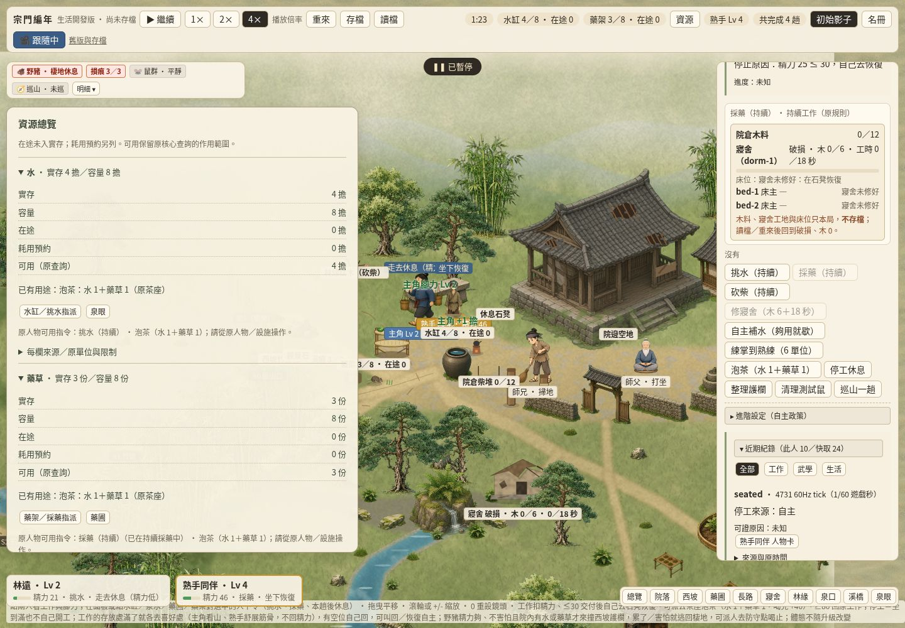
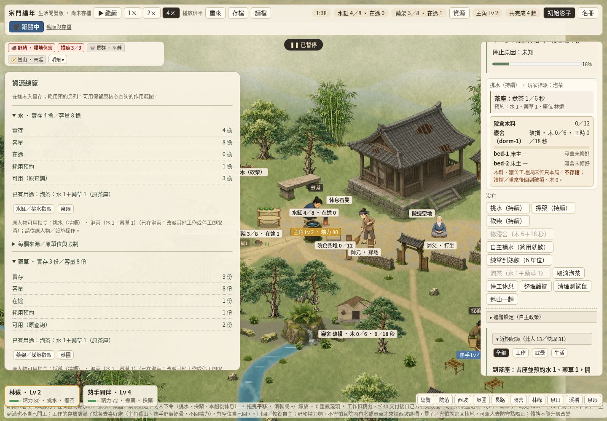
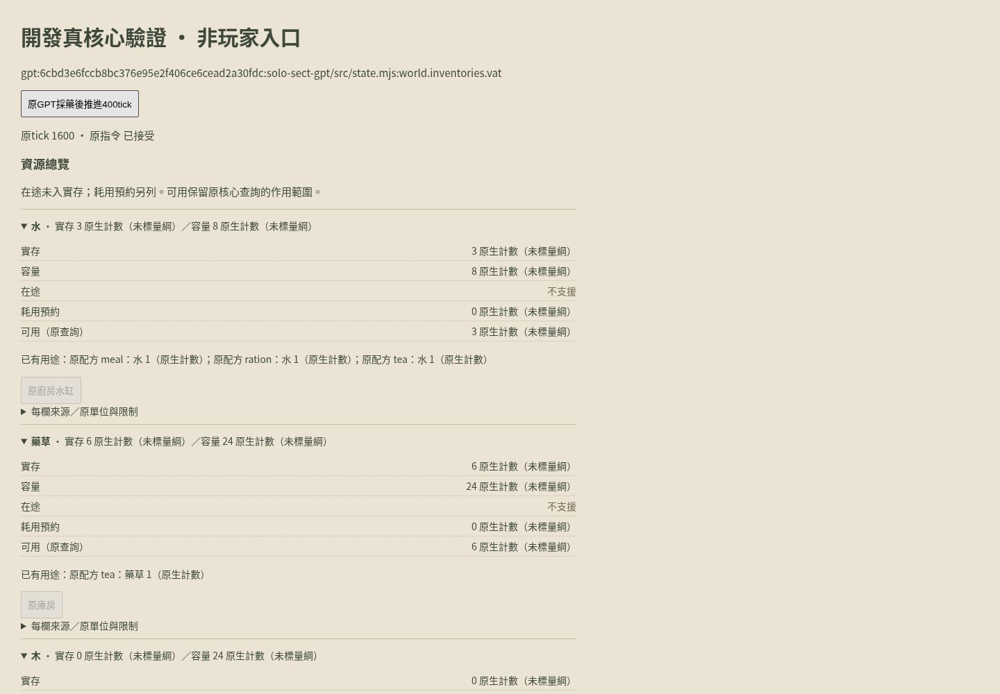

# RESOURCE-VIEW-01／#358：原資源總覽

玩家問題：水缸、藥架、茶預約與木料散在不同面板，實存／路上交付額度／真正耗用預約容易混淆。本包在同一正式生活入口HUD提供「資源」展開總覽；每資源再展開原單位、已有用途、逐欄來源與限制，連到既有設施／人物操作。既有模型決定是否能工作與何時交付。

## 授權、主筆與基線

依[#356](https://github.com/lalagrass/earth-ascension/issues/356)有限順序#357→#358→#359，本包只#358、一作者一主PR。前包PR360已合dev **`2937dd017f8b5e6dea0a05e1ae120bd25499dc15`**，push postCI40319800609五success；此為本包顯式fetch後base。工作區`/workspace/resource-public-358`、新branch `codex/resource-public-cloud`，未復用前包分支。

實際主筆獨立Codex Cloud canonical agent/task **`/root/asset348_author`**（本次工作#358 RESOURCE-VIEW-01），真host `bd5f96b62f8a`，不是grass／reviewer。runtime只提供GPT-6 family，精確backend model/effort不可讀，不把建議配置假稱實際啟動結果；shared GitHub login不是獨立平台approval。[claim6415638985](https://github.com/lalagrass/earth-ascension/issues/358#issuecomment-6415638985)經公開GitHub API核實`2026-10-26T12:09:26Z`→`2026-10-26T16:09:26Z`，登記後重讀無競合；[host收據](https://github.com/lalagrass/earth-ascension/issues/358#issuecomment-6415656175)。真最終head/base/CI/待審狀態以PR與issue收據為準。

## 資料契約與真來源

`resource-view/contract.mjs`沿character-card的`field()`遮罩；ResourceView有source namespace、full SHA、native ID、label、原unit、availability。amount/capacity/incoming/reserved/available每欄各保source/unit/availability，非known不攜value；hidden resource不渲染。只返回detached物件，不維護第二份庫存／日誌／存檔或計算通用可用公式。fixtures僅測0/unknown/hidden/unsupported及惡意value遮罩，真流程不以fixture代替。

### 正式dev（原Gemini派生生活核心）

source namespace `official`、SHA同base2937dd0，完整原路徑前綴`sect-chronicle/experiments/water-carry/demo/`。原主筆與設計來源沿既有Git歷史；本包僅薄投影，沒有更新核心bytes。

| 資源／原單位 | amount／capacity | incoming（在途） | reserved（耗用預約） | available（原查詢） |
|---|---|---|---|---|
| water／擔 | `model.view().vat / vatCapacity` | `view.inFlight` | `view.people.hero.tea.resv.water`（`tea.mjs:view`全局resv副本，不按人重複相加） | `view.teaAvail.water`→原`TE.avail()` |
| herb／份 | `view.herbs / herbCapacity` | `view.herbInFlight` | 同一全局tea resv.herb，只讀一次 | `view.teaAvail.herb`→原`TE.avail()` |
| wood／捆 | `view.home02.wood / cap` | `view.home02.woodIn` | `view.home02.resv`（原工地未領木） | `view.home02.avail`→原`H2.avail()` |

原inFlight/woodIn是**已出發的交付額度，包含尚未採集者**；不是已入庫，也不是茶／修繕耗用預約。不把它加進amount或再從available扣掉。木料`H2.store().inFlight`會包含工地bundle的回倉容量保護，總覽只讀明確`home02.woodIn`，不把已從院倉搬往工地的貨再當採伐返倉incoming。茶resv與木resv都是原閉包公開view，沒有新推算。

用途直接引用原`tea.mjs:TEA`與`home02.mjs:SITE`；不是新增配方。原`model.actions(actorId)`只供顯示當下合法指令與拒絕原因；可操作按鈕仍是原facility-view／原人物面板的dispatch入口，點下時重核。水/藥連原水缸、泉眼、藥架、藥圃；木連既有寢舍／林緣camera及原人物操作。

**歷史誤名的最小相容調整：** 原facility-view `stock.reserved`確裝`inFlight`，本包改欄名`stock.incoming`、原數值不變，兩個renderer與既有定向測試一同更新；不保留會被誤讀為耗用預約的別名。僅呈現API修正，world/save/schema版本不變；沒有外部消費者遷移、物流改造或新reservation owner。

### 第二固定真GPT核心

source SHA **`6cbd3e6fccb8bc376e95e2f406ce6cead2a30fdc`**，原作者Claude Opus5.5（依已核#342來源），不是把GPT標籤當模型作者。只讀既有固定本地`scene-shared/sources/gpt/solo-sect-gpt/src/{state,world,activities,data}.mjs`，不更新原作者branch或snapshot。

水讀原`vat`、藥/木讀原`store`；amount走原`state.qty()`、capacity原inventory.capacity（該核心每品項口徑）；reserved只精確加總原`reservations`中同倉同品項`source:<inventory>:<item>`記錄，絕不把`dest:`容量預約當耗用或貨物。原`state.availableQty()`只保原同tick供料口徑，**不宣稱已扣所有source預約**；與reserved各自分列並在畫面明說，公版不另猜淨額。

原data只給ITEM名稱、沒有物理量綱，所以UI明示「原生計數（未標量綱）」，不假定等於正式擔/份/捆。incoming沒有同口徑公開查詢，保持unsupported；沒有從dest預約或未公開bags猜總貨量。用途只讀原RECIPES.input，木若無該查詢的用途則unsupported，不湊配方。固定GPT只提供明標開發harness與同renderer薄證明，不是第二玩家入口，跨核心設施按鈕明示不可用。

### 第三固定Grok盤點

source SHA **`6760f21c342cbf72fc9fb4baf0aec8655abd0dd2`**；原Grok Bot的`solo-sect/src/sim.mjs:createState.res/cap`，來源與權利沿#345／已固定manifest。`grokResources()`在真createState上唯讀盤點amount與明列cap；herb沒有明列cap就unknown，絕不填Infinity。incoming/reserved/available/用途尚未適配，unsupported；stockReserved涉及原task lifecycle，不為湊三版擅套新公式。完整物流／食物安全／自主行為未授權。

## 呈現、驗證與限制

沿現有`public-fix/createViewWriter()`對resource的穩定details key保存展開及summary焦點，scope為全局資源，不隨人物切換套用上一人的設定；連結保穩定id，沒有另建UI框架或view state存檔。只在總覽打開時投影，沒有第二clock。單一正式入口、原素材pin／人物卡／事件系統保持。

定向`node --test --test-isolation=none sect-chronicle/resource-view/checks/resources.test.mjs sect-chronicle/facility-view/checks/facility.test.mjs`：10項，驗真長水藥路／茶預約與取消／煮成、真木料預約與搬運、固定GPT真採藥返倉與原單位／缺項、Grok真盤點／遮罩、設施合法原指令；paired完整world/RNG/log與tea/home02閉包皆與不讀ResourceView的同命令twin相同。無全seed／全人物×分支矩陣。原路線速度與#357焦點／茶事件來源、#351近期事件證據復用。

桌面腳本`node sect-chronicle/resource-view/checks/desktop-check.mjs`一個Cloud1440×1000頁／context／browser及8821服務，正式原UI派水/藥→真交付→茶預約/取消→木定位，再同頁去明標固定GPT開發證明。沒有注入貨物或縮路；結果／真圖／cleanup保`resource-view/evidence/`，最終必要devCI與完整檢查在PR收據列出。finally暫停、還原自有viewport、關page/context/browser/server並確認，不碰他人頁／8800／Mac。

實際本地結果：定向resource＋facility **10/10**、必要`node --test sect-chronicle/test/*.test.js` **431/431**、根Python **53/53**、root/變更JS syntax與diff空白檢查通過。[摘要](../resource-view/evidence/test-summary.json)記命令及log hashes。Cloud Chromium154一次流程 **15/15**、零page/console errors；真水藥交付在tick4987、茶預約在tick5899（實際值見[原結果](../resource-view/evidence/desktop-results.json)），同頁固定GPT採藥返倉在tick1600。desktop checkpoint記base加當時工作中實作，[runtime fingerprints](../resource-view/evidence/implementation-hashes.json)鎖其實際檔案；後續只補文件，最終PR headCI另核。

全部diff限sect-chronicle；無新依賴、root/CI/權限／核心數值／物流／RNG／save/schema／手機更動。木料沿既有只本局的保存限制。完整物流#160、人口維持、新資源／口渴／需求／配方與關係等未因此批准。工程交付待grass非作者review→#67→dev/postCI；作者不自審合、不啟#359。
