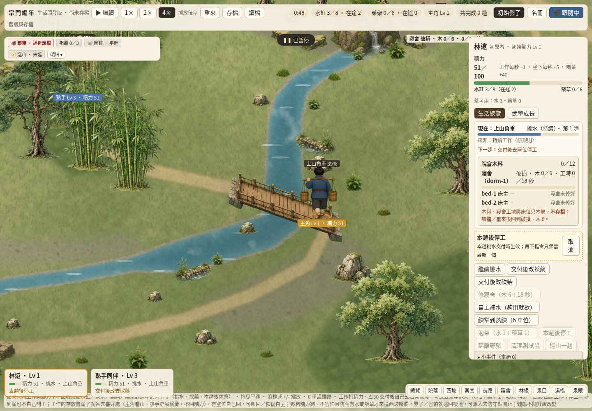
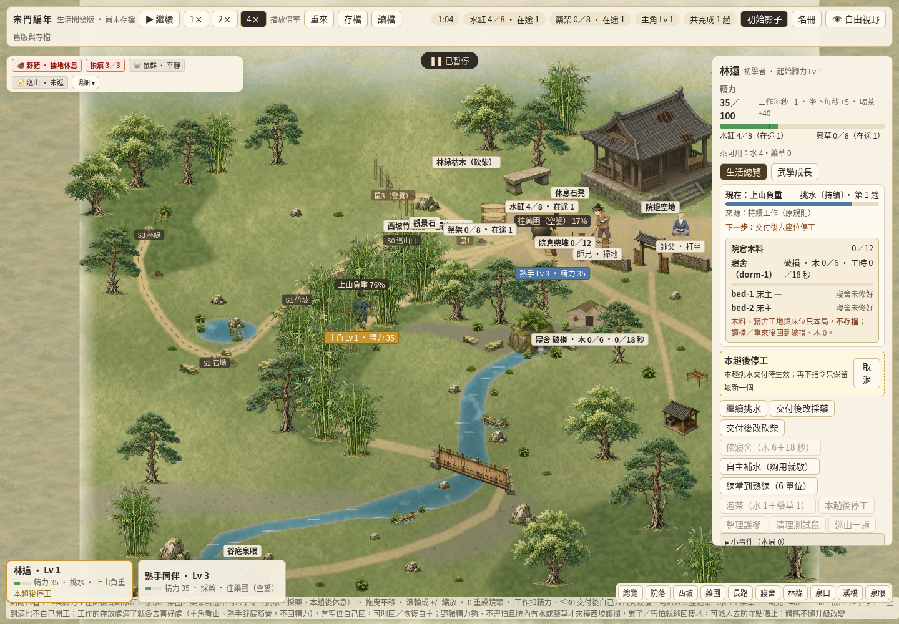
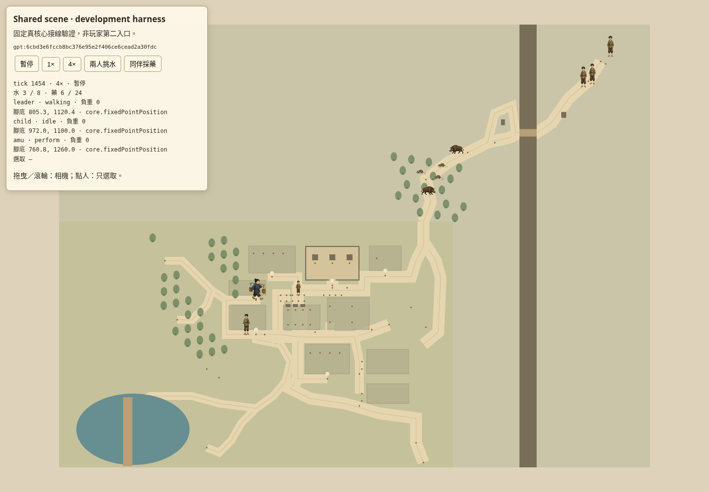

# SCENE-SHARED-01 delivery (#342)

Author: GPT-6.1 Sol / high (`scene342_author`, Cloud). Reviewer: grass, a different non-author agent. Base dev: `9ef497e86a5837539cc8e461855695b0fe468dbd`. Branch: `codex/scene-shared-01`. Claim: [6411135388](https://github.com/lalagrass/earth-ascension/issues/342#issuecomment-6411135388).

Player problem: scene drawing was tied to one app's core fields, route projection and frame comparisons. The official existing entry now consumes detached snapshots through a core-neutral Pixi renderer while preserving the water/herb loop, accepted map and original person card/commands.

## Acceptance and evidence

| Group | Delivered behavior | Evidence |
| --- | --- | --- |
| A | The same `scene-shared/renderer.mjs` consumes real official-dev, fixed Gemini and fixed GPT snapshots. No core references in the renderer; source-specific adapters own read-only projection and public command translation. | `checks/shared.test.mjs`: real source water/herb return and GPT harvest→bag→store round trip; full core state unchanged by render; manifests hash every vendored source file. |
| B | Official entry retains two original workers, long 1700.9-unit water route, true empty/load speeds, original herb phases, foot anchors, foreground rail and tree occlusion, selection and existing card. | 18 real desktop behavior checks, [raw result](../scene-shared/evidence/desktop-results.json), and the two official-entry screenshots below. |
| C | Pause leaves the full authority state unchanged while camera moves; latest command/stop wins after original delivery. Renderer never extrapolates or computes world time. Every stepped core event is captured before frame batching and consumed once. | Targeted frame-batching/pause/priority test; actual desktop pause/reassign/camera flow. |
| D | Same commands produce exactly identical state and event streams with and without rendering. GPT seeds 11/23/37/53/71 use true core RNG, native routing and invariant checks. | Targeted tests plus normal dev CI; no unrelated full RT/mobile/save matrix. |

## Source distinctions and limits

The official current-dev model is the accepted Gemini-derived **original worker loop**, not the whole fixed fork. The only model addition is a detached `scenePosition` projection through its existing core `sense.placeOf`. It changes no authority state, saved fields, RNG, routes, resource/growth/hit rules, D45 or D53. The fixed Gemini harness runs the real unmodified `bae43412…` core with its original automatic work/rest behavior. The GPT harness runs the real unmodified `6cbd3e6…` world through its native 20 Hz step and `Q=256` positions, with diagnostic art from the 2400×1800 runtime map. Neither source's extra gameplay is imported into the official demo.

**Fixed Gemini experimental life-autopilot limitation:** `model.life.setAutopilot(true); model.step(); model.step()` on a fresh fixed core reproduces `TypeError: Cannot read properties of undefined (reading 'phases')`, through `geoView` → `personAt` → `cleanStep`, because the autopilot has set legacy `motion.job` to `thatch` and `phase` to `goto`. This happens before normal `lifePos` initialization in this repro. The separate `lifePos` write / missing `personView` field / `routes.of` read is a static source observation. It is not reported as a successful autopilot rendering test. The verified original two-worker autonomy is available with that experimental mode off, as in the original fixed core's default. No gameplay repair is concealed in the renderer.

Reproduce that source limitation independently of Pixi:

```sh
node --input-type=module <<'JS'
import {createGeminiCore} from './sect-chronicle/scene-shared/checks/cores.mjs';
const {model}=createGeminiCore(true);
model.life.setAutopilot(true);
model.step(); model.step(); // upstream authority exception
JS
```

## Validation record

Targeted command: `node sect-chronicle/scene-shared/checks/shared.test.mjs` — 7/7 passed, including 5 GPT seeds and exact whole-world parity. `node --test sect-chronicle/test/scene-shared.test.js` includes these tests in the existing Node 22/24 CI. Existing `checks/model.test.mjs` passed after the view-only model addition.

Required local checks: root Python **53/53**, normal SG dev suite **390/390**, Node 22 targeted CI entry, changed-JS syntax, `node --check earth_ascension/static/m2.js`, and `git diff --check` all passed. The game suite includes the new source-connection tests; no unrelated full RT acceptance or mobile/save matrix was run.

`node sect-chronicle/scene-shared/checks/baseline-check.mjs` loads the exact official model bytes from base `9ef497e…` in a temporary sibling module and removes it in `finally`. Five normal command schedules × 10,000 ticks gave identical full exported state/log hashes against the new view-only model, even with different `view()` cadences. [Five compact parity records](../scene-shared/evidence/baseline-parity.jsonl). The worker model has no seed/RNG input; the genuine GPT core separately uses seeds 11/23/37/53/71. No seed value is invented for the worker loop.

### Cloud desktop evidence

Chromium 154.0.8037.57, headless Cloud desktop 1440×1000, one owned page/context. Runtime code checkpoint `d96585b`; later changes are test/provenance/evidence documentation, a harness favicon and replacing a harness literal 256 with the unchanged source Q constant. The behavior evidence is reused for those nonbehavioral deltas.

- Real empty/load speed cards (60/40 vs 74.4/52) and different progress along the same long route.
- Paused drag/zoom: complete world-state hashes match exactly before/after (not just tick/resources).
- Paused rest→herb→rest commands: newest stop wins without advancing time; original water is delivered exactly once and the hero stays manually stopped while the companion delivers real herbs and autonomously seeks rest.
- Loaded return at actual foot (904.23,1030.13) is behind bridge-front depth 1060; clicking the occluded world body opens the original hero card. Both actual sprite anchors match confirmed core feet.
- Same page then genuinely reads fixed Gemini; final GPT scene follows real collection and bag→store transfer at tick1454, original seed11, with no core fixture or manual state edits.

The full desktop script reached **18 passed behavior checks**, then its final console assertion caught a new harness `/favicon.ico` 404. [Raw original result, including that failure](../scene-shared/evidence/desktop-results.json) is preserved. The harness now declares the same empty data favicon as the existing official entry. A bounded three-entry asset-only recheck after that metadata fix reported **zero resource/console/page errors**; [raw recheck](../scene-shared/evidence/asset-recheck.json). No unrelated behavioral matrix was repeated. Reusable full-flow command:

```sh
PLAYWRIGHT_PATH=/path/to/playwright node sect-chronicle/scene-shared/checks/desktop-check.mjs
```

The runner starts one owned temporary server (port8812 by default, `SCENE_TEST_PORT` can override), reuses one page for official/fixed-source views, pauses before leaving, restores its owned viewport and closes context/browser/server in `finally`. Both actual runs confirmed pages0, browser closed and server stopped; process verification afterward found no own server or Chromium profile process. No deployment, Mac work or permanent polling occurred.







### Final scope

All main-PR changes are under `sect-chronicle/`. Both exact source manifests enumerate original path/hash/rights and `imported_by` dependency edges for every one of the 49 vendored files. These are the minimum static dependency closures of the source models/maps; they are only loaded by tests/development harnesses. No root/shared dependency, other product entry, source transport branch or original fork UI is integrated. The existing official app imports only its current accepted model and the shared modules. No rule/schema/RNG/save-version migration or new #340 attribute/social/MBTI system is adopted.

Current remote CI is reported in the PR at its actual final head; local successes are not represented as remote CI results. Non-author grass review and normal dev integration remain separate from this author's self-checks.
