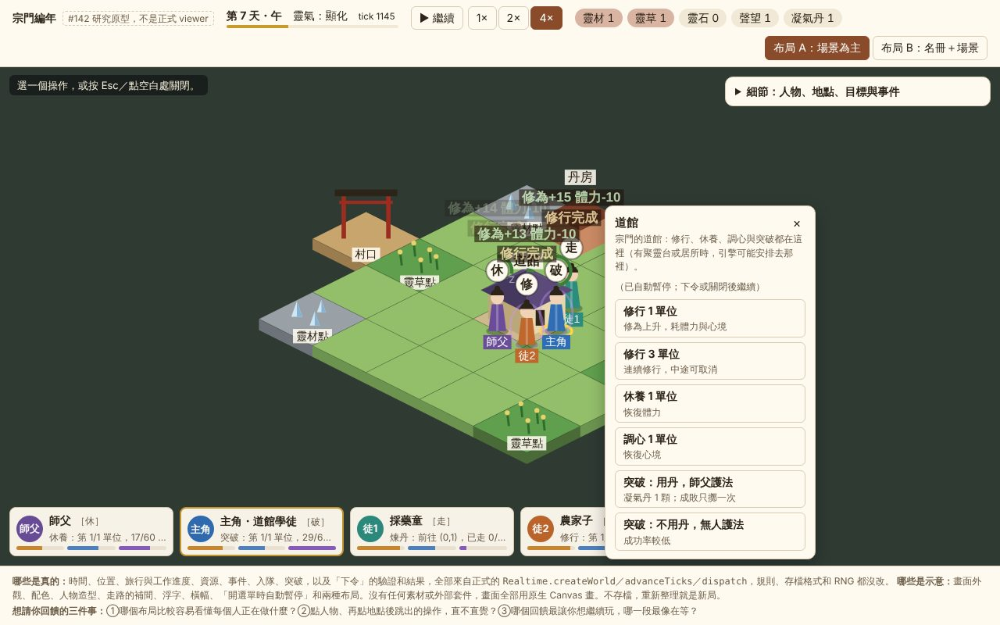
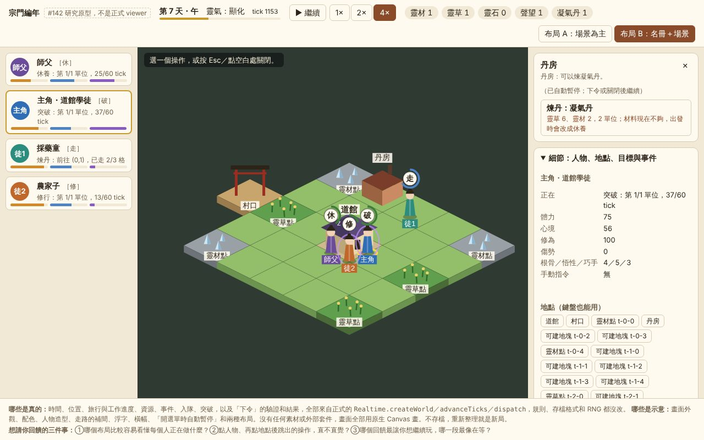

# 2.5D 生活場景研究（#142 第一輪）

實際主筆：Claude。Base：`dev` `4a8888e`。本文與 [`docs/ui-research/`](ui-research/) 只新增研究檔，不改 viewer、引擎、存檔或測試。

## 先看這個（約 5 分鐘）

1. 在 repo 根目錄執行 `python3 -m http.server 8765 --directory sect-chronicle`。
2. 打開 <http://localhost:8765/docs/ui-research/prototype.html>。布局 B 也可以直接用 `?layout=b` 打開，頁首有切換鈕。
3. 照這條短流程點一次：
   1. 按「開始」或空白鍵，看師父和主角自己出門工作。按 `4` 加速。
   2. 點藍衣的主角（或底部人物卡）。
   3. 點場景裡的一個地點：礦點、草點、空地、道館或村口。世界會自動暫停，旁邊列出主角能在這裡做的事，做不到的會寫原因。
   4. 選一項下令，世界繼續走。主角頭上的泡泡會變成金框，表示這是玩家下的令。
   5. 看回饋：虛線是路線，泡泡外圈是進度，完成時頭上會冒出數值變化。資源不夠時，畫面會直接說「改成休養」。
4. 換點師父或學徒試試：他們只依宗門目標自主，操作會顯示但不能按。

兩版草圖是原型在 `rt-dev-000` 第 7 天的截圖：

| 布局 A：場景為主 | 布局 B：名冊＋場景 |
|---|---|
|  |  |
| 場景占滿畫面，人物卡在底部。點地點後，操作選單貼在點的位置旁，細節收在右上抽屜。 | 左邊是名冊，寫著每個人正在做什麼；中間是場景。操作固定列在右側，下面是地點清單和事件。 |

**真的與示意**：

- 來自正式世界：時間、位置、路線與工作進度、資源、設施、事件、入隊、突破，以及下令的驗證和結果。全部經由 `Realtime.createWorld／advanceTicks／dispatch`，名字與狀態文字沿用 `viewer/view.js` 的 `describe`。
- 示意：外觀、配色、人物造型、走路補間、浮字與橫幅、「開選單時自動暫停」，以及兩種布局本身。
- 原型不存檔，也不處理詢問事件與目標／政策編輯。

## 想請擁有人回答的三個問題

1. 哪個布局比較容易看懂每個人正在做什麼？
2. 點人物、再點地點後跳出的操作，直不直覺？
3. 哪個回饋最讓你想繼續玩，哪一段最像在等？

回答會決定 #139 正式畫面採用哪個布局、改哪裡。在那之前，本文不默認選定布局。

## 建議路徑與次選

**建議**：#139 先用瀏覽器內建的 Canvas 2D 做場景，把繪圖封在一個薄的 renderer adapter 後面。等擁有人選定美術方向、真的要載入 sprite 素材時，再換成 PixiJS，只替換 renderer 這一層。

這不是自建 renderer 或遊戲框架。Canvas 2D 是瀏覽器標準能力（#145 第 1 條），原型的繪圖就是幾個畫菱形、方塊和人物的函式。需要評估的是何時把這層交給 PixiJS，而不是現在要不要自己寫一套引擎。

**理由**：

- 現在的瓶頸是看不懂、等太久，不是繪圖能力或效能。25 格加 4 人的灰盒場景，每幀繪圖平均 0.92 ms，p95 為 1.5 ms（量法見「驗證」）。
- 零依賴，不動 root CI 或建置流程。原型 `prototype.js` 是 53,168 bytes，gzip 後 17,124 bytes。
- 世界、時間與下令都留在既有的 JS 權威引擎，render 只讀世界，不推進世界、不讀 RNG。

**次選：PixiJS**。改用它的時機是決定採用貼圖素材之後：需要 sprite atlas、大量動畫或濾鏡，或場景物件數多到 Canvas 2D 實測不夠時。renderer adapter 的介面不變，只換實作。

### 候選比較（#145 輕量格式）

| 候選 | 版本／授權（2026-10-19 查 npm registry） | 適合度 | 選擇 |
|---|---|---|---|
| 原生 Canvas 2D | 瀏覽器內建 | 足以畫灰盒 2.5D、命中測試和補間；換素材時要自己管理圖集 | **#139 採用**，加薄 adapter |
| [PixiJS](https://github.com/pixijs/pixijs) | `pixi.js` 8.22.0（2026-10-01 發布），MIT；`dist/pixi.min.js` 840,663 bytes，gzip 236,838 bytes | 2D scene graph、sprite、事件，可只替換視覺層；不碰世界時間 | **次選**，素材定案後再接 |
| [Phaser](https://github.com/phaserjs/phaser) | `phaser` 4.2.1（2026-07-09 發布），MIT；`dist/phaser.min.js` 1,375,976 bytes，gzip 352,227 bytes | 完整遊戲框架：scene 生命週期、時鐘、輸入都和既有控制器重疊，physics 與尋路不能用來改世界 | 不建議 |
| [Tiled](https://github.com/mapeditor/tiled) | 離線地圖編輯器，JSON 支援 isometric | 目前地圖是規則固定的 5×5（`Rules.initialTiles`，`validateWorld` 要求不變），沒有編輯需求 | 延後，等地圖變成資料再評估 |
| [Kenney Isometric Miniature](https://kenney.nl/assets/isometric-miniature-prototype) | 各包頁面標 CC0 | 灰盒素材可用，但風格偏西式，與修仙宗門不合 | 未下載；採用時逐包記來源與授權 |
| [FreeSO](https://github.com/riperiperi/FreeSO) | MPL-2.0，MonoGame／C# | 只參考互動模式（點物件出現選單）；依賴原遊戲素材，不能直接用 | 只作參考 |

套件大小取自 npm registry 的發布 tarball，只解出 `dist/*.min.js` 量測，沒有安裝進 repo。效能數字只有原生 Canvas 的實測。PixiJS／Phaser 沒有做同場景量測，所以本文不對它們做效能主張。

## 資料流

```
Realtime 世界（唯一權威）
  │ advanceTicks（時鐘：每秒 4 tick × 倍率，背景暫停）
  ▼
View.describe(world) → 唯讀 model（名字、狀態文字、設施、事件）
  ▼
renderer adapter：地面 → 建築與人物依腳底深度排序 → 泡泡／路線／浮字
  （走路補間、浮字只存在畫面，不回寫世界）
  ▲
輸入：命中測試（人物優先，其次建築，最後地塊）
  → actionsFor(地點)：依 Rules 列出主角可下的令與不能下的原因
  → Realtime.dispatch(orderActivity／cancelManualOrder)
  → 新世界，下一幀重畫
```

原型自己帶一個約 40 行的最小時鐘，換算和 `viewer/controller.js` 一致，因為 dev 上的控制器還沒有下令入口。正式整合時應在控制器加 `dispatch`，不要讓畫面直接持有世界。

## 現有 API 能做到哪裡

**一、直接可用（原型已接上）**：

- 位置、路線、旅行與工作進度：`d.pos`、`activity.path／pathIndex／stepTicks／workTicks`。
- 體力、心境、修為、傷勢、資源、凝氣丹、設施與建造進度。
- 事件：`unitCompleted` 的前後數值、`breakthroughResolved`、`candidateAccepted`、`phaseNotice`，以及休養活動上的 `fallback`。
- 主角手動指令：`orderActivity` 九種、`cancelManualOrder`。
- 建造效率預覽 `Rules.evaluateFacilityPlacement`、突破資格 `Progression.eligibility`，以及靈草與援村的開放時間。

**二、需要 UI adapter，不改規則**：

- 控制器加 `dispatch`，處理 `expectedRevision` 與命令 id。
- 把「這個地點能做什麼」做成純函式並寫測試。原型的 `actionsFor` 只是示意，適合併入 #138 的唯讀 selectors。
- 每單位的資源增減：`unitCompleted` 沒帶資源差，原型只能閃動上方資源列。要在人物頭上顯示「+3 靈材」，需要 selector 推算。
- 目標與政策編輯（`setGoals`、`setPolicy` 已有）、詢問事件（`chooseEvent`、`acceptCandidate` 已有）、#141 的存讀接線。

**三、需要新玩法或規則批准（本研究不做）**：

- 對師父或學徒下令。引擎目前回 `not_protagonist`，是既有契約。
- 一次排多個工作的佇列。
- 第 7 天後的新內容或新目標（見下面 H1）。
- 需求條、心情、家具經濟、拖拉建房等。

## 可玩性假設與小實驗

數據來自 `rt-dev-000` 無人介入推到 tick 2700 的事件（Node 直接跑正式引擎，命令見「驗證」）。1× 是每秒 4 tick，一天 180 tick，約 45 秒。

| # | 假設 | 依據 | 最小實驗 | 屬於 |
|---|---|---|---|---|
| H1 | 內容在第 7 天左右就用完，之後只剩等待 | 主角 tick 1236（第 7 天，1× 約 5 分鐘）起進入「目標都已完成」等待。之後 9 次自主等待全是這個原因，第 13 天全員無事 | 擁有人用原型 4× 玩到第 8 天，記下何時開始覺得沒事做 | 玩法缺口，另提 |
| H2 | 自主太能幹，玩家的選擇看不出差別 | 不下任何令，tick 1175（1× 約 5 分鐘）主角就突破成功；丹房、援村、收徒都自己完成 | 同一 seed 玩兩次（不介入、積極下令），比較第 7 天的狀態，問擁有人感覺得到差別嗎 | 玩法與數值，另提 |
| H3 | 下令後的回饋太弱或太晚 | 令要等目前這一步結束才開始。資源不夠時會改成休養，舊 viewer 只記在事件列表 | 原型已加提示與浮字。請擁有人第 1 天就下「建造」（一定不夠料），看是否明白發生什麼事 | 呈現，#139 可做 |
| H4 | 只能指揮主角，選到其他人時會挫折 | 引擎只接受主角的手動指令 | 看擁有人會不會想點其他人下令；原型選到他們時，操作會顯示但停用並說明原因 | 規則變更需批准 |
| H5 | 開場三天選擇太少 | 靈草與援村第 4 天才開放，前三天只有採靈材、修行、建造 | 1× 和 4× 各玩一次開場，問哪段最像在等 | 呈現（教學提示）或玩法 |

換外觀不能解決 H1 和 H2。原型只能讓這兩個問題更容易被看見，不代表遊戲已經好玩。

## 呈現問題怎麼處理

- **前後遮擋**：建築與人物依腳底深度排序。選取中或滑鼠下的人若被建築擋住，會多畫一層虛線輪廓。命中測試先找人物，所以擋住也點得到。
- **同格多人**：每人依序站到格內不同位置，有建築的格子站在前緣。三人以上仍會擠（布局 A 截圖可見）。候選做法是合併泡泡或顯示人數徽章，留給 #139 決定。
- **同名辨識**：名字沿用 `describe` 的規則（同名時加 id），再加上衣服顏色和短名牌（師父、主角、徒1、徒2）。
- **縮放與平移**：滾輪或 `+`／`-` 縮放，拖曳或方向鍵平移，`0` 重設。視窗改變時自動置中，並支援高解析度螢幕。
- **鍵盤**：空白鍵播放／暫停、`1`／`2`／`4` 調倍速、`[`／`]` 換人、`Esc` 關選單。抽屜裡的地點清單是按鈕，可以用 Tab 走到並開啟操作。
- **中文字體**：使用系統字體堆疊（Noto Sans TC、PingFang TC、Microsoft JhengHei），不下載 webfont。
- **窄畫面**：390 px 寬時，布局 A 的抽屜與人物列疊在場景上，布局 B 改成上下排。兩者都能用，但場景偏小。
- **素材不足的退路**：全部用程式畫灰盒。日後換素材只動 renderer，不影響互動與世界。
- **播放中按鈕被重建**：原型最初每個 tick 重寫人物卡和地點按鈕，自動化點擊因此一直點不到，已改成只更新文字。現有 viewer 的 `render` 也是每個 revision 重寫整塊 HTML，推測播放中點人物偶爾會沒反應（未實測）。#139 應該一併處理。

## #139 最小視覺交付建議

照擁有人回饋選定布局後，#139 依序做：

1. Canvas 場景與 renderer adapter（地面、道館、設施、人物、泡泡、路線）。
2. 人物列與選取。
3. 地點操作選單，經控制器的 `dispatch` 下主角的令，資源不足或改成休養時要明講。
4. 細節抽屜：沿用 `describe`、事件與目標／政策。
5. 接上 #141 的存讀。

不在 #139：PixiJS 採用、美術素材、對非主角下令、新玩法。

## 驗證

- 原型流程：Playwright 1.56.1 內建的 headless Chromium，1280×800 與 390×844。腳本依序檢查：
  - 開始播放，點靈材點，選單出現且自動暫停；下令「採集靈材 3 單位」被接受，世界恢復，主角改走去該點。
  - 選師父後開道館選單，可用按鈕 0 個，並顯示只給主角的說明。
  - 布局 B 用地點清單對空地下令建造。靈材不夠，約 2.6 秒後顯示「你下的『建造』沒辦法開工（資源不足），這次先改成休養」。
  - 4× 播到 tick 1145 附近後截圖兩版草圖。
  - console 0 行。截圖腳本不在 repo（研究不加工具），結果只記在這裡。
- 繪圖耗時：原型內唯讀的 `protoPerf()` 記最近 240 幀。量測環境為 headless Chromium、1280×800、4× 播放約 70 秒。結果：繪圖平均 0.92 ms、p95 1.5 ms；推進平均 1.09 ms、p95 4.7 ms。只是這台機器的一次紀錄，不是 gate。
- 無人介入時間線：在 `sect-chronicle/` 下用 Node 跑 `Realtime.createWorld('rt-dev-000')`，`advanceTicks` 推到 2700，列出 `activityDone`（建造、煉丹、援村）、`phaseNotice`、`candidateAccepted`、`breakthroughResolved`、`autonomyWait` 的 tick。沒有跑 seed 矩陣。
- **未驗證**：擁有人實際操作感受、觸控裝置、Safari／Firefox、Canvas 內容對螢幕閱讀器的呈現、PixiJS／Phaser 同場景效能。
