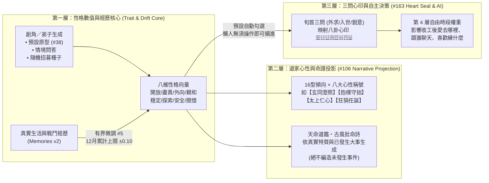
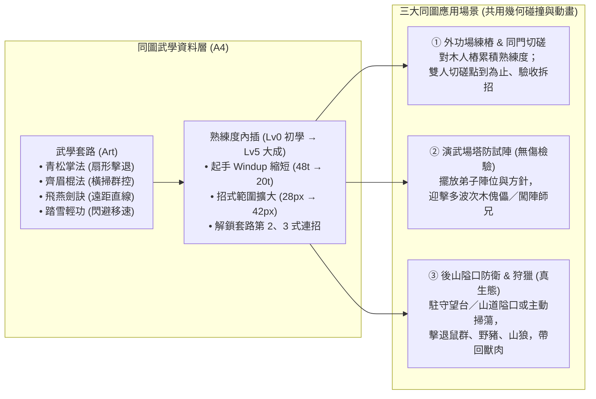
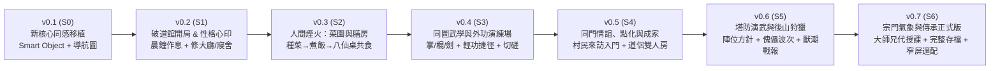

# 破道館到小門派：門派生活、同圖武學與塔防演武重新架構總藍圖

> **狀態**：架構與系統設計藍圖（基於最新 `dev` `148cfbbb27e43475c66744d53c2451125a9111a0` 資產與歷史 Issue 盤點）
> **分支**：`plan/sect-life-architecture-redesign`
> **核心願景**：融合《天下霸圖》的門派作息與擴建成就感、《模擬市民》的技能成長與人際成家溫度，以及「同圖即時武學 × 塔防式演武打獵」的實戰檢驗閉環。

---

## 一、 設計哲學：五大體驗支柱與「保留 vs 重建」

經過 M1–M2 世界模擬與 `sect-chronicle` LP01–HOME02／SOCIAL01 的迭代，我們已經非常清楚這部作品真正迷人的靈魂是什麼，以及現有原型（`experiments/water-carry/demo/`）為什麼需要一次骨架升級：

### 1.1 五大核心體驗支柱（對齊 [NORTH_STAR.md](NORTH_STAR.md) 與 [#314](https://github.com/lalagrass/earth-ascension/issues/314)）

| 支柱 | 玩家在畫面上看到什麼 | 核心樂趣來源 | 刻意不做的事 |
|---|---|---|---|
| **P1 天下霸圖式門派生活** | 弟子們在同一個山門地圖裡晨鐘暮鼓、跑來跑去，挑水、種菜、煎茶、練樁、學新武學 | 看著一個個鮮活的小人按門派作息與各自性格把山門運轉起來 | 變成只看數字報表的純文字經營，或事事都要玩家微操點擊 |
| **P2 同圖即時武學** | 不切換戰鬥場景；在外功場打木人樁、在院中同門切磋、在後山擊退野獸，全在同一張地圖直接出招 | 肉眼看得出「初學 vs 練熟」的起手快慢、掌風／劍氣範圍、步法殘影與第二式連招 | 另開回合制棋盤、滿螢幕飄 DPS 爆擊數字 |
| **P3 模擬市民式生活與成家** | 弟子做什麼長什麼技能；收工後在石凳／餐敘棚聊天、互助，關係從同門、知己走到結為道侶／家人並搬進同房 | 關係變化有真實事件記憶支撐（一起躲雨、代挑一擔水、並肩守山），而非盲刷好感條 | 無因果的送禮刷分、每 tick 呼叫 LLM 編造無中生有的台詞 |
| **P4 塔防感武學演練與狩獵** | 玩家在演武場或後山隘口擺放「陣位（守點）」與「應戰方針」，看弟子用練熟的武學自主攔截機關波次或後山獸群 | 實地驗收「這一個月練的掌法、棍法、輕功到底有沒有用」，打完帶回獸肉與一張因果清晰的戰報 | 無限刷怪割草、要求玩家手動操作每一次出招與走位 |
| **P5 從破道館一磚一瓦擴建** | 時間退回門派成立前：開局只有漏雨的破大廳、雜草院子與一口露天井；慢慢修起宿舍、膳房、菜園、藥園、外功場與後山望台 | 每個區域都由弟子真搬木石、搭鷹架施工建成；每蓋好一處，門派就多一類生活與武學活動 | 開局就是建好的大門派、點一下瞬間生出建築 |

### 1.2 現況診斷：為什麼要「保留手感與水彩資產，換掉底層骨架」？

在現有 [model.mjs](../../experiments/water-carry/demo/model.mjs)（約 1,740 行閉包）與 [routes.mjs](../../experiments/water-carry/demo/routes.mjs) 中，我們已經成功驗證了這套遊戲最寶貴的手感：
- **已驗證並 100% 保留的資產**：
  1. **長通勤與負重／腳力速度差**（[D26–D27](../DECISIONS_AND_SOURCES.md)：空手 60→84/s、負重 40→64/s，「成長即速度」肉眼可見）。
  2. **同圖武學節奏**（[palm.mjs](../../experiments/water-carry/demo/palm.mjs)、[#305 TRAIN01](https://github.com/lalagrass/earth-ascension/issues/305)：起手 Windup 48→24 tick、收勢 Recover 36→18 tick、掌距與逐隻換目標）。
  3. **有目的的生態個體與返程餘裕**（[patrol.mjs](../../experiments/water-carry/demo/patrol.mjs)、[#290 PATROL01](https://github.com/lalagrass/earth-ascension/issues/290)：野豬與林鼠有棲地、有威脅值、會逃離；巡山會算返程精力餘裕並產出真戰報）。
  4. **水彩山居母版與分階段美術資產**（[#323 SCENE-04](../../experiments/water-carry/design/scene04-masterplan/README.md) 的 S0 破道館 → S1 可居住 → S2 成熟門派三階段同母版水彩圖、`art184-watercolor`、`home01`、`home02`、`scene03` 與 `template/animator.mjs` 角色動畫烘培管線）。

- **必須重構的結構瓶頸**：
  1. **兩人寫死（`PEOPLE = [hero, cousin]`）**：反應傾向 `AUTO_REACT`、座位 `SEATS.hero`、休閒 `FUN.cousin`、練樁 `TRAIN_POSTS.hero` 全部按 ID 寫死，無法擴展到 6–12 名常住弟子與訪客。
  2. **活動狀態機碎片化**：每加一個玩法（飲水、泡茶、砍柴、修房、清鼠、招呼）就要在 `model.mjs` 手寫一組 `toXxx / xxx / fromXxx` 與專屬 `want / accept / suppress / cancel` 分支，N 個弟子 × 7 大區域 × 多門武學會讓分支組合爆炸。
  3. **單一端點手畫折線（`(962, 512)`）**：所有路線強行從院中水缸旁同一點出發以防瞬移；一旦弟子要從「宿舍」直接去「膳房」吃飯再去「外功場」練樁，手畫折線便無法支撐。

---

## 二、 核心系統重構架構（New Simulation Core Architecture）

我們建議在 `sect-chronicle/life/core/` 另起一套**資料驅動、確定性 60Hz Tick** 的模擬核心（S0 階段先將現有挑水、採藥、泡茶、砍柴修寢舍、練掌同感移植，驗收通過後凍結舊 `demo/` 作為對照組）。

```mermaid
flowchart TB
    subgraph DataLayer["1. 靜態規則與內容資料表 (Declarative Registries)"]
        ZoneReg["區域與建築階段表\n(Zones & Facility Stages S0→S2)"]
        SmartObjReg["設施活動廣告表\n(Smart Object Advertisements)"]
        MartialReg["武學與招式資料表\n(Arts, Moves, HitShapes)"]
        PersonaReg["性格、八卦心印與判詞庫\n(8D Profile + Bagua + Poems)"]
    end

    subgraph WorldState["2. 權威世界狀態 (Single Deterministic State @ 60Hz)"]
        Clock["時辰與門派作息鐘\n(Time, Shichen, Sect Schedule)"]
        MapGrid["三層空間地圖\n(Zone + NavGraph/A* + Stations)"]
        ResBroker["通用預約與庫存守恆器\n(Reservation & Inventory Broker)"]
        Disciples["弟子與訪客實體池\n(N Disciples: Needs/Skills/Persona/Intent)"]
        Ecology["後山棲地與演武波次器\n(Habitats, Beasts, Drill Waves)"]
        SocialLedger["因果記憶與關係帳本\n(Memories, Bonds, Households)"]
    end

    subgraph TickPipeline["3. 每 Tick 固定結算管線 (Deterministic System Order)"]
        S1["① 時辰推進與棲地/波次生成"] --> S2["② 感知與威脅掃描 (Perception)"]
        S2 --> S3["③ 四層決策仲裁器 (4-Tier Decision Arbiter)"]
        S3 --> S4["④ 預約鎖定與路網尋路 (Reservation & Pathing)"]
        S4 --> S5["⑤ 移動與負重/輕功步進 (Locomotion)"]
        S5 --> S6["⑥ 設施活動與同圖招式判定 (Activity & Combat)"]
        S6 --> S7["⑦ 成長、記憶與戰報入帳 (Progression & Ledger)"]
    end

    subgraph ViewLayer["4. 2.5D 水彩渲染與互動層 (PixiJS + HTML Inspector)"]
        SceneView["SCENE-04 分階段水彩底圖 + Y-Sort 遮擋"]
        CharAnim["Template 角色動作幀 + 招式地圖特效 (掌風/劍氣)"]
        UIInspector["可解釋面板 (現在/原因/下一步 + 命譜心印 + 戰報)"]
    end

    DataLayer --> TickPipeline
    WorldState <--> TickPipeline
    WorldState -->|純函式唯讀投影 view()| ViewLayer
    ViewLayer -->|玩家指令 Command| S3
```

---

### 2.1 模擬核心 A1：設施宣告活動（Smart Objects）與通用預約守恆器

借鏡《模擬市民》原始設計的 **Object Advertisement（物件廣告）** 與 [#315 (A1)](https://github.com/lalagrass/earth-ascension/issues/315)：**「能做什麼」定義在設施（Facility）上，而不是寫死在人身上。**

#### (1) 設施與活動宣告結構
每個設施依其當前建設階段（`wild` 荒廢、`ruin` 破損、`repair` 施工中、`built` Lv1、`expanded` Lv2）暴露可用的互動站位（Stations）與活動（Activities）：

```javascript
// 設施與活動資料化示意（純資料，無閉包耦合）
export const FACILITIES = {
  'fac.yard': {
    name: '外功演練場',
    zone: 'outerYard',
    stages: {
      S0: { state: 'wild', stations: [], activities: ['clearWeeds'] },
      S1: { state: 'basic', stations: ['post1', 'post2'], activities: ['drillMove', 'spar'] },
      S2: { state: 'built', stations: ['post1', 'post2', 'post3', 'post4', 'rack', 'defSlot1', 'defSlot2'], activities: ['drillMove', 'spar', 'martialWaveDrill'] }
    }
  },
  'fac.kitchen': {
    name: '膳房',
    zone: 'westYard',
    stages: {
      S0: { state: 'basic', stations: ['vat', 'teaStove'], activities: ['fetchWater', 'brewTea', 'sipTea'] },
      S1: { state: 'built', stations: ['vat', 'teaStove', 'stove1'], activities: ['fetchWater', 'brewTea', 'sipTea', 'cookMeal'] }
    }
  }
};
```

#### (2) 統一的四段式活動生命週期（Universal Activity Lifecycle）
所有日常工作、修繕、練功、泡茶、聊天都走同一個狀態機，徹底消滅手寫 `toXxx / xxx / fromXxx` 的同步 bug：
1. **`approach`（前往站位／採集點）**：出發時向 `ReservationBroker` 原子預約「目標站位 + 所需原料／存放空間」，並按當前「空手／負重 × 腳力／輕功等級」鎖定移動速度。
2. **`work / active`（站位執行）**：抵達站位後面向目標，播放對應動作（`chop`、`cook`、`palmDrill`、`chat`），按秒扣除／恢復精力並累積進度。
3. **`deliver / commit`（交付與成長）**：若是搬運類（挑水、採藥、砍柴、獵肉），沿回程路徑負重走回存放站位，**到位瞬間原子完成：釋放預約、實存 +1、對應技能經驗 +1**。
4. **`interrupt / cancel`（統一中斷守恆規則）**：
   - 沿用 LP04–HOME02 驗證過的黃金律：**「最新玩家指令優先；已拿到手上的在途貨物（in-flight）支援合法交付或安全退回工地／倉庫；取消去程時從當前真實座標折返，絕不瞬移。」**

---

### 2.2 地圖、七大門派區域與尋路 A2：從破道館長成完整山門

直接對接 `dev` 分支已完成的 [SCENE-04 母版配置 (`plan.json`)](../../experiments/water-carry/design/scene04-masterplan/source/plan.json) 與 [#316 (A2)](https://github.com/lalagrass/earth-ascension/issues/316)、[#321 (A7)](https://github.com/lalagrass/earth-ascension/issues/321)，將你期望的七大區域放進**同一張連續水彩大地圖**：

#### (1) 七大核心區域與三階段演進表（從破道館 S0 到成熟門派 S2）

| 區域 | 對應 `SCENE-04` 設施 ID | **S0：破道館開局（荒蕪求生）** | **S1：道館初立（溫飽與外功）** | **S2：門派成形（百藝、成家與塔防演武）** |
|---|---|---|---|---|
| **① 大廳區** | `fac.hall`、`fac.quiet` | **破頂正堂**：屋頂漏雨、師徒打地鋪暫住；首個任務是砍柴修補屋頂 | **修葺正堂**：可晨鐘早課、師父傳授基礎武學、接待山下訪客 | **三清正殿＋後院靜室**：藏經研讀、每旬「三問心印」立志、門派議事 |
| **② 練外功區** | `fac.yard` | **雜草前坪**：僅有一塊泥地可空手練架子，需先除草整地 | **夯土演練場**：立起 2 座木人樁（`post1/2`），可練掌法與雙人切磋 | **青石演武坪**：4 樁＋兵器架（棍／劍）＋**演武陣位（可開機關／傀儡波次演練）** |
| **③ 宿舍區** | `fac.dorm.a`、`fac.dorm.b` | **殘垣側屋**：屋頂坍塌（`dorm_broken.png`），無法入住 | **小寢舍甲（2 床）**：修好後認領專屬床位（`bed-A/B`），夜間安睡加速回精 | **東西廂房（8–12 床）＋道侶雙人房**：支援新弟子入住，親密達標可結契同住一室 |
| **④ 膳房與水系** | `fac.kitchen`、`fac.dining`、`fac.store`、`wat.*` | **露天井＋青石水缸＋小茶爐**：從潭南石階挑水入缸、煎藥茶解乏 | **膳房大陶灶＋柴房**：燒柴煮菜飯，滿足弟子「飽足」需求 | **膳房＋八仙桌餐敘棚**：午晚膳同門圍桌共食、閒聊增進感情，可燉獵肉大補湯 |
| **⑤ 藥園與藥房** | `fac.garden` (北)、`fac.herbstore`、`rt.farherb` | **荒廢舊藥畦**：僅能去西南溪橋外的遠藥坡採野生草藥 | **開墾藥圃＋晾藥架**：院內種植基礎靈草、晾乾備用 | **百草園＋煉藥房**：培育高階藥材，熬製金創藥、清心茶與破障湯 |
| **⑥ 菜園** | `fac.garden` (南) | **碎石坡地**：尚未開墾，滿地野草與山鼠嗅探 | **四季菜畦**：播種、引水灌溉、收割青菜送入膳房（種→收→煮→吃閉環） | **靈泉梯田**：由專職或偏好農藝的弟子照料，穩定供應全派十餘人口糧 |
| **⑦ 後山打獵與山門** | `fac.gate`、`fac.tower`、`risk.backwood` | **無門山徑**：西坡與北徑常有野豬拱欄、山鼠偷藥 | **木樁山門＋巡山小徑**：可派弟子沿西坡／北徑巡山驅獸 | **山門樓＋後山望台＋獵場隘口**：設守點陣位，進行**後山狩獵（產出獸肉／毛皮）與獸潮塔防** |

#### (2) 路網與尋路設計：Waypoint 走廊 ＋ 局部 A*（兼顧任意移動與長通勤美感）
- **為什麼不用純自由網格 A* 取代一切？** 因為現有挑水路（1700.9 單位，經過竹林坡、溪橋、潭南石階）與遠採藥路是精心設計的水彩觀賞動線。
- **混合尋路方案（Hybrid Corridor + Portal Graph）**：
  - **院外長路（Scenic Corridors）**：保留 `SCENE-04` `plan.json` 的 `water`、`farherb`、`patrol`、`village` 折線作為低成本主幹道。
  - **院內與跨區（Portal Graph + 16px Local Grid A*）**：院落開口（`gap.south` 院南口、`gap.gate` 山門、`gap.fence_w` 西院廊、`gap.shed` 餐敘棚通道）與各建築門口（`door`）連成導航圖（NavGraph）。弟子從「宿舍甲 bed-1」走到「膳房 stove」再走到「外功場 post2」，由導航圖算出最短路徑並平滑插值；途中若被玩家改派，直接從**當前真實 `(x, y)`** 尋路前往新目標，徹底告別「必須先走回 (962, 512) 院中端點」的限制！
  - **輕功捷徑（Qinggong Shortcuts）**：地圖上標註特殊地形邊（如 `step_stones` 踏石渡溪、`rock_ledge` 岩壁躍點、矮牆翻越點），只有 `輕功 ≥ Lv3` 的弟子在尋路時可將該邊視為連通，直接飛身躍過，在畫面上展現武林高手的瀟灑動線！

---

### 2.3 人物性格生成系統、命譜判詞與「三問心印」A3（整合 #5、#38、#106、#163）

你在歷史 Issue 中留下最有趣的設計之一，就是把 `earth_ascension` M2 的 **8 維性格與經歷漂移（[#5](https://github.com/lalagrass/earth-ascension/issues/5)、[#38](https://github.com/lalagrass/earth-ascension/issues/38)）**，與 **16 型人格／道家八卦心性／古風批命判詞（[#106](https://github.com/lalagrass/earth-ascension/issues/106)）** 以及 **每旬三問心印（[#163](https://github.com/lalagrass/earth-ascension/issues/163)）** 結合起來。

我們將它設計為**職責分明的三層架構**，既好玩、有記憶點，又遵守「不綁死行為、不強迫彈窗打擾」的原則：



#### (1) 第一層：弟子性格生成與「經歷塑造性格」（Inherited from `earth_ascension/m2.py`）
- **生成方式**：
  - **主角創角**：提供像 [#38](https://github.com/lalagrass/earth-ascension/issues/38) 一樣的「一鍵人物原型（如：格物書生、守拙匠人、任俠少年、仁心醫徒）」或 3～6 道直覺情境題，生成基礎八維向量 `profile_base` 與 2～3 個顯性性格標籤（Traits）。
  - **弟子／村民生成**：每個 NPC 入場時由世界 Seed 決定其先天八維性格、身世背景（如：過勞工程師、村醫之女、好武少年）與「人生追求（Aspiration）」。
- **經歷微調（Bounded Personality Drift，沿用 #5）**：
  - 性格不是死板的常數！當弟子經歷重大事件（例如：第一次獨力擊退野豬、在後山受傷被師兄背回、連續十天修繕屋頂完工），會寫入 `profile_changes` 並附帶事件來源 ID，讓性格隨歲月微幅成長（受滑動視窗上限保護，不會突然性格崩壞）。

#### (2) 第二層：現代 16 型 × 道家心性稱號 × 古風判詞（#106）
- 在人物面板的【命譜心印】分頁，將八維性格投影為玩家一眼有感的雙重標籤与四句古風判詞：
  - **【玄同澄照】（分析／格物型）**：偏好研究藏經、改良爐灶水路；自由時間愛去靜室看書或觀察泉眼。
  - **【抱樸守拙】（守護／勤勉型）**：看不得水缸見底或屋頂漏雨；自由時間常順手整理護欄、劈柴備料。
  - **【太上仁心】（關懷／外交型）**：偏好照看藥園、泡茶待客；同門精力低時會主動關心鼓勵（如 [#337](https://github.com/lalagrass/earth-ascension/issues/337) 小女孩的溫柔陪伴）。
  - **【狂狷任誕】（挑戰／豪邁型）**：熱愛打木人樁、找同門切磋、主動請纓去後山巡獵；收工後愛爬上望台看山。

#### (3) 第三層：三問心印（#163 旬首立志 —— 預設按性格自動預選，不卡遊戲節奏！）
- 每旬（10 遊戲日）或玩家隨時點開大廳香案，有三道處世之問（已修正 [#163](https://github.com/lalagrass/earth-ascension/issues/163) 的爻位順序：`bit0 初爻＝外求/內省`、`bit1 中爻＝入世/獨善`、`bit2 上爻＝銳意/順應`）：
  - `111 乾為天【積極進取】`（偏外功與巡獵）、`000 坤為地【抱樸守拙】`（偏營造與農事）、`001 震為雷【雷厲風行】`、`110 巽為風【閒雲野鶴】`（偏看山飲茶悟道）、`101 離為火【紅塵歷練】`（偏接待訪客與社交）、`010 坎為水【險中求道】`、`100 艮為山【深居簡出】`、`011 兌為澤【春風化雨】`（偏指點同門與共食）。
- **關鍵 UX 守則（落實擁有人於 #163 的指示）**：
  - 系統會直接根據角色的「當前性格」**預先勾好三問答案**。
  - 到了旬首，只在大廳與頂部顯示一行溫和的卦象橫幅（如：`當旬心印：☴ 巽為風【閒雲野鶴】`），**完全不彈出強制對話框、不暫停世界**；想改方針的玩家隨時點開改，想放著看小人過日子的玩家零操作就能順暢推進！

---

### 2.4 弟子決策分層、技能成長與模擬市民式人際成家（A3 & A5）

#### (1) 四層決策仲裁器（4-Tier Decision Arbiter，延續 #313 可讀性）
每個弟子在任意時刻的行為都由高到低經四層仲裁，且面板清楚顯示**「現在在做什麼 ／ 為什麼（哪一層觸發） ／ 下一步打算」**：

| 優先層級 | 觸發條件 | 行為範例 | 面板可讀解釋範例 |
|---|---|---|---|
| **Tier 1：玩家明確指令** | 玩家手動指派工作、調度守點、邀約聊天 | 「去修繕膳房」「去演練場練《青松掌》」「跟阿秀聊天」 | `正在：修繕膳房｜原因：掌門親自指派｜下一步：完工後回院` |
| **Tier 2：必要生理自理** | 精力 ≤ 30、飽足 ≤ 25、或深夜亥時就寢 | 回自己認領的床位睡覺、去茶爐喝藥茶、去膳房盛飯吃 | `正在：回宿舍甲 bed-1 歇息｜原因：精力降至 28/100｜下一步：恢復至 80 後續接採藥` |
| **Tier 3：門派作息與職責** | 依門派時辰表（卯時早課、辰～午職責、午膳、未～申練武） | 樵夫去砍柴補庫、廚子在午時前生火做飯、弟子集合外功場練樁 | `正在：外功場打木人樁｜原因：未時門派武課｜下一步：酉時自由活動` |
| **Tier 4：性格與心印自主休閒** | 職責配額已滿（如水缸已達標）或酉時自由時段 | 【閒雲野鶴】去觀景石看山、【太上仁心】找同門泡茶聊天、半途偶遇熟人寒暄兩句 | `正在：與小師妹在石凳閒聊｜原因：自由時段・心印【春風化雨】｜下一步：戌時散步` |

#### (2) 「做什麼長什麼」可見技能系統（Skill Progression）
不搞抽象的綜合戰力值，每一項技能都直接反映在**動畫速度、移動動線或產出品質**上：
- **身法體魄類**：
  - `腳力 (Leg Strength)`：挑水、搬木、遠途採集提升 ➔ 空手與負重移動速度顯著變快（Lv1 40/s → Lv5 64/s）。
  - `輕功 (Qinggong)`：走梅花樁、山徑巡邏提升 ➔ 解鎖踏石渡溪、翻越矮牆與險坡捷徑，戰鬥中閃避位移更快。
  - `體魄 (Physique)`：砍柴、營造、外功抗打提升 ➔ 精力上限與負重單趟攜帶量提升（如一趟挑兩擔水）。
- **百藝生活類**：
  - `農藝 / 藥理`：種菜、採藥提升 ➔ 作物生長照料更快、採集時認出伴生珍稀靈草。
  - `庖廚 / 茶道`：煮飯、煎茶提升 ➔ 做出的飯菜與靈茶提供更長效的飽足與回精速率。
  - `營造`：修屋、築牆提升 ➔ 工地施工讀條加快、消耗木石更省。

#### (3) 從閒聊、互助到「結契成家」的人際關係網（#188、#319、#337、NPC 招募草案）
- **關係不是憑空跳數字，而是「共同記憶帳本（Shared Memory Ledger）」**：
  - 兩人只有在**空間上真實走近、面向彼此、雙方皆有空檔**時才會觸發互動（沿用 `#300 LIFE02` 與 `#337 SOCIAL01` 的 2s 發話 + 2s 回應氣泡機制，加 30 秒同對冷卻防刷）。
  - **記憶事件來源**：`共飲一壺靈茶`、`同桌吃午飯`、`精力見底時代挑一擔水（互助）`、`外功場點到為止切磋`、`後山巡獵並肩擊退野豬`、`受挫時溫柔鼓勵`。
- **兩條關係成長軌道（嚴格區分親情與道侶）**：
  1. **成年同門／訪客軌道**：`萍水相逢 (0) ➔ 同門相識 (1) ➔ 莫逆知己 (3，需共同經歷一次互助或並肩作戰) ➔ 結契道侶 / 成家 (5，雙向性格契合且皆成年)`。
  2. **師徒／長幼親情軌道（如 #337 道館收養的小女孩）**：`收養照料 ➔ 平日相伴 ➔ 親如家人（兄妹／師徒溫馨羈絆）`，永遠走純粹的家庭親情與守護路線。
- **「拉進一個家庭」的具體生活表現**：
  - **山下村民點化入門（#152 / `NPC_LIFE_RECRUITMENT_DRAFT`）**：住在山腳的堂親或訪客（如竹科休養工程師、村醫之女）平時會沿東南村路（`rt.village`）來訪求茶或看診；當相處記憶足夠且門派建好空床位時，可邀請他們正式加入門派大家庭（保留其原本世俗練就的醫術／工匠技能！）。
  - **結為道侶／同住一房**：兩位成年弟子結為道侶（或親人同住）後，可分配至擴建後的**雙人廂房**，夜晚回同一間房歇息，日常自由時段有更高機率結伴散步、同桌吃飯，在後山演武時若伴侶受襲會優先觸發「護衛伴侶」反應！

---

### 2.5 同圖武學系統與「塔防式」演武／後山打獵（A4 & A6）

這是將「門派養成」與「戰鬥爽感」無縫縫合的核心創新：**沒有獨立的戰鬥引擎，練樁、切磋、演武場塔防、後山打獵全部共用同一套同圖招式與站位系統。**



#### (1) 同圖武學：招式資料化與肉眼可見的熟練度差距（#318 A4）
每門武學包含 2～3 式招式（Moves），每式定義明確的**三段時間軸（`windup 起手 → active 出招判定 → recover 收勢`）**與**幾何命中形狀（`shape`）**：

| 武學套路 | 招式範例 | 幾何判定形狀 (權威座標) | 初學 (Novice) 表現 | 練熟／大成 (Adept/Master) 表現 | 塔防／狩獵定位 |
|---|---|---|---|---|---|
| **《青松掌法》** | 第一式：推山掌<br>第二式：疊浪掌 | **扇形 (Cone)**<br>半徑 28→38，夾角 50°→75° | 起手慢（0.8s）、掌風短，一次只能拍退一隻近身野鼠 | 起手快（0.4s）、掌風帶青色氣浪，可同時震退扇形內 2–3 隻野獸並銜接第二式 | **近戰守點／護衛**：守在隘口正面擊退衝鋒野豬 |
| **《齊眉棍法》** | 第一式：橫掃千軍<br>第二式：立劈華山 | **圓弧／周身 (Circle/Arc)**<br>半徑 36→48，夾角 140° | 揮棍沉重、收勢破綻長 | 棍影連綿，大範圍橫掃減速並擊倒成群山鼠／木傀儡 | **群控清場（AOE Tower）**：放在轉角或雙路交匯處清理群怪 |
| **《流雲劍訣》** | 第一式：穿雲刺<br>第二式：劍氣縱橫 | **直線長距 (Line/Ray)**<br>長 55→85，寬 16 | 僅能刺擊前方單一目標 | 劍尖吐出尺許劍氣，隔空貫穿直線上的敵人 | **遠程狙擊／後排輸出**：站在望台或前排師兄身後安全輸出 |
| **《踏雪無痕》** | 身法：掠影步 | **位移／閃避 (Dash)** | 僅小幅提升平日走路速度 | 敵人撲擊前搖時自動側滑閃避，平日可直接跳過溪石捷徑 | **游擊／巡山斥候**：高速拉怪、支援漏網之魚 |

- **學會 ≠ 練熟**：師父在大廳傳授或讀藏經閣秘笈只是「學會（Lv0）」；必須在外功場打木人樁、與同門切磋、或實戰出招，才能把熟練度練上去，讓玩家在畫面上親眼看到弟子從「笨拙慢拍」變成「行雲流水」。

#### (2) 結合「塔防感」的武學演練與後山打獵（#320 A6 + `PATROL_DEFENSE_RESEARCH`）
為什麼傳統門派經營遊戲練完功常覺得空虛？因為缺少一個**「像塔防一樣直觀擺陣、看弟子用自己練出的武功守住路線」**的實地檢驗場！我們將它設計為兩種互補模式，且**完全建構在同一個地圖與活動核心上**：

1. **模式 A：演武場／山門「機關與闖陣演練」（可隨時開啟、無重傷損失的塔防沙盒）**
   - **怎麼玩**：當外功場或山門擴建完成後，玩家可點擊【開啟武學演練】，選擇演練劇本（例如：「第一關：百獸木傀儡陣」、「第二關：雙路夾擊試煉」、「第三關：鄰派師兄踢館切磋」）。
   - **塔防式佈陣（Deployment & Doctrines）**：
     - 地圖上標示出清楚的**來襲路線（Lanes）**與**陣位守點（Defense Slots，如：山門前坪、石橋頭、大廳階前）**。
     - 玩家把弟子拖放到守點上（就像塔防擺放英雄塔！），並為每位弟子設定簡單明瞭的**戰術方針**：
       - `【固守陣眼】`：寸步不離守點，敵人進入招式範圍才出手（適合棍法／劍訣弟子守隘口）。
       - `【迎擊攔截】`：主動上前一小段攔住衝鋒目標，打退後立即退回守點（適合掌法／高體魄大師兄當肉盾）。
       - `【游走護衛】`：緊跟在指定同門（如小師妹或後排弟子）身側，誰靠近就拍飛誰。
   - **即時觀看樂趣**：開陣後，玩家不用手忙腳亂點技能，而是喝著茶看弟子們各顯神通——「你看大師兄把《青松掌》練到大成後，起手快了一倍，野豬還沒撞上護欄就被一掌拍翻；二師姐在後面用《流雲劍訣》精準補刀！」

2. **模式 B：後山狩獵與獸潮防衛（真生態、產出獸肉與戰報）**
   - **平時狩獵（主動出擊）**：派遣 1～3 名弟子組成狩獵小隊，從東北山門（`fac.gate`）沿山徑前往後山望台（`fac.tower`）與獵場（`risk.backwood`）。弟子用學會的武學獵捕野豬、山雞、山鹿，成功後**親手扛著獸肉與毛皮走下山**送進膳房與倉庫！若精力低於返程安全線，小隊會自主掩護撤退。
   - **季節／突發獸潮（被動塔防）**：當後山棲地累積威脅或入冬覓食時，望台會提前預警「今日申時將有野豬群自北徑下山，意圖衝擊菜園與水缸」。玩家可提前敲響山門警鐘，讓弟子進入預設的守點陣位，加上自己修建的木籬護欄（`LP08`）、拒馬與望台，打一場真實的保衛戰！
   - **因果戰報（Battle Report）**：每次演練或狩獵結束，彈出結構化戰報——記錄守住幾波、誰在哪個守點使出哪一招擊退了哪隻野獸、誰因為初學起手太慢被撞退休養、一共帶回多少獸肉。玩家看完戰報，立刻知道「接下來該讓誰去外功場把第二式練熟、或者去膳房多煮一鍋肉湯補精力」。

---

## 三、 從破道館到門派大成：分階段開發路線圖（S0 ～ S6）

為了確保每一步都像先前的 `LP04–HOME02` 一樣**「每一包都能在瀏覽器直接看到、玩到，且不破壞既有手感」**，我們將整個重構與擴建拆解為 **7 個可獨立驗收的里程碑（S0–S6）**：

| 階段 | 里程碑名稱 | 玩家在畫面上玩到什麼 | 核心技術與系統交付 | 複用的 `dev` 資產與對應 Issue |
|---|---|---|---|---|
| **S0** | **新核心同感移植**<br>*(Parity Slice)* | 現有山居畫面、師徒兩人挑水／採藥／泡茶／砍柴修寢舍／練掌，手感與路長與舊版 100% 一致，但底層已換成 N 人資料與設施廣告核心 | 建立 `sect-chronicle/life/core/`：`SmartObject` 設施表、`ReservationBroker`、導航圖＋走廊尋路、4 層決策仲裁器；舊 `demo/` 凍結為對照組 | `art184-watercolor`、`home01`、`home02`、`SCENE-04` S0 底圖；[#314](https://github.com/lalagrass/earth-ascension/issues/314)、[#315](https://github.com/lalagrass/earth-ascension/issues/315)、[#316](https://github.com/lalagrass/earth-ascension/issues/316) |
| **S1** | **破道館開局與性格心印**<br>*(Ruined Dojo & Persona)* | 新開局只有漏雨大廳、荒草院落與師徒＋小女孩 3 人；創角／查看「八維性格＋道家心性稱號＋古風批命詩＋三問心印（預設自動勾選）」；動手除草、砍柴修好大廳屋頂與第一間雙人寢舍 | 實裝三層性格與三問心印系統（#106、#163）、門派時辰作息鐘（卯時早課～亥時就寢）、設施狀態機（`wild → ruin → repair → built`） | `SCENE-04` `S0-clean.jpg`、`home01/dojo_hall_s0.png`、`home02/dorm_*`；[#106](https://github.com/lalagrass/earth-ascension/issues/106)、[#163](https://github.com/lalagrass/earth-ascension/issues/163)、[#321](https://github.com/lalagrass/earth-ascension/issues/321) |
| **S2** | **人間煙火：菜園、膳房與藥園**<br>*(homestead & Upkeep)* | 開墾東南菜園與藥園、修復西院膳房大陶灶與餐敘棚；看到弟子「挑水灌溉 → 種菜收成 → 膳房生火煮飯 → 午時圍桌共食」與「採藥 → 晾藥 → 煎靈茶」的完整生活循環 | 新增「飽足（Hunger）」需求與「農藝、庖廚、藥理」技能成長；實裝餐敘棚多人同桌共食與席間閒聊 | `SCENE-04` `S1-clean.jpg`、`lp16` 藥圃、`home01/tea_stove.png`；[#160](https://github.com/lalagrass/earth-ascension/issues/160)、[#317](https://github.com/lalagrass/earth-ascension/issues/317) |
| **S3** | **同圖武學：外功場、傳功與切磋**<br>*(Same-Map Martial Arts)* | 擴建大廳前東側「外功演練場」（木人樁＋兵器架）；師父在大廳傳授《青松掌法》第二式與《齊眉棍法》；弟子打樁練熟、同門在院中點到為止切磋，肉眼看出起手變快、掌風變大、輕功跳過溪石 | 武學與招式資料化（`arts.mjs`：扇形／圓弧／直線幾何碰撞、熟練度參數內插）、地圖招式特效層（掌風、棍影）、輕功地形捷徑 | `palm.mjs`、`train01.mjs`、`template/actions.json`；[#305](https://github.com/lalagrass/earth-ascension/issues/305)、[#318](https://github.com/lalagrass/earth-ascension/issues/318) |
| **S4** | **同門情誼、村民點化與成家**<br>*(Sims Social & Household)* | 山腳村民（堂親、工程師、村醫之女）沿村路來訪喝茶求診；收工後弟子依性格聊天、互助代勞；累積真實記憶事件後，點化村民拜師入門，成年知己結為道侶搬入雙人廂房，形成門派大家庭 | 因果關係記憶帳本（`SocialLedger`）、兩條關係軌道（親情守護 vs 成年道侶）、村民自主追求與點化入門儀式、雙人房床位同住分配 | `#337 SOCIAL01`、[#188](https://github.com/lalagrass/earth-ascension/issues/188)、[#319](https://github.com/lalagrass/earth-ascension/issues/319)、`NPC_LIFE_RECRUITMENT_DRAFT` |
| **S5** | **塔防演武與後山狩獵**<br>*(TD Martial Drill & Hunt)* | 建起東北山門與後山望台；在演武場擺放弟子守點與方針，迎擊機關傀儡波次檢驗武學；派狩獵隊上後山打獵扛回獸肉加菜，並在獸潮來襲時擺陣守衛山門，結算詳細因果戰報 | 守點陣位（`DefenseSlot`）與三種應戰方針（固守／迎擊／護衛）、演武波次腳本器、後山生態棲地與獸肉掉落搬運、結構化戰報 UI | `patrol.mjs`、`SCENE-04` `S2-clean.jpg` 望台與山門；[#219](https://github.com/lalagrass/earth-ascension/issues/219)、[#290](https://github.com/lalagrass/earth-ascension/issues/290)、[#320](https://github.com/lalagrass/earth-ascension/issues/320) |
| **S6** | **宗門氣象與傳承存檔**<br>*(Sect Mastery & Persistence)* | 6–10 名各具性格與專長的弟子在完整 S2 山門中井然有序地生活、授業、成家、守山；大師兄能代師父指點新入門師弟；支援完整新核心版本化存讀檔與回放 | 資深弟子代授課機制、新核心 `save v1` 序列化與 deterministic replay 驗證、窄螢幕／手機版面適配 | `life-save.mjs`、`SCENE-04` 全圖 23 設施完成態 |

---

## 四、 關鍵資料結構規格預覽（Data Contracts Preview）

為了讓後續每個階段都能乾淨實作，新核心統一採用純 JSON 可序列化的資料結構：

```javascript
// 1. 弟子實體結構 (Disciple Entity)
const discipleExample = {
  id: 'disc.hero',
  name: '沈清源',
  role: 'senior',          // 'master' | 'senior' | 'disciple' | 'adopted_kin' | 'visiting_npc'
  ageGroup: 'adult',       // 'adult' | 'youth' (決定關係軌道：youth 僅限親情/同門守護)
  persona: {
    base: { open: 0.75, conscientious: 0.80, extravert: 0.45, agreeable: 0.70, stable: 0.65, explore: 0.80, safe: 0.50, care: 0.75 },
    current: { /* 隨重大記憶微調，受滑動上限保護 */ },
    changes: [{ tick: 14400, eventId: 'evt.boar_repel_1', delta: { stable: +0.03, explore: +0.02 } }],
    archetype: 'INTP',
    daoTitle: '玄同澄照',
    natalPoem: ['松風入硯洗凡塵', '靜觀泉脈悟天真'],
    heartSeal: {
      code: 0b110,         // ☴ 巽為風【閒雲野鶴】（預設由 current 性格自動推導預選，玩家可隨時改）
      overriddenByPlayer: false
    }
  },
  needs: {
    energy: { current: 78, max: 100, restAt: 30, backAt: 80 },
    satiety: { current: 85, max: 100, hungryAt: 25 } // S2 膳房完工後啟用
  },
  skills: {
    legStrength: { level: 3, exp: 4, nextExp: 6 },
    physique: { level: 2, exp: 1, nextExp: 4 },
    qinggong: { level: 1, exp: 0, nextExp: 3 },
    herbalism: { level: 2, exp: 3, nextExp: 4 },
    farming: { level: 1, exp: 0, nextExp: 2 },
    cooking: { level: 1, exp: 0, nextExp: 2 },
    construction: { level: 2, exp: 2, nextExp: 4 }
  },
  martial: {
    equippedArt: 'art.pine_palm',
    arts: {
      'art.pine_palm': {
        level: 3,          // 0=初學, 3=熟練, 5=大成
        moves: {
          'move.push_mountain': { proficiency: 0.85 },
          'move.wave_palm': { proficiency: 0.30 }
        }
      }
    },
    defenseDoctrine: 'intercept' // 'hold' 固守 | 'intercept' 迎擊 | 'protect' 護衛
  },
  housing: {
    roomId: 'fac.dorm.a',
    bedId: 'bed-1',
    householdId: 'house.founders'
  },
  decision: {
    tier: 3,               // 1=玩家指令, 2=必要自理, 3=門派作息, 4=心印自主偏好
    currentActivity: { facilityId: 'fac.yard', activityId: 'drillMove', stationId: 'post1', phase: 'active', progressTicks: 240 },
    pendingIntent: null,
    explain: {
      doing: '在外功場演練《青松掌・推山掌》',
      reason: '未時門派武課（心印【積極進取】偏好）',
      nextPlan: '酉時去茶爐泡藥茶，與阿秀閒聊'
    }
  }
};
```

---

## 五、 社群與開源架構深度借鏡：六大系統優化設計

我們結合專案內已核對的一手開源研究（[SIMS_LIFE_RESEARCH](../SIMS_LIFE_RESEARCH.md)、[MARTIAL_ARTS_RESEARCH](../MARTIAL_ARTS_RESEARCH.md)、[PATROL_DEFENSE_RESEARCH](../PATROL_DEFENSE_RESEARCH.md)、[ROOM_BEDS_RESEARCH](../ROOM_BEDS_RESEARCH.md)、[CHARACTER_PANEL_RESEARCH](../CHARACTER_PANEL_RESEARCH.md)、[RAT_POPULATION_MODELS](../RAT_POPULATION_MODELS.md)）與模擬經營／動作開源社群的成熟設計模式，在不引入笨重外部引擎或破壞純 JS 60Hz 確定性核心的前提下，對六大子系統進行架構優化：

### 5.1 開源專案借鏡與取捨總表（附授權與採用邊界）

| 系統領域 | 參考開源專案／架構（授權） | 我們借鏡的核心設計與演算法 | 刻意不照搬的部分（防膨脹邊界） |
|---|---|---|---|
| **1. 設施廣告與防乒乓自主 AI** | **[FreeSO](https://github.com/riperiperi/FreeSO)**（MPL-2.0，《模擬市民》SimAntics VM 開源重製）＋ EA 2026 自主修正 | **物件廣告（Object Advertisement）＋ 距離與重複衰減（Attenuation）＋ 遲滯門檻（Hysteresis）**：設施宣告「滿足什麼需求、對哪種性格吸引力多高」；加上距離成本與近期做過的冷卻衰減，徹底解決小人反覆橫跳 | 不搬 SimAntics bytecode 虛擬機，不一次塞入膀胱／衛生等瑣碎生理條 |
| **2. 原子工序與預約清理** | **RimWorld 架構模式（`JobDriver` / `Toil` / `ReservationManager`）** ＋ **[open-northland](https://github.com/s-nems/open-northland)**（MIT，TypeScript 確定性殖民地模擬） | **五種原子工序（Toil Pipeline）＋ 自動釋放鉤子（`onCleanup`）**：把所有工作拆成 `Reserve ➔ Goto ➔ Interact/Pickup ➔ Haul ➔ Deliver` 五種標準 Toil；任何工序被玩家打斷或因危險中止時，自動觸發 `onCleanup` 釋放站位與退還材料 | 不做過於繁瑣的「地上一塊塊掉落物拾取地獄」，在途貨物按守恆規則直接交付或退回倉儲 |
| **3. 擴建不丟身份與空間尋路** | **[OpenKeeper](https://github.com/tonihele/OpenKeeper)**（GPLv3，`RoomLairControl`）＋ **[EasyStar.js](https://github.com/prettymuchbryce/easystarjs)**（MIT，輕量格點 A*） | **三權分離（`ownerId` 床主 ／ `occupantId` 使用者 ／ `reservedBy` 預約者）＋ 增量站位擴建**：宿舍從 2 床擴建為 6 床時，保留原 `bed-1/2` ID 與床主綁定，只增量掛載 `bed-3..6`；院內動態障礙用同步確定性 A* | 不在每次升級建築時刪除重建實體；不讓非同步尋路延遲影響 60Hz 確定性回放 |
| **4. 武學「學會≠練熟」與三段式出招** | **[Cataclysm: DDA](https://github.com/CleverRaven/Cataclysm-DDA)**（CC-BY-SA 3.0，武學 JSON 與熟練度提案 `#62964`）＋ **[Veloren](https://github.com/veloren/veloren)**（GPLv3，`basic_melee.rs`） | **招式定義與熟練度解耦 ＋ `Buildup(起手) ➔ Action(判定) ➔ Recover(收勢)` 三段狀態機**：師父傳授僅解鎖 Lv0 架子，透過打樁／切磋／實戰連續內插縮短起手幀並擴大幾何判定區 | 不搬 CDDA 複雜的部位傷殘與百種 buff；不用 Pixi 渲染幀碰撞，命中 100% 由權威模型幾何結算 |
| **5. 塔防路徑可讀性與安全撤退預算** | **[Mindustry](https://github.com/Anuken/Mindustry)**（GPLv3，路徑成本與防線）＋ **[Zero-K](https://github.com/ZeroK-RTS/Zero-K)**（GPLv2，`cmd_retreat.lua`）＋ **[Beyond All Reason](https://github.com/beyond-all-reason/Beyond-All-Reason)**（GPLv2） | **戰術姿態（固守 Hold ／ 迎擊 Intercept ／ 護衛 Protect）＋ 返程精力安全線（`RetreatMargin = 回程路耗 + 遭遇緩衝`）**：讓塔防演武與後山狩獵既有清楚來路與陣位，又能自主知難而退、不送死 | 不做無限膨脹刷波、不做基地核心爆破 Game Over、不要求玩家微操風箏 |
| **6. 因果社交記憶與有界生態** | **RimWorld（`Thought_MemorySocial`）** ＋ 本專案 **`earth_ascension/m2.py`（`memories_v2` `#2`、`#5`）** ＋ **[#219 資源限制族群 B 案](../RAT_POPULATION_MODELS.md)** | **可追溯事件記憶帳本（Shared Memory Ledger）＋ 資源守恆育幼生態**：每點好感都對應一筆有時間、有地點的共同經歷；後山野獸只有在偷到／覓得足夠食糧時才會繁衍新個體 | 不搞無因果數字好感條；後山野獸不憑空計時無限刷出 |

---

### 5.2 六大系統的具體工程優化方案

#### 優化一：將「手寫活動分支」升級為「五步原子工序（Toil Pipeline）」
過去每新增一種工作（如砍柴、泡茶、修屋），都要在 `model.mjs` 裡手寫幾百行的 `toXxx / xxx / fromXxx`。現在我們借鏡 RimWorld 的 `Toil` 模式，在 `sect-chronicle/life/core/toils.mjs` 只定義 **5 個通用原子工序**，任何新區域的新活動都只需要用 JSON 陣列組裝：
1. **`reserve({ facility, station, inputs, outputSlot })`**：原子鎖定站位與材料／容量；失敗則不啟動並給出可讀原因（如「膳房大陶灶使用中」「水缸已滿」）。
2. **`goto({ targetStation, speedMode: 'empty' | 'loaded' | 'qinggong' })`**：沿導航圖與走廊移動，支援中途絲滑改派與輕功跳躍路段。
3. **`interact({ durationTicks, energyPerSec, anim, soundOrBubble })`**：在站位執行動作（打樁、劈柴、炒菜、對坐聊天）。
4. **`transfer({ from, to, item, amount })`**：四方守恆轉移（從採集點／倉庫轉入角色手中 `carrying`，或從手中轉入工地／水缸／餐桌）。
5. **`complete({ skillXp, memoryEvent, releaseAll: true })`**：結算技能成長、寫入生活／社交記憶，並釋放所有預約。

> **優化效益**：未來新增「去菜園澆水」「去藥房熬湯」「去大廳抄經」只需寫 15 行資料宣告，自動享有完整的中斷返程、貨物守恆、存讀檔與原因面板顯示！

#### 優化二：FreeSO 式「雙重衰減（Attenuation）＋ 遲滯（Hysteresis）」自主 AI
為了讓 6～12 名弟子在山門裡看起來像真人一樣有條理，而不會出現「剛坐下喝茶 1 秒又跑去挑水」或「連續看山 10 次」的機械感：
- **進入與退出門檻分離（Hysteresis）**：例如精力 `≤ 30` 觸發回床休息，必須恢復到 `≥ 80` 才釋放回工作（沿用 LP04 已驗證規則）；水缸存量 `< 50%` 觸發自主補水，補到 `100%` 才轉入自由活動（沿用 LIFE02 規則）。
- **飽和衰減（Saturation Attenuation）**：每個自由活動（看山、泡茶、閒聊、自發練樁）在完成一次後，對該弟子的吸引力會在接下來 60 遊戲秒內衰減 `70%`，促使他自然切換去散步、找人說話或換一項休閒。

#### 優化三：性格 × 三問心印 × 社交記憶的「零打擾、強敘事」閉環
- **預設預選（Zero-Popup Default）**：每旬初的「三問心印（`#163`）」由角色的八維性格自動算出預設卦象（例如盡責＋安全高的弟子預設為 `☷ 坤為地【抱樸守拙】`，探索＋外向高的弟子預設為 `☰ 乾為天【積極進取】`）。玩家不點開就不打斷，點開則可隨時微調當旬整個門派或個人的修行風氣。
- **社交記憶氣泡與因果回顧**：兩個弟子在餐敘棚吃飯或石凳休息時，頭頂氣泡會從他們最近的**真實經歷庫（`memories`）**取材——例如剛去過後山的師兄會聊「西坡那頭野豬力氣真大」，剛修好寢舍的師弟會回應「今晚總算有新床睡了」，徹底告別罐頭廢話！

---

## 六、 後續完整版本規劃藍圖（Version Roadmap：`v0.1` ～ `v0.7`）

我們將前述的「S0～S6 路線圖」進一步落實為 **7 個具體可交付、可獨立驗收的產品版本（`v0.1` ～ `v0.7`）**。每個版本都遵循專案的 **[可見交付規則（D12 / VISIBLE_DELIVERY_PLAN）](../VISIBLE_DELIVERY_PLAN.md)**：每完成一版，玩家就能在同一個入口直接看到山門變大、弟子變聰明、武學變豐富！



---

### 📦 版本 `v0.1`（S0）：新核心同感移植版（Core Parity & Foundation）
- **版本定位**：換引擎骨架不換手感。建立 `sect-chronicle/life/core/`，讓現有山居玩法在新架構上 100% 重現。
- **核心系統交付**：
  1. **Toil Pipeline 與 SmartObject 註冊表**：用通用工序重寫「挑水、採藥、泡茶、砍柴、修寢舍、認領雙床、練掌」。
  2. **混合路網尋路器（`nav.mjs`）**：串接院內導航點與院外長走廊（挑水路長誤差 `≤ 2%`），支援任意位置直接改派不瞬移。
  3. **四層決策仲裁器 v1**：統一處理 `玩家指令 ＞ 必要自理（精力 30/80、喝茶）＞ 持續工作 ＞ 偏好休閒`。
- **驗收標準（DoD）**：
  - 同 seed 下，單趟挑水／採藥／砍柴耗時、負重速度差、精力曲線與舊 `demo/` 一致；中途任意秒數改派工作無瞬移、無丟失在途貨物。

---

### 📦 版本 `v0.2`（S1）：破道館開局與性格心印版（Ruined Dojo & Persona System）
- **版本定位**：把時間點退回「門派尚未成立的破道館」，並帶入最好玩的**人物性格生成與三問心印系統**。
- **核心系統交付**：
  1. **破道館開局（`SCENE-04` S0 母版實裝）**：開局大廳屋頂破損、院子長滿雜草、側屋坍塌；師父＋主角＋收養小女孩（`#337`）3 人起步，一步步除草、砍柴修好大廳屋頂與雙人寢舍。
  2. **三層人物性格生成系統（`#5`、`#38`、`#106`）**：
     - 創角／弟子面板實裝「八維性格向量 ＋ 道家心性稱號（【玄同澄照】【抱樸守拙】【太上仁心】【狂狷任誕】）＋ 古風批命詩」。
     - 重大生活與修繕事件（如「首次修好大廳屋頂」）寫入經歷記憶並微調性格。
  3. **旬首「三問心印」（`#163` 無打擾預選版）**：依性格自動預選八卦心印（玩家可隨時在大廳香案改選），驅動自由時段的個人行為差異。
  4. **天下霸圖式「門派時辰作息鐘」**：實裝卯時早課、辰～午勞作、未～申練功、酉～戌自由陪伴、亥時回床就寢的日夜節律。
- **驗收標準（DoD）**：
  - 不點任何彈窗也能跨旬順暢運行；不同心性稱號的弟子在酉時自由時間會明顯選擇不同去處（看書、整理庭院、找小師妹說話、打樁）。

---

### 📦 版本 `v0.3`（S2）：人間煙火——菜園、藥園與膳房共食版（Homestead & Dining Loop）
- **版本定位**：補齊《模擬市民》與門派經營最迷人的「種田 ➔ 做飯 ➔ 同門圍桌吃飯聊天」生活閉環。
- **核心系統交付**：
  1. **菜園與藥園擴建（`fac.garden`）**：開墾東南菜畦與藥畦；新增「農藝」「藥理」技能（做什麼長什麼，等級越高灌溉收成越快、能採到伴生靈草）。
  2. **膳房大陶灶與餐敘棚（`fac.kitchen` + `fac.dining`）**：
     - 廚事工序：從柴房抱柴 ＋ 水缸取水 ＋ 菜園收菜 ➔ 在大陶灶生火煮出熱騰騰的飯菜 ➔ 端上餐敘棚八仙桌。
  3. **統一溫飽與圍桌共食**：午膳（午時）與晚膳（酉時）鐘響，弟子們自動走向餐敘棚同桌吃飯，席間自然觸發日常寒暄（聊今天種菜、挑水或練功的事），吃飽後獲得穩定的精力恢復與好感累積。
- **驗收標準（DoD）**：
  - 完整跑通「挑水＋砍柴＋種菜 ➔ 煮飯 ➔ 多人同桌用餐 ➔ 席間對話」守恆鏈；缺水或缺柴時面板清楚提示哪個環節待補。

---

### 📦 版本 `v0.4`（S3）：同圖武學、外功演練場與輕功捷徑版（Same-Map Martial Arts）
- **版本定位**：實現「在同一張地圖直接看到弟子施展不同武功、越練越強、飛簷走壁抄捷徑」的武俠養成爽感。
- **核心系統交付**：
  1. **外功演練場擴建（`fac.yard`）**：建造 4 座木人樁與兵器架；師父可在修好的大廳開堂傳授武學。
  2. **多門同圖武學與招式資料化（`#318` A4）**：
     - 實裝三門代表性外功：**《青松掌法》**（扇形擊退，2 式）、**《齊眉棍法》**（大圓弧橫掃群控，2 式）、**《流雲劍訣》**（直線遠距貫穿，2 式）以及身法**《踏雪無痕》**。
     - 熟練度內插與視覺特效：從初學（Lv0）練到熟練（Lv3）與大成（Lv5），起手前搖明顯縮短、掌風／棍影／劍氣 Pixi 特效擴大，並解鎖第一式接第二式的連招！
  3. **同圖雙人切磋（Sparring）**：兩名弟子在外功場中間對練拆招（點到為止不傷身），雙方同時獲得武學熟練度與切磋記憶。
  4. **輕功融入生活動線**：學會《踏雪無痕》並練至 Lv3 的弟子，挑水或巡山經過溪石與岩階時直接施展輕功躍過，大幅縮短通勤時間。
- **驗收標準（DoD）**：
  - 玩家肉眼可辨識初學 vs 大成的出招速度、範圍與第二式連招；雙人切磋與木人樁共用同一套幾何判定且可隨時被玩家指令安全中止。

---

### 📦 版本 `v0.5`（S4）：同門情誼、村民點化與結契成家版（Sims Social, Recruitment & Family）
- **版本定位**：將人數從 3 人擴展到 6～8 人，實現「觀察山下村民生活 ➔ 交心點化入門 ➔ 同門日久生情結為道侶／家庭同住」。
- **核心系統交付**：
  1. **山下村民自主生活與來訪（`NPC_LIFE_RECRUITMENT_DRAFT`）**：
     - 沿東南村路（`rt.village`），堂親、過勞工程師、村醫之女、好武少年等 NPC 會依各自作息上山喝茶、求藥或觀摩練拳。
     - 透過泡茶款待、贈藥、切磋指點累積共同記憶，當契合度達標且宿舍有空床位時，可觸發**【點化拜師入門】**，將其原本的醫術／工匠／體魄專長帶入門派！
  2. **因果關係帳本與雙軌關係階梯（`#319` A5 + `#337`）**：
     - 成年人際軌道：`陌生 ➔ 同門 ➔ 知己（需共同經歷互助或並肩作戰）➔ 結契道侶／成家`。
     - 長幼親情軌道（如收養的小女孩）：`收養照料 ➔ 平日相伴 ➔ 親如家人`，溫馨守護。
  3. **道侶成家與雙人廂房（`fac.dorm.b`）**：
     - 擴建宿舍乙，支援「雙人房／家庭房」分配；結為道侶的兩人搬入同房安睡、自由時間高機率結伴同行、吃飯同桌，戰鬥時自動優先護衛伴侶。
- **驗收標準（DoD）**：
  - 點開任意兩人的關係面板，能讀到促成他們成為知己或道侶的真實歷史事件清單；新入門弟子能無縫接入門派作息、認領床位並參與分工。

---

### 📦 版本 `v0.6`（S5）：塔防式武學演武與後山狩獵版（Tower-Defense Drill & Hunting）
- **版本定位**：驗收養成成果的高潮版本！結合塔防佈陣的策略感與同圖武學的視覺爽感，讓「練功、種田煮肉湯、造護欄望台」全部在實戰中派上用場。
- **核心系統交付**：
  1. **演武場／山門「塔防式試陣演練」（`#320` A6 模式一）**：
     - 玩家在演武場或山門前擺放弟子**守點陣位（Defense Slots）**，為每人設定**三種戰術姿態（`【固守陣眼】`／`【迎擊攔截】`／`【游走護衛】`）**。
     - 開啟多波次演練劇本（如「木傀儡闖陣」「掌棍劍協同守隘口」）：看前排掌法弟子震退衝鋒目標、棍法弟子在轉角橫掃群控、劍訣弟子在後排遠距點殺！
  2. **後山望台、生態狩獵與獸潮保衛戰（`#320` A6 模式二 + `#219` B 案）**：
     - **主動狩獵**：派小隊從山門經望台（`fac.tower`）深入後山獵場，獵捕野豬、山鹿並**親手扛回獸肉**交給膳房（煮出大補肉湯，大幅提升練武效率）；精力觸及 `Zero-K` 式返程安全線時自動掩護撤退。
     - **被動獸潮塔防**：後山棲地存糧／威脅達標時預警獸群下山，敲響山門警鐘，弟子自動進入預設守點陣位迎擊，保護菜園與水缸。
  3. **結構化因果戰報（Battle Report v2）**：
     - 詳列每場演武或狩獵的「守住波數、最遠抵達、每位弟子各招式命中／擊退明細、受傷休養原因、帶回戰利品（獸肉／毛皮）」。
- **驗收標準（DoD）**：
  - 同一波次下，「初學弟子陣容」與「練熟掌棍劍配隊陣容」在同一張地圖上演出的守線結果與戰報有顯著且可解釋的差距。

---

### 📦 版本 `v0.7`（S6）：宗門氣象、大師兄代授課與正式存檔版（Sect Mastery & Persistence）
- **版本定位**：完成 8～12 人成熟小門派（`SCENE-04` S2 全景完成態）的長線自走循環、傳承教學與正式版持久化。
- **核心系統交付**：
  1. **薪火相傳（資深弟子代授課與帶新人）**：當大師兄／二師姐將某門武學練至 Lv4+，可在早課或武課時段代替師父在外功場指點新入門師弟（搭配 `☱ 兌為澤【春風化雨】` 心印更有成就感）。
  2. **門派名聲與山下互動深化**：山下村民偶爾上山求診或委託除獸，完成後提升門派聲望並帶回稀缺五金／種子／古籍殘頁。
  3. **新核心正式存讀檔（`Save Schema v1`）與長時回放驗證**：依 [D40](../DECISIONS_AND_SOURCES.md) 在玩法穩定後一次性封裝完整 JSON 存檔、匯出備份與固定 seed 回放測試。
  4. **窄螢幕與手機版面適配（`BL-P01`）**：在桌面版體驗完全定案後，完成響應式面板收折與觸控手勢適配。
- **驗收標準（DoD）**：
  - 10 名弟子在 S2 完整山門中連續運行 10 個遊戲日無卡死、無預約洩漏、存讀檔前後 canonical state 100% 一致。
