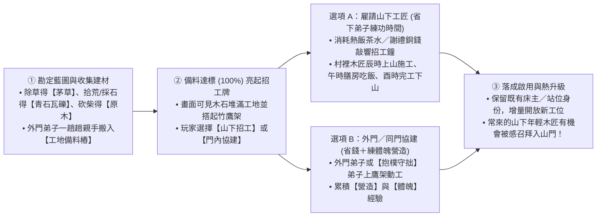
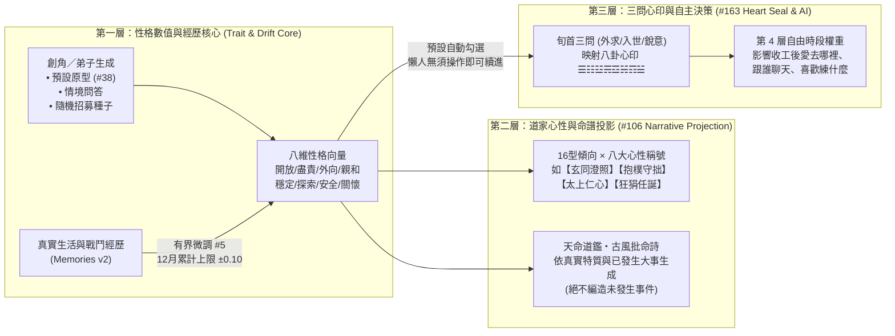
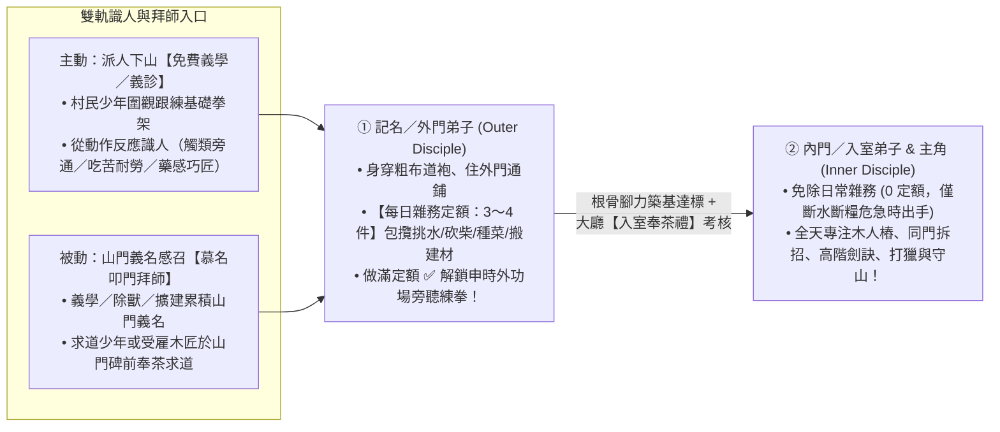
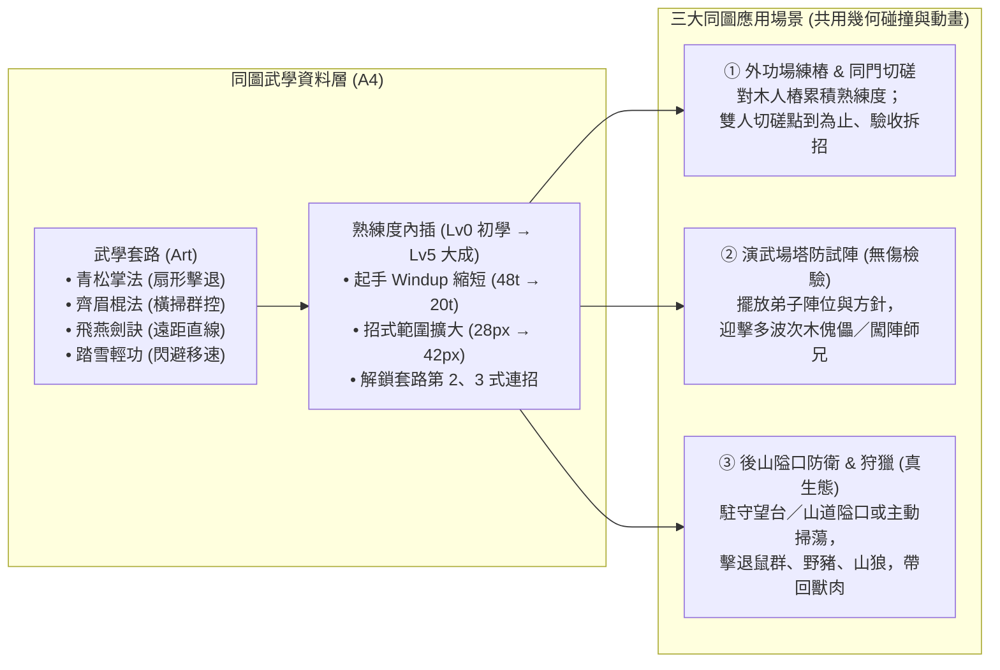
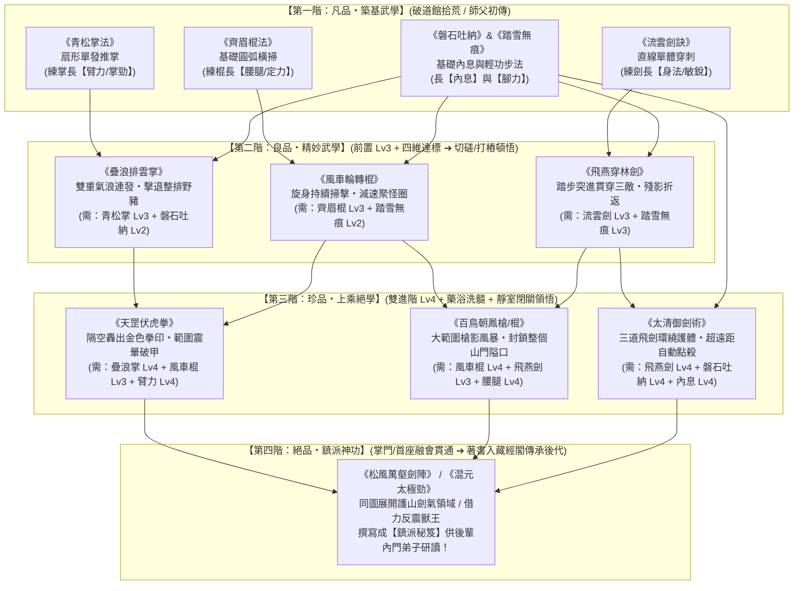
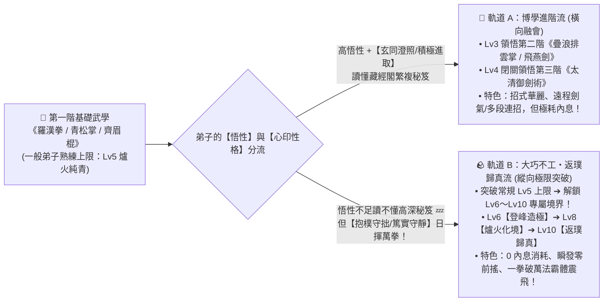
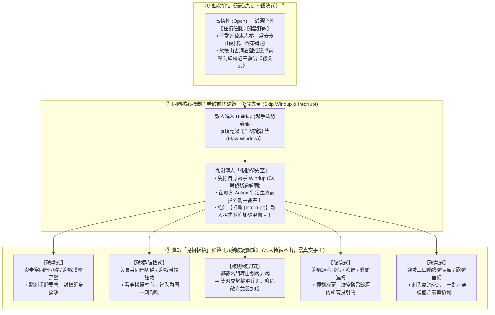
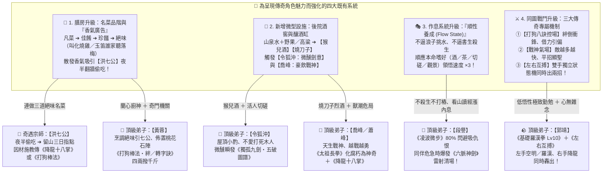
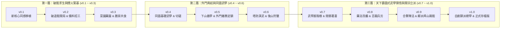

# 破道館到小門派：門派生活、同圖武學與塔防演武重新架構總藍圖

> **狀態**：架構與系統設計藍圖（基於最新 `dev` `148cfbbb27e43475c66744d53c2451125a9111a0` 資產與歷史 Issue 盤點）
> **分支**：`plan/sect-life-architecture-redesign`
> **核心願景**：融合《天下霸圖》的門派作息與擴建成就感、《模擬市民》的技能成長與人際成家溫度，以及「同圖即時武學 × 塔防式演武打獵」的實戰檢驗閉環。

---

## 一、 設計哲學：五大體驗支柱與「保留 vs 重建」

經過 M1–M2 世界模擬與 `sect-chronicle` LP01–HOME02／SOCIAL01 的迭代，我們已經非常清楚這部作品真正迷人的靈魂是什麼，以及現有原型（`experiments/water-carry/demo/`）為什麼需要一次骨架升級：

### 1.1 五大核心體驗支柱（對齊 [NORTH_STAR.md](NORTH_STAR.md) 與 [#314](https://github.com/lalagrass/earth-ascension/issues/314)）

| 支柱 | 玩家在畫面上看到什麼 | 核心樂趣來源 | 刻意不做的事 |
|---|---|---|---|
| **P1 天下霸圖式門派生活** | 弟子們在同一個山門地圖裡晨鐘暮鼓、跑來跑去，挑水、種菜、煎茶、練樁、學新武學 | 看著一個個鮮活的小人按門派作息與各自性格把山門運轉起來 | 變成只看數字報表的純文字經營，或事事都要玩家微操點擊 |
| **P2 同圖即時武學** | 不切換戰鬥場景；在外功場打木人樁、在院中同門切磋、在後山擊退野獸，全在同一張地圖直接出招 | 肉眼看得出「初學 vs 練熟」的起手快慢、掌風／劍氣範圍、步法殘影與第二式連招 | 另開回合制棋盤、滿螢幕飄 DPS 爆擊數字 |
| **P3 模擬市民式生活與成家** | 弟子做什麼長什麼技能；收工後在石凳／餐敘棚聊天、互助，關係從同門、知己走到結為道侶／家人並搬進同房 | 關係變化有真實事件記憶支撐（一起躲雨、代挑一擔水、並肩守山），而非盲刷好感條 | 無因果的送禮刷分、每 tick 呼叫 LLM 編造無中生有的台詞 |
| **P4 塔防感武學演練與狩獵** | 玩家在演武場或後山隘口擺放「陣位（守點）」與「應戰方針」，看弟子用練熟的武學自主攔截機關波次或後山獸群 | 實地驗收「這一個月練的掌法、棍法、輕功到底有沒有用」，打完帶回獸肉與一張因果清晰的戰報 | 無限刷怪割草、要求玩家手動操作每一次出招與走位 |
| **P5 從破道館一磚一瓦擴建** | 時間退回門派成立前：開局只有漏雨的破大廳、雜草院子與一口露天井；慢慢修起宿舍、膳房、菜園、藥園、外功場與後山望台 | 每個區域都由弟子真搬木石、搭鷹架施工建成；每蓋好一處，門派就多一類生活與武學活動 | 開局就是建好的大門派、點一下瞬間生出建築 |

### 1.2 現況診斷：為什麼要「保留手感與水彩資產，換掉底層骨架」？

在現有 [model.mjs](../../experiments/water-carry/demo/model.mjs)（約 1,740 行閉包）與 [routes.mjs](../../experiments/water-carry/demo/routes.mjs) 中，我們已經成功驗證了這套遊戲最寶貴的手感：
- **已驗證並 100% 保留的資產**：
  1. **長通勤與負重／腳力速度差**（[D26–D27](../DECISIONS_AND_SOURCES.md)：空手 60→84/s、負重 40→64/s，「成長即速度」肉眼可見）。
  2. **同圖武學節奏**（[palm.mjs](../../experiments/water-carry/demo/palm.mjs)、[#305 TRAIN01](https://github.com/lalagrass/earth-ascension/issues/305)：起手 Windup 48→24 tick、收勢 Recover 36→18 tick、掌距與逐隻換目標）。
  3. **有目的的生態個體與返程餘裕**（[patrol.mjs](../../experiments/water-carry/demo/patrol.mjs)、[#290 PATROL01](https://github.com/lalagrass/earth-ascension/issues/290)：野豬與林鼠有棲地、有威脅值、會逃離；巡山會算返程精力餘裕並產出真戰報）。
  4. **水彩山居母版與分階段美術資產**（[#323 SCENE-04](../../experiments/water-carry/design/scene04-masterplan/README.md) 的 S0 破道館 → S1 可居住 → S2 成熟門派三階段同母版水彩圖、`art184-watercolor`、`home01`、`home02`、`scene03` 與 `template/animator.mjs` 角色動畫烘培管線）。

- **必須重構的結構瓶頸**：
  1. **兩人寫死（`PEOPLE = [hero, cousin]`）**：反應傾向 `AUTO_REACT`、座位 `SEATS.hero`、休閒 `FUN.cousin`、練樁 `TRAIN_POSTS.hero` 全部按 ID 寫死，無法擴展到 6–12 名常住弟子與訪客。
  2. **活動狀態機碎片化**：每加一個玩法（飲水、泡茶、砍柴、修房、清鼠、招呼）就要在 `model.mjs` 手寫一組 `toXxx / xxx / fromXxx` 與專屬 `want / accept / suppress / cancel` 分支，N 個弟子 × 7 大區域 × 多門武學會讓分支組合爆炸。
  3. **單一端點手畫折線（`(962, 512)`）**：所有路線強行從院中水缸旁同一點出發以防瞬移；一旦弟子要從「宿舍」直接去「膳房」吃飯再去「外功場」練樁，手畫折線便無法支撐。

---

## 二、 核心系統重構架構（New Simulation Core Architecture）

我們建議在 `sect-chronicle/life/core/` 另起一套**資料驅動、確定性 60Hz Tick** 的模擬核心（S0 階段先將現有挑水、採藥、泡茶、砍柴修寢舍、練掌同感移植，驗收通過後凍結舊 `demo/` 作為對照組）。

```mermaid
flowchart TB
    subgraph DataLayer["1. 靜態規則與內容資料表 (Declarative Registries)"]
        ZoneReg["區域與建築階段表\n(Zones & Facility Stages S0→S2)"]
        SmartObjReg["設施活動廣告表\n(Smart Object Advertisements)"]
        MartialReg["武學與招式資料表\n(Arts, Moves, HitShapes)"]
        PersonaReg["性格、八卦心印與判詞庫\n(8D Profile + Bagua + Poems)"]
    end

    subgraph WorldState["2. 權威世界狀態 (Single Deterministic State @ 60Hz)"]
        Clock["時辰與門派作息鐘\n(Time, Shichen, Sect Schedule)"]
        MapGrid["三層空間地圖\n(Zone + NavGraph/A* + Stations)"]
        ResBroker["通用預約與庫存守恆器\n(Reservation & Inventory Broker)"]
        Disciples["弟子與訪客實體池\n(N Disciples: Needs/Skills/Persona/Intent)"]
        Ecology["後山棲地與演武波次器\n(Habitats, Beasts, Drill Waves)"]
        SocialLedger["因果記憶與關係帳本\n(Memories, Bonds, Households)"]
    end

    subgraph TickPipeline["3. 每 Tick 固定結算管線 (Deterministic System Order)"]
        S1["① 時辰推進與棲地/波次生成"] --> S2["② 感知與威脅掃描 (Perception)"]
        S2 --> S3["③ 四層決策仲裁器 (4-Tier Decision Arbiter)"]
        S3 --> S4["④ 預約鎖定與路網尋路 (Reservation & Pathing)"]
        S4 --> S5["⑤ 移動與負重/輕功步進 (Locomotion)"]
        S5 --> S6["⑥ 設施活動與同圖招式判定 (Activity & Combat)"]
        S6 --> S7["⑦ 成長、記憶與戰報入帳 (Progression & Ledger)"]
    end

    subgraph ViewLayer["4. 2.5D 水彩渲染與互動層 (PixiJS + HTML Inspector)"]
        SceneView["SCENE-04 分階段水彩底圖 + Y-Sort 遮擋"]
        CharAnim["Template 角色動作幀 + 招式地圖特效 (掌風/劍氣)"]
        UIInspector["可解釋面板 (現在/原因/下一步 + 命譜心印 + 戰報)"]
    end

    DataLayer --> TickPipeline
    WorldState <--> TickPipeline
    WorldState -->|純函式唯讀投影 view()| ViewLayer
    ViewLayer -->|玩家指令 Command| S3
```

---

### 2.1 模擬核心 A1：設施宣告活動（Smart Objects）與通用預約守恆器

借鏡《模擬市民》原始設計的 **Object Advertisement（物件廣告）** 與 [#315 (A1)](https://github.com/lalagrass/earth-ascension/issues/315)：**「能做什麼」定義在設施（Facility）上，而不是寫死在人身上。**

#### (1) 設施與活動宣告結構
每個設施依其當前建設階段（`wild` 荒廢、`ruin` 破損、`repair` 施工中、`built` Lv1、`expanded` Lv2）暴露可用的互動站位（Stations）與活動（Activities）：

```javascript
// 設施與活動資料化示意（純資料，無閉包耦合）
export const FACILITIES = {
  'fac.yard': {
    name: '外功演練場',
    zone: 'outerYard',
    stages: {
      S0: { state: 'wild', stations: [], activities: ['clearWeeds'] },
      S1: { state: 'basic', stations: ['post1', 'post2'], activities: ['drillMove', 'spar'] },
      S2: { state: 'built', stations: ['post1', 'post2', 'post3', 'post4', 'rack', 'defSlot1', 'defSlot2'], activities: ['drillMove', 'spar', 'martialWaveDrill'] }
    }
  },
  'fac.kitchen': {
    name: '膳房',
    zone: 'westYard',
    stages: {
      S0: { state: 'basic', stations: ['vat', 'teaStove'], activities: ['fetchWater', 'brewTea', 'sipTea'] },
      S1: { state: 'built', stations: ['vat', 'teaStove', 'stove1'], activities: ['fetchWater', 'brewTea', 'sipTea', 'cookMeal'] }
    }
  }
};
```

#### (2) 統一的四段式活動生命週期（Universal Activity Lifecycle）
所有日常工作、修繕、練功、泡茶、聊天都走同一個狀態機，徹底消滅手寫 `toXxx / xxx / fromXxx` 的同步 bug：
1. **`approach`（前往站位／採集點）**：出發時向 `ReservationBroker` 原子預約「目標站位 + 所需原料／存放空間」，並按當前「空手／負重 × 腳力／輕功等級」鎖定移動速度。
2. **`work / active`（站位執行）**：抵達站位後面向目標，播放對應動作（`chop`、`cook`、`palmDrill`、`chat`），按秒扣除／恢復精力並累積進度。
3. **`deliver / commit`（交付與成長）**：若是搬運類（挑水、採藥、砍柴、獵肉），沿回程路徑負重走回存放站位，**到位瞬間原子完成：釋放預約、實存 +1、對應技能經驗 +1**。
4. **`interrupt / cancel`（統一中斷守恆規則）**：
   - 沿用 LP04–HOME02 驗證過的黃金律：**「最新玩家指令優先；已拿到手上的在途貨物（in-flight）支援合法交付或安全退回工地／倉庫；取消去程時從當前真實座標折返，絕不瞬移。」**

---

### 2.2 地圖、七大門派區域與尋路 A2：從破道館長成完整山門

直接對接 `dev` 分支已完成的 [SCENE-04 母版配置 (`plan.json`)](../../experiments/water-carry/design/scene04-masterplan/source/plan.json) 與 [#316 (A2)](https://github.com/lalagrass/earth-ascension/issues/316)、[#321 (A7)](https://github.com/lalagrass/earth-ascension/issues/321)，將你期望的七大區域放進**同一張連續水彩大地圖**：

#### (1) 七大核心區域與三階段演進表（從破道館 S0 到成熟門派 S2）

| 區域 | 對應 `SCENE-04` 設施 ID | **S0：破道館開局（荒蕪求生）** | **S1：道館初立（溫飽與外功）** | **S2：門派成形（百藝、成家與塔防演武）** |
|---|---|---|---|---|
| **① 大廳區** | `fac.hall`、`fac.quiet` | **破頂正堂**：屋頂漏雨、師徒打地鋪暫住；首個任務是砍柴修補屋頂 | **修葺正堂**：可晨鐘早課、師父傳授基礎武學、接待山下訪客 | **三清正殿＋後院靜室**：藏經研讀、每旬「三問心印」立志、門派議事 |
| **② 練外功區** | `fac.yard` | **雜草前坪**：僅有一塊泥地可空手練架子，需先除草整地 | **夯土演練場**：立起 2 座木人樁（`post1/2`），可練掌法與雙人切磋 | **青石演武坪**：4 樁＋兵器架（棍／劍）＋**演武陣位（可開機關／傀儡波次演練）** |
| **③ 宿舍區** | `fac.dorm.a`、`fac.dorm.b` | **殘垣側屋**：屋頂坍塌（`dorm_broken.png`），無法入住 | **小寢舍甲（2 床）**：修好後認領專屬床位（`bed-A/B`），夜間安睡加速回精 | **東西廂房（8–12 床）＋道侶雙人房**：支援新弟子入住，親密達標可結契同住一室 |
| **④ 膳房與水系** | `fac.kitchen`、`fac.dining`、`fac.store`、`wat.*` | **露天井＋青石水缸＋小茶爐**：從潭南石階挑水入缸、煎藥茶解乏 | **膳房大陶灶＋柴房**：燒柴煮菜飯，滿足弟子「飽足」需求 | **膳房＋八仙桌餐敘棚**：午晚膳同門圍桌共食、閒聊增進感情，可燉獵肉大補湯 |
| **⑤ 藥園與藥房** | `fac.garden` (北)、`fac.herbstore`、`rt.farherb` | **荒廢舊藥畦**：僅能去西南溪橋外的遠藥坡採野生草藥 | **開墾藥圃＋晾藥架**：院內種植基礎靈草、晾乾備用 | **百草園＋煉藥房**：培育高階藥材，熬製金創藥、清心茶與破障湯 |
| **⑥ 菜園** | `fac.garden` (南) | **碎石坡地**：尚未開墾，滿地野草與山鼠嗅探 | **四季菜畦**：播種、引水灌溉、收割青菜送入膳房（種→收→煮→吃閉環） | **靈泉梯田**：由專職或偏好農藝的弟子照料，穩定供應全派十餘人口糧 |
| **⑦ 後山打獵與山門** | `fac.gate`、`fac.tower`、`risk.backwood` | **無門山徑**：西坡與北徑常有野豬拱欄、山鼠偷藥 | **木樁山門＋巡山小徑**：可派弟子沿西坡／北徑巡山驅獸 | **山門樓＋後山望台＋獵場隘口**：設守點陣位，進行**後山狩獵（產出獸肉／毛皮）與獸潮塔防** |

#### (2) 路網與尋路設計：Waypoint 走廊 ＋ 局部 A*（兼顧任意移動與長通勤美感）
- **為什麼不用純自由網格 A* 取代一切？** 因為現有挑水路（1700.9 單位，經過竹林坡、溪橋、潭南石階）與遠採藥路是精心設計的水彩觀賞動線。
- **混合尋路方案（Hybrid Corridor + Portal Graph）**：
  - **院外長路（Scenic Corridors）**：保留 `SCENE-04` `plan.json` 的 `water`、`farherb`、`patrol`、`village` 折線作為低成本主幹道。
  - **院內與跨區（Portal Graph + 16px Local Grid A*）**：院落開口（`gap.south` 院南口、`gap.gate` 山門、`gap.fence_w` 西院廊、`gap.shed` 餐敘棚通道）與各建築門口（`door`）連成導航圖（NavGraph）。弟子從「宿舍甲 bed-1」走到「膳房 stove」再走到「外功場 post2」，由導航圖算出最短路徑並平滑插值；途中若被玩家改派，直接從**當前真實 `(x, y)`** 尋路前往新目標，徹底告別「必須先走回 (962, 512) 院中端點」的限制！
  - **輕功捷徑（Qinggong Shortcuts）**：地圖上標註特殊地形邊（如 `step_stones` 踏石渡溪、`rock_ledge` 岩壁躍點、矮牆翻越點），只有 `輕功 ≥ Lv3` 的弟子在尋路時可將該邊視為連通，直接飛身躍過，在畫面上展現武林高手的瀟灑動線！

#### (3) 擴建與建設閉環：收集建材備料 ➔ 山下招工／同門協建（Blueprint Staging & Hiring Artisans）
借鏡開源殖民地／城建專案 **[Widelands](https://github.com/widelands/widelands)**（`GPL-2.0` 的 `ConstructionSite` 備料佇列）、**[Stonehearth](https://github.com/stonehearth/stonehearth)**（`MIT/Apache-2.0` 的搬運工與木匠分離）與 **《Clanfolk》客匠短工機制**，將「破道館一步步擴建成大門派」做成極具踏實感的**三階段建造系統**：



1. **第一階段：日常勞動自然產出三大建材，親手搬入「工地備料樁（Staging Pile）」**
   - 玩家點選破敗建築（如 `S0 破頂正堂`、`坍塌寢舍`）或新區域藍圖（如 `外功演練場`、`膳房大陶灶`、`後山望台`），地圖上會出現**工地備料樁**與清楚的建材進度條（例如：`原木 0/6`、`青石瓦礫 0/4`、`茅草 0/4`）。
   - **開局拾荒與日常收集無縫結合**：
     - **清理廢墟瓦礫** ➔ 直接產出首批【青石／舊瓦】；
     - **除草開荒** ➔ 直接產出鋪屋頂的【茅草／竹材】；
     - **後山砍柴／伐木** ➔ 產出【原木】。
   - 負責雜務的弟子會一趟趟把木料與石材親手抱到工地旁堆疊，畫面上能看到工地從「空地」變成「木石成堆、搭起竹鷹架」。
2. **第二階段：建材備齊（100%）➔ 解鎖【山下招工開建】與【同門協建】雙模式**
   - 當工地備料滿額後，不再只是乾等主角自己敲木頭，而是提供極具策略與生活感的兩種施工方式（可同時並用）：
     - **【雇請山下工匠／短工】（推薦：解放主角與核心弟子去練功！）**：花費膳房做好的熱飯菜、靈茶或山下義診攢下的謝禮銅錢，在山門掛出**「招工牌」**。隔日辰時，1～2 名山下木匠或泥水匠就會背著工具袋走上山門，在鷹架上叮叮噹噹蓋房子，午時還會去你的餐敘棚吃頓熱飯、跟弟子聊山下八卦，傍晚完工領錢下山！
     - **【門內弟子協建】**：由外門弟子或性格偏 `☷ 坤為地【抱樸守拙】` 的弟子上鷹架施工，省下招工費並實打實提升「營造」與「體魄」技能。
     - **匠人奇遇**：多次受雇上山蓋房的年輕木匠，若每次來都有熱茶好飯、又常在午休時羨慕地看著外功場練拳，好感達標後會主動詢問：「掌門，這演武場是我親手蓋的，能不能容我也留在山上當個外門弟子？」

---

### 2.3 人物性格生成系統、命譜判詞與「三問心印」A3（整合 #5、#38、#106、#163）

你在歷史 Issue 中留下最有趣的設計之一，就是把 `earth_ascension` M2 的 **8 維性格與經歷漂移（[#5](https://github.com/lalagrass/earth-ascension/issues/5)、[#38](https://github.com/lalagrass/earth-ascension/issues/38)）**，與 **16 型人格／道家八卦心性／古風批命判詞（[#106](https://github.com/lalagrass/earth-ascension/issues/106)）** 以及 **每旬三問心印（[#163](https://github.com/lalagrass/earth-ascension/issues/163)）** 結合起來。

我們將它設計為**職責分明的三層架構**，既好玩、有記憶點，又遵守「不綁死行為、不強迫彈窗打擾」的原則：



#### (1) 第一層：弟子性格生成與「經歷塑造性格」（Inherited from `earth_ascension/m2.py`）
- **生成方式**：
  - **主角創角**：提供像 [#38](https://github.com/lalagrass/earth-ascension/issues/38) 一樣的「一鍵人物原型（如：格物書生、守拙匠人、任俠少年、仁心醫徒）」或 3～6 道直覺情境題，生成基礎八維向量 `profile_base` 與 2～3 個顯性性格標籤（Traits）。
  - **弟子／村民生成**：每個 NPC 入場時由世界 Seed 決定其先天八維性格、身世背景（如：過勞工程師、村醫之女、好武少年）與「人生追求（Aspiration）」。
- **經歷微調（Bounded Personality Drift，沿用 #5）**：
  - 性格不是死板的常數！當弟子經歷重大事件（例如：第一次獨力擊退野豬、在後山受傷被師兄背回、連續十天修繕屋頂完工），會寫入 `profile_changes` 並附帶事件來源 ID，讓性格隨歲月微幅成長（受滑動視窗上限保護，不會突然性格崩壞）。

#### (2) 第二層：現代 16 型 × 道家心性稱號 × 古風判詞（#106）
- 在人物面板的【命譜心印】分頁，將八維性格投影為玩家一眼有感的雙重標籤与四句古風判詞：
  - **【玄同澄照】（分析／格物型）**：偏好研究藏經、改良爐灶水路；自由時間愛去靜室看書或觀察泉眼。
  - **【抱樸守拙】（守護／勤勉型）**：看不得水缸見底或屋頂漏雨；自由時間常順手整理護欄、劈柴備料。
  - **【太上仁心】（關懷／外交型）**：偏好照看藥園、泡茶待客；同門精力低時會主動關心鼓勵（如 [#337](https://github.com/lalagrass/earth-ascension/issues/337) 小女孩的溫柔陪伴）。
  - **【狂狷任誕】（挑戰／豪邁型）**：熱愛打木人樁、找同門切磋、主動請纓去後山巡獵；收工後愛爬上望台看山。

#### (3) 第三層：三問心印（#163 旬首立志 —— 預設按性格自動預選，不卡遊戲節奏！）
- 每旬（10 遊戲日）或玩家隨時點開大廳香案，有三道處世之問（已修正 [#163](https://github.com/lalagrass/earth-ascension/issues/163) 的爻位順序：`bit0 初爻＝外求/內省`、`bit1 中爻＝入世/獨善`、`bit2 上爻＝銳意/順應`）：
  - `111 乾為天【積極進取】`（偏外功與巡獵）、`000 坤為地【抱樸守拙】`（偏營造與農事）、`001 震為雷【雷厲風行】`、`110 巽為風【閒雲野鶴】`（偏看山飲茶悟道）、`101 離為火【紅塵歷練】`（偏接待訪客與社交）、`010 坎為水【險中求道】`、`100 艮為山【深居簡出】`、`011 兌為澤【春風化雨】`（偏指點同門與共食）。
- **關鍵 UX 守則（落實擁有人於 #163 的指示）**：
  - 系統會直接根據角色的「當前性格」**預先勾好三問答案**。
  - 到了旬首，只在大廳與頂部顯示一行溫和的卦象橫幅（如：`當旬心印：☴ 巽為風【閒雲野鶴】`），**完全不彈出強制對話框、不暫停世界**；想改方針的玩家隨時點開改，想放著看小人過日子的玩家零操作就能順暢推進！

---

### 2.4 弟子決策分層、技能成長與模擬市民式人際成家（A3 & A5）

#### (1) 四層決策仲裁器（4-Tier Decision Arbiter，延續 #313 可讀性）
每個弟子在任意時刻的行為都由高到低經四層仲裁，且面板清楚顯示**「現在在做什麼 ／ 為什麼（哪一層觸發） ／ 下一步打算」**：

| 優先層級 | 觸發條件 | 行為範例 | 面板可讀解釋範例 |
|---|---|---|---|
| **Tier 1：玩家明確指令** | 玩家手動指派工作、調度守點、邀約聊天 | 「去修繕膳房」「去演練場練《青松掌》」「跟阿秀聊天」 | `正在：修繕膳房｜原因：掌門親自指派｜下一步：完工後回院` |
| **Tier 2：必要生理自理** | 精力 ≤ 30、飽足 ≤ 25、或深夜亥時就寢 | 回自己認領的床位睡覺、去茶爐喝藥茶、去膳房盛飯吃 | `正在：回宿舍甲 bed-1 歇息｜原因：精力降至 28/100｜下一步：恢復至 80 後續接採藥` |
| **Tier 3：門派作息與職責** | 依門派時辰表（卯時早課、辰～午職責、午膳、未～申練武） | 樵夫去砍柴補庫、廚子在午時前生火做飯、弟子集合外功場練樁 | `正在：外功場打木人樁｜原因：未時門派武課｜下一步：酉時自由活動` |
| **Tier 4：性格與心印自主休閒** | 職責配額已滿（如水缸已達標）或酉時自由時段 | 【閒雲野鶴】去觀景石看山、【太上仁心】找同門泡茶聊天、半途偶遇熟人寒暄兩句 | `正在：與小師妹在石凳閒聊｜原因：自由時段・心印【春風化雨】｜下一步：戌時散步` |

#### (2) 「做什麼長什麼」可見技能系統（Skill Progression）
不搞抽象的綜合戰力值，每一項技能都直接反映在**動畫速度、移動動線或產出品質**上：
- **身法體魄類**：
  - `腳力 (Leg Strength)`：挑水、搬木、遠途採集提升 ➔ 空手與負重移動速度顯著變快（Lv1 40/s → Lv5 64/s）。
  - `輕功 (Qinggong)`：走梅花樁、山徑巡邏提升 ➔ 解鎖踏石渡溪、翻越矮牆與險坡捷徑，戰鬥中閃避位移更快。
  - `體魄 (Physique)`：砍柴、營造、外功抗打提升 ➔ 精力上限與負重單趟攜帶量提升（如一趟挑兩擔水）。
- **百藝生活類**：
  - `農藝 / 藥理`：種菜、採藥提升 ➔ 作物生長照料更快、採集時認出伴生珍稀靈草。
  - `庖廚 / 茶道`：煮飯、煎茶提升 ➔ 做出的飯菜與靈茶提供更長效的飽足與回精速率。
  - `營造`：修屋、築牆提升 ➔ 工地施工讀條加快、消耗木石更省。

#### (3) 從閒聊、互助到「結契成家」的人際關係網（#188、#319、#337、NPC 招募草案）
- **關係不是憑空跳數字，而是「共同記憶帳本（Shared Memory Ledger）」**：
  - 兩人只有在**空間上真實走近、面向彼此、雙方皆有空檔**時才會觸發互動（沿用 `#300 LIFE02` 與 `#337 SOCIAL01` 的 2s 發話 + 2s 回應氣泡機制，加 30 秒同對冷卻防刷）。
  - **記憶事件來源**：`共飲一壺靈茶`、`同桌吃午飯`、`精力見底時代挑一擔水（互助）`、`外功場點到為止切磋`、`後山巡獵並肩擊退野豬`、`受挫時溫柔鼓勵`。
- **兩條關係成長軌道（嚴格區分親情與道侶）**：
  1. **成年同門／訪客軌道**：`萍水相逢 (0) ➔ 同門相識 (1) ➔ 莫逆知己 (3，需共同經歷一次互助或並肩作戰) ➔ 結契道侶 / 成家 (5，雙向性格契合且皆成年)`。
  2. **師徒／長幼親情軌道（如 #337 道館收養的小女孩）**：`收養照料 ➔ 平日相伴 ➔ 親如家人（兄妹／師徒溫馨羈絆）`，永遠走純粹的家庭親情與守護路線。
- **「拉進一個家庭」的具體生活表現**：
  - **山下村民點化入門（#152 / `NPC_LIFE_RECRUITMENT_DRAFT`）**：住在山腳的堂親或訪客（如竹科休養工程師、村醫之女）平時會沿東南村路（`rt.village`）來訪求茶或看診；當相處記憶足夠且門派建好空床位時，可邀請他們正式加入門派大家庭（保留其原本世俗練就的醫術／工匠技能！）。
  - **結為道侶／同住一房**：兩位成年弟子結為道侶（或親人同住）後，可分配至擴建後的**雙人廂房**，夜晚回同一間房歇息，日常自由時段有更高機率結伴散步、同桌吃飯，在後山演武時若伴侶受襲會優先觸發「護衛伴侶」反應！

#### (4) 新弟子雙軌發掘（下山義學識人＋慕名登門拜師）與「外門雜務定額 ➔ 解放內門專注武學」制度
借鏡 **《Dwarf Fortress》公會堂公開講學（Guildhall Demonstrations）**、**《了不起的修仙模擬器》外門／內門二元分工** 與 **《Oxygen Not Included》職責優先序矩陣**，解決門派經營遊戲常見的兩大痛點：「招人像抽卡沒故事」以及「中後期人多了，主角還整天被挑水砍柴打斷練功」：



1. **雙軌發掘新弟子：不搞抽卡，在生活與講武中「望氣識人」**
   - **軌道 A（主動下山）：派人下山「免費義學講武／義診施茶」**
     - 當主角或資深弟子將基礎武學（如《青松掌法》）練至熟練（Lv3+）或具備藥理技能，可派遣他沿村路（`rt.village`）下山（或在山門外坪涼亭）舉辦半日的**【免費義學／義診】**。
     - **視覺化識人（Observation-Based Talent Discovery）**：3～4 名山腳村民、樵夫少年、落魄書生或流民孩童會圍過來跟著比劃拳架。玩家**不必死盯冰冷的數值表**，直接看他們跟練時的現場表現就能發掘良才：
       - **✨ 武道悟性奇才**：跟著比劃兩下就步伐沉穩、頭頂浮現微弱靈光（`💡 觸類旁通`），下課後還追著請教發力訣竅；
       - **🪨 勤勉外門棟樑**：雖然拳架生澀、汗如雨下，但別人都歇息了仍在咬牙蹲馬步，散場後主動幫你把茶桶挑回山門（`💪 吃苦耐勞`）；
       - **🌿 百藝專長苗子**：對打拳心不在焉，卻蹲在藥簍旁細聞每株草藥（`🌱 天生藥感`），或盯著涼亭榫卯結構比劃（`🔨 巧匠苗子`）。
     - 經數次義學相識後，即可對看中的潛力人物發出**【准入山門・授外門道袍】**邀請！
   - **軌道 B（被動感召）：山門聲望與「慕名登門拜師」**
     - 隨著下山義學、替村莊驅趕野豬、或山門建築擴建（S0 ➔ S1 ➔ S2），門派累積**「山間義名（Sect Reputation）」**。
     - 每隔數日清晨，山門石階（`fac.gate`）會出現慕名而來的求道者（或曾受雇上山蓋房、被門派風氣感動的年輕木匠）。師父或主角可前往山門**「奉茶問心」**，查看其性格卦象與人生追求，決定收為外門弟子或贈茶結緣。

2. **外門弟子「每日雜務定額（Daily Chore Quota）」➔ 徹底解放主角與內門專注武學**
   - **為什麼需要外門／內門分層？**
     開局破道館（S0）只有師徒時，主角親手挑水、砍柴、修屋頂很有荒野求生的代入感；但當門派走上正軌，玩家最渴望的是**「讓新收的外門師弟們把挑水、砍柴、種菜、搬建材包下來，讓主角與核心弟子能心無旁騖地閉關練劍、切磋拆招、去後山打獵！」**
   - **四階門派身分與工時制度表**：

| 門派身分階梯 | 服飾與床位配置 | 每日雜務定額 (`ChoreQuota`) | 系統派工優先序（`ReservationBroker`） | 成長與晉升閉環 |
|---|---|---|---|---|
| **① 山下短工／客匠**<br>*(Hired Artisan)* | 短打布衣<br>（辰時上山、酉時返村） | **專職施工／搬建材**<br>（領取熱飯茶水或銅錢） | 僅接取已備齊建材的工地施工單；午時於餐敘棚共食 | 協助快速擴建山門；部分年輕匠人好感滿額後可請求拜入外門 |
| **② 記名／外門弟子**<br>*(Outer Disciple)* | 灰青粗布道袍<br>（住外門大通鋪） | **每日必滿 `3～4 件` 雜務**<br>（挑水、砍柴、種菜、採藥、搬建材、炊事） | **雜務第一順位（Priority 1）**：只要今日定額未滿或庫存 `< 80%`，優先包攬全山門日常雜務 | **先勞其筋骨，後授其武道**：在挑水砍柴中把「腳力、體魄、百藝」練紮實；當日做滿 `3/3` 雜務後，頭頂跳出 `✅ 今日雜務已畢`，**解鎖申時～酉時去外功場旁聽練拳！** |
| **③ 內門／入室弟子**<br>*(Inner Disciple & 主角)* | 雲紋青衫道袍<br>（住雙人雅室／獨立廂房） | **免除日常雜務（`0 定額`）**<br>（僅在水糧 `< 15%` 危急時才補位） | **武學與歷練第一順位**：預設略過所有日常搬運／挑水／農事，專注外功場打樁、雙人切磋、藏經研讀、後山狩獵與守山 | 外門弟子將「腳力／體魄」與基礎武學練至 Lv2，並累積足夠門派貢獻後，可於大廳舉行**【入室奉茶禮】**正式晉升內門！ |
| **④ 親傳／代師首座**<br>*(Senior Instructor)* | 玄青鶴氅道袍<br>（正殿側室／靜室） | **免除日常雜務（`0 定額`）** | 可指派執行**「帶隊下山義學」**、**「外功場代師授課」**與**「後山狩獵領隊」** | 將武學練至 Lv4+ 的大師兄／二師姐，替師父指點外門師弟並下山發掘新血，形成完美的宗門傳承自走循環 |

---

### 2.5 同圖武學系統與「塔防式」演武／後山打獵（A4 & A6）

這是將「門派養成」與「戰鬥爽感」無縫縫合的核心創新：**沒有獨立的戰鬥引擎，練樁、切磋、演武場塔防、後山打獵全部共用同一套同圖招式與站位系統。**



#### (1) 同圖武學：招式資料化與肉眼可見的熟練度差距（#318 A4）
每門武學包含 2～3 式招式（Moves），每式定義明確的**三段時間軸（`windup 起手 → active 出招判定 → recover 收勢`）**與**幾何命中形狀（`shape`）**：

| 武學套路 | 招式範例 | 幾何判定形狀 (權威座標) | 初學 (Novice) 表現 | 練熟／大成 (Adept/Master) 表現 | 塔防／狩獵定位 |
|---|---|---|---|---|---|
| **《青松掌法》** | 第一式：推山掌<br>第二式：疊浪掌 | **扇形 (Cone)**<br>半徑 28→38，夾角 50°→75° | 起手慢（0.8s）、掌風短，一次只能拍退一隻近身野鼠 | 起手快（0.4s）、掌風帶青色氣浪，可同時震退扇形內 2–3 隻野獸並銜接第二式 | **近戰守點／護衛**：守在隘口正面擊退衝鋒野豬 |
| **《齊眉棍法》** | 第一式：橫掃千軍<br>第二式：立劈華山 | **圓弧／周身 (Circle/Arc)**<br>半徑 36→48，夾角 140° | 揮棍沉重、收勢破綻長 | 棍影連綿，大範圍橫掃減速並擊倒成群山鼠／木傀儡 | **群控清場（AOE Tower）**：放在轉角或雙路交匯處清理群怪 |
| **《流雲劍訣》** | 第一式：穿雲刺<br>第二式：劍氣縱橫 | **直線長距 (Line/Ray)**<br>長 55→85，寬 16 | 僅能刺擊前方單一目標 | 劍尖吐出尺許劍氣，隔空貫穿直線上的敵人 | **遠程狙擊／後排輸出**：站在望台或前排師兄身後安全輸出 |
| **《踏雪無痕》** | 身法：掠影步 | **位移／閃避 (Dash)** | 僅小幅提升平日走路速度 | 敵人撲擊前搖時自動側滑閃避，平日可直接跳過溪石捷徑 | **游擊／巡山斥候**：高速拉怪、支援漏網之魚 |

- **學會 ≠ 練熟**：師父在大廳傳授或讀藏經閣秘笈只是「學會（Lv0）」；必須在外功場打木人樁、與同門切磋、或實戰出招，才能把熟練度練上去，讓玩家在畫面上親眼看到弟子從「笨拙慢拍」變成「行雲流水」。

#### (2) 致敬《天下霸圖》：四階武學進階樹、四維根基與「閉關領悟／著書傳承」系統
《天下霸圖》最讓人欲罷不能的核心魅力，就是**「基礎武功不只是過度技能，而是透過練基礎功累積五力（四維根基），當兩門前置武學與身體素質達標時，能融會貫通『領悟』出威力與視覺截然不同的高階武學，甚至成為本門鎮派絕學！」**

我們結合 **《天下霸圖》前置武學領悟樹**、開源 RPG **[Tales of Maj'Eyal (ToME4)](https://github.com/NetCoreGames/tome4)**（`GPLv3` 的 Talent Category Mastery 與跨系協同解鎖）以及 **[Cataclysm: DDA](https://github.com/CleverRaven/Cataclysm-DDA)**（秘笈研讀與實戰頓悟），設計出**「同圖可見的四階武學進階與領悟系統」**：



1. **為什麼基礎武學值得認真練？（《天下霸圖》式「四維根基」與前置跳板）**
   - 在我們的系統裡，挑水、砍柴與修習第一階基礎武學，會實打實淬鍊弟子的**四維武道根基**：**【臂力（掌棍威力與負重）】【腰腿（下盤穩固與抗擊退）】【身法（起手速度與閃避）】【內息（高階招式氣力池與劍氣射程）】**。
   - 想要領悟第二階的《疊浪排雲掌》，不能靠抽卡買書，必須先把《青松掌法》練到 Lv3、搭配基礎內功《磐石吐納》Lv2，且【臂力】達標！
2. **三種讓人充滿期待的「新武學領悟時刻（Epiphany Moments）」**：
   - **① 同門切磋頓悟（Sparring Breakthrough）**：當主角與師兄在外功場拆招切磋，若雙方前置武學與根基已滿，有機會在交手拆招瞬間頭頂綻放金光、跳出**「💡 靈光一閃！在拆招中融會《青松掌》與《吐納功》，領悟進階武學【疊浪排雲掌】！」**並當場使出新招！
   - **② 後院靜室「閉關鑽研」（Secluded Enlightenment，`fac.quiet`）**：擴建出後院靜室後，可讓滿足雙前置的內門弟子進入靜室閉關數日（由外門弟子送飯送茶），出關時正式領悟第三階上乘絕學！
   - **③ 著書立說・藏經閣薪火相傳（Scripture Authoring）**：這是結合《天下霸圖》自創門派最爽的一環——當主角或大師兄千辛萬苦自行領悟出《疊浪排雲掌》或《太清御劍術》後，可以去靜室案頭**「撰寫武學手札」**放入門派藏經架！從此以後，門派裡後進的師弟師妹只要根基達標，就能直接去藏經架研讀師兄留下的手札學會該武功，不用再從頭摸索！
3. **門派百藝如何支撐高階武學？（藥浴洗髓 × 百鍛兵刃）**
   - **高階武學的氣力消耗與「藥浴／靈茶」**：如同《天下霸圖》高階招式耗氣極大，第三階絕學需要深厚內息支撐；藥園種出的靈草可在煉藥房熬製**【培元藥浴】**與**【紫竹靈茶】**，幫資質普通但勤奮的弟子洗髓突破根基瓶頸！
   - **匠作兵刃搭配**：外功場與匠作坊可利用後山硬木與礦石打造**【熟銅齊眉棍】【青鋒長劍】【負重鐵護腕】**，讓高階兵刃武學發揮出 100% 的同圖劍氣與橫掃範圍。

#### (3) 雙軌武道：悟性不夠學不會高深劍訣？苦練基礎《羅漢拳／青松掌》直達「登峰造極・返璞歸真」！
武俠小說與經典遊戲裡最讓人熱血沸騰的橋段之一（如《天龍八部》喬峰以最基礎的《太祖長拳》力壓少林高僧、郭靖資質魯鈍卻把基礎掌法練到極致、或《金庸群俠傳》《活俠傳》裡把基礎《羅漢拳／野球拳》練到十級天下無敵），就是**「大巧不工、返璞歸真」**！

如果在門派經營裡，「低悟性」的弟子永遠只能當挑水工具人、後期打架完全沒戲份，那就太可惜了。因此我們借鏡開源 Roguelike **[Dungeon Crawl Stone Soup (DCSS)](https://github.com/crawl/crawl)**（`GPLv2` 中低魔法資質角色將基礎徒手格鬥 `Unarmed Combat` 從 Lv1 苦練至 Lv27 大宗師時，直接獲得基礎點傷線性累加與出招延遲減半 `1.0 ➔ 0.5` 的質變公式）與 **[Tales of Maj'Eyal (ToME4)](https://github.com/NetCoreGames/tome4)**（基礎天賦樹超額專精倍率），設計出**「博學進階 vs 抱樸守拙・返璞歸真」雙軌武道系統**：



1. **為什麼他學不會高深武功，卻能把基礎《羅漢拳》練到 Lv10？**
   - 當一名弟子先天**「悟性偏低」**（八維中 `open / explore` 較低，去藏經閣看《太清御劍術》秘笈頭頂會冒出 `💫 字太深奧看攏無...`），但他擁有極高的**「盡責與守拙（`conscientious` + `☷ 坤為地【抱樸守拙】` 或 `☶ 艮為山【篤實守靜】`）」**時：
   - 他不會分心去學五花八門的新套路，而是每天做完挑水砍柴後，雷打不動地站在同一個木人樁前，把師父最早教他的那套**第一階基礎《羅漢拳》（或《青松掌》《齊眉棍》）**反覆打上成千上萬遍！
   - 當他在 `Lv5（爐火純青）` 繼續苦練並累積足夠的「專一揮拳次數」與「臂力／腰腿根基」時，會觸發專屬的**「大巧不工・破限頓悟」**——打破凡品武學的 Lv5 天花板，開啟 **Lv6～Lv10 的【登峰造極 ➔ 返璞歸真】境界**！

2. **《基礎羅漢拳》練到「Lv10 返璞歸真」在同圖上有什麼驚人表現？**

| 武學境界 | 一般弟子（Lv1～Lv5 常規上限） | 苦行弟子專屬突破：**Lv6～Lv8【登峰造極】** | 苦行弟子終極質變：**Lv9～Lv10【返璞歸真・大巧不工】** |
| :--- | :--- | :--- | :--- |
| **出招起手 (`Windup`)** | `0.8s ➔ 0.4s`（常規起手） | **`0.25s`（拳隨意動，後發先至）** | **`0.15s`（零前搖瞬發！對手劍招還在蓄力就已中拳）** |
| **內息消耗 (`Qi Cost`)** | `0`（基礎外功不耗內息） | **`0`（全場永動，不靠丹藥也能連戰百合）** | **`0`（越戰越勇，每次出拳反而恢復自身定力）** |
| **同圖物理與視覺效果** | 普通近身推掌／直拳，僅能擊退 1 隻小野鼠 | **【沉渾拳罡】**：平平無奇的一拳揮出，地面震起金色塵浪，自帶**「強韌霸體（不被打斷）」**與大距離擊飛！ | **【一拳破萬法】**：沒有花俏特效，只有一聲沉悶雷鳴與腳下金蓮氣環——**無視敵方格擋／劍陣護盾，一拳直接將衝鋒野豬王或踢館高手的護體氣勁轟碎震暈！** |

3. **帶來的絕妙門派故事感（Emergent Wuxia Story）**：
   - 你在 `v0.5` 下山免費義學時，收了一個別人都不看好的**笨拙農家少年阿牛**（悟性低、學不會劍訣，每天老老實實挑水砍柴做滿 3 件外門雜務，下午只對著一號木人樁傻練《羅漢拳》）。
   - 到了 `v0.9` **名門劍派高徒登門拜山踢館**時，門裡聰明的師弟們被對方的精妙劍招壓制、內息耗盡；這時阿牛默默走上演武場中央，頂著漫天劍影一步踏出，用那招練了三萬遍、毫無花巧的**《羅漢拳・返璞歸真》**，僅憑 0.15 秒的瞬發鐵拳直接破開對方劍陣、一拳定乾坤！這種「傻小子苦練基礎拳成宗師」的養成成就感，會讓玩家對每個弟子都愛不釋手。

#### (4) 劍道無上魅力：《獨孤九劍（無招破綻流）》—— 料敵機先、後發先至與「見招拆招圖譜」
如果說低悟性、老實勤懇的阿牛代表的是郭靖式的「大巧不工《羅漢拳》」，那麼武俠世界裡最瀟灑、最令人神往的劍法巔峰，絕對是令狐沖與風清揚的**《獨孤九劍》——「無招勝有招，料敵機先，後發先至，破盡天下武學」**！

最棒的是，我們前面借鏡 **`Veloren` (`GPLv3`) 的三段式招式狀態機（`Buildup 起手前搖 ➔ Action 判定 ➔ Recover 收勢硬直`）** 與 **`Cataclysm: DDA` (`CC-BY-SA 3.0`) 的條件觸發反擊（`dodge_counter / block_counter`）**，剛好能把《獨孤九劍》做成**全遊戲最獨特、完全不靠死打木人樁的「動態看破拆招劍法」**！



1. **為什麼《獨孤九劍》不能靠死打木人樁練滿？（「木人無招，唯有活人有破綻」）**
   - 傳統武學（如《青松掌》《太清御劍術》）可以靠對著木人樁苦練把熟練度堆滿；
   - 但《獨孤九劍》講究**「有招才有破綻」**——木人樁是死物，不會出招，因此九劍傳人打木人樁拿不到破式經驗！
   - 想要把九劍練成，只有兩條極具江湖味的途徑：
     - **日常在大廳／外功場找不同流派的同門師兄弟「切磋拆招」**（跟練掌的師兄切磋漲【破掌式】，跟練棍的師姐切磋漲【破棍式】）；
     - **在後山狩獵與 `v0.9`「江湖名門拜山踢館」中實戰交手**！對手招式越繁複、名頭越響亮，九劍傳人看破其破綻後的反擊威力就越驚人！

2. **在同一個地圖上，玩家會看到什麼超帥的《獨孤九劍》演出？**
   - **「敵先動、我後動，卻一劍斷其咽喉」**：
     - 當衝鋒的野豬王或來踢館的鄰派劍客開始蓄力起手（`Buildup` 階段，身上泛起蓄力光圈）時，站在陣位上的九劍弟子平時只是提劍抱胸、瀟灑而立（連防禦架勢都不擺——「只攻不守」）。
     - 就在敵人起手即將落下的前 `0.2 秒`，敵人身上亮起一道**「🎯 破綻」**閃光！九劍弟子瞬間化作一道青白色殘影欺身而進，畫面響起清脆的一聲劍鳴，敵人原本蓄勢待發的大招直接被**強制打斷（`💥 破招！破劍式`）**，整個人僵直後退！

3. **三大武道巔峰的「同門切磋終極彩蛋」：當《獨孤九劍》遇上 Lv10《返璞歸真・羅漢拳》！**
   - 這會在你的門派裡誕生最津津樂道的名場面：
     - **二師弟（高悟性＋【狂狷任誕】）**練成了專抓天下武學破綻的**《獨孤九劍》**，連破來拜山的各派高手；
     - **大師兄阿牛（低悟性＋【抱樸守拙】）**只會一門練了三萬遍、毫無花巧的 **Lv10《返璞歸真・羅漢拳》**。
     - 當兩人在外功場切磋時，系統會觸發特殊武學共鳴事件——因為阿牛的 Lv10 基礎直拳已經「大巧不工、渾然天成（僅 `0.15s` 零前搖，沒有繁複變招的破綻窗口）」，二師弟頭頂會跳出驚嘆氣泡：**`「咦？！大師兄這記最普通的直拳渾然天成，竟尋不到半點破綻！」`** 兩人平分秋色、拱手大笑，雙雙獲得「無招與至拙」的最高武道感悟！

#### (5) 結合「塔防感」的武學演練與後山打獵（#320 A6 + `PATROL_DEFENSE_RESEARCH`）
為什麼傳統門派經營遊戲練完功常覺得空虛？因為缺少一個**「像塔防一樣直觀擺陣、看弟子用自己練出的武功守住路線」**的實地檢驗場！我們將它設計為兩種互補模式，且**完全建構在同一個地圖與活動核心上**：

1. **模式 A：演武場／山門「機關與闖陣演練」（可隨時開啟、無重傷損失的塔防沙盒）**
   - **怎麼玩**：當外功場或山門擴建完成後，玩家可點擊【開啟武學演練】，選擇演練劇本（例如：「第一關：百獸木傀儡陣」、「第二關：雙路夾擊試煉」、「第三關：鄰派師兄踢館切磋」）。
   - **塔防式佈陣（Deployment & Doctrines）**：
     - 地圖上標示出清楚的**來襲路線（Lanes）**與**陣位守點（Defense Slots，如：山門前坪、石橋頭、大廳階前）**。
     - 玩家把弟子拖放到守點上（就像塔防擺放英雄塔！），並為每位弟子設定簡單明瞭的**戰術方針**：
       - `【固守陣眼】`：寸步不離守點，敵人進入招式範圍才出手（適合棍法／劍訣弟子守隘口）。
       - `【迎擊攔截】`：主動上前一小段攔住衝鋒目標，打退後立即退回守點（適合掌法／高體魄大師兄當肉盾）。
       - `【游走護衛】`：緊跟在指定同門（如小師妹或後排弟子）身側，誰靠近就拍飛誰。
   - **即時觀看樂趣**：開陣後，玩家不用手忙腳亂點技能，而是喝著茶看弟子們各顯神通——「你看大師兄把《青松掌》練到大成後，起手快了一倍，野豬還沒撞上護欄就被一掌拍翻；二師姐在後面用《流雲劍訣》精準補刀！」

2. **模式 B：後山狩獵與獸潮防衛（真生態、產出獸肉與戰報）**
   - **平時狩獵（主動出擊）**：派遣 1～3 名弟子組成狩獵小隊，從東北山門（`fac.gate`）沿山徑前往後山望台（`fac.tower`）與獵場（`risk.backwood`）。弟子用學會的武學獵捕野豬、山雞、山鹿，成功後**親手扛著獸肉與毛皮走下山**送進膳房與倉庫！若精力低於返程安全線，小隊會自主掩護撤退。
   - **季節／突發獸潮（被動塔防）**：當後山棲地累積威脅或入冬覓食時，望台會提前預警「今日申時將有野豬群自北徑下山，意圖衝擊菜園與水缸」。玩家可提前敲響山門警鐘，讓弟子進入預設的守點陣位，加上自己修建的木籬護欄（`LP08`）、拒馬與望台，打一場真實的保衛戰！
   - **因果戰報（Battle Report）**：每次演練或狩獵結束，彈出結構化戰報——記錄守住幾波、誰在哪個守點使出哪一招擊退了哪隻野獸、誰因為初學起手太慢被撞退休養、一共帶回多少獸肉。玩家看完戰報，立刻知道「接下來該讓誰去外功場把第二式練熟、或者去膳房多煮一鍋肉湯補精力」。

---

### 2.6 傳奇宗師奇遇與頂級潛力弟子系統（洪七公、令狐沖、喬峰、郭靖、黃蓉、段譽）—— 搭配既有系統強化的「活生生武俠人物」設計

如果只是把「洪七公」「令狐沖」「喬峰」當成數值比較高的普通小人塞進地圖，那就浪費了他們的靈魂！
我們參考 **《金庸群俠傳》開源重製社群（[`kys-cpp`](https://github.com/scarsty/kys-cpp) / [`jynew`](https://github.com/jynew/jynew) GPLv3）**將生活技藝（廚藝、美酒、心性）與絕學傳承深度綁定的設計，以及 **《Dwarf Fortress》個人嗜好系統（Personal Preferences）＋《RimWorld》特殊特質驅動（`TraitDef` / `Hospitality` 訪客互動）**，先對我們既有的四大系統進行**針對性強化**，讓這些極具魅力的角色在同一個門派地圖上真正「活出自己的個性」：



#### (1) 為了讓傳奇角色活起來，我們對既有設計做的 4 項系統升級

1. **膳房（`fac.kitchen`）升級 —— 新增「名菜品階食譜」與「夜半菜香廣告（`FoodAromaAd`）」**：
   - **既有設計**：挑水＋砍柴＋收菜 ➔ 煮出普通大鍋飯補飽足。
   - **強化設計**：當門內有高「庖廚」技能的弟子（如黃蓉型小師妹或專精廚藝的師兄），結合菜園鮮蔬、藥園靈草與後山獵回的野雞／山鹿／鮮筍，可烹調出四階品級料理：**凡菜 ➔ 佳餚 ➔ 珍饈 ➔ 絕味**（如**【叫化燒雞】【荷葉筍尖湯】【玉笛誰家聽落梅】【二十四橋明月夜】**）。
   - **系統連動**：每當膳房在酉時晚膳做出一道「珍饈／絕味」並留有餘菜溫在灶上，該設施會向山門外發送高吸引力的 `FoodAromaAd`（菜香信號）——這正是觸發**【九指神丐・洪七公】**半夜翻牆進膳房偷吃的確定性條件！
2. **後院新增微型設施 ——「酒窖與釀酒缸（`fac.brewery`）」與酒品 Buff**：
   - 收集後山野果、山泉水與糧食，可在膳房旁增設【青石釀酒缸】，釀出清冽甘醇的**【猴兒百果酒】**與剛烈豪邁的**【關外燒刀子】**。
   - 美酒不僅能在晚膳時招待客匠與訪客，更是**【令狐沖】**與**【喬峰】**這類傳奇弟子進入巔峰狀態的催化劑！
3. **作息與雜務系統修改 ——「順性養成（Flow State）」與「怪才豁免權」**：
   - 一般弟子遵循「外門做滿 3 件雜務 ➔ 打木人樁練拳」的標準紀律；
   - 但傳奇潛力弟子帶有專屬的**【本命天性（Signature Trait）】**。若硬逼【令狐沖】每天挑水砍柴打死木人，他會偷溜去宿舍屋頂睡大覺；若掌門勾選**「順性放養」**（供他好酒、排他跟活人切磋拆招），他會在微醺中進入 `Flow State`，劍道領悟速度飆升 **300%**！
4. **同圖戰鬥引擎（`combat.mjs`）擴充 —— 三大傳奇專屬機制**：
   - **①【八訣控場（`EightFormulaControl`）】**：專為《打狗棒法》設計，不靠蠻力硬砸，而是在敵人衝鋒／出招時觸發**「絆（跌倒定身）、纏（減速封招）、轉（借力轉向）、封（封鎖內圈）」**。
   - **②【戰神氣場・平招顯聖（`BattleGodAura`）】**：專為【喬峰】設計，同圖半徑內敵人越多，自身出招前搖越短、霸體越高；且能將第一階基礎拳掌的幾何判定直接放大至第三階絕學規模！
   - **③【一心二用・左右互搏（`DualCastPipeline`）】**：專為【郭靖／周伯通】這類「悟性極低、卻心無雜念（`open ≤ 0.25`）」的角色設計！高悟性聰明人因為心思太雜反而無法學會；學會後，角色身上的 `combat.mjs` 狀態機會分裂為**左、右兩個獨立出招通道**，同一幀內左手拍出《基礎羅漢拳／空明拳》、右手轟出《降龍十八掌》，雙重特效同屏爆發！

---

#### (2) 六大傳奇角色（宗師奇遇 ＆ 頂級潛力弟子）詳細互動與武學設計

我們將這些膾炙人口的角色設計為**「1 位神級奇遇宗師客卿（洪七公）」＋「5 位可在下山義學／江湖奇遇中偶遇並收入門下的頂級潛力弟子」**（在遊戲資料層可透過 `persona/archetype` 同時支援「經典致敬本名」或「古風化名」切換）：

| 角色原型（定位） | 如何偶遇／觸發入山？ | 在地圖上的獨特日常生活表現（Sims 生活感） | 專屬天賦與同圖招牌武學演出 |
|---|---|---|---|
| **🍗 洪七公**<br>*(九指神丐・奇遇宗師客卿)* | **【膳房夜半偷吃奇遇】**：當膳房煮出「珍饈／絕味」名菜（如叫化燒雞）留在灶上，亥時一個背著紅葫蘆的白髮老乞丐會翻牆潛入膳房偷吃！不驅趕他、反而連做 **3 道不重樣絕味名菜**款待，他便大笑留山作客 3 日指點弟子！ | 白天在後山石亭抱著紅葫蘆打盹，一到午膳、晚膳鐘響立刻第一個衝進餐敘棚搶雞腿吃；邊吃邊點評弟子的廚藝與拳腳，氣氛熱鬧非凡 | **因材施教傳授兩大絕學**：<br>① 見門內有【抱樸守拙・低悟性苦練型（如郭靖）】弟子，親傳**《降龍十八掌》**（剛猛金龍氣浪三連擊）；<br>② 見門內有【玲瓏廚神・高悟性靈巧型（如黃蓉）】弟子，親傳**《打狗棒法》**（絆／劈／纏／轉八訣控場）！ |
| **🍶 令狐沖**<br>*(浪子劍癡・頂級潛力弟子)* | **【下山酒肆解圍 ／ 屋頂偷酒奇遇】**：派人下山時在村口酒肆遇到為救人獨鬥惡霸卻醉倒的落魄少年；或門派釀出【猴兒百果酒】後，發現他躺在酒窖屋頂偷喝，甘願拜入山門打工抵酒錢！ | 八維 `open: 0.95`（極高悟性）、`consc: 0.25`（極度灑脫）。派他挑水他會順路去溪邊抓魚跟小師妹開玩笑；**打死板木人樁會哈欠連天（經驗極低）**；最愛去酒窖小酌一杯後，找全門派師兄弟輪流切磋！ | **天賦【微醺劍心・無招破綻】**：<br>飲用【猴兒酒】後進入微醺狀態，對敵人 `Buildup` 起手破綻的捕捉窗口擴大 `50%`！是全作最快領悟並修滿**《獨孤九劍・五破圖譜》**的絕世劍才，在演武場一劍「後發先至」挑落踢館高手的長劍！ |
| **🐉 喬峰／蕭峰**<br>*(天生戰神・頂級潛力弟子 / 結義大哥)* | **【後山暴雨獸潮・並肩死戰奇遇】**：當門派遭遇強大獸潮或強敵圍攻危急時，一名豪邁魁梧的關外大漢突然自山道躍入助陣，徒手生撕野豬王！戰後在膳房與掌門連乾三碗【關外燒刀子】，義結金蘭留駐山門！ | 個性豪爽重義，從不計較粗活，砍柴一劈就是別人三倍量；晚膳最愛端著大碗烈酒與師弟們暢飲，同桌弟子的恐懼消退、膽識（`stable`）大幅成長 | **天賦【天生戰神・化腐朽為神奇】**：<br>① **平招顯聖**：就算只使第一階《太祖長拳／羅漢拳》，掌風範圍與震退力直接等同第三階絕學！<br>② **越戰越勇**：周圍敵人越多攻速越快；施展**《降龍十八掌・亢龍有悔》**時伴隨震天金龍咆哮，一掌轟退整條走廊的敵群！ |
| **🪨 郭靖**<br>*(至拙大俠・頂級潛力弟子)* | **【下山免費義學・雨中苦練奇遇】**：派人下山義學教拳時，別的村民學兩遍就走，唯獨這個濃眉大眼的憨厚少年學得最慢，卻在散場大雨中獨自把一招《推山掌》一板一眼練了三百遍，感動師兄帶回山門！ | 八維 `open: 0.20`、`consc: 0.98`（`☷ 坤為地【抱樸守拙】`極致代表）。當外門弟子時每天主動把水缸挑到滿溢、把柴房堆得整整齊齊；晚上別人都睡了還在木人樁前苦練基礎拳 | **天賦【大巧不工 ＋ 左右互搏】**：<br>① 將第一階《基礎羅漢拳》直接練破上限至 **Lv10【返璞歸真】**；<br>② 因心思純淨無雜念，獨家習得**《左右互搏術》**，並獲洪七公青睞傳授**《降龍十八掌》**——同圖守點時**左手羅漢／空明拳、右手降龍掌雙招齊發**，宛如不動明王！ |
| **🎋 黃蓉**<br>*(蘭心廚仙・頂級潛力弟子)* | **【江南珍材／尋味入山奇遇】**：當門派藥園與菜園種出罕見靈筍與香草時，一名古靈精怪的少女循著食材乘小舟而來，主動借用膳房大陶灶露了一手絕世好菜，並與憨厚師兄結下不解之緣！ | 天生「庖廚」與「機巧」滿級，每天在膳房變著花樣研發【叫化燒雞】【二十四橋明月夜】（正是她做的菜把洪七公引了進來！）；不愛做粗重挑水，但會幫工地設計省力滑輪 | **天賦【奇門五轉 ＋ 打狗八訣】**：<br>① 在塔防演武場可佈置**【奇門桃花石陣】**，讓來襲野獸或踢館高手在陣中迷路繞圈；<br>② 手持翠竹棒施展洪七公所傳**《打狗棒法》**，以「絆字訣」「轉字訣」不費吹灰之力將巨獸絆倒在石陣中！ |
| **🦢 段譽**<br>*(慈悲書癡・頂級潛力弟子)* | **【後山懸崖採藥・救起書生奇遇】**：弟子去後山採藥時，發現一名為了觀賞瀑布茶花不慎跌落山崖、懷裡還緊緊護著佛經與棋譜的溫潤書生，救回寢舍養傷後欣然留山！ | **【不殺生・不打樁】**：派他去後山打獵，他會偷偷把網住的山雞放生（`「小生實在下不了手……」`）；也不愛打木人樁。但他超愛在**大廳讀書、石亭看山、茶爐泡茶**，且每看一次山、讀一次經，【內息】與【身法】就會自己暴漲！ | **天賦【凌波微步 ＋ 六脈神劍】**：<br>① 塔防守點時踩八卦步施展**《凌波微步》**，高達 `80%` 閃避率，在怪群中瀟灑游走毫髮無傷並高速回氣；<br>② 平時不出手傷人，但只要**身旁同門／心上人受創或自身內息溢滿**，瞬間觸發**《六脈神劍》**，六道無形雷射劍氣縱橫全場瞬間清屏！ |

> **💡 為什麼這套設計能讓玩家百玩不膩？**
> 1. **生活經營與武學奇遇完美咬合**：你不是靠「抽卡畫面」抽到洪七公或令狐沖，而是因為**你認真把菜園、藥園、膳房和酒窖經營起來**，煮出了【叫化燒雞】才在半夜抓到偷吃的**洪七公**；釀出了【猴兒酒】才留住了貪杯的**令狐沖**；下山免費義學時沒有嫌棄那個雨中練拳最慢的傻小子，才收到了未來的**郭靖**！
> 2. **每個角色在同一個地圖上都有一眼可辨的「生活小動作」與「成名絕技」**：看到廚房冒出金色菜香就知道今晚七公可能會來；看到屋頂有人抱著酒罈睡覺就知道是令狐師兄；看到演武場上金龍咆哮、雙掌齊出、竹棒絆馬、六脈雷射，整個門派就像一部活生生的金庸群俠大戲！

---

## 三、 從破道館到門派大成：分階段開發路線圖（S0 ～ S6）

為了確保每一步都像先前的 `LP04–HOME02` 一樣**「每一包都能在瀏覽器直接看到、玩到，且不破壞既有手感」**，我們將整個重構與擴建拆解為 **7 個可獨立驗收的里程碑（S0–S6）**：

| 階段 | 里程碑名稱 | 玩家在畫面上玩到什麼 | 核心技術與系統交付 | 複用的 `dev` 資產與對應 Issue |
|---|---|---|---|---|
| **S0** | **新核心同感移植**<br>*(Parity Slice)* | 現有山居畫面、師徒兩人挑水／採藥／泡茶／砍柴修寢舍／練掌，手感與路長與舊版 100% 一致，但底層已換成 N 人資料與設施廣告核心 | 建立 `sect-chronicle/life/core/`：`SmartObject` 設施表、`ReservationBroker`、導航圖＋走廊尋路、4 層決策仲裁器；舊 `demo/` 凍結為對照組 | `art184-watercolor`、`home01`、`home02`、`SCENE-04` S0 底圖；[#314](https://github.com/lalagrass/earth-ascension/issues/314)、[#315](https://github.com/lalagrass/earth-ascension/issues/315)、[#316](https://github.com/lalagrass/earth-ascension/issues/316) |
| **S1** | **破道館開局、性格心印與備料招工**<br>*(Ruined Dojo, Persona & Construction)* | 新開局只有漏雨大廳、荒草院落與師徒＋小女孩 3 人；創角／查看「八維性格＋道家心性稱號＋古風批命詩＋三問心印（預設自動勾選）」；除草得茅草、拾荒得青石、砍柴得原木搬入工地備料樁，備齊後可選**【雇請山下工匠】**或**【同門協建】**修好大廳屋頂與第一間雙人寢舍 | 實裝三層性格與三問心印系統（#106、#163）、門派時辰作息鐘（卯時早課～亥時就寢）、工地備料佇列（`ConstructionStaging`）與山下短工招募 | `SCENE-04` `S0-clean.jpg`、`home01/dojo_hall_s0.png`、`home02/dorm_*`；[#106](https://github.com/lalagrass/earth-ascension/issues/106)、[#163](https://github.com/lalagrass/earth-ascension/issues/163)、[#321](https://github.com/lalagrass/earth-ascension/issues/321) |
| **S2** | **人間煙火：菜園、膳房與藥園**<br>*(Homestead & Upkeep)* | 開墾東南菜園與藥園、修復西院膳房大陶灶與餐敘棚；看到弟子「挑水灌溉 → 種菜收成 → 膳房生火煮飯 → 午時圍桌共食」與「採藥 → 晾藥 → 煎靈茶」的完整生活循環；煮出的熱飯菜可用來招待山下工匠或訪客 | 新增「飽足（Hunger）」需求與「農藝、庖廚、藥理」技能成長；實裝餐敘棚多人同桌共食與席間閒聊 | `SCENE-04` `S1-clean.jpg`、`lp16` 藥圃、`home01/tea_stove.png`；[#160](https://github.com/lalagrass/earth-ascension/issues/160)、[#317](https://github.com/lalagrass/earth-ascension/issues/317) |
| **S3** | **同圖武學：外功場、傳功與切磋**<br>*(Same-Map Martial Arts)* | 收集木石擴建大廳前東側「外功演練場」（木人樁＋兵器架）；師父在大廳傳授《青松掌法》第二式與《齊眉棍法》；弟子打樁練熟、同門在院中點到為止切磋，肉眼看出起手變快、掌風變大、輕功跳過溪石 | 武學與招式資料化（`arts.mjs`：扇形／圓弧／直線幾何碰撞、熟練度參數內插）、地圖招式特效層（掌風、棍影）、輕功地形捷徑 | `palm.mjs`、`train01.mjs`、`template/actions.json`；[#305](https://github.com/lalagrass/earth-ascension/issues/305)、[#318](https://github.com/lalagrass/earth-ascension/issues/318) |
| **S4** | **義學識人、外門雜務定額與結契成家**<br>*(Outreach, Outer/Inner Sect & Family)* | 派主角／師兄**下山免費義學講武**識出潛力苗子，或接待山門**慕名拜師者**；新弟子從**【外門弟子】**做起，每天做滿 `3 件雜務定額` 幫門派挑水砍柴收集建材（**徹底解放主角與內門專注練武！**），申時去外功場旁聽練拳；根骨達標後晉升**【內門弟子】**，並與成年知己結為道侶搬入雙人廂房 | 雙軌招人（下山義學識人＋慕名叩門）、外門／內門輩分與每日雜務定額（`ChoreQuota`）、因果關係記憶帳本（`SocialLedger`）、雙人房床位同住分配 | `#337 SOCIAL01`、[#188](https://github.com/lalagrass/earth-ascension/issues/188)、[#319](https://github.com/lalagrass/earth-ascension/issues/319)、`NPC_LIFE_RECRUITMENT_DRAFT`、`SHANJIANDAO_DRAFT` |
| **S5** | **塔防演武與後山狩獵**<br>*(TD Martial Drill & Hunt)* | 建起東北山門與後山望台；在演武場擺放弟子守點與方針，迎擊機關傀儡波次檢驗武學；派狩獵隊上後山打獵扛回獸肉加菜，並在獸潮來襲時擺陣守衛山門，結算詳細因果戰報 | 守點陣位（`DefenseSlot`）與三種應戰方針（固守／迎擊／護衛）、演武波次腳本器、後山生態棲地與獸肉掉落搬運、結構化戰報 UI | `patrol.mjs`、`SCENE-04` `S2-clean.jpg` 望台與山門；[#219](https://github.com/lalagrass/earth-ascension/issues/219)、[#290](https://github.com/lalagrass/earth-ascension/issues/290)、[#320](https://github.com/lalagrass/earth-ascension/issues/320) |
| **S6** | **宗門氣象與傳承存檔**<br>*(Sect Mastery & Persistence)* | 6–10 名外門／內門弟子在完整 S2 山門中井然有序地分擔雜務、授業、成家、守山；大師兄能代師父指點外門新師弟；支援完整新核心版本化存讀檔與回放 | 資深弟子代授課機制、新核心 `save v1` 序列化與 deterministic replay 驗證、窄螢幕／手機版面適配 | `life-save.mjs`、`SCENE-04` 全圖 23 設施完成態 |

---

## 四、 關鍵資料結構規格預覽（Data Contracts Preview）

為了讓後續每個階段都能乾淨實作，新核心統一採用純 JSON 可序列化的資料結構：

```javascript
// 1. 弟子實體結構 (Disciple Entity)
const discipleExample = {
  id: 'disc.hero',
  name: '沈清源',
  role: 'senior',          // 'master' | 'senior' | 'inner_disciple' | 'outer_disciple' | 'hired_artisan' | 'adopted_kin' | 'visiting_npc'
  sectRank: {
    tier: 'inner',         // 'laborer' (山下短工) | 'outer' (外門弟子) | 'inner' (內門弟子) | 'senior' (親傳首座)
    dailyChoreQuota: 0,    // 外門預設 3～4 件/日；內門與主角為 0（免除日常雜務，僅危急 <15% 時補位）
    choresDoneToday: 0,
    sectContribution: 120, // 外門做滿雜務累積貢獻，達標且根骨/基礎掌法 Lv2 可行【入室奉茶禮】晉升內門
    canTeachOutreach: true // 可否代表門派下山免費義學講武
  },
  ageGroup: 'adult',       // 'adult' | 'youth' (決定關係軌道：youth 僅限親情/同門守護)
  persona: {
    base: { open: 0.75, conscientious: 0.80, extravert: 0.45, agreeable: 0.70, stable: 0.65, explore: 0.80, safe: 0.50, care: 0.75 },
    current: { /* 隨重大記憶微調，受滑動上限保護 */ },
    changes: [{ tick: 14400, eventId: 'evt.boar_repel_1', delta: { stable: +0.03, explore: +0.02 } }],
    archetype: 'INTP',
    daoTitle: '玄同澄照',
    natalPoem: ['松風入硯洗凡塵', '靜觀泉脈悟天真'],
    heartSeal: {
      code: 0b110,         // ☴ 巽為風【閒雲野鶴】（預設由 current 性格自動推導預選，玩家可隨時改）
      overriddenByPlayer: false
    }
  },
  needs: {
    energy: { current: 78, max: 100, restAt: 30, backAt: 80 },
    satiety: { current: 85, max: 100, hungryAt: 25 } // S2 膳房完工後啟用
  },
  skills: {
    legStrength: { level: 3, exp: 4, nextExp: 6 },
    physique: { level: 2, exp: 1, nextExp: 4 },
    qinggong: { level: 1, exp: 0, nextExp: 3 },
    herbalism: { level: 2, exp: 3, nextExp: 4 },
    farming: { level: 1, exp: 0, nextExp: 2 },
    cooking: { level: 1, exp: 0, nextExp: 2 },
    construction: { level: 2, exp: 2, nextExp: 4 }
  },
  martial: {
    equippedArt: 'art.pine_palm',
    arts: {
      'art.pine_palm': {
        level: 3,          // 0=初學, 3=熟練, 5=大成
        moves: {
          'move.push_mountain': { proficiency: 0.85 },
          'move.wave_palm': { proficiency: 0.30 }
        }
      }
    },
    defenseDoctrine: 'intercept' // 'hold' 固守 | 'intercept' 迎擊 | 'protect' 護衛
  },
  housing: {
    roomId: 'fac.dorm.a',
    bedId: 'bed-1',
    householdId: 'house.founders'
  },
  decision: {
    tier: 3,               // 1=玩家指令, 2=必要自理, 3=門派作息(外門先清雜務定額/內門專注練武), 4=心印自主偏好
    currentActivity: { facilityId: 'fac.yard', activityId: 'drillMove', stationId: 'post1', phase: 'active', progressTicks: 240 },
    pendingIntent: null,
    explain: {
      doing: '在外功場演練《青松掌・推山掌》',
      reason: '內門弟子免雜務（外門師弟阿牛已接手挑水）・專注未時武課',
      nextPlan: '酉時去茶爐泡藥茶，與阿秀閒聊'
    }
  }
};

// 2. 建築擴建與備料招工結構 (Construction Staging & Artisan Hiring)
const constructionSiteExample = {
  facilityId: 'fac.yard',
  targetStage: 'S1',
  phase: 'ready_to_build', // 'staging_materials' (收集建材中) | 'ready_to_build' (備齊待招工) | 'building' (施工中) | 'completed'
  stagingPile: {
    timber: { current: 6, required: 6 }, // 砍柴/伐木收集
    stone:  { current: 4, required: 4 }, // 清理破屋瓦礫/後山採石收集
    thatch: { current: 4, required: 4 }  // 院落除草/採竹收集
  },
  workforce: {
    mode: 'hire_artisans', // 'hire_artisans' (雇請山下工匠) | 'sect_disciples' (門內外門弟子協建) | 'hybrid'
    hiredArtisans: ['npc.carpenter_lin'], // 辰時上山施工、午時膳房吃飯、好感滿可求拜外門
    progressTicks: 720,
    totalTicks: 1800
  }
};
```

---

## 五、 社群與開源架構深度借鏡：十大系統優化設計

我們結合專案內已核對的一手開源研究（[SIMS_LIFE_RESEARCH](../SIMS_LIFE_RESEARCH.md)、[MARTIAL_ARTS_RESEARCH](../MARTIAL_ARTS_RESEARCH.md)、[PATROL_DEFENSE_RESEARCH](../PATROL_DEFENSE_RESEARCH.md)、[ROOM_BEDS_RESEARCH](../ROOM_BEDS_RESEARCH.md)、[CHARACTER_PANEL_RESEARCH](../CHARACTER_PANEL_RESEARCH.md)、[RAT_POPULATION_MODELS](../RAT_POPULATION_MODELS.md)）與模擬經營／動作開源社群的成熟設計模式，在不引入笨重外部引擎或破壞純 JS 60Hz 確定性核心的前提下，對十大子系統進行架構優化：

### 5.1 開源專案借鏡與取捨總表（附授權與採用邊界）

| 系統領域 | 參考開源專案／架構（授權） | 我們借鏡的核心設計與演算法 | 刻意不照搬的部分（防膨脹邊界） |
|---|---|---|---|
| **1. 設施廣告與防乒乓自主 AI** | **[FreeSO](https://github.com/riperiperi/FreeSO)**（MPL-2.0，《模擬市民》SimAntics VM 開源重製）＋ EA 2026 自主修正 | **物件廣告（Object Advertisement）＋ 距離與重複衰減（Attenuation）＋ 遲滯門檻（Hysteresis）**：設施宣告「滿足什麼需求、對哪種性格吸引力多高」；加上距離成本與近期做過的冷卻衰減，徹底解決小人反覆橫跳 | 不搬 SimAntics bytecode 虛擬機，不一次塞入膀胱／衛生等瑣碎生理條 |
| **2. 原子工序與預約清理** | **RimWorld 架構模式（`JobDriver` / `Toil` / `ReservationManager`）** ＋ **[open-northland](https://github.com/s-nems/open-northland)**（MIT，TypeScript 確定性殖民地模擬） | **五種原子工序（Toil Pipeline）＋ 自動釋放鉤子（`onCleanup`）**：把所有工作拆成 `Reserve ➔ Goto ➔ Interact/Pickup ➔ Haul ➔ Deliver` 五種標準 Toil；任何工序被玩家打斷或因危險中止時，自動觸發 `onCleanup` 釋放站位與退還材料 | 不做過於繁瑣的「地上一塊塊掉落物拾取地獄」，在途貨物按守恆規則直接交付或退回倉儲 |
| **3. 擴建不丟身份與空間尋路** | **[OpenKeeper](https://github.com/tonihele/OpenKeeper)**（GPLv3，`RoomLairControl`）＋ **[EasyStar.js](https://github.com/prettymuchbryce/easystarjs)**（MIT，輕量格點 A*） | **三權分離（`ownerId` 床主 ／ `occupantId` 使用者 ／ `reservedBy` 預約者）＋ 增量站位擴建**：宿舍從 2 床擴建為 6 床時，保留原 `bed-1/2` ID 與床主綁定，只增量掛載 `bed-3..6`；院內動態障礙用同步確定性 A* | 不在每次升級建築時刪除重建實體；不讓非同步尋路延遲影響 60Hz 確定性回放 |
| **4. 武學「學會≠練熟」與三段式出招** | **[Cataclysm: DDA](https://github.com/CleverRaven/Cataclysm-DDA)**（CC-BY-SA 3.0，武學 JSON 與熟練度提案 `#62964`）＋ **[Veloren](https://github.com/veloren/veloren)**（GPLv3，`basic_melee.rs`） | **招式定義與熟練度解耦 ＋ `Buildup(起手) ➔ Action(判定) ➔ Recover(收勢)` 三段狀態機**：師父傳授僅解鎖 Lv0 架子，透過打樁／切磋／實戰連續內插縮短起手幀並擴大幾何判定區 | 不搬 CDDA 複雜的部位傷殘與百種 buff；不用 Pixi 渲染幀碰撞，命中 100% 由權威模型幾何結算 |
| **5. 塔防路徑可讀性與安全撤退預算** | **[Mindustry](https://github.com/Anuken/Mindustry)**（GPLv3，路徑成本與防線）＋ **[Zero-K](https://github.com/ZeroK-RTS/Zero-K)**（GPLv2，`cmd_retreat.lua`）＋ **[Beyond All Reason](https://github.com/beyond-all-reason/Beyond-All-Reason)**（GPLv2） | **戰術姿態（固守 Hold ／ 迎擊 Intercept ／ 護衛 Protect）＋ 返程精力安全線（`RetreatMargin = 回程路耗 + 遭遇緩衝`）**：讓塔防演武與後山狩獵既有清楚來路與陣位，又能自主知難而退、不送死 | 不做無限膨脹刷波、不做基地核心爆破 Game Over、不要求玩家微操風箏 |
| **6. 因果社交記憶與有界生態** | **RimWorld（`Thought_MemorySocial`）** ＋ 本專案 **`earth_ascension/m2.py`（`memories_v2` `#2`、`#5`）** ＋ **[#219 資源限制族群 B 案](../RAT_POPULATION_MODELS.md)** | **可追溯事件記憶帳本（Shared Memory Ledger）＋ 資源守恆育幼生態**：每點好感都對應一筆有時間、有地點的共同經歷；後山野獸只有在偷到／覓得足夠食糧時才會繁衍新個體 | 不搞無因果數字好感條；後山野獸不憑空計時無限刷出 |
| **7. 工地備料佇列與搬運／工匠分離** | **[Widelands](https://github.com/widelands/widelands)**（GPL-2.0，`ConstructionSite` 備料佇列）＋ **[Stonehearth](https://github.com/stonehearth/stonehearth)**（MIT/Apache-2.0，搬運工與木匠分離）＋ **[Project Porcupine](https://github.com/OrderOfThePorcupine/ProjectPorcupine)**（GPLv3）＋ **《Clanfolk》客匠短工** | **藍圖備料樁（Staging Pile）＋ 備齊招工開建（雇請山下匠人 vs 門內協建）**：除草／拾荒／砍柴自然產出茅草、青石與原木，親手搬到工地堆滿後，可花熱飯茶水請山下木匠上山蓋房，不打斷弟子練功 | 不做繁瑣的二十種建材加工鏈（只留原木、青石、茅草三種直觀建材）；不在材料未到齊前空敲空氣蓋房 |
| **8. 公開義學識人與「外門雜務定額 vs 內門專武」** | **《Dwarf Fortress》公會堂公開講學（Guildhall Demonstrations）** ＋ **《了不起的修仙模擬器》外門／內門二元分工** ＋ **《Oxygen Not Included》職責優先序矩陣** | **下山義學動態識人 ＋ 外門每日雜務定額（`ChoreQuota`）自動解放內門**：派人下山免費教拳，從村民跟練反應識出良才；新弟子從外門做起，每天做滿 3 件雜務才解鎖晚課習武，讓主角與內門弟子 100% 從挑水砍柴中解放、專心武道 | 不搞手遊式「花錢十連抽卡招弟子」；不讓掌門與真傳大弟子在門派壯大後還被低階雜務打斷閉關 |
| **9. 四階武學進階樹、閉關領悟與著書傳承** | **《天下霸圖》武學進階／五力領悟樹** ＋ **[Tales of Maj'Eyal (ToME4)](https://github.com/NetCoreGames/tome4)**（GPLv3，天賦樹專精倍率與跨系協同解鎖）＋ **[Path of Building](https://github.com/PathOfBuildingCommunity/PathOfBuilding)**（MIT，節點前置與專精加乘圖） | **雙前置武學 ＋ 四維根基門檻（臂力／腰腿／身法／內息）➔ 切磋頓悟／靜室閉關領悟高階武學 ➔ 撰寫手札入藏經閣傳承**：讓基礎武功成為通往絕世神功的必經基石，每往上一階都有同圖可見的新幾何特效與戰術定位 | 不做《天下霸圖》原版需農到 9000 次的枯燥數值坑；不因自創門派鎖死終極武學（所有高階武學皆可透過領悟與著書解鎖） |
| **10. 低悟性「基礎羅漢拳・登峰造極／返璞歸真」** | **[Dungeon Crawl Stone Soup (DCSS)](https://github.com/crawl/crawl)**（GPLv2，`skills.cc` / `fight.cc` 基礎徒手格鬥 Lv1→27 點傷累加與攻速減半公式）＋ **《金庸群俠傳》野球拳／《天龍八部》太祖長拳／《活俠傳》基礎拳掌極限流** | **破限專精（Lv5 常規上限 ➔ Lv6～Lv10 登峰造極／返璞歸真）**：悟性不足讀不懂高深秘笈、但性格【抱樸守拙】的弟子，一生專練一門第一階《羅漢拳／青松掌》，解鎖 **0.15s 零前搖瞬發 ＋ 0 內息消耗 ＋ 霸體破招震暈** | 不把低悟性弟子當成後期必淘汰的廢卡；不強制要求全門派每個人都走同一條高悟性劍仙路線 |
| **11. 劍道無上魅力《獨孤九劍》（無招勝有招・後發先至）** | **[Cataclysm: DDA](https://github.com/CleverRaven/Cataclysm-DDA)**（CC-BY-SA 3.0，`data/json/techniques.json` 的 `dodge_counter / block_counter` 與 `required_buffs_all` 條件破綻反擊）＋ **[Veloren](https://github.com/veloren/veloren)**（GPLv3，`Buildup` 起手前搖破綻截擊）＋ **《笑傲江湖》獨孤九劍「見招拆招」** | **敵手前搖破綻截擊（`onTargetBuildupFlaw`）＋ 0s 跳過己方前搖後發先至 ＋ 五破圖譜（破掌／破棍／破劍／破箭／破氣）**：對手處於 `Buildup` 起手瞬間亮起破綻紅芒，九劍傳人零前搖疾刺破綻、強制打斷對手大招；且**木人無招不可練，唯有與活人切磋／拆招才能精進對應破式** | 不把獨孤九劍做成無腦全屏飛劍轟炸（那屬於道門《太清御劍術》）；九劍魅力在於「敵越強、招越繁，破綻越明顯」的精準截擊 |
| **12. 傳奇宗師奇遇與頂級潛力弟子（洪七公／令狐沖／喬峰／郭靖／黃蓉／段譽）** | **《金庸群俠傳》開源重製社群（[kys-cpp](https://github.com/scarsty/kys-cpp) / [jynew](https://github.com/jynew/jynew) GPLv3）** ＋ **《Dwarf Fortress》個人嗜好（Preferences）** ＋ **《RimWorld》特質驅動與訪客款待（`TraitDef` / `Hospitality`）** | **名菜菜香引宗師（`FoodAromaAd` ➔ 洪七公夜半偷吃傳《降龍十八掌／打狗棒法》）＋ 酒窖佳釀與順性養成（`Flow State` ➔ 令狐沖微醺劍意、段譽看山讀經漲內息）＋ 三大傳奇戰鬥機制（喬峰【戰神氣場・平招顯聖】、郭靖【左右互搏雙招齊發】、黃蓉【奇門石陣＋打狗八訣】）** | 不做成課金抽卡池；所有傳奇宗師與頂級弟子皆由玩家在山門經營出的美食、佳釀、義學與危局奇遇自然觸發 |

---

### 5.2 十大系統的具體工程優化方案

#### 優化一：將「手寫活動分支」升級為「五步原子工序（Toil Pipeline）」
過去每新增一種工作（如砍柴、泡茶、修屋），都要在 `model.mjs` 裡手寫幾百行的 `toXxx / xxx / fromXxx`。現在我們借鏡 RimWorld 的 `Toil` 模式，在 `sect-chronicle/life/core/toils.mjs` 只定義 **5 個通用原子工序**，任何新區域的新活動都只需要用 JSON 陣列組裝：
1. **`reserve({ facility, station, inputs, outputSlot })`**：原子鎖定站位與材料／容量；失敗則不啟動並給出可讀原因（如「膳房大陶灶使用中」「水缸已滿」）。
2. **`goto({ targetStation, speedMode: 'empty' | 'loaded' | 'qinggong' })`**：沿導航圖與走廊移動，支援中途絲滑改派與輕功跳躍路段。
3. **`interact({ durationTicks, energyPerSec, anim, soundOrBubble })`**：在站位執行動作（打樁、劈柴、炒菜、對坐聊天）。
4. **`transfer({ from, to, item, amount })`**：四方守恆轉移（從採集點／倉庫轉入角色手中 `carrying`，或從手中轉入工地／水缸／餐桌）。
5. **`complete({ skillXp, memoryEvent, releaseAll: true })`**：結算技能成長、寫入生活／社交記憶，並釋放所有預約。

> **優化效益**：未來新增「去菜園澆水」「去藥房熬湯」「去大廳抄經」只需寫 15 行資料宣告，自動享有完整的中斷返程、貨物守恆、存讀檔與原因面板顯示！

#### 優化二：FreeSO 式「雙重衰減（Attenuation）＋ 遲滯（Hysteresis）」自主 AI
為了讓 6～12 名弟子在山門裡看起來像真人一樣有條理，而不會出現「剛坐下喝茶 1 秒又跑去挑水」或「連續看山 10 次」的機械感：
- **進入與退出門檻分離（Hysteresis）**：例如精力 `≤ 30` 觸發回床休息，必須恢復到 `≥ 80` 才釋放回工作（沿用 LP04 已驗證規則）；水缸存量 `< 50%` 觸發自主補水，補到 `100%` 才轉入自由活動（沿用 LIFE02 規則）。
- **飽和衰減（Saturation Attenuation）**：每個自由活動（看山、泡茶、閒聊、自發練樁）在完成一次後，對該弟子的吸引力會在接下來 60 遊戲秒內衰減 `70%`，促使他自然切換去散步、找人說話或換一項休閒。

#### 優化三：性格 × 三問心印 × 社交記憶的「零打擾、強敘事」閉環
- **預設預選（Zero-Popup Default）**：每旬初的「三問心印（`#163`）」由角色的八維性格自動算出預設卦象（例如盡責＋安全高的弟子預設為 `☷ 坤為地【抱樸守拙】`，探索＋外向高的弟子預設為 `☰ 乾為天【積極進取】`）。玩家不點開就不打斷，點開則可隨時微調當旬整個門派或個人的修行風氣。
- **社交記憶氣泡與因果回顧**：兩個弟子在餐敘棚吃飯或石凳休息時，頭頂氣泡會從他們最近的**真實經歷庫（`memories`）**取材——例如剛去過後山的師兄會聊「西坡那頭野豬力氣真大」，剛修好寢舍的師弟會回應「今晚總算有新床睡了」，徹底告別罐頭廢話！

#### 優化四：Widelands / Stonehearth 式「工地備料佇列 ＋ 山下客匠招工」與 ONI 式「外門雜務優先序矩陣」
- **為什麼把「收集資源蓋房」與「外門弟子雜務定額」設計成一體兩面？**
  1. **開局（1～3 人）**：沒有外門弟子時，主角除草得茅草、清理廢墟得青石、砍柴得原木，存夠材料後敲響**【山下招工鐘】**，用一鍋熱菜飯或藥茶請山下木匠上山幫蓋外功場與宿舍，主角就能省下大半體力開始練功！
  2. **成長期（4～8 人）**：主角練熟《青松掌》後**下山免費義學**，把看中的勤快少年與悟性奇才招進山門當**【外門弟子】**。
  3. **自動化分工（Priority Matrix）**：在 `ReservationBroker` 中，所有「挑水、砍柴、種菜、搬運建材到工地」的日常工單，對**外門弟子（且當日雜務定額 `choresDoneToday < dailyChoreQuota`）**具有 `×3.0` 的高優先權；而對**主角與內門弟子**則降為 `0.0`（除非水缸／存糧低於 `15%` 觸發斷糧警報）。玩家會親眼看到：**外門師弟們每天早上把水挑滿、柴劈好、工地木石備齊，下午開心地去外功場旁聽練拳；而主角則能一整天泡在演武場精研劍訣與拆招！**

#### 優化五：《天下霸圖》× ToME4 式「可預期武學領悟圖譜（Deterministic Enlightenment Graph）」
- **解決《天下霸圖》原版痛點**：原版《天下霸圖》最讓人著迷的是「練滿低階武學領悟高階武學」，但原版常因「隱藏條件不明」或「自創門派 Bug 鎖死終極武學」讓玩家卡關。
- **我們的透明化升級方案**：
  1. **領悟線索透明可查**：在藏經閣／武學圖譜 UI 中，還沒領悟的進階武學會以**「水墨剪影＋明確領悟線索」**呈現（例如：`【？？？・中階掌法】線索：需《青松掌法》Lv3 ＋《磐石吐納》Lv2 ＋ 臂力 Lv3，於外功場切磋或靜室閉關領悟`）。玩家永遠有下一個明確的期待目標！
  2. **同圖招式「質變」而非純數值膨脹**：每往上一階，不只是傷害數字變大，而是**幾何形狀與物理機制進化**（如：凡品單發扇形 ➔ 良品二連發排雲氣浪 ➔ 珍品隔空金印震暈 ➔ 絕品護山劍陣領域），在同圖演武與塔防時一眼就能看出「神功大成」的震撼感！

---

## 六、 後續完整版本規劃藍圖（Version Roadmap：`v0.1` ～ `v1.0` 十階段演進）

我們將整個遊戲從「破道館求生」到「開宗立派、領悟鎮派神功」規劃為 **10 個具體可交付、可獨立驗收的產品版本（`v0.1` ～ `v1.0`）**。每個版本都遵循專案的 **[可見交付規則（D12 / VISIBLE_DELIVERY_PLAN）](../VISIBLE_DELIVERY_PLAN.md)**：



---

### 📦 版本 `v0.1`（S0）：新核心同感移植版（Core Parity & Foundation）
- **版本定位**：換引擎骨架不換手感。建立 `sect-chronicle/life/core/`，讓現有山居玩法在新架構上 100% 重現。
- **核心系統交付**：
  1. **Toil Pipeline 與 SmartObject 註冊表**：用通用工序重寫「挑水、採藥、泡茶、砍柴、修寢舍、認領雙床、練掌」。
  2. **混合路網尋路器（`nav.mjs`）**：串接院內導航點與院外長走廊（挑水路長誤差 `≤ 2%`），支援任意位置直接改派不瞬移。
  3. **四層決策仲裁器 v1**：統一處理 `玩家指令 ＞ 必要自理（精力 30/80、喝茶）＞ 持續工作 ＞ 偏好休閒`。
- **驗收標準（DoD）**：
  - 同 seed 下，單趟挑水／採藥／砍柴耗時、負重速度差、精力曲線與舊 `demo/` 一致；中途任意秒數改派工作無瞬移、無丟失在途貨物。

---

### 📦 版本 `v0.2`（S1）：破道館開局、性格心印與「收集資源招工擴建」版（Ruined Dojo, Persona & Construction Staging）
- **版本定位**：把時間點退回「門派尚未成立的破道館」，帶入**人物性格生成與三問心印系統**，並實裝**「收集建材備料 ➔ 招工開建」**的踏實擴建體驗。
- **核心系統交付**：
  1. **破道館開局與三大建材收集（`SCENE-04` S0 母版實裝）**：
     - 開局大廳屋頂破損、院子長滿雜草、側屋坍塌；師父＋主角＋收養小女孩（`#337`）3 人起步。
     - **拾荒與採集直接轉化為建材**：院落除草產出【茅草】、清理破屋坍塌廢墟產出【青石瓦礫】、後山砍柴產出【原木】，一趟趟親手搬入**工地備料樁（`stagingPile`）**。
  2. **備齊招工開建（雇請山下工匠 vs 同門協建）**：
     - 當工地備料達 100% 搭起竹鷹架後，可選擇花費熱茶／謝禮**【雇請山下木匠上山施工】**（省下主角體力去練掌），或由門內弟子親自動手協建（提升「營造」與「體魄」），修好大廳屋頂與第一間雙人寢舍。
  3. **三層人物性格生成系統（`#5`、`#38`、`#106`）與旬首「三問心印」（`#163` 無打擾預選版）**：
     - 創角／弟子面板實裝「八維性格向量 ＋ 道家心性稱號 ＋ 古風批命詩 ＋ 自動預選八卦心印」。
  4. **天下霸圖式「門派時辰作息鐘」**：實裝卯時早課、辰～午勞作、未～申練功、酉～戌自由陪伴、亥時回床就寢的日夜節律。
- **驗收標準（DoD）**：
  - 完整跑通「除草／拾荒／砍柴 ➔ 搬入工地備料樁 ➔ 備齊敲鐘招請山下木匠／同門施工 ➔ 建築落成啟用」守恆流程；不點任何彈窗也能跨旬順暢運行。

---

### 📦 版本 `v0.3`（S2）：人間煙火——菜園、藥園、膳房名菜食譜與後院釀酒版（Homestead, Gourmet Kitchen & Brewery）
- **版本定位**：補齊《模擬市民》與門派經營最迷人的「種田 ➔ 鑽研名菜食譜與釀酒 ➔ 同門與客匠圍桌吃飯聊天」生活閉環，並為後續引來**【洪七公】**與**【令狐沖／喬峰】**埋下關鍵伏筆！
- **核心系統交付**：
  1. **菜園與藥園擴建（`fac.garden`）**：收集木石與茅草開墾東南菜畦與藥畦；新增「農藝」「藥理」技能（做什麼長什麼，等級越高灌溉收成越快、能採到伴生靈草與鮮筍）。
  2. **膳房大陶灶、四階名菜品譜與後院釀酒缸（`fac.kitchen` + `fac.brewery` + `fac.dining`）**：
     - **廚事與名菜品階**：從普通大鍋飯進階至**凡菜 ➔ 佳餚 ➔ 珍饈 ➔ 絕味**（如【叫化燒雞】【荷葉筍尖湯】【玉笛誰家聽落梅】），高品階料理出鍋會散發 `FoodAromaAd`（菜香廣告）。
     - **後院青石釀酒缸**：用山泉水與野果／高粱釀出**【猴兒百果酒】**與**【關外燒刀子】**。
  3. **統一溫飽、招待客匠與圍桌共食**：午膳（午時）與晚膳（酉時）鐘響，弟子與受雇上山的山下工匠自動走向餐敘棚同桌吃飯飲酒，席間自然觸發日常寒暄，吃飽後獲得穩定的精力恢復與好感累積。
- **驗收標準（DoD）**：
  - 完整跑通「挑水＋砍柴＋種菜／野味 ➔ 烹調品階名菜／釀酒 ➔ 多人同桌用餐 ➔ 席間對話」守恆鏈；缺水或缺柴時面板清楚提示哪個環節待補。

---

### 📦 版本 `v0.4`（S3）：同圖基礎武學、外功演練場與輕功捷徑版（Same-Map Basic Martial Arts）
- **版本定位**：實現「在同一張地圖直接看到弟子施展不同武功、越練越強、飛簷走壁抄捷徑」的第一層武俠養成爽感。
- **核心系統交付**：
  1. **外功演練場擴建（`fac.yard`）**：收集原木與青石、招請山下木匠建造 4 座木人樁與兵器架；師父可在修好的大廳開堂傳授**第一階（凡品・築基）武學**。
  2. **第一階同圖武學與四維根基（`#318` A4）**：
     - 實裝四門築基武功：**《青松掌法》**（扇形擊退，練【臂力】）、**《齊眉棍法》**（圓弧橫掃，練【腰腿】）、**《流雲劍訣》**（直線穿刺，練【身法】）、以及基礎內功／身法**《磐石吐納》《踏雪無痕》**（練【內息】與【腳力】）。
     - 熟練度內插與視覺特效：從初學（Lv0）練到熟練（Lv3）與大成（Lv5），起手前搖明顯縮短、掌風／棍影／劍氣 Pixi 特效擴大！
  3. **同圖雙人切磋（Sparring）与輕功捷徑**：兩名弟子在外功場對練拆招（點到為止不傷身）；《踏雪無痕》練至 Lv3 可直接飛身躍過溪石與岩階捷徑。
- **驗收標準（DoD）**：
  - 玩家肉眼可辨識初學 vs 大成的出招速度與範圍；練習不同基礎武學可穩定提升對應的四維根基（臂力／腰腿／身法／內息）。

---

### 📦 版本 `v0.5`（S4）：下山免費義學、偶遇頂級潛力弟子、外門雜務定額與結契成家版（Outreach Teaching, Prodigy Disciples, Outer/Inner Sect & Family）
- **版本定位**：將人數從 3 人擴展到 6～8 人，落地**「派人下山免費教學識人 ＋ 偶遇頂級潛力奇才（郭靖／令狐沖／黃蓉／段譽型）＋ 外門弟子做滿雜務定額解放主角練武 ＋ 同門結契成家」**的核心體驗！
- **核心系統交付**：
  1. **雙軌發掘新弟子 ＋「頂級潛力奇才（Prodigy Archetypes）」奇遇系統**：
     - **派人下山免費義學／義診**：派主角或資深弟子下山公開授拳或施茶看診，3～4 名村民少年圍觀跟練；從跟練的**動作與氣泡反應（`💡 觸類旁通`、`💪 吃苦耐勞`、`🌱 天生藥感`、`🔨 巧匠苗子`）**直觀發掘潛力人物，邀請入山！
     - **偶遇頂級傳奇苗子**：
       - 雨中散場後仍獨自練拳三百遍的**【郭靖（至拙大俠）】**；
       - 村口酒肆抱劍醉倒或偷喝門派猴兒酒的**【令狐沖（浪子劍癡）】**；
       - 循著靈筍香草而來借灶做菜的**【黃蓉（蘭心廚仙）】**；
       - 後山採藥救起、只愛看山讀經不肯殺生的**【段譽（慈悲書癡）】**！
     - **順性養成（`Flow State`）機制**：針對頂級奇才提供本命嗜好（如供令狐沖飲猴兒酒切磋、讓段譽看山讀經漲內息），觸發 3 倍領悟速度！
  2. **外門弟子「每日雜務定額（`ChoreQuota`）」與內門晉升階梯**：
     - 新弟子一律從**【記名／外門弟子】**做起，每日設定 `3～4 件雜務定額`，**優先包攬全門派挑水、砍柴、種菜與搬建材**；當日做滿定額後跳出 `✅ 今日雜務已畢`，解鎖申時去外功場旁聽練拳！
     - **主角與內門弟子徹底解放**：只要外門弟子在崗且水糧非危急（`≥ 15%`），主角與內門弟子**免除所有日常雜務**，全天專注練劍、切磋與突破！外門弟子把腳力／體魄與基礎掌法練至 Lv2 後，可於大廳舉行**【入室奉茶禮】**晉升內門。
  3. **因果關係帳本、雙軌關係階梯與道侶雙人房（`#319` A5 + `#337` + `fac.dorm.b`）**：
     - 區分「成年同門 ➔ 知己 ➔ 結契道侶」與「長幼親情守護」雙軌；擴建宿舍乙，讓結為道侶的兩人（如郭靖與黃蓉）搬入雙人雅室同住、共食、並肩護衛。
- **驗收標準（DoD）**：
  - 招收 2～3 名外門弟子後，在不下達任何手動挑水／砍柴指令下，外門弟子能自動維持全山門水柴菜飯與工地建材供應，主角全天練武時間佔比提升至 `80%+`；頂級奇才在順性養成下展現專屬生活行為與氣泡。

---

### 📦 版本 `v0.6`（S5）：塔防式武學演武與後山狩獵版（Tower-Defense Drill & Hunting）
- **版本定位**：結合塔防佈陣的策略感與同圖武學的視覺爽感，讓「練功、種田煮肉湯、造護欄望台」全部在實戰中派上用場。
- **核心系統交付**：
  1. **演武場／山門「塔防式試陣演練」（`#320` A6 模式一）**：
     - 玩家在演武場或山門前擺放弟子**守點陣位（Defense Slots）**，設定**三種戰術姿態（`【固守陣眼】`／`【迎擊攔截】`／`【游走護衛】`）**，迎擊多波次木傀儡闖陣。
  2. **後山望台、生態狩獵與獸潮保衛戰（`#320` A6 模式二 + `#219` B 案）**：
     - **主動狩獵**：派內門小隊深入後山獵捕野豬、山鹿並**親手扛回獸肉**交給膳房（煮大補肉湯提升練功與四維成長效率）；精力觸及 `Zero-K` 返程安全線自動掩護撤退。
     - **被動獸潮塔防**：後山棲地存糧達標時預警獸群下山，敲響山門警鐘進入守點陣位迎擊。
  3. **結構化因果戰報（Battle Report v2）**：詳列守住波數、各招式命中明細、帶回戰利品。
- **驗收標準（DoD）**：
  - 同一波次下，「初學弟子陣容」與「練熟掌棍劍配隊陣容」在同一張地圖上演出的守線結果與戰報有顯著且可解釋的差距。

---

### 📦 版本 `v0.7`（S6）：《天下霸圖》式武學進階樹、「基礎拳登峰造極」與著書入閣版（Martial Evolution, Simple Mastery & Scripture Pavilion）
- **版本定位**：重現《天下霸圖》與武俠小說最迷人的兩條巔峰養成路——**聰明弟子「融會貫通領悟高深絕學并寫成秘笈」**，而**悟性不足的老實弟子則「苦練基礎《羅漢拳／青松掌》直達 Lv10 登峰造極・返璞歸真」**！
- **核心系統交付**：
  1. **後院靜室與藏經閣擴建（`fac.quiet`）**：收集建材於大廳後院建起清幽靜室與藏經書架。
  2. **軌道 A（高悟性・博學進階流）——第二階與第三階武學領悟樹**：
     - **第二階進階武學（切磋／打樁頓悟）**：
       - 《青松掌 Lv3》＋《磐石吐納 Lv2》＋ 臂力 ➔ 領悟**《疊浪排雲掌》**（雙重氣浪連發、大範圍推開整排野豬）；
       - 《齊眉棍 Lv3》＋《踏雪無痕 Lv2》＋ 腰腿 ➔ 領悟**《風車輪轉棍》**（持續旋身橫掃減速聚怪圈）；
       - 《流雲劍 Lv3》＋《踏雪無痕 Lv3》＋ 身法 ➔ 領悟**《飛燕穿林劍》**（踏步突進貫穿三敵、殘影折返）。
     - **第三階上乘絕學（靜室閉關領悟）**：
       - 當兩門第二階武學與四維根基達標，可入靜室閉關（外門弟子每日送飯送茶），出關領悟**《天罡伏虎拳》**（隔空金色拳印震暈）、**《百鳥朝鳳棍》**（封路槍影風暴）、**《太清御劍術》**（三道飛劍環繞護體＋超遠距點殺）！
  3. **軌道 B（低悟性・大巧不工流）——基礎武學突破 Lv6～Lv10「登峰造極 ➔ 返璞歸真」**：
     - 借鏡 `DCSS` 徒手格鬥極限成長與《天龍八部》太祖長拳／《金庸群俠傳》野球拳設定：當悟性不足讀不懂高深秘笈、但性格【抱樸守拙／篤實守靜】的弟子，始終專一苦練第一階《羅漢拳／青松掌／齊眉棍》達標時，將**打破常規 Lv5 上限，解鎖 Lv6～Lv10 專屬境界**！
     - **Lv8【登峰造極】**解鎖強韌霸體與沉渾拳罡；**Lv10【返璞歸真・一拳破萬法】**達成 `0.15s` 零前搖瞬發、`0` 內息消耗、一拳直接震碎踢館高手護體劍陣的逆襲爽感！
  4. **著書立說・撰寫秘笈傳承（Scripture Authoring）**：
     - 領悟進階武學或將基礎拳練至【返璞歸真】的弟子，皆可在靜室案頭將心得**撰寫成《武學手札／拳意拳譜》放入藏經閣**，並在外功場代師授課指點後輩！
- **驗收標準（DoD）**：
  - 玩家可在「武學圖譜」清楚看到高悟性進階路線與低悟性返璞歸真路線；同場演武或踢館比試中，「Lv10 返璞歸真基礎拳」與「第三階太清御劍術」各有鮮明優勢且戰力並駕齊驅。

---

### 📦 版本 `v0.8`（S7）：煉藥洗髓、百鍛兵刃與內息循環版（Alchemy Bath, Weapon Smithing & Qi Loop）
- **版本定位**：還原《天下霸圖》中**「高階武學需要煉丹補氣與神兵利器相襯」**的深度經營閉環。
- **核心系統交付**：
  1. **煉藥房與「洗髓藥浴／培元丹茶」（`fac.herbstore` 進階）**：
     - 第三階上乘絕學出招威力驚人，但消耗大量「內息（Qi）」與體力；藥園培育的高階靈草可熬製**【固本洗髓藥浴】**（幫根骨普通但勤奮的弟子突破四維上限）與**【聚元靈丹／靈茶】**（戰鬥與演武中快速回氣，支撐高階連招）。
  2. **巧匠鍛造與趁手兵刃（Weapon & Gear Crafting）**：
     - 收集後山硬木、寒鐵礦與獸皮，由擅長「巧匠」的弟子鍛造**【熟銅齊眉棍】【青鋒長劍】【玄鐵護腕】【負重沙袋綁腿】**。
     - 弟子佩帶負重綁腿挑水練樁可加速【腰腿／腳力】成長；佩帶青鋒劍施展《太清御劍術》時劍氣射程與貫穿數再升一階！
- **驗收標準（DoD）**：
  - 完整跑通「藥園種靈草 ➔ 煉製洗髓藥浴助外門出身弟子突破根基 ➔ 鍛造青鋒劍 ➔ 施展第三階絕學守住高難度獸潮」的養成鏈。

---

### 📦 版本 `v0.9`（S8）：傳奇宗師【洪七公】夜訪、《獨孤九劍／降龍／打狗／六脈》神功與「名門拜山踢館」版（Legendary Grandmasters, Signature Arts & Rival Sect Challenges）
- **版本定位**：當門派名菜飄香、佳釀醇厚、弟子根基大成時，不僅能引來**【九指神丐・洪七公】夜半翻牆偷吃傳功**、在獸潮危局結識**【天生戰神・喬峰】**，還能在同圖演武場迎接**江湖各派高手登門拜山拆招**！
- **核心系統交付**：
  1. **奇遇宗師【洪七公】夜半偷吃與傳奇人物專屬神功實裝**：
     - **膳房名菜引七公**：當膳房烹調出 3 道不重樣【珍饈／絕味】（如叫化燒雞、玉笛誰家聽落梅），觸發洪七公亥時潛入膳房偷吃奇遇！款待後留山三日，因材施教親傳**《降龍十八掌》**（剛猛金龍氣浪）與**《打狗棒法》**（絆／劈／纏／轉八訣控場）！
     - **五大傳奇弟子專屬機制全面覺醒**：
       - **【令狐沖 × 獨孤九劍（五破圖譜）】**：飲猴兒酒進入微醺劍意，在敵人 `Buildup` 起手破綻紅芒瞬間 **`0s` 後發先至疾刺打斷**；透過活人切磋與拜山實戰修滿【破掌／破棍／破劍／破箭／破氣】！
       - **【喬峰 × 天生戰神・平招顯聖】**：獸潮危局助陣結義，擁有「敵越多攻速越快」戰神氣場，連第一階《太祖長拳》都能打出三階絕學範圍，施展《降龍十八掌・亢龍有悔》咆哮貫穿全場！
       - **【郭靖 × 左右互搏雙招齊發】**：低悟性至拙心性解鎖雙通道狀態機，同一幀左手轟出 Lv10《返璞歸真・羅漢拳》、右手拍出《降龍十八掌》！
       - **【黃蓉 × 奇門桃花石陣 ＋ 打狗八訣】**：於山門防線佈置迷途石陣，手持竹棒以「絆字訣」連環絆倒衝鋒頭目！
       - **【段譽 × 凌波微步 ＋ 六脈神劍】**：80% 閃避游走回氣，同門危急或內息溢滿時爆發六道穿透全場的無形劍氣！
  2. **同門／道侶「雙人合擊陣法（Formation Synergy）」**：
     - 當結為道侶或莫逆知己的兩名內門弟子（如郭靖與黃蓉），在演武場／山門駐守相鄰陣位時，會觸發同圖協同合擊與雙人共鳴氣場視覺特效！
  3. **江湖名門拜山與「同圖踢館／以武會友」**：
     - 隨著門派名震一方，每隔數旬會有**鄰派劍客、刀客、槍棒名家、暗器好手與氣宗高徒**沿山門石階登門拜山討教！
     - 沒有切換獨立戰鬥畫面，直接在大廳前坪的**青石演武場**擺開陣勢：可選「單挑拆招（1v1 考驗《獨孤九劍》見招拆招或《返璞歸真羅漢拳》一拳破萬法）」或「三才闖陣（3v3 考驗門派陣位與道侶合擊）」。
     - 獲勝可贏得江湖聲望、名門贈禮與**稀世古武學殘頁**；即使惜敗也不死人，反而能從對方招式中獲得「實戰拆招感悟（大幅提升九劍對應破式熟練度或加速下次閉關領悟）」！
- **驗收標準（DoD）**：
  - 膳房做出 3 道絕味名菜可確定性觸發洪七公夜訪傳功；《獨孤九劍》後發先至截擊、《左右互搏》雙招齊發、《降龍十八掌》金龍氣浪與《打狗棒法》八訣控場皆可在同圖演武與拜山比試中直觀呈現。

---

### 📦 版本 `v1.0`（S9）：開宗立派、自創鎮派絕學與百代傳承正式版（Grand Sect Founding & Ultimate Mastery）
- **版本定位**：從當初漏雨的「無名破道館（`v0.2`）」，正式掛匾開山、融合自創**第四階【鎮派神功】**，完成百代傳承與正式版持久化。
- **核心系統交付**：
  1. **開山立匾大典與第四階「鎮派神功」領悟**：
     - 當大廳升至三清正殿（S2 完成態）、門下擁有 8～12 名內外門弟子且藏經閣收錄滿 3 部上乘絕學時，可舉辦**【開山立匾大典】**（自訂門派名號與宗風）。
     - 掌門／主角可集本門掌、棍、劍、內功之大成，在正殿閉關領悟第四階**【鎮派神功】**（如《松風萬壑劍陣》在守點展開全屏劍氣領域、或《混元太極勁》借力反震一切衝鋒），並可為鎮派絕學**自訂招式名號**，寫入鎮派寶典！
  2. **跨代薪火傳承與《宗門編年史》長卷**：
     - 支援長線遊玩：當初從山下義學招進來挑水砍柴的外門小師弟，一步步升入內門、學成鎮派神功、與師妹結為道侶、接任新一代首座去教導更年輕的師弟；系統自動記錄生成圖文並茂的《宗門編年史》。
  3. **新核心正式存讀檔（`Save Schema v1`）、長時回放與窄螢幕適配（`BL-P01 / BL-P02`）**：
     - 依 [D40](../DECISIONS_AND_SOURCES.md) 一次性封裝完整 JSON 存檔、匯入匯出備份、固定 seed 長時回放驗證，以及桌面／平板／手機響應式面板適配。
- **驗收標準（DoD）**：
  - 完整驗證從 `S0 破道館` 到 `S2 開宗立派 + 第四階鎮派神功` 的全流程；10～12 名弟子連續運行 20 個遊戲日無卡死、無預約洩漏，存讀檔前後 canonical state 100% 一致。
