# 破道館到小門派：門派生活、同圖武學與塔防演武重新架構總藍圖

> **狀態**：架構與系統設計總藍圖（基於最新 `dev` `148cfbbb27e43475c66744d53c2451125a9111a0` 資產與歷史 Issue 盤點）
> **分支**：`plan/sect-life-architecture-redesign`
> **核心願景**：融合《天下霸圖》的門派作息、四階武學進階與擴建成就感、《模擬市民》的技能成長與人際成家溫度、「同圖即時武學 × 分段里程巡山 × 塔防演武」的實戰強度驗證，以及「金庸群俠 × 周星馳《鹿鼎記》《功夫》」21 位傳奇人物與零手動全自動掌門的獨特魅力。

---

## 📑 總藍圖目錄（Table of Contents）

- **[一、 設計哲學：五大體驗支柱與「保留 vs 重建」](#一-設計哲學五大體驗支柱與保留-vs-重建)**
- **[二、 核心系統重構架構（New Simulation Core Architecture）](#二-核心系統重構架構new-simulation-core-architecture)**
  - **[2.1 模擬核心 A1：設施宣告活動（Smart Objects）與通用預約守恆器](#21-模擬核心-a1設施宣告活動smart-objects與通用預約守恆器)**
  - **[2.2 空間與擴建 A2：破道館開局、收集資源招工蓋房与 7 大區域演進](#22-空間與擴建-a2破道館開局收集資源招工蓋房與-7-大區域演進)**
  - **[2.3 雙軌開局創角、零手動全自動掌門與三層性格／三問心印系統](#23-雙軌開局創角自由配點問卷-vs-直接選經典主角零手動全自動個性驅動與三層性格三問心印系統)**
  - **[2.4 模擬市民式生活、下山免費義學、外門雜務定額與結契成家](#24-模擬市民式生活下山免費義學外門雜務定額與結契成家)**
  - **[2.5 同圖即時武學、四階進階樹、基礎羅漢拳 Lv10、獨孤九劍與「S0～S5 分段里程巡山 × 四大性格流派」](#25-同圖即時武學天下霸圖式進階領悟樹與塔防式演武打獵)**
  - **[2.6 金庸群俠 × 周星馳宇宙（《鹿鼎記》＋《功夫》）21 位傳奇人物與九大系統連動全圖鑑](#26-金庸群俠--周星馳武俠宇宙鹿鼎記功夫二十大傳奇人物與系統連動全圖鑑)**
- **[三、 從破道館到門派大成：分階段開發路線圖（S0 ～ S6 總表）](#三-從破道館到門派大成分階段開發路線圖s0--s6)**
- **[四、 關鍵資料結構規格預覽（Data Contracts Preview）](#四-關鍵資料結構規格預覽data-contracts-preview)**
- **[五、 社群與開源架構深度借鏡：18 項系統借鏡與 10 大架構體檢閉環](#五-社群與開源架構深度借鏡十大系統優化設計)**
- **[六、 後續完整版本規劃藍圖（Version Roadmap：`v0.1` ～ `v1.0` 十階段演進）](#六-後續完整版本規劃藍圖version-roadmapv01--v10-十階段演進)**
- **[七、 下一步執行指南與多模型分工實戰手冊（Next Steps & Model Orchestration Playbook）](#七-下一步執行指南與多模型分工實戰手冊next-steps--model-orchestration-playbook)**

---

## 一、 設計哲學：五大體驗支柱與「保留 vs 重建」

經過 M1–M2 世界模擬與 `sect-chronicle` LP01–HOME02／SOCIAL01 的迭代，我們已經非常清楚這部作品真正迷人的靈魂是什麼，以及現有原型（`experiments/water-carry/demo/`）為什麼需要一次骨架升級：

### 1.1 五大核心體驗支柱（對齊 [NORTH_STAR.md](NORTH_STAR.md) 與 [#314](https://github.com/lalagrass/earth-ascension/issues/314)）

| 支柱 | 玩家在畫面上看到什麼 | 核心樂趣來源 | 刻意不做的事 |
|---|---|---|---|
| **P1 天下霸圖式門派生活** | 弟子們在同一個山門地圖裡晨鐘暮鼓、跑來跑去，挑水、種菜、煎茶、練樁、學新武學 | 看著一個個鮮活的小人按門派作息與各自性格把山門運轉起來 | 變成只看數字報表的純文字經營，或事事都要玩家微操點擊 |
| **P2 同圖即時武學** | 不切換戰鬥場景；在外功場打木人樁、在院中同門切磋、在後山擊退野獸，全在同一張地圖直接出招 | 肉眼看得出「初學 vs 練熟」的起手快慢、掌風／劍氣範圍、步法殘影與第二式連招 | 另開回合制棋盤、滿螢幕飄 DPS 爆擊數字 |
| **P3 模擬市民式生活與成家** | 弟子做什麼長什麼技能；收工後在石凳／餐敘棚聊天、互助，關係從同門、知己走到結為道侶／家人並搬進同房 | 關係變化有真實事件記憶支撐（一起躲雨、代挑一擔水、並肩守山），而非盲刷好感條 | 無因果的送禮刷分、每 tick 呼叫 LLM 編造無中生有的台詞 |
| **P4 塔防感武學演練與狩獵** | 玩家在演武場或後山隘口擺放「陣位（守點）」與「應戰方針」，看弟子用練熟的武學自主攔截機關波次或後山獸群 | 實地驗收「這一個月練的掌法、棍法、輕功到底有沒有用」，打完帶回獸肉與一張因果清晰的戰報 | 無限刷怪割草、要求玩家手動操作每一次出招與走位 |
| **P5 從破道館一磚一瓦擴建** | 時間退回門派成立前：開局只有漏雨的破大廳、雜草院子與一口露天井；慢慢修起宿舍、膳房、菜園、藥園、外功場與後山望台 | 每個區域都由弟子真搬木石、搭鷹架施工建成；每蓋好一處，門派就多一類生活與武學活動 | 開局就是建好的大門派、點一下瞬間生出建築 |

### 1.2 現況診斷：為什麼要「保留手感與水彩資產，換掉底層骨架」？

在現有 [model.mjs](../../experiments/water-carry/demo/model.mjs)（約 1,740 行閉包）與 [routes.mjs](../../experiments/water-carry/demo/routes.mjs) 中，我們已經成功驗證了這套遊戲最寶貴的手感：
- **已驗證並 100% 保留的資產**：
  1. **長通勤與負重／腳力速度差**（[D26–D27](../DECISIONS_AND_SOURCES.md)：空手 60→84/s、負重 40→64/s，「成長即速度」肉眼可見）。
  2. **同圖武學節奏**（[palm.mjs](../../experiments/water-carry/demo/palm.mjs)、[#305 TRAIN01](https://github.com/lalagrass/earth-ascension/issues/305)：起手 Windup 48→24 tick、收勢 Recover 36→18 tick、掌距與逐隻換目標）。
  3. **有目的的生態個體與返程餘裕**（[patrol.mjs](../../experiments/water-carry/demo/patrol.mjs)、[#290 PATROL01](https://github.com/lalagrass/earth-ascension/issues/290)：野豬與林鼠有棲地、有威脅值、會逃離；巡山會算返程精力餘裕並產出真戰報）。
  4. **水彩山居母版與分階段美術資產**（[#323 SCENE-04](../../experiments/water-carry/design/scene04-masterplan/README.md) 的 S0 破道館 → S1 可居住 → S2 成熟門派三階段同母版水彩圖、`art184-watercolor`、`home01`、`home02`、`scene03` 與 `template/animator.mjs` 角色動畫烘培管線）。

- **必須重構的結構瓶頸**：
  1. **兩人寫死（`PEOPLE = [hero, cousin]`）**：反應傾向 `AUTO_REACT`、座位 `SEATS.hero`、休閒 `FUN.cousin`、練樁 `TRAIN_POSTS.hero` 全部按 ID 寫死，無法擴展到 6–12 名常住弟子與訪客。
  2. **活動狀態機碎片化**：每加一個玩法（飲水、泡茶、砍柴、修房、清鼠、招呼）就要在 `model.mjs` 手寫一組 `toXxx / xxx / fromXxx` 與專屬 `want / accept / suppress / cancel` 分支，N 個弟子 × 7 大區域 × 多門武學會讓分支組合爆炸。
  3. **單一端點手畫折線（`(962, 512)`）**：所有路線強行從院中水缸旁同一點出發以防瞬移；一旦弟子要從「宿舍」直接去「膳房」吃飯再去「外功場」練樁，手畫折線便無法支撐。

---

## 二、 核心系統重構架構（New Simulation Core Architecture）

我們建議在 `sect-chronicle/life/core/` 另起一套**資料驅動、確定性 60Hz Tick** 的模擬核心（S0 階段先將現有挑水、採藥、泡茶、砍柴修寢舍、練掌同感移植，驗收通過後凍結舊 `demo/` 作為對照組）。

```mermaid
flowchart TB
    subgraph DataLayer["1. 靜態規則與內容資料表 (Declarative Registries)"]
        ZoneReg["區域與建築階段表\n(Zones & Facility Stages S0→S2)"]
        SmartObjReg["設施活動廣告表\n(Smart Object Advertisements)"]
        MartialReg["武學與招式資料表\n(Arts, Moves, HitShapes)"]
        PersonaReg["性格、八卦心印與判詞庫\n(8D Profile + Bagua + Poems)"]
    end

    subgraph WorldState["2. 權威世界狀態 (Single Deterministic State @ 60Hz)"]
        Clock["時辰與門派作息鐘\n(Time, Shichen, Sect Schedule)"]
        MapGrid["三層空間地圖\n(Zone + NavGraph/A* + Stations)"]
        ResBroker["通用預約與庫存守恆器\n(Reservation & Inventory Broker)"]
        Disciples["弟子與訪客實體池\n(N Disciples: Needs/Skills/Persona/Intent)"]
        Ecology["後山棲地與演武波次器\n(Habitats, Beasts, Drill Waves)"]
        SocialLedger["因果記憶與關係帳本\n(Memories, Bonds, Households)"]
    end

    subgraph TickPipeline["3. 每 Tick 固定結算管線 (Deterministic System Order)"]
        S1["① 時辰推進與棲地/波次生成"] --> S2["② 感知與威脅掃描 (Perception)"]
        S2 --> S3["③ 四層決策仲裁器 (4-Tier Decision Arbiter)"]
        S3 --> S4["④ 預約鎖定與路網尋路 (Reservation & Pathing)"]
        S4 --> S5["⑤ 移動與負重/輕功步進 (Locomotion)"]
        S5 --> S6["⑥ 設施活動與同圖招式判定 (Activity & Combat)"]
        S6 --> S7["⑦ 成長、記憶與戰報入帳 (Progression & Ledger)"]
    end

    subgraph ViewLayer["4. 2.5D 水彩渲染與互動層 (PixiJS + HTML Inspector)"]
        SceneView["SCENE-04 分階段水彩底圖 + Y-Sort 遮擋"]
        CharAnim["Template 角色動作幀 + 招式地圖特效 (掌風/劍氣)"]
        UIInspector["可解釋面板 (現在/原因/下一步 + 命譜心印 + 戰報)"]
    end

    DataLayer --> TickPipeline
    WorldState <--> TickPipeline
    WorldState -->|純函式唯讀投影 view()| ViewLayer
    ViewLayer -->|玩家指令 Command| S3
```

---

### 2.1 模擬核心 A1：設施宣告活動（Smart Objects）與通用預約守恆器

借鏡《模擬市民》原始設計的 **Object Advertisement（物件廣告）** 與 [#315 (A1)](https://github.com/lalagrass/earth-ascension/issues/315)：**「能做什麼」定義在設施（Facility）上，而不是寫死在人身上。**

#### (1) 設施與活動宣告結構
每個設施依其當前建設階段（`wild` 荒廢、`ruin` 破損、`repair` 施工中、`built` Lv1、`expanded` Lv2）暴露可用的互動站位（Stations）與活動（Activities）：

```javascript
// 設施與活動資料化示意（純資料，無閉包耦合）
export const FACILITIES = {
  'fac.yard': {
    name: '外功演練場',
    zone: 'outerYard',
    stages: {
      S0: { state: 'wild', stations: [], activities: ['clearWeeds'] },
      S1: { state: 'basic', stations: ['post1', 'post2'], activities: ['drillMove', 'spar'] },
      S2: { state: 'built', stations: ['post1', 'post2', 'post3', 'post4', 'rack', 'defSlot1', 'defSlot2'], activities: ['drillMove', 'spar', 'martialWaveDrill'] }
    }
  },
  'fac.kitchen': {
    name: '膳房',
    zone: 'westYard',
    stages: {
      S0: { state: 'basic', stations: ['vat', 'teaStove'], activities: ['fetchWater', 'brewTea', 'sipTea'] },
      S1: { state: 'built', stations: ['vat', 'teaStove', 'stove1'], activities: ['fetchWater', 'brewTea', 'sipTea', 'cookMeal'] }
    }
  }
};
```

#### (2) 統一的四段式活動生命週期（Universal Activity Lifecycle）
所有日常工作、修繕、練功、泡茶、聊天都走同一個狀態機，徹底消滅手寫 `toXxx / xxx / fromXxx` 的同步 bug：
1. **`approach`（前往站位／採集點）**：出發時向 `ReservationBroker` 原子預約「目標站位 + 所需原料／存放空間」，並按當前「空手／負重 × 腳力／輕功等級」鎖定移動速度。
2. **`work / active`（站位執行）**：抵達站位後面向目標，播放對應動作（`chop`、`cook`、`palmDrill`、`chat`），按秒扣除／恢復精力並累積進度。
3. **`deliver / commit`（交付與成長）**：若是搬運類（挑水、採藥、砍柴、獵肉），沿回程路徑負重走回存放站位，**到位瞬間原子完成：釋放預約、實存 +1、對應技能經驗 +1**。
4. **`interrupt / cancel`（統一中斷守恆規則）**：
   - 沿用 LP04–HOME02 驗證過的黃金律：**「最新玩家指令優先；已拿到手上的在途貨物（in-flight）支援合法交付或安全退回工地／倉庫；取消去程時從當前真實座標折返，絕不瞬移。」**

---

### 2.2 地圖、七大門派區域與尋路 A2：從破道館長成完整山門

直接對接 `dev` 分支已完成的 [SCENE-04 母版配置 (`plan.json`)](../../experiments/water-carry/design/scene04-masterplan/source/plan.json) 與 [#316 (A2)](https://github.com/lalagrass/earth-ascension/issues/316)、[#321 (A7)](https://github.com/lalagrass/earth-ascension/issues/321)，將你期望的七大區域放進**同一張連續水彩大地圖**：

#### (1) 七大核心區域與三階段演進表（從破道館 S0 到成熟門派 S2）

| 區域 | 對應 `SCENE-04` 設施 ID | **S0：破道館開局（荒蕪求生）** | **S1：道館初立（溫飽與外功）** | **S2：門派成形（百藝、成家與塔防演武）** |
|---|---|---|---|---|
| **① 大廳區** | `fac.hall`、`fac.quiet` | **破頂正堂**：屋頂漏雨、師徒打地鋪暫住；首個任務是砍柴修補屋頂 | **修葺正堂**：可晨鐘早課、師父傳授基礎武學、接待山下訪客 | **三清正殿＋後院靜室**：藏經研讀、每旬「三問心印」立志、門派議事 |
| **② 練外功區** | `fac.yard` | **雜草前坪**：僅有一塊泥地可空手練架子，需先除草整地 | **夯土演練場**：立起 2 座木人樁（`post1/2`），可練掌法與雙人切磋 | **青石演武坪**：4 樁＋兵器架（棍／劍）＋**演武陣位（可開機關／傀儡波次演練）** |
| **③ 宿舍區** | `fac.dorm.a`、`fac.dorm.b` | **殘垣側屋**：屋頂坍塌（`dorm_broken.png`），無法入住 | **小寢舍甲（2 床）**：修好後認領專屬床位（`bed-A/B`），夜間安睡加速回精 | **東西廂房（8–12 床）＋道侶雙人房**：支援新弟子入住，親密達標可結契同住一室 |
| **④ 膳房與水系** | `fac.kitchen`、`fac.dining`、`fac.store`、`wat.*` | **露天井＋青石水缸＋小茶爐**：從潭南石階挑水入缸、煎藥茶解乏 | **膳房大陶灶＋柴房**：燒柴煮菜飯，滿足弟子「飽足」需求 | **膳房＋八仙桌餐敘棚**：午晚膳同門圍桌共食、閒聊增進感情，可燉獵肉大補湯 |
| **⑤ 藥園與藥房** | `fac.garden` (北)、`fac.herbstore`、`rt.farherb` | **荒廢舊藥畦**：僅能去西南溪橋外的遠藥坡採野生草藥 | **開墾藥圃＋晾藥架**：院內種植基礎靈草、晾乾備用 | **百草園＋煉藥房**：培育高階藥材，熬製金創藥、清心茶與破障湯 |
| **⑥ 菜園** | `fac.garden` (南) | **碎石坡地**：尚未開墾，滿地野草與山鼠嗅探 | **四季菜畦**：播種、引水灌溉、收割青菜送入膳房（種→收→煮→吃閉環） | **靈泉梯田**：由專職或偏好農藝的弟子照料，穩定供應全派十餘人口糧 |
| **⑦ 後山打獵與山門** | `fac.gate`、`fac.tower`、`risk.backwood` | **無門山徑**：西坡與北徑常有野豬拱欄、山鼠偷藥 | **木樁山門＋巡山小徑**：可派弟子沿西坡／北徑巡山驅獸 | **山門樓＋後山望台＋獵場隘口**：設守點陣位，進行**後山狩獵（產出獸肉／毛皮）與獸潮塔防** |

#### (2) 路網與尋路設計：Waypoint 走廊 ＋ 局部 A*（兼顧任意移動與長通勤美感）
- **為什麼不用純自由網格 A* 取代一切？** 因為現有挑水路（1700.9 單位，經過竹林坡、溪橋、潭南石階）與遠採藥路是精心設計的水彩觀賞動線。
- **混合尋路方案（Hybrid Corridor + Portal Graph）**：
  - **院外長路（Scenic Corridors）**：保留 `SCENE-04` `plan.json` 的 `water`、`farherb`、`patrol`、`village` 折線作為低成本主幹道。
  - **院內與跨區（Portal Graph + 16px Local Grid A*）**：院落開口（`gap.south` 院南口、`gap.gate` 山門、`gap.fence_w` 西院廊、`gap.shed` 餐敘棚通道）與各建築門口（`door`）連成導航圖（NavGraph）。弟子從「宿舍甲 bed-1」走到「膳房 stove」再走到「外功場 post2」，由導航圖算出最短路徑並平滑插值；途中若被玩家改派，直接從**當前真實 `(x, y)`** 尋路前往新目標，徹底告別「必須先走回 (962, 512) 院中端點」的限制！
  - **輕功捷徑（Qinggong Shortcuts）**：地圖上標註特殊地形邊（如 `step_stones` 踏石渡溪、`rock_ledge` 岩壁躍點、矮牆翻越點），只有 `輕功 ≥ Lv3` 的弟子在尋路時可將該邊視為連通，直接飛身躍過，在畫面上展現武林高手的瀟灑動線！

#### (3) 擴建與建設閉環：收集建材備料 ➔ 山下招工／同門協建（Blueprint Staging & Hiring Artisans）
借鏡開源殖民地／城建專案 **[Widelands](https://github.com/widelands/widelands)**（`GPL-2.0` 的 `ConstructionSite` 備料佇列）、**[Stonehearth](https://github.com/stonehearth/stonehearth)**（`MIT/Apache-2.0` 的搬運工與木匠分離）與 **《Clanfolk》客匠短工機制**，將「破道館一步步擴建成大門派」做成極具踏實感的**三階段建造系統**：

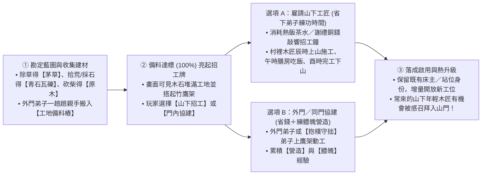

1. **第一階段：日常勞動自然產出三大建材，親手搬入「工地備料樁（Staging Pile）」**
   - 玩家點選破敗建築（如 `S0 破頂正堂`、`坍塌寢舍`）或新區域藍圖（如 `外功演練場`、`膳房大陶灶`、`後山望台`），地圖上會出現**工地備料樁**與清楚的建材進度條（例如：`原木 0/6`、`青石瓦礫 0/4`、`茅草 0/4`）。
   - **開局拾荒與日常收集無縫結合**：
     - **清理廢墟瓦礫** ➔ 直接產出首批【青石／舊瓦】；
     - **除草開荒** ➔ 直接產出鋪屋頂的【茅草／竹材】；
     - **後山砍柴／伐木** ➔ 產出【原木】。
   - 負責雜務的弟子會一趟趟把木料與石材親手抱到工地旁堆疊，畫面上能看到工地從「空地」變成「木石成堆、搭起竹鷹架」。
2. **第二階段：建材備齊（100%）➔ 解鎖【山下招工開建】與【同門協建】雙模式**
   - 當工地備料滿額後，不再只是乾等主角自己敲木頭，而是提供極具策略與生活感的兩種施工方式（可同時並用）：
     - **【雇請山下工匠／短工】（推薦：解放主角與核心弟子去練功！）**：花費膳房做好的熱飯菜、靈茶或山下義診攢下的謝禮銅錢，在山門掛出**「招工牌」**。隔日辰時，1～2 名山下木匠或泥水匠就會背著工具袋走上山門，在鷹架上叮叮噹噹蓋房子，午時還會去你的餐敘棚吃頓熱飯、跟弟子聊山下八卦，傍晚完工領錢下山！
     - **【門內弟子協建】**：由外門弟子或性格偏 `☷ 坤為地【抱樸守拙】` 的弟子上鷹架施工，省下招工費並實打實提升「營造」與「體魄」技能。
     - **匠人奇遇**：多次受雇上山蓋房的年輕木匠，若每次來都有熱茶好飯、又常在午休時羨慕地看著外功場練拳，好感達標後會主動詢問：「掌門，這演武場是我親手蓋的，能不能容我也留在山上當個外門弟子？」

---

### 2.3 雙軌開局創角（自由配點＋性向測驗 vs 選經典角色當主角）、天命課金加點與「零手動・全自動個性驅動」（整合 #5、#38、#106、#163）

我們將開局創角、人物性格與所有經典弟子統一在同一套資料驅動架構下，支援**「兩大開局模式（自創主角 vs 直接選經典角色當主角）」**，並實現**「就算玩家雙手離開鍵盤滑鼠，主角也能完全依照個性與價值觀自動練功、自動經營門派」**的終極模擬體驗：

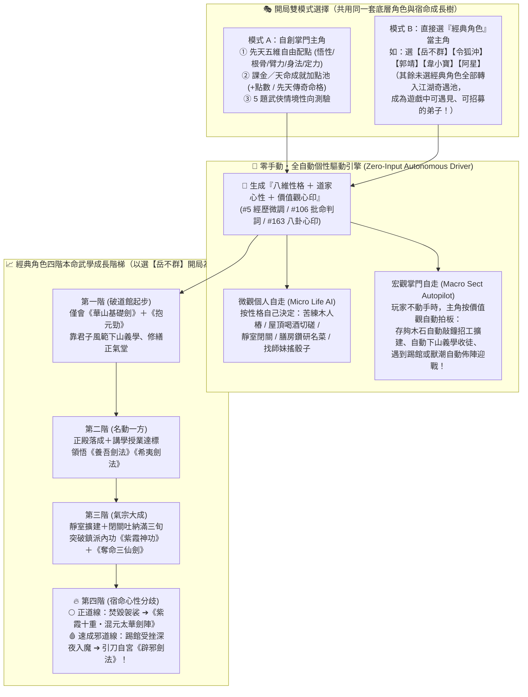

---

#### (1) 模式 A：自創主角 ——「先天五維自由配點 ＋ 情境性向測驗 ＋ 課金／天命加點池」
參考開源 **[Cataclysm: DDA](https://github.com/CleverRaven/Cataclysm-DDA)**（CC-BY-SA 3.0，`newcharacter.cpp` 多池自由配點與特質系統）、**《金庸群俠傳X》開源版（[`jynew`](https://github.com/jynew/jynew)）** 與經典 CRPG 的問卷創角（《Ultima IV》《Fallout G.O.A.T.》），自創主角分為直觀的三步：

1. **第一步：先天五維自由配點（Point-Buy Pool，基礎 `30 點` 自由分配）**
   每一點屬性都直接改變角色在地圖上的速度、可學武學與 AI 偏好（而且**高有高的神功、低有低的奇遇**，絕無廢點！）：
   - **【悟性（Comprehension，1～10）】**：決定高深武學領悟速度、秘笈研讀門檻與《獨孤九劍》破綻捕捉窗口。*(註：若刻意將悟性壓低至 `≤ 3`，反而能解鎖「心無雜念」專屬的《基礎羅漢拳 Lv10 返璞歸真》與《左右互搏術》！)*
   - **【根骨（Constitution，1～10）】**：決定精力上限、內息（Qi）容量、藥浴洗髓吸收率，以及能否睡【古墓寒玉床】或修練《紫霞神功》《九陽神功》《易筋經》。
   - **【臂力（Strength，1～10）】**：決定挑水砍柴單趟負重上限、七十斤【玄鐵重劍】揮動門檻，以及掌法／棍法的擊退與破甲力道。
   - **【身法（Agility，1～10）】**：決定空手與輕功移動速度、出招前搖縮減率，以及《凌波微步》《葵花／辟邪》的閃避與極速殘影上限。
   - **【定力／福緣（Composure & Fortune，1～10）】**：決定靜室閉關突破率、面對《辟邪劍譜》等速成邪功誘惑時的心性定力，以及下山義學／後山採藥偶遇頂級傳奇弟子與奇遇宗師的機率！
2. **第二步：課金／天命成就加點系統（Destiny Pool & Supporter Perks）**
   - 玩家可透過多周目成就累積或**課金支持（「天命玉璧／功德加點包」）**，在開局額外注入 **【天命屬性點（如 `+5 / +10 / +20 點` 打造六邊形滿天賦開局）】**，或自由選配 **【先天傳奇命格詞條】**：
     - 例如：`【萬中無一（骨骼驚奇・打通任督二脈機率翻倍）】`、`【滔滔江水（下山招工買建材 0 成本）】`、`【天生戰神（敵越多攻速越快）】`、`【食神轉世（開局自帶叫化雞食譜引洪七公）】`。
   - **商業化與平衡兼顧**：單機／模擬玩家不課金可用標準 30 點體驗「凡人或偏科奇才逆襲」的樂趣；想爽玩「開局天選掌門」或支持開發的玩家，則能透過課金加點自由捏出超規格神仙開局！
3. **第三步：五題武俠情境性向測驗（Situational Questionnaire）➔ 生成八維性格與價值觀心印**
   - 透過 3～5 道有江湖味的情境問答（例如：① 破道館漏雨又沒米時你先做什麼？② 撿到一冊霸道卻傷身的速成秘笈練不練？③ 山下惡霸欺負村民怎麼處置？④ 收到一個笨但老實的徒弟怎麼教？），自動生成：
     - **第一層：八維性格向量（`persona.base`）與經歷有界微調（[#5](https://github.com/lalagrass/earth-ascension/issues/5)、[#38](https://github.com/lalagrass/earth-ascension/issues/38)）**；
     - **第二層：道家心性稱號（【玄同澄照】【抱樸守拙】【太上仁心】【狂狷任誕】【君子端方】）與古風批命詩（[#106](https://github.com/lalagrass/earth-ascension/issues/106)）**；
     - **第三層：旬首「三問心印」（[#163](https://github.com/lalagrass/earth-ascension/issues/163) 八卦心印，預設按性格自動勾選，不彈窗打斷遊戲節奏）**。

---

#### (2) 核心突破：「零手動・全自動個性模板驅動（Zero-Input Autonomous Protagonist）」
參考開源 **[FreeSO](https://github.com/riperiperi/FreeSO)**（MPL-2.0，《模擬市民》SimAntics 高自由意志 AI）、**[Progress Quest](https://bitbucket.org/grumdrig/pq)**（GPL，零操作自走 RPG）與 **RimWorld Autonomous JobGiver**：
- **為什麼這能讓遊戲變得超輕鬆又耐看？**
  - 傳統經營遊戲裡，主角或掌門決策往往「玩家不點滑鼠就卡住不動」。
  - 在我們的新核心中，開局生成的**「五維配點 ＋ 八維性格 ＋ 價值觀心印」直接組成了【掌門全自動駕駛引擎（`SectLeaderAutopilot`）】**！
  - **就算玩家創完角後把雙手完全放開（不用點任何指令）：**
    1. **個人修練全自動（Micro AI）**：
       - 捏出**【低悟性＋抱樸守拙】**的主角，他每天天亮會自己去把破屋頂修好、把水缸挑滿，然後雷打不動在木人樁前苦練《基礎羅漢拳》直到 Lv10【返璞歸真】；
       - 捏出**【高悟性＋狂狷浪子】**的主角，他會自己去後山採野果釀【猴兒酒】、躺在屋頂喝酒、找每一個入門的師弟妹切磋拆招，自己跑去後山懸崖領悟《獨孤九劍》！
    2. **門派經營全自動（Macro Sect Autopilot）**：
       - 當外門弟子把工地備料樁的原木、青石、茅草搬滿 100% 後，若玩家在 10 秒內沒有手動操作，**主角會根據自己的性格價值觀，自己走到山門敲響【招工鐘】請山下木匠上山蓋房**（君子型主角優先擴建大廳與靜室，吃貨型主角優先擴建膳房與菜園，好戰型主角優先擴建外功演練場與山門望台）！
       - 當門派有空床位時，主角會**自己帶隊下山免費義學**，並按照自己的性格偏好把投緣的傳奇弟子招進山門！
  - **隨時可插手、隨時可放手**：玩家想微操時，點擊一下即可下達最高優先級的 `Tier 1 玩家指令`；想放鬆吃零食看戲時，開啟**【掌門順性自走】**，整座山門就會像一個活生生的武俠生態缸一樣自己演繹出獨一無二的門派傳奇！

---

#### (3) 模式 B：直接選「經典角色」當主角開局 —— 如何從破道館一步步學會經典內功與劍法？（以【岳不群】為例）

你提出了一個極為關鍵的設計核心：**「如果玩家開局直接選【岳不群】（或令狐沖、郭靖、韋小寶、阿星）當破道館主角，或者是把他們招進來當弟子，要怎麼設計才不會開局就滿級無聊，而是讓他順著性格一步步學會他的招牌內功與劍法？」**

我們借鏡開源 **[Tales of Maj'Eyal (ToME4)](https://github.com/NetCoreGames/tome4)**（GPLv3，角色專屬天賦演進樹）與 **《Crusader Kings / RimWorld》心性壓力與宿命抉擇事件鏈（Stress & Dilemma Branching）**，將所有經典角色統一設計為**「開局皆從第一階凡品起步，隨門派設施擴建與性格行為里程碑，逐步解鎖四階本命武學樹」**！

以下用 **選【岳不群（君子劍・華山重興劇本）】當主角開局** 完整拆解這套機制的精妙之處：

| 成長階段 | 門派場景與岳不群的自動性格行為 | 如何一步步學會經典內功與劍法？ | 同圖視覺與心性考驗 |
|---|---|---|---|
| **第一階段：破館初立**<br>*(v0.2 ~ v0.4 凡品築基)* | **【落魄華山舊道館】**：開局岳不群還是年輕掌門（可帶師妹寧中則與幼年大弟子）。他的性格模板是**【君子端方・重振門楣】**（高定力、重名聲），全自動AI會優先修補大廳屋頂、要求弟子晨起早課、衣冠整潔 | **初始僅會第一階基礎武功**：<br>• 外功：**《華山基礎劍法》**（中規中矩的直線刺擊）<br>• 內功：**《華山抱元勁》**（初階氣宗吐納，回氣平穩但無爆發） | 出劍端正嚴謹；在大廳懸掛「有所不為軒」破舊木匾，立志以氣宗正道復興門派 |
| **第二階段：君子名劍**<br>*(v0.5 良品精妙)* | **【下山義學博美名】**：岳不群的 AI 極度重視江湖聲望，會頻繁親自下山免費義學講武、扶危濟困，贏得山下村民敬仰（累積**【君子劍聲望】**），並廣收外門弟子替他分擔雜務 | **授業與聲望觸發領悟**：<br>當《華山基礎劍法 Lv3》＋《抱元勁 Lv2》＋ 大廳親自授課滿 5 次且【君子聲望】達標，自然領悟華山第二階名劍：<br>• **《養吾劍法》**（以浩然正氣劍圈格擋並卸力反擊）<br>• **《希夷劍法》**（以靜制動、守中帶攻） | 在演武場與同門切磋時，劍氣呈現淡雅青霞，防禦滴水不漏，盡顯名門掌門風範 |
| **第三階段：紫氣東來**<br>*(v0.7 ~ v0.8 珍品上乘)* | **【靜室閉關・氣宗正統】**：「華山九功，第一紫霞！」當後院擴建出**【清幽靜室（`fac.quiet`）】**且藥園種出靈茶後，岳不群因為「先練氣、後練劍」的價值觀，每天下午會自動進入靜室閉關打坐 | **閉關突破鎮派內功與殺招**：<br>當《抱元勁 Lv5》＋【根骨／內息 Lv4】＋ 靜室閉關累積滿 3 旬，正式突破第三階華山鎮派絕學：<br>• 鎮派內功：**《紫霞神功》**（內息綿密如紫霞護體，回氣翻倍，劍氣附帶震斷敵兵刃的紫霞內勁！）<br>• 凌厲殺招：**《太岳三青峰》**（三劍連環暴擊）與偷學自劍宗殘篇的**《奪命連環三仙劍》**！ | 打坐與出招時臉上浮現一團氤氳紫氣（同圖特效**【紫氣東來】**），一柄長劍紫芒吞吐！ |
| **🔥 第四階段：宿命分歧**<br>*(v0.9 ~ v1.0 絕品鎮派)* | **【強敵踢館與徒弟超越的心魔考驗】**：當嵩山派等強敵頻頻登門拜山踢館、或門下徒弟（令狐沖）意外在後山學會《獨孤九劍》風頭蓋過師父時，系統會檢定岳不群當下的**【門派存亡壓力】**與**【性格經歷微調值】**，觸發終極分歧！ | **兩條截然不同的第四階神功結局（可玩家手選，或由性格自動抉擇）**：<br>🌕 **分支 A【堅守君子本心・《紫霞十重・混元太華劍陣》】**：若門派興盛、踢館獲勝且與夫人徒弟關係和睦（定力高），岳不群在獲得《辟邪劍譜》袈裟時會**當眾焚毀袈裟**，勘破心魔將《紫霞神功》練至第十重返璞歸真，自創正道鎮派神功！<br>🩸 **分支 B【執念入魔・深夜引刀《辟邪劍法》】**：若踢館連敗受辱、焦慮爆表，岳不群會在深夜獨自走進靜室：**`「欲練神功，引刀自宮……為了華山基業，岳某別無選擇！」`** 一夜速成第四階極速邪功**《辟邪劍法》**！ | 🌕 **正道線**：漫天紫霞化為護山大劍陣，萬人景仰；<br>🩸 **辟邪線**：衣袍轉為妖異紫紅，獲得 **`0.05s` 七十二路鬼魅紅影＋繡花針／細劍瞬殺**，戰力暴漲 300%，但性格黑化、眾叛親離！ |

> **💡 同理，選任何一位經典角色當主角（或招為弟子），都有專屬的「四階漸進成長弧線」**：
> - 選 **【令狐沖】**：`《華山基礎劍》 ➔ 飲猴兒酒切磋領悟《太岳三青峰》 ➔ 後山思過崖奇遇《獨孤九劍・總決式》 ➔ 迎戰各路踢館高手修滿《九劍五破圖譜》＋《易筋經》`
> - 選 **【郭靖】**：`《基礎羅漢拳》 ➔ 雨中苦練突破《羅漢拳 Lv10 返璞歸真》 ➔ 膳房名菜引洪七公＆蜂箱引周伯通習得《降龍十八掌＋空明拳》 ➔ 《左右互搏雙掌齊出＋九陰真經》`
> - 選 **【阿星（《功夫》）】**：`《無影踩腳趾＋神級開鎖逃命步》 ➔ 挨打練成《銅皮鐵骨體魄》 ➔ 迎戰強敵重傷包成【白色木乃伊繭】 ➔ 破繭打通任督二脈《如來神掌・萬佛朝宗》`
> - 選 **【韋小寶（《鹿鼎記》）】**：`《撒石灰＋滔滔江水 0 成本招工》 ➔ 賭坊廚房混熟《神行百變抹油逃命步》 ➔ 偷師海大富《抓奶龍爪手＋五件金絲軟甲》 ➔ 《洋人火銃連發＋滿門神仙替我打架》`

---

### 2.4 弟子決策分層、技能成長與模擬市民式人際成家（A3 & A5）

#### (1) 四層決策仲裁器（4-Tier Decision Arbiter，延續 #313 可讀性）
每個弟子在任意時刻的行為都由高到低經四層仲裁，且面板清楚顯示**「現在在做什麼 ／ 為什麼（哪一層觸發） ／ 下一步打算」**：

| 優先層級 | 觸發條件 | 行為範例 | 面板可讀解釋範例 |
|---|---|---|---|
| **Tier 1：玩家明確指令** | 玩家手動指派工作、調度守點、邀約聊天 | 「去修繕膳房」「去演練場練《青松掌》」「跟阿秀聊天」 | `正在：修繕膳房｜原因：掌門親自指派｜下一步：完工後回院` |
| **Tier 2：必要生理自理** | 精力 ≤ 30、飽足 ≤ 25、或深夜亥時就寢 | 回自己認領的床位睡覺、去茶爐喝藥茶、去膳房盛飯吃 | `正在：回宿舍甲 bed-1 歇息｜原因：精力降至 28/100｜下一步：恢復至 80 後續接採藥` |
| **Tier 3：門派作息與職責** | 依門派時辰表（卯時早課、辰～午職責、午膳、未～申練武） | 樵夫去砍柴補庫、廚子在午時前生火做飯、弟子集合外功場練樁 | `正在：外功場打木人樁｜原因：未時門派武課｜下一步：酉時自由活動` |
| **Tier 4：性格與心印自主休閒** | 職責配額已滿（如水缸已達標）或酉時自由時段 | 【閒雲野鶴】去觀景石看山、【太上仁心】找同門泡茶聊天、半途偶遇熟人寒暄兩句 | `正在：與小師妹在石凳閒聊｜原因：自由時段・心印【春風化雨】｜下一步：戌時散步` |

#### (2) 「做什麼長什麼」可見技能系統（Skill Progression）
不搞抽象的綜合戰力值，每一項技能都直接反映在**動畫速度、移動動線或產出品質**上：
- **身法體魄類**：
  - `腳力 (Leg Strength)`：挑水、搬木、遠途採集提升 ➔ 空手與負重移動速度顯著變快（Lv1 40/s → Lv5 64/s）。
  - `輕功 (Qinggong)`：走梅花樁、山徑巡邏提升 ➔ 解鎖踏石渡溪、翻越矮牆與險坡捷徑，戰鬥中閃避位移更快。
  - `體魄 (Physique)`：砍柴、營造、外功抗打提升 ➔ 精力上限與負重單趟攜帶量提升（如一趟挑兩擔水）。
- **百藝生活類**：
  - `農藝 / 藥理`：種菜、採藥提升 ➔ 作物生長照料更快、採集時認出伴生珍稀靈草。
  - `庖廚 / 茶道`：煮飯、煎茶提升 ➔ 做出的飯菜與靈茶提供更長效的飽足與回精速率。
  - `營造`：修屋、築牆提升 ➔ 工地施工讀條加快、消耗木石更省。

#### (3) 從閒聊、互助到「結契成家」的人際關係網（#188、#319、#337、NPC 招募草案）
- **關係不是憑空跳數字，而是「共同記憶帳本（Shared Memory Ledger）」**：
  - 兩人只有在**空間上真實走近、面向彼此、雙方皆有空檔**時才會觸發互動（沿用 `#300 LIFE02` 與 `#337 SOCIAL01` 的 2s 發話 + 2s 回應氣泡機制，加 30 秒同對冷卻防刷）。
  - **記憶事件來源**：`共飲一壺靈茶`、`同桌吃午飯`、`精力見底時代挑一擔水（互助）`、`外功場點到為止切磋`、`後山巡獵並肩擊退野豬`、`受挫時溫柔鼓勵`。
- **兩條關係成長軌道（嚴格區分親情與道侶）**：
  1. **成年同門／訪客軌道**：`萍水相逢 (0) ➔ 同門相識 (1) ➔ 莫逆知己 (3，需共同經歷一次互助或並肩作戰) ➔ 結契道侶 / 成家 (5，雙向性格契合且皆成年)`。
  2. **師徒／長幼親情軌道（如 #337 道館收養的小女孩）**：`收養照料 ➔ 平日相伴 ➔ 親如家人（兄妹／師徒溫馨羈絆）`，永遠走純粹的家庭親情與守護路線。
- **「拉進一個家庭」的具體生活表現**：
  - **山下村民點化入門（#152 / `NPC_LIFE_RECRUITMENT_DRAFT`）**：住在山腳的堂親或訪客（如竹科休養工程師、村醫之女）平時會沿東南村路（`rt.village`）來訪求茶或看診；當相處記憶足夠且門派建好空床位時，可邀請他們正式加入門派大家庭（保留其原本世俗練就的醫術／工匠技能！）。
  - **結為道侶／同住一房**：兩位成年弟子結為道侶（或親人同住）後，可分配至擴建後的**雙人廂房**，夜晚回同一間房歇息，日常自由時段有更高機率結伴散步、同桌吃飯，在後山演武時若伴侶受襲會優先觸發「護衛伴侶」反應！

#### (4) 新弟子雙軌發掘（下山義學識人＋慕名登門拜師）與「外門雜務定額 ➔ 解放內門專注武學」制度
借鏡 **《Dwarf Fortress》公會堂公開講學（Guildhall Demonstrations）**、**《了不起的修仙模擬器》外門／內門二元分工** 與 **《Oxygen Not Included》職責優先序矩陣**，解決門派經營遊戲常見的兩大痛點：「招人像抽卡沒故事」以及「中後期人多了，主角還整天被挑水砍柴打斷練功」：

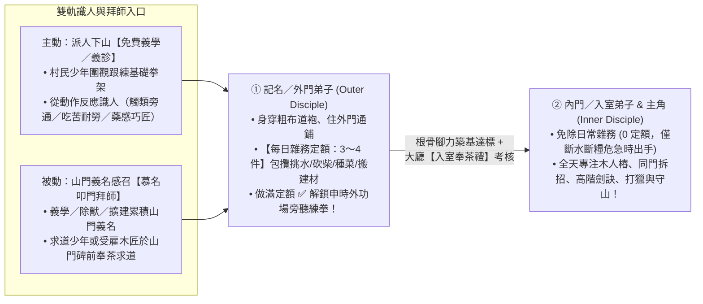

1. **雙軌發掘新弟子：不搞抽卡，在生活與講武中「望氣識人」**
   - **軌道 A（主動下山）：派人下山「免費義學講武／義診施茶」**
     - 當主角或資深弟子將基礎武學（如《青松掌法》）練至熟練（Lv3+）或具備藥理技能，可派遣他沿村路（`rt.village`）下山（或在山門外坪涼亭）舉辦半日的**【免費義學／義診】**。
     - **視覺化識人（Observation-Based Talent Discovery）**：3～4 名山腳村民、樵夫少年、落魄書生或流民孩童會圍過來跟著比劃拳架。玩家**不必死盯冰冷的數值表**，直接看他們跟練時的現場表現就能發掘良才：
       - **✨ 武道悟性奇才**：跟著比劃兩下就步伐沉穩、頭頂浮現微弱靈光（`💡 觸類旁通`），下課後還追著請教發力訣竅；
       - **🪨 勤勉外門棟樑**：雖然拳架生澀、汗如雨下，但別人都歇息了仍在咬牙蹲馬步，散場後主動幫你把茶桶挑回山門（`💪 吃苦耐勞`）；
       - **🌿 百藝專長苗子**：對打拳心不在焉，卻蹲在藥簍旁細聞每株草藥（`🌱 天生藥感`），或盯著涼亭榫卯結構比劃（`🔨 巧匠苗子`）。
     - 經數次義學相識後，即可對看中的潛力人物發出**【准入山門・授外門道袍】**邀請！
   - **軌道 B（被動感召）：山門聲望與「慕名登門拜師」**
     - 隨著下山義學、替村莊驅趕野豬、或山門建築擴建（S0 ➔ S1 ➔ S2），門派累積**「山間義名（Sect Reputation）」**。
     - 每隔數日清晨，山門石階（`fac.gate`）會出現慕名而來的求道者（或曾受雇上山蓋房、被門派風氣感動的年輕木匠）。師父或主角可前往山門**「奉茶問心」**，查看其性格卦象與人生追求，決定收為外門弟子或贈茶結緣。

2. **外門弟子「每日雜務定額（Daily Chore Quota）」➔ 徹底解放主角與內門專注武學**
   - **為什麼需要外門／內門分層？**
     開局破道館（S0）只有師徒時，主角親手挑水、砍柴、修屋頂很有荒野求生的代入感；但當門派走上正軌，玩家最渴望的是**「讓新收的外門師弟們把挑水、砍柴、種菜、搬建材包下來，讓主角與核心弟子能心無旁騖地閉關練劍、切磋拆招、去後山打獵！」**
   - **四階門派身分與工時制度表**：

| 門派身分階梯 | 服飾與床位配置 | 每日雜務定額 (`ChoreQuota`) | 系統派工優先序（`ReservationBroker`） | 成長與晉升閉環 |
|---|---|---|---|---|
| **① 山下短工／客匠**<br>*(Hired Artisan)* | 短打布衣<br>（辰時上山、酉時返村） | **專職施工／搬建材**<br>（領取熱飯茶水或銅錢） | 僅接取已備齊建材的工地施工單；午時於餐敘棚共食 | 協助快速擴建山門；部分年輕匠人好感滿額後可請求拜入外門 |
| **② 記名／外門弟子**<br>*(Outer Disciple)* | 灰青粗布道袍<br>（住外門大通鋪） | **每日必滿 `3～4 件` 雜務**<br>（挑水、砍柴、種菜、採藥、搬建材、炊事） | **雜務第一順位（Priority 1）**：只要今日定額未滿或庫存 `< 80%`，優先包攬全山門日常雜務 | **先勞其筋骨，後授其武道**：在挑水砍柴中把「腳力、體魄、百藝」練紮實；當日做滿 `3/3` 雜務後，頭頂跳出 `✅ 今日雜務已畢`，**解鎖申時～酉時去外功場旁聽練拳！** |
| **③ 內門／入室弟子**<br>*(Inner Disciple & 主角)* | 雲紋青衫道袍<br>（住雙人雅室／獨立廂房） | **免除日常雜務（`0 定額`）**<br>（僅在水糧 `< 15%` 危急時才補位） | **武學與歷練第一順位**：預設略過所有日常搬運／挑水／農事，專注外功場打樁、雙人切磋、藏經研讀、後山狩獵與守山 | 外門弟子將「腳力／體魄」與基礎武學練至 Lv2，並累積足夠門派貢獻後，可於大廳舉行**【入室奉茶禮】**正式晉升內門！ |
| **④ 親傳／代師首座**<br>*(Senior Instructor)* | 玄青鶴氅道袍<br>（正殿側室／靜室） | **免除日常雜務（`0 定額`）** | 可指派執行**「帶隊下山義學」**、**「外功場代師授課」**與**「後山狩獵領隊」** | 將武學練至 Lv4+ 的大師兄／二師姐，替師父指點外門師弟並下山發掘新血，形成完美的宗門傳承自走循環 |

---

### 2.5 同圖武學系統與「塔防式」演武／後山打獵（A4 & A6）

這是將「門派養成」與「戰鬥爽感」無縫縫合的核心創新：**沒有獨立的戰鬥引擎，練樁、切磋、演武場塔防、後山打獵全部共用同一套同圖招式與站位系統。**

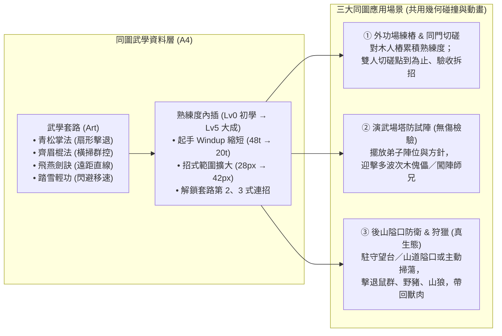

#### (1) 同圖武學：招式資料化與肉眼可見的熟練度差距（#318 A4）
每門武學包含 2～3 式招式（Moves），每式定義明確的**三段時間軸（`windup 起手 → active 出招判定 → recover 收勢`）**與**幾何命中形狀（`shape`）**：

| 武學套路 | 招式範例 | 幾何判定形狀 (權威座標) | 初學 (Novice) 表現 | 練熟／大成 (Adept/Master) 表現 | 塔防／狩獵定位 |
|---|---|---|---|---|---|
| **《青松掌法》** | 第一式：推山掌<br>第二式：疊浪掌 | **扇形 (Cone)**<br>半徑 28→38，夾角 50°→75° | 起手慢（0.8s）、掌風短，一次只能拍退一隻近身野鼠 | 起手快（0.4s）、掌風帶青色氣浪，可同時震退扇形內 2–3 隻野獸並銜接第二式 | **近戰守點／護衛**：守在隘口正面擊退衝鋒野豬 |
| **《齊眉棍法》** | 第一式：橫掃千軍<br>第二式：立劈華山 | **圓弧／周身 (Circle/Arc)**<br>半徑 36→48，夾角 140° | 揮棍沉重、收勢破綻長 | 棍影連綿，大範圍橫掃減速並擊倒成群山鼠／木傀儡 | **群控清場（AOE Tower）**：放在轉角或雙路交匯處清理群怪 |
| **《流雲劍訣》** | 第一式：穿雲刺<br>第二式：劍氣縱橫 | **直線長距 (Line/Ray)**<br>長 55→85，寬 16 | 僅能刺擊前方單一目標 | 劍尖吐出尺許劍氣，隔空貫穿直線上的敵人 | **遠程狙擊／後排輸出**：站在望台或前排師兄身後安全輸出 |
| **《踏雪無痕》** | 身法：掠影步 | **位移／閃避 (Dash)** | 僅小幅提升平日走路速度 | 敵人撲擊前搖時自動側滑閃避，平日可直接跳過溪石捷徑 | **游擊／巡山斥候**：高速拉怪、支援漏網之魚 |

- **學會 ≠ 練熟**：師父在大廳傳授或讀藏經閣秘笈只是「學會（Lv0）」；必須在外功場打木人樁、與同門切磋、或實戰出招，才能把熟練度練上去，讓玩家在畫面上親眼看到弟子從「笨拙慢拍」變成「行雲流水」。

#### (2) 致敬《天下霸圖》：四階武學進階樹、四維根基與「閉關領悟／著書傳承」系統
《天下霸圖》最讓人欲罷不能的核心魅力，就是**「基礎武功不只是過度技能，而是透過練基礎功累積五力（四維根基），當兩門前置武學與身體素質達標時，能融會貫通『領悟』出威力與視覺截然不同的高階武學，甚至成為本門鎮派絕學！」**

我們結合 **《天下霸圖》前置武學領悟樹**、開源 RPG **[Tales of Maj'Eyal (ToME4)](https://github.com/NetCoreGames/tome4)**（`GPLv3` 的 Talent Category Mastery 與跨系協同解鎖）以及 **[Cataclysm: DDA](https://github.com/CleverRaven/Cataclysm-DDA)**（秘笈研讀與實戰頓悟），設計出**「同圖可見的四階武學進階與領悟系統」**：

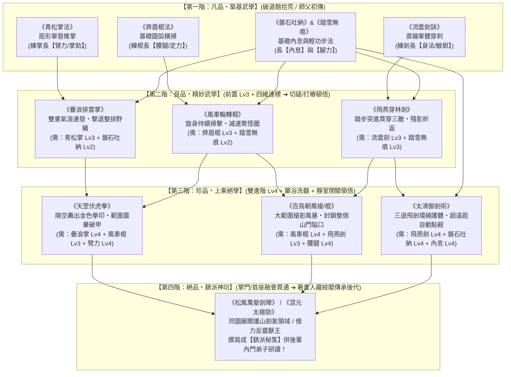

1. **為什麼基礎武學值得認真練？（《天下霸圖》式「四維根基」與前置跳板）**
   - 在我們的系統裡，挑水、砍柴與修習第一階基礎武學，會實打實淬鍊弟子的**四維武道根基**：**【臂力（掌棍威力與負重）】【腰腿（下盤穩固與抗擊退）】【身法（起手速度與閃避）】【內息（高階招式氣力池與劍氣射程）】**。
   - 想要領悟第二階的《疊浪排雲掌》，不能靠抽卡買書，必須先把《青松掌法》練到 Lv3、搭配基礎內功《磐石吐納》Lv2，且【臂力】達標！
2. **三種讓人充滿期待的「新武學領悟時刻（Epiphany Moments）」**：
   - **① 同門切磋頓悟（Sparring Breakthrough）**：當主角與師兄在外功場拆招切磋，若雙方前置武學與根基已滿，有機會在交手拆招瞬間頭頂綻放金光、跳出**「💡 靈光一閃！在拆招中融會《青松掌》與《吐納功》，領悟進階武學【疊浪排雲掌】！」**並當場使出新招！
   - **② 後院靜室「閉關鑽研」（Secluded Enlightenment，`fac.quiet`）**：擴建出後院靜室後，可讓滿足雙前置的內門弟子進入靜室閉關數日（由外門弟子送飯送茶），出關時正式領悟第三階上乘絕學！
   - **③ 著書立說・藏經閣薪火相傳（Scripture Authoring）**：這是結合《天下霸圖》自創門派最爽的一環——當主角或大師兄千辛萬苦自行領悟出《疊浪排雲掌》或《太清御劍術》後，可以去靜室案頭**「撰寫武學手札」**放入門派藏經架！從此以後，門派裡後進的師弟師妹只要根基達標，就能直接去藏經架研讀師兄留下的手札學會該武功，不用再從頭摸索！
3. **門派百藝如何支撐高階武學？（藥浴洗髓 × 百鍛兵刃）**
   - **高階武學的氣力消耗與「藥浴／靈茶」**：如同《天下霸圖》高階招式耗氣極大，第三階絕學需要深厚內息支撐；藥園種出的靈草可在煉藥房熬製**【培元藥浴】**與**【紫竹靈茶】**，幫資質普通但勤奮的弟子洗髓突破根基瓶頸！
   - **匠作兵刃搭配**：外功場與匠作坊可利用後山硬木與礦石打造**【熟銅齊眉棍】【青鋒長劍】【負重鐵護腕】**，讓高階兵刃武學發揮出 100% 的同圖劍氣與橫掃範圍。

#### (3) 雙軌武道：悟性不夠學不會高深劍訣？苦練基礎《羅漢拳／青松掌》直達「登峰造極・返璞歸真」！
武俠小說與經典遊戲裡最讓人熱血沸騰的橋段之一（如《天龍八部》喬峰以最基礎的《太祖長拳》力壓少林高僧、郭靖資質魯鈍卻把基礎掌法練到極致、或《金庸群俠傳》《活俠傳》裡把基礎《羅漢拳／野球拳》練到十級天下無敵），就是**「大巧不工、返璞歸真」**！

如果在門派經營裡，「低悟性」的弟子永遠只能當挑水工具人、後期打架完全沒戲份，那就太可惜了。因此我們借鏡開源 Roguelike **[Dungeon Crawl Stone Soup (DCSS)](https://github.com/crawl/crawl)**（`GPLv2` 中低魔法資質角色將基礎徒手格鬥 `Unarmed Combat` 從 Lv1 苦練至 Lv27 大宗師時，直接獲得基礎點傷線性累加與出招延遲減半 `1.0 ➔ 0.5` 的質變公式）與 **[Tales of Maj'Eyal (ToME4)](https://github.com/NetCoreGames/tome4)**（基礎天賦樹超額專精倍率），設計出**「博學進階 vs 抱樸守拙・返璞歸真」雙軌武道系統**：

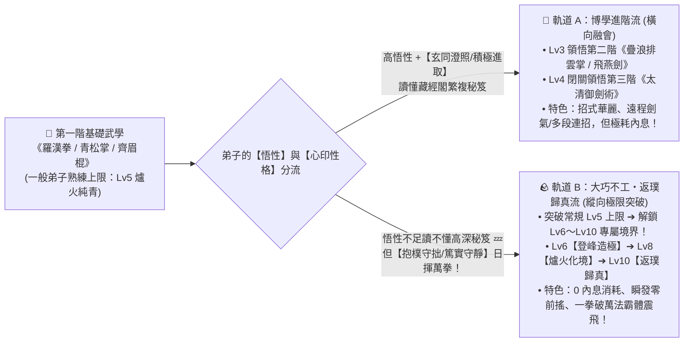

1. **為什麼他學不會高深武功，卻能把基礎《羅漢拳》練到 Lv10？**
   - 當一名弟子先天**「悟性偏低」**（八維中 `open / explore` 較低，去藏經閣看《太清御劍術》秘笈頭頂會冒出 `💫 字太深奧看攏無...`），但他擁有極高的**「盡責與守拙（`conscientious` + `☷ 坤為地【抱樸守拙】` 或 `☶ 艮為山【篤實守靜】`）」**時：
   - 他不會分心去學五花八門的新套路，而是每天做完挑水砍柴後，雷打不動地站在同一個木人樁前，把師父最早教他的那套**第一階基礎《羅漢拳》（或《青松掌》《齊眉棍》）**反覆打上成千上萬遍！
   - 當他在 `Lv5（爐火純青）` 繼續苦練並累積足夠的「專一揮拳次數」與「臂力／腰腿根基」時，會觸發專屬的**「大巧不工・破限頓悟」**——打破凡品武學的 Lv5 天花板，開啟 **Lv6～Lv10 的【登峰造極 ➔ 返璞歸真】境界**！

2. **《基礎羅漢拳》練到「Lv10 返璞歸真」在同圖上有什麼驚人表現？**

| 武學境界 | 一般弟子（Lv1～Lv5 常規上限） | 苦行弟子專屬突破：**Lv6～Lv8【登峰造極】** | 苦行弟子終極質變：**Lv9～Lv10【返璞歸真・大巧不工】** |
| :--- | :--- | :--- | :--- |
| **出招起手 (`Windup`)** | `0.8s ➔ 0.4s`（常規起手） | **`0.25s`（拳隨意動，後發先至）** | **`0.15s`（零前搖瞬發！對手劍招還在蓄力就已中拳）** |
| **內息消耗 (`Qi Cost`)** | `0`（基礎外功不耗內息） | **`0`（全場永動，不靠丹藥也能連戰百合）** | **`0`（越戰越勇，每次出拳反而恢復自身定力）** |
| **同圖物理與視覺效果** | 普通近身推掌／直拳，僅能擊退 1 隻小野鼠 | **【沉渾拳罡】**：平平無奇的一拳揮出，地面震起金色塵浪，自帶**「強韌霸體（不被打斷）」**與大距離擊飛！ | **【一拳破萬法】**：沒有花俏特效，只有一聲沉悶雷鳴與腳下金蓮氣環——**無視敵方格擋／劍陣護盾，一拳直接將衝鋒野豬王或踢館高手的護體氣勁轟碎震暈！** |

3. **帶來的絕妙門派故事感（Emergent Wuxia Story）**：
   - 你在 `v0.5` 下山免費義學時，收了一個別人都不看好的**笨拙農家少年阿牛**（悟性低、學不會劍訣，每天老老實實挑水砍柴做滿 3 件外門雜務，下午只對著一號木人樁傻練《羅漢拳》）。
   - 到了 `v0.9` **名門劍派高徒登門拜山踢館**時，門裡聰明的師弟們被對方的精妙劍招壓制、內息耗盡；這時阿牛默默走上演武場中央，頂著漫天劍影一步踏出，用那招練了三萬遍、毫無花巧的**《羅漢拳・返璞歸真》**，僅憑 0.15 秒的瞬發鐵拳直接破開對方劍陣、一拳定乾坤！這種「傻小子苦練基礎拳成宗師」的養成成就感，會讓玩家對每個弟子都愛不釋手。

#### (4) 劍道無上魅力：《獨孤九劍（無招破綻流）》—— 料敵機先、後發先至與「見招拆招圖譜」
如果說低悟性、老實勤懇的阿牛代表的是郭靖式的「大巧不工《羅漢拳》」，那麼武俠世界裡最瀟灑、最令人神往的劍法巔峰，絕對是令狐沖與風清揚的**《獨孤九劍》——「無招勝有招，料敵機先，後發先至，破盡天下武學」**！

最棒的是，我們前面借鏡 **`Veloren` (`GPLv3`) 的三段式招式狀態機（`Buildup 起手前搖 ➔ Action 判定 ➔ Recover 收勢硬直`）** 與 **`Cataclysm: DDA` (`CC-BY-SA 3.0`) 的條件觸發反擊（`dodge_counter / block_counter`）**，剛好能把《獨孤九劍》做成**全遊戲最獨特、完全不靠死打木人樁的「動態看破拆招劍法」**！

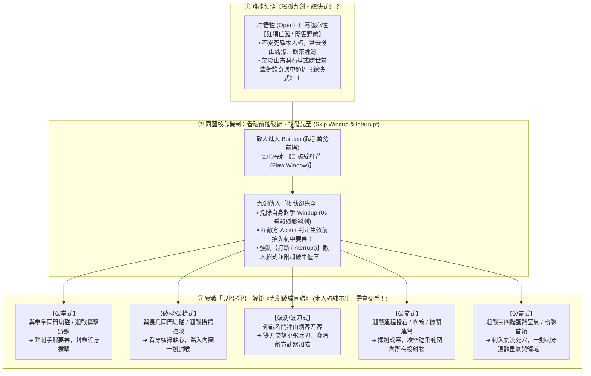

1. **為什麼《獨孤九劍》不能靠死打木人樁練滿？（「木人無招，唯有活人有破綻」）**
   - 傳統武學（如《青松掌》《太清御劍術》）可以靠對著木人樁苦練把熟練度堆滿；
   - 但《獨孤九劍》講究**「有招才有破綻」**——木人樁是死物，不會出招，因此九劍傳人打木人樁拿不到破式經驗！
   - 想要把九劍練成，只有兩條極具江湖味的途徑：
     - **日常在大廳／外功場找不同流派的同門師兄弟「切磋拆招」**（跟練掌的師兄切磋漲【破掌式】，跟練棍的師姐切磋漲【破棍式】）；
     - **在後山狩獵與 `v0.9`「江湖名門拜山踢館」中實戰交手**！對手招式越繁複、名頭越響亮，九劍傳人看破其破綻後的反擊威力就越驚人！

2. **在同一個地圖上，玩家會看到什麼超帥的《獨孤九劍》演出？**
   - **「敵先動、我後動，卻一劍斷其咽喉」**：
     - 當衝鋒的野豬王或來踢館的鄰派劍客開始蓄力起手（`Buildup` 階段，身上泛起蓄力光圈）時，站在陣位上的九劍弟子平時只是提劍抱胸、瀟灑而立（連防禦架勢都不擺——「只攻不守」）。
     - 就在敵人起手即將落下的前 `0.2 秒`，敵人身上亮起一道**「🎯 破綻」**閃光！九劍弟子瞬間化作一道青白色殘影欺身而進，畫面響起清脆的一聲劍鳴，敵人原本蓄勢待發的大招直接被**強制打斷（`💥 破招！破劍式`）**，整個人僵直後退！

3. **三大武道巔峰的「同門切磋終極彩蛋」：當《獨孤九劍》遇上 Lv10《返璞歸真・羅漢拳》！**
   - 這會在你的門派裡誕生最津津樂道的名場面：
     - **二師弟（高悟性＋【狂狷任誕】）**練成了專抓天下武學破綻的**《獨孤九劍》**，連破來拜山的各派高手；
     - **大師兄阿牛（低悟性＋【抱樸守拙】）**只會一門練了三萬遍、毫無花巧的 **Lv10《返璞歸真・羅漢拳》**。
     - 當兩人在外功場切磋時，系統會觸發特殊武學共鳴事件——因為阿牛的 Lv10 基礎直拳已經「大巧不工、渾然天成（僅 `0.15s` 零前搖，沒有繁複變招的破綻窗口）」，二師弟頭頂會跳出驚嘆氣泡：**`「咦？！大師兄這記最普通的直拳渾然天成，竟尋不到半點破綻！」`** 兩人平分秋色、拱手大笑，雙雙獲得「無招與至拙」的最高武道感悟！

#### (5) 如何直觀呈現角色強度？——「分段里程巡山清怪」×「山門塔防守陣」×「四大非數值實力回饋」（#104 / #290 / #320 + `PATROL_DEFENSE_RESEARCH`）

傳統武俠手遊用一個冰冷的「戰力 99,999」數字來代表強弱，玩家既無感又容易審美疲勞。
在本作中，我們結合先前 Issue **[#104](https://github.com/lalagrass/earth-ascension/issues/104)、[#290](https://github.com/lalagrass/earth-ascension/issues/290)（[PATROL_DEFENSE_RESEARCH](../PATROL_DEFENSE_RESEARCH.md) ／ [PATROL01_HANDOFF](../PATROL01_HANDOFF.md)）與 [#320](https://github.com/lalagrass/earth-ascension/issues/320)** 的核心構想，並借鏡開源社群（**[Zero-K](https://github.com/ZeroK-RTS/Zero-K)** 的 `cmd_retreat.lua` 撤退預算、**[Beyond All Reason](https://github.com/beyond-all-reason/Beyond-All-Reason)** 的沿路掃蕩、**[Mindustry](https://github.com/Anuken/Mindustry)** 的防線壓力、**[Path of Building](https://github.com/PathOfBuildingCommunity/PathOfBuilding)** 的成長對比與 **[Dwarf Fortress](https://www.bay12games.com/dwarves/)** 的傳奇銘刻），設計出**「主動向外：分段里程巡山清怪」＋「被動守內：山門塔防演武」＋「日常可見：四大物理與江湖反饋」**的立體強度呈現體系！

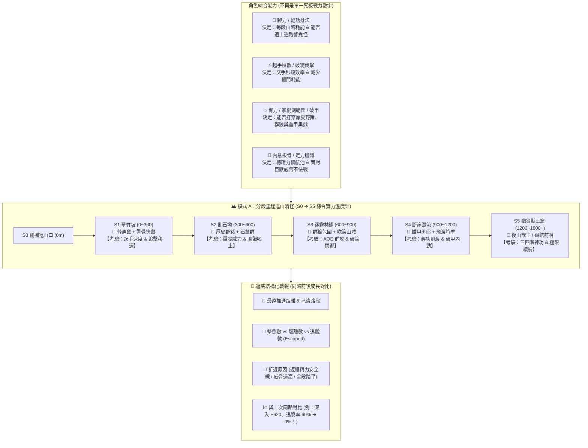

---

##### 1. 模式 A：後山「分段里程巡山清怪」（Segmented Distance Patrol —— 角色綜合能力的最佳試金石！）
當玩家派遣一名角色（或由全自動掌門自主決定）走出西側／北側柵欄「巡山一趟」時，這不是按一下按鈕等倒數的文字派遣，而是**真人在同一張地圖山徑上越走越遠的實戰遠征**：

- **為什麼「走得多遠、清了多少、逃了多少」能完美呈現角色綜合強度？**
  1. **嚴格的「返程精力安全線（`RetreatBudget = 下一段路耗 + 實際退路回程耗能 + 8 點餘裕`）」**（沿用 `#290 PF3` 確定性公式）：
     - 角色每往前推進一個短段（`≤ 40` 世界單位）或每次起手出招前，都會即時計算：「我剩下的精力，夠不夠打完這一掌再沿著真山路平安走回院子？」一旦觸及回程安全底線，角色就會自主收手、循原路返院，絕不無腦送死。
     - 因此，**腳力越快、輕功越高、內息越深厚的角色，花在走路上的精力比例就越低，能推進的「極限里程」就自然越遠！**
  2. **「擊倒 vs 逃脫（Escaped）」直接反映身法與招式熟練度**：
     - 山徑上的野怪不是站著等死的木頭！例如 **警覺林鼠** 在察覺角色靠近（`50` 單位）或同伴受擊（`100` 單位）時，會立刻以 `120` 速度往竹林逃生折線狂奔；角色離主路追擊最多允許 `≤ 80` 單位或 `3 遊戲秒`（逾時則放棄追擊回主路，記為 **【逃脫 1 隻】**）。
     - **初學弟子（起手 `0.8s`、移速慢）**：走到 `S1 翠竹坡`，掌還沒拍下去，3 隻老鼠已經跑掉 2 隻，戰報寫著**「擊倒 1、逃脫 2，精力見底折返」**；
     - **練成《羅漢拳 Lv10（0.15s 瞬發）》或《獨孤九劍（0s 後發先至）》或《凌波微步》的高手**：剛踏入竹坡，老鼠還沒反應過來就被瞬發掌風連拍三隻，**「逃脫數：0！」** 省下的追逐時間與精力讓他能繼續往 `S3、S4` 深山推進！

- **後山六大距離路段（`S0 ➔ S5`）的階層式生態考驗表**：
  每一段距離都不是單純把怪物血量乘以 10，而是**專門檢驗角色不同維度的武學與身體素質**：

| 距離里程段 | 世界距離（自 S0 起算） | 出沒對手與生態行為 | 考驗角色的哪項綜合能力？ | 實力不足者的表現（為何折返？） | 綜合強者的表現（如何一路輾壓？） |
| :--- | :--- | :--- | :--- | :--- | :--- |
| **S0 柵欄巡山口** | `0`（前導路終點） | 窺探菜園的零星家鼠 | **基礎精力門檻**（出發需精力 `≥ 40`） | 剛挑完水太累（`< 40`），先回院喝茶休息 | 精神飽滿跨出柵欄，正式開始計入巡山里程 |
| **S1 翠竹坡** | `0 ～ 300` 單位 | **普通林鼠 ＋ 警覺快鼠**（見人即鑽竹林逃跑） | **【起手速度 ＋ 追擊腳力】** | 起手太慢（`48 ticks`）、追不上逃鼠；戰報滿滿「逃脫」，追逐耗盡精力在 `250` 單位折返 | 起手快（`≤ 18 ticks`）或步法快，照面即秒殺，**零逃脫**輕鬆通過 |
| **S2 亂石坳** | `300 ～ 600` 單位 | **成群石鼠 ＋ 覓食厚皮野豬**（具衝撞威脅，普通輕拳打不退） | **【單發掌力 ＋ 膽識喝止】** | 掌法未熟且膽識低，無法驅離近距（`≤ 120`）野豬威脅，依安全規則**知難而退返院** | 一記熟練《青松掌》或中氣十足的戶外喝止（威脅 `+80`）直接震退野豬，扛起野味繼續深入 |
| **S3 迷霧林緣** | `600 ～ 900` 單位 | **群聚野狼（3～5 隻圍攻）＋ 林間吹箭山賊斥候** | **【扇形/圓弧 AOE 群攻 ＋ 破箭/閃避】** | 只有單體初階招式，被群狼與遠程吹箭拖住，交手時間過長導致返程精力不足而折返 | 施展《齊眉棍・橫掃》、《疊浪排雲掌》或《獨孤九劍・破箭式》，一招清光狼群、磕飛吹箭 |
| **S4 斷崖激流** | `900 ～ 1,200` 單位 | **斷崖窄橋地形 ＋ 鐵甲黑熊（高霸體護甲）** | **【輕功飛渡捷徑 ＋ 破甲內勁/重兵】** | 不會輕功只能繞遠路（路耗翻倍）；普通劍招砍在黑熊皮上被彈開 | 《踏雪無痕》飛躍斷崖省下一半精力；以《羅漢拳・登峰造極》或《洪家鐵線拳／玄鐵重劍》一擊破甲 |
| **S5 幽谷獸王窟** | `1,200 ～ 1,600+` 單位 | **後山百獸王 ／ 邪派踢館前哨營地** | **【三四階鎮派神功 ＋ 宗師級內息續航】** | 內息與定力無法支撐高階大招連發，在洞口留下記號後安全撤退 | 喬峰《降龍十八掌》、阿星《如來神掌》、岳不群《紫霞劍氣》或令狐沖《破氣式》單騎踏平獸王窟，插下本門旗幟滿載靈藥獸肉歸來！ |

- **返院「同路成長前後對比戰報（Before / After Progression Telemetry）」**（借鏡 `#290 PF4` ＋ `Path of Building`）：
  當角色走回院門（HOME）時，右側不會跳出雜亂的公式，而是給出一張極具成就感的**【巡山實戰紀錄卡】**，並自動與他**上一次走同一條路的紀錄**做對比：
  > 📜 **【巡山返院戰報：郭靖（內門弟子）】**
  > - **最遠推進里程**：**`1,080 單位（抵達 S4 斷崖激流）`** *(📈 較上次進步 `+690 單位`！上次止步於 S2 亂石坳)*
  > - **已確認清理路段**：**`S1 翠竹坡 ✔`、`S2 亂石坳 ✔`、`S3 迷霧林緣 ✔`** *(後山騷擾壓力降低 75%)*
  > - **遭遇與處理結果**：共觀測 **12** 個目標 —— **擊倒 10 隻**（林鼠×5、石鼠×3、野狼×2）、**喝止驅離 2 頭**（厚皮野豬×1、鐵甲黑熊×1）、**逃脫 0 隻** *(🔥 上次逃脫率 50% ➔ 本次達成「零逃脫」完美追擊！)*
  > - **時間與精力分布**：總耗時 `68s`（移動 `38s` ／ 交手 `12s` ／ 返程 `18s`），單隻平均處理耗時 **`1.0s`** *(⚡ 較初學時縮短 `64%`)*
  > - **返院原因**：於 S4 擊退鐵甲黑熊後，剩餘精力 `22` 觸及返程安全預算（回程需 `14` ＋ 安全餘裕 `8`），從容收招返院，帶回【上等獸肉 ×3、百年靈芝 ×1】！

---

##### 1.5 性格與身法決定的「四大巡山流派」：韋小寶《神行百變》摸金溜邊流 vs 郭靖「除惡務盡」百分之百肅清流！

最妙的是，在 [PATROL_DEFENSE_RESEARCH.md](../PATROL_DEFENSE_RESEARCH.md#L57-L59) 的原始契約中，早就預留了兩個關鍵設計伏筆：
1. **將「最遠抵達距離（Exploration Depth）」與「已清理路段（Clearance Rate）」拆開計算**（跑過一段不等於整段已安全）；
2. **將遭遇結果分為「擊倒 ／ 驅離 ／ 逃脫 ／ 繞避（Bypassed）」四種互斥狀態**！

當我們把這項契約與**角色的性格模板（八維性格 × 三問心印）＋ 招牌步法**結合，並借鏡開源 Roguelike **[Dungeon Crawl Stone Soup (DCSS)](https://github.com/crawl/crawl)**（`GPLv2`，`travel.cc / mon-util.cc` 中潛行斥候 `Stealth Pass-by` 擦身溜怪撿寶 vs 重裝戰士 `Tab-Clear` 逐格肅清的雙軌探索機制）以及 **[Zero-K](https://github.com/ZeroK-RTS/Zero-K)**（`unit_states.lua` 的交戰姿態 `Avoid / Engage / Hunt`），同一個巡山系統會自然湧現出 **4 種截然不同、極具戲劇張力且戰略互補的巡山流派**：

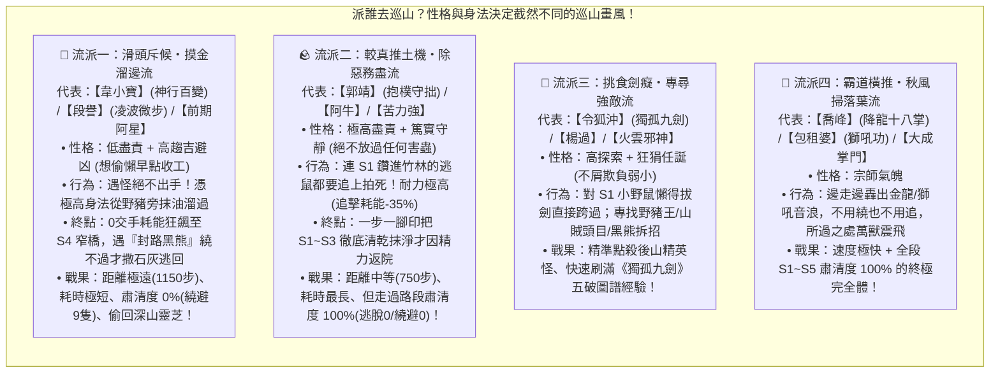

1. **為什麼【韋小寶】能靠《神行百變》一路溜到深山，最後卻會被「擋路惡霸」逼退？（`BypassCheck` vs `ChokepointBlockage` 機制）**
   - **想偷懶早退的心理驅動**：韋小寶（低 `conscientious` 盡責 ＋ 高 `safe` 惜命）被派去巡山時，心裡想的是**「打架多累啊！老子趕緊跑完交差回去搖骰子泡師姐！」** 因此他的交戰方針預設為 **`avoid_and_slip`（逢怪繞避）**，離路追擊半徑為 **`0`**（老鼠跑掉他還拍手叫好：`「跑得好！省得老子動手！」`）。
   - **《神行百變》繞避檢定（`FootworkBypass`）**：
     - 每個路段有其**「地形封鎖度（`ChokepointBlockage`，0%～100%）」**。
     - 在寬敞的 **`S1 翠竹坡（封鎖度 15%）`、`S2 亂石坳（30%）`、`S3 迷霧林緣（50%）`**：韋小寶憑藉頂尖身法與《神行百變》（繞避成功率 `+85%`），趁野豬低頭拱土、野狼轉頭時，像泥鰍一樣貼著山壁草叢躡手躡腳溜過去（記為 **【繞避 Bypassed +1】**），完全不花半點交手精力與時間，更順手摸走崖邊罕見的【百年何首烏】！
   - **踢到鐵板的終點（絕對隘口封鎖）**：
     - 當韋小寶一路狂飆衝到 **`S4 斷崖獨木橋（地形封鎖度 95%！）`** 時，一頭三百斤的**【鐵甲黑熊】**直接一屁股坐在窄橋正中央（或者遇到嗅覺反隱的狼王堵死山谷）！
     - 當 `怪物佔位封鎖度 > 角色繞避極限` 時，身法再高也無法從黑熊肚子下鑽過去！韋小寶頭頂立刻跳出驚恐氣泡：**`「😱 娘親咧！這大黑熊把路堵死了，風緊扯呼！」`** 隨手撒出一把【白石灰】掩護，轉身發揮極限腳力一路狂奔逃回山門！

2. **為什麼【郭靖】雖然走得慢、推進距離不一定最遠，卻是門派最不可或缺的定海神針？（耐力加成 × 100% 肅清 × 同門接力）**
   - **較真老實的「除惡務盡」心理驅動**：郭靖（滿格 `conscientious` 盡責 ＋ `☷ 坤為地【抱樸守拙】`）看到一隻警覺鼠往竹林逃跑，絕不會像韋小寶那樣放牠走，而是頭頂冒出 **`「😤 決不能放這害蟲去偷咬師父種的菜！」`**。
   - **高耐力耐心加成（`Endurance & Persistence`）**：
     - 系統為郭靖這類高根骨、高定力的較真角色提供 **「長途耐力減耗（追擊與交手精力消耗 `-35%`）」** 與 **「雙倍追擊執著度（離路追擊上限由 `80單位/3s` 提升至 `150單位/6s`）」**。
     - 他會一步一腳印把 `S1 翠竹坡` 的每一隻逃鼠追上拍暈，再把 `S2 亂石坳` 的野豬正面轟退，接著把 `S3` 的狼群一隻不留地清理乾淨。雖然一趟下來耗時 `110 秒`、走到 `S3 尾端（780 步）` 就因精力觸及回程安全線而返院，但他走過的每一寸山路，**肅清完成度都是紮紮實實的 `100%`（逃脫 0、繞避 0）**！

3. **極具策略深度的「同門巡山互補與接力開拓（Relay Expedition）」**：
   因為我們的後山生態遵循 `#290 PF2` 的**「真實持久個體狀態（清掉的怪不會因返院立刻刷新，需數日才會自然遷入）」**，這讓不同性格的弟子產生了絕妙的化學反應：

| 巡山維度 | 🎲 派【韋小寶】去巡山（滑頭斥候流） | 🪨 派【郭靖】去巡山（較真推土機流） | 🤝 先派郭靖清場 ➔ 再派韋小寶／令狐沖接力！ |
| :--- | :--- | :--- | :--- |
| **花費時間** | **極快（`35 秒` 早去早回）** | **較慢（`110 秒` 穩紮穩打）** | 兩趟分工合作，效率最大化 |
| **最遠推進距離** | **極遠（直衝 `S4 斷崖 1,120 步`）** | **穩健（推進至 `S3 林緣 780 步`）** | 郭靖先打通前中段，後發者直取 `S5 獸王窟`！ |
| **遭遇明細** | 擊倒 `0` ／ 驅離 `0` ／ **繞避 `9` 隻** | **擊倒 `9` 隻 ／ 驅離 `2` 頭 ／ 逃脫 `0` ／ 繞避 `0`** | 前段 `100%` 乾淨，後段精準奪寶或斬首 Boss |
| **路段肅清完成度** | **`0%`（怪全還在原地，菜園照樣被偷！）** | **`100%`（S1～S3 徹底安全，三日內零獸患！）** | **山門絕對安全 ＋ 深山奇珍全拿** |
| **帶回戰利品** | 偷摸回深山崖邊的【百年靈芝／古墓殘卷】 | 扛回滿滿三大塊【上等野豬肉／狼皮】交給膳房加菜 | 膳房有肉煮大補湯、藏經閣有秘笈、藥房有靈芝！ |

   - **玩家看戰報的樂趣翻倍**：當你同時看韋小寶的戰報（`「最遠 1,120 步！擊倒 0、繞避 9 隻，於 S4 被黑熊堵路撒石灰逃回」`）和郭靖的戰報（`「最遠 780 步，擊倒 9、驅離 2、逃脫 0，S1～S3 肅清度 100%」`）時，不必看一句台詞，兩個角色鮮活的性格與實力差異就已經躍然紙上！

---

##### 2. 模式 B：演武場／山門「塔防式擺陣與獸潮防線測試」（#320 A6）
如果說「模式 A（分段巡山）」是用**「能往外走多遠」**來測試單兵綜合實力，那麼「模式 B（山門塔防）」就是用**「能把敵人擋在多外面」**來測試全門派的陣地戰強度！
- **演武場機關闖陣（無損沙盒試煉）**：隨時開啟「木傀儡闖陣」或「同門守陣演練」，把弟子擺在**守點陣位（Defense Slots）**，切換**`【固守陣眼】`／`【迎擊攔截】`／`【游走護衛】`**三種戰術姿態。
- **季節獸潮與拜山踢館（真防線壓力測試）**：
  - **弱小時期的狼狽防線**：3 隻野豬衝進來，初學弟子起手慢、威力弱，一路被撞破外圍木欄杆，退到大廳台階前才勉強合圍拍退；
  - **強盛時期的「一夫當關」**：當你的主角、喬峰或包租婆練成神功站在**東北山門石橋頭（第一道防線）**時，20 隻狂暴獸群還沒跨過石橋，就被一記《降龍十八掌》或《大喇叭獅吼功》全部轟飛在山門之外——**院子裡連一根草都沒被踩壞，外門小師弟還在膳房門口淡定炸油條**！這種「防線從大廳門口推到山門橋外」的視覺反差，比任何數值都更能證明門派的強大！

---

##### 3. 參考開源與社群的「四大非數值強度視覺反饋（Show, Don't Tell Strength Showcase）」
除了巡山里程與塔防防線外，我們還從 **[Veloren](https://github.com/veloren/veloren)**、**[Cataclysm: DDA](https://github.com/CleverRaven/Cataclysm-DDA)** 與 **[Dwarf Fortress](https://www.bay12games.com/dwarves/)** 借鏡了 4 個讓玩家在日常掛機時**「不用點開面板，光看畫面細節就爽感爆棚」**的強度呈現設計：

1. **🪵【木人樁與青石板的「四階物理破壞反饋」（Training Prop Destruction Tiers）】**：
   - **初學（Lv1～2）**：打木人樁是輕悶的「啪啪」聲，木人樁紋絲不動，弟子打完還會甩甩發紅的手掌；
   - **熟練（Lv3～5）**：出招帶起白色氣旋，木人樁被打得劇烈搖晃、周圍落葉被掌風吹散；
   - **登峰造極／上乘絕學（Lv6～8）**：一拳轟出，**木人樁直接從中斷裂飛出**（外門師弟頭頂冒汗跑過來換新木樁！），腳下青石板震出蛛網裂紋；
   - **返璞歸真／鎮派神功（Lv9～10）**：阿星練成《如來神掌》在演武場留下的**五指大掌坑**、楊過在後山瀑布揮劍直接讓**瀑布水流一分為二斷流 2 秒**、岳不群《紫霞十重》打坐時周身三丈紫氣繚繞！
2. **😱【野生動物與江湖宵小的「宗師氣場威懾（Aura Deterrence）」】**：
   - 當角色還弱時，院子裡的野鼠要等他走近 `50` 單位才慢吞吞跑開；
   - 當角色綜合實力達到宗師境（內息＋膽識＋巡山紀錄達 S4 以上）時，自帶**「不怒自威」氣場**——走上後山巡山時，低階林鼠在 `180` 單位外感應到殺氣就嚇得瑟瑟發抖無法動彈；下山敲詐的三流惡霸看到山門口站著剛打穿 S5 的掌門，頭頂直接跳出 **`「😱 打擾了！小的只是路過借口水喝！」`** 當場抱頭鼠竄（不戰而屈人之兵）！
3. **🪨【山門口的「鎮山功勳石碑（Sect Monument & Record Board）」】**：
   - 借鏡 `Dwarf Fortress` 史詩雕像：在山門前坪立有一塊青石碑，自動銘刻本門歷代弟子的三大巔峰紀錄：
     - **🏆《後山開拓最遠紀錄》**：*「某年某月，大弟子令狐沖單騎深入 S5 獸王窟 1,540 步，擊倒 18 敵、零逃脫！」*
     - **🏆《山門一擊最高紀錄》**：*「某年某月，阿星以一式《如來神掌》同時震退 16 名闖陣強敵！」*
     - **🏆《大巧不工極限紀錄》**：*「外門阿牛苦練基礎《羅漢拳》三萬遍，於演武場一拳轟碎名門劍陣！」*
   - 路過的拜山訪客與新入門的外門小師弟走過石碑時，都會停下腳步駐足仰望（頭頂冒出 `「✨ 總有一天我也要把名字刻在石碑上！」`，獲得當日練功效率 `+20%` 激勵）。
4. **🎖️【同門師弟的「行禮與稱呼變化」】**：
   - 剛入門時大家平起平坐；當某位角色首度單人打通 `S3 迷霧林緣` 或在獸潮中獨守一門後，外門師弟在走廊遇到他時，會主動停步抱拳行禮（**`「見過大師兄！大師兄昨日後山一掌真乃神威！」`**），讓強者的地位在《模擬市民》式的日常互動中自然流露！

---

### 2.6 金庸群俠 × 周星馳武俠宇宙（《鹿鼎記》＋《功夫》）二十大傳奇人物與系統連動全圖鑑

如果只是把經典角色當成「數值比較高的普通小人」塞進地圖，那就浪費了他們的靈魂！
仔細一想，**周星馳電影《功夫》裡的「豬籠城寨」，根本就是我們門派日常（模擬市民煙火氣＋外門打雜隱世高手＋同圖神功對轟）最完美的原型！**
我們參考 **《金庸群俠傳》開源重製社群（[`kys-cpp`](https://github.com/scarsty/kys-cpp) / [`jynew`](https://github.com/jynew/jynew) GPLv3）**、**《Dwarf Fortress》個人嗜好系統**與 **《RimWorld》特質驅動（`TraitDef` / `Hospitality`）**，將 **金庸群俠** 與 **周星馳《鹿鼎記》（韋小寶、海大富）＋《功夫》（阿星、包租婆、包租公、火雲邪神、天殘地缺、豬籠城寨三隱士）** 完美融合，先對既有系統進行 **9 項針對性強化**，讓這 **20 位極具魅力的角色**在同一個門派地圖上真正活出自己的招牌畫風：

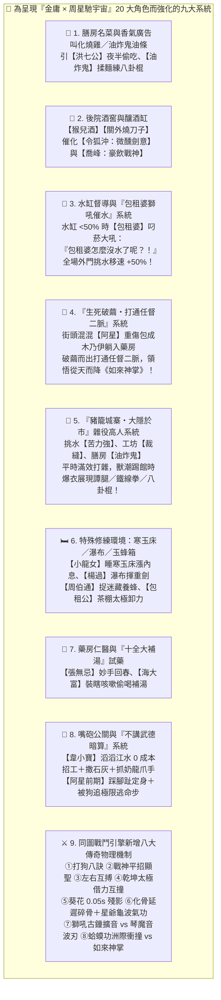

#### (1) 為了讓「金庸群俠 × 周星馳《鹿鼎記》《功夫》」活起來，我們對既有設計做的 9 項系統升級

1. **🍲 膳房（`fac.kitchen`）升級 ——「名菜品階食譜」「夜半菜香廣告」與「早點油條攤」**：
   - 高庖廚弟子（如**【黃蓉】**）可烹調四階料理：**凡菜 ➔ 佳餚 ➔ 珍饈 ➔ 絕味**（如【叫化燒雞】【玉笛誰家聽落梅】），酉時散發 `FoodAromaAd` 引來**【洪七公】**半夜翻牆偷吃！
   - 卯時早膳新增**【油炸鬼早點攤】**，由豬籠城寨隱士**【油炸鬼】**用大擀麵棍揉麵炸油條（順便把擀麵棍當成《五郎八卦棍》耍得虎虎生風！）。
2. **🍶 後院新增微型設施 ——「酒窖與釀酒缸（`fac.brewery`）」**：
   - 釀造**【猴兒百果酒】**與**【關外燒刀子】**，分別催化**【令狐沖：微醺劍意】**與**【喬峰：豪飲戰意】**。
3. **📢 水缸（`fac.vat`）與作息督導升級 ——「包租婆催水獅吼（Landlady Water Supervision）」**：
   - 完美結合我們既有的 `LIFE02 水缸系統` 與《功夫》最經典名場面！
   - 當門派水缸水量掉到 `50%` 以下時，穿著睡衣、滿頭捲髮筒的**【包租婆】**會立刻叉腰走到水缸旁，對著正在洗澡或偷懶的外門弟子發動小獅吼：**`「包租婆～怎麼沒水了呢？！水費不用錢啊？快去挑水！」`** —— 被吼到的所有外門弟子頭頂冒汗，挑水與砍柴移動速度直接 **`+50%`**！
4. **🦋 武學覺醒升級 ——「生死破繭・打通任督二脈（Meridian Butterfly Awakening）」**：
   - 專為周星馳《功夫》主角**【阿星】**設計的傳奇逆襲曲線！
   - 阿星剛進門派時手裡只有一本花十塊錢買來的地攤小人書《如來神掌》，平時打架只會使出下三濫的**【踩腳趾】**與**【被狗追練出的極限逃命步】**；
   - 但當他在保衛山門（或迎戰**【火雲邪神】**）時挺身而出遭受重擊、全身經脈盡碎被包成**【白色木乃伊繭】**抬進藥房後——經過一夜金光洗禮，他會**破繭成蝶、徹底打通任督二脈**，直接領悟從天而降、一掌轟塌半座演武場的第四階絕世神功**《如來神掌》**！
5. **🥖 外門雜務系統升級 ——「豬籠城寨・大隱隱於市（Hidden Masters in Chores）」**：
   - 下山招收外門雜役或工匠時，有機率招到《功夫》裡的**豬籠城寨三隱士：【苦力強（挑夫）】【裁縫師傅】【油炸鬼（廚師）】**。
   - 他們平時在門派裡安分守己地挑水、縫製衣服護腕、炸油條，從不顯山露水；一旦獸潮或踢館強敵攻破山門前坪，三人會同時撕開粗布衣衫，亮出宗師級的**《十二路譚腿》《洪家鐵線拳》《五郎八卦棍》**！
6. **🛏️ 特殊修練環境 ——「古墓寒玉床」「山洪瀑布台」與「百花玉蜂箱」**：
   - **【小龍女】**睡寒玉床連作夢都漲內息；**【楊過】**在瀑布下揮舞七十斤玄鐵重劍；**【周伯通】**在蜂箱旁跟小師弟玩捉迷藏傳授《左右互搏》。
7. **🏥 藥房（`fac.herbstore`）升級 ——「仁心醫館」與「十全大補湯引海大富」**：
   - **【張無忌】**坐鎮藥房妙手回春；熬出【十全大補靈湯】則引來**周星馳版【海大富（海公公）】**裝瞎咳嗽摸進藥房偷喝試藥！
8. **🎲 市集外交與奇門暗算 ——「滔滔江水嘴砲公關」與「不講武德神技」**：
   - **周星馳版【韋小寶】**下山招工靠「滔滔江水連綿不絕」**0 成本免工錢還帶回倒貼建材**；戰鬥使出**【撒石灰致盲 ➔ 抓奶龍爪手破防 ➔ 五件寶衣抹油裝死＋洋人火銃】**！
9. **⚔️ 同圖戰鬥引擎（`combat.mjs`）新增八大傳奇物理機制**：
   - 除**①打狗八訣控場、②喬峰戰神平招顯聖、③左右互搏雙招齊出、④乾坤大挪移反彈、⑤東方不敗 `0.05s` 葵花繡花針殘影、⑥海大富化骨綿掌三步延遲碎骨＋星爺版暴走龜波氣功**外，再新增《功夫》專屬的兩大視覺奇觀：
   - **⑦【獅吼功古鐘擴音 vs 六指琴魔音波刃】**：包租婆發動《獅吼功》時，若把大廳前的**【破道館青銅古鐘】**拆下來當作大喇叭擴音，環狀金色音浪威力擴大 300%，直接震碎**【天殘地缺】**彈出的無形音波刀刃與骷髏音浪，並吹飛全場敵人衣甲！
   - **⑧【火雲邪神：空手夾子彈＋蛤蟆功洲際衝撞 vs 阿星：萬佛朝宗如來神掌】**：火雲邪神可兩指夾住一切遠程暗器與韋小寶的火銃子彈，趴地鼓腮發動《蛤蟆功》化作流光撞飛防線；唯有阿星飛上雲端拍落佔據半個畫面的巨型金色掌印**《如來神掌》**方能將其鎮壓！

---

#### (2) 二十一位傳奇人物（既可選為開局主角、亦可於遊戲中偶遇招募為弟子／客卿）詳細互動與武學全表

> **📌 統一角色池設計原則**：
> - 當玩家開局選擇**「自創主角」**時，下表全部 **21 位經典角色**都會作為**「可遇見、可招募的弟子／客卿角色」**散落於江湖奇遇中，從初階開始在你的門派裡一步步成長；
> - 當玩家開局選擇其中一位**「經典角色當主角（如選【岳不群】【令狐沖】【郭靖】【韋小寶】【阿星】）」**時，該角色即成為破道館的一代掌門，其餘 20 位則成為他可以招入麾下的傳奇弟子！

| 角色原型（定位） | 如何偶遇／招募入山？（或選為開局主角） | 在地圖上的獨特日常生活表現（Sims 生活感） | 四階本命武學成長階梯 ＆ 同圖招牌絕學演出 |
|---|---|---|---|
| **⚔️ 岳不群**<br>*(君子劍・可選主角／可招募大師兄或客卿)* | **【開局可選掌門 ／ 山下君子講學奇遇招募】**：一襲青衫、溫文爾雅的氣宗劍客，極重門派禮法與名聲 | 性格模板**【君子端方】**：最愛在大廳讀書授課、督促師弟早課、下山免費義學博取美名；建好靜室後每天雷打不動閉關吐納 | **【四階漸進成長＋終局宿命分歧】**：<br>① 初階《華山基礎劍＋抱元勁》➔ ② 二階《養吾劍／希夷劍》➔ ③ 三階靜室閉關突破鎮派內功**《紫霞神功（紫氣東來護體）》＋《奪命三仙劍》** ➔ ④ **終局分歧**：堅守本心練成**《紫霞十重・混元太華劍陣》**，或受挫入魔深夜引刀速成**《辟邪劍法（0.05s 紫紅鬼魅殘影）》**！ |
| **🦋 阿星**<br>*(周星馳《功夫》主角・萬中無一武學奇才)* | **【山下街頭賣小人書 ／ 敲詐反被揍奇遇】**：派人下山時遇到一個拿著十塊錢《如來神掌》小人書、想逞威風卻總是被惡霸欺負的街頭少年（身旁還跟著愛吃冰棒的肥仔聰）！ | **開竅前**：武功極菜，去工坊幫忙卻用神級開鎖術打開所有箱子，被狗或包租婆追時展現**全門派第二快的逃命狂奔速度**！<br>**破繭後**：換上白褂黑褲，氣度淵渟嶽峙 | **【前期：踩腳趾＋扔小刀烏龍】➔【破繭打通任督二脈：如來神掌】**：<br>① 開竅前近身只會使出**【無影踩腳趾】**（踩扁敵人雙腳定身 3 秒）；<br>② 守山門遭受重創包成木乃伊後**打通任督二脈**！出關後一腳震裂青石板，縱身躍入九天雲霞，從天而降拍出覆蓋半張地圖的金色巨掌**《如來神掌・萬佛朝宗》**！ |
| **📢 包租婆**<br>*(《功夫》肥婆／小龍女・隱世大宗師)* | **【破道館收租 ／ 攜眷隱居奇遇】**：與包租公成對入駐山門後院雅室，自封門派「總管事婆」，誰敢浪費水柴就拿拖鞋追殺誰！ | 整天穿絲質睡衣、滿頭捲髮筒、嘴叼香菸在院子巡視；**只要水缸存量 `< 50%` 就叉腰大吼：`「包租婆～怎麼沒水了呢？！」`**（全場外門挑水速度瞬間 `+50%`）；看到包租公跟師姐聊天會直接從二樓丟花盆砸他頭！ | **天賦【風火輪狂奔 ＋ 大喇叭獅吼功】**：<br>① **極限飆速**：雙腿化作車輪殘影，移動速度全作第一；<br>② **《獅吼功》**：深吸一口氣轟出環狀金色音浪吹飛全場；若拿起**【青銅古鐘】**當大喇叭擴音，直接震碎整條山門地板與一切音波攻擊！ |
| **🚬 包租公**<br>*(《功夫》楊過・太極拳大宗師)* | 與包租婆一同入駐山門，平時看似怕老婆、愛偷懶的糟老頭 | 最愛端著小茶壺在茶棚跟年輕師妹泡茶講笑話，走起路來骨頭軟綿綿像隨時會跌倒；被包租婆花盆砸中頭還能笑嘻嘻摸頭繼續喝茶 | **天賦【真・太極大圓圈（借力互撞）】**：<br>當多名敵人同時圍攻他時，他雙手畫出柔順太極大圓，把左邊敵人砍來的刀勢直接牽引砸向右邊敵人的臉，讓整群踢館高手在圈內**自己撞自己、東倒西歪**！ |
| **🐸 火雲邪神**<br>*(《功夫》梁小龍版・終極踢館狂人／怪客)* | **【終極武痴踢館 ／ 被如來神掌打服留山】**：聽聞門派有絕世高手，身穿白背心、藍短褲、踩著塑膠拖鞋獨自走上山門石階找人打架（口頭禪：**`「我只是想打死兩位，或者被兩位打死！」`**） | 被阿星的《如來神掌》轟出大掌坑並拿棒棒糖感化後留駐山門；平時穿著拖鞋蹲在菜園水溝邊抓青蛙、摺紙蓮花，看起來像個怪老頭 | **天賦【唯快不破・空手夾子彈 ＋ 蛤蟆功】**：<br>① **空手夾子彈**：任何遠程弓箭、暗器甚至韋小寶的洋人火銃子彈射向他，都會被他兩根手指輕鬆夾住！<br>② **《蛤蟆功》**：四肢貼地趴下、脖子與腮幫鼓起發出蛙鳴蓄力，隨即化作洲際飛彈撞穿整排敵陣，最後還會暗算掏出**【蓮花毒鏢】**！ |
| **🪕 天殘地缺**<br>*(《功夫》琴魔雙煞・踢館／客卿組合)* | **【山門石階撫琴踢館】**：戴著墨鏡與禮帽的雙人琴師抬著古琴坐鎮山門石階，一曲未終便削斷石柱！戰敗後可留駐大廳側廊撫琴助威 | 平時坐在大廳迴廊合奏古曲（提升周圍同門練功專注度），惜字如金、酷勁十足 | **天賦【六指琴魔・無形音波刃】**：<br>超遠程塔防砲台！十指疾撥古琴，向山門走廊連續發射肉眼可見的半透明**【音波切刃】**與**【骷髏音浪】**，可與包租婆的《獅吼功》正面對波！ |
| **🥖 豬籠城寨三隱士**<br>*(苦力強／裁縫／油炸鬼・外門神級雜役)* | **【山下招工／義學偶遇隱世高手】**：下山招收雜役與工匠時偶遇這三位看似普通的勞工大叔，甘願留在門派當外門雜役過平淡日子 | **外門雜務之神**：<br>① **苦力強**：一次挑四桶水、扛三捆柴，健步如飛；<br>② **裁縫師傅**：在工坊縫製精美道袍與玄鐵鐵環；<br>③ **油炸鬼**：每天卯時在膳房揉麵炸油條香飄全院！ | **【平時打雜，危急爆衣亮真功】**：<br>山門告急時三人同時扯下粗布圍裙：<br>① 苦力強使出**《十二路譚腿》**凌空連環踢爆衝鋒獸群；<br>② 裁縫雙臂套滿鐵環使出**《洪家鐵線拳》**硬剛重兵；<br>③ 油炸鬼抄起長棍使出**《五郎八卦棍》**封死山門隘口！ |
| **🎲 韋小寶**<br>*(周星馳《鹿鼎記》版・神級公關／暗算王)* | **【山下賭坊解圍 ／ 膳房偷雞腿奇遇】**：用灌鉛骰子贏光惡霸的機靈少年；進山門後一秒鐘都不肯打木人樁（打一下就喊手痛溜走）！ | **【0 武功・滿級公關與後宮體質】**：<br>① 下山招木匠靠**`「滔滔江水連綿不絕」`**神級馬屁 **0 成本免工錢**還帶回倒貼建材！<br>② 跟所有師姐師妹聊天好感漲速 **×500%**！ | **周星馳版【不講武德暗算三連】**：<br>① **【撒石灰】**（扇形強制致盲 3 秒）➔ ② **【抓奶龍爪手】**（誇張雙手連抓強制破防＋羞恥硬直）➔ ③ **【五件寶衣抹油裝死 ＋ 洋人火銃冷箭】**！ |
| **👻 海大富**<br>*(周星馳／吳孟達版・海公公・奇遇老怪)* | **【藥房極品大補湯奇遇】**：藥房熬出「十全大補靈湯」時，彎腰駝背裝瞎邊走邊咳（`「咳咳……小桂子，把藥端來……」`）摸進藥房偷喝補湯！ | 平時走路慢如烏龜、十步一咳嗽；藥房一開火就鬼魅瞬移到藥鍋旁！與韋小寶同場每天上演考校爆笑日常 | **周星馳版兩階段神技**：<br>① **《化骨綿掌》**：敵人中掌走三步後全身骨骼如豆腐碎裂延遲內爆！<br>② **【暴走二階段・星爺版極限氣功波】**：撕開外袍肌肉暴漲，雙手推出貫穿全場的巨型藍紫氣功光柱！ |
| **🍗 洪七公**<br>*(九指神丐・奇遇宗師客卿)* | **【膳房夜半偷吃奇遇】**：膳房做出「珍饈／絕味」名菜（叫化燒雞等），亥時背紅葫蘆翻牆偷吃！連做 3 道名菜款待便留山傳功！ | 白天石亭打盹，開飯第一個衝進餐敘棚搶雞腿；邊吃邊點評廚藝與武功 | 因材施教親傳至剛**《降龍十八掌》**（金龍氣浪）與至巧**《打狗棒法》**（絆／劈／纏／轉八訣控場）！ |
| **🤪 周伯通**<br>*(老頑童・奇遇宗師／玩伴)* | **【藥園百花玉蜂箱 ／ 捉迷藏奇遇】**：跑來偷看蜜蜂、拉著外門小師弟畫圈圈玩捉迷藏 | 在院子追蝴蝶、跟小師弟猜拳打滾，最愛找純真傻小子玩 | 親傳**《空明拳》**與獨家神技**《左右互搏術》**（讓郭靖、小龍女解鎖雙手同時出兩招）！ |
| **🪡 東方不敗**<br>*(日出東方・終極拜山／幽谷高人)* | **【名震江湖終極拜山 ／ 幽谷繡莊奇遇】**：門派名聲登頂時紅衣飄然登門切磋 | 平時在靜室刺繡賞花，舉手投足妖異優雅 | **【葵花極速・一針破萬軍】**：出招前搖僅 **`0.05s`**，拉出鮮紅殘影、一枚**【繡花針】**半秒連點五敵死穴！ |
| **🍶 令狐沖**<br>*(浪子劍癡・頂級潛力弟子)* | **【下山酒肆解圍 ／ 屋頂偷喝猴兒酒奇遇】** | 打木人樁哈欠連天；最愛去酒窖喝猴兒酒後找同門輪流切磋拆招 | **【微醺劍心 ＋ 獨孤九劍】**：捕捉敵人 `Buildup` 起手破綻紅芒 **`0s` 後發先至疾刺打斷**，修滿【五破圖譜】！ |
| **🐉 喬峰／蕭峰**<br>*(天生戰神・頂級潛力弟子／結義大哥)* | **【後山暴雨獸潮・並肩死戰奇遇】**：徒手生撕野豬王，戰後連乾三碗【關外燒刀子】義結金蘭 | 砍柴一劈三倍量；晚膳與師弟大碗喝酒，全場膽識（`stable`）暴漲 | **【天生戰神・平招顯聖】**：第一階《太祖長拳》打出三階威力；敵越多越快，**《降龍十八掌・亢龍有悔》**金龍咆哮貫穿走廊！ |
| **🪨 郭靖**<br>*(至拙大俠・頂級潛力弟子)* | **【下山免費義學・散場大雨獨練三百遍】** | `☷ 坤為地【抱樸守拙】`代表，每天主動挑滿水缸、深夜苦練基礎拳 | 把第一階《羅漢拳》練至 **Lv10【返璞歸真】**，配合**《左右互搏》**左手羅漢拳、右手**《降龍十八掌》**雙招同發！ |
| **🎋 黃蓉**<br>*(蘭心廚仙・頂級潛力弟子)* | **【尋罕見靈筍香草入山借灶做菜】** | 庖廚與機巧滿級，研發【叫化燒雞】【二十四橋明月夜】引來洪七公 | 塔防佈置**【奇門桃花石陣】**讓敵群迷路繞圈，手持翠竹棒施展**《打狗棒法・絆／轉字訣》**！ |
| **🦅 楊過**<br>*(狂傲孤俠・頂級潛力弟子)* | **【後山斷崖救孤 ／ 神鵰引路奇遇】** | 孤傲敏感，最愛去**【後山山洪瀑布】**頂激流揮舞七十斤玄鐵重劍 | **【玄鐵重劍無鋒 ＋ 黯然銷魂掌】**：重劍拍出扇形巨浪；道侶不在身側時孤寂爆發 300% 暴擊《黯然銷魂掌》！ |
| **❄️ 小龍女**<br>*(古墓仙子・頂級潛力弟子)* | **【藥園百花盛開・玉蜂引路奇遇】** | 晚上睡**【古墓寒玉床】**（睡覺自動高速漲內息），白天照料玉蜂箱 | 驅動玉蜂群協防；雙手《左右互搏》，與楊過相鄰守點觸發**《玉女素心劍・雙劍合璧》**！ |
| **☯️ 張無忌**<br>*(仁心醫仙・頂級潛力弟子)* | **【後山採藥救治寒毒仁醫少年奇遇】** | 醫術滿級治百病，打坐散發《九陽神功》暖光助同房師兄弟回精力 | **《九陽神功》** 5 倍回氣；守點展開**《乾坤大挪移／太極拳》**，把敵人暗器與**海大富的龜波氣功**原封不動反彈回去！ |
| **🦢 段譽**<br>*(慈悲書癡・頂級潛力弟子)* | **【後山懸崖救起賞花跌落書生】** | 不殺生不打樁（打獵會偷放生山雞），看山讀經泡茶自動暴漲內息 | **《凌波微步》** 80% 閃避游走回氣；同伴危急或內息溢滿時爆發**《六脈神劍》**六道無形雷射清屏！ |

---

#### (3) 🌟 同一張地圖上的「金庸 × 周星馳宇宙」神級跨界名場面

當這 20 位角色在我們同一個 60Hz 門派大院裡生活與守山門時，每一天都會誕生讓人笑出眼淚又熱血沸騰的名場面：
1. **【豬籠城寨早晨日常：包租婆催水 × 韋小寶搖骰子 × 令狐沖喝悶酒】**：
   - 卯時晨鐘剛響，水缸剩 40% 水，穿著睡衣捲髮筒的**【包租婆】**立刻叉腰站在院子中央大吼：**`「包租婆～怎麼沒水了呢？！」`** 正在洗臉的外門師弟跟**【苦力強】**嚇得飛奔去溪邊挑水；二樓**【包租公】**剛想端茶壺去找**【小龍女】**搭訕，直接被包租婆一記花盆砸中腦門；而**【韋小寶】**正蹲在膳房門口偷吃**【油炸鬼】**剛炸好的油條，順便對路過的**【洪七公】**大拍馬屁！
2. **【跨宇宙終極踢館大戰：火雲邪神 ＆ 海大富 vs 阿星 ＆ 張無忌 ＆ 韋小寶】**：
   - 當穿著白背心拖鞋的**【火雲邪神】**與暴走撕衣的**【海大富】**聯手闖陣時：
     - **【韋小寶】**衝上去先撒一把**【白石灰】**再掏出**【洋人火銃】**開槍，結果火雲邪神兩根手指輕鬆夾住子彈冷笑：**`「天下武功，無堅不摧，唯快不破！」`** 韋小寶嚇得立刻抹油躺地裝死！
     - 海大富雙手合十轟出貫穿全場的**【星爺版超巨型龜波氣功】**，卻被陣眼上的**【張無忌】**一記**《乾坤大挪移》**加上**【包租公】**的**《太極大圓圈》**硬生生牽引轉向，反轟在正趴地準備發動《蛤蟆功》的火雲邪神頭上！
     - 最後，剛打通任督二脈的**【阿星】**從九天雲端一躍而下，伴隨莊嚴激昂的古曲拍出一記遮天蔽日的**《如來神掌・萬佛朝宗》**，把整個青石演武場拍出一個巨大的五指掌印坑！火雲邪神跪地抱拳：**`「這是什麼掌法？！」`** 阿星淡淡一笑：**`「想學啊？我教你啊！」`** —— 這就是這座門派獨一無二的終極浪漫！

---

## 三、 從破道館到門派大成：分階段開發路線圖（S0 ～ S6）

為了確保每一步都像先前的 `LP04–HOME02` 一樣**「每一包都能在瀏覽器直接看到、玩到，且不破壞既有手感」**，我們將整個重構與擴建拆解為 **7 個可獨立驗收的里程碑（S0–S6）**：

| 階段 | 里程碑名稱 | 玩家在畫面上玩到什麼 | 核心技術與系統交付 | 複用的 `dev` 資產與對應 Issue |
|---|---|---|---|---|
| **S0** | **新核心同感移植**<br>*(Parity Slice)* | 現有山居畫面、師徒兩人挑水／採藥／泡茶／砍柴修寢舍／練掌，手感與路長與舊版 100% 一致，但底層已換成 N 人資料與設施廣告核心 | 建立 `sect-chronicle/life/core/`：`SmartObject` 設施表、`ReservationBroker`、導航圖＋走廊尋路、4 層決策仲裁器；舊 `demo/` 凍結為對照組 | `art184-watercolor`、`home01`、`home02`、`SCENE-04` S0 底圖；[#314](https://github.com/lalagrass/earth-ascension/issues/314)、[#315](https://github.com/lalagrass/earth-ascension/issues/315)、[#316](https://github.com/lalagrass/earth-ascension/issues/316) |
| **S1** | **破道館開局、性格心印與備料招工**<br>*(Ruined Dojo, Persona & Construction)* | 新開局只有漏雨大廳、荒草院落與師徒＋小女孩 3 人；創角／查看「八維性格＋道家心性稱號＋古風批命詩＋三問心印（預設自動勾選）」；除草得茅草、拾荒得青石、砍柴得原木搬入工地備料樁，備齊後可選**【雇請山下工匠】**或**【同門協建】**修好大廳屋頂與第一間雙人寢舍 | 實裝三層性格與三問心印系統（#106、#163）、門派時辰作息鐘（卯時早課～亥時就寢）、工地備料佇列（`ConstructionStaging`）與山下短工招募 | `SCENE-04` `S0-clean.jpg`、`home01/dojo_hall_s0.png`、`home02/dorm_*`；[#106](https://github.com/lalagrass/earth-ascension/issues/106)、[#163](https://github.com/lalagrass/earth-ascension/issues/163)、[#321](https://github.com/lalagrass/earth-ascension/issues/321) |
| **S2** | **人間煙火：菜園、膳房與藥園**<br>*(Homestead & Upkeep)* | 開墾東南菜園與藥園、修復西院膳房大陶灶與餐敘棚；看到弟子「挑水灌溉 → 種菜收成 → 膳房生火煮飯 → 午時圍桌共食」與「採藥 → 晾藥 → 煎靈茶」的完整生活循環；煮出的熱飯菜可用來招待山下工匠或訪客 | 新增「飽足（Hunger）」需求與「農藝、庖廚、藥理」技能成長；實裝餐敘棚多人同桌共食與席間閒聊 | `SCENE-04` `S1-clean.jpg`、`lp16` 藥圃、`home01/tea_stove.png`；[#160](https://github.com/lalagrass/earth-ascension/issues/160)、[#317](https://github.com/lalagrass/earth-ascension/issues/317) |
| **S3** | **同圖武學：外功場、傳功與切磋**<br>*(Same-Map Martial Arts)* | 收集木石擴建大廳前東側「外功演練場」（木人樁＋兵器架）；師父在大廳傳授《青松掌法》第二式與《齊眉棍法》；弟子打樁練熟、同門在院中點到為止切磋，肉眼看出起手變快、掌風變大、輕功跳過溪石 | 武學與招式資料化（`arts.mjs`：扇形／圓弧／直線幾何碰撞、熟練度參數內插）、地圖招式特效層（掌風、棍影）、輕功地形捷徑 | `palm.mjs`、`train01.mjs`、`template/actions.json`；[#305](https://github.com/lalagrass/earth-ascension/issues/305)、[#318](https://github.com/lalagrass/earth-ascension/issues/318) |
| **S4** | **義學識人、外門雜務定額與結契成家**<br>*(Outreach, Outer/Inner Sect & Family)* | 派主角／師兄**下山免費義學講武**識出潛力苗子，或接待山門**慕名拜師者**；新弟子從**【外門弟子】**做起，每天做滿 `3 件雜務定額` 幫門派挑水砍柴收集建材（**徹底解放主角與內門專注練武！**），申時去外功場旁聽練拳；根骨達標後晉升**【內門弟子】**，並與成年知己結為道侶搬入雙人廂房 | 雙軌招人（下山義學識人＋慕名叩門）、外門／內門輩分與每日雜務定額（`ChoreQuota`）、因果關係記憶帳本（`SocialLedger`）、雙人房床位同住分配 | `#337 SOCIAL01`、[#188](https://github.com/lalagrass/earth-ascension/issues/188)、[#319](https://github.com/lalagrass/earth-ascension/issues/319)、`NPC_LIFE_RECRUITMENT_DRAFT`、`SHANJIANDAO_DRAFT` |
| **S5** | **塔防演武與後山狩獵**<br>*(TD Martial Drill & Hunt)* | 建起東北山門與後山望台；在演武場擺放弟子守點與方針，迎擊機關傀儡波次檢驗武學；派狩獵隊上後山打獵扛回獸肉加菜，並在獸潮來襲時擺陣守衛山門，結算詳細因果戰報 | 守點陣位（`DefenseSlot`）與三種應戰方針（固守／迎擊／護衛）、演武波次腳本器、後山生態棲地與獸肉掉落搬運、結構化戰報 UI | `patrol.mjs`、`SCENE-04` `S2-clean.jpg` 望台與山門；[#219](https://github.com/lalagrass/earth-ascension/issues/219)、[#290](https://github.com/lalagrass/earth-ascension/issues/290)、[#320](https://github.com/lalagrass/earth-ascension/issues/320) |
| **S6** | **宗門氣象與傳承存檔**<br>*(Sect Mastery & Persistence)* | 6–10 名外門／內門弟子在完整 S2 山門中井然有序地分擔雜務、授業、成家、守山；大師兄能代師父指點外門新師弟；支援完整新核心版本化存讀檔與回放 | 資深弟子代授課機制、新核心 `save v1` 序列化與 deterministic replay 驗證、窄螢幕／手機版面適配 | `life-save.mjs`、`SCENE-04` 全圖 23 設施完成態 |

---

## 四、 關鍵資料結構規格預覽（Data Contracts Preview）

為了讓後續每個階段都能乾淨實作，新核心統一採用純 JSON 可序列化的資料結構：

```javascript
// 1. 角色／弟子統一實體結構 (Unified Protagonist & Disciple Entity)
const discipleExample = {
  id: 'disc.hero',
  name: '岳不群',          // 支援自創姓名，或直接選經典角色（如 '岳不群' / '令狐沖' / '郭靖' / '韋小寶' / '阿星'）
  originMode: 'preset_iconic', // 'custom_point_buy' (自創配點＋問卷) | 'preset_iconic' (經典角色模板，開局未選者自動轉入江湖奇遇招募池)
  destinyTreeId: 'destiny.yue_buqun', // 綁定四階本命武學成長與宿命分歧樹（如：抱元勁 ➔ 養吾劍 ➔ 紫霞神功 ➔ 紫霞十重 vs 辟邪劍法）
  role: 'senior',          // 'master' | 'senior' | 'inner_disciple' | 'outer_disciple' | 'hired_artisan' | 'adopted_kin' | 'visiting_npc'
  innateStats: {           // 先天五維配點（基礎 30 點自由分配 ＋ 課金/成就天命加點池）
    comprehension: 7,      // 悟性 (1~10)：決定高階領悟與破綻捕捉；≤3 解鎖羅漢拳Lv10與左右互搏
    constitution: 6,       // 根骨 (1~10)：決定內息上限、藥浴吸收與紫霞/九陽修練門檻
    strength: 5,           // 臂力 (1~10)：決定挑水負重、玄鐵重劍門檻與擊退力道
    agility: 7,            // 身法 (1~10)：決定移速、出招前搖縮減與凌波/葵花/辟邪殘影
    composure: 8,          // 定力/福緣 (1~10)：決定閉關突破率、抗入魔定力（影響辟邪分歧）與奇遇率
    destinyBonusPoints: 10,// 課金／天命成就額外注入點數
    innatePerks: ['perk.gentleman_sword'] // 先天命格詞條（如【君子端方】【萬中無一】【滔滔江水】）
  },
  sectRank: {
    tier: 'inner',         // 'laborer' (山下短工) | 'outer' (外門弟子) | 'inner' (內門弟子) | 'senior' (親傳首座)
    dailyChoreQuota: 0,    // 外門預設 3～4 件/日；內門與主角為 0（免除日常雜務，僅危急 <15% 時補位）
    choresDoneToday: 0,
    sectContribution: 120, // 外門做滿雜務累積貢獻，達標且根骨/基礎掌法 Lv2 可行【入室奉茶禮】晉升內門
    canTeachOutreach: true // 可否代表門派下山免費義學講武
  },
  ageGroup: 'adult',       // 'adult' | 'youth' (決定關係軌道：youth 僅限親情/同門守護)
  persona: {
    base: { open: 0.70, conscientious: 0.88, extravert: 0.65, agreeable: 0.72, stable: 0.60, explore: 0.55, safe: 0.82, care: 0.65 },
    current: { /* 隨重大記憶與踢館勝負微調，影響第四階宿命分歧抉擇 */ },
    changes: [{ tick: 14400, eventId: 'evt.boar_repel_1', delta: { stable: +0.03, explore: +0.02 } }],
    archetype: 'ESTJ',
    daoTitle: '君子端方',
    natalPoem: ['紫氣東來映華山', '有所不為立人間'],
    heartSeal: {
      code: 0b111,         // ☰ 乾為天【積極進取／重振門楣】（預設由 current 性格自動推導預選）
      overriddenByPlayer: false
    },
    autopilot: {           // 零手動・全自動個性驅動開關（玩家不動手時，由性格自動執行個人修練與掌門經營決策）
      enabled: true,
      macroSectPolicy: 'prestige_and_inner_qi' // 按性格自動決定擴建優先序、下山義學與閉關時機
    }
  },
  needs: {
    energy: { current: 78, max: 100, restAt: 30, backAt: 80 },
    satiety: { current: 85, max: 100, hungryAt: 25 } // S2 膳房完工後啟用
  },
  skills: {
    legStrength: { level: 3, exp: 4, nextExp: 6 },
    physique: { level: 2, exp: 1, nextExp: 4 },
    qinggong: { level: 1, exp: 0, nextExp: 3 },
    herbalism: { level: 2, exp: 3, nextExp: 4 },
    farming: { level: 1, exp: 0, nextExp: 2 },
    cooking: { level: 1, exp: 0, nextExp: 2 },
    construction: { level: 2, exp: 2, nextExp: 4 }
  },
  martial: {
    equippedArt: 'art.pine_palm',
    arts: {
      'art.pine_palm': {
        level: 3,          // 0=初學, 3=熟練, 5=大成
        moves: {
          'move.push_mountain': { proficiency: 0.85 },
          'move.wave_palm': { proficiency: 0.30 }
        }
      }
    },
    defenseDoctrine: 'intercept' // 'hold' 固守 | 'intercept' 迎擊 | 'protect' 護衛
  },
  patrolRecord: {          // 分段里程巡山清怪與性格流派紀錄 (#104 / #290 PF4)
    styleMode: 'methodical_clear', // 'stealth_bypass' (韋小寶神行百變溜邊摸金流) | 'methodical_clear' (郭靖除惡務盡100%肅清流) | 'elite_hunter' (令狐沖專找強敵流) | 'juggernaut' (喬峰橫推流)
    furthestStage: 'S3',   // 'S0' 巡山口 | 'S1' 翠竹坡 | 'S2' 亂石坳 | 'S3' 迷霧林緣 | 'S4' 斷崖激流 | 'S5' 獸王古窟
    furthestDistance: 860, // 沿主路推進的最遠世界單位距離（不含折返與離路追逐）
    lastReport: {
      distanceReached: 860,
      clearedStages: ['S1', 'S2', 'S3'], // 只有肅清完成度達標才列入（韋小寶純溜過不計入已肅清！）
      clearanceRate: 1.00, // 走過路段肅清完成度（郭靖 100% vs 韋小寶 0%）
      downedCount: 8,      // 擊倒數（依獨立個體 ID 去重）
      drivenOffCount: 1,   // 喝止／震退大型野獸數
      escapedCount: 0,     // 逃脫數（反映追擊移速與起手秒殺效率：0 代表完美追擊！）
      bypassedCount: 0,    // 繞避數（韋小寶《神行百變》抹油溜過的怪數，遇到 S4 封路黑熊 Blockage 95% 才被迫折返）
      returnReason: 'retreat_budget', // 'retreat_budget' (觸及回程安全線+8) | 'chokepoint_blocked' (韋小寶被巨獸封路) | 'high_threat' | 'full_clear' | 'player_recall'
      deltaVsPrevious: { distanceGain: +540, escapedRateDrop: -0.60, avgKillTicksDrop: -0.58 }
    },
    strengthShowcaseTier: 3 // 1=手痛初學, 2=木樁搖晃落葉飛, 3=打斷木樁青石裂+野鼠遠遁, 4=五指掌坑/瀑布斷流+山門石碑留名
  },
  housing: {
    roomId: 'fac.dorm.a',
    bedId: 'bed-1',
    householdId: 'house.founders'
  },
  decision: {
    tier: 3,               // 1=玩家指令, 2=必要自理, 3=門派作息(外門先清雜務定額/內門專注練武), 4=心印自主偏好
    currentActivity: { facilityId: 'fac.yard', activityId: 'drillMove', stationId: 'post1', phase: 'active', progressTicks: 240 },
    pendingIntent: null,
    explain: {
      doing: '在外功場演練《青松掌・推山掌》',
      reason: '內門弟子免雜務（外門師弟阿牛已接手挑水）・專注未時武課',
      nextPlan: '酉時去茶爐泡藥茶，與阿秀閒聊'
    }
  }
};

// 2. 建築擴建與備料招工結構 (Construction Staging & Artisan Hiring)
const constructionSiteExample = {
  facilityId: 'fac.yard',
  targetStage: 'S1',
  phase: 'ready_to_build', // 'staging_materials' (收集建材中) | 'ready_to_build' (備齊待招工) | 'building' (施工中) | 'completed'
  stagingPile: {
    timber: { current: 6, required: 6 }, // 砍柴/伐木收集
    stone:  { current: 4, required: 4 }, // 清理破屋瓦礫/後山採石收集
    thatch: { current: 4, required: 4 }  // 院落除草/採竹收集
  },
  workforce: {
    mode: 'hire_artisans', // 'hire_artisans' (雇請山下工匠) | 'sect_disciples' (門內外門弟子協建) | 'hybrid'
    hiredArtisans: ['npc.carpenter_lin'], // 辰時上山施工、午時膳房吃飯、好感滿可求拜外門
    progressTicks: 720,
    totalTicks: 1800
  }
};
```

---

## 五、 社群與開源架構深度借鏡：十大系統優化設計

我們結合專案內已核對的一手開源研究（[SIMS_LIFE_RESEARCH](../SIMS_LIFE_RESEARCH.md)、[MARTIAL_ARTS_RESEARCH](../MARTIAL_ARTS_RESEARCH.md)、[PATROL_DEFENSE_RESEARCH](../PATROL_DEFENSE_RESEARCH.md)、[ROOM_BEDS_RESEARCH](../ROOM_BEDS_RESEARCH.md)、[CHARACTER_PANEL_RESEARCH](../CHARACTER_PANEL_RESEARCH.md)、[RAT_POPULATION_MODELS](../RAT_POPULATION_MODELS.md)）與模擬經營／動作開源社群的成熟設計模式，在不引入笨重外部引擎或破壞純 JS 60Hz 確定性核心的前提下，對十大子系統進行架構優化：

### 5.1 開源專案借鏡與取捨總表（附授權與採用邊界）

| 系統領域 | 參考開源專案／架構（授權） | 我們借鏡的核心設計與演算法 | 刻意不照搬的部分（防膨脹邊界） |
|---|---|---|---|
| **1. 設施廣告與防乒乓自主 AI** | **[FreeSO](https://github.com/riperiperi/FreeSO)**（MPL-2.0，《模擬市民》SimAntics VM 開源重製）＋ EA 2026 自主修正 | **物件廣告（Object Advertisement）＋ 距離與重複衰減（Attenuation）＋ 遲滯門檻（Hysteresis）**：設施宣告「滿足什麼需求、對哪種性格吸引力多高」；加上距離成本與近期做過的冷卻衰減，徹底解決小人反覆橫跳 | 不搬 SimAntics bytecode 虛擬機，不一次塞入膀胱／衛生等瑣碎生理條 |
| **2. 原子工序與預約清理** | **RimWorld 架構模式（`JobDriver` / `Toil` / `ReservationManager`）** ＋ **[open-northland](https://github.com/s-nems/open-northland)**（MIT，TypeScript 確定性殖民地模擬） | **五種原子工序（Toil Pipeline）＋ 自動釋放鉤子（`onCleanup`）**：把所有工作拆成 `Reserve ➔ Goto ➔ Interact/Pickup ➔ Haul ➔ Deliver` 五種標準 Toil；任何工序被玩家打斷或因危險中止時，自動觸發 `onCleanup` 釋放站位與退還材料 | 不做過於繁瑣的「地上一塊塊掉落物拾取地獄」，在途貨物按守恆規則直接交付或退回倉儲 |
| **3. 擴建不丟身份與空間尋路** | **[OpenKeeper](https://github.com/tonihele/OpenKeeper)**（GPLv3，`RoomLairControl`）＋ **[EasyStar.js](https://github.com/prettymuchbryce/easystarjs)**（MIT，輕量格點 A*） | **三權分離（`ownerId` 床主 ／ `occupantId` 使用者 ／ `reservedBy` 預約者）＋ 增量站位擴建**：宿舍從 2 床擴建為 6 床時，保留原 `bed-1/2` ID 與床主綁定，只增量掛載 `bed-3..6`；院內動態障礙用同步確定性 A* | 不在每次升級建築時刪除重建實體；不讓非同步尋路延遲影響 60Hz 確定性回放 |
| **4. 武學「學會≠練熟」與三段式出招** | **[Cataclysm: DDA](https://github.com/CleverRaven/Cataclysm-DDA)**（CC-BY-SA 3.0，武學 JSON 與熟練度提案 `#62964`）＋ **[Veloren](https://github.com/veloren/veloren)**（GPLv3，`basic_melee.rs`） | **招式定義與熟練度解耦 ＋ `Buildup(起手) ➔ Action(判定) ➔ Recover(收勢)` 三段狀態機**：師父傳授僅解鎖 Lv0 架子，透過打樁／切磋／實戰連續內插縮短起手幀並擴大幾何判定區 | 不搬 CDDA 複雜的部位傷殘與百種 buff；不用 Pixi 渲染幀碰撞，命中 100% 由權威模型幾何結算 |
| **5. 塔防路徑可讀性與安全撤退預算** | **[Mindustry](https://github.com/Anuken/Mindustry)**（GPLv3，路徑成本與防線）＋ **[Zero-K](https://github.com/ZeroK-RTS/Zero-K)**（GPLv2，`cmd_retreat.lua`）＋ **[Beyond All Reason](https://github.com/beyond-all-reason/Beyond-All-Reason)**（GPLv2） | **戰術姿態（固守 Hold ／ 迎擊 Intercept ／ 護衛 Protect）＋ 返程精力安全線（`RetreatMargin = 回程路耗 + 遭遇緩衝`）**：讓塔防演武與後山狩獵既有清楚來路與陣位，又能自主知難而退、不送死 | 不做無限膨脹刷波、不做基地核心爆破 Game Over、不要求玩家微操風箏 |
| **6. 因果社交記憶與有界生態** | **RimWorld（`Thought_MemorySocial`）** ＋ 本專案 **`earth_ascension/m2.py`（`memories_v2` `#2`、`#5`）** ＋ **[#219 資源限制族群 B 案](../RAT_POPULATION_MODELS.md)** | **可追溯事件記憶帳本（Shared Memory Ledger）＋ 資源守恆育幼生態**：每點好感都對應一筆有時間、有地點的共同經歷；後山野獸只有在偷到／覓得足夠食糧時才會繁衍新個體 | 不搞無因果數字好感條；後山野獸不憑空計時無限刷出 |
| **7. 工地備料佇列與搬運／工匠分離** | **[Widelands](https://github.com/widelands/widelands)**（GPL-2.0，`ConstructionSite` 備料佇列）＋ **[Stonehearth](https://github.com/stonehearth/stonehearth)**（MIT/Apache-2.0，搬運工與木匠分離）＋ **[Project Porcupine](https://github.com/OrderOfThePorcupine/ProjectPorcupine)**（GPLv3）＋ **《Clanfolk》客匠短工** | **藍圖備料樁（Staging Pile）＋ 備齊招工開建（雇請山下匠人 vs 門內協建）**：除草／拾荒／砍柴自然產出茅草、青石與原木，親手搬到工地堆滿後，可花熱飯茶水請山下木匠上山蓋房，不打斷弟子練功 | 不做繁瑣的二十種建材加工鏈（只留原木、青石、茅草三種直觀建材）；不在材料未到齊前空敲空氣蓋房 |
| **8. 公開義學識人與「外門雜務定額 vs 內門專武」** | **《Dwarf Fortress》公會堂公開講學（Guildhall Demonstrations）** ＋ **《了不起的修仙模擬器》外門／內門二元分工** ＋ **《Oxygen Not Included》職責優先序矩陣** | **下山義學動態識人 ＋ 外門每日雜務定額（`ChoreQuota`）自動解放內門**：派人下山免費教拳，從村民跟練反應識出良才；新弟子從外門做起，每天做滿 3 件雜務才解鎖晚課習武，讓主角與內門弟子 100% 從挑水砍柴中解放、專心武道 | 不搞手遊式「花錢十連抽卡招弟子」；不讓掌門與真傳大弟子在門派壯大後還被低階雜務打斷閉關 |
| **9. 四階武學進階樹、閉關領悟與著書傳承** | **《天下霸圖》武學進階／五力領悟樹** ＋ **[Tales of Maj'Eyal (ToME4)](https://github.com/NetCoreGames/tome4)**（GPLv3，天賦樹專精倍率與跨系協同解鎖）＋ **[Path of Building](https://github.com/PathOfBuildingCommunity/PathOfBuilding)**（MIT，節點前置與專精加乘圖） | **雙前置武學 ＋ 四維根基門檻（臂力／腰腿／身法／內息）➔ 切磋頓悟／靜室閉關領悟高階武學 ➔ 撰寫手札入藏經閣傳承**：讓基礎武功成為通往絕世神功的必經基石，每往上一階都有同圖可見的新幾何特效與戰術定位 | 不做《天下霸圖》原版需農到 9000 次的枯燥數值坑；不因自創門派鎖死終極武學（所有高階武學皆可透過領悟與著書解鎖） |
| **10. 低悟性「基礎羅漢拳・登峰造極／返璞歸真」** | **[Dungeon Crawl Stone Soup (DCSS)](https://github.com/crawl/crawl)**（GPLv2，`skills.cc` / `fight.cc` 基礎徒手格鬥 Lv1→27 點傷累加與攻速減半公式）＋ **《金庸群俠傳》野球拳／《天龍八部》太祖長拳／《活俠傳》基礎拳掌極限流** | **破限專精（Lv5 常規上限 ➔ Lv6～Lv10 登峰造極／返璞歸真）**：悟性不足讀不懂高深秘笈、但性格【抱樸守拙】的弟子，一生專練一門第一階《羅漢拳／青松掌》，解鎖 **0.15s 零前搖瞬發 ＋ 0 內息消耗 ＋ 霸體破招震暈** | 不把低悟性弟子當成後期必淘汰的廢卡；不強制要求全門派每個人都走同一條高悟性劍仙路線 |
| **11. 劍道無上魅力《獨孤九劍》（無招勝有招・後發先至）** | **[Cataclysm: DDA](https://github.com/CleverRaven/Cataclysm-DDA)**（CC-BY-SA 3.0，`data/json/techniques.json` 的 `dodge_counter / block_counter` 與 `required_buffs_all` 條件破綻反擊）＋ **[Veloren](https://github.com/veloren/veloren)**（GPLv3，`Buildup` 起手前搖破綻截擊）＋ **《笑傲江湖》獨孤九劍「見招拆招」** | **敵手前搖破綻截擊（`onTargetBuildupFlaw`）＋ 0s 跳過己方前搖後發先至 ＋ 五破圖譜（破掌／破棍／破劍／破箭／破氣）**：對手處於 `Buildup` 起手瞬間亮起破綻紅芒，九劍傳人零前搖疾刺破綻、強制打斷對手大招；且**木人無招不可練，唯有與活人切磋／拆招才能精進對應破式** | 不把獨孤九劍做成無腦全屏飛劍轟炸（那屬於道門《太清御劍術》）；九劍魅力在於「敵越強、招越繁，破綻越明顯」的精準截擊 |
| **12. 二十一位傳奇宗師與頂級潛力弟子（金庸群俠 × 周星馳《鹿鼎記》《功夫》宇宙）** | **《金庸群俠傳》開源重製社群（[kys-cpp](https://github.com/scarsty/kys-cpp) / [jynew](https://github.com/jynew/jynew) GPLv3）** ＋ **《Dwarf Fortress》個人嗜好** ＋ **《RimWorld》特質驅動（`TraitDef` / `Hospitality`）** ＋ **周星馳《鹿鼎記》《功夫》經典名場面致敬** | **九大系統連動（名菜引洪七公、包租婆水缸 <50% 獅吼催水、阿星重傷木乃伊破繭打通任督二脈領悟《如來神掌》、豬籠城寨三隱士平時打雜危急爆衣、十全大補湯引海大富、韋小寶滔滔江水 0 成本招工＋撒石灰＋抓奶龍爪手）＋ 八大傳奇戰鬥物理機制** | 不做成課金抽卡池；所有傳奇宗師與頂級弟子皆由玩家在山門經營出的美食、水缸、藥湯、寒玉床與義學奇遇自然觸發 |
| **13. 雙軌開局創角（五維配點＋問卷 vs 選經典角色如岳不群）、天命課金加點與「零手動全自動個性驅動」** | **[Cataclysm: DDA](https://github.com/CleverRaven/Cataclysm-DDA)**（CC-BY-SA 3.0，多池自由配點 `newcharacter.cpp`）＋ **[FreeSO](https://github.com/riperiperi/FreeSO)**（MPL-2.0，高自由意志 AI）＋ **[Progress Quest](https://bitbucket.org/grumdrig/pq)**（GPL，零手動自走 RPG）＋ **[ToME4](https://github.com/NetCoreGames/tome4)**（GPLv3，專屬宿命進階樹） | **統一角色模板（自創五維配點＋天命課金加點＋5 題情境問卷 vs 直接選經典角色當主角，未選者轉入可招募弟子池）＋ 零手動掌門自走引擎（`SectLeaderAutopilot`：玩家不動手時由個性自動修練與自動敲鐘招工／義學收徒）＋ 四階本命武學與宿命分歧樹（如岳不群：抱元勁 ➔ 養吾劍 ➔ 紫霞神功 ➔ 紫霞十重正道 vs 引刀自宮辟邪劍法）** | 不讓經典角色開局就滿級秒殺全場（必須從破道館第一階順著性格一步步練起）；不強制要求玩家每分鐘微操點滑鼠 |
| **14. 全自動觀影導演鏡頭與「10 秒確定性名場面重播」** | **[OpenTTD](https://github.com/OpenTTD/OpenTTD)**（GPLv2，`Extra Viewport` 子母畫面與新聞快訊）＋ **RimWorld（`LetterStack` 事件分級）** ＋ **[Ikemen GO](https://github.com/ikemen-engine/Ikemen-GO)**（MIT，格鬥確定性重播） | **三級事件分流 ＋ 傳奇名場面自動推鏡慢動作（Director Auto-Zoom）＋ 確定性高光書籤重播（Instant Replay Clip）**：在零手動自走模式下，日常小事不打擾，但遇到「洪七公偷吃、阿星破繭如來神掌、岳不群深夜引刀自宮」時自動推鏡特寫並存下快照，玩家倒水回來也能一鍵重播剛才錯過的 10 秒名場面！ | 不做佔用大量記憶體的影片錄製（直接利用 60Hz deterministic snapshot + 600 ticks 重演，僅佔幾 KB！） |
| **15. 同圖混戰三層視覺降噪與「0.12s 破招頓幀」** | **[Zero-K](https://github.com/ZeroK-RTS/Zero-K)**（GPLv2，RTS 圖層優先序與地面預警）＋ **[Ikemen GO](https://github.com/ikemen-engine/Ikemen-GO)**（MIT，`Hitstop` 破招頓幀與書法字標） | **地面 25% 水墨陣法層 ＋ 決定性破招 `0.12s` 頓幀（Hitstop）＋ 非戰鬥雜役自動退廊圍觀**：解決 12 人＋20 怪同圖施展金龍、獅吼、龜波氣功時的畫面光害，讓《獨孤九劍》破招與《乾坤大挪移》反彈瞬間清晰無比 | 不做遮擋全螢幕的浮誇粒子特效；不讓挑水路過的雜役卡在戰場正中央 |
| **16. 純 JSON 宣告式宿命樹引擎與「說書人節奏閥門」** | **[inkjs](https://github.com/y-lohse/inkjs)**（MIT，純資料條件狀態圖）＋ **RimWorld（`Storyteller` 人口與事件節奏控制）** ＋ **[ToME4](https://github.com/NetCoreGames/tome4)**（GPLv3，跨周目天命解鎖池） | **零硬編碼 `destiny-trees.json` ＋ 設施因果門檻（一旬最多 1 位傳奇奇遇）＋ 開局世界畫風濾鏡（正統武俠／星爺無厘頭／全明星）＋ 跨周目天命傳家寶**：新增第 22 位傳奇角色只需填 30 行 JSON；達成名場面可免費獲天命點並解鎖該角色為下局主角！ | 絕不在 `model.mjs` 裡寫 21 套角色專屬 `if-else`；絕不在開局前 10 分鐘把所有神級角色一次塞爆破道館 |
| **17. 分段里程巡山清怪、四大性格巡山流派（韋小寶溜邊 vs 郭靖全清）與非數值強度回饋** | 本專案 **[#104](https://github.com/lalagrass/earth-ascension/issues/104) / [#290](https://github.com/lalagrass/earth-ascension/issues/290)（[PATROL_DEFENSE_RESEARCH](../PATROL_DEFENSE_RESEARCH.md)）** ＋ **[DCSS](https://github.com/crawl/crawl)**（GPLv2，`Stealth Pass-by` 潛行溜怪 vs `Tab-Clear` 全清）＋ **[Zero-K](https://github.com/ZeroK-RTS/Zero-K)**（GPLv2，`cmd_retreat.lua` 與交戰姿態）＋ **[Path of Building](https://github.com/PathOfBuildingCommunity/PathOfBuilding)**（MIT） | **S0～S5 六段里程試煉 ＋ 性格驅動四大巡山流派（韋小寶《神行百變》0 交戰溜邊衝 S4 摸寶直到被黑熊封路 vs 郭靖高耐力追殺每隻逃鼠達成 100% 肅清 ＋ 同門接力開拓）＋「擊倒／驅離／逃脫／繞避」對比戰報 ＋ 四大非數值強度視覺（打斷木樁、五指掌坑、百獸辟易、鎮山石碑）** | 不搞無意義的「戰力 999,999」數值膨脹；不把「跑得遠」直接等同於「路段已安全肅清」 |
| **18. 巡山摸金返程驚獸防刷、行軍口糧、子母跟拍窗與四大武道相剋環** | **[DCSS](https://github.com/crawl/crawl)**（GPLv2，奪寶返程警戒 Orb Run）＋ **[Cataclysm: DDA](https://github.com/CleverRaven/Cataclysm-DDA)**（氣味暴露 `scent_map`）＋ **[Dwarf Fortress](https://www.bay12games.com/dwarves/)**（行軍乾糧袋 `Backpack`）＋ **[OpenTTD](https://github.com/OpenTTD/OpenTTD)**（子母視窗） | **靈物散香返程驚獸檢定（防韋小寶無限無傷刷寶，強制凸顯郭靖先清場的戰略價值）＋ 膳房行軍飯糰／雞腿（防郭靖巡山過久餓肚半途而廢）＋ 右上角巡山子母跟拍窗（PiP）＋ 四大武道流派循環相剋環** | 不讓單一溜邊角廢掉所有戰鬥養成；不讓長途巡山與主院落生活鏡頭彼此顧此失彼 |

---

### 5.2 十大系統的具體工程優化方案

#### 優化一：將「手寫活動分支」升級為「五步原子工序（Toil Pipeline）」
過去每新增一種工作（如砍柴、泡茶、修屋），都要在 `model.mjs` 裡手寫幾百行的 `toXxx / xxx / fromXxx`。現在我們借鏡 RimWorld 的 `Toil` 模式，在 `sect-chronicle/life/core/toils.mjs` 只定義 **5 個通用原子工序**，任何新區域的新活動都只需要用 JSON 陣列組裝：
1. **`reserve({ facility, station, inputs, outputSlot })`**：原子鎖定站位與材料／容量；失敗則不啟動並給出可讀原因（如「膳房大陶灶使用中」「水缸已滿」）。
2. **`goto({ targetStation, speedMode: 'empty' | 'loaded' | 'qinggong' })`**：沿導航圖與走廊移動，支援中途絲滑改派與輕功跳躍路段。
3. **`interact({ durationTicks, energyPerSec, anim, soundOrBubble })`**：在站位執行動作（打樁、劈柴、炒菜、對坐聊天）。
4. **`transfer({ from, to, item, amount })`**：四方守恆轉移（從採集點／倉庫轉入角色手中 `carrying`，或從手中轉入工地／水缸／餐桌）。
5. **`complete({ skillXp, memoryEvent, releaseAll: true })`**：結算技能成長、寫入生活／社交記憶，並釋放所有預約。

> **優化效益**：未來新增「去菜園澆水」「去藥房熬湯」「去大廳抄經」只需寫 15 行資料宣告，自動享有完整的中斷返程、貨物守恆、存讀檔與原因面板顯示！

#### 優化二：FreeSO 式「雙重衰減（Attenuation）＋ 遲滯（Hysteresis）」自主 AI
為了讓 6～12 名弟子在山門裡看起來像真人一樣有條理，而不會出現「剛坐下喝茶 1 秒又跑去挑水」或「連續看山 10 次」的機械感：
- **進入與退出門檻分離（Hysteresis）**：例如精力 `≤ 30` 觸發回床休息，必須恢復到 `≥ 80` 才釋放回工作（沿用 LP04 已驗證規則）；水缸存量 `< 50%` 觸發自主補水，補到 `100%` 才轉入自由活動（沿用 LIFE02 規則）。
- **飽和衰減（Saturation Attenuation）**：每個自由活動（看山、泡茶、閒聊、自發練樁）在完成一次後，對該弟子的吸引力會在接下來 60 遊戲秒內衰減 `70%`，促使他自然切換去散步、找人說話或換一項休閒。

#### 優化三：性格 × 三問心印 × 社交記憶的「零打擾、強敘事」閉環
- **預設預選（Zero-Popup Default）**：每旬初的「三問心印（`#163`）」由角色的八維性格自動算出預設卦象（例如盡責＋安全高的弟子預設為 `☷ 坤為地【抱樸守拙】`，探索＋外向高的弟子預設為 `☰ 乾為天【積極進取】`）。玩家不點開就不打斷，點開則可隨時微調當旬整個門派或個人的修行風氣。
- **社交記憶氣泡與因果回顧**：兩個弟子在餐敘棚吃飯或石凳休息時，頭頂氣泡會從他們最近的**真實經歷庫（`memories`）**取材——例如剛去過後山的師兄會聊「西坡那頭野豬力氣真大」，剛修好寢舍的師弟會回應「今晚總算有新床睡了」，徹底告別罐頭廢話！

#### 優化四：Widelands / Stonehearth 式「工地備料佇列 ＋ 山下客匠招工」與 ONI 式「外門雜務優先序矩陣」
- **為什麼把「收集資源蓋房」與「外門弟子雜務定額」設計成一體兩面？**
  1. **開局（1～3 人）**：沒有外門弟子時，主角除草得茅草、清理廢墟得青石、砍柴得原木，存夠材料後敲響**【山下招工鐘】**，用一鍋熱菜飯或藥茶請山下木匠上山幫蓋外功場與宿舍，主角就能省下大半體力開始練功！
  2. **成長期（4～8 人）**：主角練熟《青松掌》後**下山免費義學**，把看中的勤快少年與悟性奇才招進山門當**【外門弟子】**。
  3. **自動化分工（Priority Matrix）**：在 `ReservationBroker` 中，所有「挑水、砍柴、種菜、搬運建材到工地」的日常工單，對**外門弟子（且當日雜務定額 `choresDoneToday < dailyChoreQuota`）**具有 `×3.0` 的高優先權；而對**主角與內門弟子**則降為 `0.0`（除非水缸／存糧低於 `15%` 觸發斷糧警報）。玩家會親眼看到：**外門師弟們每天早上把水挑滿、柴劈好、工地木石備齊，下午開心地去外功場旁聽練拳；而主角則能一整天泡在演武場精研劍訣與拆招！**

#### 優化五：《天下霸圖》× ToME4 式「可預期武學領悟圖譜（Deterministic Enlightenment Graph）」
- **解決《天下霸圖》原版痛點**：原版《天下霸圖》最讓人著迷的是「練滿低階武學領悟高階武學」，但原版常因「隱藏條件不明」或「自創門派 Bug 鎖死終極武學」讓玩家卡關。
- **我們的透明化升級方案**：
  1. **領悟線索透明可查**：在藏經閣／武學圖譜 UI 中，還沒領悟的進階武學會以**「水墨剪影＋明確領悟線索」**呈現（例如：`【？？？・中階掌法】線索：需《青松掌法》Lv3 ＋《磐石吐納》Lv2 ＋ 臂力 Lv3，於外功場切磋或靜室閉關領悟`）。玩家永遠有下一個明確的期待目標！
  2. **同圖招式「質變」而非純數值膨脹**：每往上一階，不只是傷害數字變大，而是**幾何形狀與物理機制進化**（如：凡品單發扇形 ➔ 良品二連發排雲氣浪 ➔ 珍品隔空金印震暈 ➔ 絕品護山劍陣領域），在同圖演武與塔防時一眼就能看出「神功大成」的震撼感！

---

### 5.3 架構全面體檢（Design Review）：十大潛在痛點與開源優化閉環

經過對目前整體設計（破道館 7 區擴建、四階武學與羅漢拳破限、獨孤九劍、21 位金庸×周星馳傳奇角色、雙軌開局創角、零手動自走掌門、以及 `S0～S5` 分段里程巡山與四大性格流派）的兩輪深度檢視，我們找出了實作後可能面臨的 **10 個具體體驗與工程瓶頸**，並參考開源社群最佳實踐補齊完整防呆閉環：

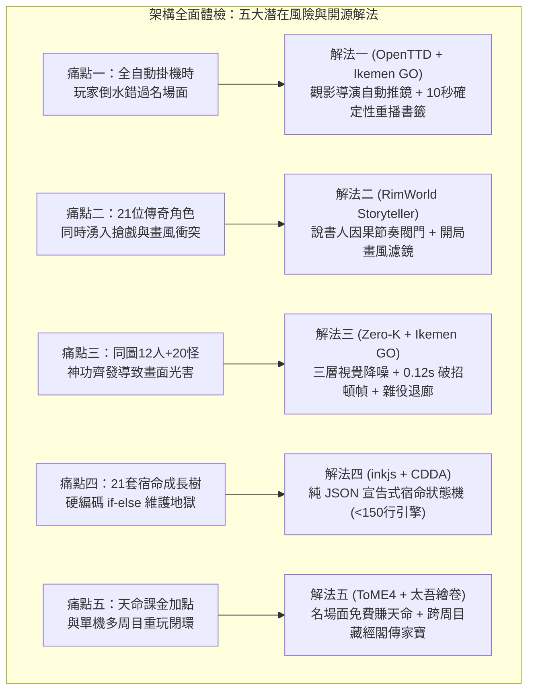

#### 體檢一：「零手動全自動（Autopilot）」下玩家錯過高光名場面問題（Missed Climax Problem）
- **潛在風險**：當玩家開啟「零手動全自動掌門（`SectLeaderAutopilot`）」放著觀察或去泡咖啡時，山門裡可能剛好發生「洪七公半夜偷吃叫化雞」、「阿星從木乃伊繃帶破繭領悟如來神掌」或「令狐沖一劍刺破對手前搖破綻」。如果沒有鏡頭引導與回放機制，玩家回來只看到一行冷冰冰的文字紀錄，魅力會大打折扣。
- **開源借鏡**：**[OpenTTD](https://github.com/OpenTTD/OpenTTD)**（GPLv2，`Extra Viewport` 事件子母視窗與底部新聞快訊）＋ **RimWorld（`LetterStack` 事件分級）** ＋ **[Ikemen GO](https://github.com/ikemen-engine/Ikemen-GO)**（MIT，確定性格鬥重播）。
- **具體優化方案**：
  1. **三級事件分流（3-Tier Notification）**：
     - **Tier C（日常瑣事：挑水、砍柴、普通打樁）**：僅顯示頭頂微氣泡，0 視窗打擾。
     - **Tier B（門派進度：竣工、外門晉升、突破小境界）**：右側浮現水墨竹簡書籤，點擊可將鏡頭平滑移至當事人。
     - **Tier A（傳奇名場面：宗師造訪、獨孤九劍破招、阿星破繭、岳不群深夜抉擇）**：觸發**「觀影導演鏡頭（Cinema Director Mode）」**——鏡頭自動平滑推近（Zoom `1.35x`）、全場進入 `0.3x` 慢動作特寫 `1.5` 秒，讓玩家像看武俠電影一樣直擊高潮！
  2. **「10 秒確定性名場面重播（Instant Replay Clip）」**：
     - 由於我們的底層模擬是 `60Hz` 100% 確定性狀態機（Deterministic State + RNG Seed），每當觸發 Tier A 名場面時，系統只需在記憶體存下一份 **事件前 5 秒的輕量狀態快照（Snapshot，僅約 `4KB`）**。
     - 就算玩家當時不在電腦前，回來點擊右側竹簡書籤上的 **「🎬 重播名場面（10s）」**，即可在子母畫面或主畫面完美重演剛才那 10 秒的精彩過招！

#### 體檢二：21 位傳奇角色「神仙菜市場／搶戲稀釋」與畫風衝突問題（Spotlight Crowding & Tone Clash）
- **潛在風險**：如果一局遊戲裡，洪七公、東方不敗、喬峰、包租婆、火雲邪神在短短兩旬內全部湧進破道館，不僅床位與糧食瞬間崩潰，每位傳奇角色的戲份也會被稀釋成普通路人；此外，有玩家某局想玩「正統金庸悲劇武俠（如岳不群走火入魔）」，某局想玩「周星馳無厘頭歡樂功夫」，混在一起可能偶爾出戲。
- **開源借鏡**：**RimWorld（`Storyteller` 人口曲線與威脅節奏閥門）** ＋ **[Battle for Wesnoth](https://github.com/wesnoth/wesnoth)**（GPLv2，戰役時代篩選器 Era Filter）。
- **具體優化方案**：
  1. **「說書人因果節奏閥門（Storyteller Pacing Gate）」**：
     - **建築階段門檻**：S0 破道館期最多只會遇到 **1 位** 初期落魄奇才（如背柴少年郭靖、混混阿星、或嘴砲韋小寶）；S1 膳房與外功場建成後才解鎖第二梯隊（令狐沖、包租公婆）；S2 藏經閣、瀑布與名菜齊備後才解鎖宗師級奇遇（洪七公、東方不敗、火雲邪神）。
     - **冷卻與單局精選（Curated Cast per Run）**：每旬最多觸發 **1 次** 傳奇人物奇遇；單局遊戲從 21 人池中依玩家山門建設方向自然觸發 **6～8 位** 核心傳奇人物，確保每位進門的角色都有充足的宿命戲份，且每開新局遇到的組合都不同！
  2. **開局「江湖畫風濾鏡（World Tone Filter）」**：
     - 創角時提供一鍵勾選：**`【全明星江湖（預設：金庸＋星爺混搭）】`**、**`【正統金庸武俠（僅金庸群俠）】`**、或 **`【周星馳無厘頭宇宙（僅鹿鼎記＋功夫）】`**，滿足不同心境！

#### 體檢三：同圖 12 人＋20 怪混戰時的「畫面光害與可讀性問題」（Same-Map Visual Clutter）
- **潛在風險**：當後山獸潮或拜山踢館發生時，同張地圖上有喬峰放金龍、包租婆吼獅吼功、海大富推龜波氣功、東方不敗灑繡花針，還要加上外門雜役挑水路過，畫面很容易變成一團看不清動作的光害。
- **開源借鏡**：**[Zero-K](https://github.com/ZeroK-RTS/Zero-K)**（GPLv2，RTS 圖層優先序與地面預警圓）＋ **[Ikemen GO](https://github.com/ikemen-engine/Ikemen-GO)**（MIT，`Hitstop` 破招頓幀）。
- **具體優化方案**：
  1. **三層視覺優先序（3-Layer Visual Hierarchy）**：
     - **底層（地面水墨紋，透明度 `25%`）**：太極圖、打狗陣、護山劍陣一律畫在地板人物腳下，絕不遮擋人物肢體。
     - **中層（半透明氣勁，透明度 `50%`）**：普通拳掌扇形與箭矢。
     - **頂層（決定性瞬間＋`0.12s` 格鬥破招頓幀 Hitstop）**：只有當觸發**《獨孤九劍》破招截擊、《乾坤大挪移》反彈、或《如來神掌》天降金印**時，全場觸發 `0.12 秒`（7 幀）的格鬥遊戲式「頓幀定格（Hitstop）」＋水墨書法大字（如 **`【破劍式！】`**），打擊感與辨識度瞬間拉滿！
  2. **非戰鬥人員自動退廊助威（Civilian Auto-Evade & Cheer）**：
     - 一旦山門進入演武或迎敵狀態，未參戰的外門雜役與工匠會自動放下扁擔、退到走廊屋簷下安全格，並做出「拍手助威／驚呼」動畫，既不擋路又充滿《天下霸圖》與《功夫》豬籠城寨街坊圍觀的熱鬧氣氛！

#### 體檢四：21 位經典角色「四階宿命樹」的工程可維護性（Zero-Hardcode Data-Driven Destiny Graph）
- **潛在風險**：如果把岳不群、令狐沖、阿星等 21 人的「四階武學解鎖條件＋關鍵宿命抉擇」寫成 `model.mjs` 裡的硬編碼 `if (actor.id === 'yue_buqun') ...`，程式碼會迅速膨脹成難以維護的義大利麵，且極易破壞確定性存檔。
- **開源借鏡**：**[inkjs](https://github.com/y-lohse/inkjs)**（MIT，純資料條件故事節點）＋ **[Cataclysm: DDA](https://github.com/CleverRaven/Cataclysm-DDA)**（CC-BY-SA 3.0，JSON 條件結構）。
- **具體優化方案**：
  - 將所有角色的四階成長抽離為純資料檔案 **`sect-chronicle/life/data/destiny-trees.json`**，引擎只寫一個 `<150` 行的通用檢核器 `evaluateDestinyMilestones(world, actor)`：
    ```json
    {
      "archetypeId": "yue_buqun",
      "stages": [
        { "stage": 1, "unlockArt": "baoyuan_jin", "require": { "dayMin": 1 } },
        { "stage": 2, "unlockArt": "yangwu_sword", "require": { "facility": "hall_repaired", "artLv": { "baoyuan_jin": 2 } } },
        { "stage": 3, "unlockArt": "zixia_qi", "require": { "facility": "quiet_room", "moralityMin": 70, "artLv": { "yangwu_sword": 4 } } },
        { "stage": 4, "dilemmaId": "huashan_crisis", "branches": {
            "orthodox": { "require": { "stat": { "focus": 10 } }, "unlockArt": "zixia_tier10", "title": "華山聖手" },
            "bixie": { "require": { "item": "kasaya_scroll" }, "unlockArt": "bixie_sword", "applyTrait": "castrated_speed_x3", "title": "紫衣梟雄" }
          }
        }
      ]
    }
    ```
  - **工程效益**：新增第 22 位傳奇角色只需填寫 30 行 JSON，**0 行核心程式碼修改**，且天然支援單元測試與確定性回放！

#### 體檢五：「天命課金加點」與單機多周目重玩價值的良性閉環（Meta-Progression & Fair Monetization）
- **潛在風險**：玩家可能會擔心「課金加點會不會變成逼課手遊？」或者「打完一局岳不群之後，下一局還有什麼新鮮感？」
- **開源借鏡**：**[Tales of Maj'Eyal (ToME4)](https://github.com/NetCoreGames/tome4)**（GPLv3，跨周目成就解鎖池與 Donator 便利包）＋ **《太吾繪卷／活俠傳》天命輪迴與傳家寶**。
- **具體優化方案**：
  1. **雙軌獲取「天命功德點（Destiny Points）」**：
     - **免費遊玩成就軌**：在遊戲中每達成一個傳奇里程碑（例如：第一次讓低悟性弟子把《羅漢拳》練到 Lv10、第一次吸引洪七公入駐、或打通岳不群正道／邪道結局），都會永久獲得 **+2～+5 點天命點**，並**免費解鎖該傳奇弟子作為下一局的可選開局主角**！
     - **支持者課金包軌（Supporter DLC / 課金加速）**：忙碌的上班族玩家若想直接體驗「開局全屬性拉滿的天才自創主角」或「開局直接解鎖全部 21 位經典主角模板」，可透過支持者天命包一鍵解鎖，完全不影響單機平衡，且雙軌玩家都能享受完整內容。
  2. **「藏經閣秘笈／神兵傳家寶」跨周目繼承（Heirloom Carryover）**：
     - 上一周目自創主角親手撰寫進藏經閣的鎮派絕學、或是打造的《玄鐵重劍》，在開啟下一周目（例如選岳不群或阿星開局）時，可花費少量天命點作為**「破道館祖傳遺物」**帶入新局，讓每一周目的努力都成為下一段江湖傳奇的基石！

---

#### 體檢六：韋小寶「《神行百變》0 交戰溜邊流」的無限刷寶漏洞與返程驚獸機制（Anti-Cheese Loot Scent & Return Risk）
- **潛在風險**：既然韋小寶能靠《神行百變》繞過 S1～S3 的野怪直衝 S4 偷採【百年靈芝】，如果回程也讓他 100% 無視沿途野怪免費走回家，玩家只要無限派韋小寶當外送員就能搬空深山，那誰還要辛辛苦苦練郭靖去把 S1～S3 清乾淨？
- **開源借鏡**：**[Dungeon Crawl Stone Soup (DCSS)](https://github.com/crawl/crawl)**（`GPLv2`，奪取符文／Orb Run 返程警戒度翻倍機制）＋ **[Cataclysm: DDA](https://github.com/CleverRaven/Cataclysm-DDA)**（`CC-BY-SA 3.0`，戰利品氣味暴露 `scent_map`）。
- **具體優化方案**：
  1. **「靈物散香・返程驚獸檢定（Loot Scent Alert on Uncleared Segments）」**：
     - 韋小寶去程是「兩手空空」躡手躡腳溜過野豬；但一旦他在深山摘下異香撲鼻的【百年靈芝／何首烏】揣在懷裡，**返程經過每一個「尚未肅清的路段（Uncleared Segment）」時，靈藥香氣都會驚動他去程沒清掉的野豬與群狼**！
     - 每穿過一段未清怪區，韋小寶就必須消耗 **1 次防身手段（如【撒白石灰】或額外扣除 `6 點逃命精力`）**，若精力不足甚至會被野豬追撞掉一半戰利品、狼狽滾回山門！
     - **完美鎖死「郭靖 ＋ 韋小寶」的戰略互補**：
       - **單派韋小寶硬偷**：去程輕鬆，回程卻要穿越自己留下的 9 隻怪，被追得雞飛狗跳、狂撒石灰才保住半株靈草；
       - **先派郭靖把 S1～S3 清成 `100% 安全區`，再派韋小寶接力衝 S4**：韋小寶回程走在郭靖打通的安全山道上，**0 驚動、0 損耗、100% 完美帶回全部奇珍**！
  2. **天材地寶自然生長週期（Regrowth Cooldown）**：深山靈藥採摘後需 `2～3 旬` 自然生長，杜絕每分鐘重複刷寶。

#### 體檢七：郭靖「較真推土機流（耗時 110 秒）」的跨時辰飢餓中斷與「膳房行軍口糧」連動（Expedition Rations）
- **潛在風險**：郭靖因為性格較真、連逃跑的小老鼠都要追進竹林拍死，一趟巡山耗時長達 `110 秒`（跨越午膳或晚膳時辰）。如果照一般生活 AI「飽足度低於門檻就中斷工作回膳房吃飯」，郭靖就會每次清到 `S2` 就因為肚子餓跑回家，永遠推不到 `S3`！
- **開源借鏡**：**[Dwarf Fortress](https://www.bay12games.com/dwarves/)**（巡邏隊攜帶 `Backpack / Waterskin` 行軍乾糧與水袋，避免邊境巡邏因飢渴折返）＋ **RimWorld（遠征口糧 `MealSurvivalPack`）**。
- **具體優化方案**：
  - **膳房連動 ——「行軍乾糧袋與竹筒靈茶（Patrol Ration Pouch）」**：
    - 當膳房（`v0.3`）建成後，黃蓉或油炸鬼做飯時會自動準備隨身乾糧（**【荷葉飯糰】【叫化雞腿】【脆皮油條】**）。
    - 凡是郭靖、阿牛這類**「長時全清流（`methodical_clear`）」**弟子出發巡山前，會自動在腰間掛上 `1 份行軍口糧`。
    - 當他在後山清完 `S2 亂石坳` 感到飢餓或精力消耗過半時，不會折返跑回家，而是直接在山道石碑旁**席地而坐 `2 秒` 大口吃掉黃蓉包的雞腿飯糰（頭頂冒出 `「🍗 吃飽了！把前面那窩野狼也清乾淨再回山！」`，當場補充 `25 點飽足度 ＋ 15 點精力`）**，一鼓作氣完成 `S1～S3` 的 100% 肅清！

#### 體檢八：後山長山徑（`S0～S5`）與門派主院落的「鏡頭顧此失彼問題」（Patrol Picture-in-Picture & Progress Bar）
- **潛在風險**：後山 `S0 ➔ S5` 山徑蜿蜒長達 `1,600` 世界單位。如果玩家把鏡頭拉去深山看韋小寶溜怪，就看不到院子裡包租婆催水；如果鏡頭留在家裡，又看不到郭靖和韋小寶在山上的爆笑表現。
- **開源借鏡**：**[OpenTTD](https://github.com/OpenTTD/OpenTTD)**（`GPLv2`，`Extra Viewport` 浮動追蹤子視窗）＋ **[Zero-K](https://github.com/ZeroK-RTS/Zero-K)**（畫中畫 PiP 戰況窗）。
- **具體優化方案**：
  - **右上角「巡山畫中畫小圓窗（Patrol PiP Viewport）」＋「水墨竹簡里程軸」**：
    - 只要有弟子在山外巡山，畫面右上角自動浮現一個古風水墨圓窗（`240×180` 即時同步跟拍巡山弟子），圓窗下方附帶一條直觀的里程進度軸：**`[山門]━━S1(✔)━━S2(✔)━━S3(🏃‍♂️韋小寶・溜邊中)━━S4(🐻封路)━━S5`**。
    - 玩家主畫面留在大院看門派日常，眼角餘光就能從小圓窗即時欣賞韋小寶躡手躡腳溜過野豬、或郭靖一掌拍飛惡狼；點擊小圓窗即可隨時將主副鏡頭一鍵切換！

#### 體檢九：「零手動全自動掌門（Autopilot）」如何聰明派對人去巡山？（Context-Aware Patrol Dispatcher）
- **潛在風險**：在零手動全自動模式下，如果菜園正被老鼠偷吃，掌門 AI 卻派了「遇怪不打只會繞路」的韋小寶去巡山，結果老鼠一隻沒少，玩家會覺得自動 AI 很蠢。
- **開源借鏡**：**[Oxygen Not Included](https://www.kleientertainment.com/games/oxygen-not-included)**（任務需求與小人特質適性矩陣）。
- **具體優化方案**：
  - 在 `SectLeaderAutopilot` 內建**「因才派巡三法則」**：
    1. **【後山獸患高 ／ 膳房缺肉】** ➔ 自動指派 **🪨 郭靖／阿牛（全清流）** 出門把 `S1～S3` 清成 100% 安全區並扛肉回山；
    2. **【前段已由郭靖清場 ✔ ＋ 藥房缺深山靈草】** ➔ 自動接力指派 **🎲 韋小寶／段譽（斥候流）** 趁安全期無損狂飆 `S4` 採藥；
    3. **【望台偵測到高威脅野豬王／山賊頭目】** ➔ 自動指派 **🍶 令狐沖／楊過（劍癡流）** 定點斬首兼修《獨孤九劍》！

#### 體檢十：眾多頂級神功同台時的「四大武道流派循環相剋環」（Rock-Paper-Scissors Martial Balance）
- **潛在風險**：當《獨孤九劍》、《羅漢拳 Lv10》、《如來神掌》、《太極／乾坤大挪移》、《大喇叭獅吼功》同時存在時，如何確保沒有單一武學無腦碾壓全場，讓每個弟子都有高光時刻？
- **開源借鏡**：**[Tales of Maj'Eyal (ToME4)](https://github.com/NetCoreGames/tome4)** 與 **[Ikemen GO](https://github.com/ikemen-engine/Ikemen-GO)**（格鬥遊戲「破招／霸體／當身反彈／全屏破防」四角相剋）。
- **具體優化方案**：建立清晰的**「四大武道流派循環相剋環」**：

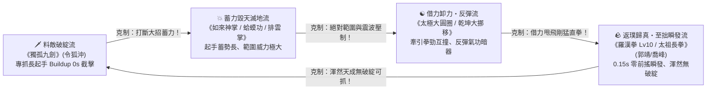

---

## 六、 後續完整版本規劃藍圖（Version Roadmap：`v0.1` ～ `v1.0` 十階段演進）

我們將整個遊戲從「破道館求生」到「開宗立派、領悟鎮派神功」規劃為 **10 個具體可交付、可獨立驗收的產品版本（`v0.1` ～ `v1.0`）**。每個版本都遵循專案的 **[可見交付規則（D12 / VISIBLE_DELIVERY_PLAN）](../VISIBLE_DELIVERY_PLAN.md)**：

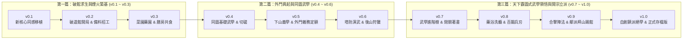

---

### 📦 版本 `v0.1`（S0）：新核心同感移植版（Core Parity & Foundation）
- **版本定位**：換引擎骨架不換手感。建立 `sect-chronicle/life/core/`，讓現有山居玩法在新架構上 100% 重現。
- **核心系統交付**：
  1. **Toil Pipeline 與 SmartObject 註冊表**：用通用工序重寫「挑水、採藥、泡茶、砍柴、修寢舍、認領雙床、練掌」。
  2. **混合路網尋路器（`nav.mjs`）**：串接院內導航點與院外長走廊（挑水路長誤差 `≤ 2%`），支援任意位置直接改派不瞬移。
  3. **四層決策仲裁器 v1**：統一處理 `玩家指令 ＞ 必要自理（精力 30/80、喝茶）＞ 持續工作 ＞ 偏好休閒`。
- **驗收標準（DoD）**：
  - 同 seed 下，單趟挑水／採藥／砍柴耗時、負重速度差、精力曲線與舊 `demo/` 一致；中途任意秒數改派工作無瞬移、無丟失在途貨物。

---

### 📦 版本 `v0.2`（S1）：破道館開局、雙軌創角（自由配點＋問卷 vs 選經典主角）、零手動自走與「收集資源招工擴建」版（Ruined Dojo, Dual Creation, Autopilot & Construction Staging）
- **版本定位**：把時間點退回「門派尚未成立的破道館」，實裝**雙軌開局創角（五維自由配點＋性向問卷＋課金天命加點 vs 直接選經典角色如岳不群／令狐沖／郭靖／韋小寶／阿星當主角）**、**零手動全自動個性驅動引擎（`SectLeaderAutopilot`）**，以及**「收集建材備料 ➔ 招工開建」**的踏實擴建體驗。
- **核心系統交付**：
  1. **雙軌開局創角與「零手動・全自動個性驅動（Zero-Input Autonomy）」**：
     - **模式 A（自創掌門）**：提供固定 30 點**先天五維自由配點（悟性／根骨／臂力／身法／定力福緣）**＋**課金／天命成就額外加點與傳奇命格詞條**＋**5 題武俠情境性向測驗**，生成八維性格、道家心性稱號、古風批命詩與預設八卦心印（`#5`、`#38`、`#106`、`#163`）。
     - **模式 B（直接選經典角色當主角）**：可直接選【岳不群】【令狐沖】【郭靖】【韋小寶】【阿星】等經典角色作為破道館開局掌門，綁定其專屬**四階本命武學成長與宿命分歧樹**；其餘未選經典角色自動轉入「江湖奇遇可招募弟子池」！
     - **掌門全自動駕駛引擎（`SectLeaderAutopilot`）**：就算玩家創角後完全不動手，主角也會依照自己的五維與性格模板，自動執行個人修練與掌門決策（備料滿 100% 自動敲鐘請木匠蓋房、自動下山義學收徒、自動閉關突破）。
  2. **破道館開局與三大建材收集（`SCENE-04` S0 母版實裝）**：
     - 開局大廳屋頂破損、院子長滿雜草、側屋坍塌；院落除草產出【茅草】、清理破屋坍塌廢墟產出【青石瓦礫】、後山砍柴產出【原木】，一趟趟親手搬入**工地備料樁（`stagingPile`）**。
  3. **備齊招工開建（雇請山下工匠 vs 同門協建）**：
     - 當工地備料達 100% 搭起竹鷹架後，可選擇花費熱茶／謝禮**【雇請山下木匠上山施工】**（或由韋小寶型角色靠嘴砲 0 成本招工！），或由門內弟子協建，修好大廳屋頂與第一間雙人寢舍。
  4. **天下霸圖式「門派時辰作息鐘」**：實裝卯時早課、辰～午勞作、未～申練功、酉～戌自由陪伴、亥時回床就寢的日夜節律。
- **驗收標準（DoD）**：
  - 完整驗證「自創配點問卷開局」與「選經典角色（如岳不群）開局」雙路徑；開啟零手動自走模式下，主角能不靠玩家點擊、按自身性格自動完成「收集木石備料 ➔ 敲鐘招請木匠修好大廳與寢舍 ➔ 按時辰練功歇息」的跨旬完整閉環。

---

### 📦 版本 `v0.3`（S2）：人間煙火——菜園、藥園、膳房名菜食譜與後院釀酒版（Homestead, Gourmet Kitchen & Brewery）
- **版本定位**：補齊《模擬市民》與門派經營最迷人的「種田 ➔ 鑽研名菜食譜與釀酒 ➔ 同門與客匠圍桌吃飯聊天」生活閉環，並為後續引來**【洪七公】**與**【令狐沖／喬峰】**埋下關鍵伏筆！
- **核心系統交付**：
  1. **菜園與藥園擴建（`fac.garden`）**：收集木石與茅草開墾東南菜畦與藥畦；新增「農藝」「藥理」技能（做什麼長什麼，等級越高灌溉收成越快、能採到伴生靈草與鮮筍）。
  2. **膳房大陶灶、四階名菜品譜與後院釀酒缸（`fac.kitchen` + `fac.brewery` + `fac.dining`）**：
     - **廚事與名菜品階**：從普通大鍋飯進階至**凡菜 ➔ 佳餚 ➔ 珍饈 ➔ 絕味**（如【叫化燒雞】【荷葉筍尖湯】【玉笛誰家聽落梅】），高品階料理出鍋會散發 `FoodAromaAd`（菜香廣告）。
     - **後院青石釀酒缸**：用山泉水與野果／高粱釀出**【猴兒百果酒】**與**【關外燒刀子】**。
  3. **統一溫飽、招待客匠與圍桌共食**：午膳（午時）與晚膳（酉時）鐘響，弟子與受雇上山的山下工匠自動走向餐敘棚同桌吃飯飲酒，席間自然觸發日常寒暄，吃飽後獲得穩定的精力恢復與好感累積。
- **驗收標準（DoD）**：
  - 完整跑通「挑水＋砍柴＋種菜／野味 ➔ 烹調品階名菜／釀酒 ➔ 多人同桌用餐 ➔ 席間對話」守恆鏈；缺水或缺柴時面板清楚提示哪個環節待補。

---

### 📦 版本 `v0.4`（S3）：同圖基礎武學、外功演練場與輕功捷徑版（Same-Map Basic Martial Arts）
- **版本定位**：實現「在同一張地圖直接看到弟子施展不同武功、越練越強、飛簷走壁抄捷徑」的第一層武俠養成爽感。
- **核心系統交付**：
  1. **外功演練場擴建（`fac.yard`）**：收集原木與青石、招請山下木匠建造 4 座木人樁與兵器架；師父可在修好的大廳開堂傳授**第一階（凡品・築基）武學**。
  2. **第一階同圖武學與四維根基（`#318` A4）**：
     - 實裝四門築基武功：**《青松掌法》**（扇形擊退，練【臂力】）、**《齊眉棍法》**（圓弧橫掃，練【腰腿】）、**《流雲劍訣》**（直線穿刺，練【身法】）、以及基礎內功／身法**《磐石吐納》《踏雪無痕》**（練【內息】與【腳力】）。
     - 熟練度內插與視覺特效：從初學（Lv0）練到熟練（Lv3）與大成（Lv5），起手前搖明顯縮短、掌風／棍影／劍氣 Pixi 特效擴大！
  3. **同圖雙人切磋（Sparring）与輕功捷徑**：兩名弟子在外功場對練拆招（點到為止不傷身）；《踏雪無痕》練至 Lv3 可直接飛身躍過溪石與岩階捷徑。
- **驗收標準（DoD）**：
  - 玩家肉眼可辨識初學 vs 大成的出招速度與範圍；練習不同基礎武學可穩定提升對應的四維根基（臂力／腰腿／身法／內息）。

---

### 📦 版本 `v0.5`（S4）：下山免費義學、偶遇頂級潛力弟子（含周星馳版韋小寶／阿星／豬籠城寨三隱士）、外門雜務定額與結契成家版（Outreach Teaching, Prodigy Disciples, Outer/Inner Sect & Family）
- **版本定位**：將人數從 3 人擴展到 6～10 人，落地**「派人下山免費教學識人 ＋ 偶遇頂級潛力奇才與豬籠城寨隱世雜役 ＋ 包租婆催水督導 ＋ 外門弟子做滿雜務定額解放主角練武 ＋ 同門結契成家」**的核心體驗！
- **核心系統交付**：
  1. **雙軌發掘新弟子 ＋「頂級潛力奇才 ＆ 豬籠城寨大隱於市」奇遇系統**：
     - **派人下山免費義學／招工**：從跟練反應直觀發掘潛力人物，邀請入山！
     - **偶遇金庸 × 周星馳宇宙傳奇苗子與隱世雜役**：
       - **🦋【阿星（《功夫》主角）】**：山下拿著十塊錢《如來神掌》小人書的街頭少年！開竅前只會**【無影踩腳趾】**、神級開鎖與被狗追練出的極限逃命步；直到後期守山門重傷包成木乃伊，才會觸發**【破繭成蝶・打通任督二脈】**！
       - **🥖【豬籠城寨三隱士（苦力強／裁縫／油炸鬼）】**：平時是最強外門挑水夫、工坊裁縫、膳房早點炸油條師傅；山門危急時直接撕開圍裙，爆衣展現**《十二路譚腿》《洪家鐵線拳》《五郎八卦棍》**！
       - **🎲【韋小寶（《鹿鼎記》版）】**：靠**`「滔滔江水連綿不絕」`**嘴砲 **0 成本免工錢招工還帶回倒貼建材**！在門派跟師姐聊天好感漲速 `×500%`，同圖戰鬥使出**【撒石灰致盲 ＋ 抓奶龍爪手破防 ＋ 五件寶衣抹油裝死／火槍冷箭】**！
       - **🪨【郭靖】**（雨中散場獨練三百遍）、**🍶【令狐沖】**（偷喝猴兒酒）、**🎋【黃蓉】**（尋靈筍借灶做菜）、**🦅【楊過】**（後山斷崖神鵰）、**❄️【小龍女】**（百花玉蜂）、**☯️【張無忌】**（寒毒仁醫少年）、**🦢【段譽】**（不殺生書生）！
     - **順性養成（`Flow State`）機制**：針對怪才提供本命嗜好（供令狐沖飲酒切磋、讓段譽看山讀經、讓韋小寶串門子搖骰子），觸發 3 倍成長速度！
  2. **外門弟子「每日雜務定額（`ChoreQuota`）」＋【包租婆催水獅吼】督導**：
     - 新弟子從**【記名／外門弟子】**做起，每日做滿 `3～4 件雜務定額` 才解鎖申時練拳；若**【包租婆】**入駐且水缸 `< 50%`，包租婆會叉腰大吼**`「包租婆～怎麼沒水了呢？！」`**，全場外門挑水移速瞬間 `+50%`！
     - **主角與內門弟子徹底解放**：只要外門弟子在崗且水糧非危急（`≥ 15%`），主角與內門弟子**免除所有日常雜務**，全天專注練劍、切磋與突破！
  3. **因果關係帳本、雙軌關係階梯與道侶雙人房（`#319` A5 + `#337` + `fac.dorm.b`）**：
     - 區分「成年同門 ➔ 知己 ➔ 結契道侶」與「長幼親情守護」雙軌；擴建宿舍乙，讓結為道侶的兩人（如郭靖與黃蓉、楊過與小龍女、包租公與包租婆）搬入雙人雅室同住、共食、並肩護衛。
- **驗收標準（DoD）**：
  - 招收外門弟子後自動維持全山門水柴菜飯與工地建材供應；包租婆水缸 `< 50%` 催水 Buff、韋小寶免錢招工、城寨三隱士打雜與爆衣護山皆可直觀觸發。

---

### 📦 版本 `v0.6`（S5）：分段里程巡山清怪、塔防演武與非數值強度驗證版（Segmented Distance Patrol, TD Drill & Strength Showcase）
- **版本定位**：徹底告別無聊的死板戰力數字，透過**「主動向外：S0～S5 六段里程巡山清怪（看角色能推多遠、清多少怪、被逃走多少）」＋「被動守內：山門塔防演武（看防線能擋在多外面）」＋「日常可見：四大物理與江湖反饋」**，全方位呈現角色的綜合強度！
- **核心系統交付**：
  1. **後山「S0～S5 六段里程巡山清怪系統」（`#104` / `#290` 完整擴展版）**：
     - **六段階層式生態考驗**：從 `S0 柵欄巡山口` 出發，依距離推進 `S1 翠竹坡（考驗起手速度與追擊逃鼠）` ➔ `S2 亂石坳（考驗單發掌力與膽識喝止野豬）` ➔ `S3 迷霧林緣（考驗 AOE 清狼群與破箭）` ➔ `S4 斷崖激流（考驗輕功飛渡與破甲內勁打黑熊）` ➔ `S5 幽谷獸王窟（考驗鎮派神功與極限續航）`。
     - **嚴謹返程安全預算（`RetreatBudget = 下一短段耗能 + 實際退路回程耗能 + 8`）與有限離路追擊（`≤80 單位 / 3s`）**：綜合能力（腳力、身法、起手幀數、內息、威力）越強，路上浪費的時間與精力越少，就能走得越遠、逃脫率越趨近於 `0%`！
  2. **返院「同路成長前後對比戰報（Before / After Progression Telemetry Card）」**：
     - 詳列本趟**最遠推進距離、已確認清理路段、個體去重結果（擊倒／驅離／逃脫／繞避）、折返原因**，並自動與該角色上次同路巡山紀錄並排對比（例如：`深入距離 +690（S1 ➔ S4）、警覺鼠逃脫率 60% ➔ 0%、單隻處理耗時 -64%`），讓養成進步肉眼可見！
  3. **演武場／山門「塔防式試陣演練」與獸潮保衛戰（`#320` A6 + `#219` B 案）**：
     - 擺放弟子**守點陣位（Defense Slots）**與**三種戰術姿態（`【固守陣眼】`／`【迎擊攔截】`／`【游走護衛】`）**；直觀呈現「弱時狼狽退守大廳台階 vs 強時一人鎮守山門石橋外寸步不讓」的防線推進感。
  4. **四大非數值強度視覺反饋（Show, Don't Tell）**：
     - **木人樁／青石板四階破壞**（初學手痛 ➔ 木樁搖晃 ➔ 一掌打斷木樁＋青石裂紋 ➔ 五指大掌坑／瀑布斷流）、**宗師氣場百獸辟易**（低階野鼠 `180` 單位外不戰而逃）、**山門鎮山功勳石碑**（自動銘刻本門最遠巡山與一擊清場紀錄）與**同門抱拳行禮稱呼升級**。
- **驗收標準（DoD）**：
  - 同名角色在「初學低腳力」與「練熟武學＋高腳力」兩個階段派遣同路巡山時，推進距離、逃脫率與返院對比戰報呈現顯著且 100% 確定性可解釋的差距。

---

### 📦 版本 `v0.7`（S6）：《天下霸圖》式武學進階樹、「基礎拳登峰造極」與著書入閣版（Martial Evolution, Simple Mastery & Scripture Pavilion）
- **版本定位**：重現《天下霸圖》與武俠小說最迷人的兩條巔峰養成路——**聰明弟子「融會貫通領悟高深絕學并寫成秘笈」**，而**悟性不足的老實弟子則「苦練基礎《羅漢拳／青松掌》直達 Lv10 登峰造極・返璞歸真」**！
- **核心系統交付**：
  1. **後院靜室與藏經閣擴建（`fac.quiet`）**：收集建材於大廳後院建起清幽靜室與藏經書架。
  2. **軌道 A（高悟性・博學進階流）——第二階與第三階武學領悟樹**：
     - **第二階進階武學（切磋／打樁頓悟）**：
       - 《青松掌 Lv3》＋《磐石吐納 Lv2》＋ 臂力 ➔ 領悟**《疊浪排雲掌》**（雙重氣浪連發、大範圍推開整排野豬）；
       - 《齊眉棍 Lv3》＋《踏雪無痕 Lv2》＋ 腰腿 ➔ 領悟**《風車輪轉棍》**（持續旋身橫掃減速聚怪圈）；
       - 《流雲劍 Lv3》＋《踏雪無痕 Lv3》＋ 身法 ➔ 領悟**《飛燕穿林劍》**（踏步突進貫穿三敵、殘影折返）。
     - **第三階上乘絕學（靜室閉關領悟）**：
       - 當兩門第二階武學與四維根基達標，可入靜室閉關（外門弟子每日送飯送茶），出關領悟**《天罡伏虎拳》**（隔空金色拳印震暈）、**《百鳥朝鳳棍》**（封路槍影風暴）、**《太清御劍術》**（三道飛劍環繞護體＋超遠距點殺）！
  3. **軌道 B（低悟性・大巧不工流）——基礎武學突破 Lv6～Lv10「登峰造極 ➔ 返璞歸真」**：
     - 借鏡 `DCSS` 徒手格鬥極限成長與《天龍八部》太祖長拳／《金庸群俠傳》野球拳設定：當悟性不足讀不懂高深秘笈、但性格【抱樸守拙／篤實守靜】的弟子，始終專一苦練第一階《羅漢拳／青松掌／齊眉棍》達標時，將**打破常規 Lv5 上限，解鎖 Lv6～Lv10 專屬境界**！
     - **Lv8【登峰造極】**解鎖強韌霸體與沉渾拳罡；**Lv10【返璞歸真・一拳破萬法】**達成 `0.15s` 零前搖瞬發、`0` 內息消耗、一拳直接震碎踢館高手護體劍陣的逆襲爽感！
  4. **著書立說・撰寫秘笈傳承（Scripture Authoring）**：
     - 領悟進階武學或將基礎拳練至【返璞歸真】的弟子，皆可在靜室案頭將心得**撰寫成《武學手札／拳意拳譜》放入藏經閣**，並在外功場代師授課指點後輩！
- **驗收標準（DoD）**：
  - 玩家可在「武學圖譜」清楚看到高悟性進階路線與低悟性返璞歸真路線；同場演武或踢館比試中，「Lv10 返璞歸真基礎拳」與「第三階太清御劍術」各有鮮明優勢且戰力並駕齊驅。

---

### 📦 版本 `v0.8`（S7）：煉藥洗髓、特殊修練環境（寒玉床／瀑布／玉蜂）與百鍛神兵版（Alchemy, Special Cultivation Beds & Divine Weapons）
- **版本定位**：還原《天下霸圖》與群俠傳中**「高階武學與傳奇弟子需要奇珍藥湯、特殊修練環境與神兵寶甲相襯」**的深度經營閉環。
- **核心系統交付**：
  1. **煉藥房升級、仁心醫館與「十全大補湯引海大富」（`fac.herbstore` 進階）**：
     - 藥園培育的高階靈草可熬製**【固本洗髓藥浴】**、**【聚元靈丹】**與**【十全大補靈湯】**（熬出大補湯將引來**周星馳版【海大富（海公公）】**一邊裝瞎咳嗽一邊潛入藥房偷喝試藥！）。
     - 若門內有**【張無忌（仁心醫仙）】**坐鎮藥房，可瞬間治癒一切重傷與內傷疲勞。
  2. **三大特殊修練環境設施（寒玉床、山洪瀑布、百花玉蜂箱）**：
     - **【古墓寒玉床】**：供**【小龍女】**與高內息弟子就寢，連睡覺都在高速增長內息！
     - **【後山山洪瀑布台】**：供**【楊過】**頂著激流揮舞玄鐵重劍，領悟「重劍無鋒、大巧不工」與《黯然銷魂掌》！
     - **【百花玉蜂箱】**：設於藥園旁，吸引**【老頑童・周伯通】**跑來偷看蜜蜂、跟小師弟玩捉迷藏，並可驅動玉蜂群協防山門！
  3. **巧匠鍛造與傳奇神兵寶甲（Weapon & Gear Crafting）**：
     - 收集後山硬木、寒鐵礦、玄鐵與金絲，鍛造**【熟銅齊眉棍】【青鋒長劍】【七十斤玄鐵重劍（楊過專屬）】【金絲軟甲／洋人火銃（韋小寶專屬）】【繡花針（東方不敗專屬）】**。
- **驗收標準（DoD）**：
  - 完整跑通「種靈草熬十全大補湯引海大富 ➔ 築寒玉床與蜂箱引周伯通 ➔ 鍛造玄鐵重劍與金絲軟甲 ➔ 支撐傳奇絕學守住高難度獸潮」的養成鏈。

---

### 📦 版本 `v0.9`（S8）：金庸 × 周星馳宇宙（《鹿鼎記》《功夫》）二十大群俠神功與「名門／火雲邪神拜山踢館」版（20 Heroes, Kung Fu Hustle & Rival Sect Challenges）
- **版本定位**：當門派名菜飄香、佳釀醇厚、大補湯出鍋時，**金庸群俠**與**周星馳《鹿鼎記》《功夫》傳奇宗師**全面覺醒，並在同圖演武場迎接**各派高手、【天殘地缺】、【東方不敗】與【火雲邪神】登門拜山拆招**！
- **核心系統交付**：
  1. **奇遇宗師入山與《功夫》終極踢館事件**：
     - **📢【包租婆】＆ 🚬【包租公】**：入駐後院雅室！包租婆擁有全圖第一**【風火輪狂奔】**與拆下青銅古鐘擴音的**《大喇叭獅吼功》**；包租公在茶棚施展**《真・太極大圓圈》**牽引敵人互相撞飛！
     - **🪕【天殘地缺】＆ 🐸【火雲邪神】踢館大戰**：
       - **天殘地缺**坐鎮山門石階撫琴發射**《六指琴魔・音波切刃與骷髏音浪》**（可與包租婆《獅吼功》正面對波震碎琴弦！）；
       - **火雲邪神**穿白背心拖鞋登場，展現**【唯快不破・兩指空手夾子彈】**與趴地鼓腮**《蛤蟆功（洲際飛彈衝撞）》**！
     - **🦋【阿星：生死破繭・打通任督二脈 ➔ 如來神掌】**：
       - 當阿星在迎戰火雲邪神／保衛山門時重傷被包成**【白色木乃伊繭】**送入藥房，隔日破繭而出**打通任督二脈**！一腳踩碎青石地板，躍入九天雲霞拍出覆蓋半張地圖的金色巨掌**《如來神掌・萬佛朝宗》**（轟出五指大掌坑並用棒棒糖感化火雲邪神留駐山門）！
     - **🍗【洪七公】**（夜半偷吃名菜傳《降龍十八掌》《打狗棒法》）、**🤪【周伯通】**（養蜂捉迷藏傳《空明拳》《左右互搏》）、**👻【海大富（星爺版）】**（偷喝大補湯、《化骨綿掌》三步碎骨延遲內爆＋暴走撕衣**【星爺版超巨型龜波氣功】**）、**🪡【東方不敗】**（`0.05s` 葵花極速殘影、一針點五敵）！
  2. **十大傳奇弟子與城寨三隱士同圖招牌絕學全面連動**：
     - **🥖【豬籠城寨三隱士（苦力強／裁縫／油炸鬼）】**：山門危急時撕開圍裙爆衣使出**《十二路譚腿》《洪家鐵線拳》《五郎八卦棍》**！
     - **🎲【韋小寶】**（滔滔江水嘴砲降速＋撒石灰＋抓奶龍爪手＋五件寶衣抹油裝死／火銃）、**🍶【令狐沖】**（微醺《獨孤九劍》`0s` 後發先至截擊破綻）、**🐉【喬峰】**（《太祖長拳》平招顯聖＋《降龍十八掌》金龍咆哮）、**🪨【郭靖】**（Lv10《返璞歸真羅漢拳》＋《左右互搏》雙掌齊發）、**🎋【黃蓉】**（奇門桃花石陣＋《打狗棒法》八訣絆鎖）、**🦅【楊過】**（玄鐵重劍巨浪＋孤寂爆發《黯然銷魂掌》）、**❄️【小龍女】**（玉蜂群＋與楊過觸發**《玉女素心劍・雙劍合璧》**）、**☯️【張無忌】**（《九陽神功》＋**《乾坤大挪移》反彈暗器與海大富的巨型龜波氣功！**）、**🦢【段譽】**（《凌波微步》80%閃避＋《六脈神劍》六道雷射清場）！
  3. **江湖名門拜山與「同圖踢館／以武會友」**：
     - 直接在大廳前坪**青石演武場**進行 1v1 單挑拆招或 3v3 闖陣；獲勝贏得聲望與古譜殘頁，惜敗亦能累積九劍破式與打通任督二脈契機！
- **驗收標準（DoD）**：
  - 20 位傳奇角色的生活嗜好與同圖戰鬥特效（阿星木乃伊破繭《如來神掌》、包租婆古鐘《獅吼功》對轟天殘地缺音波刃、火雲邪神空手夾子彈＋《蛤蟆功》、韋小寶撒石灰＋抓奶龍爪手、海大富化骨綿掌＋星爺龜波氣功、乾坤大挪移反彈、獨孤九劍後發先至、左右互搏雙招齊出）皆可在演武場與拜山實戰中確定性觸發與驗證。

---

### 📦 版本 `v1.0`（S9）：開宗立派、自創鎮派絕學與百代傳承正式版（Grand Sect Founding & Ultimate Mastery）
- **版本定位**：從當初漏雨的「無名破道館（`v0.2`）」，正式掛匾開山、融合自創**第四階【鎮派神功】**，完成百代傳承與正式版持久化。
- **核心系統交付**：
  1. **開山立匾大典與第四階「鎮派神功」領悟**：
     - 當大廳升至三清正殿（S2 完成態）、門下擁有 8～12 名內外門弟子且藏經閣收錄滿 3 部上乘絕學時，可舉辦**【開山立匾大典】**（自訂門派名號與宗風）。
     - 掌門／主角可集本門掌、棍、劍、內功之大成，在正殿閉關領悟第四階**【鎮派神功】**（如《松風萬壑劍陣》在守點展開全屏劍氣領域、或《混元太極勁》借力反震一切衝鋒），並可為鎮派絕學**自訂招式名號**，寫入鎮派寶典！
  2. **跨代薪火傳承與《宗門編年史》長卷**：
     - 支援長線遊玩：當初從山下義學招進來挑水砍柴的外門小師弟，一步步升入內門、學成鎮派神功、與師妹結為道侶、接任新一代首座去教導更年輕的師弟；系統自動記錄生成圖文並茂的《宗門編年史》。
  3. **新核心正式存讀檔（`Save Schema v1`）、長時回放與窄螢幕適配（`BL-P01 / BL-P02`）**：
     - 依 [D40](../DECISIONS_AND_SOURCES.md) 一次性封裝完整 JSON 存檔、匯入匯出備份、固定 seed 長時回放驗證，以及桌面／平板／手機響應式面板適配。
- **驗收標準（DoD）**：
  - 完整驗證從 `S0 破道館` 到 `S2 開宗立派 + 第四階鎮派神功` 的全流程；10～12 名弟子連續運行 20 個遊戲日無卡死、無預約洩漏，存讀檔前後 canonical state 100% 一致。

---

## 七、 下一步執行指南與多模型分工實戰手冊（Next Steps & Model Orchestration Playbook）

當整份總藍圖（`v0.1` ～ `v1.0`）定稿後，**最忌諱的是把十個版本的內容一次塞給單一 Prompt 要求「幫我把整個遊戲寫出來」**——這會導致任何模型都只寫出表面空殼 UI 而弄壞 `60Hz` 確定性物理與既有長通勤手感。

最穩健、最高效的推進方式，是沿用本專案已驗證成功的 **「單一版本切片（Single-Slice Handoff Spec）➔ 整包實作與單測（Full-Slice Implementation）➔ 差異審查與真人試玩（Diff Review & Playtest）」** 三步曲，並根據模型強項進行最佳化分工：

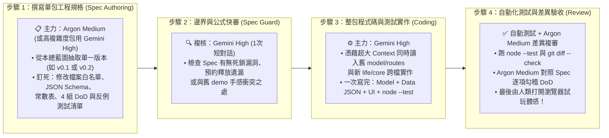

---

### 7.1 模型分工策略評估：「Argon Medium 寫 Spec ＋ Gemini High 照著開發」好不好？如何微調更完美？

你的構想**「先用 `Argon Medium` 寫好 Spec，再用 `Gemini High` 照著開發」非常準確且性價比極高**！原因與微調建議如下：

| 工作環節 | 推薦使用模型 | 為什麼這個模型最適合？（優勢與邊界分析） | 實戰微調建議（Pro-Tips） |
| :--- | :--- | :--- | :--- |
| **① 將總藍圖拆解為單包工程規格書**<br>*(例如產出 `LIFE_V01_HANDOFF.md`)* | **主力：`Argon Medium`**<br>*(若遇高複雜數學包則由 `Gemini High` 補強)* | • 我們已經有這份超完整的 1,300 行總藍圖，寫單包 Spec 不需要重新發散創意，而是需要**結構工整、高遵從度、不亂加戲、速度快**地把該版本的「檔案白名單、資料欄位、常數值、A～D 四組驗收標準」收斂成 120 行的工程契約。<br>• `Argon Medium` 在這種「根據母藍圖提取結構化工程 Spec」的任務上速度極快、格式極穩且省額度。 | **關鍵微調（加上 1 步 Spec 快審）**：<br>`Argon Medium` 寫出初版 Spec 後，在開工寫 Code 前，讓 **`Gemini High` 用 1 個回合快速掃一眼 Spec 的「數學不變量与狀態機邊界」**（例如檢查 `Toil` 中斷時の `onCleanup` 退料規則、或巡山回程精力取整公式有無漏洞）。確認無誤後再動工，能省下後面 80% 的返工！ |
| **② 照著 Spec 進行跨檔案整包開發與寫單測**<br>*(Model + Data + UI + Test)* | **主力：`Gemini High`** | • **超大 Context 跨檔全局對齊**：本專案從 `v0.1` 開始需要同時對照舊 `model.mjs`（1,740 行）、`routes.mjs`、`palm.mjs`、`patrol.mjs` 並建立 `sect-chronicle/life/core/` 的多個模組。`Gemini High` 能一次把 8～12 個檔案完整放進腦中，不會出現「改了 `core/toils.mjs` 卻忘了更新 `app.mjs` 呼叫端」的斷裂問題。<br>• **深度確定性邏輯推理**：面對 `60Hz` tick 順序、預約守恆、四層決策仲裁與 `node --test` 反例測試，`Gemini High` 的長思維鏈能一次寫出嚴密無死鎖的程式碼。 | **如何讓 `Gemini High` 發揮 120% 實力？**<br>• **一包一分支、一次做完 A～D**：不要把一個版本拆成「先寫空白檔案、明天再接 UI」，直接把 `Argon Medium` 寫好的整包 Spec 餵給 `Gemini High`，要求它在同一次工作流中完成 **「核心邏輯 ＋ 純 JSON 資料表 ＋ 畫面接線 ＋ `node --test` 代表反例測試」** 並跑通所有測試再交件！ |
| **③ 角色台詞氣泡、批命詩與 21 傳奇角色 JSON 擴充**<br>*(純資料與敘事內容)* | **`Argon Medium` 或 `Gemini High`** | • 因為我們在「體檢四」已經把角色宿命樹（`destiny-trees.json`）、名菜食譜與性格對話氣泡設計成**純 JSON 資料表（與引擎程式碼 100% 解耦）**。<br>• 當 `Gemini High` 把 `<150` 行的通用檢核引擎寫好後，後續擴充第 5～21 位傳奇角色的 JSON 設定與趣味台詞，交給 `Argon Medium` 批次生成即可，既快又不會動到核心引擎程式碼！ | 先由 `Gemini High` 寫好前 3 個代表角色（如：**自創主角、岳不群、韋小寶、郭靖**）作為 Golden Sample，之後其餘角色讓 `Argon Medium` 照著同一份 JSON Schema 擴充。 |
| **④ 程式碼差異審查與 DoD 勾稽**<br>*(PR / Diff Review)* | **`Argon Medium`（初審勾稽）＋ 人類試玩** | • 當 `Gemini High` 寫完並跑過 `node --test` 後，用 `Argon Medium` 讀取 `git diff` 與原 Spec，逐條核對：「有沒有偷改白名單外的檔案？有沒有破壞既有水路 `1700.9` 速度？四組 DoD 是否全數滿足？」 | 機器審過 `git diff` 與 CI 後，你只需要打開本地瀏覽器用 `1x / 4x` 看小人跑個 3 分鐘，就能輕鬆享受成果！ |

---

### 7.2 建議立即啟動的「前三步具體行動清單（Action Plan）」

為了馬上看到第一個可玩成果、又不被龐大系統壓垮，建議接下來按以下 3 步推進：

1. **第一步（現在即可做）：用 `Argon Medium` 產出 `v0.1`＋`v0.2` 的第一份正式工程規格書（`LIFE_V01_V02_HANDOFF.md`）**
   - **為什麼建議把 `v0.1（新核心同感移植）` 與 `v0.2（破道館開局、五維配點/選岳不群、零手動自走掌門、備料招工蓋房）` 作為第一階段重點？**
     - 如果只做 `v0.1`，畫面上看起來跟舊版一模一樣，玩家感受不到新設計的興奮感；
     - 因此建議：先用 `Argon Medium` 寫出 **`v0.1`（底層 `Toil` 與 `SmartObject` 骨架，確保挑水／採藥／砍柴／修屋同感不壞）** 的 Spec，緊接著立刻寫 **`v0.2`（雙軌開局創角：30 點五維配點＋問卷 vs 選【岳不群／韋小寶／郭靖】開局 ＋ `SectLeaderAutopilot` 零手動自走 ＋ 收集茅草/青石/原木敲鐘招木匠修大廳）** 的 Spec！
2. **第二步：交給 `Gemini High` 在新分支實作並通過 `node --test` 快驗**
   - 讓 `Gemini High` 讀取 `LIFE_V01_V02_HANDOFF.md` 與現有 `experiments/water-carry/demo/`，建立模組化的新核心，確保：
     - `node --test sect-chronicle/test/*.test.js` 全數綠燈；
     - 創角後就算玩家**雙手離開鍵盤（0 點擊）**，也能親眼看著主角（如岳不群或自創主角）按自己的性格自動除草、砍柴、把建材搬滿備料樁、自動敲鐘請山下木匠把破道館大廳修好，然後自己去外功場練第一階劍法！
3. **第三步：在瀏覽器親眼驗收「零手動破道館開局」後，再依序推進 `v0.3 ～ v0.6`（外門雜務定額 ➔ 韋小寶/郭靖分段里程巡山）**
   - 每一版都維持 **「`Argon Medium` 寫 120 行 Spec ➔ `Gemini High` 掃一眼邊界並整包寫完 Code + Test ➔ 瀏覽器試玩」** 的節奏，就能穩紮穩打把這座獨一無二的「金庸 × 周星馳 × 天下霸圖 × 模擬市民」江湖門派真正做出來！
