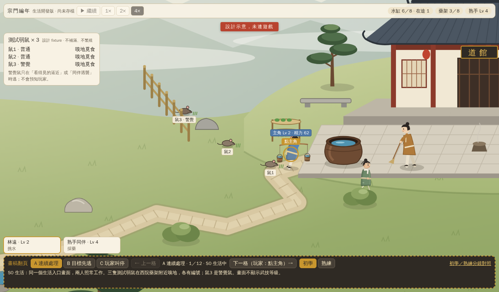
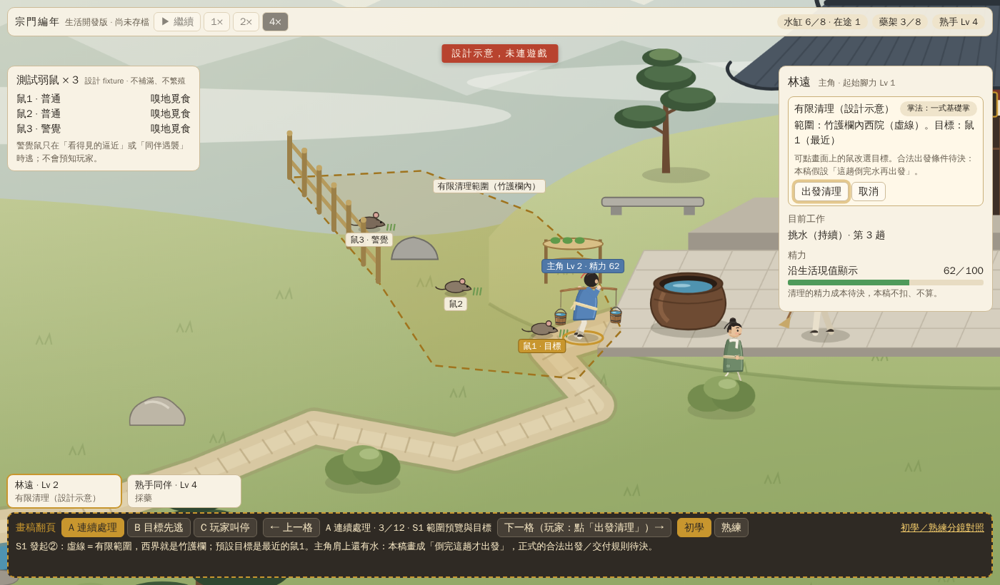
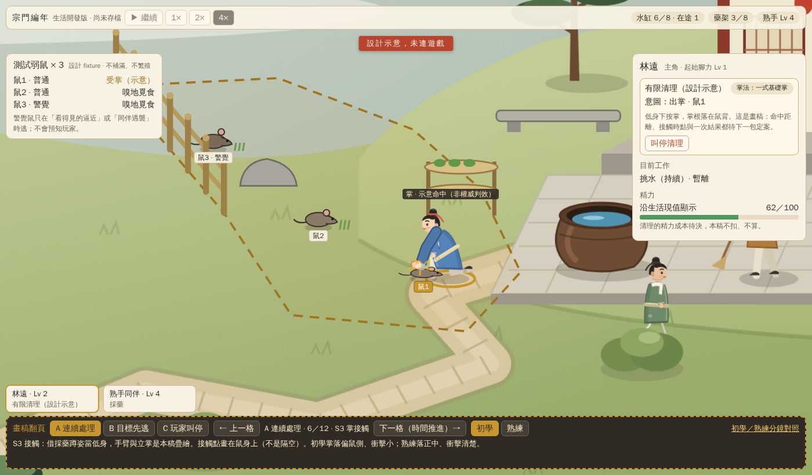
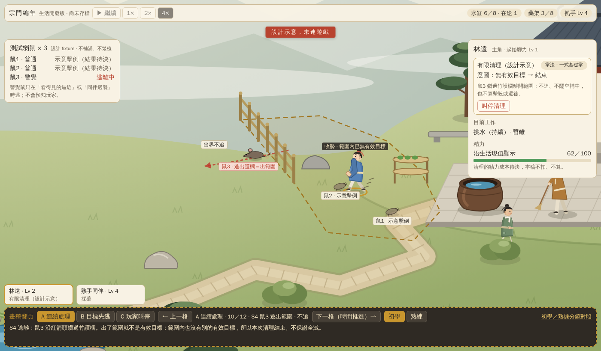
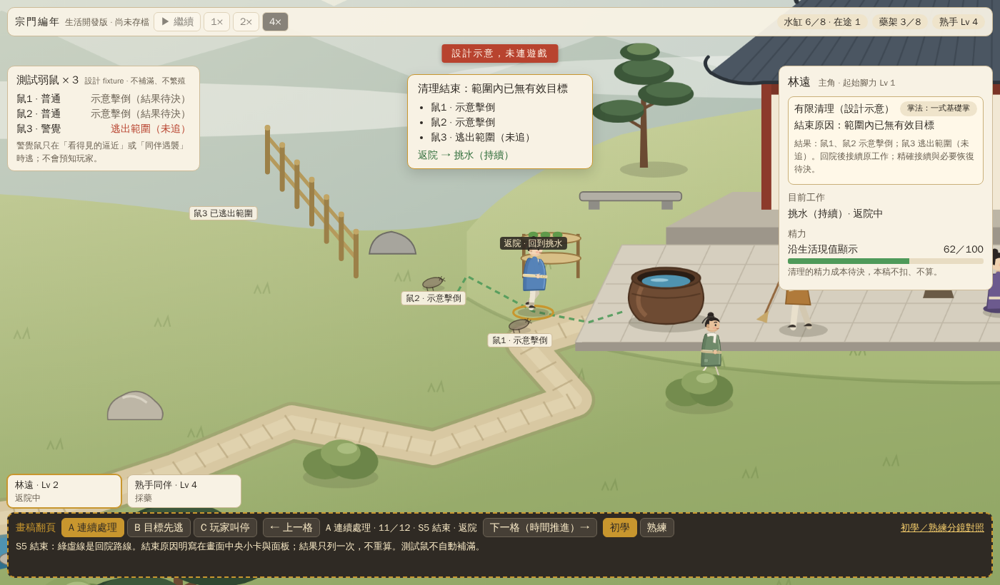
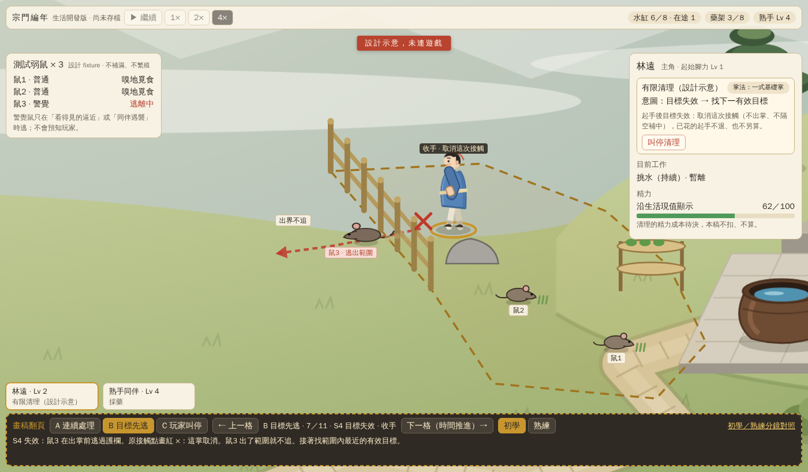
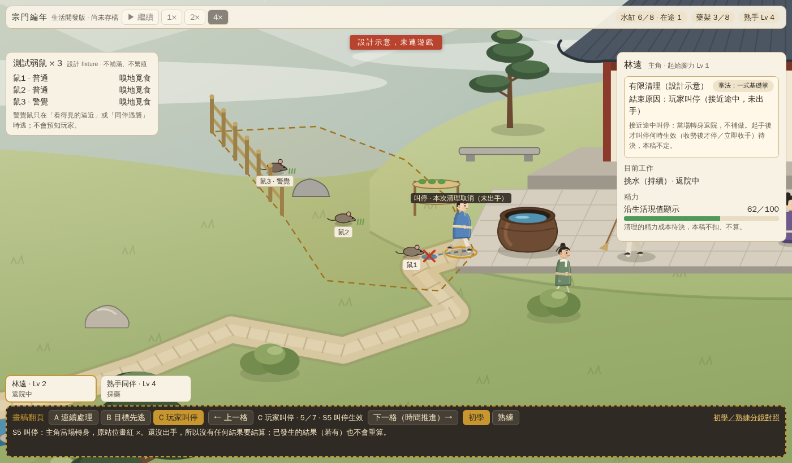
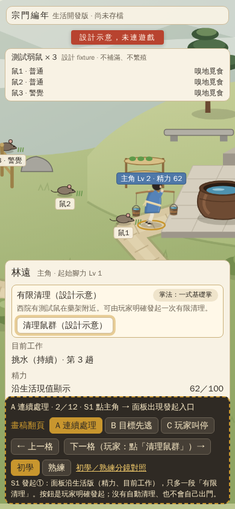
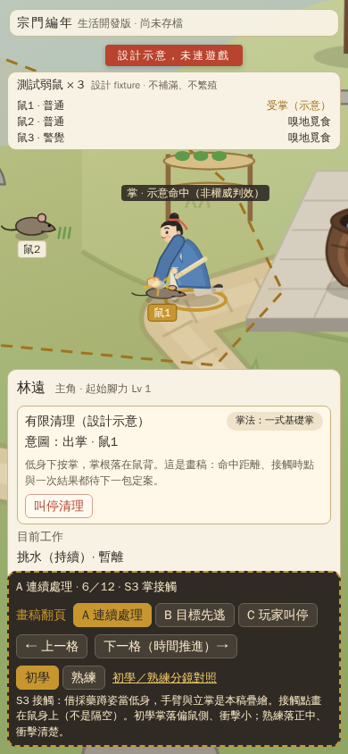
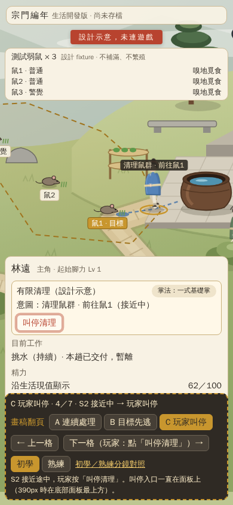

# LP-10 掌法畫面稿與點選流程（#220）

> **設計示意，未連遊戲。** 這一包是畫面與點選流程的設計交付，不是戰鬥 runtime：沒有命中判定、HP、傷害、精力扣除或成長值，也不改生活展示（8800 仍是 LP09）。

- 批准：[D20](../../../docs/DECISIONS_AND_SOURCES.md#d20lp-10-掌法畫面稿與點選流程-q1q4-批准2026-10-22)（擁有人 2026-10-22 批准 Q1–Q4）、[LP10 工作包](../../../docs/LP10_HANDOFF.md)、[Claude 兩小時提示詞](../../../docs/LP10_CLAUDE_PROMPT.md)、[#220](https://github.com/lalagrass/earth-ascension/issues/220)。
- 實際主筆：Claude。設計稿被接受也**不**授權進 runtime，下一個可操作包要等本頁「待決事項」的產品定案。


**最新狀態（2026-10-22）**：本設計已由PR237合dev1c82218／postCI39805538262五SUCCESS，#220按D20設計範圍結案。原「待決事項」保留為畫稿沿革；擁有人現已依 [D21](../../../docs/DECISIONS_AND_SOURCES.md#d21lp-11-手動掌法清鼠-k1k4-批准2026-10-22)批准[#238](https://github.com/lalagrass/earth-ascension/issues/238)的K1–K4，有限runtime執行以 [LP11工作包](../../../docs/LP11_HANDOFF.md)為準。**本頁與HTML仍是設計示意，不會因產品批准變成已可玩的戰鬥。**

## 怎麼看

```bash
cd sect-chronicle/experiments/water-carry
python3 -m http.server 8830 --bind 127.0.0.1   # 任一未占用埠都可以；頁面要 fetch 共用 scene.json，不能直接用 file:// 開
```

| 入口 | 網址 | 內容 |
|---|---|---|
| 點選流程 | <http://127.0.0.1:8830/design/lp10/> | 同一生活場景的 S0–S5 畫面；底部深色虛線框是「翻稿列」（不是遊戲介面），可切 A／B／C 路徑、上一格／下一格、初學／熟練 |
| 初學／熟練對照 | <http://127.0.0.1:8830/design/lp10/compare.html> | 同鏡頭同時刻並排、相對節奏條、分段姿勢特寫 |
| 直接開某一格 | `index.html?path=B&step=6&skill=e` | `step` 從 0 起；`skill` 為 `b`（初學）或 `e`（熟練） |

畫面上的金色脈動圈或脈動按鈕＝玩家這一步要點的地方（點了就翻到下一格）；沒有玩家動作的格子按「下一格（時間推進）」。鍵盤左右鍵也可翻。

## 畫面

桌面 1400×820（同一生活場景、兩人外觀、三鼠編號、竹護欄邊界、選取圈、發起／叫停入口、正在做什麼、為何結束）：

| S0 生活 | S1 範圍預覽與目標 |
|---|---|
|  |  |
| **S2 接近鼠1** | **S3 掌接觸（示意命中）** |
|  |  |
| **S4 鼠3 逃出範圍・不追** | **S5 結束返院** |
|  |  |
| **B：起手後目標失效・收手** | **C：接近途中叫停** |
|  |  |

390px 操作配置（面板改為底部面板，「有限清理」段落與叫停鍵放在面板最上方，不用捲動就看得到）：

| 發起入口 | 掌接觸 | 叫停 |
|---|---|---|
|  |  |  |

三條路徑全部格子的縮圖總覽：[lp10/out/paths.png](lp10/out/paths.png)。初學／熟練對照：[lp10/out/compare.png](lp10/out/compare.png)。

## 狀態與操作表

| 狀態 | 玩家看見 | 玩家可點 | 本稿畫法與交代 |
|---|---|---|---|
| S0 生活 | 原生活場景；兩人照常工作；鼠1、鼠2（普通）、鼠3（警覺）在西院藥架附近嗅地，各有編號 | 點主角 | 面板沿生活版（目前工作、精力），不顯示武技等級 |
| S1 發起 | 面板多一段「有限清理（設計示意）」→ 按「清理鼠群」後出現範圍虛線（西界＝竹護欄）與預設目標（最近的鼠） | 「清理鼠群」→ 可點鼠改選目標 →「出發清理」／「取消」 | 玩家明確發起，沒有自動清理。主角肩上有水：本稿畫成「倒完這趟才出發」，**合法出發規則待決** |
| S2 接近 | 藍虛線路線＋站位點；頭上意圖條「清理鼠群 · 前往鼠N」 | 叫停清理（一直在面板上） | 沿固定路走，不瞬移、不全圖追；走多快只看腳力 |
| S3 起手／接觸／收勢 | 站定 → 起手 → 低身下按掌、掌根落在鼠背 → 收勢 | 叫停清理 | 「示意命中」是畫稿標記，不是權威判效；弱鼠一掌「示意擊倒」（側躺），不畫成已驗傷害或擊殺 |
| S4 換目標／逃離 | 自動挑範圍內最近、仍有效的鼠；警覺鼠逃跑紅箭頭、出護欄＝出範圍、「出界不追」 | 叫停清理 | 起手後目標失效：取消這次接觸（紅 ×、不出掌、不隔空補中），再換有效目標；沒有就到 S5。逃走不算擊殺或遷徙 |
| S5 叫停或結束返院 | 畫面中央結束小卡＋面板寫結束原因與結果；綠虛線回院 | （回到 S0 後可再發起） | 結束原因分開寫：「範圍內已無有效目標」／「玩家叫停」。結果只列一次、不重算；測試鼠不自動補滿 |

## 三條短路徑

| 路徑 | 格子（點選流程裡的順序） | 結束原因 |
|---|---|---|
| **A 連續處理** | S0 → 點主角 → 範圍預覽（目標鼠1）→ 接近鼠1 → 站定起手 → 掌接觸 → 收勢・鼠1 示意擊倒 → 轉向鼠2 → 鼠2 接觸（鼠3 看見同伴遇襲）→ 鼠3 逃出範圍・不追 → 結束返院 → 回生活（12 格） | 範圍內已無有效目標（鼠1、鼠2 示意擊倒；鼠3 逃出範圍未追） |
| **B 目標先逃** | S0 → 點主角 → 改選鼠3 → 目標鼠3 → 接近鼠3 → 起手（鼠3 察覺逼近）→ 目標失效・收手（取消接觸）→ 換目標鼠2 → 鼠2 接觸 → 結束返院（鼠1 那段同 A，略）→ 回生活（11 格） | 範圍內已無有效目標（鼠3 起手後、接觸前逃出範圍；鼠2、鼠1 示意擊倒） |
| **C 玩家叫停** | S0 → 點主角 → 範圍預覽 → 接近鼠1 時按「叫停清理」→ 叫停生效（當場轉身，原站位紅 ×）→ 返院 → 回生活（7 格） | 玩家叫停（接近途中，未出手）；三隻鼠都還在 |

警覺鼠的固定設定（本稿 fixture）：只在「看得見的逼近」（B）或「看見同伴遇襲」（A）時逃，不讀玩家指令、不預知。普通鼠從旁經過不會驚走。

## 初學／熟練對照

[compare.html](lp10/compare.html)（輸出 [compare.png](lp10/out/compare.png)）。同一個主角、同一個鏡頭、同一條路、同一腳力，只換「掌法熟練」這個**明標的設計 fixture**：

1. **同一時刻並排**：t＝0.5／1.2／3.2／4.8／6.5 拍時兩列各在做什麼。熟練在 t＝3.2 已經走向鼠2、t＝4.8 已經打到鼠2；初學在 t＝4.8 還在收勢踉蹌。
2. **相對節奏條**：藍色移動段（走到鼠2）兩列等長，所以差異不是播放倍率；差在站定、起手、收勢、轉向。拍數只用來排畫格，**不凍結毫秒、HP、傷害或攻擊間隔**。
3. **分段特寫**：站定（初學要調整腳步）、起手（初學收掌到身後、大幅後坐；熟練收在腰側）、掌接觸（初學落點偏鼠側、衝擊線少；熟練落正中、衝擊清楚）、收勢（初學退半步踉蹌；熟練直接站正可轉身）。

點選流程的翻稿列也可以切「初學／熟練」，S3 各格會換姿勢與接觸效果，位置與路線不變。

熟練差異不是已實作的角色能力，也不從腳力 Lv、體態或 MBTI 推出；本輪沒有戰鬥 XP，熟練從哪裡來是待決事項。

## 素材與限制

- 場景背景、松樹、石頭、水缸、師父／師兄是 `spikes/shared/assets/` 既有 PNG（來源同 V2／V3 紀錄）；兩人身體是 `template/out/` 既有 sheet 的**借用幀**：走路＝`herbWalk`，站定／起手／收手＝`herbHand`，掌接觸的低身＝`herbGather`（採藥蹲姿），初學收勢＝`herbWalk-0`＋後傾，回生活＝`idle-0`。
- **缺專用掌法幀**：手臂與立掌是本稿在借用幀上用向量疊繪的示意；正式要做時需要專用的起手／出掌／收勢幀，本包沒有重畫 atlas。
- 竹護欄、藥架、石凳、觀景石照 `demo/app.mjs` 的向量畫法重畫；測試鼠、衝擊線、範圍／路線／察覺圈、紅 ×、轉身符號是本稿原創向量。沒有引用外部或付費素材。
- 座標與 `demo/routes.mjs` 同一張地圖（護欄、院中端點、防守路），但只是抄數字，沒有匯入 routes.mjs 或 model.mjs。鼠的位置、範圍虛線、站位是本稿 fixture。
- 頂列（播放、水缸等）是畫上去的，不能操作；數字是示意值，與世界無關。

## 待決事項（下一個可操作包要先定）

每項列本稿建議與取捨；都還沒定案，展示 HTML 也沒有把它們實作成正式語義。

| 待決 | 本稿建議 | 取捨 | 去向 |
|---|---|---|---|
| 合法出發／交付與必要恢復 | 沿 LP07～09：本趟完整交付、必要恢復到 80 後，在院中才能正式出發；忙碌時按下＝排入候補 | 立即打斷工作較爽快，但會丟水／藥、與既有規則衝突 | 保留建議，待定 |
| 人工停工／叫回與既有護院／整理的優先順序 | 人工明派（含清理）與既有 guard／fix 互斥，同一人只有一個正式外出；清理中不受理自主護院／整理 | 允許並行會讓一人同時兩個意圖 | 待定 |
| 返院後接續 | 回院中端點後接續清理前的最新有效工作意圖（本稿畫「回到挑水」） | 要不要自動恢復、或停在院中等指令 | 待定 |
| 精力成本 | 只在出掌動作扣（類似整理護欄每秒扣），移動不扣；值待真人校準 | 不扣會變無成本刷；扣太多會讓清理變成負擔 | 待定，本稿不扣 |
| 權威命中 | 起手完成時重驗目標仍在掌距內、仍在範圍內、仍有效，才結算一次結果；否則取消（B 的畫法） | 只在出發時判會出現隔空命中 | 保留建議，待定 |
| HP／傷害／攻擊間隔 | 弱鼠先做「一掌一結果」的 fixture，不先開 HP 條 | 有 HP 才能表現熟練多掌差，但要先定數值 | 延後 |
| 擊倒後的鼠 | 擇一：昏倒一段時間後離開／當場退走／移除；本稿只畫側躺標記 | 移除最簡單但像刪圖；昏倒最自然但多一狀態 | 待定 |
| 熟練來源 | 本輪只比較兩個 fixture，不給戰鬥 XP；之後若要成長，另案 | 無來源就只能是設定值 | 延後 |
| 三鼠生成／重設 | 開發用「重設測試鼠」按鈕或固定在每次重來時重生；不自動補滿、不繁殖 | 自動補滿會變刷怪 | 待定 |
| 有限範圍與逃生界線 | 西界＝竹護欄（與 LP06～09 同一條線），其他三邊固定；出界即失效、不追 | 範圍太小沒得打、太大像巡山 | 保留建議 |
| 起手後叫停何時生效 | 兩案：(a) 收勢完才停（結果照算一次）；(b) 立即收手（取消這次接觸）。本稿只畫接近途中叫停 | (a) 不會出現半掌狀態；(b) 反應快但要定已花成本 | 待定 |
| 警覺鼠察覺規則 | 看得見的逼近（固定半徑）或看見同伴遇襲；不讀玩家指令 | 半徑與視線是否被護欄遮擋要再定 | 待定 |

不在本包：自動殺敵、人物受傷、真偷糧、掉落、戰鬥 XP、繁殖、巡山、完整生態、存讀檔。[#219](https://github.com/lalagrass/earth-ascension/issues/219) 生態研究不是前置。

## 檔案

可編輯來源都在 `design/lp10/`，PNG 輸出在 `design/lp10/out/`：

| 檔案 | 內容 |
|---|---|
| `lp10/index.html`、`lp10/lp10.css` | 點選流程頁與樣式（沿 demo/style.css 的紙色／墨色語言） |
| `lp10/flow.js` | 翻稿：只切換 states.js 的格子，不跑時鐘／RNG，不匯入 model.mjs |
| `lp10/states.js` | 每一格的位置、姿勢、面板文字、熱區與說明；A／B／C 路徑順序 |
| `lp10/scene.js` | 2D canvas 場景繪製：共用背景／道具、借用人物幀、掌法手臂疊繪、測試鼠、範圍與效果 |
| `lp10/compare.html`、`lp10/compare.js` | 初學／熟練對照頁與相對節奏表 |
| `lp10/render.js` | 用 Playwright 輸出 `out/*.png`（先開靜態伺服器；`node render.js [基底網址] [輸出資料夾]`） |

## 驗證（設計階段）

只驗畫稿與翻稿，不代表戰鬥可玩、平衡或真人喜好已驗；結果見 PR。

- 實際開圖看過 8 張桌面、3 張 390px、三路徑總覽與對照頁。
- 桌面 1400×820 與 390×844 各實際點過 A／B／C：熱區、上一格、初學／熟練切換可用，無水平溢出，console 無錯。
- `node --check` 本包 JS；相對連結、程式碼框、新檔空白檢查；根 `python3 -m unittest discover -s tests -v`、`node --check earth_ascension/static/m2.js`、`git diff --check`。
