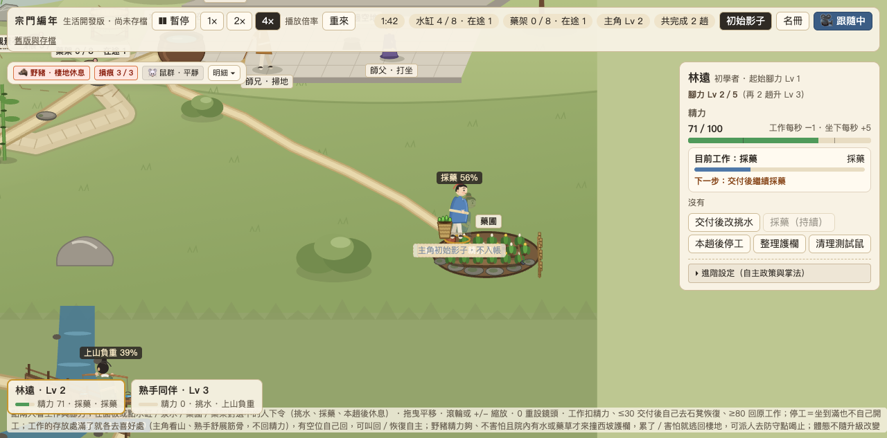
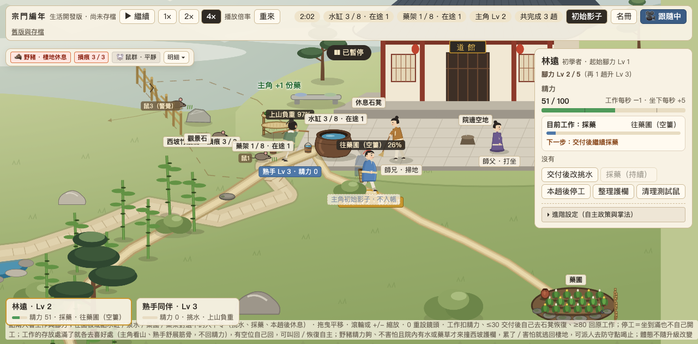

# LP-16 美術與採藥視覺整合交付包

本文件為 **LP-16「美術與採藥視覺整合」**（追蹤 [#271](https://github.com/lalagrass/earth-ascension/issues/271)，依據 [D31 整包流程](../../../../docs/PARALLEL_HANDOFF.md#d31單一主筆完整工作包與集中審查) 與 [VALIDATION_POLICY](../../../../docs/VALIDATION_POLICY.md)）之正式交付紀錄、視覺接線差異、最終掛點數值與實測驗證成果。

- **實際主筆**：Gemini (Antigravity)
- **Base dev SHA**：`959286cde4091aedf2c40ec4342963de83f0d2f4`（LP-16 規格文件合入版，postCI 39969918115 通過）
- **關聯 Issues**：Refs [#271](https://github.com/lalagrass/earth-ascension/issues/271)、[#184](https://github.com/lalagrass/earth-ascension/issues/184)、[#182](https://github.com/lalagrass/earth-ascension/issues/182)、[#170](https://github.com/lalagrass/earth-ascension/issues/170)（前置設計來源：[#259](https://github.com/lalagrass/earth-ascension/issues/259) / #267 LP-15、#270 Grok D32）

---

## 1. 工作包 A–D 完成摘要

| 工作包 | 完成內容與可見成果 | 邊界與承諾保證 |
|---|---|---|
| **A. 場景真正更新** | 1. **東坡藥圃地景精修**（`HERB.patch` `1440, 788`）：新增暖灰石邊緣包邊與苔蘚微飾、深褐色梯田腐殖土台地基底、三道耕作土畦溝壑、18 組立體三層藥草植株（深綠/翠綠葉片＋金黃與嫩白藥花草穗）、帶竹節與橫綁繩的竹籬。 2. **新增陶甕與木鋤**：西側灌溉陶甕（`1388, 778`，紅陶暖土色帶水光）與東側靠放木鋤（`1490, 804`，木柄倚竹籬、石刃入地）。 3. **曬藥架精修**（`896, 482`）：維持 2 層竹篩、上限 8 份；粗竹立柱榫接、竹節刻劃、人字斜撐加固、雙層大竹篩經緯篾條編織紋理，以及 1～8 份清晰可辨的捆紮草藥束。 4. **長挑水路石階呼應**（`scenery.mjs`）：院南斜坡段（點 1～3）與崖階降坡段（點 12～14）增添 Grok 暖灰鑿石踏步、受光上緣與苔綠微飾。 | 幾何 `STREAM_POLY`、`BRIDGE_DECK_POLY`、原挑水路徑、世界尺寸 100% 不變；裝飾不畫成阻擋可行走區域的障礙。 |
| **B. 採藥動作可看懂** | 1. **沿原 atlas 與渲染層**：  - `herbOut`（去程空身）：背簍背於身後微遮 `(-8*face, -19)`，`z - 0.03`，`load = 0`。  - `herbGather`（4 秒）：前段 `k < 0.5` 採摘（`herbGather` 取水蹲身姿勢），簍具卸於腳邊身前 `(-18, 0)`，`z + 0.03`，`load = k`（0.0 → 0.5）；後段 `k >= 0.5` 直身裝簍（切換為 `herbHand` 直身姿態），草藥逐漸裝滿（`load = k`，0.5 → 1.0）。  - `herbBack`（負重返程）：滿載綠草之竹簍背於身後上方 `(-2*face, -20)`，`z + 0.03`，`load = 1`。  - `herbDeliver`（4 秒）：簍具卸於面向藥架身側 `(+16*face, 0)`，`load = 1 - k`，人物採交藥姿態。 2. **真實結算回饋**：交付 tick 當刻，藥架竹篩實存 +1（`herbs: 0 → 1`），人物 `trips + 1`，跳出 `+1 份藥` 綠色浮字。主角完成首趟立即由 Lv 1 升至 Lv 2。 | 不新增 phase、不新增手部獨立骨架或全套人物動畫；暫停時所有動作與簍具擺動同步停止。 |
| **C. 長通勤與真成長不變** | 水路長度（1700.3）與採藥路（515.2）、世界尺寸（1600×1350）、物理速度（空身 60.0/74.4，負重 40.0/52.0）、精力消耗與自主休息、在途預約守恆、選人與鏡頭跟隨完全保留。改工嚴格「當趟交付後生效」，不瞬移。 | `model.mjs`、`routes.mjs`、`water-layout.mjs` 100% 只讀零變更。 |
| **D. 可整合交付** | 模組化原創可編輯來源（`demo/assets/lp16/herb-decor.mjs`）、單一作者集中交付、嚴格工程白名單、桌面無頭真瀏覽器操作驗證與真實截圖（`desktop-gather.png`、`desktop-deliver.png`）。 | 零第三方外部依賴，不使用未授權點陣概念圖作為 runtime 地圖。 |

---

## 2. 掛點與視覺參數最終值

對齊 LP-15 規格並依 PixiJS 渲染適配之最終參數：

| 狀態 / 物件 | 最終場景坐標 / 偏移值 | 圖層深度 (`zIndex`) | 草藥負載 (`load`) | 姿態幀選取 |
|---|---|---|---|---|
| **去程 (herbOut)** | `(p.x - p.face * 8 * s, p.y - 19 * s)` | `p.y - 0.03`（背於身後微遮） | `0`（空簍） | `herbWalk` (循環步態) |
| **採摘 (herbGather 前段 k < 0.5)** | `(p.x - 18, p.y)` | `p.y + 0.03`（身前地面清晰可見） | `k` (0.0 → 0.5) | `herbGather` (俯身微蹲) |
| **裝簍 (herbGather 後段 k >= 0.5)** | `(p.x - 18, p.y)` | `p.y + 0.03`（身前地面清晰可見） | `k` (0.5 → 1.0) | `herbHand` (直身整理入簍) |
| **負重回程 (herbBack)** | `(p.x - p.face * 2 * s, p.y - 20 * s)` | `p.y + 0.03`（背負於身後上方） | `1.0`（滿載綠草） | `herbWalkBack` (沉穩負重步態) |
| **交藥 (herbDeliver)** | `(p.x + p.face * 16 * s, p.y)` | `p.y + 0.03`（卸於面向藥架身側） | `1 - k` (草藥轉移入架) | `herbHand` (捧草交付站姿) |
| **藥架 (Drying Rack)** | `(places.rack.x, places.rack.y + 8)` = `(896, 482)` | `p.y + 8` | `v.herbs` (0～8 份草藥束) | 雙層竹篩，竹柱榫接斜撐 |
| **灌溉陶甕** | `(1388, 778)`（`patch.x - 52, patch.y - 10`） | 地面層 `ground` | N/A | 腹鼓口斂紅陶甕 |
| **靠放木鋤** | `(1490, 804)`（`patch.x + 50, patch.y + 16`） | 地面層 `ground` | N/A | 木長柄倚靠竹籬、暗鐵鋤刃入地 |

---

## 3. 採用、保留與延後差異表

| 項目 | 來源 | 本包實際採用 | 本包延後事項 |
|---|---|---|---|
| **東坡藥圃** | LP-15 H1 / Grok D32 | 採用 Grok 暖灰石包邊、苔綠、深褐梯田土畦；補灌溉陶甕與靠放木鋤 | 完整三層台地搬遷、泉眼搬家、全圖點陣替換延後 |
| **曬藥架** | LP-15 H1 / #271 | 嚴格維持 2 層竹篩、8 份容量；精修雙粗竹柱、榫接斜撐、大竹篩編織篾條經緯紋理與 1～8 束草藥辨識 | 3 層藥架方案不採用（避免破壞 8 份容量契約） |
| **採藥動作** | LP-15 H2 | 4 秒 `herbGather` 內依 `k < 0.5` 採摘（蹲姿）與 `k >= 0.5` 裝簍（直身）切換；4 秒 `herbDeliver` 身側卸簍與交付；草藥隨進度轉移 | 獨立捧草手部圖層、手持小木鋤撥土全新骨架延後（標記為 BL-P02） |
| **長挑水路** | Grok D32 | 坡段石階（點 1～3）與石階降坡段（點 12～14）呼應 Grok 暖灰鑿石踏步與苔綠色調 | 步道拓寬或路徑改道延後（嚴格保持 1700.3 長度與幾何契約） |
| **角色立繪** | Grok D32 | 保留色彩與人物氣質參考（主角藍短衫、熟手村居少年、女孩阿岫） | 不將大圖縮為靜態小人、不重繪全套 atlas、不新增第三人 AI |

---

## 4. 真實桌面驗證與證據

依據 [VALIDATION_POLICY](../../../../docs/VALIDATION_POLICY.md)，本地完成變更 JS 語法檢查、diff 檢查與無頭 Chrome 完整真實操作驗證：

1. **JS 語法檢查**：
   - `node --check demo/app.mjs` 通過（0 錯誤）。
   - `node --check demo/assets/lp16/herb-decor.mjs` 通過（0 錯誤）。
   - `node --check demo/assets/long-water/scenery.mjs` 通過（0 錯誤）。
2. **Git diff 檢查**：
   - `git diff --check origin/dev` 通過（零結尾空白、零多餘換行）。
3. **單元測試全數通過**：
   - `node --test checks/*.test.mjs` 共 141 項測試 100% 通過（含 `model.test.mjs` 38 項、`water13.test.mjs`、`water14.test.mjs` 等）。
4. **真實桌面操作驗證**（SwiftShader WebGL 無頭 Chrome，1280×720 視窗）：
   - 啟動臨時服務，點擊 UI 按鈕切換 4× 倍率、選取主角、下達「改採藥」命令。
   - 驗證「當趟交付後生效」：主角完整走完原有挑水路程、水缸 +1 擔水、結算升至 Lv 2。
   - 隨後自動返院啟程前往東坡藥圃（`herbOut`，背負空簍）。
   - 抵達藥圃後執行 `herbGather`（身前置簍，`k < 0.5` 蹲身採藥，`k >= 0.5` 直身裝簍），捕獲真實截圖 [`desktop-gather.png`](desktop-gather.png)。
   - 負重返回（`herbBack`，滿載綠草之竹簍背於身後上方）。
   - 抵達院中藥架執行 `herbDeliver`（身側卸簍，草藥轉移），交付那一刻藥架實存由 0 變 1，捕獲交付截圖 [`desktop-deliver.png`](desktop-deliver.png)。
   - 驗證完成後立即暫停、清理服務與瀏覽器行程，零殘留。

### 驗證截圖

- **採藥現場（東坡藥圃、灌溉陶甕、靠放木鋤與身前置簍）**：
  
- **交付入帳（院中精修雙層竹藥架、實存 1/8 份藥草、主角 Lv 2）**：
  

---

## 5. 資源清理與邊界確認

- 臨時 Chrome 行程與靜態測試服務（連接埠 8824）已全數終止並確認清理。
- 專案原有背景生活入口（連接埠 8800）全程未碰觸，保持完整運作。
- 修改檔案嚴格限於白名單：
  - `sect-chronicle/experiments/water-carry/demo/app.mjs`
  - `sect-chronicle/experiments/water-carry/demo/assets/lp16/herb-decor.mjs`
  - `sect-chronicle/experiments/water-carry/demo/assets/lp16/README.md`
  - `sect-chronicle/experiments/water-carry/demo/assets/long-water/scenery.mjs`
  - `sect-chronicle/experiments/water-carry/demo/style.css`
  - `sect-chronicle/experiments/water-carry/design/lp16-integration/README.md`
  - `sect-chronicle/experiments/water-carry/design/lp16-integration/desktop-gather.png`
  - `sect-chronicle/experiments/water-carry/design/lp16-integration/desktop-deliver.png`
  - `sect-chronicle/experiments/water-carry/README.md`
