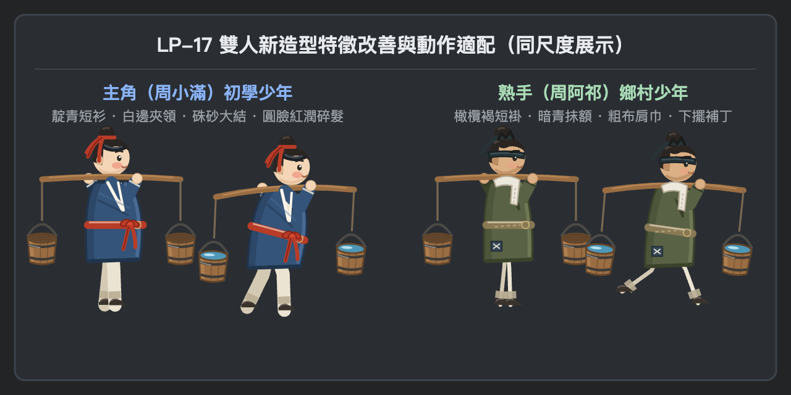
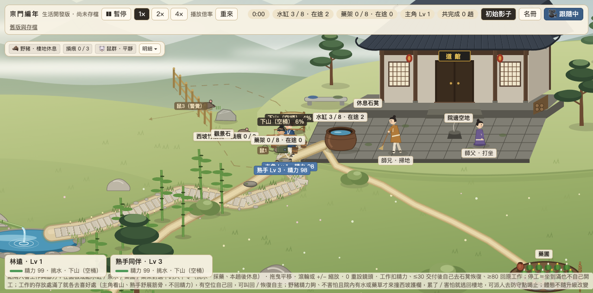
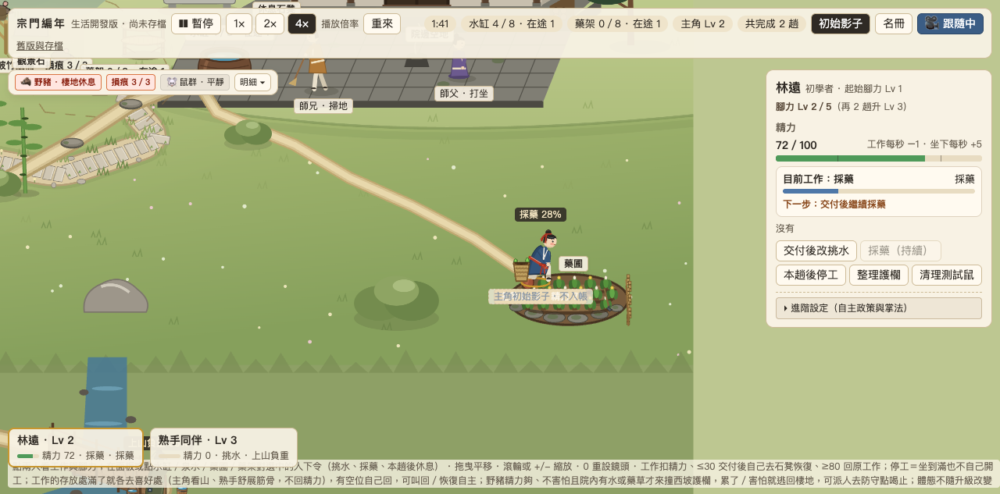
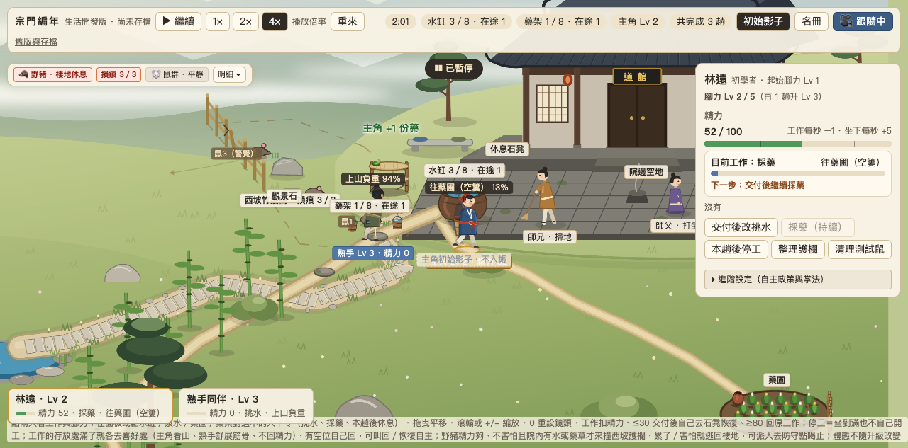

# LP-17 道館場景與雙人美術整合交付包

本文件為 **LP-17「道館場景與雙人美術整合」**（追蹤 [#274](https://github.com/lalagrass/earth-ascension/issues/274)，依據 [D31 整包流程](../../../../docs/PARALLEL_HANDOFF.md#d31單一主筆完整工作包與集中審查) 與 [VALIDATION_POLICY](../../../../docs/VALIDATION_POLICY.md)）之正式交付紀錄、視覺接線差異、最終角色幀配置與實測驗證成果。

- **實際主筆**：Gemini (Antigravity)
- **Base dev SHA**：`6943ce648d983f67d080d8fd58f9cff23b732f63`（LP-17 規格文件合入版，postCI 39981176621 通過）
- **關聯 Issues**：Refs [#274](https://github.com/lalagrass/earth-ascension/issues/274)、[#184](https://github.com/lalagrass/earth-ascension/issues/184)、[#182](https://github.com/lalagrass/earth-ascension/issues/182)、[#170](https://github.com/lalagrass/earth-ascension/issues/170)（前置設計來源：[#271](https://github.com/lalagrass/earth-ascension/issues/271) / #273 LP-16、#270 Grok D32）

---

## 1. 審查意見補修紀錄（Review Iteration）

依據 Game PO 於 PR #277 集中審查反饋（兩項 P2），本輪集中補修完成：

| 審查項 | 問題反饋 | 補修方案與具體成果 |
|---|---|---|
| **R1. 雙人造型實質改善** | 原 painter 僅換色與傳遞 round，原臉髮／衣料幾何未實質改善。 | 1. **周小滿（主角初學少年）**：  - **臉髮**：新增額前微垂少年碎髮劉海、雙頰健康紅潤氣色（微汗紅暈）、清澈高光雙眸，頭頂髮髻繫雙耳紅結與身後飄逸雙飄帶。  - **服飾結構**：交領增設白邊內層夾領，胸腹自然布料衣褶陰影，腰間繫經典硃砂大蝴蝶結與自然垂褶，袖口收束。 2. **周阿祁（熟手鄉村少年）**：  - **臉髮**：新增深青石板色抹額頭巾、額角 spiky 碎短抓髻與鬢角、修容削瘦下頜弧度、剛毅濃眉與專注眼神。  - **服飾結構**：敞開式粗布短褂，肩搭具經緯織紋與下垂褶皺的粗麻擦汗巾，粗麻繩絞線束腰，下擺深藍補丁增添十字針腳明線。 3. **同尺度細節展示**：輸出 [`character-details.png`](character-details.png) 清楚比對兩人站姿與挑水動作特徵。 |
| **R2. 匯出異常保證清理** | `export-lp17.js` 原僅於腳本末尾 `browser.close()`，中途拋錯或逾時會遺留 Chromium 行程。 | 1. 將所有頁面操作置入嚴格 `try { ... } finally { if (browser) await browser.close(); }` 區塊，保證無論成功、失敗、中途 throw 或逾時，瀏覽器行程均乾淨關閉釋放。 2. 發生錯誤時保留非零 exit code（`process.exit(exitCode)`）。 |
| **非阻擋項回饋** | 1. 授權描述修正。 2. 角色命名界定。 | 1. 素材與文檔如實標註為本專案貢獻者原創向量生成與開源衍生，不逕自推定或擴大宣稱全倉授權範圍。 2. 標明「周小滿／周阿祁」為小說與設計參考命名，遊戲 UI 仍維持「林遠／熟手」標準名稱。 |

---

## 2. 工作包 A–D 完成摘要

| 工作包 | 完成內容與可見成果 | 邊界與承諾保證 |
|---|---|---|
| **A. 道館院落與全景重繪** | 1. **道館建築與庭院全面重繪**（`demo/assets/lp17/bg.png` 3200×1800 @ 2× = 1600×900 場景）：  - 原有純平鋪紅柱白牆全面替換為青灰筒瓦殿頂、飛簷鴟尾、老杉木柱梁架、暖紙木欞花窗。  - 重整台基與階道，石縫青苔微飾、院落石階與散水石板鋪砌，新增柴垛與院角青銅古鼎香爐。 2. **院落與山徑過渡呼應**（`scenery.mjs`）：  - 院南石階坡道、竹林邊緣、溪石踏步及泉眼周邊植被石木色調，全面呼應 Grok D32 暖灰石、深老木竹、苔綠土色。  - 保留院中水缸、大水桶、LP-16 東坡藥圃、灌溉陶甕與雙層竹曬藥架等可讀生活道具。 | 原挑水路徑（1700.9）、藥路（515.2）、世界尺寸（1600×1350）100% 不變；建物與庭院均在原可行走幾何外，無新舊重影，不阻擋原行走與互動判定點。 |
| **B. 雙人角色真套動作** | 1. **原位重繪雙人精細外觀**（`hero.png` 與 `cousin.png`，950×1284 30/27 幀）：  - **主角（周小滿）**：圓潤 13 歲初學少年，靛青藍短布衫、白邊夾領、腰繫硃砂大結、前額碎髮、微紅圓臉帶著認真神情。  - **熟手（周阿祁）**：稍瘦長 12-13 歲精幹鄉村少年，橄欖褐交領短褂、暗青抹額頭巾、肩搭粗麻擦汗巾、補丁短褲，眼神專注俐落。 2. **嚴格沿用原動態與契約規格**：  - 保持共框 `190×214`（95×107 @ 2×）、腳底錨點 `(90, 184)`（45, 92 @ 2×）、碰撞箱與負重掛點完全相同。  - 完整覆蓋走路、負重挑水、汲水、倒水、歇息、採藥、裝簍、負重回程、交藥全動作（hero 30 幀 / cousin 27 幀），零掉幀、零截頭、零漂腳。 | 不新增手部骨架、不新增第三人或第二時鐘，借用掌法手臂與衣袖、桶簍色彩完美協調；暫停時所有動作與掛載物同步停定。 |
| **C. 長通勤與真成長不變** | 水路長度（1700.9）與採藥路（515.2）、世界尺寸（1600×1350）、物理速度（空身 60.0/74.4，負重 40.0/52.0）、精力消耗與自主休息、在途預約守恆、選人與鏡頭跟隨完全保留。改工嚴格「當趟交付後生效」，不瞬移。 | `model.mjs`、`routes.mjs`、`water-layout.mjs` 100% 只讀零變更。 |
| **D. 可整合交付** | 提供原創程序化向量/畫布烘焙工具（`demo/tools/export-lp17.js`）、高解析度 Sprite Sheet 與 Manifest（`demo/assets/lp17/**`）、桌面無頭 Chrome 完整真實操作驗證與截圖（`desktop-scene.png`、`desktop-gather.png`、`desktop-deliver.png`、`character-details.png`）。遵守單一預覽部署原則，PO 於合併後更新 8800。 | 零採購、零外部商業未授權圖資、不使用整張點陣概念圖鋪成底圖。 |

---

## 3. 角色 Sprite Sheet 與幀配置規範

依據原 `template/tools/bake.js` 與 LP-17 規格，烘焙至 `demo/assets/lp17/`：

| 角色 | 總幀數 | 網格配置 | 單幀尺寸 | 錨點 (Anchor) | Hitbox (x, y, w, h) | 角色特色與色調 |
|---|---|---|---|---|---|---|
| **周小滿 (hero)** | 30 幀 | 5 行 × 6 列 (950×1284) | 190×214 | `(90, 184)` | `(65, 81, 50, 106)` | 圓潤主角、靛藍短褂（`#345479`）、硃砂大結（`#b83c28`）、白邊夾領、前額碎髮 |
| **周阿祁 (cousin)** | 27 幀 | 5 行 × 6 列 (950×1284) | 190×214 | `(90, 184)` | `(66, 84, 48, 103)` | 稍瘦熟手、橄欖褐短衫（`#5a6245`）、暗青抹額（`#243236`）、粗麻汗巾、補丁 |

---

## 4. 真實桌面驗證與證據

依據 [VALIDATION_POLICY](../../../../docs/VALIDATION_POLICY.md)，本地完成變更 JS 語法檢查、diff 檢查與無頭 Chrome 完整真實操作驗證：

1. **JS 語法檢查**：
   - `node --check demo/app.mjs` 通過（0 錯誤）。
   - `node --check demo/tools/export-lp17.js` 通過（0 錯誤）。
   - `node --check demo/assets/long-water/scenery.mjs` 通過（0 錯誤）。
2. **Git diff 檢查**：
   - `git diff --check origin/dev` 通過（零結尾空白、零多餘換行）。
3. **Sprite Sheet 契約校驗**：
   - `template/out/` 與 `demo/assets/lp17/` 對比：`frames count`、`frameSize`、`anchorPx`、`hitbox`、`attach keys`、`animations keys` 100% 一致。
4. **真實桌面端到端生活驗證**（SwiftShader WebGL 無頭 Chrome，1280×720 視窗）：
   - 啟動靜態測試服務，載入全新 LP-17 場景與雙人 Sprite Sheet，捕獲全景截圖 [`desktop-scene.png`](desktop-scene.png)。
   - 觀察兩人在長挑水路上各自按照初學 (60.0/40.0) 與熟手 (74.4/52.0) 速度行走，步態平穩，無截頭、無漂腳。
   - 選取主角小滿，切換採藥工作（當趟挑水交付後生效）。
   - 主角挑水完成並交付（水缸 +1），隨後啟程前往東坡藥圃。
   - 主角於藥圃身前置簍、蹲身採藥並直身裝簍，捕獲採藥截圖 [`desktop-gather.png`](desktop-gather.png)。
   - 負重返回院落藥架交付草藥，藥架草藥實存 +1（`herbs: 0 → 1`），捕獲交付完成截圖 [`desktop-deliver.png`](desktop-deliver.png)。
   - 暫停模擬並關閉無頭瀏覽器與服務，零行程殘留。

### 驗證截圖

- **雙人造型同尺度細節特徵展示（髮型、抹額、夾領、紅結、汗巾、補丁）**：
  
- **全新道館院落全景與雙人出門挑水**：
  
- **主角周小滿於東坡藥圃採藥（藍衣紅結新外觀與置簍姿態）**：
  
- **草藥交付入帳（藥架實存 1/8 份草藥、主角 Lv 2，阿祁挑水途中）**：
  

---

## 5. 資源清理與單一預覽原則

- `demo/tools/export-lp17.js` 將所有瀏覽器操作置於 `try ... finally` 中，無論成功或失敗均保證釋放 Chromium。
- 臨時 Chrome 行程與靜態測試服務已全數終止並確認清理。
- 專案原有背景生活入口（連接埠 8800）全程未碰觸，保持完整運作。
- 嚴格遵守單一預覽原則：不自行替換或備份 8800，由 Game PO 於 PR 合併至 `dev` 後統一發布與重啟。
