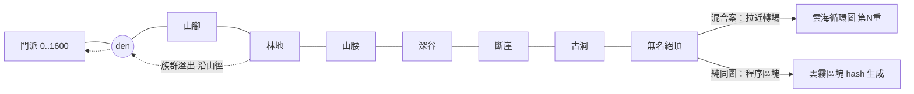

# 巡山：同一張地圖往外延伸（無轉場）設計 — 2026-10-25

接 `PATROL-MAP-DESIGN-v155.md`（方案 A：邊緣轉場進段圖）。本文件回答：**如果不切場景、整個後山就是同一張連續大地圖**，怎麼做。基準 head `13178a4` 之後的 `2d2b87a`。只寫設計，不改程式。示意圖：`artifacts/patrol-design/samemap-mockup.png`（HTML 原檔同目錄，粗略色塊示意，非美術稿）。

## 1. 先例（連結 2026-10-25 以 curl 驗證回 200）

| 遊戲／資料 | 同圖延伸怎麼做 | 借什麼 | 連結 |
|---|---|---|---|
| Kenshi | 整個世界無縫、鏡頭跟小隊，基地照常算；遠處區塊降級模擬 | 跟隨鏡頭＋遠處粗算 | [Steam](https://store.steampowered.com/app/233860/) |
| Against the Storm | 營地與林地空地在**同一張圖**，霧裡一圈圈開拓，越外越危險 | 環帶＋迷霧揭露（已採） | [Steam](https://store.steampowered.com/app/1336490/) |
| Songs of Syx | 單一超大城市圖，大量單位；靠極簡畫法與聚合模擬撐效能 | 縮小時改畫圖示、不畫細節 | [Steam](https://store.steampowered.com/app/1162750/) |
| Factorio | 世界分 32×32 區塊，探索時才生成；雷達揭霧；遠處敵巢會擴張並來襲 | **區塊按需生成＋巢穴擴張來襲**＝共用生態 | [Map generator](https://wiki.factorio.com/Map_generator)・[Radar](https://wiki.factorio.com/Radar) |
| Mindustry（開源） | 單張圖內敵人從固定生成點沿路來襲 | 固定生成點＝各環族群 | [GitHub](https://github.com/Anuken/Mindustry) |
| OpenTTD（開源） | 超大格子圖＋多個視窗（Extra viewport）＋小地圖 | 子視窗／小地圖跳轉 | [GitHub](https://github.com/OpenTTD/OpenTTD) |
| Cataclysm: DDA（開源） | 只在玩家周圍「reality bubble」細模擬，外面只記狀態 | **模擬 LOD** | [官網](https://cataclysmdda.org/)・[GitHub](https://github.com/CleverRaven/Cataclysm-DDA) |
| Minecraft | 16×16 區塊、種子決定生成、只載入玩家附近區塊 | 種子＋區塊座標＝決定性無盡 | [Chunk](https://minecraft.wiki/w/Chunk) |
| Don't Starve Together | 一張大島＋迷霧揭露、小地圖 | 小地圖記錄已探索 | [Steam](https://store.steampowered.com/app/322330/) |
| Valheim／Terraria | 種子生成大世界、生態區（biome）越遠越難 | **依距離分難度**（同我們的固定深度難度） | [Valheim](https://store.steampowered.com/app/892970/)・[Terraria](https://store.steampowered.com/app/105600/) |
| Banished／Going Medieval／Timberborn | 固定大小大地圖，邊緣出怪或資源，鏡頭自由 | 鏡頭邊界與捲動手感 | [Banished](https://store.steampowered.com/app/242920/)・[Going Medieval](https://store.steampowered.com/app/1029780/)・[Timberborn](https://store.steampowered.com/app/1062090/) |
| RimWorld 大地圖 | 圖越大越卡，社群普遍建議別超過中型 | 有限大小、別貪大 | [Steam](https://store.steampowered.com/app/294100/) |
| Red Blob Games | 2D 視野／迷霧演算法、格子座標 | 迷霧與視野計算 | [2D Visibility](https://www.redblobgames.com/articles/visibility/)・[首頁](https://www.redblobgames.com/) |
| MDN | Canvas 最佳化（離屏預繪、分層、整數座標）、tilemap 捲動 | 我們是原生 Canvas，照這套做 | [Optimizing canvas](https://developer.mozilla.org/en-US/docs/Web/API/Canvas_API/Tutorial/Optimizing_canvas)・[Tilemaps](https://developer.mozilla.org/en-US/docs/Games/Techniques/Tilemaps) |
| PixiJS | WebGL 2D，大量 sprite 時可替換 Canvas | 備案，非必要 | [pixijs.com](https://pixijs.com/) |

共通建議：**區塊化＋只畫視窗內＋離屏預繪背景**；**近處細算、遠處粗算**；**種子決定生成**；**迷霧＋小地圖**；**地圖別無限大，無盡部分才用程序區塊**。

## 2. 設計

### 2.1 世界配置與座標
- 世界座標原點不動：門派 1600×900 留在 (0,0)–(1600,900)，**世界往右、往上長**（上方用負 y）。den (1475,22) 是山腳入口。
- 7 環以 den 為圓心、半徑逐圈加大，往右上展開（示意：山腳 0–500、林地 500–1100、… 無名絕頂到約 4000）。世界有限區域約 **6400×4800**（含門派）。
- 現有距離 `X.dist`（0→1600）**對應到一條實際畫出的山徑**（polyline），用弧長換算座標；模擬仍只看 `dist`，地圖是投影。
- 區塊：**256×256 px**；有限區約 25×19 ≈ 475 塊，只建立進過視窗的。

### 2.2 繪製與效能（原生 Canvas）
- 每個區塊第一次進視窗時，把地形＋靜態物畫到離屏 canvas 快取；每幀只 `drawImage` 視窗內 6–12 塊＋動態單位。
- 縮放三段 LOD：近（立繪小人）、中（圓點＋名字）、遠（只畫環色塊、族群圖示），Songs of Syx 式。
- 快取上限約 64 塊，LRU 釋放；記憶體約 64×256×256×4 ≈ 16MB。
- 單位數量很小（隊伍 ≤ 數人、每環怪數十），不需要空間雜湊；若之後加多，再用以區塊為格的簡單 hash。

### 2.3 模擬 LOD（玩家看家時）
- **權威模擬不分遠近**：巡山與族群一律跑現有決定性公式，與鏡頭位置無關 → 存檔、種子、黃金雜湊不受鏡頭影響。
- 只有**演出**依鏡頭降級：鏡頭內播走位與戰鬥動畫；鏡頭外只更新座標點（小地圖上的點）。這是 CDDA 思路，但我們連「粗算」都不用，因為模擬本來就是抽象的。

### 2.4 鏡頭 UX
- 左上：「🏯 回山門」（瞬移鏡頭回院子）、「👣 跟隨隊伍」（開關）。
- 右下小地圖：整個世界縮圖，顯示院子、隊伍、各環族群、迷霧；點哪跳哪。
- 鏡頭邊界：只能捲到已揭霧的範圍＋一圈邊（越探越大，Against the Storm 式）。
- 出發時不自動跟隨；大事件依三級事件規則才拉鏡頭。

### 2.5 戰鬥與性格風格
- 同方案 A：**看得見的單位＋批次結果**，結果由現有公式決定，畫面播 2–4 秒演出。
- 怪物站位固定：每環依 `every` 間距，以（環 id＋種子）在山徑兩側放點；強度只看該環 `scale`。
- 風格看走位：清場繞去打每一隻、穩推只打擋路的、疾行直線快走、溜走貼邊閃過並留下殘餘怪（回程獸襲就從這些點冒出）。

### 2.6 召回、返程、獸襲
- 召回：隊伍原地轉身沿同一條山徑走回院子（連續，不瞬移）。
- 獸襲：每環有族群計數；族群溢出時，怪從**該環的巢點**沿同一條山徑往下走，經 den 進院子 → 玩家在同一張圖上看得到「怪從哪一圈下來」。清過的環在 `qing` 期間不下山。
- 隊伍與下山的怪在路上相遇就打一場（看得見）。

### 2.7 迷霧
- 每區塊一個 bit：未探／已探；視野以隊伍為中心半徑揭開（Red Blob 的簡化版，圓形即可，不做遮擋）。已探但不在視野的區塊淡化，只顯示最後見到的族群。

### 2.8 無盡雲霧環
- 無名絕頂之外是**程序生成區塊**：區塊座標＋存檔種子＋重數 → hash 決定地形與怪點（Minecraft 式），每重 200 步一段、段末無名高手，強度 ×1.18/重不變。
- 純同圖延伸會讓世界越來越遠；**混合案**：雲霧入口處做一次拉近轉場，雲霧重數都在同一張「雲海」循環圖上（見 §3）。

### 2.9 存檔大小與決定性
- 存：迷霧 bit（475 塊 ≈ 60 bytes，base64 約 80 字）、各環族群（7 個數字）、已清時間、無盡最深重數。地形、怪點全由種子重算，**不存**。新增約 < 1KB。
- 決定性：生成只用存檔種子與座標 hash，不用 `Math.random`、不看鏡頭；同種子同結果。

### 2.10 美術需求
- 每環一套地表 tile（7 套，可用同一套筆觸換色＋點綴物：竹、松、岩、洞口、雲）、環與環之間的過渡邊、山徑線、巢穴圖示、雲霧 tile 1 套、小地圖配色。比方案 A 的 7 張段背景多：要能接邊、能重複。

## 3. 拓樸示意

```
 y-  ┌──────────────────────────────────────────────┐
     │                  ☁ 雲霧（程序區塊／或混合：入口拉近進雲海圖）
     │            ╭── 無名絕頂 ──╮
     │        ╭── 古洞 ── 斷崖 ──╮      ● 族群巢點（溢出就沿山徑下山）
     │     ╭── 深谷 ── 山腰 ──╮
     │   ╭── 林地 ──╮   ●
     │ ╭─ 山腳 ─╮ ●            山徑 polyline：dist 0→1600 弧長對應
     │ │  den ● ← (1475,22)
 0   ├─┴────────┤
     │ 門派 1600×900                         [小地圖]
 900 └──────────┘  x→
```



## 4. 成本比較

| | 方案 A（邊緣轉場段圖） | 純同圖延伸 | **混合（近環同圖＋雲霧拉近）** |
|---|---|---|---|
| 「跟著出門」連續感 | 中（到 den 會切） | 最強 | 強（只有雲霧切一次） |
| 看出獸從哪一圈下來 | 中 | 最強 | 最強 |
| 程式 | 段圖載入＋轉場 | 區塊快取、捲動、LOD、迷霧、小地圖、程序區塊 | 同圖前 4 項＋一張雲海圖 |
| 美術 | 7 張段背景 | 7 套可接邊 tile＋過渡 | 7 套 tile＋雲海 1 張 |
| 效能風險 | 低 | 中（世界一直變大） | 低–中（有限大小） |
| 成本 | M | L | **M+** |

## 5. 建議與分期
建議採**混合案**：7 環在同一張有限大地圖連續延伸，雲霧無盡段在入口拉近進一張循環雲海圖。它保有你想要的「邊打邊跟著走出去」，獸襲路線也看得見；又避開世界無限長大的效能與美術成本。方案 A 的段圖不用做，雲海圖就是唯一的轉場。

| 分期 | 內容 | 驗收 |
|---|---|---|
| v1.55a | 世界座標往右上延伸、區塊離屏快取、可捲動鏡頭＋邊界、回山門／跟隨按鈕；合併敵人表、各環族群、獸襲從巢點沿山徑下山 | 60fps（1440×900，桌機）；同種子雜湊不變 |
| v1.55b | 山徑 polyline 與 `dist` 對應；隊伍連續走出 den；山腳、林地兩環 tile；固定怪點；批次戰鬥演出；召回走回 | 瀏覽器實點：出發→跟隨→打怪→召回回院子 |
| v1.55c | 其餘 5 環 tile；迷霧（區塊 bit）＋小地圖；四種風格走位；回程獸襲的殘餘怪 | 4 風格截圖可分辨；存檔＋讀檔後迷霧一致 |
| v1.55d | 雲霧入口拉近轉場＋雲海循環圖；LOD 遠景圖示 | 無盡段 3 重可連續跑；縮到最遠仍流暢 |

難度只看環深度；性格自動駕駛不變。

## 6. 待決問題（括號為建議預設）
1. 雲霧無盡段：混合（拉近進雲海圖）還是純同圖程序區塊？（**混合**）
2. 鏡頭能捲到沒探過的地方嗎？（**不行**，只到已揭霧＋一圈邊，探索才有感）
3. 隊伍出發時鏡頭自動跟隨嗎？（**不自動**，跳紙條，點「跟隨」才跟）
