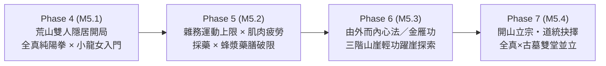

# 「終南雙劍・荒山隱居 ➔ 開山立宗」里程碑總體規劃（Phase 4 ～ Phase 7 Master Roadmap）

> **目標分支**：`codex/solo-sect-grok`（`solo-sect/` 目錄）  
> **前置完成**：  
> - Phase 1：微距武道與生活實況窗 × 人體工學物理演繹（[`PHASE1-ERGONOMIC-MICRO-STAGE.md`](PHASE1-ERGONOMIC-MICRO-STAGE.md)，`59af2e06`）  
> - Phase 2：硬核接招拆招 × 微距單挑／鎖角特寫（[`PHASE2-COMBAT-EXCHANGE-DUEL-STAGE.md`](PHASE2-COMBAT-EXCHANGE-DUEL-STAGE.md)，`f6302233`）  
> - Phase 3：群戰無雙割草 × 雙劍合璧／陣法合擊 × 闖關波次與 MBTI 人格演繹（[`PHASE3-CROWD-SYNERGY-WAVE-GAUNTLET.md`](PHASE3-CROWD-SYNERGY-WAVE-GAUNTLET.md)，`cb79f74e`）

---

## 一、 核心願景與體驗轉向：為什麼「推遲門派、雙人荒山隱居開局」？

在 Phase 1–3 完成微距視窗的人體工學與武打演繹後，為了讓玩家真正沉浸於「**從一介凡夫俗子磕磕絆絆挑水砍柴、苦練入門拳架、由外而內震開氣脈、練成輕功飛身躍崖、與賞心悅目的伴侶雙修合璧，最終才水到渠成開山立派**」的武俠養成醍醐味，後續開發將拆分為 **4 個循序漸進的里程碑（Phase 4 ～ Phase 7）**：

---

## 二、 主角與伴侶武學路線定案（全真派 × 古墓派主軸 ＋ 少林 × 桃花相容）

### 1. 主打路線：【終南隱居・雙劍眷侶】（全真起手主角 ＋ 小龍女）
* **典故與機制契合度**：全真教與古墓派同處終南山，武學一剛一柔、互為表裡；古墓派至高武學《玉女心經》與《玉女素心劍》天生要求「**一人使全真武學、一人使古墓武學**」方能雙劍合璧、陰陽互濟。
* **主角（全真純陽路線 — 由外而內五階成長）**：
  1. **入門外功《純陽拳》（`chunyangFist`）**：道門築基拳法。初期體魄低時出拳搖晃、馬步浮動；隨雜務與藥膳調養漸趨沉穩。
  2. **由外而內《玄門心法／全真大道歌》（`quanzhenXinfa`）**：當《純陽拳》練至小成（Tier 1）且體魄達標，收拳吐納間外勁化為丹田暖流，自動頓悟內功。
  3. **足下生風《金雁功》（`jinyanStep`）**：當《玄門心法》真氣貫通足太陽經，於挑水爬坡或與小龍女比試腳力時頓悟全真招牌輕功——荒山雜務開始忽上忽下、飛快穿梭，並解鎖**躍上三階山崖**能力！
  4. **中階拳劍《昊天掌》（`haotianPalm`）與《全真劍法》（`quanzhenSword`）**：由拳入掌、以拳通劍，法度森嚴，與小龍女《玉女劍法》形成剛柔雙劍對照。
  5. **絕頂化境《先天功》（`xiantianGong`）與《雙劍合璧》**：躍上第三階絕頂山崖參悟石刻，並與小龍女合參《玉女心經》。
* **伴侶：小龍女（古墓清修路線 — 入門起步、逐步領悟經典）**：
  1. **開局僅帶入門武功**：初出古墓於後山結廬，僅帶**入門級《古墓捕雀功》（`buqueStep`，基礎輕功）**與**《玉女劍法・初篇》（`yunvJian` 入門階）**，尚不會高階絕學。
  2. **生活專長【百花玉蜂漿 × 寒潭靈草】**：只要玩家在荒山採藥（`forage`），小龍女在灶房煮飯（`cook`）時便會調入玉蜂漿煉成「**百花玉蜂藥膳**」，替主角消除肌肉疲勞、縮短超量恢復週期。
  3. **逐步領悟經典武學**：隨雙人日常切磋與躍上寒潭高崖，依序領悟《天羅地網勢》（`tianluoPalm`）➔《美女拳》（`meinvFist`）➔《玉女素心劍》（`yunvSword`）➔ 與主角玄門內力合參領悟《玉女心經》（`yunv`）。

### 2. 相容第二路線：【苦力少林 × 桃花靈廚】（羅漢拳主角 ＋ 黃蓉）
* 既有 [`luohan-book.mjs`](../../src/luohan-book.mjs) 與 [`routines.mjs`](../../src/routines.mjs) 的《羅漢十八手》（`luohanHands`）100% 完整保留，並套用相同的「由外而內」規則（《羅漢拳》➔《少林心法》➔《少林身法》），可搭配擅長「十全歸元藥膳」與奇門蘭花拂穴手的**黃蓉**。

---

## 三、 四大 Milestones 規格書索引與驗收矩陣

| 里程碑階段 | 規格書文件 | 核心交付重點 | 關鍵修改模組（嚴守 19 模組契約） |
| :--- | :--- | :--- | :--- |
| **Phase 4 (M5.1)** | [`PHASE4-HERMITAGE-DUO-OPENING.md`](PHASE4-HERMITAGE-DUO-OPENING.md) | 荒山雙人隱居開局（`hermitage` 模式）、推遲門派面板與月俸、全真《純陽拳》套路、小龍女入門武功與漸進領悟鏈 | `data.mjs`, `routines.mjs`, `luohan-book.mjs`, `arts.mjs`, `sim.mjs`, `start-ui.mjs`, `main.mjs` |
| **Phase 5 (M5.2)** | [`PHASE5-LABOR-FATIGUE-HERBAL-DIET.md`](PHASE5-LABOR-FATIGUE-HERBAL-DIET.md) | 雜務凡人運動保健上限（`18`）、單日肌肉疲勞與超量恢復週期、採藥×煮飯觸發「玉蜂藥膳／歸元湯」縮短週期並破限、微距雜務流暢度演進 | `economy.mjs`, `sim.mjs`, `growth-playback.mjs`, `pose-render.mjs`, `main.mjs` |
| **Phase 6 (M5.3)** | [`PHASE6-EXTERIOR-TO-INTERIOR-CLIFF-QINGGONG.md`](PHASE6-EXTERIOR-TO-INTERIOR-CLIFF-QINGGONG.md) | 「由外而內」自動頓悟心法與《金雁功》身法、荒山三階山崖節點（`cliff1`～`cliff3`）與輕功檢定、微距視窗「忽上忽下」與「飛身躍崖」演出 | `data.mjs`, `arts.mjs`, `sim.mjs`, `growth-playback.mjs`, `paper-doll.mjs`, `pose-render.mjs` |
| **Phase 7 (M5.4)** | [`PHASE7-DUAL-LINEAGE-SECT-FOUNDING.md`](PHASE7-DUAL-LINEAGE-SECT-FOUNDING.md) | 【開山立宗】里程碑事件、三大道統抉擇（預設「陰陽合宗・全真×古墓雙堂並立」）、弟子分堂拜師、雙劍合璧鎮派傳承 | `sect.mjs`, `arts.mjs`, `data.mjs`, `sim.mjs`, `main.mjs` |

---

## 四、 架構與測試鐵律（Engineering Invariants）

1. **19 模組邊界不變**：所有功能擴充皆在 [`architecture/MODULES.md`](../architecture/MODULES.md) 既有 19 個 `src/*.mjs` 檔案內完成，不新增額外 `src/*.mjs` 檔案。
2. **既有 Golden 與回歸測試零退化**：
   * 預設無旗標的既有測試開局（`createState(seed)` 未傳入 `hermitage: true` 時）保持原有 3 人門派行為與亂數序列，確保 `bash solo-sect/test/run.sh smoke` 與 `bash solo-sect/test/run.sh quick` 358+ 項測試 100% 通過。
   * 新開局（或傳入 `hermitage: true` / 選擇「終南隱居・雙劍開局」）啟用完整 Phase 4–7 雙人荒山隱居 ➔ 開山立宗體驗。
3. **微距視窗零模擬污染（Zero Simulation Contamination）**：所有 `growth-playback.mjs` 與 `pose-render.mjs` 的微距視覺推導維持純函式唯讀投影。
