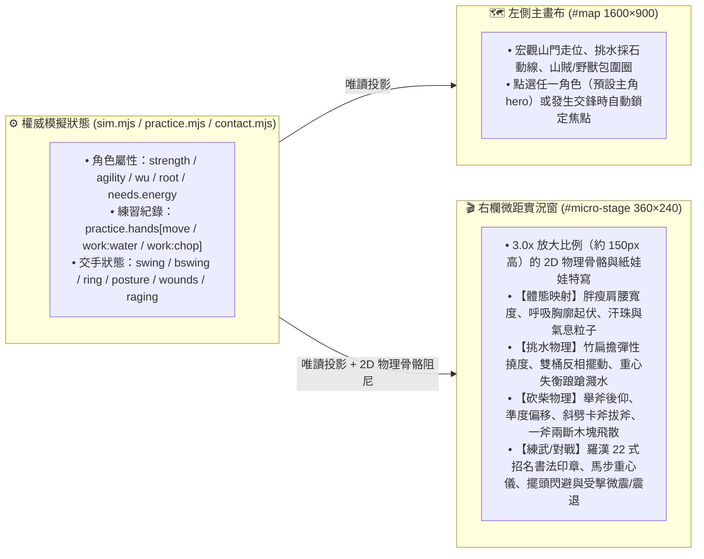

# Phase 1 設計與交接規格書：微距武道與生活實況窗（Micro-Stage Viewport）× 人體工學物理演繹

> **分支**：`codex/solo-sect-grok`
> **基底版本**：`RULES_VERSION 4.0`（承接 N32 白身起手、N33 手熟眼熟冪律、N37 真受力分層傷口、N40 羅漢拳 22 段拳譜、N48/N55/N59 共用骨架播放與 N60 分層像素紙娃娃）
> **目標**：在不破壞既有模擬規則、存檔與 `golden.mjs` 雜湊的前提下，解決「1600×900 大地圖小人比例太小、看不清挑水磕磕絆絆、砍柴卡斧、一招一式練功架勢與微距擺頭拆招」的核心體驗痛點，為 Coding Agent 提供可直接開工的完整工程規格與驗收契約。

---

## 一、 現況盤點：我們已經有什麼 vs. Phase 1 要補齊什麼？

在 `codex/solo-sect-grok` 最新的第十一輪基底（`af5ded19`）中，底層數學與骨架已經非常紮實，但**視覺呈現尺度**受限於主地圖比例：

| 模組與既有能力 | 目前在 `solo-sect/src/` 的實作位置 | 為什麼在大地圖上還不夠過癮？（Phase 1 核心缺口） |
| :--- | :--- | :--- |
| **1. 手熟眼熟與動作殘差** | [`src/practice.mjs`](../../src/practice.mjs)、[`src/growth-playback.mjs`](../../src/growth-playback.mjs) | `playbackParams(d, art)` 已算出 `hipHeight`（馬步深淺 17→8.5px）、`sway`（橫向晃動）、`chopPause`（每斧停頓）與 `waterTilt`（水桶傾角 30°→0°）。但在 `1600×900` 主地圖上角色僅約 `40px` 高，幾個像素的馬步下沉與水桶晃動肉眼極難察覺。 |
| **2. 羅漢十八手 22 段與日常姿勢** | [`src/routines.mjs`](../../src/routines.mjs)、[`src/pose-render.mjs`](../../src/pose-render.mjs)、[`src/paper-doll.mjs`](../../src/paper-doll.mjs) | `LUOHAN_EIGHTEEN_HANDS` 已有 22 式（朝山拜佛、斬手劈心掌、白鶴亮翅、羅漢打虎等），`DAILY_POSES` 已有 `walk`、`chop`、`water`。但目前只做簡單的線性座標補間（`mixArray`），缺乏**體態胖瘦強弱差異、關節力矩慣性（PD 彈簧阻尼）、挑水扁擔壓彎濺水、砍柴卡斧甩手、單足獨立失衡踉蹌**等物理細節。 |
| **3. 硬核武俠交手與受力分層** | [`src/arts.mjs`](../../src/arts.mjs)、[`src/contact.mjs`](../../src/contact.mjs)、[`src/starter-combat.mjs`](../../src/starter-combat.mjs)、[`src/tactics.mjs`](../../src/tactics.mjs) | 底層已有「看破、進身閃、招架反震、架勢崩潰、林克時間（`WITCH`）、焦躁惱羞（`CLASH.fret`）、四層組織傷口（瘀青/皮破/傷筋/斷骨）」。但在主地圖上交鋒只看到頭頂飄一個「閃」「架」字，看不到**「高手原地微微擺頭讓刀鋒擦過、隨手一掌拍飛」**或**「菜雞互啄刀劍鏘鏘半天只微微一震」**的肢體交鋒特寫。 |
| **4. 16 型人格與性情自主決策** | [`src/decision.mjs`](../../src/decision.mjs)、[`src/social.mjs`](../../src/social.mjs)、[`src/start-ui.mjs`](../../src/start-ui.mjs) | 已有性格特質與四層決策（指令／生理／作息／性格），但尚未把人格維度映射到**「微觀練功與勞動姿態習慣」**（如苦練派死磕單式 vs 頓悟派跳練觀景、急躁者卡斧摔斧頭 vs 沉穩者調呼吸）。 |

---

## 二、 Phase 1 核心設計：「雙視窗連動（主地圖沙盤 ＋ 右欄微距實況窗）」

不縮小或重寫主地圖（`#map` 維持 `1600×900` 呈現宏觀走位、山門擴建與圍攻包圍網），而是在右側面板 `#panel` 的 `#focuscard` 區域內，新增一個 **`360×240` 的高幀率微距實況視窗（Micro-Stage Viewport，`#micro-stage`）**。



### 架構鐵律（Zero Simulation Contamination）
1. **純顯示唯讀衍生（Read-Only View Adapter）**：微距實況窗的所有骨骼角度、彈簧阻尼、水花粒子、卡斧動畫與重心儀，**100% 由現有權威狀態（`s.t`、`d.skills`、`d.practice.hands`、`d.needs.energy`、`d.task`、`d.swing`、`d.ring`）透過純函式或純前端 UI 狀態推導**。
2. **不污染 `state`、不抽 `rng(s)`、不改 `RULES_VERSION`**：絕不在微距視窗中呼叫世界 `rng(s)` 或回寫 `d.pos`／`d.hp`，確保 `node tools/golden.mjs --check` 與所有既有單測 100% 原地通過！

---

## 三、 人體工學體態與物理運動模型（Ergonomic Physics Model）

我們將角色的「身體現況」從冷冰冰的數字，轉化為微距視窗中一眼可辨的 **四大物理運動參數**（以 [`src/growth-playback.mjs`](../../src/growth-playback.mjs) 與 [`src/paper-doll.mjs`](../../src/paper-doll.mjs) 為基礎擴充）：

### 1. 體態外型映射（Somatotype & Build Visuals）
依角色的 `skills.strength`（力氣）、`skills.agility`（腳力/身法）、`root`（根骨）與開局出身（[`src/origins.mjs`](../../src/origins.mjs)），動態決定紙娃娃的軀幹與四肢比例：
* **初階虛胖／沉重態（高體重感、低身法 `agility < 15` 且 `strength < 15`）**：
  * 軀幹腰腹像素加寬 `+4px`，重心偏高（`uprightHip` 抬升），運動時胸腔呼吸縮放頻率加快 `1.6x`，連續勞作或出招 3 秒後額頭持續冒出汗珠粒子。
* **初階單薄／瘦弱態（低力氣 `strength < 10`）**：
  * 肩寬縮減 `-2px`、四肢細長；負重（挑水／舉斧）時脊柱前傾角 `lean` 額外增加 `+6° ~ +10°`，呈現「被重物壓彎腰」的吃力感。
* **練成精悍／宗師態（隨 `hands['work:water']`、`hands['work:chop']`、`strength >= 30`、`agility >= 30` 自然演進）**：
  * 倒三角肩背加寬、腰腹收緊，腰帶與衣擺隨發力俐落擺動，站樁時重心下沉如釘入青石。

### 2. 二階彈簧阻尼關節濾波（Spring-Damper Joint Dynamics）
在 [`src/pose-render.mjs`](../../src/pose-render.mjs) 的關鍵幀補間之上，為微距視窗加入二階物理響應（或確定性相位諧波合成，使任意時刻 `s.t` 皆可無狀態重現）：
* **關節剛度（Stiffness $K_p$）**：正比於 `1 + d.skills.strength / 25 + (1 - practiceResidual(n))`。
  * **初學者（低力氣、手生 `residual ≈ 1`）**：出拳或舉斧時呈現**欠阻尼過衝與抖動（Overshoot & Wobble）**：手伸出去後手腕與前臂會有 `±3.5px` 的高頻微顫，收勢時身體跟著晃兩下才站穩。
  * **大成者（高力氣、手熟 `residual < 0.25`）**：呈現**臨界阻尼急停（Snap & Crisp Hitstop）**：前搖蓄力沉穩，出拳在最後 `15%` 時間內高速到位，到位瞬間定格 `0.08s` 並震起地面微塵與衣袂氣浪！
* **重心偏移值（Center of Mass Offset, `comOffset`）**：
  * 即時計算當前姿勢（特別是單腿獨立的 `wing` 白鶴亮翅、`leftKick`、挑水行進、大動作揮斧）的重心投影偏離支撐腳中心的比例 `comOffset ∈ [-1, 1]`。
  * 當 `|comOffset| > 0.75`（常見於初學者練「白鶴亮翅」或挑水踩階梯）時，觸發可見的**「單腳支撐顫抖與墊步扶正（Stumble Recovery）」**！

---

## 四、 四大核心情境的微距視窗演繹規格

### 情境 A：【挑水（`work === 'water'`）】—— 扁擔撓度、水面晃動與踉蹌濺水
在微距視窗中，當角色執行挑水或搬運時：
1. **彈性竹扁擔與雙桶物理**：
   * 繪製橫跨雙肩的竹扁擔（Bezier 曲線），其下彎撓度（Deflection）為 `bend = 6 * (1 - 0.5 * strFactor)`。
   * 前後兩隻木桶隨步伐相位 `clock * 4` 呈現擺錘運動，最大傾角直接讀取 `playback.waterTilt`（初學高達 `30°`，練熟後 `< 5°`）。
2. **磕磕絆絆與濺水表現**：
   * **初學階段（`waterTilt > 18°`）**：每當步伐跨步落地（`sin(clock * 4)` 極值點），角色膝蓋明顯下軟（`sink + 4px`），桶口傾斜超過臨界角，向上濺出 3～5 顆水滴粒子並落在石階上；角色表情咬牙、頭頂偶爾閃過小字 `「好沉…腰快斷了」`。
   * **熟練階段（`waterTilt <= 8°`）**：步伐輕快平穩，扁擔隨步伐微幅彈性共振，水面呈水平藍線不灑一滴水。

### 情境 B：【砍柴（`work === 'chop'`）】—— 舉斧後仰、斜劈卡斧與一斧兩斷
在微距視窗右側繪製劈柴木墩與待劈原木，根據 `hands['work:chop']` 的手熟殘差 `chopResidual = practiceResidual(handUses(d, 'work:chop'))` 呈現三階段差異：
1. **初學磕絆（`chopResidual > 0.7`：砍不準＋卡斧＋甩手）**：
   * **舉斧吃力**：`axeReady` 階段因斧頭重，上身後仰 `lean - 6°`，雙臂微抖。
   * **落點偏差與卡斧**：下劈時斧刃軌跡帶隨機確定性偏移，砍在木頭邊緣而非正中；木頭不裂開，斧頭卡在木紋裡！在 `playback.chopPause`（長達 `0.5s`）期間，畫面演出角色**雙手用力拔斧頭、拔出後甩動發麻的右手腕並擦汗喘氣**。
2. **小成穩定（`0.35 < chopResidual <= 0.7`）**：
   * 落點居中有木屑飛濺，兩斧劈開一根原木。
3. **大成宗師（`chopResidual <= 0.35`：腰馬合一・一斧兩斷）**：
   * 蹬腿轉腰送肩，斧刃劃出銀白滿月弧光，命中瞬間觸發短暫頓幀（Hitstop），原木乾脆俐落向左右兩側彈飛裂開！

### 情境 C：【一招一式練功（`task.act === 'train'`）】—— 羅漢 22 式與傳統武學之美
當角色在外功場或木人樁練武時，微距視窗直接將 [`src/routines.mjs`](../../src/routines.mjs) 的 `routineFrame` 放大演繹：
1. **一招一式招名書法印章與進度**：
   * 視窗左上角顯示當前套路與招式名稱（如 **`《羅漢十八手》第 19 式：白鶴亮翅`** 或 **`第 6 式：托塔雙推山`**），以及該招對應的底層手熟有效次數 `n` 與實際前搖秒數 `wind`。
2. **「理想宗師架勢虛影（Ghost Silhouette）」vs.「當前身體實際架勢」**：
   * 在角色身後以 `15%` 透明度的淡墨色繪製「零晃動、深馬步、標準角度」的宗師架勢重影。
   * **初學時**：玩家能直觀看到自己的小人馬步蹲不下去（比淡墨重影高一截）、出拳角度歪斜、在「白鶴亮翅」單腳站立時重心儀左右狂擺；
   * **練熟後**：小人的動作與背後的宗師淡墨重影完美重合，出拳帶起破空殘影與木人樁震動！
3. **16 型人格（MBTI／性情）在微距視窗的練功演出差異**：
   * 讀取角色特質與性情：沉穩／實感型（S/J）呼吸勻稱、每式停頓標準；跳脫／直覺型（N/P）在式與式之間有靈動墊步，偶爾觸發靈光一閃氣泡；急躁／剛猛型（F/剛）出拳力道大但收勢晃動更明顯。

### 情境 D：【實戰交手特寫（`swing / bswing / ring`）】—— 菜雞互啄、擺頭閃避與林克時間
當焦點角色處於交手狀態（或玩家點選正在交戰的弟子／山賊／野獸）時，微距視窗切換為**「雙人對決特寫鏡（Duel Close-Up）」**，同框繪製主角與當前最近對手：
1. **【菜雞互啄】（雙方手熟/眼熟皆低，頻頻招架或輕擦）**：
   * 看見雙方拳腳柴刀「乒乒乓乓」交擊，每次格架（`parry`）迸出小火花，但因為勁力未透（`pressure` 低於傷口閾值），受擊方只是**身體微微一震（水平微幅彈動 `3px`，架勢條微扣，不掉血）**，兩人邊打邊退步喘氣。
2. **【境界輾壓：微距擺頭閃避（Head-Slip Avoid）與隨手拍飛】**：
   * 當防守方觸發 `dodge` 或 `intercept`，且其使用時間佔來招窗口比例極小（`usedRatio < 0.4`，代表眼力與身法遠勝對手）時：
   * 微距視窗中，防守方**雙腳原地不動**，僅**頸部與上身微側 15°（擺頭閃避）**，讓敵人的刀鋒或撲咬從臉頰旁擦過（留下殘影線），緊接著一記順勢推掌/截擊直接把敵人震飛出畫面邊緣！
3. **【多人圍攻消耗與惱羞硬拼】**：
   * 當 `tactics.mjs` 算出的應接負荷 `L >= 0.8`（被 3～4 人同時或錯相圍攻）時，微距視窗背景邊緣出現多道逼近的紅芒扇形；角色的閃避從「原地擺頭」被迫切換為**「狼狽大滑步／連退喘氣」**，架勢條與內力快速下滑。
   * 一旦 `d.raging`（焦躁惱羞）觸發，微距視窗中角色雙眼泛紅、頭頂爆出「怒」字氣浪，放棄防守架勢大開大合硬拼！
4. **【林克時間（Witch Time）與名功絕活特寫】**：
   * 當觸發 N19/N23 險招完美閃避慢動作（`s.witch`）或 N20 名功絕活（獨孤九劍破綻直刺、太極借力畫圓、九陽金鐘反震、葵花紅影）時，微距視窗外框亮起金邊，以慢動作清晰展示「劍尖直刺對手手腕破綻」或「護體金光震飛敵人刀刃」的瞬間！

---

## 五、 檔案清單與模組切分（給 Coding Agent 的精確藍圖）

為符合 `solo-sect` 的模組規範（見 [`docs/architecture/MODULES.md`](../architecture/MODULES.md) 與 [`test/unit/interface/docs-links.test.mjs`](../../test/unit/interface/docs-links.test.mjs)），所有新增與修改嚴格限制在以下範圍：

### 1. 修改與擴充檔案
* **`solo-sect/src/growth-playback.mjs`**（或新增內部純函式並由 `growth-playback.mjs` 匯出）：
  * 擴充 `ergonomicFrame(d, s, view)` 純函式：基於現有 `playbackParams(d, art)`，輸出：
    * `buildProfile`: `{ shoulderDelta, waistDelta, fatRatio, breathRate, sweatLevel }`（體態胖瘦與喘氣流汗程度）
    * `jointSpring`: `{ overshoot, wobblePx, hitstopAlpha, comOffset, isStumbling }`（關節過衝抖動、寸勁頓幀、重心偏移與失衡踉蹌旗標）
    * `laborDetail`: `{ poleBend, waterSplash, chopOffset, isAxeStuck, woodSplit }`（挑水扁擔彎曲/濺水、砍柴偏差/卡斧/劈開狀態）
    * `combatDetail`: `{ dodgeTier: 'headSlip' | 'sideStep' | 'scramble', microShiverPx, opponent }`（擺頭閃避分級、受擊微震幅度與當前對決目標）
* **`solo-sect/src/pose-render.mjs`** ＆ **`solo-sect/src/paper-doll.mjs`**：
  * 新增 ` renderMicroStage(canvasCtx, s, focalActor)`：
    * 在 `360×240` 畫布上繪製局部環境微景（挑水石階、劈柴木墩、演武木人樁、或交手對決地面）。
    * 以 `2.8x ~ 3.2x` 放大比例繪製焦點角色（交手時同框繪製對手），套用 `ergonomicFrame` 的腰圍/肩寬體態、扁擔彎曲與水花、卡斧動畫、宗師淡墨重影（Ghost Pose）與擺頭閃避動態。
    * 在畫布底部繪製緊湊的 **「重心平衡儀（Balance & Posture Bar）」** 與 **「當前招式／工序物理狀態條」**。
* **`solo-sect/index.html`** ＆ **`solo-sect/style.css`** ＆ **`solo-sect/src/main.mjs`**：
  * 在 `index.html` 的 `#focuscard` 上方（或內部）加入 `<div id="micro-stage-wrap"><canvas id="micro-stage" width="360" height="220"></canvas><div id="micro-caption"></div></div>`（可點擊收合，記住 UI 偏好）。
  * 在 `main.mjs` 的 `draw()` 迴圈中呼叫 `renderMicroStage`，焦點角色預設為玩家選中角色 `sel`（未選時為 `hero`，若有人正在觸發林克時間或交手則可自動切鏡或顯示切鏡提示）。

---

## 六、 驗證與測試計畫（Verification Contract）

Coding Agent 完成實作後，必須依序執行並通過以下驗證：

### 1. 新增專屬單元測試（`solo-sect/test/unit/growth/phase1-micro-stage.test.mjs`）
必須涵蓋以下 5 項確定性斷言：
1. **挑水成長物理對照**：同一名白身角色，`hands['work:water'] = 0`（初學）時 `waterTilt` 較大、步伐極值點觸發 `waterSplash === true` 且 `poleBend` 明顯；當 `hands['work:water'] = 60` 且 `agility = 30` 後，`waterTilt` 顯著降低且 `waterSplash === false`。
2. **砍柴卡斧與一斧開木對照**：`hands['work:chop'] = 0` 時在揮斧落點觸發 `isAxeStuck === true` 與長 `chopPause`；手熟提升至 `60` 後 `isAxeStuck === false` 且觸發俐落劈開。
3. **羅漢拳 22 式與單足平衡（白鶴亮翅）對照**：演練《羅漢十八手》第 19 式「白鶴亮翅」（`oneLeg` 姿勢）時，初學者（`hands.bodyPush = 0, agility = 5`）的 `|comOffset|` 超過失衡閾值並觸發 `isStumbling === true`；練熟後（`hands.bodyPush = 80, agility = 35`）`isStumbling === false` 且馬步 `hipHeight` 接近深馬步下限。
4. **交手「微震」與「擺頭閃避（`headSlip`）」判定**：
   * 當攻擊壓力未達皮破閾值（`depth < 0`）或被格擋時，受擊方產生 `microShiverPx > 0`（微微一震）且氣血不減；
   * 當高身法/高眼熟角色面對慢速來招（如野狗/嘍囉）輕鬆閃避時，`dodgeTier === 'headSlip'`（原地擺頭閃避）；面對多人圍攻高負荷（`L >= 0.8`）時退化為 `'scramble'`（大動作狼狽閃避）。
5. **零模擬污染保證（Zero State Mutation）**：對同一 `state` 連續呼叫 `ergonomicFrame` 與 `renderMicroStage` 100 次前後，`JSON.stringify(state)` 與 `state.rng` 完全一字不差。

### 2. 官方輕量與回歸測試命令
```bash
cd solo-sect
# 1. 跑新增單測與文件連結檢查
node --test test/unit/growth/phase1-micro-stage.test.mjs test/unit/interface/docs-links.test.mjs

# 2. 跑 smoke 最小驗證（約 30 秒）與 quick 快速套件
bash test/run.sh smoke
bash test/run.sh quick

# 3. 檢查空白與格式
git diff --check
```

---

## 七、 給 Coding Agent 的直接啟動提示詞（Copy-Paste Prompt）

```text
請在 `codex/solo-sect-grok` 分支的 `solo-sect/` 目錄下，依據 `solo-sect/docs/plans/PHASE1-ERGONOMIC-MICRO-STAGE.md` 實作 Phase 1「微距武道與生活實況窗（Micro-Stage Viewport）× 人體工學物理演繹」。

核心要求：
1. 嚴格遵守「純顯示唯讀衍生（Zero Simulation Contamination）」：不修改模擬規則、不抽 `rng(s)`、不改 `RULES_VERSION`、不動 `golden/*.json`。
2. 在 `src/growth-playback.mjs` 擴充 `ergonomicFrame(d, s, view)`，將角色力氣/身法/手熟殘差（`practiceResidual`）映射為體態比例（胖瘦肩腰寬度、喘氣流汗）、關節彈簧阻尼（初學過衝手抖 vs 大成寸勁頓幀、單腿白鶴亮翅重心失衡 `isStumbling`）、日常勞動物理（挑水扁擔彎曲與濺水 `waterSplash`、砍柴偏差卡斧 `isAxeStuck` vs 一斧兩斷）以及交手微距表現（菜雞受擊微震 `microShiverPx`、高手原地擺頭閃避 `headSlip` vs 圍攻狼狽閃避 `scramble`）。
3. 在 `src/pose-render.mjs` 與 `src/paper-doll.mjs` 實作 `renderMicroStage`，並於 `index.html`、`style.css`、`src/main.mjs` 的右欄 `#focuscard` 掛載 `360×220` 的 `#micro-stage` 特寫畫布（含宗師淡墨重影對照、重心平衡儀、招式/工序狀態與可收合控制）。
4. 若新增 `.mjs` 檔案，同步登記於 `docs/architecture/MODULES.md`，確保 `test/unit/interface/docs-links.test.mjs` 通過。
5. 新增 `test/unit/growth/phase1-micro-stage.test.mjs` 驗證上述 5 大情境與零狀態污染，並跑通 `bash test/run.sh smoke`、`bash test/run.sh quick` 與 `git diff --check`。
```
