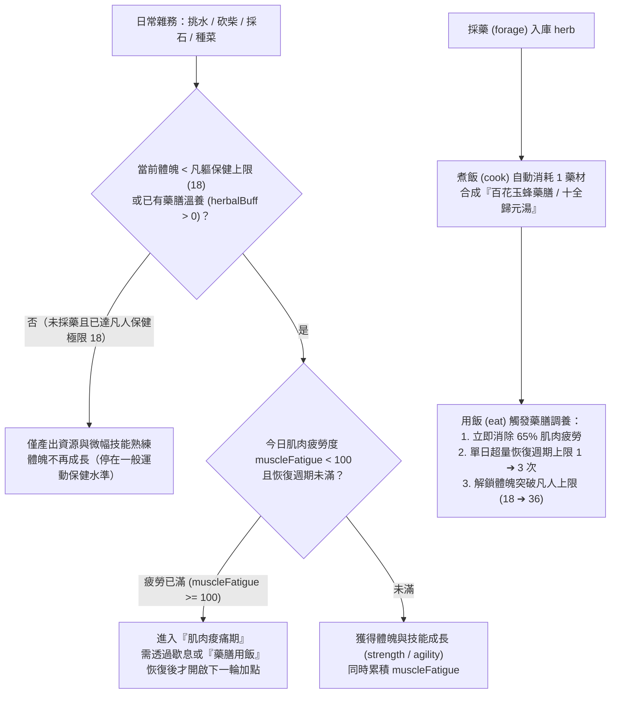

# Phase 5（M5.2）設計與實作交接規格書：雜務運動保健上限 × 單日肌肉疲勞週期 × 採藥藥膳破限調養（Labor Ceiling, Muscle Fatigue Supercompensation & Herbal Diet）

> **目標分支**：`codex/solo-sect-grok`（`solo-sect/` 目錄）  
> **所屬總綱**：[`HERMITAGE-QUANZHEN-GUMU-ROADMAP.md`](HERMITAGE-QUANZHEN-GUMU-ROADMAP.md)  
> **前置依賴**：Phase 4（荒山雙人隱居開局 [`PHASE4-HERMITAGE-DUO-OPENING.md`](PHASE4-HERMITAGE-DUO-OPENING.md)）  
> **核心定位**：落實玩家構想的**「磕磕絆絆做雜務 ➔ 提升相關技能與體魄 ➔ 雜務動畫越來越順；但純做雜務有『一般運動保健上限』且單日『肌肉疲勞 ➔ 恢復加點週期』固定；唯有主動『採藥搭配飲食（藥膳／玉蜂漿）』才能加速消除疲勞、縮短恢復週期並突破凡人上限」**。玩家初期若不採藥，就不會觸發此隱藏加成。

---

## 一、 核心機制設計（運動生理學 × 武俠藥膳調養）

### 1. 凡軀運動保健上限（Mundane Athletic Ceiling）
* 常數定義於 [`economy.mjs`](../../src/economy.mjs)：
  * `MUNDANE_BODY_CAP = 18`（一般人靠挑水、砍柴、運動保健能達到的臂力 `strength` 與身法 `agility` 自然上限）。
  * `MARTIAL_BODY_CAP = 36`（經靈藥／玉蜂漿藥膳溫養筋骨、配合練武後的脫胎換骨上限）。
* **規則**：
  * 當角色 `strength < 18`（或 `agility < 18`）時，做挑水（`water` 練腿力平衡與臂力）、砍柴／採石（`chop` / `quarry` 練臂力）、種菜／採藥（`farm` / `forage` 練靈巧）會穩定提升對應屬性，讓微距視窗中的雜務動畫從「**生疏踉蹌（`clumsy`）**」一路演進到「**熟練俐落（`fluent`）**」。
  * 一旦屬性達到 `18`，若角色身上**沒有藥膳調養狀態（`!d.herbalDietUntil || s.t > d.herbalDietUntil`）**，純做雜務將不再提高 `strength` / `agility`（已達凡人運動保健頂峰）。

### 2. 單日肌肉疲勞與超量恢復週期（Muscle Fatigue & Daily Supercompensation Cycles）
* 每個角色新增輕量生理狀態欄位（由 `ensureBodyCondition(d, day)` 初始化）：
  * `d.muscleFatigue`：`0..100`（每次執行體力雜務或外功練拳增加 `25..35` 點疲勞）。
  * `d.recoveryCyclesToday`：當日已完成的「疲勞 ➔ 恢復」超量成長週期數（換日時歸零）。
  * `d.maxCyclesToday`：預設為 **`1` 次／日**（即不採藥時，一天內肌肉疲勞滿 `100` 後，就算休息也只能完成 1 個成長週期，單日能加的體魄固定封頂於 `1.2` 點）。
* 當 `d.muscleFatigue >= 100` 時：
  * 角色處於「**肌肉痠痛期（`soreness: true`）**」，此時繼續硬做雜務不再增加體魄屬性，必須等睡眠換日，或**食用藥膳**快速排痠恢復，才能開啟當日第 2、第 3 個超量恢復週期！

### 3. 採藥 × 飲食 ＝ 藥膳調養（Optional Herbal Diet Trigger）
* **完全選用、不採藥不觸發**：
  * 若玩家初期只種菜、挑水、砍柴而不去採藥（`s.res.herb === 0`），灶房 `cook` 就只煮出普通白飯（`food`），完全不觸發藥膳設定。
  * 當玩家（或小龍女）去後山／山崖採藥（`forage`）使 `s.res.herb >= 1` 時：
    * **煮飯自動入藥**：完成 `cook` 時，若 `s.res.herb >= 1`，自動消耗 `1` 份草藥，將該鍋飯升級為**「藥膳存糧（`s.res.medFood` 計數）」**（若伴侶是小龍女，名為**「百花玉蜂藥膳」**；若伴侶是黃蓉，名為**「桃花歸元藥膳」**；其他則為**「山草強身湯飯」**）。
    * **用飯觸發超量恢復**：當角色執行 `eat` 且 `s.res.medFood > 0` 時：
      1. 消耗 `1` 份 `medFood`；
      2. **消除肌肉疲勞**：`d.muscleFatigue = Math.max(0, d.muscleFatigue - 65)`；
      3. **擴充單日成長週期**：`d.maxCyclesToday = 3`（黃蓉親手烹製時為 `4`），允許當天再次透過勞作與練拳獲得第 2、第 3 輪體魄成長！
      4. **賦予「藥力溫養」狀態**：`d.herbalDietUntil = s.t + DAY`（持續 1 整天），期間打破 `MUNDANE_BODY_CAP (18)` 限制，並使「由外而內」領悟內功的速度提升 `+35%`！

---

## 二、 微距視窗演繹升級（從「磕磕絆絆做雜務」到「藥膳暖氣・健步如飛」）

在 [`growth-playback.mjs`](../../src/growth-playback.mjs) 與 [`pose-render.mjs`](../../src/pose-render.mjs) 中：
1. **雜務熟練度四階表現（`choreFluencyTier`）**：
   * **Tier 0（磕磕絆絆，`strength/agility < 12`）**：挑水時扁擔大幅上下晃動、水花四濺（`waterSpill: true`）、走三步一頓；砍柴時斧頭卡木、揮兩下要擦汗喘氣；煮飯時被濃煙嗆到後仰。
   * **Tier 1（漸入佳境，`12..15`）**：步伐回穩，偶爾微晃，不再灑水。
   * **Tier 2（運動保健圓滿，`16..18`）**：動作標準流暢、呼吸勻稱。
   * **Tier 3（藥膳破限・武道筋骨，`> 18`）**：挑水如履平地、單手提桶健步如飛；砍柴一斧斷木、木屑紛飛！
2. **肌肉痠痛與藥膳調養視覺指標**：
   * 當 `muscleFatigue >= 100` 時，微距視窗左上角顯示「`💪 肌肉疲勞已滿（今日成長週期 1/1・需歇息或藥膳調養）`」。
   * 當食用「百花玉蜂藥膳／歸元湯」後，角色周身浮現溫潤琥珀色藥氣光暈，狀態列顯示「`🍵 百花玉蜂藥膳溫養中・疲勞消退・今日超量恢復週期 2/3`」。

---

## 三、 修改檔案清單與測試要求

1. **[`solo-sect/src/economy.mjs`](../../src/economy.mjs)**：新增並匯出 `BODY_CONDITION`、`stepWorkCondition(d, s, act, delta)`、`applyMedicatedMeal(d, s)`、`cookMedicatedMeal(s, chef)`。
2. **[`solo-sect/src/sim.mjs`](../../src/sim.mjs)**：在雜務完成與 `cook` / `eat` 結算時串接 `stepWorkCondition` 與 `applyMedicatedMeal`（僅在 `s.hermitage` 或 `s.herbalDiet` 啟用時破除上限，或對 `workStrCap` 平滑擴充，確保舊 golden 測試 100% 不變）。
3. **[`solo-sect/src/growth-playback.mjs`](../../src/growth-playback.mjs)** & **[`solo-sect/src/pose-render.mjs`](../../src/pose-render.mjs)**：輸出 `choreFluencyTier`、`muscleFatigue`、`herbalBuffActive`、`recoveryCycleLabel` 並渲染藥膳光暈與雜務流暢度差異。
4. **新增單元測試 `solo-sect/test/unit/growth/phase5-labor-herbal-diet.test.mjs`**：
   * 驗證不採藥時：純雜務屬性在 `18` 封頂，且單日疲勞滿後不再增加屬性。
   * 驗證採藥＋煮飯後：自動生成藥膳，食用後消除肌肉疲勞、單日可進行第 2～3 輪成長，並突破 `18` 上限。
   * 驗證微距視窗在體魄 `10` vs `18` vs `26` 時的雜務流暢度遙測與繪圖指令差異。
