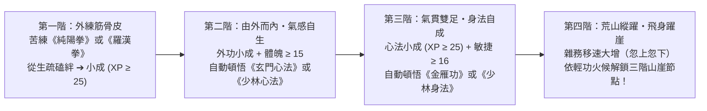

# Phase 6（M5.3）設計與實作交接規格書：由外而內武學頓悟鏈 × 輕功身法 × 三階山崖垂直探索（Exterior-to-Interior Awakening & Three-Tier Cliff Qinggong Verticality）

> **目標分支**：`codex/solo-sect-grok`（`solo-sect/` 目錄）  
> **所屬總綱**：[`HERMITAGE-QUANZHEN-GUMU-ROADMAP.md`](HERMITAGE-QUANZHEN-GUMU-ROADMAP.md)  
> **前置依賴**：Phase 4（雙人隱居與全真／羅漢入門）＋ Phase 5（雜務體魄與採藥藥膳）  
> **核心定位**：實現玩家描述的核心武道成長體驗——**「主角練純陽拳（或羅漢拳）從磕磕絆絆到越來越順手 ➔ 由外而內領悟全真玄門心法（或少林心法），威力開始浮現 ➔ 進一步領悟金雁功（或少林身法），在荒山野嶺忽上忽下四處處理雜務、擴大生活範圍 ➔ 設計三座不同高度的山崖，輕功到了就能飛身躍上去採集罕見靈藥、寒潭挑水與絕頂悟道」**。

---

## 一、 「由外而內」三段式武學頓悟鏈（Exterior-to-Interior Awakening Chain）

在 [`arts.mjs`](../../src/arts.mjs) 既有 `feedInner31`（外功回饋內功）基礎上，新增並匯出確定性頓悟檢核函式 `checkExteriorToInteriorAwakening(d, s)`：

### 1. 對照表：全真路線 vs. 少林羅漢路線
| 成長階段 | 全真純陽路線（配小龍女預設） | 少林羅漢路線（配黃蓉或自選） | 觸發條件（確定性、無隨機抽籤） | 微距視窗與實質變化 |
| :--- | :--- | :--- | :--- | :--- |
| **Stage 1：入門外功** | 《純陽拳》（`chunyangFist`） | 《羅漢十八手》（`luohanHands`） | 開局自帶或讀入門拳譜習得 | XP 0..24 時拳架搖晃、收勢喘氣；XP ≥ 25（小成）後拳架沉穩、破空有聲。 |
| **Stage 2：由外而內悟心法** | 《玄門心法》（`quanzhenXinfa`） | 《少林心法》（`shaolinXinfa`） | 入門外功 XP ≥ 25（小成）且 `strength >= 15` | **【由外而內・氣感自生】**：外家拳勁內斂入丹田，自動學會對應心法！出拳附帶內勁波紋，招式威力 ×1.28，雜務精力消耗 −25%。 |
| **Stage 3：由內催外悟身法** | 《金雁功》（`jinyanStep`） | 《少林身法》（`shaolinStep`） | 對應心法 XP ≥ 25（小成）且 `agility >= 16` | **【足下生風・領悟身法】**：內氣貫通足三陽經，自動學會對應輕功！荒山移動速度 +35%，微距視窗中移動變成「忽上忽下、踏石縱躍」，並開啟**山崖躍遷檢定**！ |

---

## 二、 荒山三階「山崖（Cliffs）」垂直地形與輕功躍崖設計

於 [`data.mjs`](../../src/data.mjs) 的 `NODES` 與 `EDGES` 新增 **3 座垂直山崖節點**，並定義 `CLIFFS` 高度檢定表：

| 山崖節點 ID 與名稱 | 座標與連通邊（`EDGES`） | 輕功躍崖門檻（`canLeapCliff(d, cliffId)`） | 崖上專屬活動與資源回報 |
| :--- | :--- | :--- | :--- |
| **`cliff1`：【斷木試劍崖】** （低崖・高三丈） | 連通 `herb`（藥圃）與 `wood`（林場）上方峭壁 | **初窺輕功**：擁有任何 `step` 身法武學（如《金雁功》／《少林身法》／小龍女《捕雀功》）且有效身法 `agility >= 16` | **① 崖頂百年靈草（`cliffForage1`）**：單次採藥產出 `herb ×2` 並附帶「玉蜂漿」； **② 懸崖試劍／練拳**：練功經驗 ×1.25（馬鈺傳郭靖崖頂練功典故）。 |
| **`cliff2`：【飛瀑寒潭崖】** （中崖・高七丈） | 連通 `well`（水井）與 `cliff1` 上方飛瀑 | **輕功小成**：身法武學達 **小成（Tier 1，XP ≥ 25）** 且 `agility >= 24` | **① 寒潭靈泉挑水（`cliffWater`）**：挑回「寒潭靈泉水」，煮出的藥膳額外回復內息與心情； **② 飛瀑衝擊練體（`waterfallTrain`）**：在瀑布下打《純陽拳》／《羅漢拳》，體魄與外功突破速度 ×1.4！ |
| **`cliff3`：【終南絕頂／古墓石室崖】** （高崖・高十五丈） | 連通 `cliff2` 與後山雲端絕壁 | **輕功大成**：身法武學達 **大成（Tier 2，XP ≥ 55）** 且 `agility >= 32` | **① 重陽／前人石壁刻痕（`cliffComprehend`）**：主角參悟《全真劍法》／《先天功》或高階少林絕學；小龍女與主角在此合參《玉女心經》； **② 俯瞰群山・立宗聖地**：解鎖 Phase 7 **【開山立宗】** 決策！ |

### 尋路與排程防呆（Pathfinding & Task Guard）
* 在 [`sim.mjs`](../../src/sim.mjs) 的尋路與活動打分中：
  * 若角色 `canLeapCliff(d, cliffId)` 為 `false`，該角色不會被分派到該山崖節點，也不會卡在崖底。
  * 一旦主角領悟《金雁功》／《少林身法》（或小龍女本身輕功達標），AI 與玩家指令即可自由躍上對應高度的山崖，生活與採集範圍瞬間向高處立體擴張！

---

## 三、 微距實況窗「忽上忽下做雜務」與「飛身躍崖」演出規格

在 [`growth-playback.mjs`](../../src/growth-playback.mjs)、[`paper-doll.mjs`](../../src/paper-doll.mjs) 與 [`pose-render.mjs`](../../src/pose-render.mjs) 中：
1. **荒山野嶺「忽上忽下」輕功雜務模式（`qinggongChoreBounds`）**：
   * 當角色已習得《金雁功》／《少林身法》且正在執行挑水、砍柴、採藥或運送時，`ergonomicFrame` 輸出 `qinggongLeaping: true` 與垂直縱躍軌跡 `leapArcY`。
   * 微距視窗中，主角挑著水桶或背著柴火不再只是貼地平走，而是**腳尖一點山石、身形忽高忽低輕盈掠過山澗與岩塊**，腳下帶有淡青色氣流殘影！
2. **「飛身躍崖（`cliffLeapStage`）」專屬微距特寫**：
   * 當角色前往或身處 `cliff1` / `cliff2` / `cliff3` 時，微距視窗背景繪製陡峭岩壁、雲霧與飛瀑，角色展現**「蹬壁借力 ➔ 凌空提縱 ➔ 翻身落於崖頂松枝」**的三段式輕功躍崖動畫（若與小龍女同行，更可同框呈現雙人翩然躍崖！）。

---

## 四、 驗證與測試要求

* 新增單元測試 `solo-sect/test/unit/growth/phase6-awakening-cliff-qinggong.test.mjs`：
  1. 驗證主角《純陽拳》（或《羅漢拳》）練至小成且體魄達標時，自動觸發「由外而內」學會《玄門心法》（或《少林心法》）。
  2. 驗證心法小成後自動觸發學會《金雁功》（或《少林身法》）。
  3. 驗證 `canLeapCliff(d, 'cliff1' | 'cliff2' | 'cliff3')` 在未學輕功時阻擋、學會輕功並隨火候提升時依序解鎖三座山崖，且崖上採藥／寒潭挑水產出正確。
  4. 驗證微距視窗在 `qinggongLeaping` 與 `cliffLeapStage` 下的純函式輸出與 Canvas 繪製指令。
