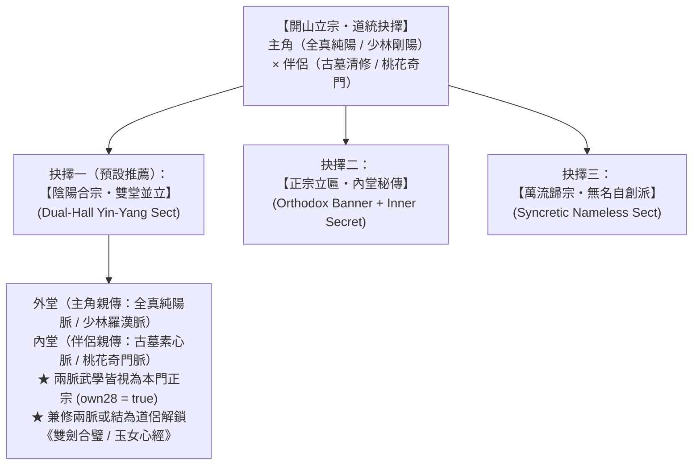

# Phase 7（M5.4）設計與實作交接規格書：雙人異派開山立宗・道統抉擇與雙堂傳承（Dual-Lineage Sect Founding & Twin-Hall Doctrine）

> **目標分支**：`codex/solo-sect-grok`（`solo-sect/` 目錄）  
> **所屬總綱**：[`HERMITAGE-QUANZHEN-GUMU-ROADMAP.md`](HERMITAGE-QUANZHEN-GUMU-ROADMAP.md)  
> **前置依賴**：Phase 4（荒山雙人隱居）＋ Phase 5（雜務藥膳）＋ Phase 6（由外而內與輕功躍崖）  
> **核心定位**：完美解答**「主角與伴侶武學門派不同（如全真純陽×古墓清修，或少林羅漢×桃花奇門），從雙人隱居發展到開山立派時該怎麼抉擇？」**——提供水到渠成的【開山立宗】里程碑與**「陰陽合宗・雙堂並立」**道統架構。

---

## 一、 從「荒山雙人隱居」到「開山立宗」的觸發條件

在 `s.hermitage.active === true` 期間，當雙人達成以下任一武道里程碑（或玩家於滿足基本條件後手動點擊「**立匾開山**」按鈕）：
1. **武道小成條件**：主角已「由外而內」領悟內功與輕功（如《玄門心法》＋《金雁功》），且伴侶已領悟至第二階段以上武學（如小龍女《玉女劍法》或黃蓉《蘭花拂穴手》）；
2. **山崖探索或守山考驗**：已躍上至少第一座山崖（`cliff1` 試劍崖）或成功擊退第一波闖入荒山的山賊／窺探者。

達成後，系統彈出**【開山立宗・道統抉擇】**決策卡（亦可透過 API `foundHermitageSect(s, doctrine, customPlaque)` 直接觸發）。

---

## 二、 三大道統抉擇（解決雙人異派合流的核心設計）

### 抉擇一：【陰陽合宗・雙堂並立】（預設推薦：`doctrine = 'dualHall'`）
* **道統設定**：
  * 若為「全真主角 ＋ 小龍女」，預設門派道統為 **`zhongnan`（終南雙劍宗／全真古墓合宗）**，牌匾可自訂（預設「**終南山・雙劍山莊**」）。
  * 若為「少林羅漢主角 ＋ 黃蓉」，預設為 **`longrong`（剛巧合宗）**，牌匾預設「**隱龍山莊**」。
* **雙堂傳承規則（Twin-Hall Lineage Rules）**：
  1. **雙樹正宗免罰**：門派武學樹 `s.sect.tree` 與弟子的 `d.stree` **同時納入主角一脈（全真樹／少林樹）與伴侶一脈（古墓樹／桃花樹）**！在 [`arts.mjs`](../../src/arts.mjs) 的 `own28(d, a)` 與 `sectBiasMul(d, a)` 判定中，兩脈武學皆為本門正宗（`outside = 1.0`，完全不吃他派 `0.78` 虛浮懲罰，且皆可作為本門根基內功催動！）。
  2. **弟子分堂拜師（`d.hall = 'yang' | 'yin'`）**：
     * 開山後招收的新弟子，依其根骨、悟性與性格（剛健憨厚者入主角「**純陽外堂**」學拳掌全真劍；輕靈清冷／聰穎者入小龍女／黃蓉「**素心內堂**」學古墓輕功玉女劍或奇門蘭花手）。
  3. **鎮派雙修合璧加成**：
     * 當同門一男一女（或主角與伴侶）一人修全真劍、一人修玉女劍並肩作戰時，直接觸發 Phase 3 的 `synergyMode = 'twinSwordsCouple'`（雙劍合璧威力 ×1.35），且可合參鎮派神功《玉女心經》（`yunv`）！

### 抉擇二：【正宗立匾・內堂秘傳】（`doctrine = 'orthodox'`）
* 以主角或伴侶其中一方的名門正宗立匾（例如立「全真別院」或「古墓新脈」），另一方的武學列為 `s.sect.secretLineage`（僅限掌門、伴侶與首徒親傳，不外流給普通外門弟子）。

### 抉擇三：【萬流歸宗・無名自創派】（`doctrine = 'wuming'`）
* 對接既有 `sectId = 'wuming'`（無名派），啟用「百納海川・宗師觸類旁通」，自由揉合天下武學。

---

## 三、 開山後的平滑過渡（Hermitage ➔ Full Sect Transition）

當 `foundHermitageSect(s, doctrine, plaque)` 執行時：
1. `s.hermitage.active = false`，`s.hermitage.founded = true`，`s.hermitage.foundedDay = s.day`；
2. 設定月俸寬限期 `s.econ.graceUntil = s.day + UPKEEP.graceDay`（自開山日起算再給 10 天寬限期，不追溯隱居日數！）；
3. 解鎖完整門派經營面板（收徒、建設、山下市集、巡山遠征隊伍擴編），並贈與「開山立宗」全派心情鼓舞（`newLook`）与初始名聲 `+10`。

---

## 四、 修改檔案清單與測試要求

1. **[`solo-sect/src/sect.mjs`](../../src/sect.mjs)** & **[`solo-sect/src/data.mjs`](../../src/data.mjs)**：
   * 新增 `zhongnan`（全真×古墓雙脈）與 `foundHermitageSect(s, doctrine, opts)`、弟子分堂指派 `assignDiscipleHall(s, d)`。
2. **[`solo-sect/src/arts.mjs`](../../src/arts.mjs)**：
   * `own28(d, a)` 與 `ownArt24(d, a)` 支援雙堂門派（`s.sect?.dualTree`）。
3. **[`solo-sect/src/sim.mjs`](../../src/sim.mjs)** & **[`solo-sect/src/main.mjs`](../../src/main.mjs)**：
   * 串接開山立宗觸發條件、UI 立匾抉擇按鈕與面板解鎖。
4. **新增單元測試 `solo-sect/test/unit/growth/phase7-dual-lineage-sect.test.mjs`**：
   * 驗證雙人隱居達成條件後執行 `foundHermitageSect(s, 'dualHall')`：
     * `s.hermitage.active` 轉為 `false`，月俸寬限期自開山日起算；
     * 全真派武學（`chunyangFist`, `quanzhenXinfa`, `quanzhenSword`）與古墓派武學（`tianluoPalm`, `yunvJian`, `yunv`）在門內皆判定 `own28 === true`，無外門懲罰；
     * 新招收弟子可依性格分入純陽堂或素心堂，並與雙劍合璧系統無縫聯動。
