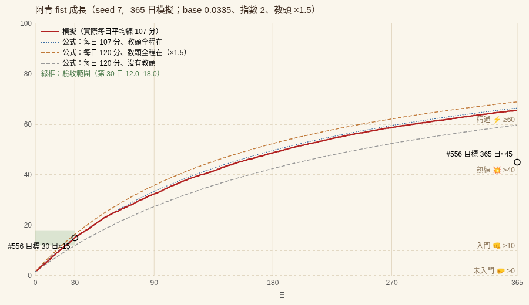

# W4（#556）武館開張 — 驗收紀錄

實際主筆：Grok（由 Grok Bot 代送）。分支 `town/wuxia`，tag `wuxia-w4`。元素 id `w04-dojo`（預設開，`requires: ['w03-life']`）。含 #562 W4 兩項補充（起始技能值、資料常數標 `_src`）。

## 做了什麼

1. **武館物件**（`data/wuxia/objects.json`，地點 `dojo`，只在 `w04-dojo` 開時加入世界）：木人樁（`dummies`，容量 2，打樁）、石鎖（`stone-locks`，容量 2，舉石鎖）、梅花樁×1（站樁）、教頭位×1（指點，限周教頭）、沙袋×1（擊打）。木人樁、石鎖各合成一個容量 2 的物件，畫面仍是 2 根樁、2 個石鎖（DEVIATIONS W4-1）。
2. **技能**：每人 `fist 拳腳／power 力／stance 下盤／stamina 耐力`，整數 0–1000，畫面 /10 取一位小數。每遊戲分鐘 `gain = base × weight × (1 − level/1000)^2 × 教頭加成 × 疲累係數`，教頭加成 1.5（周教頭在武館、醒著、不在對話），`fatigue > 80` 時效率減半；小數累積在 `frac`，滿 1 才進位。全部常數在 `data/wuxia/training.json`，每個數值旁有 `_src`（量測／推導／旋鈕，#562 W4-8）；`needs.json` 也補了 `_src`。
3. **起始技能**（#562 W4-7，`characters.json` 的 `skills`）：周教頭 620／480／600／450；石虎 力 420、其餘 ≤ 80（60／420／50／80）；阿青 15／20／10／30；林嫂、何郎中、老韓 0–20。
4. **誰去練**（`schedules.json` 的 `overlays["w04-dojo"]`）：周教頭第 1 日開局就重開武館，日程 07:00–12:00 武館指點（W4-2、W4-9）；阿青 07:30–10:00 武館練功（打樁），零工移到下午（W4-3）；石虎每兩天（第 1、3、5… 日）15:30–16:30 舉石鎖。其他人不練。#562 W3-5 每天至少 2 小時留白仍成立。
5. **看得出變強**：打樁 emoji 依拳腳分四階 🤛／👊／💥／⚡（門檻 0／100／400／600，W4-6），階級名 未入門／入門／熟練／精通；打樁數 `5 + fist/40`（取整）寫進活動說明「打樁 N下/分」，顯示在頭上。emoji 與說明在引擎內依拳腳值改寫，所以畫面、截圖、重播都一致。
6. **畫面**：`folk.png` 加第 5 列 2 格出拳動作圖（程式產生，原 4 列逐像素不變，W4-7）；武館器具與門口「開館」紅綢（`src/wuxia/DojoLayer`）；人物詳情多「武藝」面板（4 個技能、階級、打樁數，`src/wuxia/SkillPanel`）。
7. **工具**：`wuxia:skill-report`（每人每 5 天技能值、阿青每日練功、教頭在場／不在分開列、驗收判定）、`wuxia:dojo-diff`（開／關對照）、`tools/wuxia/skill-curve.ts`（365 日曲線 SVG）；`wuxia:shot` 支援 `dayN-HH:MM`、`--who`、`--blind`（W4-8）；`wuxia:headless --days` 上限放到 365。`wuxia:check` 加第 12 項（dojo-diff）與第 13 項（30 日技能報告）。單元測試 `convex/wuxia/w04_dojo/dojo.test.ts` 12 個。

上游修改都標 `// WUXIA-PATCH(W4): …`，列在 `UPSTREAM.md`（Character.tsx、Player.tsx、PixiGame.tsx、PlayerDetails.tsx、package.json）。新增美術只有 `folk.png` 的出拳列（自製，CREDITS.md 已更新）。引擎內沒有用 `Math.random`／`crypto.randomUUID`／`Date.now`。

## 驗收指令與實際輸出

審核者重跑（不需要 Docker、不需要 LLM）：

```
npm ci
npm run wuxia:check
npm run wuxia:headless -- --seed 7 --days 30 --out /tmp/d30.json
npm run wuxia:skill-report -- /tmp/d30.json        # 每人每 5 天的技能值
npm run wuxia:shot -- --seed 7 --at day1-09:00,day30-09:00 --who 阿青 --out docs/wuxia/w04/
npm run wuxia:dojo-diff                              # 關掉 w04-dojo 的對照（也在 wuxia:check 裡）
```

以下輸出都是 2026-11-12 06:1x–06:2x（Asia/Taipei）在 commit `848e8210` 上跑的（之後只改了文件、盲測拼圖與曲線標籤位置，不影響 hash）。

### `npm run wuxia:check`

`Test Suites: 21 passed, 21 total`、`Tests: 165 passed, 165 total`（W3 時 153 個，新增 12 個 W4 測試，沒有刪除或放寬舊測試），之後的檢查（節錄 `ok` 行，雜訊 log 省略）：

```
ok   headless seed 7 × 2 (30 min) hash 相同 4b038f412afb978c59b5f9c397369e4f67b0f155dc7c141d1df2b8c2928f7dc2
ok   headless seed 8 hash 與 seed 7 不同 d3178d36762bc9f267f6817f7f1bc075c79ddabc6f22e25a432c48bff4753249
ok   replay docs/wuxia/fixtures/w0-headless-seed7.jsonl steps=300 hash f2d5356cfb68c88a5dcd1bb012ba1778df0c1e8f50e97338dd24971303f4984b
ok   replay docs/wuxia/fixtures/w0-live-qwen05-30m.jsonl steps=1341 hash 5ed5840fbef31974ca8f4c659ec2d5e54ba35b6aab1b7e87fc254ab42e265b11
ok   replay docs/wuxia/fixtures/w0-live-qwen15-30m.jsonl steps=1126 hash e9ba9b73484fb598a2dd91d8507b5905881f0671cd4e386d8d63708b359455cd
ok   replay docs/wuxia/fixtures/w0-live.jsonl steps=529 hash 001cdcf7bebb42a45d850f727c97ae1734dfaacd73d4b20a31876ab2c4fc9489
ok   replay docs/wuxia/fixtures/w02-live.jsonl steps=1125 hash 2d0952eb100770eea4cb060bdb83cd170e996b476f428f111526f7fff6eb1308
ok   replay docs/wuxia/fixtures/w03-live-qwen3b-30m.jsonl steps=1192 hash ef238987d298161a055362b5ff7c857748ea4e5553b2ff120007b8655d3477c5
ok   convex/aiTown、convex/engine 的 Math.random／randomUUID 只剩 agentOperations.ts
ok   git ls-files public/assets 為空（上游美術不在 repo）
ok   public/wuxia/ 每個檔案都登記在 CREDITS.md
ok   docs/wuxia/ 檔案大小在上限內（單檔 ≤1 MB，GIF ≤3 MB）
ok   skin-diff A：w01-skin 關＝W0 世界 hash 331a11aa71fd164039bf6e7a59857d3dc66ebe8081fb4416b2e73bdd26c0367d
ok   skin-diff B：同一張地圖開／關只差 wuxia.clockEpoch、wuxia.enabled.w01-skin
ok   skin-diff C：開 8f7fe0dc071b59240f5d86981e5043ad4d2ef93c50b5ab5d452ab63e8d9b1a2b 與關的差異都在地圖相關欄位（27 類）
ok   prompts.gen.ts 跟 data/wuxia/prompts、anachronisms.txt 同步
ok   folk-diff A：w02-folk 關＝W1 世界（5 人）hash 8f7fe0dc071b59240f5d86981e5043ad4d2ef93c50b5ab5d452ab63e8d9b1a2b
ok   folk-diff B：同樣 5 人開／關只差 wuxia.enabled.w02-folk
ok   convex/ 的路徑都符合 Convex 模組命名（英數、底線、句點）
ok   life-diff A：w03-life 關＝W2 世界 hash dadeb8a8380997085715890489042f8d89346e75f6214e9ed77109e7f7b777d4
ok   life-diff B：開 3 日 hash 25608b55eec2ef9e896de7478406ebdbb732089968185bae5a50aef27bdade20，第 2、3 日作息全過、預約 ≤ capacity、最長選不到事做 0 分、最長 hunger>90 0 分
ok   life-diff C：關 3 日 hash 42e9d2dbc088591248f2b520fa21a40c69f1347e42b669302d53c559d04a911e，沒有作息規律
ok   dojo-diff A：w04-dojo 關＝W3 世界 hash 35c860ffc3af21caae503f3aa4fe4fb58529e0a41778f7f31e24dfd5cf85df9b
ok   dojo-diff B：關掉時武館空著（第 1 日練功 0 分、進院子 0 次）；開時 480 人分鐘
ok   dojo-diff C：第 1 日開／關，日程沒改的 3 人作息相同（0 人時間表完全相同）
ok   skill-report 30 日（hash 345d41b511372773…）阿青第 30 日拳腳在 120–180：151（顯示 15.1，入門）
ok   skill-report 30 日（hash 345d41b511372773…）周教頭在場時增長明顯較高（同等級折算每分鐘 在場÷不在 ≥ 1.3）：1.50（在場 3159 分、不在 201 分；依日子 24 天 0.0413/分 vs 6 天 0.0377/分）
wuxia:check passed
```

（`life-diff B` 的開 3 日 hash 從 W3 的 `9aae79cd…` 變成 `25608b55…`，因為預設多開了 `w04-dojo`；見「hash 變化」。）

### `npm run wuxia:headless -- --seed 7 --days 30 --out /tmp/d30.json`

```
seed=7 minutes=30 steps=43201 conversations=0 messages=910
clock 第 31 日 卯正（遊戲分鐘 43200）
map /ai-town/wuxia/tiles/town.jpg
hash 345d41b511372773431a4a634de26b859c6e7f4e692d5461d54e3f6d8219e81f
```

（`minutes=30` 是無頭工具的預設欄位，給了 `--days` 時以天數為準，steps＝30×1440＋1。）

### `npm run wuxia:skill-report -- /tmp/d30.json`（完整輸出）

```
# 技能報告（seed 7，30 日，hash 345d41b511372773…）

## 每人每 5 天的技能值（當日結束時；顯示 /10，括號是階級）

### 林嫂（lin-sao）
| 技能 | 第 1 日 | 第 5 日 | 第 10 日 | 第 15 日 | 第 20 日 | 第 25 日 | 第 30 日 |
|---|---:|---:|---:|---:|---:|---:|---:|
| 拳腳 | 1.0（未入門） | 1.0（未入門） | 1.0（未入門） | 1.0（未入門） | 1.0（未入門） | 1.0（未入門） | 1.0（未入門） |
| 力 | 1.5 | 1.5 | 1.5 | 1.5 | 1.5 | 1.5 | 1.5 |
| 下盤 | 1.0 | 1.0 | 1.0 | 1.0 | 1.0 | 1.0 | 1.0 |
| 耐力 | 2.0 | 2.0 | 2.0 | 2.0 | 2.0 | 2.0 | 2.0 |
練功共 0 遊戲分鐘（31 日，平均每日 0 分）

### 周教頭（zhou-jiaotou）
| 技能 | 第 1 日 | 第 5 日 | 第 10 日 | 第 15 日 | 第 20 日 | 第 25 日 | 第 30 日 |
|---|---:|---:|---:|---:|---:|---:|---:|
| 拳腳 | 62.0（精通） | 62.0（精通） | 62.0（精通） | 62.0（精通） | 62.0（精通） | 62.0（精通） | 62.0（精通） |
| 力 | 48.0 | 48.0 | 48.0 | 48.0 | 48.0 | 48.0 | 48.0 |
| 下盤 | 60.0 | 60.0 | 60.0 | 60.0 | 60.0 | 60.0 | 60.0 |
| 耐力 | 45.0 | 45.0 | 45.0 | 45.0 | 45.0 | 45.0 | 45.0 |
練功共 7020 遊戲分鐘（31 日，平均每日 234 分）

### 石虎（shi-hu）
| 技能 | 第 1 日 | 第 5 日 | 第 10 日 | 第 15 日 | 第 20 日 | 第 25 日 | 第 30 日 |
|---|---:|---:|---:|---:|---:|---:|---:|
| 拳腳 | 6.0（未入門） | 6.0（未入門） | 6.0（未入門） | 6.0（未入門） | 6.0（未入門） | 6.0（未入門） | 6.0（未入門） |
| 力 | 42.0 | 42.1 | 42.3 | 42.4 | 42.5 | 42.7 | 42.8 |
| 下盤 | 5.0 | 5.0 | 5.0 | 5.0 | 5.0 | 5.0 | 5.0 |
| 耐力 | 8.0 | 8.1 | 8.2 | 8.3 | 8.4 | 8.5 | 8.6 |
練功共 900 遊戲分鐘（31 日，平均每日 30 分）

### 何郎中（he-langzhong）
| 技能 | 第 1 日 | 第 5 日 | 第 10 日 | 第 15 日 | 第 20 日 | 第 25 日 | 第 30 日 |
|---|---:|---:|---:|---:|---:|---:|---:|
| 拳腳 | 0.5（未入門） | 0.5（未入門） | 0.5（未入門） | 0.5（未入門） | 0.5（未入門） | 0.5（未入門） | 0.5（未入門） |
| 力 | 1.0 | 1.0 | 1.0 | 1.0 | 1.0 | 1.0 | 1.0 |
| 下盤 | 1.0 | 1.0 | 1.0 | 1.0 | 1.0 | 1.0 | 1.0 |
| 耐力 | 1.5 | 1.5 | 1.5 | 1.5 | 1.5 | 1.5 | 1.5 |
練功共 0 遊戲分鐘（31 日，平均每日 0 分）

### 老韓（lao-han）
| 技能 | 第 1 日 | 第 5 日 | 第 10 日 | 第 15 日 | 第 20 日 | 第 25 日 | 第 30 日 |
|---|---:|---:|---:|---:|---:|---:|---:|
| 拳腳 | 0.5（未入門） | 0.5（未入門） | 0.5（未入門） | 0.5（未入門） | 0.5（未入門） | 0.5（未入門） | 0.5（未入門） |
| 力 | 0.5 | 0.5 | 0.5 | 0.5 | 0.5 | 0.5 | 0.5 |
| 下盤 | 1.0 | 1.0 | 1.0 | 1.0 | 1.0 | 1.0 | 1.0 |
| 耐力 | 1.0 | 1.0 | 1.0 | 1.0 | 1.0 | 1.0 | 1.0 |
練功共 0 遊戲分鐘（31 日，平均每日 0 分）

### 阿青（a-qing）
| 技能 | 第 1 日 | 第 5 日 | 第 10 日 | 第 15 日 | 第 20 日 | 第 25 日 | 第 30 日 |
|---|---:|---:|---:|---:|---:|---:|---:|
| 拳腳 | 2.0（未入門） | 3.9（未入門） | 6.0（未入門） | 8.3（未入門） | 10.6（入門） | 12.7（入門） | 15.1（入門） |
| 力 | 2.0 | 2.0 | 2.0 | 2.0 | 2.0 | 2.0 | 2.0 |
| 下盤 | 1.0 | 1.0 | 1.0 | 1.0 | 1.0 | 1.0 | 1.0 |
| 耐力 | 3.1 | 3.6 | 4.1 | 4.7 | 5.3 | 5.9 | 6.6 |
練功共 3360 遊戲分鐘（31 日，平均每日 112 分）

## 阿青 每日練功（拳腳；教頭在場＝周教頭在武館、醒著、不在對話）
| 日 | 練功分 | 教頭在場分 | 拳腳增加 | 其中教頭在場時 | 日終拳腳 | 階級 | 打樁數/分 |
|---:|---:|---:|---:|---:|---:|---|---:|
| 1 | 120 | 120 | 5.73 | 5.73 | 2.0 | 未入門 | 5 |
| 2 | 60 | 60 | 2.84 | 2.84 | 2.3 | 未入門 | 5 |
| 3 | 120 | 108 | 5.44 | 5.07 | 2.9 | 未入門 | 5 |
| 4 | 120 | 120 | 5.56 | 5.56 | 3.4 | 未入門 | 5 |
| 5 | 120 | 82 | 4.91 | 3.74 | 3.9 | 未入門 | 5 |
| 6 | 60 | 60 | 2.73 | 2.73 | 4.2 | 未入門 | 6 |
| 7 | 120 | 120 | 5.41 | 5.41 | 4.7 | 未入門 | 6 |
| 8 | 60 | 60 | 2.68 | 2.68 | 5.0 | 未入門 | 6 |
| 9 | 120 | 95 | 4.95 | 4.18 | 5.5 | 未入門 | 6 |
| 10 | 120 | 120 | 5.27 | 5.27 | 6.0 | 未入門 | 6 |
| 11 | 120 | 109 | 5.05 | 4.74 | 6.5 | 未入門 | 6 |
| 12 | 120 | 104 | 4.92 | 4.47 | 7.0 | 未入門 | 6 |
| 13 | 120 | 120 | 5.10 | 5.10 | 7.5 | 未入門 | 6 |
| 14 | 120 | 114 | 4.96 | 4.80 | 8.0 | 未入門 | 7 |
| 15 | 60 | 59 | 2.49 | 2.45 | 8.3 | 未入門 | 7 |
| 16 | 180 | 180 | 7.43 | 7.43 | 9.0 | 未入門 | 7 |
| 17 | 60 | 41 | 2.19 | 1.67 | 9.2 | 未入門 | 7 |
| 18 | 120 | 120 | 4.86 | 4.86 | 9.7 | 未入門 | 7 |
| 19 | 120 | 113 | 4.71 | 4.54 | 10.2 | 入門 | 7 |
| 20 | 120 | 120 | 4.76 | 4.76 | 10.6 | 入門 | 7 |
| 21 | 120 | 120 | 4.71 | 4.71 | 11.1 | 入門 | 7 |
| 22 | 120 | 120 | 4.66 | 4.66 | 11.6 | 入門 | 7 |
| 23 | 120 | 119 | 4.60 | 4.56 | 12.0 | 入門 | 8 |
| 24 | 60 | 60 | 2.29 | 2.29 | 12.3 | 入門 | 8 |
| 25 | 120 | 120 | 4.54 | 4.54 | 12.7 | 入門 | 8 |
| 26 | 120 | 116 | 4.44 | 4.35 | 13.2 | 入門 | 8 |
| 27 | 120 | 120 | 4.45 | 4.45 | 13.6 | 入門 | 8 |
| 28 | 120 | 87 | 3.99 | 3.18 | 14.0 | 入門 | 8 |
| 29 | 180 | 152 | 6.18 | 5.50 | 14.6 | 入門 | 8 |
| 30 | 120 | 120 | 4.30 | 4.30 | 15.1 | 入門 | 8 |

## 教頭在場 vs 不在（分開列）
### 依日子（教頭在場的日子＝當日練功時間 ≥ 90% 有教頭在場）
| | 天數 | 練功分 | 拳腳增加 | 每練功分鐘拳腳增加 | 同等級折算每分鐘練功量 |
|---|---:|---:|---:|---:|---:|
| 教頭在場的日子 | 24 | 2640 | 109.01 | 0.0413 | 0.04920 |
| 教頭有缺席的日子 | 6 | 720 | 27.15 | 0.0377 | 0.04576 |
在場的日子：1, 2, 3, 4, 6, 7, 8, 10, 11, 13, 14, 15, 16, 18, 19, 20, 21, 22, 23, 24, 25, 26, 27, 30
有缺席的日子：5, 9, 12, 17, 28, 29

### 依分鐘（同等級折算：每分鐘拳腳增加 ÷ (1−拳腳/1000)^2）
- 教頭在場：3159 分，每分鐘練功量 0.04945（理論 base×1.5 = 0.05025）
- 教頭不在：201 分，每分鐘練功量 0.03296（理論 base = 0.03350）
- 在場 ÷ 不在 = 1.50

## 驗收
PASS 阿青第 30 日拳腳在 120–180：151（顯示 15.1，入門）
PASS 周教頭在場時增長明顯較高（同等級折算每分鐘 在場÷不在 ≥ 1.3）：1.50（在場 3159 分、不在 201 分；依日子 24 天 0.0413/分 vs 6 天 0.0377/分）
```

### `npm run wuxia:shot -- --seed 7 --at day1-09:00,day30-09:00 --who 阿青 --out docs/wuxia/w04/`

```
docs/wuxia/w04/w04-seed7-d01-0900-1400x820.png  第 1 日 巳初  遊戲分鐘 180  hash 48536918ca0c9c7931e1f88c8483a0566b7c6ef6f19a2d056fa7eff93fec7d6c  391922 bytes
docs/wuxia/w04/w04-seed7-d01-0900-390w.png  第 1 日 巳初  遊戲分鐘 180  hash 48536918ca0c9c7931e1f88c8483a0566b7c6ef6f19a2d056fa7eff93fec7d6c  153319 bytes
docs/wuxia/w04/w04-seed7-d30-0900-1400x820.png  第 30 日 巳初  遊戲分鐘 41940  hash 6aa6414e488c54bc7929bfa1a5c9df2046d57549ca07ba897b6f5e0a2edda342  399454 bytes
docs/wuxia/w04/w04-seed7-d30-0900-390w.png  第 30 日 巳初  遊戲分鐘 41940  hash 6aa6414e488c54bc7929bfa1a5c9df2046d57549ca07ba897b6f5e0a2edda342  159400 bytes
```

重跑時 state hash 跟 repo 裡 `w04-seed7-shots.json` 完全相同；1400×820 的 PNG 逐位元組相同，390 寬的 PNG 差幾百位元組（瀏覽器縮放的抗鋸齒，畫面內容相同）。截圖的遊戲分鐘 0＝卯正 06:00，所以 09:00＝遊戲分鐘 180（巳初）。

### `npm run wuxia:dojo-diff`

```
seed=7 minutes=30
A ok   w04-dojo 關＝W3 世界（enabled=["w01-skin","w02-folk","w03-life"]，沒有武館物件與技能狀態） 30 分 hash 35c860ffc3af21caae503f3aa4fe4fb58529e0a41778f7f31e24dfd5cf85df9b
B ok   關：第 1 日練功 0 分、進武館院子 0 次（武館空著）；開：第 1 日練功 480 人分鐘
C ok   第 1 日時間表 開 df11f03ae7f97660… vs 關 b6945257e4953f79…
  林嫂（lin-sao）：作息相同（每個日程時段都做到排定的事、睡／吃／工作判定相同；只差擾動造成的分鐘與挑選順序）
  石虎（shi-hu）：日程有改（練功相關）
  何郎中（he-langzhong）：作息相同（每個日程時段都做到排定的事、睡／吃／工作判定相同；只差擾動造成的分鐘與挑選順序）
  老韓（lao-han）：作息相同（每個日程時段都做到排定的事、睡／吃／工作判定相同；只差擾動造成的分鐘與挑選順序）
  阿青（a-qing）：日程有改（練功相關）
      開 打零工(420-600)沒做
      關 打零工(420-600)有做
  周教頭（zhou-jiaotou）：日程有改（練功相關）
      開 茶館喝悶酒(540-720)沒做
      開 午飯(720-780)沒做
      關 茶館喝悶酒(540-720)有做
      關 午飯(720-780)有做
dojo-diff passed
seed=7 minutes=30 steps=1800 conversations=0 messages=11
hash 4b038f412afb978c59b5f9c397369e4f67b0f155dc7c141d1df2b8c2928f7dc2
## headless --seed 8 --minutes 30
seed=8 minutes=30 steps=1800 conversations=0 messages=30
hash d3178d36762bc9f267f6817f7f1bc075c79ddabc6f22e25a432c48bff4753249
## headless --seed 7 --minutes 30 --off w04-dojo
seed=7 minutes=30 steps=1800 conversations=0 messages=30
hash 35c860ffc3af21caae503f3aa4fe4fb58529e0a41778f7f31e24dfd5cf85df9b
## headless --seed 8 --minutes 30 --off w04-dojo
seed=8 minutes=30 steps=1800 conversations=0 messages=42
hash 119a36092d8bfe94755d22b7f175fb39adb8cf1866a146c511128ab5fd2dbd97
## headless --seed 7 --minutes 30 --off w04-dojo,w03-life
seed=7 minutes=30 steps=1800 conversations=87 messages=400
hash dadeb8a8380997085715890489042f8d89346e75f6214e9ed77109e7f7b777d4
## headless --seed 7 --minutes 30 --off w02-folk
seed=7 minutes=30 steps=1800 conversations=79 messages=370
hash 8f7fe0dc071b59240f5d86981e5043ad4d2ef93c50b5ab5d452ab63e8d9b1a2b
## headless --seed 7 --minutes 30 --off w01-skin
seed=7 minutes=30 steps=1800 conversations=80 messages=290
hash 331a11aa71fd164039bf6e7a59857d3dc66ebe8081fb4416b2e73bdd26c0367d
## headless --seed 7 --days 3
seed=7 minutes=30 steps=4321 conversations=0 messages=61
hash 25608b55eec2ef9e896de7478406ebdbb732089968185bae5a50aef27bdade20
## headless --seed 7 --days 3 --off w04-dojo
seed=7 minutes=30 steps=4321 conversations=0 messages=88
hash 9aae79cdfed215386acef91956210e54f728640208435d82e8997fb32b16f6dd
## headless --seed 7 --days 3 --off w03-life
seed=7 minutes=30 steps=4321 conversations=222 messages=1100
hash 42e9d2dbc088591248f2b520fa21a40c69f1347e42b669302d53c559d04a911e
## W3 day-report
## 全程檢查
  PASS 林嫂 第 2 日與第 3 日時間表不完全相同
  PASS 石虎 第 2 日與第 3 日時間表不完全相同
  PASS 何郎中 第 2 日與第 3 日時間表不完全相同
  PASS 老韓 第 2 日與第 3 日時間表不完全相同
  PASS 阿青 第 2 日與第 3 日時間表不完全相同
  PASS 周教頭 第 2 日與第 3 日時間表不完全相同
  PASS 預約 ≤ capacity（4321 個遊戲分鐘逐分檢查：超額預約 0、超額使用 0、重複預約 0）
  PASS 沒有人連續 2 遊戲小時選不到事做（最長 0 分）
  PASS 沒有人 hunger 連續 6 小時 > 90（最長 0 分）
  INFO 對話最長 60 遊戲分鐘（上限 90）
  INFO 對話 8 段，開始地點 {"teahouse":8}，說話地點 {"teahouse":7,"well":1}；說話在茶館／飯桌／河邊 7/8（88%）

day-report: 全部 PASS
```

阿青、周教頭、石虎是「日程有改」的三人，差的都是被練功時段取代的 W3 時段（阿青早上零工、周教頭上午喝悶酒；周教頭午飯因指點到 12:00 後才走過去，在 12:00–13:00 內沒吃滿 10 分，晚一點吃，W4-4）。林嫂、何郎中、老韓的作息相同，但分鐘級時間表不同，因為全鎮共用一條 `game.rng()`（W4-4）。

### 驗收條件逐條

| 條件 | 結果 | 依據 |
|---|---|---|
| `npm run wuxia:check` | PASS | 165 tests、13 項檢查 |
| 阿青第 30 天 `fist` 在 120–180 | PASS | 151（顯示 15.1，入門） |
| 周教頭在場的日子增長明顯較高（報告分開列） | PASS | 同等級折算每分鐘：在場 0.04945 vs 不在 0.03296，比 1.50（理論 1.5）；依日子：在場的 24 天 0.0413/分 vs 有缺席的 6 天 0.0377/分（有缺席的日子也大多有教頭，所以差距較小）。報告「教頭在場 vs 不在」兩種分法都列了 |
| 第 1 天 vs 第 30 天兩張阿青打樁截圖並排，不看數字也看得出差別 | PASS | [w04-seed7-d01-vs-d30.png](w04/w04-seed7-d01-vs-d30.png)：第 1 日 🤛、打樁 5下/分；第 30 日 👊、打樁 8下/分（武藝面板 1.5→15.1、未入門→入門） |
| 審核者盲測：截圖去掉日期，判斷哪張是後期 | 材料備妥，待審核者判斷 | 見「盲測」。我是作者，不能當盲測者 |
| 關掉 `w04-dojo`：武館空著、沒人練 | PASS | dojo-diff B：第 1 日練功 0 分、進院子 0 次；截圖 [w04-seed7-dojooff-d01-0900-1400x820.png](w04/w04-seed7-dojooff-d01-0900-1400x820.png) 武館封門、院子沒有器具和人 |
| 關掉 `w04-dojo`：其他作息與 W3 一致 | PASS | dojo-diff A：關＝W3 hash `35c860ff…`；3 日 `--off w04-dojo` ＝ W3 的 `9aae79cd…`；同 seed 第 1 日 diff 只差練功相關（dojo-diff C） |
| （#562 W4-7）起始技能值 | PASS | `characters.json` 的 `skills`；dojo.test.ts「#562 W4-7 起始技能值」 |
| （#562 W4-8）training.json、needs.json 每個數值有 `_src` | PASS | dojo.test.ts「#562 W4-8」逐欄檢查 |
| 練功增加 fatigue、hunger，> 80 效率減半 | PASS | dojo.test.ts「#556 公式…累 > 80 減半」；`objects.json` 練功活動的 `needs` |
| 打樁數 `5 + fist/40`、emoji 四階 | PASS | dojo.test.ts「#556 emoji 四階、打樁數」；報告每日「打樁數/分」5→8 |

## 時間尺度（成長曲線與調整前後）

（[SVG](w04/skill-curve.svg)）

指令：`npm run wuxia:headless -- --seed 7 --days 365 --out /tmp/d365.json`（hash `7f24e944af9532f7a8c78a62d95cfb1fc0b5663809b90e2ccedf9974d6b52fef`，525601 步，約 22 分鐘）→ `npx tsx tools/wuxia/skill-curve.ts /tmp/d365.json --days 365 --out docs/wuxia/w04/skill-curve.svg`：

```
{"out":"docs/wuxia/w04/skill-curve.svg","L0":15,"avgTrain":107.3,"simDay30":151,"simDay365":655,"analytic120coach":{"d30":164,"d365":689},"analytic120solo":{"d30":120,"d365":597},"analyticAvgCoach":{"d30":150,"d365":665}}
```

- 模擬：第 30 日 151（入門），第 365 日 655（精通）。公式解析解（每日平均 107 分、教頭全程在）30 日 150／365 日 665，跟模擬吻合。
- #556 的兩個目標「30 日約 150」「1 年約 450」在 `(1 − L/1000)^2` 下不能同時成立（30 日到 150 的話 1 年一定 > 600）。照公式做、校準 30 日（驗收條件），1 年目標記在 **D4**（DEVIATIONS W4-10）。
- 調整前後（只動 `training.json` 的 `base`，其他不變，`seed 7 --days 30`）：

| base | 30 日 hash | 阿青第 5／10／15／20／25／30 日拳腳 | 第 30 日 | 在場÷不在 |
|---|---|---|---|---|
| 0.0284（調整前：理論推導，假設每日 120 分全有教頭） | `567a72ae1491d4cb34e6ec23cfada65316283eb8270e0d0976c5258818058780` | 3.5／5.3／7.3／9.4／11.2／13.2 | 132 | 1.50 |
| **0.0335**（採用：扣掉實際每日約 112 分、約 6% 教頭不在的分鐘） | `345d41b511372773431a4a634de26b859c6e7f4e692d5461d54e3f6d8219e81f` | 3.9／6.0／8.3／10.6／12.7／15.1 | 151 | 1.50 |

兩個都在 120–180 內；取 0.0335 讓 30 日落在 #556 寫的「約 150」。推導過程寫在 `training.json` 的 `base_src`。

## 截圖（`docs/wuxia/w04/`）

| 內容 | 檔案 | state hash |
|---|---|---|
| 第 1 日 巳初（09:00），阿青打樁：🤛、打樁 5下/分，武藝面板 未入門 | [w04-seed7-d01-0900-1400x820.png](w04/w04-seed7-d01-0900-1400x820.png)、手機寬 [w04-seed7-d01-0900-390w.png](w04/w04-seed7-d01-0900-390w.png) | `48536918ca0c9c7931e1f88c8483a0566b7c6ef6f19a2d056fa7eff93fec7d6c` |
| 第 30 日 巳初，阿青打樁：👊、打樁 8下/分，入門（拳腳 14.8，當時還沒練完當天） | [w04-seed7-d30-0900-1400x820.png](w04/w04-seed7-d30-0900-1400x820.png)、手機寬 [w04-seed7-d30-0900-390w.png](w04/w04-seed7-d30-0900-390w.png) | `6aa6414e488c54bc7929bfa1a5c9df2046d57549ca07ba897b6f5e0a2edda342` |
| 第 1／30 日並排 | [w04-seed7-d01-vs-d30.png](w04/w04-seed7-d01-vs-d30.png) | 同上兩個 |
| 武館全景（開）：周教頭在教頭位指點、阿青打樁、器具與「開館」紅綢 | [w04-seed7-dojo-d01-0900-1400x820.png](w04/w04-seed7-dojo-d01-0900-1400x820.png) | `48536918…`（同第 1 日） |
| 對照：關 w04-dojo，同時刻武館封門、院子空著 | [w04-seed7-dojooff-d01-0900-1400x820.png](w04/w04-seed7-dojooff-d01-0900-1400x820.png) | `c52091578c683139…`（見 `w04-seed7-dojooff-shots.json`） |
| 出拳動作圖預覽（folk.png 第 5 列，3 倍） | [folk-sheet-3x.png](w04/folk-sheet-3x.png) | — |
| 阿青 365 日成長曲線 | [skill-curve.png](w04/skill-curve.png)、[skill-curve.svg](w04/skill-curve.svg) | `7f24e944…`（365 日） |

武館全景指令：`npm run wuxia:shot -- --seed 7 --at day1-09:00 --sizes 1400x820 --name w04-seed7-dojo --out docs/wuxia/w04/`（對照加 `--off w04-dojo --name w04-seed7-dojooff`）。每張都 < 1 MB。

### 盲測

`npm run wuxia:shot -- --seed 7 --at day1-09:00,day30-09:00 --who 阿青 --blind --sizes 1400x820 --out docs/wuxia/w04/`（`--blind` 拿掉時辰牌與 hash）→ `w04-seed7-blind-d01-…`、`w04-seed7-blind-d30-…`。給審核者看的是裁切後的 [w04-seed7-blind-AB.png](w04/w04-seed7-blind-AB.png)（只有阿青、木人樁、頭上的 emoji 與打樁數，左右順序打亂）。**請先看圖判斷哪張是後期，再看答案**：

<details><summary>答案</summary>

A＝第 30 日（👊、打樁 8下/分），B＝第 1 日（🤛、打樁 5下/分）。

</details>

我是作者，沒辦法自己當盲測者；這一條等 owner／Claude 驗收時判斷。

## 回歸（W0–W3 的驗收仍通過）

- `wuxia:check` 第 1–11 項照舊通過：W0 四份 journal 重播 hash 跟 W0.md 相同（`f2d5356c…`、`5ed5840f…`、`e9ba9b73…`、`001cdcf7…`），W2 實跑 `2d0952eb…`、W3 實跑 `ef238987…` 跟 W2.md／W3.md 相同；skin-diff、folk-diff、life-diff A／C 的 hash 跟之前相同。
- **`--off w04-dojo` 回到 W3 hash**：

```
headless --seed 7 --minutes 30 --off w04-dojo   hash 35c860ffc3af21caae503f3aa4fe4fb58529e0a41778f7f31e24dfd5cf85df9b   （W3 預設）
headless --seed 8 --minutes 30 --off w04-dojo   hash 119a36092d8bfe94755d22b7f175fb39adb8cf1866a146c511128ab5fd2dbd97   （W3 預設）
headless --seed 7 --days 3 --off w04-dojo       hash 9aae79cdfed215386acef91956210e54f728640208435d82e8997fb32b16f6dd   （W3 的 3 日）
headless --seed 7 --minutes 30 --off w04-dojo,w03-life   hash dadeb8a8380997085715890489042f8d89346e75f6214e9ed77109e7f7b777d4   （W2）
headless --seed 7 --minutes 30 --off w02-folk   hash 8f7fe0dc071b59240f5d86981e5043ad4d2ef93c50b5ab5d452ab63e8d9b1a2b   （W1，w03/w04 因相依自動關）
headless --seed 7 --minutes 30 --off w01-skin   hash 331a11aa71fd164039bf6e7a59857d3dc66ebe8081fb4416b2e73bdd26c0367d   （W0）
headless --seed 7 --days 3 --off w03-life       hash 42e9d2dbc088591248f2b520fa21a40c69f1347e42b669302d53c559d04a911e   （W3 的 off 3 日）
```

- W3 的驗收在開 `w04-dojo` 時也照樣過：`headless --seed 7 --days 3` → `day-report --day 2` 全部 PASS（每人睡 6–9 小時、2–3 餐、工作者 ≥ 4 小時在工作地點、預約 ≤ capacity、最長選不到事做 0 分、hunger>90 最長 0 分、第 2／3 日時間表不同；對話最長 60 分）。
- 截圖回歸：W1 指令 `wuxia:shot -- --seed 7 --at 0,600,1200 --off w04-dojo,w03-life,w02-folk` 三張 state hash `ce758737…`、`0c9842e6…`、`ff18a7f2…`，跟 W1.md 相同；W3 指令 `--at 1770,2195 --off w04-dojo` 為 `238bc239…`、`495d6bbf…`，跟 W3.md 相同。

### hash 變化（刻意的）

| 項目 | W3 | W4 | 原因 |
|---|---|---|---|
| `headless --seed 7 --minutes 30`（預設） | `35c860ff…df9b` | `4b038f412afb978c59b5f9c397369e4f67b0f155dc7c141d1df2b8c2928f7dc2` | 預設開 `w04-dojo`：多武館物件、技能狀態、周教頭／阿青／石虎的日程覆蓋 |
| `headless --seed 8 --minutes 30`（預設） | `119a3609…bd97` | `d3178d36762bc9f267f6817f7f1bc075c79ddabc6f22e25a432c48bff4753249` | 同上 |
| `headless --seed 7 --days 3`（預設，life-diff B） | `9aae79cd…f6dd` | `25608b55eec2ef9e896de7478406ebdbb732089968185bae5a50aef27bdade20` | 同上 |
| `headless --seed 7 --minutes 30 --off w04-dojo` | — | `35c860ff…df9b` | 等於 W3 預設 |
| `headless --seed 7 --days 3 --off w04-dojo` | — | `9aae79cd…f6dd` | 等於 W3 的 3 日 |
| `headless --seed 7 --days 30`（新） | — | `345d41b511372773431a4a634de26b859c6e7f4e692d5461d54e3f6d8219e81f` | W4 新增 |
| `headless --seed 7 --days 365`（新，曲線用） | — | `7f24e944af9532f7a8c78a62d95cfb1fc0b5663809b90e2ccedf9974d6b52fef` | W4 新增 |
| W3 截圖指令 `wuxia:shot -- --seed 7 --at 1770,2195`（不加 --off） | `238bc239…`、`495d6bbf…` | 會不同 | 預設開武館；加 `--off w04-dojo` 即回到 W3 |
| `folk.png` 圖檔 | 384×256 | 384×320 | 加出拳列（W4-7）；原 4 列逐像素不變，W1–W3 的截圖 hash（state hash）不受影響 |

## 跟規格不同的地方

詳見 `DEVIATIONS.md` 的 W4-1～W4-10。重點：

- 木人樁、石鎖各合成一個容量 2 的物件（畫面仍是 2 個），讓阿青不用每節換樁走來走去（W4-1）。
- 周教頭 07:00–12:00 指點，保留 12:00 午飯（W4-2）；阿青 07:30–10:00 練功、零工移到下午；石虎單數日 15:30–16:30 舉石鎖（W4-3）。
- 「只差練功相關」用作息層級比對（共用亂數流，分鐘級細節一定會位移）（W4-4）。
- 階級門檻 0／100／400／600 是旋鈕（W4-6）；出拳圖加在 folk.png 第 5 列（W4-7）；`wuxia:shot` 新參數（W4-8）；第 1 日開局即開館（W4-9）。
- 30 日校準在 151，1 年會到約 655 而不是 450（W4-10，D4）。

### 待 owner 決定

- **D4 技能成長的 1 年目標**：#556 的公式下「30 日約 150」與「1 年約 450」不能同時成立。選項 (a) 照公式、只校準 30 日（**建議，已實作**）；(b) 指數改約 5 並重算 base，兩個都對但高段幾乎不長；(c) 公式不動，加每日成長上限或練久遞減。改哪個都只動 `training.json`，不影響 W1–W3 hash。另外注意：照 (a)，阿青約第 310 日拳腳會超過周教頭的 620（由 365 日模擬的成長率推算）；W6／W7 用的是 30 日內的差距，不受影響，但第二系列做長期成長時要一起考慮。
- D1–D3 照舊（D1 雲端模型與金鑰、D2 token 上限、D3 W1 截圖時刻）。
